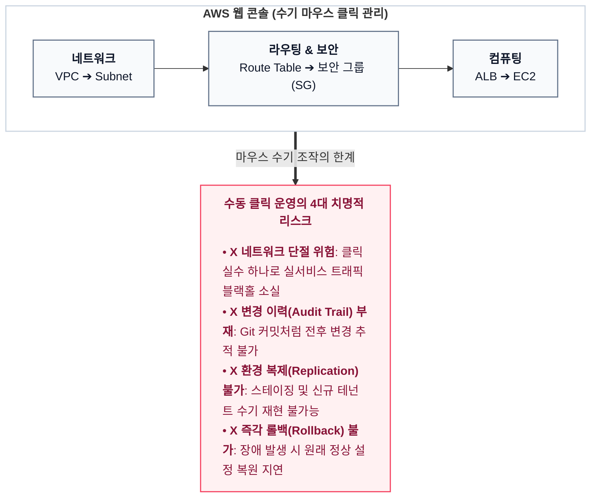
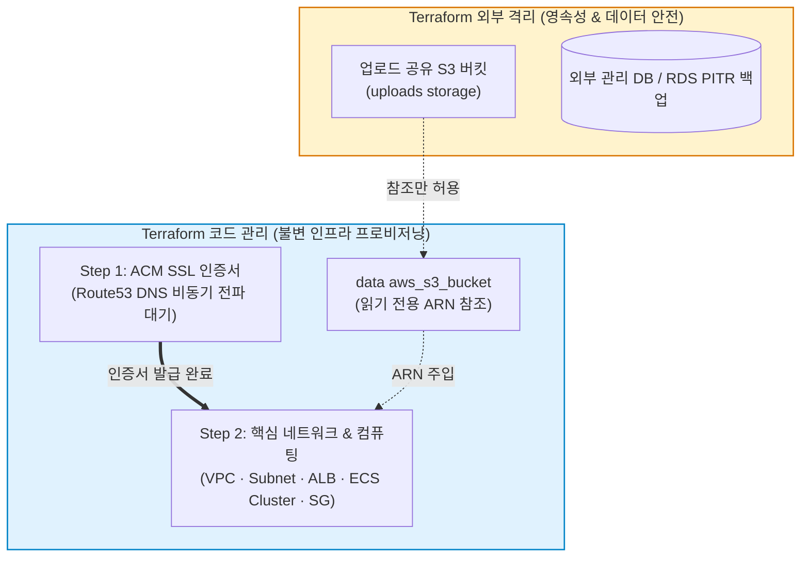
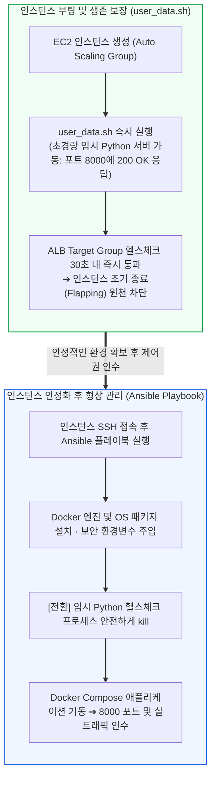
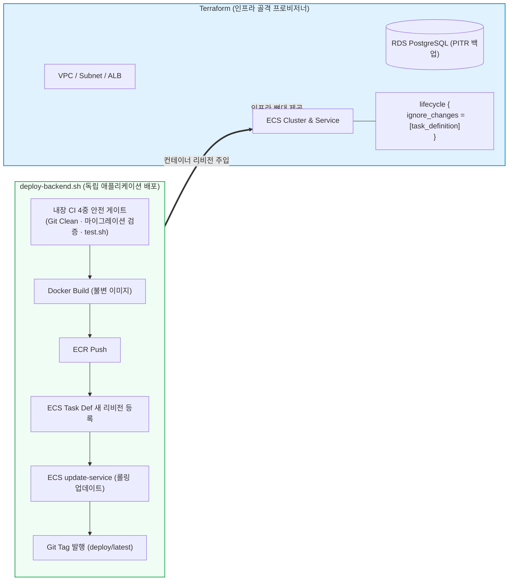
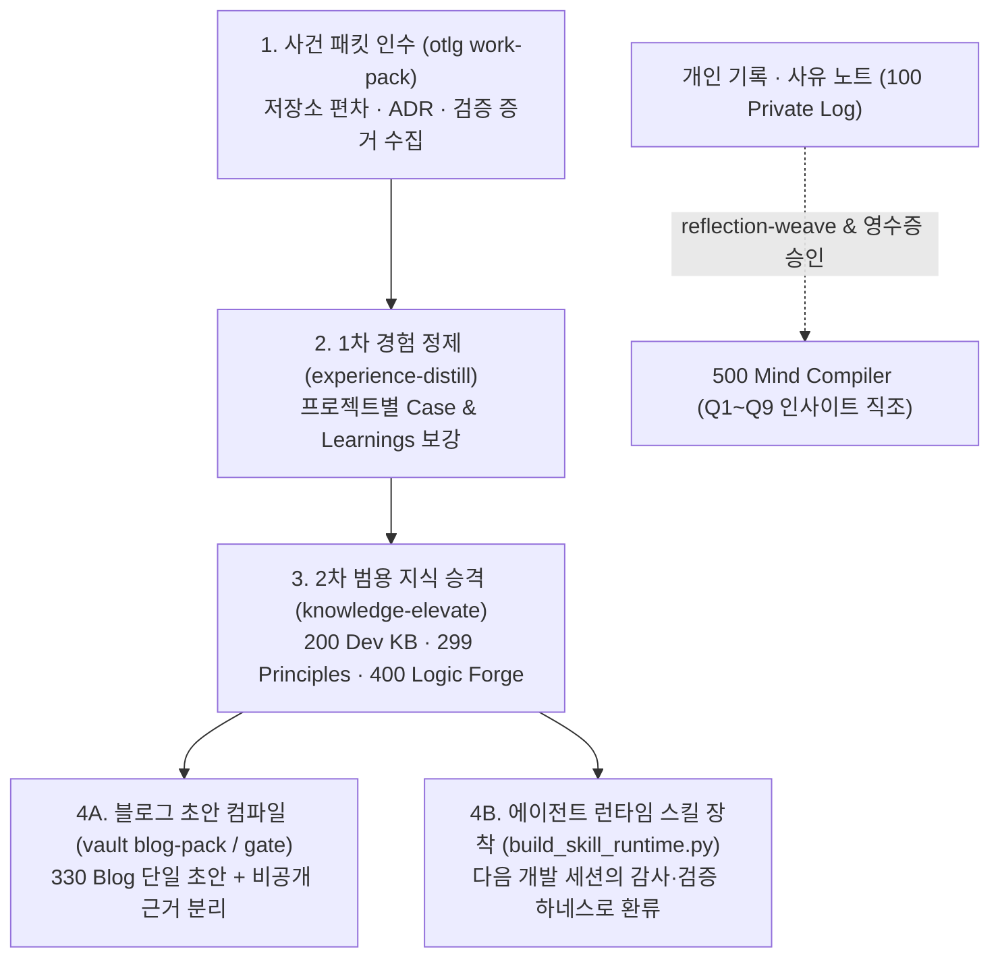
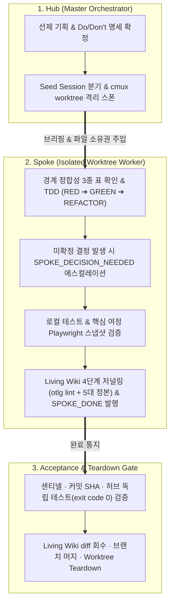

- table of contents
{:toc}

본 문서는 **1인 팀의 프로덕션 엔지니어링 운영체계** 시리즈의 후반부([[8편]](/tag-ai-agent-architecture/8-cloud-infra-evolution/) ~ [[11편]](/tag-ai-agent-architecture/11-external-workflow-and-ai-os/)) 본문에서 호흡 조절을 위해 분리한 **상세 인프라 코드, 프론트엔드 `FSD` 슬라이스 스캐폴딩 규격, `Obsidian Vault` 9대 공간 및 신진대사 프로토콜, 그리고 외부 에이전트 워크플로우 비교 매트릭스**를 수록한 기술 레퍼런스다.

---

## Ansible Playbook·Docker 무중단 배포와 DB 백업·보안 자동화 {#ansible-docker-infra}

[[8편] 어차피 도커인데 앤서블은 왜 썼을까](/tag-ai-agent-architecture/8-cloud-infra-evolution/)에서 다룬 클라우드 인프라의 진화는 수동 웹 콘솔 조작의 리스크를 걷어내고, 선언적 인프라(`Terraform`)와 불변 아티팩트(`Docker` + `ECR` + `ECS`) 및 내장 CI 게이트(`deploy-backend.sh`)로 수렴해 간 과정이다. 이 섹션에서는 각 단계에서 작성했던 실제 설정 코드와 아키텍처 다이어그램 전문을 정리한다.

### 수동 콘솔 운영의 리스크와 Terraform 생명주기 분리

초기 웹 콘솔 마우스 클릭 운영이 안고 있던 4대 구조적 리스크와, 이를 해결하기 위해 도입한 `Terraform`의 영속 데이터 격리(`uploads` `S3` 버킷 및 외부 관리형 DB 분리) 및 `ACM` 인증서 2-Step 프로비저닝 구조는 다음과 같다.





### EC2 부트스트랩 Flapping 방지용 임시 헬스체크와 Ansible 인수 구조

과도기 시절 `EC2` 오토스케일링 그룹(`ASG`)에서 `user_data.sh` 실행 시간이 길어져 `ALB` 헬스체크 타임아웃으로 서버가 무한 재시작되던 Flapping 참사를 막기 위해, 부팅 직후 8000번 포트를 즉시 점유해 `200 OK`를 반환하던 임시 `Python` 서버 스크립트와 `Ansible` 플레이북의 2단계 제어권 인수 구조는 다음과 같았다.

```bash
# user_data.sh 내부: ALB 헬스체크를 30초 내 통과시켜 인스턴스를 안정화하는 임시 프로세스
python3 -c "
import http.server, socketserver
class H(http.server.SimpleHTTPRequestHandler):
    def do_GET(self):
        self.send_response(200)
        self.end_headers()
        self.wfile.write(b'warming up')
socketserver.TCPServer(('', 8000), H).serve_forever()
" &
```



### Terraform과 배포 스크립트(`deploy-backend.sh`)의 관할권 경계 및 내장 CI 게이트

이후 호스트 OS 관리의 오버헤드를 완전히 덜어내기 위해 `Ansible`을 폐기하고 `AWS ECR` + `ECS` 불변 컨테이너 파이프라인으로 전환하면서, 인프라 골격(`Terraform`)과 애플리케이션 리비전(`deploy-backend.sh`)의 소유권 충돌을 방지한 `ecs.tf` 설정 코드 및 배포 파이프라인 구조다.

```hcl
resource "aws_ecs_service" "app" {
  name            = "production-backend"
  cluster         = aws_ecs_cluster.main.id
  task_definition = aws_ecs_task_definition.app.arn
  desired_count   = 2

  deployment_circuit_breaker {
    enable   = true
    rollback = true
  }

  lifecycle {
    ignore_changes = [
      task_definition, # 애플리케이션 배포 파이프라인(deploy-backend.sh)이 전담 소유
      desired_count    # 오토스케일링 정책이 동적으로 소유
    ]
  }
}
```



`deploy-backend.sh` 내부에 구현된 4단계 프로덕션 방어 게이트의 세부 사양은 다음과 같다.

| 검증 단계 | 실행 명령 및 메커니즘 | 차단하는 장애 유형 |
|---|---|---|
| **Git 워킹 트리 청결 강제** | `git status --porcelain` 비어 있음 확인 | 미커밋 코드나 로컬 `.venv` 가상환경이 도커 빌드 컨텍스트에 유입되어 이미지 용량이 수 GB로 폭증하는 사고(ADR-0012) 차단 |
| **DB 마이그레이션 안전성 및 백업 확인** | `check_migration_safety.sh` 정적 분석 + 일회성 `ECS Fargate` 선행 태스크 | `Alembic` 다중 head 분기 및 `op.drop_table()` 등 파괴적 DDL 차단, `RDS` 자동 백업(PITR) 기반 위에서 컨테이너 교체 전 스키마 정합성 확보 |
| **TDD 회귀 테스트 전수 통과** | 로컬 연산 자원 기반 `test.sh` 실행 (`set -e`) | 단위·통합 테스트가 단 1건이라도 실패할 경우 도커 이미지 빌드 자체를 즉시 중단 |
| **결정론적 추적 태그 및 자동 롤백** | `deploy/{timestamp}`, `deploy/latest` 태그 푸시 + `ECS circuit_breaker` | 현재 구동 중인 컨테이너의 정확한 커밋 역추적 보장 및 새 리비전 헬스체크 실패 시 직전 정상 리비전으로 자동 롤백 |

- [8편 본문으로 돌아가기](/tag-ai-agent-architecture/8-cloud-infra-evolution/)

---

## 프론트엔드 FSD 레이어·슬라이스 격리와 /fsd-slice 스캐폴딩 규격 {#frontend-fsd-slices}

[[9편] 어차피 프론트엔드인데 아키텍처가 왜 필요해?](/tag-ai-agent-architecture/9-frontend-fsd/)에서 다룬 13만 줄(`132,454 LOC`, `635개 파일`) 레거시 프론트엔드 리팩터링은 도메인 간 교차 참조 위반 `104건`을 `Feature-Sliced Design(FSD)` 6계층 구조와 `Public API` 방화벽으로 해결한 과정이다. 이 섹션에서는 에이전트가 준수하는 `/fsd-slice` 스캐폴딩 규칙과 `Public API` 캡슐화 코드 규격을 상세히 정리한다.

### `/fsd-slice` 스캐폴딩과 레이어별 세그먼트 책임

에이전트가 새로운 도메인이나 기능을 추가할 때 수작업으로 임의의 폴더를 만들지 못하도록, 반드시 스캐폴더 명령(`npm run new:slice`)을 통해 정석 세그먼트 구조와 `index.ts` 공개 API를 생성하도록 강제한다.

```bash
# FSD 슬라이스 정형 스캐폴딩 명령
npm run new:slice -- <entity|feature|widget|page> <kebab-name>
```

- **`entity` 슬라이스 명명**: 도메인 명사 단수형 사용 (예: `teacher`, `class`, `paper`, `student`)
- **`feature` 슬라이스 명명**: `동사+명사` 1행위 단위 사용 (예: `teacher-create`, `class-edit`, `auth-login`, `exam-grading`)
- **`widget` / `page` 슬라이스 명명**: 화면 및 독립 UI 블록 명사 사용

| FSD 레이어 | 필수 세그먼트 폴더 | 수록 대상 및 아키텍처 제약 |
|---|---|---|
| **`pages`** | `ui/` | 라우트 진입 화면. 하위 `widgets`, `features`, `entities`의 **조립(Composition)만** 수행하며 직접적인 비즈니스 로직이나 API 호출 작성 금지 |
| **`widgets`** | `ui/` (필요 시 `model/`) | 헤더, 사이드바, 대시보드 패널 등 독립적인 대형 복합 UI 블록. 여러 `features`와 `entities`를 조합 |
| **`features`** | `ui/`, `model/` | 사용자의 인터랙션과 비즈니스 가치를 만드는 액션 컴포넌트 및 `mutation` 훅. 성공 시 하위 대상 `entity`의 쿼리 캐시를 무효화 |
| **`entities`** | `model/`, `api/`, `ui/` | 백엔드 응답과 1:1 대응하는 핵심 도메인 데이터 타입, `react-query` 조회 훅(`use<Name>Query`), 쿼리 키(`<name>Keys`), 도메인 기본 표시 카드 |
| **`shared`** | `ui/`, `lib/`, `api/`, `config/` | 특정 비즈니스 도메인에 종속되지 않는 디자인 시스템 원자 컴포넌트, HTTP 클라이언트, 날짜·문자열 포맷 유틸리티 |

### Public API (`index.ts`) 캡슐화 코드와 Steiger 3중 검증 게이트

각 슬라이스 내부의 세그먼트(`ui/`, `model/`, `api/`, `lib/`)는 외부에서 직접 접근할 수 없는 사적 영역이며, 오직 슬라이스 루트의 `index.ts`에 명시된 **`named export`**만 외부 레이어에 노출된다(`default export` 금지).

```typescript
// src/entities/student/index.ts (유일한 공개 정문: Public API)
export { StudentCard } from './ui/StudentCard';
export { useStudentQuery, studentKeys } from './api/useStudentQuery';
export type { Student, StudentFilterParams } from './model/types';

// 주의: 내부에서만 쓰이는 서브 컴포넌트나 헬퍼 함수는 절대로 export하지 않는다!
// X ui/sub/InternalAvatarBadge.tsx
// X model/internalFormatters.ts
```

```typescript
// [올바른 참조] 상위 feature 슬라이스에서 하위 entity의 Public API 정문으로만 import
import { StudentCard, useStudentQuery, type Student } from '@entities/student';

// [차단되는 참조 1] 슬라이스 내부 세그먼트 경로 직접 침투 (Steiger 및 ESLint boundaries 에러)
import { InternalAvatarBadge } from '@entities/student/ui/sub/InternalAvatarBadge';

// [차단되는 참조 2] 동일 계층(feature <-> feature) 간 수평 참조 (아키텍처 린터 하드 에러)
import { EnrollCourseButton } from '@features/enroll-course';
```

에이전트는 슬라이스 구현을 마친 뒤 반드시 아래 3중 검증 게이트를 통과해야만 작업을 완료할 수 있으며, 위반 발생 시 린트 규칙을 우회(`eslint-disable`)하는 대신 컴포넌트의 소속 레이어를 재설계해야 한다.

```bash
npm run lint:fsd    # Steiger 기반 FSD 계층 단방향 규칙 및 Public API 경계 검증 (위반 0 필수)
npm run typecheck   # TypeScript 컴파일러 타입 경계 검증
npm run test:run    # 슬라이스 내부에 콜로케이션(Foo.tsx -> Foo.test.tsx)된 단위·통합 테스트 실행
```

- [9편 본문으로 돌아가기](/tag-ai-agent-architecture/9-frontend-fsd/)

---

## Vault 폴더의 역할 분리(000~900)와 3대 지식 신진대사 프로토콜 {#vault-os-architecture}

[[10편] 기록의 악마는 고립된 노트의 꿈을 꾸지 않는다](/tag-ai-agent-architecture/10-knowledge-ontology/)에서 다룬 `Obsidian Vault` 지식 온톨로지는 4,400여 개 문서와 2만 4천여 개 위키링크가 뒤엉키는 엔트로피를 폴더별 역할 분리와 2계층 의미 관계망, 그리고 사건 기반 신진대사 루프로 통제한 시스템이다.

### PARA를 넘어선 최상위 폴더 역할 분리(`000`~`900`)와 시간축 분리

실행 가능성이라는 주관적 기준에 의존하다가 `Area`와 `Resource`의 모호함으로 6개월 만에 무너졌던 `PARA` 체계를 대체하기 위해, 도서관 십진분류법(`Johnny Decimal`)과 객체지향의 단일 책임 원칙(SRP)을 결합해 지식의 라이프사이클에 따른 공간 경계를 확립했다. 특히 과거 2,245개에 달하던 TRPG 룰북·시나리오 파일이 개발 지식 검색을 오염시키던 문제를 해결하기 위해 `800`번대 취미 서고를 별도 볼트로 완전히 분리(엑소더스)하고, 인간의 주관적 감정(`100 Private Log`)과 객관적 개발 작업 사실(`301 Day Notes`)을 물리적으로 격리했다.

| 공간 번호 및 명칭 | 핵심 역할 (Single Responsibility) | AI 에이전트 접근 및 생명주기 규칙 |
|---|---|---|
| **`000 Index`** | 온톨로지 스키마 정본, 태그 화이트리스트, 시스템 메타 관제탑 | 전역 스키마 계약 및 `vault CLI` 기준점 참조 |
| **`100 Private Log`** | 월간 일기(`102 Monthly Diary`) 및 내면 심리 디버거(`103 Debugger`) | `vault.mind_sources` 선택기로 `Harvest`(AI 요약)를 배제한 순수 개인 발화만 `Mind Compiler` 연결에 참조 (임의 요약·수정 절대 금지) |
| **`200 Dev Knowledge Base`** | 프로젝트 독립적인 보편 컴퓨터 공학 원리 및 `299 Principles`(48개 실천 철칙) | 에이전트의 설계·코드 감사(`principles-audit`) 기준 원천 |
| **`300 Runtime`** | 현재 진행 중인 프로젝트(`302`, `303`), `301 Day Notes` 작업대, `330 Blog` | 활성 작업 공간. 프로젝트 종료 시 핵심 교훈만 승격 후 즉시 퇴역 |
| **`400 Logic Forge`** | 아키텍처 의사결정(`Decision Node`)과 대안 비교(`Trade-offs`)의 1:1 대칭 쌍 | 과거 기각된 대안을 에이전트가 재도입하는 헛발질 차단 |
| **`500 Mind Compiler`** | 삶의 아홉 가지 화두(`Q1`~`Q9`, `Q3` 결번 보존) 질문(`_Question.md`)과 인사이트 | 응답 없이 AI가 임의로 결론을 확정하지 못함 (`.vault-mind/ledger.json` + `SHA-256` 영수증 `apply --receipt` 봉인) |
| **`600 Content Observatory`** | 외부 도서 아카이브(`ext:repo:books-notes:<path>#<heading>`) 앵커 참조 및 비판적 리뷰(`review`) | 도서 챕터 요약 본문은 외부 아카이브로 격리하고 볼트 내부 노트에서는 `ext:` URI로 연결 (`builds_on`에는 `ext:` 불허) |
| **`700 Life Stack`** | 세무, 건강, 생활 인프라 등 비개발 일상 데이터 격리 구역 | 개발 지식 검색(`200`~`400`)과 섞이지 않도록 분리 |
| **`900 Archive`** | 임무를 마친 프로젝트와 구버전 프로세스의 영구 보관소 (`status: archived`) | 활성 그래프 추론에서는 제외하되 파일 실존 및 `*_archived` 계보 추적은 유지 |

### 2계층 관계망(구조 1종·의미 7종) 시험 문장과 `vault CLI` 검증 스펙

문서 간 연결의 맥락을 기계와 인간 모두가 오해 없이 판독할 수 있도록 정의한 구조 관계(`builds_on`, 과거 대체 간선 `supersedes`는 `v0.4.0`에서 은퇴)의 3대 통과 테스트와 의미 관계 7종의 시험 문장(Test Sentence) 판정 기준은 다음과 같다.

- **`builds_on` 3대 통과 기준**:
  1. **막힘 테스트**: "B를 모르면 A를 아예 읽을 수 없는가?" (단순 참고 수준이면 본문 일반 위키링크로 처리)
  2. **비대칭 테스트**: "`B builds_on A`가 성립하지 않는가?" (양방향이 모두 성립하면 선후 관계가 아니라 대등 연관 개념)
  3. **직계 부모 및 내부 학습 불변식**: A가 B를 필요로 하고 B가 C를 필요로 할 때 A에는 볼트 내부의 직계 부모인 B만 기입하며(최대 3개, 외부 `ext:` URI 불허), 조상 노드는 `SQLite` 재귀 `CTE` 이행 폐쇄(`vault q path`, 0.5ms)로 자동 추론한다.

| 의미 관계 | 시험 문장 (소리 내어 읽어 참일 때만 선언) | 인접 관계 타이브레이커 및 실전 용례 |
|---|---|---|
| **`derived_from`** | **"A는 B에서 나왔다"** | B가 없었으면 A가 탄생할 수 없었던 직접 출처 (실전 장애 `case`, 외부 도서 `ext:`, 미문서화 경험 `experience` 센티넬) |
| **`informed_by`** | **"A는 B의 영향을 받았다"** | 직접 근거는 아니나 사고의 틀에 영감을 준 자료 (`W3C PROV-O` `prov:wasInfluencedBy` 방향 준수) |
| **`contradicts`** | **"A와 B는 둘 다 참일 수 없다"** | 한 시스템 안에서 동시에 양립할 수 없는 배타적 설계 충돌 |
| **`diverges_from`** | **"A는 B를 바탕으로 삼되 일부를 바꿨다"** | 표준 패턴이나 오픈소스를 우리 환경의 제약에 맞게 변형한 결정 |
| **`applies`** | **"A는 B라는 원칙을 적용했다"** | 구체적 설계나 구현이 `299 Principles`의 원칙을 채택한 관계 |
| **`expresses`** | **"A는 B라는 가치를 구현한다"** | 구체적 도구·규칙이 추상적 엔지니어링 철학을 대변할 때 |
| **`answered_by`** | **"A라는 질문이 B에서 답을 얻는다"** | 질문 노트에 대한 답변 연결 (질문의 영구 종결 선언이 아님) |

### 사건 기반(Event-driven) 3대 지식 신진대사 루프 프로토콜

달력 주기(일·주·월)에 맞춰 기계적으로 실행하던 요식행위를 폐기하고, 저장소 사건 패킷(`repo-work-pack/1`) 인수와 기록 생성에 반응하도록 재편한 3대 정제 스킬, 블로그 초안 파이프라인(`vault blog-pack/draft/gate`), 글로벌 스킬 컴파일의 상세 프로토콜이다.

1. **1차 인수 및 정제 (`vault work-intake` & `experience-distill`)**
   - 코드 저장소에서 추출한 사건 패킷(`otlg work-pack`, 5분류 편차 및 ADR 5축 상태 분리)을 `.vault-work/evidence`에 보존하고, 새 문서를 무분별하게 늘리는 대신 프로젝트별 기존 `Case`와 `Learnings` 문서를 우선 보강한다.
2. **2차 범용 지식 승격 및 산출물 컴파일 (`knowledge-elevate` · `blog-draft` · `build_skill_runtime.py`)**
   - 여러 프로젝트에서 반복 검증된 교훈을 보편 기술 개념(`200 Dev KB`), 타협 불가 실천 규율(`299 Principles`), 대안 비교 의사결정(`400 Logic Forge`)으로 승격한다.
   - 승격된 정본 지식은 두 갈래로 컴파일된다. 첫째, `vault blog-pack` 5채널 근거 패킷과 `blog-gate`를 거쳐 비공개 근거와 분리된 `330 Blog` 단일 초안이 된다. 둘째, `build_skill_runtime.py`를 통해 글로벌 에이전트 런타임 스킬(`principles-audit` 등)로 빌드되어 다음 코딩 세션의 하네스에 즉시 장착된다.
3. **내면 성찰 직조 (`reflection-weave` & `Mind Compiler`)**
   - `100 Private Log`의 순수 개인 발화(`vault.mind_sources`로 AI 요약본인 `Harvest` 배제)를 `vv weave`와 `vault mind scan`으로 탐색해 삶의 아홉 가지 화두(`500 Mind Compiler`, `Q1`~`Q9`)와 연결 후보를 제안하고, 토마토의 직접 응답과 `SHA-256` 영수증(`vault mind apply --receipt`) 대조를 거쳐 인사이트를 갱신한다.



- [10편 본문으로 돌아가기](/tag-ai-agent-architecture/10-knowledge-ontology/)

---

## 외부 에이전트 워크플로우(Ralph·gstack·oh-my-openagent) 심층 비교 매트릭스 {#external-workflow-comparison}

[[11편] 우리는 이미 각자의 운영체제를 짜고 있었다](/tag-ai-agent-architecture/11-external-workflow-and-ai-os/)에서 살펴본 것처럼, AI 에이전트를 실무 프로덕션에 투입하는 엔지니어들은 각자의 현장에서 부딪히며 놀라울 만큼 유사한 운영체제(OS) 구조로 수렴하고 있다. 이 섹션에서는 대표적인 외부 에이전트 하네스 패러다임들과 우주초월님의 실전 워크플로우, 그리고 토마토의 `AI Agent OS`(`Hive Mind` + `cmux` + `otlg` + `Living Wiki`)를 아키텍처 차원에서 정밀하게 대조한다.

### 외부 에이전트 하네스 생태계의 주요 접근법 분석

1. **반복 루프 기반 자율 수렴형 (`Ralph` / Ralph Wiggum AI Loop)**:
   - **핵심 메커니즘**: `while :; do cat PROMPT.md | claude ; done` 또는 `/ralph-loop` 플러그인을 통해 에이전트가 완료 약속 문자열(`--completion-promise "COMPLETE"`)을 출력하거나 최대 반복 횟수(`--max-iterations`)에 도달할 때까지 동일한 목표 프롬프트를 끈질기게 재공급한다.
   - **강점과 한계**: 첫 시도의 완벽함보다 루프를 통한 자기 교정(`Iteration > Perfection`)에 집중하며 야간 배치나 프로토타이핑에서 높은 돌파력을 보여준다. 다만 단일 작업 공간에서 무제한 루프를 돌릴 경우 컨텍스트 오염이나 스코프 팽창이 발생하기 쉬워, 실패 지점마다 명시적인 가드레일(표지판)과 물리적 격리 장치가 뒷받침되어야 한다.
2. **역할 페르소나 및 멀티 에이전트 라우팅형 (`gstack`, `oh-my-openagent` 등 오픈소스 하네스)**:
   - **핵심 메커니즘**: 단일 에이전트에게 모든 작업을 맡기는 대신 기획자(CEO/PM), 아키텍트, 구현자, 리뷰어, QA 엔지니어 등 전문화된 역할 스킬(Role Skills)이나 병렬 서브에이전트 구성을 제공하여 단계별 프롬프트 전환과 도구 호출을 체계화한다.
   - **강점과 한계**: 프롬프트 엔지니어링의 진입 장벽을 낮추고 역할별 관점 분리(Perspective Separation)를 손쉽게 도입할 수 있다. 그러나 프롬프트 레벨의 역할 부여만으로는 에이전트가 공유 브랜치에서 남의 파일을 덮어쓰거나 테스트 통과를 거짓 보고하는 물리적 일탈을 완벽히 막기 어렵다.
3. **마스터 오케스트레이션 및 이종 검수·캐시 최적화형 (우주초월 실전 워크플로우)**:
   - **핵심 메커니즘**: 인간은 마스터 AI와만 소통하고, 마스터가 선제 기획(`Do & Don't` 명세표) ➔ 개발(`Codex` 구현 + `Claude` 읽기 전용 교차 검수) ➔ `Playwright` 캡처 증거 기반 QA ➔ 나무위키 스타일 위키 문서화까지 전 과정을 지휘하며 `Seed AI(Forked Session)`로 컨텍스트 캐시 히트율(75~90%)을 극대화한다.

### 외부 에이전트 하네스 vs 토마토 AI Agent OS 아키텍처 대조 매트릭스

| 비교 차원 | 단순 반복 루프 (`Ralph` 방식) | 역할·스킬 분담 하네스 (`gstack` · `oh-my-openagent`) | 우주초월 실전 워크플로우 | 토마토 AI Agent OS (`Hive Mind` + `cmux` + `otlg`) |
|---|---|---|---|---|
| **오케스트레이션 및 격리 단위** | 단일 세션 반복 루프 (`--max-iterations` 제어, 수동 worktree 병행) | 역할별 프롬프트/서브에이전트 전환 (주로 단일 작업 트리 공유) | 마스터 AI 총괄 + 그래프 분할 병렬 실행 | **허브(Master) + `cmux` 1:1:1:1 `git worktree` 물리 격리 + `spoke-guard` 훅** |
| **기획 및 스코프 통제** | 프롬프트 내 완료 조건(`Success criteria`) 및 실패 표지판 튜닝 | 기획/설계 전용 역할 스킬을 통한 사전 계획 문서 생성 | 마스터 선제 기획 및 닫힌 형태의 **`Do & Don't` 명세표** 하달 | **선제 `Do & Don't` 명세 + 3종 경계 정합성 표 + `SPOKE_DECISION_NEEDED` 에스컬레이션** |
| **도메인 지식 주입 및 캐싱** | 매 루프마다 `PROMPT.md` 및 파일 재탐색 | 글로벌/로컬 스킬 및 규칙 문서(`AGENTS.md`) 로드 | **공통 `Seed AI` 세션 Fork**를 통한 프롬프트 캐시 적중률(75~90%) 확보 | **`.ontology/`(`otlg v0.5.0`) 3-Graph·양방향 `brief` 0.01초 조회 + `vault CLI`(`v0.6.0`) 그래프 질의 + Seed 캐싱** |
| **구현 및 교차 검수 규율** | 테스트 통과 시까지 루프 내 자율 디버깅 | 구현 에이전트와 리뷰 에이전트 페르소나 분리 | **`Codex`(구현) + `Claude`(읽기 전용 검수)** 이종 모델 무한 승인 루프 | **Kent Beck `TDD` + 객체 디자인 46규칙 + 독립 Critic 에이전트 교차 검수** |
| **완료 판정 및 QA 증거** | `<promise>COMPLETE</promise>` 문자열 출력 매칭 | 린트/테스트 명령 실행 및 리뷰 스킬 승인 | TODO 완료 근거 기입 강제 + **`Playwright` 브라우저 조작 화면 캡처 증거** | **센티넬(`SPOKE_DONE`) + 허브 독립 테스트(`exit code 0` + `@pytest.mark.otlg_contract` 영수증) + 핵심 여정 `Playwright` 스냅샷** |
| **지식 영속화 및 거버넌스** | 별도 위키 계층 없음 (코드 및 README 중심) | 세션 로그 또는 작업 요약 마크다운 산출 | 개발 완료 직후 나무위키 스타일 마크다운 인덱스 위키 자동 갱신 | **`Living Wiki Engine` (`otlg lint --strict` + 5대 정본 `.ontology/`·`arc42 §11`·`ADR`·`deferred-watchlist`·`WORKLOG` 원자적 저널링)** |

### 차세대 AI Agent OS 엔드투엔드 파이프라인 아키텍처

외부 워크플로우의 4대 강점(선제 `Do & Don't` 명세, `Seed Session` 캐싱, `Playwright` 스냅샷 검수, 위키 생명주기 편입)을 토마토의 `TDD`·`spoke-guard` 하드 바운더리 및 `Repo Ontology(otlg)`와 결합한 전체 실행 파이프라인은 다음과 같다.



특히 스포크가 구현 도중 명세에 없는 권한 정책이나 스키마 변경을 마주했을 때 임의로 추측(Guessing)해 코드를 짜는 대신 `SPOKE_DECISION_NEEDED` 신호를 올려 일시 정지하고 허브의 결정을 기다리는 에스컬레이션 프로토콜과, 퇴장 직전 `otlg lint --strict`로 코드와 도메인 온톨로지 명세의 정합성을 검증하는 저널링 관문이 결합되면서 에이전트의 속도와 엔지니어링의 엄밀함이 비로소 하나의 운영체제 안에서 양립할 수 있게 되었다.

- [11편 본문으로 돌아가기](/tag-ai-agent-architecture/11-external-workflow-and-ai-os/)
