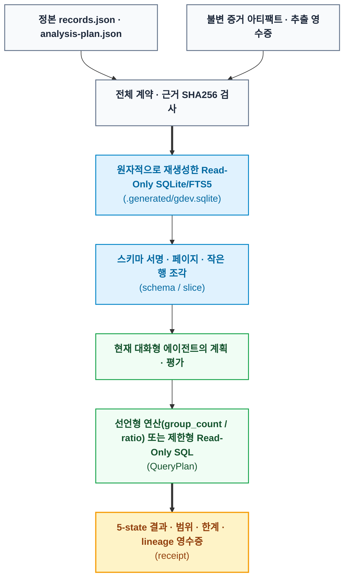
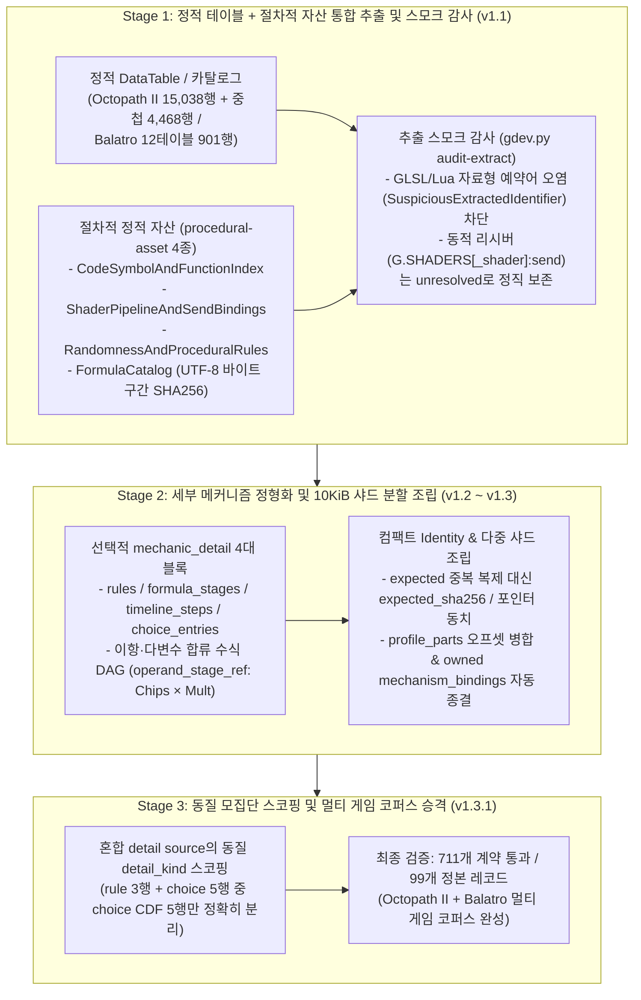

- table of contents
{:toc}

> 이 문서는 온톨로지 엔지니어링 시리즈 **[8편](/tag-ontology-engineering/8-game-dev-evidence-ontology/)**과 **[10편](/tag-ontology-engineering/10-code-on-graph-and-epilogue/)** 본문에서 다룬 `game-dev-ontology`(`v0.1.0` ~ `v1.3.1`)의 11종 레코드·4대 프로파일·16개 패싯 명세, 『Octopath Traveler II』 2차 실게임 코퍼스 불일치 대조표와 15,038행 전수 추출(`ItemDB` 953행 18개 기약분수 환급률 계층), Read-Only SQLite/FTS5 기반 `Code-on-Graph` 가드레일과 정적 Shard-Merge, 그리고 『Balatro』 절차적 Lua·GLSL 자산 감사와 이항·다변수 수식 DAG 레퍼런스를 수록한 심화 문서입니다.

---

## 11종 레코드·4대 프로파일과 ItemDB 953행 18개 기약분수 계층의 실증 {#itemdb-refund-ratios}

### 엔진 중립 11종 레코드 계약과 4대 게임 요소 프로파일 (`record v0.6.0`)

`game-dev-ontology`는 스키마·검증기·작성 계약·CoG CLI 도구층을 관리하고, 실제 여러 상용 게임의 역공학 코퍼스는 인접 데이터 저장소인 `game-dev-knowledge`에 분리 보관한다. 지식의 수명주기와 인식론적 확신 수준(`epistemic`: `observed` / `derived` / `inferred` / `hypothesis`)을 통제하는 11종 레코드의 역할과 참조 계약은 다음과 같다.

| `kind` | 식별 대상 | 참조·카디널리티 및 핵심 불변식 계약 |
|:---|:---|:---|
| **`game`** | 게임 작품 | `build`가 `game` 1개를 참조. 여러 빌드를 별개 작품으로 세지 않음 |
| **`build`** | 플랫폼·버전·아티팩트가 고정된 분석 대상 | `game` 1, 기준 `artifact_sha256` 및 하위 실행파일·아카이브 목록 `secondary_artifacts[]` (`relative_path`, `role`, `sha256`) |
| **`evidence`** | 불변 원본 파일에 대한 근거 목록 | `build` 0..1, `method=rea`는 canonical bundle과 단일 CLI 봉투(`ok=true`) 모두 지원. 하위 실행파일 근거는 `subject_artifact_path`로 대조 |
| **`finding`** | 단일 빌드에 관한 원자적 주장 | `build` 1, 동일 빌드의 `supports`/`contradicts` (`evidence_ref` + `rea_record_id` + `locator`), 수치·필드 대조용 `source_checks[]` |
| **`pattern`** | 매개변수와 적용 조건으로 추상화한 설계 메커니즘 | 비가설·검토된 `finding` 1..N, `semantic_facets`(5축: `intention`/`mechanism`/`resource`/`feedback`/`constraint`), 패턴 간 `relations`(`requires`/`complements`/`conflicts`/`alternative`) |
| **`module`** | 직접 구현할 재사용 단위의 계약 (`implementation=original`) | `pattern` 1..N, 입출력 포트 의미 메타데이터, 선택적 `contract.context`(CVT), `prototype` 이상은 코드 `bindings` 필수 |
| **`experiment`** | 기술 확인·시뮬레이션·플레이테스트 계획/결과 | `target` 1..N, `evidence` 0..N (`experiment_type=playtest` 포함). `passed` 실험 영수증이 있어야만 패턴·모듈의 `validated` 승격 허용 |
| **`stack-practice`** | 특정 엔진·스택에서 권장하는 공식 방법 | `official_doc` 근거 1..N, `compatibility` 1..N, 점검일·재검토일 필수 |
| **`analysis-job`** | 세션별 조사 범위·예산·중단 영수증 | `build` 1, `output` 0..N, `budget` 1, `stop_reason` / `resume_cursor` |
| **`project`** | 자신이 제작할 게임의 제약과 성공 기준 | `adoption`이 `project` 1개를 참조 (제작 시작 시 작성) |
| **`adoption`** | 제작 프로젝트에서 지식을 채택한 결정 | `project` 1, 선택한 패턴·모듈 1..N, `experiment` 0..N, 위험 완화 대책(`risk_responses`) |

각 `finding`은 확인된 사실만 선택적으로 담는 4대 게임 요소 프로파일(`balance`, `level`, `sprite`, `feel`)을 가질 수 있으며, 모르는 수치를 `0`이나 가짜 기본값으로 채우지 않는다.

| 프로파일 | 주요 구조화 필드 | 작성 및 검증 원칙 |
|:---|:---|:---|
| **`balance`** | `formula_expr`, `variables`(`source_slots` 포함), `curve_type`, `caps`, `economy_flow`, `metrics`, `invariants` | 입출력 단위, 적용 순서, 표본·난수·난이도·장비 조건 고정. 원시 슬롯(`Min`/`Max`/`Init`/`Param`)은 소비 코드 확인 전까지 `source_slots`에 보관하고 `value`는 `null`로 유지 |
| **`level`** | `spatial_representation`, `coordinate_system`, `zones`, `connections`, `triggers`, `pacing`, `camera_presets` | 월드 거리와 시간 분리, 면적 0인 구역 거부. `camera_presets`는 회전 순서 미확인 시 `unexamined`로 기록하고 초점거리를 레벨 경계로 합산하지 않음 |
| **`sprite`** | `atlas`, `rect`, `pixels_per_unit`, `world_unit_name`, `pivot_normalized`, `raw_pivot`, `sorting`, `billboard_mode`, `frame_boxes`, `animation`, `placement` | `raw_pivot={space,value}`로 원본 픽셀/로컬 값을 보존하고 정규화 피벗과 산술 정합성을 대조. 그림 크기와 히트박스를 혼동하지 않음 |
| **`feel`** | `scope`, `trigger_event`, `reference_event`, `reference_clock`, `reference_hz`, `uncertainty_ms`, `input_response`, `time_modulation`, `channels` | 사건 1개당 1개 프로파일. 관측 시계(`reference_clock`)와 내부 갱신 시계(`clock_domain`), 코드 설정(`configured`)과 런타임 실측(`captured`) 분리 |

특히 손맛과 타격감을 구조화하는 `feel` 프로파일의 5대 핵심 축과 해석 경계는 다음과 같다.

| `feel` 프로파일 핵심 축 | 기록하는 구조적 내용 | 정적·런타임 해석 시 지키는 엄격한 경계 |
|:---|:---|:---|
| **`trigger_event` & `reference_clock`** | 발화 사건, 시간 기준점, 샘플링 속도(`reference_hz`), 측정 오차(`uncertainty_ms`) | 영상 `FPS`와 엔진 `simulation tick`을 같다고 가정하지 않으며, 관측 시계가 `unknown`이면 임의의 숫자(`ms`)를 적지 않고 `null`로 둔다 |
| **`input_response`** | 입력 버퍼, 코너 보정, 코요테 타임 유예, 반응 곡선과 근거 종류 | 모르는 수치를 `0`으로 채우지 않는다 (`0`은 실제로 지연이나 유예가 '즉시/없음'으로 확인된 값일 때만 사용한다) |
| **`time_modulation`** | 히트스톱·슬로모션 시 변조되는 시계와 복구 방식(`unscaled_timer`, `same_clock_timer` 등) | 히트스톱이라는 이름만으로 모든 시스템이 멈춘다고 단정하지 않고 `simulation`, `animation`, `audio`, `UI` 중 어떤 시계가 멈추는지 구분한다 |
| **`channels` & `mechanical_coupling`** | 시각·청각·햅틱 트랙별 오프셋과 역할(`confirmation`, `gameplay_telegraph` 등), 판정 결합 여부 | 렌더 스케일이나 카메라가 흔들렸다고 해서 히트박스나 조준 판정까지 변하는지(`affects_collision_or_state`) 아니면 순수 감각(`sensory_only`)인지 분리한다 |
| **`accessibility` & `fallback_status`** | 화면 흔들림·점멸 등을 껐을 때 전조 단서(`telegraph`)의 대체 전달 수단 유무 (`available`, `known_missing`) | 소스 상수만으로 '플레이어가 쾌감을 느낀다'거나 '제작자가 의도했다'(`claim_scope: design`)를 `observed`로 적는 것을 금지하고 `inferred`/`hypothesis`로 격리한다 |

전체 조사(`full`)는 MDA(Mechanics·Dynamics·Aesthetics)와 Game Feel 분해 기준을 결합한 **16개 표준 패싯(`goals_loops`, `rules_state`, `input_control`, `combat_ai`, `balance_economy`, `progression_content`, `space_level`, `presentation_assets`, `feedback_juice`, `audio_haptics`, `ui_onboarding_accessibility`, `narrative_world`, `social_multiplayer`, `systems_pipeline`, `platform_business`, `pacing_experience`)**과 각 발견 시스템의 **7개 분석 축(`constitution`, `behavior`, `numbers`, `presentation`, `relations`, `implementation`, `evidence`)**을 점검하도록 강제한다.

### v0.4.0 2차 실게임 코퍼스 불일치 대조표와 110개 값 앵커 (`source_checks`)

『Octopath Traveler II』의 초기 309행 표본 아티팩트 5종과 2차 코퍼스 제출본의 주장을 바이트 단위로 독립 대조했을 때 적발된 AI 기억 오염 사례와 교정 조치는 다음과 같다.

| 분석 항목 | 2차 제출본에 적혀 있던 주장 (`observed` 등) | 보존된 원본 JSON 아티팩트 대조 결과 및 교정 조치 |
|:---|:---|:---|
| **`CharacterGrow` (성장 테이블)** | `Lv_1 NextExp=12`이며, 레벨 50과 레벨 99의 요구 경험치 수치가 확정 관찰됨 | 당시 원본 JSON에 저장된 샘플 키는 `1`, `2`뿐이며 `NextExp` 값도 `6`, `10`이었다. **보존된 파일에 아예 추출되지 않은 레벨 50·99 수치가 적혀 있던 것**으로, 즉시 미확인 값을 제거하고 실제 숫자 키 기반으로 추출기를 교정했다. |
| **`ItemDB` (아이템 판매 비율)** | 상점 아이템 판매 가격은 구매가의 **20%**로 확정됨 | 당시 보존된 네 샘플(`ITM_CSM_0010`~`0031`)의 구매가/판매가는 `50/5`, `260/26`, `720/72`, `1480/148`로 모두 **10%**였다. 외부 통념이 섞인 20% 서술을 폐기하고, 표본 4건 한정 계산값(`derived: 10%`)으로 엄격히 한정했다. |
| **`TownTable` & `FieldCommand`** | 마을 관계도 `Init/Max=5`, 필드 커맨드 카테고리는 `Information/Item/Battle/Follow` | 일반 마을 세 샘플의 실제 값은 `25/25/1500`이었고, 실제 `FieldCommandCategory` 열거형은 `eRight/eEvil/eNight`였다. 플레이어 친화적인 4대 기능군 재분류는 원본 관찰이 아니라 분석가의 추론(`inferred`)으로 분리했다. |
| **`LevelTable` & 해상도 스케일** | `EncountStepMin=120`, 핸드헬드 해상도 스케일 `100%` | 해당 레벨 샘플의 실제 값은 `0` 또는 `1000`이었고(`120`은 `EncountVolumeData`의 값), 해상도 스케일은 타이틀 화면만 `100%`일 뿐 실제 플레이 레벨 세 샘플은 `70%`였다. |
| **`PotentialityActionDB` (저력)** | `ActionPointInit=0`, `ActionPointMax=100`을 보편 규칙으로 설명 | 저장된 9개 행의 실제 `Init`은 `55~95`, `Max`는 `80~125`(`FENCER_DARK`는 `95/125`, `MERCHANT`는 `70/100`)에 분포하며 런타임 충전 규칙은 미확인이었다. |
| **미수록 심볼 및 소셜 기능 단정** | 보존 아티팩트에 없는 클래스·함수·이펙트 이름을 `observed`로 기재, `Steam API`가 업적 전용이므로 소셜 영역 전체를 `N/A`로 종결 | 원본 5종에 없는 심볼은 관찰 근거에서 제외했으며, DLL 임포트와 업적 테이블만으로는 타 플랫폼·비동기 기능의 부재를 증명할 수 없으므로 `N/A`를 철회하고 `unexamined` 질문으로 다시 열었다. |

이 문제를 뿌리 뽑기 위해 `record schema v0.4.0`에 도입한 두 가지 장치가 **`finding.source_checks`(110개 값 앵커)**와 **`extraction-receipt.schema.json`(추출 영수증)**이었다.

```bash
# 조사 계획 확인 및 스키마·feel·파일럿·조사 계획·원본 값 앵커(source_checks) 일괄 검증
uv run scripts/gdev.py analyze plan --build build:octopath2/win-steam
uv run scripts/gdev.py analyze resume --plan path/to/analysis-plan.json
uv run scripts/check_contract.py
uv run scripts/check_feel_contract.py
uv run scripts/check_analysis_contract.py
uv run scripts/check_source_contract.py
```

- **`source_checks` 리터럴 투영**: 수치·열거값 주장은 `supports`에 연결된 증거 파일 내부의 세부 JSON Pointer를 지정해 `identity`(리터럴 일치) 또는 `derived` 산술 연산(`ratio`, `sum`, `difference`, `product`) 결과와 `expected` 값을 기계적으로 대조한다. `observed` 문장은 확인된 `source_checks` 범위의 리터럴 투영으로만 한정된다.
- **추출 영수증과 정직한 미완결 선언**: 원본·스크립트 해시와 전체/파싱/저장/생략 행 수(`total`/`parsed`/`stored`/`omitted`), 미해석 필드(`undecoded_fields`), 배열 절단(`truncated_arrays`)을 영수증에 기록하며 과거 증거에 가짜 영수증을 소급 부착하지 않는다. 그 결과 `v0.4.0` 보정 직후 검증 스위트는 `207 passed`를 기록했고, 전체 조사 범위표는 완료(`documented`) 0건인 **`15 partial / 1 unexamined` (미해결 질문 큐 30건)**으로 정직하게 여며졌다.

### Pak 4.11GB 15,038행 전수 추출과 ItemDB 953행 18개 기약분수 환급률 분포 (v0.8 ~ v1.2)

이후 윈도우 분석 PC에서 실제 4.11GB 원본 `Octopath_Traveler2-WindowsNoEditor.pak`(`Pak v11`, 373,957개 파일)을 대상으로 `--all-rows` 전수 추출을 수행하여, 27개 핵심 `DataTable` 전수 스냅샷(`octopath2-pak-27tables-allrows-v080.json`, 34.4MB, **15,038 / 15,038행**)과 31개 핵심 테이블의 중첩 구조체 전수 해독 스냅샷(`octopath2-pak-v120-supplement.json`, **4,468 / 4,468행**, `undecoded_fields=0`, `truncated_arrays=0`, 중첩 UEXP 바이트 슬라이스 매니페스트 **707건**)을 반입했다.

전수 추출된 `ItemDB` 1,675행 중 비매품(`BuyPrice == 0`, 722행)을 제외한 유가 아이템 **953행 전체**에 대해 선언형 `QueryPlan`(`group_count` on `ratio(SellPrice, BuyPrice)`)을 실행한 결과, 표본 4행에서는 단일 `10%`(`1/10`)로 보였던 상점 환급률이 실제로는 아래 **18개 기약분수 계층**으로 분포함이 실증되었다.

| 분류 계층 | 기약분수 (`Sell / Buy`) | 백분율 (근사) | 해당 행 수 (`953행` 중) | 대표 아이템 사례 (`BuyPrice -> SellPrice`) |
|:---|:---|:---|:---|:---|
| **주요 4대 계층 (합계 `927행`)** | **`1 / 5`** | **`20.0%`** | **`533행`** | `ITM_FLV_0150` (`5 -> 1`) 외 무기·방어구·장신구 등 장비류 주류 계층 |
| | **`1 / 10`** | **`10.0%`** | **`267행`** | `ITM_CSM_0010` (`50 -> 5`), `ITM_CSM_0020` (`260 -> 26`) 등 일반 회복·소비 아이템 계층 (`v0.4` 표본 4행이 뽑혔던 구간) |
| | **`1 / 2`** | **`50.0%`** | **`95행`** | `ITM_FLV_0010` (`100 -> 50`) 등 환금성 귀중품 및 전리품 계층 |
| | **`1 / 20`** | **`5.0%`** | **`32행`** | 특수 제약 소비재 및 일부 퀘스트·지식 연관 물품 계층 |
| **특수 복수 계층 (`15행`)** | **`2 / 3`** | `66.67%` | `6행` | `ITM_EQP_AXE_990` (`150,000 -> 100,000`) 등 최상위 전설·특수 무기군 |
| | **`4 / 5`** | `80.0%` | `6행` | `ITM_FLV_0210` (`100 -> 80`) 등 고환율 교역품 |
| | **`1 / 1`** | `100.0%` | `3행` | `ITM_FLV_0390`, `ITM_FLV_0480` (`10,000 -> 10,000`), `ITM_FLV_0630` (원가 보전 귀중품) |
| **단건 예외 계층 (`11종 11행`)** | `3 / 5`, `52 / 157`, `1 / 3`, `13 / 40`, `26 / 145`, `1 / 6`, `1 / 7`, `43 / 1000`, `1 / 30`, `1 / 40`, `1 / 120` | `0.83%` ~ `60.0%` | 각 `1행` (총 `11행`) | `ITM_MEAT_1320` (`3/5`), `ITM_EQP_AMR_570` (`15,700 -> 5,200`, `52/157`), `ITM_FLV_0190` (`1/3`), `ITM_FLV_0450` (`13/40`), `ITM_EQP_AMR_540` (`29,000 -> 5,200`, `26/145`), `ITM_CSM_0101` (`15,000 -> 2,500`, `1/6`), `ITM_EQP_DGR_400` (`1/7`), `ITM_FLV_0500` (`43/1000`), `ITM_CSM_0281` (`1/30`), `ITM_FLV_0700` (`1/40`), `ITM_FLV_0690` (`12,000 -> 100`, `1/120`) |

아울러 전수 스냅샷과 `v1.2.0` 중첩 구조체 해독을 통해 다음 핵심 분포들이 함께 확정되었다.

- **마을 평판·보조 아이템(`TownTable` 31행)**: 더미(`eNONE`) 1행을 제외한 30개 마을 전수가 `ConnectionInit=25, ConnectionMax=25`를 가지며, 관계 회복 비용(`ConnectionPrice`)은 `1,500 리프`(12곳), `3,000 리프`(9곳), `6,000 리프`(9곳)의 3단계 지역 티어로 나뉜다. 중첩 `FcAssistItem` 8종은 확률형 정보 보너스 `+10.0`, 고용(`Hire`) 할인 `0.2`, 포획·강탈 해금 `0.0`을 부여한다.
- **보스 브레이크 슬로모션 억제(`EnemyDB` 1,689행)**: 일반 몬스터 1,678행은 `DisableBreakSlow = false`이나, 특정 보스 페이즈 단 **11행**(`ENE_BOS_APO_C01_010..020`, `ENE_BOS_APO_C02_010..040`, `ENE_BOS_MER_C05_010..040`, `ENE_BOS_SCH_C05_020`)에만 `DisableBreakSlow = true`가 설정되어 있다.
- **사운드·진동·플립북·카메라 전수 완결**: `SETable`(1,799행: `Battle` 872, `Event` 604, `Env` 156, `Map` 94, `System` 73), `CueSheetData`(129행), `SeVibrationTable` 및 `FfeVibrationData`(69행 1:1 매핑), `MissionCustomFlipbookDB`(363행 전수 `ChrMi_MJSprite` 머티리얼, `10fps` 243·`20fps` 117·`15fps` 3), `BattleCameraInitData`(3행 전수 FOV `31.89도`, 조리개 `f/0.4`), `SwitchLevelResolutionTable`(352행 6조합 해상도 정책)이 미해독 필드 0건으로 정적 종결(`documented`)되었다.

- [8편 본문으로 돌아가기](/tag-ontology-engineering/8-game-dev-evidence-ontology/)

---

## Agent-in-the-Loop CoG SQLite/FTS5 투영 엔진과 정적 Shard-Merge 워크플로우 {#shard-merge}

### 정본 JSON과 재생성 가능한 Read-Only SQLite/FTS5 분리 파이프라인

`game-dev-ontology`의 `Code-on-Graph`(`CoG`) 도구층은 별도의 LLM API 서버나 호스트 임의 Python `exec()`를 두지 않고, **현재 대화형 에이전트가 Planner·Generator·Evaluator를 맡고 `gdev.py` CLI가 결정론적 스키마 추상화(`schema`)·슬라이스(`slice`)·질의 실행(`QueryPlan`)·모듈 사전검사(`modules check`)·5-State 영수증(`receipt`)을 제공하는 Agent-in-the-Loop 아키텍처**로 작동한다.



`<root>/.generated/gdev.sqlite` 색인은 `records`, `build`/`plan`, 증거 `SHA256`, 어댑터 목록, 스키마·도구·SQLite 버전을 기록하며 입력이 하나라도 바뀌면 모든 조회를 `stale`로 거부한다.

### 보완 가드레일 4대 계약과 7대 합격 기준

부분 추출 데이터나 정적 테이블 위에서 에이전트가 성급한 일반화나 잘못된 단위 환산을 저지르지 못하도록 다음 4대 보완 가드레일을 강제한다.

1. **전수 분포 질문(`population`) vs 표본(`sample_only`) 구분 (`SampleOnlyPopulation`)**: 표본만 저장된 테이블(예: 초기 `EnemyDB` 3/1,689행)에 전수 분포나 집계를 물으면 결과가 `0`건이어도 `empty_valid`로 부재를 확정하지 않고 반드시 `status: incomplete`, `SampleOnlyPopulation` 진단, `partial_result`를 반환한다(`scope: sample`로 표본 자체를 물을 때만 `answered` 허용).
2. **행 전수화(`--all-rows`)와 중첩 필드 디코딩 완전성 분리**: 모든 행을 저장했더라도 요청한 필드나 필터가 `<Struct:...>` 같은 미해석 플레이스홀더(`undecoded_fields`)이거나 절단된 배열(`truncated_arrays`)이면 `unknown`/`incomplete`로 격리한다(무관한 정상 해독 스칼라 리프 조회는 허용).
3. **`value=null` / `source_slots` 임의 선택 및 `60Hz` 임의 환산 금지**: `BattleParamDefineTable`처럼 4슬롯(`Min`/`Max`/`Init`/`Param`)만 있고 네이티브 소비 코드가 확인되지 않은 상태에서 특정 슬롯을 실사용 수치로 자동 연산하면 `UnknownSlotMeaning`으로 차단한다. 검증된 `clock_basis` 근거 없이 프레임(`frames`)을 `60Hz`로 가정해 초(`seconds`)로 바꾸는 연산도 `IncomparableUnit`으로 거부한다.
4. **모듈 포트 의미 정합성 및 `draft`/`proposed` 경계**: `modules check`는 `unit`뿐 아니라 `semantic_key`, `datatype`, `shape`(스칼라는 `[]`), `clock_basis`, `conditions`, `capabilities`, 그리고 CVT `context`(`subject`, `scene`, `time_basis`, `conditions`)를 대조한다. `modules draft`와 `compose-draft`는 독자 구현을 위한 `proposed` 명세 초안만 생성하며 코드 실행(`execution: not_run`)이나 검증(`validated`)을 자동 부여하지 않는다.

읽기 전용 SQL 백엔드(`mode=ro`, `PRAGMA query_only=ON`, SQLite authorizer, 확장 로딩 금지, 함수 allowlist, VM 단계 `progress_handler` 예산 제한)와 함께 검증된 7대 합격 기준은 다음과 같다.

| 합격 기준 | 검증 및 실증 위치 | 해석 경계 |
|:---|:---|:---|
| **서로 다른 게임의 같은 추상 메커니즘 발견** | GDK 교차 계약(`check_cross_game_contract.py`), `feedback.time_modulation` 후보 2개(`Octopath II` break slow vs `Juicy Breakout` hit freeze) | 정적 설계 대안 분류이며 런타임 동등성 인증 아님 |
| **표본 전수화 거부** | `QueryPlan`의 `sample-only` zero/count 반례, 초기 코퍼스 `EnemyDB` 3/1,689 `COUNT` | `incomplete` + `partial_result: 3` 유지 |
| **슬롯·clock 추측 거부** | `source_slots` / raw table slots 연산 차단 및 `frames` 임의 변환 반례 | 미확인 슬롯·`60Hz` 임의 선택 차단 (`UnknownSlotMeaning` / `IncomparableUnit`) |
| **미검증 추천 분리** | `find`의 `recommended_ids: []`, 미검증 엔진·메타데이터 모듈 검사 | `candidate`·`proposed`·`fixture`는 검증된 추천에서 배제 |
| **색인 자동 무효화 (`stale` 거부)** | `records`/`plan`/`schema`/`tool`/`SQLite`/`evidence`/`adapter` 변경 감지 | 원본 해시 오류는 재색인으로 정당화하지 않음 |
| **자동 모듈 승격 금지** | `candidate -> proposed` 초안 생성 시 빈 `bindings`/`experiment_refs` 유지 | 코드 실행·실험·채택 자동 생성 없음 (`execution: not_run`) |
| **권한·자원 위반 즉시 중단** | 숨은 테이블/쓰기/`ATTACH`/재귀/비허용 함수·예산 초과 반례 | 제한형 SQL 투영 경계 (원시 SQL은 항상 `UnverifiedSQLSemantics` + `incomplete`) |

### 1단계 Hub 단독 수집 vs 2단계 정적 Spoke Shard-Merge와 256MiB RSS 스트리밍 검증

대용량 추출 아티팩트와 다중 에이전트 분석에서 메모리 고갈 및 스트림 타임아웃(`Error: The stream was interrupted`)을 막기 위해 수집·분할·병합·스트리밍 검증을 다음 절차로 표준화했다.

```bash
# 1. Stage 1 (Hub 단독): 색인 생성 및 미해결 타깃을 병렬 Spoke 배정 묶음으로 분할
uv run scripts/gdev.py index --records "<corpus>/records.json" --root "<corpus>"
uv run scripts/gdev.py shards plan \
  --records "<corpus>/records.json" \
  --analysis-plan "<corpus>/analysis-plan.json" --root "<corpus>" \
  --workers 4 --output "<scratch>/batch.json"

# 2. Stage 3 (Hub 통합): 각 Spoke가 제출한 150줄·10KiB 이하 샤드 검증 -> 스냅샷 병합 -> 정본 승격
uv run scripts/gdev.py shards check \
  --records "<corpus>/records.json" --analysis-plan "<corpus>/analysis-plan.json" --root "<corpus>" \
  --batch "<scratch>/batch.json" --shard "<scratch>/spoke-1.json" --shard "<scratch>/spoke-2.json"

uv run scripts/gdev.py shards merge \
  --records "<corpus>/records.json" --analysis-plan "<corpus>/analysis-plan.json" --root "<corpus>" \
  --batch "<scratch>/batch.json" --shard "<scratch>/spoke-1.json" --shard "<scratch>/spoke-2.json" \
  --output-dir "<snapshots>/review-001"

uv run scripts/gdev.py shards promote \
  --snapshot "<snapshots>/review-001" --records "<corpus>/records.json" \
  --analysis-plan "<corpus>/analysis-plan.json" --root "<corpus>" --in-place
```

- **정적 Spoke 샤드 규격(`analysis-shard.schema.json`)**: 각 Spoke는 원본 바이너리를 열거나 정본을 직접 수정하지 않고, 자신에게 배정된 범위(`assigned_targets`)의 변경분(`records.add`, `records.update`, `cells`)만 **물리적 150줄·UTF-8 10KiB 이하**의 독립 JSON 파일로 출력한다. 새 레코드 ID는 `<kind>:shard/<batch_hash>/<spoke-id>/...` 네임스페이스를 강제하여 Spoke 간 충돌을 원천 배제한다.
- **원자적 스냅샷 게시와 복구 저널 기반 승격(`promote --in-place`)**: `shards merge`는 최대 256개의 샤드를 모아 전체 계약을 검증한 뒤 외부 스냅샷 디렉토리에 원자적으로 게시한다. 이후 `shards promote --in-place`는 `.gdev-promote-lock`과 `.gdev-promote-journal.json`을 통해 기준 revision 대조 및 장애 시 자동 롤백 복구를 보장하며, 장문 게임 보고서(`docs/games/<game>/<build>.md`) 역시 수동 편집 대신 `render_game_report.py --check`로 결정론적 렌더링만 허용한다.
- **공통 스트리밍 검증기(`ArtifactSession` & `ijson`)**: 대용량 추출 JSON을 검증하거나 필드 어댑터를 투영할 때 파일 전체를 `json.loads()`로 메모리에 올리지 않고, 경로 튜플 기반 스트리밍 리더로 필요한 스칼라와 행 감사만 수행한다. **107,904,493바이트(약 107.9MB, 26,000행)** 합성 입력 시험에서 전체 파일 적재 호출 `0회`, 피크 메모리 **256MiB RSS 시험 예산 이내** 동작을 실증했다.

- [8편 본문으로 돌아가기](/tag-ontology-engineering/8-game-dev-evidence-ontology/) / [10편 본문으로 돌아가기](/tag-ontology-engineering/10-code-on-graph-and-epilogue/)

---

## Balatro 절차적 Lua·GLSL 자산 감사와 세부 메커니즘·수식 DAG (v1.1 ~ v1.3.1) {#balatro-procedural-assets}

### 『Balatro』 절차적 디테일 누락 3대 사례 및 원인 분석표

두 번째 타깃인 **『Balatro』(`build:balatro/steam-17459173`, `LÖVE 11.x` + `LuaJIT` + `GLSL`)**의 12개 정적 카탈로그 테이블(`G.P_CENTERS` 등 **901행**)을 `v1.0.0` 파이프라인으로 전수 추출했을 때 누락되었던 핵심 절차적 디테일과 3중 원인은 다음과 같다.

| 정적 테이블 추출만으로는 누락되었던 『Balatro』의 핵심 디테일 | 실제 `Lua` / `GLSL` 원본 내부의 메커니즘 및 수식 | 왜 기존(`v1.0.0`) 파이프라인이 놓쳤는가? |
|:---|:---|:---|
| **언시드 런의 마우스 커서 엔트로피 시드 & 골드 스테이크 전설 보정** (`functions/misc_functions.lua`) | 언시드 시작 시 단순 `os.time()`이 아니라 **마우스 호버 좌표(`x, y`)와 시간(`t`)의 선형 결합식**(`0.33411983*x + 0.874146*y + 0.412311010*t`)으로 8자리 시드를 만들고, 골드 스테이크(`stake >= 8`)에서는 미클리어 전설 조커가 첫 Soul 조커로 배정될 때까지 고정 소수 상수(`+0.56189235...`)를 반복 가산하며 재탐색함 | Stage 1 추출 영수증이 명사형 데이터 테이블(`selected_tables`)의 행 전수성(`all_rows`)만 감사했을 뿐, 함수 내부의 **동사형 절차적 수식과 분기 규칙**을 추출 대상에 포함하지 않음 (선언형 카탈로그 편향) |
| **Foil·Holo·Polychrome 카드의 3D 정점 왜곡 & 비호버 공전 궤도** (`card.lua`, `sprite.lua`, `*.fs`) | 호버 시 마우스 화면 좌표를 정점 셰이더(`mouse_screen_pos`)로 넘겨 거리 제곱 비례 3D 원근 휨과 광택 위상 이동(`tilt_var.amt`)을 만들고, 비호버 대기 시에는 카드 고유 `ID` 기반 의사난수 공전각(`G.TIMERS.REAL*(1.56 + (self.ID/1.14212)%1) + self.ID/1.35122`)으로 살아 숨 쉬는 카드 질감을 합성함 | GLSL 파서가 커스텀 정밀도 매크로(`extern MY_HIGHP_OR_MEDIUMP vec2 ...`)를 처리하지 못해 변수명 자리에 자료형 예약어(`["vec2", "number", "float"]`)를 기록하는 **조용한 토큰 오염(Silent Token Corruption)** 발생 |
| **에디션 누적 임계값(CDF) 추첨 및 `Chips × Mult` 합류 수식** (`common_events.lua` 등) | `poll_edition`의 누적 확률 구간(Negative `0.3%`, Polychrome 순 `0.3%`, Holo 순 `1.4%`, Foil 순 `2.0%`), 보장 배율(`×25`), `Stone Card` 셰이더 전면 생략 예외, 독립 누적된 `Chips` 버킷과 `Mult` 버킷의 이항 곱셈 합류 | Stage 2의 병렬 Spoke들은 정본 격리 규칙에 따라 Stage 1이 만든 `gdev.sqlite`만 조회하므로, Stage 1에서 절차적 자산이 빠지자 **4개 Spoke 전원이 동일한 맹점을 공유**함 |

### v1.1.0 ~ v1.3.1 3단계 진화 파이프라인과 절차적 정적 자산 4대 프로필

이 사각지대를 해소하기 위해 `v1.1.0`부터 `v1.3.1`까지 구축한 3단계 통합 파이프라인은 다음과 같다.



`v1.1.0`에서 신설한 `schemas/procedural-asset.schema.json`의 4대 절차적 정적 자산 프로필과 바이트 오프셋 검증 규칙은 다음과 같다.

| 절차적 자산 프로필 (`v1.1.0`) | 최소 의미 계약 및 구조화 필드 | 정적 검증 경계 및 남는 한계 |
|:---|:---|:---|
| **`CodeSymbolAndFunctionIndex`** | 정규화 심볼 ID, 언어, 종류, 원본 본문 바이트 구간(`[start, end)` + `SHA256`), 참조 전역 상태(`globals`: `G.CONTROLLER.cursor_*`, `G.TIMERS.*`), 상수 리터럴 및 조건식 | 선언된 파서 인벤토리(`procedural-inventory/1`) 범위의 심볼이며 프로그램 전체 실행 의미를 자동 보증하지 않음 |
| **`ShaderPipelineAndSendBindings`** | `uniform`/`effect`/`position`/`send` 구분, `glsl_type` 및 `precision_macro`, 호출 리시버/인자, `target_symbol` | 동적 리시버(`G.SHADERS[_shader]:send` 12건)는 추측하지 않고 `unresolved_references=12`(`status: incomplete`)로 정직 보존 |
| **`RandomnessAndProceduralRules`** | 시드 입력원(시간 vs 커서 엔트로피 vs 고정 시드), 스트림 키, 재시드·보정 조건(`stake >= 8`), 가드 및 표현식 | 정적 규칙 후보이며 런타임 확률 분포의 종료성이나 실제 엔트로피 품질을 자동 인증하지 않음 |
| **`FormulaCatalog`** | `owner_symbol`, 정확한 수식 원문 바이트 구간, ID로 키를 붙인 계수(`coefficients`)의 원문 토큰(`raw_lexeme`) 및 십진수 스칼라 리프(`/coefficients/{id}/numeric_value`) | 계수 스칼라 리프는 기존 `source_checks`(`identity`)로 1:1 대조하고, 수식의 설계 의도나 산술 도출 결과는 별도 `derived`/`inferred`로 기록 |

이와 함께 `gdev.py audit-extract`는 언어와 필드 역할을 구분하여, GLSL의 `name=vec2`나 `extern_names`에 자료형 예약어가 들어간 파서 오염을 `SuspiciousExtractedIdentifier`로 즉시 차단한다(반면 `type=vec2`나 Lua의 합법적 변수명 `float`는 오탐하지 않음).

### 세부 메커니즘(`mechanic_detail`) 4대 블록과 v1.3.0 ~ v1.3.1 실전 병목 돌파

`v1.2.0`에서는 거시적 4대 프로파일 아래에 게임의 미시적 작동 원리를 자식 행(`detail_rows`) 단위로 구조화하는 선택적 `mechanic_detail` 프로필 4대 블록을 도입했다.

| `mechanic_detail` 블록 | 자식 행 종류 | 표현 및 정합성 검증 범위 |
|:---|:---|:---|
| **`rules`** | `rule` | `trigger`/`guards`/`reads`/`writes`, 상태 전이(`from` -> `to`), `phase`/`priority`/`tie-break`, `reset`/`persistence`, 쿨다운 시계 |
| **`formula_stages`** | `formula_stage` | 입력(`input`), 가산/감산(`add`/`subtract`), 곱셈/나눗셈(`multiply`/`divide`), 반올림(`round`), 클램프(`clamp`)의 순서·버킷·단위 및 선행 스테이지 참조(`operand_stage_ref`) |
| **`timeline_steps`** | `timeline_step` | `event`/`clip`/`frame`/`box`, `modality`/`asset`, `offset`/`duration`, 시계·명시적 `mapping`·`uncertainty`, 취소·트윈·반복 및 타입 파라미터 |
| **`choice_entries` + `choice`** | `choice_entry` | `weight`/`CDF`/`probability` 의미 구분(단조 증가 및 완전 분포 확률합 `1` 대조), 추첨 구간·경계, 복원 여부, 시드·스트림·재추첨(`reroll`) 규칙 참조 |

이어지는 `v1.3.0`과 `v1.3.1`에서는 『Octopath Traveler II』와 『Balatro』의 실전 메커니즘 종결 과정에서 마주친 4대 구조적 병목을 완벽히 해결했다.

1. **복제 없는 컴팩트 Identity(`expected_sha256`)와 다중 샤드 분할 조립(`profile_parts`)**:
   - 기존에는 `documented` 프로필의 모든 자식 행을 `source_checks[].expected`에 또 한 번 인라인 복제해야 해서, 자식 8개짜리 『Balatro』 프로필 하나가 `13,012 bytes`로 불어나 Spoke 샤드 상한(`10,240 bytes`)을 초과했다.
   - `v1.3.0`에서는 `identity` 체크에서 `expected` 생략(아티팩트 포인터와 `record_pointer` 직접 동치 대조) 또는 `gdev-json/1` 정규화 값 해시인 **`expected_sha256`**을 지원하고, 프로필 루트(`/profiles/i`) 단일 앵커가 하위 자식 전체를 포괄하도록 개선했다.
   - 나아가 100행 규모의 대형 테이블도 각 10KiB 이하의 여러 샤드(`profile_parts`: `target`/`id`/`profile_id`/`collection`/`offset`/`items`)로 나누어 제출하면 Hub가 오프셋 순서대로 빈틈이나 중복 없이 병합하도록 만들었다.
2. **Spoke 소유 질문의 자율 종결 (`mechanism_bindings`)**:
   - 기존에는 `mechanism_reviews`가 Hub 전용이라 Spoke가 자기 질문을 `documented`로 닫으면 바인딩 누락 에러가 발생하던 데드락을 해소하여, 질문 `finding_refs` 내 유일한 동빌드·동패싯 `documented` 프로필을 자동 바인딩하거나 `mechanism_bindings` 슬롯으로 즉시 종결할 수 있게 했다.
3. **이항·다변수 합류 수식 DAG (`operand_stage_ref` & `explicit_unit_transform`)**:
   - 선행 단계를 1개만 허용하던 직렬 파이프라인을 확장하여, 상수 `operand` 대신 `depends_on`에 포함된 선행 스테이지의 출력을 참조하는 **`operand_stage_ref`**와 명시적 단위 변환 객체(`explicit_unit_transform: {operation, input_unit, operand_unit, output_unit, rationale}`)를 도입했다.
   - 이로써 『Balatro』의 핵심 점수 합류식인 **`Final Score = Chips × Mult`**(`chips * mult -> score`), 3변수 마우스 커서 호버 시드 가중합, 『Octopath Traveler II』의 물리·속성 합류 수식을 유향 비순환 그래프(DAG)로 정형화하고 유리수 전파로 0 분모 위험까지 검출한다.
4. **크로스플랫폼 경로 정규화 및 혼합 Detail 동질 `detail_kind` 스코핑 (`v1.3.1`)**:
   - Windows와 macOS 간 `revision.evidence` 경로 구분자 차이(`\ ` vs `/`)로 인한 `StaleDatasetRevision`을 막기 위해 모든 상대 경로 키를 POSIX(`/`)로 통일하고 영수증 재저장에 원자적 `os.replace`를 적용했다.
   - 또한 하나의 메커니즘 프로필 안에 규칙(`rule` 3행)과 확률 구간(`choice` 5행)이 함께 들어 있을 때, `/outcome`, `/probability`, `/cdf`를 묻는 `QueryPlan`이 스키마상 허용된 속성과 실제 존재하는 자식 `kind`의 교집합(`choice_entries`)만 먼저 스코핑하도록 보정하여 『Balatro』 에디션 CDF 5분위 질의가 정확한 `status: answered`(5행, 판단 불가 0) 영수증을 반환하게 되었다.

```bash
# 절차적 자산 계약, 세부 메커니즘, v1.3.0 컴팩트 샤드·수식 DAG 및 실코퍼스(99레코드) 통합 검증
uv run scripts/check_procedural_contract.py
uv run scripts/check_detail_contract.py
uv run scripts/check_v130_contract.py
uv run scripts/validate.py /Users/eboshi/Desktop/Ontology/game-dev-knowledge/corpus/records.json \
  --root /Users/eboshi/Desktop/Ontology/game-dev-knowledge/corpus
```

이 모든 진화를 거쳐 `game-dev-ontology`(`v1.3.1`)는 **총 `711 passed`의 계약 테스트**를 통과했으며, `game-dev-knowledge` 코퍼스는 『Octopath Traveler II』와 『Balatro』를 합쳐 **정본 레코드 `99건`(`game 2, build 2, evidence 15, finding 65, pattern 7, analysis-job 8`, `MissingComparisonMeasures` 힌트 `0건`), 정적 필드 어댑터 `8종`, 추출기 단위 테스트 `18/18 통과`**를 기록하고 있다.

- [8편 본문으로 돌아가기](/tag-ontology-engineering/8-game-dev-evidence-ontology/)
