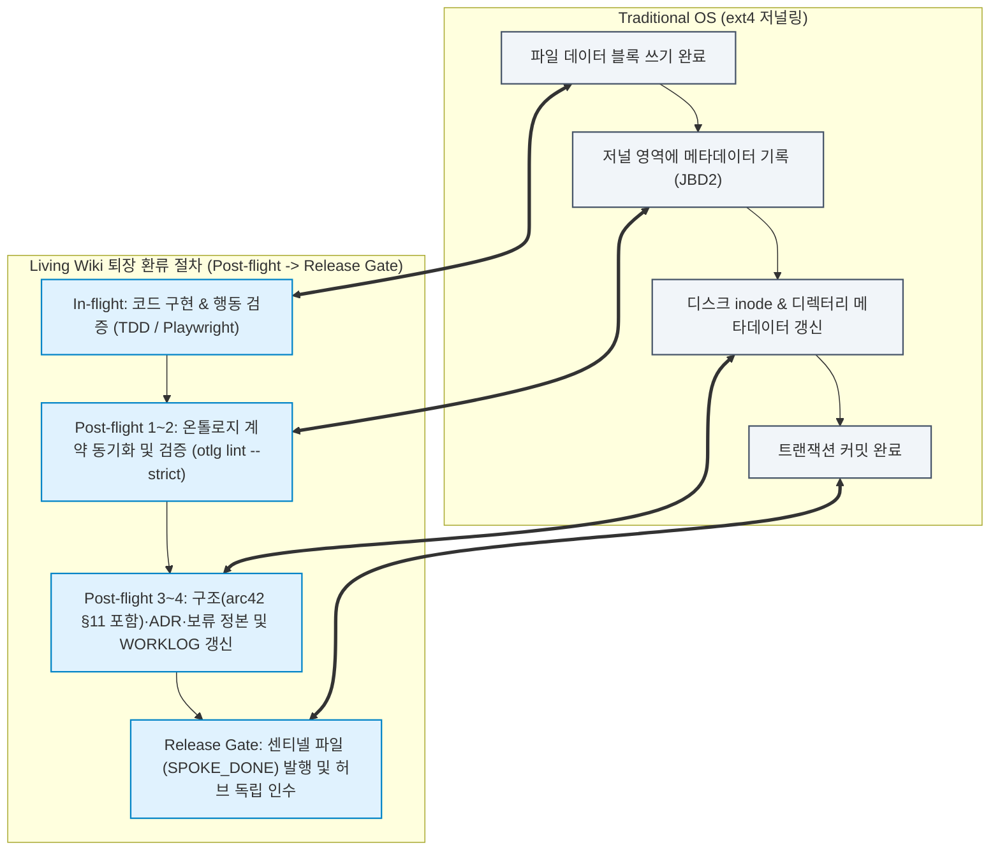
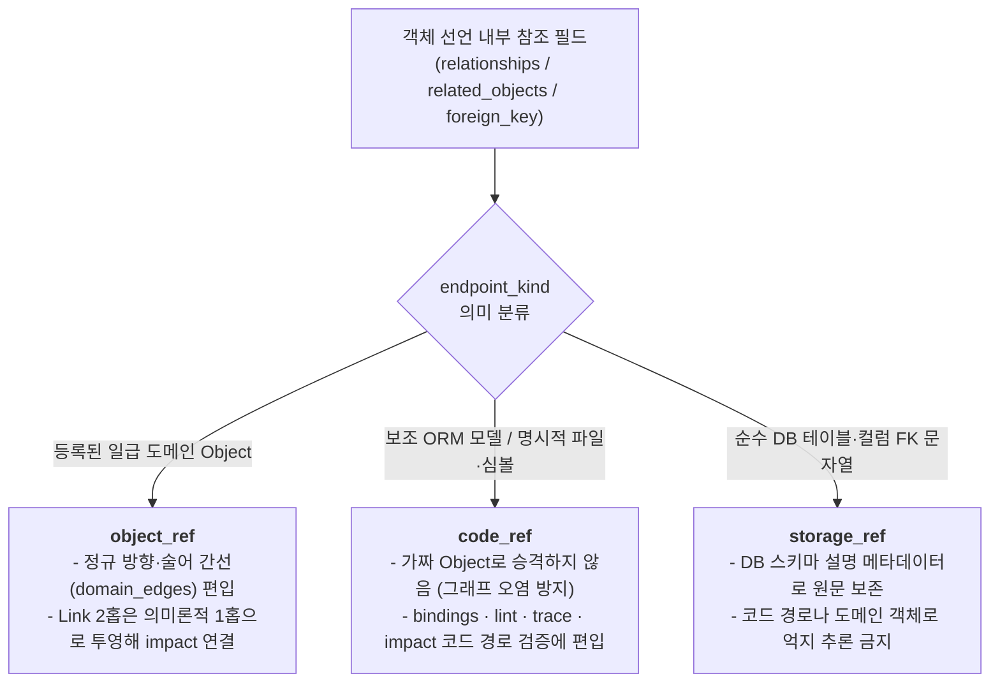

- table of contents
{:toc}

> 이 문서는 **[[6편] 아무리 똑똑한 알바생이라도 금고 열쇠를 통째로 맡기는 사장님은 없다](/tag-ontology-engineering/6-sdlc-harness-and-living-wiki/)**와 **[[10편] 경험이 글이 되고 의미가 스스로를 증명하기까지, 지식·성찰 컴파일러와 3대 의미 모형 감사](/tag-ontology-engineering/10-knowledge-blog-compiler-and-semantic-critique/)**에서 분리된 엔지니어링 심화 레퍼런스다. `repo-ontology`의 물리적 실행 하네스(`spoke-guard`), 『개발 규율집 v2.2』 5대 정본 거버넌스, 그리고 『Semantic Modeling for Data』를 바탕으로 수행한 `v0.5.0` 의미 모형 감사(`RC-01`~`RC-11`)의 전수 반례와 이행 계약을 담고 있다.
{:.lead}

---

## spoke-guard 하드 바운더리와 4단계 Living Wiki 자가 갱신 루프 {#living-wiki}

### 팔란티어 AIP Action과 SDLC 실행 하네스의 분업 경계

`repo-ontology`가 다스리는 프로덕션 코드베이스 도메인은 온톨로지 엔진 자체가 런타임 상태 원본을 쥐고 직접 굴러가는 `trpg-ontology`(`live_state`)와 달리, 온톨로지가 **'접지 명세(Grounding Spec, `code_specification`)'**를 맡고 외부 실행 하네스가 **'물리적 집행과 행동 검증'**을 나눠 맡는 분업 구조를 취한다.

| 비교 축 | Palantir AIP 런타임 Action Layer | Repo Ontology + SDLC 실행 하네스 |
| :--- | :--- | :--- |
| **통제 대상** | 프로덕션 운영 데이터베이스 쓰기 트랜잭션 | 39만 줄 규모 멀티레이어 코드베이스의 파일 수정 및 브랜치 병합 |
| **허용 인터페이스** | 온톨로지에 선언된 `Action Types` 도구 호출(`Tool Calling`) | `otlg brief` / `trace`로 추출한 닫힌 슬라이스 지시서(`Do & Don't`) |
| **물리적 차단기** | API 게이트웨이 및 Action 권한·파라미터 검증기 | `cmux` 격리 워크트리 + **`spoke-guard.sh` (`PreToolUse Hook`)** |
| **행동 및 결과 검증** | 트랜잭션 커밋 전 도메인 불변식 및 감사 로그 기록 | **`pytest` (`@pytest.mark.otlg_contract`) + `Playwright` 스냅샷** |
| **메타데이터 환류** | 오브젝트 상태 및 이벤트 히스토리 즉시 갱신 | **`.spoke/SPOKE_DONE` 직전 5대 정본 자가 저널링 (`Living Wiki`)** |

### spoke-guard 물리적 도어락 스크립트와 통제 지표

자연어 프롬프트로만 "공용 모듈을 수정하지 마라"고 지시하는 방식은 디버깅이 길어지고 컨텍스트가 비대해질수록 반드시 누수된다. 이를 OS 프로세스 레벨에서 차단하기 위해 도구 호출 직전에 작동하는 `spoke-guard.sh`(`PreToolUse Hook`)를 배치했다.

```bash
#!/usr/bin/env bash
# .spoke/hooks/spoke-guard.sh (PreToolUse 하드 바운더리 검증 훅)
TARGET_FILE="$1"
ALLOWED_PATHS_FILE=".spoke/allowed_paths.txt"

# 1. 거버넌스 헌법 및 온톨로지 코어 임의 수정 차단 (별도 승인 없는 변조 방지)
if [[ "$TARGET_FILE" == "AGENTS.md" || "$TARGET_FILE" == "CLAUDE.md" ]]; then
  echo "[SPOKE-GUARD BLOCKED] 거버넌스 헌법(AGENTS.md)은 스포크가 임의로 수정할 수 없습니다." >&2
  exit 2
fi

# 2. 선제 Do & Don't에 정의된 허용 경로 외 공용 모듈 침범 차단
if [[ -f "$ALLOWED_PATHS_FILE" ]] && ! grep -qF "$TARGET_FILE" "$ALLOWED_PATHS_FILE"; then
  echo "[SPOKE-GUARD BLOCKED] 비인가 파일 수정 시도 차단: $TARGET_FILE" >&2
  echo "허용된 슬라이스 경계 밖의 수정이 필요하면 SPOKE_DECISION_NEEDED로 에스컬레이션하십시오." >&2
  exit 2
fi
```

구두 주의(자연어 프롬프트 단독 통제)와 물리적 카드키 잠금(`spoke-guard` + 하네스)의 실제 운영 차이는 아래와 같다.

| 통제 항목 | 자연어 프롬프트 단독 통제 (구두 주의) | `spoke-guard` + 물리적 하네스 (카드키 잠금) |
| :--- | :--- | :--- |
| **공용 모듈 월경(침범) 차단** | 미흡 (컨텍스트 장기화 시 빈번히 누수) | **완전 차단 (`PreToolUse Hook`에서 `exit 2` 즉각 거부)** |
| **파괴적 빌드 명령 실행 방지** | 미흡 (`flutter clean`, `rm -rf ios/Pods` 등 임의 실행 위험) | **완전 차단 (금지 명령어 패턴 매칭 차단)** |
| **FSD / 레이어링 아키텍처 준수** | 불안정 (에이전트 주의력에 따라 편차 발생) | **강제 (`otlg lint --strict` 및 정적 아키텍처 규칙)** |
| **미정의 규칙 임의 추측 방지** | 미흡 (환각으로 임의 비즈니스 로직 작성) | **강제 (`SPOKE_DECISION_NEEDED` 호출 벨 에스컬레이션)** |

### 개발 규율집 v2.2: 5대 정본 문서(SSOT) 디렉토리와 책임 매트릭스

기존 `docs/features/` 수기 기능 명세와 파편화된 기술 부채 문서를 폐지하고, `.ontology/`와 `arc42 §11`로 통폐합하여 완성한 5대 정본 디렉토리 구조와 검증 책임 매트릭스다.

```text
project-root/
├── AGENTS.md                  # [1. 규범 (Norms)] 80줄 이내의 프로젝트 부트스트랩 및 행동 계약 정본
├── CLAUDE.md                  # AGENTS.md를 읽도록 지목하는 3줄짜리 얇은 어댑터 (Thin Adapter)
├── WORKLOG.md                 # [5. 실행 기록 (Execution)] 당월 활성 작업·판단·검증 대장 (식별자 F1, X3 등)
├── .ontology/                 # [2. 도메인·코드·계약 정본 (Invariants)] docs/features/를 흡수한 단일 정본
│   ├── objects/               # 도메인 명사 (Entity, 핵심 프로퍼티, 상태 Enum)
│   ├── links/                 # 엔티티 간 구조적 관계 및 카디널리티
│   ├── actions/               # 비즈니스 동사 (상태 전이, 사전 조건, 풀스택 code_binding)
│   ├── functions/             # 상태 변경 없는 순수 도메인 계산 규칙
│   ├── rules/                 # 시스템 전역 불변식 및 강제 경로 (ADR 및 TD 식별자 연동)
│   ├── views/                 # 클라이언트 UI 화면 경로와 백엔드 온톨로지 매핑
│   ├── architecture.yml       # 레이어 의존 방향 및 금지 규칙 (Architecture Graph)
│   └── contracts.yml          # 불변식과 @pytest.mark.otlg_contract 테스트 봉인 (Contract Graph)
└── docs/
    ├── architecture/          # [3. 현재 구조 및 기술 부채 (As-Is)] arc42 §1~§12 + C4 다이어그램
    │   └── 11-risks-and-technical-debt.md  # 기술 부채 기본 정본 (Fowler 4분면, TD-4 등 식별자 관리)
    ├── adr/                   # [4. 결정 근거 (Why)] Nygard 포맷 ADR (.ontology/와 양방향 참조)
    ├── worklog/               # 월별 잘라낸 불변 작업 이력 아카이브 (YYYY-MM.md)
    └── deferred-watchlist.md  # [5. 보류 감시] 스코프 외 보류·미해결 항목 및 재개 트리거
```

| 정본 역할 | 레포지토리 경로 | 담을 내용 (단일 책임 및 중복 서술 금지) | 검증 책임 |
| :--- | :--- | :--- | :--- |
| **규범 (Norms)** | `AGENTS.md` (`CLAUDE.md` 어댑터) | 80줄 이내의 착수 순서, 금지·강제 경계, 정본 위치 지목, 실행할 검사 명령과 완료 조건 | 에이전트·리뷰, 설치된 훅(`spoke-guard`)과 CI |
| **도메인 계약** | `.ontology/` | `docs/features/`를 흡수한 도메인 객체·관계·액션·함수·규칙·뷰, 아키텍처 그래프, 실제 `code_binding`과 테스트 계약 | `otlg lint --strict` 정적 검사 + 구현·행동 테스트(`TDD`) |
| **현재 구조·부채** | `docs/architecture/` | `arc42` §1~§12 기반의 현재 빌딩 블록과 `C4` 다이어그램, 그리고 `arc42 §11`(`11-risks-and-technical-debt.md`)로 일원화한 기술 부채 정본 | 실제 코드·배포 설정 대조 및 `.ontology/`의 `tech_debt` 참조 검증 |
| **결정 근거 (Why)** | `docs/adr/NNNN-제목.md` | 대안 비교, 설계 결정의 이유(`Why`)와 감수할 결과, 상태(`accepted`/`superseded`) | 아키텍처 리뷰 및 `.ontology/`의 `adr` 필드 연결 확인 |
| **실행 기록·보류** | `WORKLOG.md`, `docs/deferred-watchlist.md` | 타입+순번 식별자(`F1`, `X3`) 기반 작업·판단·검증 이력(당월 활성 유지 및 `docs/worklog/YYYY-MM.md` 아카이빙), 스코프 외 보류 항목과 재개 트리거 | 변경 `diff`와 실제 테스트·브라우저 실행 증거 대조 |

### 4단계 Living Wiki 자가 갱신 루프와 퇴장 관문 상세 절차

리눅스 커널의 `ext4` 저널링(`JBD2`)이 데이터 블록 쓰기 뒤 메타데이터(`inode`) 갱신까지 마쳐야 트랜잭션을 커밋하듯, `/hub-orchestrate` 워크플로우는 **`Pre-flight` -> `In-flight` -> `Post-flight` -> `Release Gate`**의 4단계 자가 갱신 루프로 돌아간다.



| 루프 단계 | 세부 관문 | 주관 주체 및 도구 | 통과 불변식 (Exit Criteria) |
| :--- | :--- | :--- | :--- |
| **Pre-flight (착수 기획)** | 선제 `Do & Don't` 명세 | `Hub Agent` (`otlg trace` / `brief`) | 작업 ID(`F12` 등) 부여, 대상 `Action` 바운더리 확정 및 `.spoke/allowed_paths.txt` 명세 |
| **In-flight (격리 집행)** | 격리 `TDD` 구현 & `QA` | `Spoke Agent` (`cmux worktree` + `spoke-guard` + `pytest` + `Playwright`) | 비인가 경로 침범 0건, `RED-GREEN-REFACTOR` 및 `Critic` 검증 통과, 실제 브라우저 렌더링 스냅샷 확보 |
| **Post-flight (퇴장 저널링)** | 5대 정본 동기화 (세부 4단계) | `Spoke Agent` (`otlg lint --strict`) | 1) `.ontology/` YAML 및 `contracts.yml` 동기화<br>2) `otlg lint --strict`로 `ERROR`·`WARNING` 해소 및 `info`/`trace`/`translate` 확인<br>3) `arc42`(§11 기술 부채 Fowler 4분면 포함)·`ADR`·`deferred-watchlist.md` 라우팅<br>4) `WORKLOG.md`에 작업 ID와 검증 결과 기록 (커밋 메시지 `Refs: F12` 연동) |
| **Release Gate (독립 인수)** | 완료 인계 및 메인 병합 | `Spoke` 발행 -> `Hub` 독립 검증·인수 | `.spoke/SPOKE_DONE` 확인, 제출 커밋 `SHA`에서 테스트 러너·스냅샷 독립 재검증 후 병합 |

> [6편 본문으로 돌아가기](/tag-ontology-engineering/6-sdlc-harness-and-living-wiki/)

---

## v0.5.0 의미 모형 감사: RC-01~11 반례와 3종 엔드포인트·양방향 brief 계약 {#repo-v050-audit}

### 감사 배경과 P1 · P2 · P3 공통 판단 기준

Panos Alexopoulos의 『Semantic Modeling for Data』를 바탕으로 수립한 `ontology-critique-practices v1.0.0` 스킬을 적용하여, `repo-ontology v0.4.0`과 실제 에듀테크 B2B SaaS 프로덕트의 `.ontology/` 코퍼스를 대상으로 2차 의미 모형 감사를 수행했다. `Antigravity`가 구조적 취약점 후보를 발제하고, `Codex`가 디스크 변경 없이 메모리 모델·mock·조회 CLI로 최소 반례를 재현한 뒤 기술 합의를 거쳐 `v0.5.0`에 이행했다.

| 관점 | 핵심 감사 질문 | `repo-ontology v0.5.0` 판정 원칙 |
| :--- | :--- | :--- |
| **P1 의미 명시성 (Expressiveness, E)** | 원래 선언된 관계·ID·상태·범위가 조회와 검증에서도 손실 없이 보존되는가 | 참조 무결성, 방향·술어·수명주기(`lifecycle`) 보존, 계약 영수증 필수값 강제를 우선한다 |
| **P2 의미 공유성 (Sharedness, S)** | 서로 다른 의미를 같은 필드처럼 다루거나 미해석(`unknown`)·절단을 성공으로 읽게 하지 않는가 | DB 외래키(`storage_ref`)·코드 보조모델(`code_ref`)·도메인 객체(`object_ref`), 그리고 정적 매핑·검증·실행 통과를 엄격히 구분한다 |
| **P3 실용성 (Practicality, P)** | 실제 개발 질문(`CQ`)을 더 정확히 답하는 최소한의 구조 변화인가 | 얇은 정규화 투영과 경계가 명확한(bounded) 조회를 지지하며, 무거운 OWL/BFO 상위 온톨로지나 별도 그래프 DB 전환은 배제한다 |

### 최초 후보의 수용·반론과 RC-01~11 최소 반례 전수 표

감사 과정에서 확인한 후보들의 수용·기각 경계와 메모리/실코퍼스 최소 반례(`RC-01` ~ `RC-11`) 전수 목록이다.

| 추적 ID | 감사 후보 및 입력·조건 | 관측된 의미 왜곡 (수정 전 `v0.4.0`) | `v0.5.0` 합의 및 이행 경계 |
| :--- | :--- | :--- | :--- |
| **`RC-01` / `RC-01-P`** | `relationships.profile.model`과 `related_objects.Child.binding`에 존재하지 않는 파일 경로 지정 | `strict lint` 이슈가 빈 목록(`0건`)으로 통과함. 반면 DB FK나 보조 모델을 무조건 `Object`로 승격하자는 초안은 가짜 객체 오염을 유발함 | 명시적 코드 경로는 검사하되 가짜 `Object` 승격은 기각. 원문·selector를 보존하며 **`object_ref` / `code_ref` / `storage_ref` 3종으로 분리** |
| **`RC-02-P`** | 실제 코퍼스 `otlg brief FeeInvoice` (수강료 청구서 객체 조회) | `preconditions: 0` 반환. 해당 객체를 타깃으로 삼는 액션의 `PAID_AMOUNT_POSITIVE` 등 필수 계약 3건이 통째로 누락됨 | 객체(`Object`) 조회 시 **그 객체를 `target`으로 삼는 `Action`의 사전조건과 계약**을 양방향으로 보완 |
| **`RC-02-T`** | 실제 코퍼스 `otlg brief CloseMonthlySnapshot` (액션 조회) | `transitions: 0` 반환. 타깃 객체의 `CLOSE` 상태 전이 관련 필수 계약 2건이 누락됨 | 액션(`Action`) 조회 시 **타깃 `Object`의 해당 상태 전이(`state_transition`)와 계약**을 선택 집합에 포함 |
| **`RC-03` / `RC-03-P`** | `a.py`에 객체 A 바인딩, `A -> Link -> B`(`b.py` 바인딩) 구조에서 `otlg impact a.py` 실행 | `impact`의 `related` 목록에 중간 `Link`만 나오고 상대 객체 `B`와 `b.py`가 단절됨 | 정규 방향 간선(`domain_edges`)과 이웃 캐시를 분리하고, **`Link`의 두 구현 홉을 의미론적 1홉(semantic 1-hop)으로 투영**하여 상대 객체 바인딩까지 도달 |
| **`RC-04-U` / `T` / `I`** | `ANALYSIS001` 경고 주입, `trace FeeInvoice --limit 1`, `fee_invoice.py`의 `impact` 조회 | 하위 projection은 `incomplete`이거나 `omitted=17`, `omitted_importers=2`가 발생했음에도 상위 공통 봉투는 `status: ok`, `complete: true`, `exit 0`으로 보고함 | 정책 심각도와 완결성을 분리. `ANALYSIS001` 또는 하위 절단 발생 시 상위 봉투까지 **`status=incomplete`, `completeness.complete=false`, `exit 2`**로 전파 |
| **`RC-05-P`** | 미등록 `domain`, 존재하지 않는 `Action.target`·`Link` 양끝·`Rule.scope` 입력 | `lint`는 `ERROR` 5개를 잡지만, `validate_registry`는 빈 목록을 반환하고 `brief`는 `ok`로 출력함 | 모든 읽기 명령(`brief`, `trace`, `impact`, `translate` 등)에 **동일한 공통 레지스트리 참조 무결성 게이트** 적용 |
| **`RC-06a`** | `Function` 엔티티의 그래프 연결성 및 거버넌스 감사 | `records`/`bindings`/`trace`/`View`에는 이미 포함되므로 '완전 고립' 주장은 부분 반박. 단, 거버넌스와 명시적 의존성 표현이 부족함 | 실행형 호스트를 추가하지 않고, `Function`에 **`governance`와 명시적 `depends_on`** 및 선택적 계약 연결을 지원 |
| **`RC-06b` / `RC-11`** | `Actor`에 `role=ADMIN`과 `roles=[STUDENT]`, 조건에 `rule: x>0`과 `expression: x<0` 동시 입력 | 서로 모순된 동의어(alias) 필드가 충돌 검사 없이 동시에 모델을 통과함 | `role -> roles`, `effect -> effects`, `rule -> expression`으로 정규화하되, **동시 입력된 값이 상충하면 즉시 거부**. 자연어 `effect`를 임의 실행 코드로 추정하지 않음 |
| **`RC-06c`** | `contracts` 증거 스냅샷과 `work-pack` 스냅샷의 해시 대상 비교 | 두 해시의 입력 파일 집합이 다름 | 서로 다른 목적과 범위의 리비전이므로 억지 동일화는 기각. 대신 **용도 호환 불가(교환 금지) 경계를 명시** |
| **`RC-06d` / `RC-06d-P`** | 21개 ADR을 포함한 스냅샷에서 `work-pack` 자동 수집 실행 | 최대 20개 상한에서 조용히 잘린 채 `excerpts: 20`, `status: answered`, `capture_eligible: true`를 반환하고 설정 파일의 `adr_dir`을 무시함 | `config.governance.adr_dir`을 존중하고, 자동 수집 20개 초과 시 **`adr_coverage` 절단 진단과 함께 `capture_eligible=false`, `incomplete`**로 판정 |
| **`RC-07` / `RC-07-E`** | 실제 코퍼스 `otlg brief FeeInvoice` 실행 (같은 청구 도메인 안에 월별 스냅샷 객체가 공존) | `scope=[FeeMonthlySnapshot]`으로 한정된 `MONTHLY_SNAPSHOT_CLOSED_IMMUTABILITY`(`applicability: scoped`) 규칙이 `FeeInvoice` 브리핑에 과잉 포함됨 | 도메인 분류를 `applicability=domain`과 동일시하지 않음. `scoped` 규칙은 **`scope` 일치 또는 명시적 참조 시에만 포함**하고 모든 규칙에 **`inclusion_reason`** 출력 |
| **`RC-08`** | 금지(`prohibition`) 및 은퇴(`deprecated`) 규칙과 상태기계 보유 객체를 `trace`로 조회 | 출력 투영에서 규칙의 `kind`/`forbidden`/`applicability`/`lifecycle`과 객체의 `state_machine`/`constraints`/`lifecycle`이 탈락함 | `trace` 투영 시 객체·규칙·액션·함수의 **금지 조건, 제약, 수명주기(`lifecycle`) 전체 선언을 보존** (조회 포함을 현행 승격으로 오독 방지) |
| **`RC-09`** | `snapshot`/`nodeid`/`outcome` 3개 키만 가진 최소 JSON을 계약 영수증으로 주입 | `evidence_schema`, `exitstatus`, `selection_complete`, `contract_hash`가 없는데도 기본값으로 `passed: 1`로 인정함 | **`evidence_schema='1'`, 정수 `exitstatus=0`(`boolean` 제외), `selection_complete is True`, 현재 `contract_hash` 일치**가 모두 확인된 경우에만 `passed`로 인정 |
| **`RC-10`** | 액션 ID에 `A/B`처럼 슬래시(`/`)가 포함된 상태에서 사전조건 계약 매칭 | 모델 로더는 허용하지만 활성 계약 파서가 `action:A`에서 잘라내어 `inactive`로 오판함 | 개별 `PrimitiveID`에는 예약 구분자(`:`, `/`) 사용을 금지하되, 정규 참조(`action:A/precondition:P`), 코드 경로, 수식의 나눗셈은 허용 |

### 핵심 설계 1: 3종 엔드포인트 정규화 (`object_ref` · `code_ref` · `storage_ref`)

객체 선언 내부의 `relationships`, `relations`, `related_objects`, `properties.foreign_key`는 원문과 `selector`를 그대로 보존하면서 의미에 따라 세 가지 `endpoint_kind`로 정규화된다.



- **경로 없는 모델 이름의 처리**: `code_ref`에서 실제 파일 경로 없이 모델 심볼 이름만 적힌 항목은 `unbound_symbol`로 남기며, `otlg lint --strict`가 이를 숨기지 않고 `ANALYSIS001` 경고 및 `status=incomplete`(`exit 2`)로 정직하게 보고한다.

### 핵심 설계 2: 양방향 `brief` 문맥 보완과 `scoped` 규칙 `inclusion_reason`

에이전트에게 작업 지시서(`Do & Don't`)를 생성해 주는 `otlg brief`가 필요한 사전조건은 빼먹고(`RC-02`) 남의 객체 규칙은 섞어 넣던(`RC-07`) 문제를 해결하기 위해, 그래프 탐색 방향과 규칙 매칭 계약을 재설계했다.

1. **양방향 타깃 보완**:
   - `Object`를 기준으로 브리핑할 때는 그 객체를 `target`으로 삼는 `Action`들의 사전조건(`preconditions`)과 계약을 함께 끌어온다.
   - `Action`을 기준으로 브리핑할 때는 그 액션이 가리키는 타깃 `Object`의 해당 상태 전이(`state_transitions`)와 계약을 함께 끌어온다.
   - 단, 공통 액터(`Actor: ADMIN` 등)를 타고 무관한 도메인 전체로 조회가 폭발하지 않도록 `R-08` 차단 경계는 그대로 유지한다.
2. **규칙 적용 범위(`applicability`) 엄격 분리 및 `inclusion_reason` 명시**:
   - `applicability: scoped` 규칙은 질의 대상이 해당 `scope` 목록에 정확히 일치하거나 명시적 `rule_id`/`View` 참조가 있을 때만 포함한다. 같은 도메인에 속한다는 이유만으로 이웃 객체(`FeeMonthlySnapshot`)의 `scoped` 규칙을 `FeeInvoice` 브리핑에 끼워 넣지 않는다.
   - 모든 반환 규칙에는 에이전트와 리뷰어가 왜 이 규칙이 브리핑에 들어왔는지 즉시 확인할 수 있도록 `inclusion_reason`(`scope_match`, `explicit_ref`, `domain_wide`, `global_rule` 등)을 함께 출력한다.

### 핵심 설계 3: 계약 영수증 필수값 강제와 직렬화 안전 예산

테스트 통과를 증명하는 계약 영수증(`RC-09`)과 대규모 그래프 직렬화 경계는 다음과 같이 고정했다.

- **계약 영수증(`Contract Evidence`) 엄격 검증**:
  - 단순히 JSON 파일이 존재하거나 `outcome: passed` 문자열이 적혀 있다고 해서 통과로 인정하지 않는다.
  - 반드시 `evidence_schema == '1'`, 명시적 `snapshot` 및 `tests` 목록, **정수 `exitstatus == 0`**(Python에서 `isinstance(False, int)`가 참이 되는 함정을 막기 위해 `boolean` 타입 명시적 배제), **`selection_complete is True`**(`truthy` 문자열 배제), 그리고 현재 온톨로지의 `contract_hash` 및 수집된 테스트 노드 ID 일치가 모두 검증되어야만 `passed`로 판정한다.
  - `snapshot=null`은 플러그인의 미완성/구형 관측으로 보존할 뿐 성공 증거로 삼지 않는다.
- **직렬화 전 트리 예산**:
  - 비정상적인 순환 참조나 거대 입력으로 인한 메모리 고갈을 막기 위해 직렬화 전 **최대 10,000노드·32깊이 예산**을 검사하며, 초과 시 불완전한 로드로 즉시 거부한다.

### v0.5.0 실증 코퍼스 및 회귀 검증 요약

`v0.5.0` 이행 후 `repo-ontology` 자체 테스트 스위트와 실제 에듀테크 B2B SaaS 프로덕트 코퍼스에서 확인한 검증 결과다.

- **전체 테스트 스위트**: `uv run --extra javascript --group dev python -m pytest -q` 기준 **`139 passed`** (`tests/test_semantic_critique.py` 신규 경계 회귀 포함), 프로덕트 기존 수강료 청구·스냅샷 단위 테스트 **`31 passed`**.
- **필수 계약 영수증 판정**: `otlg contracts report --require-passed` 실행 결과 **`required / mapped / passed = 9 / 9 / 9`** 전수 통과.
- **실코퍼스 `brief` 교정 확인**:
  - `otlg brief FeeInvoice`: 누락되었던 사전조건 3개·계약 5개가 정상 복원되었고, 월별 스냅샷 전용 `scoped` 규칙은 깔끔하게 제외됨.
  - `otlg brief CloseMonthlySnapshot`: 상태 전이 1개·계약 4개 정상 포함.
- **정직한 불완전성(`incomplete`) 보고**:
  - 프로덕트 코퍼스의 경로 포함 심볼 126개 중 인덱싱 범위 내 `resolved` 18개, `out_of_scope` 108개, `missing` 0개, `unknown` 0개로 분리 집계.
  - 아직 인덱서가 지원하지 않는 Dart 심볼 참조 및 경로 없는 모델 이름 선언 1건에 대해 `strict lint`가 경고 11건을 숨기지 않고 `ERROR 0, ANALYSIS001 WARNING 11`, `status=incomplete`(`exit 2`)로 정직하게 보고함 확인.
- **측정하지 않은 지표의 정직한 보류**:
  - 독립 주석자 간 합의도($\kappa$)나 골드 질문셋 기반 정밀도·재현율을 별도로 측정하지 않았으므로 **`E/S/P` 정량 점수 및 `ESBI`는 `N/A`**로 유지하며, 테스트 통과 개수를 의미 품질 점수로 둔갑시키지 않는다.

> [10편 본문으로 돌아가기](/tag-ontology-engineering/10-knowledge-blog-compiler-and-semantic-critique/)
