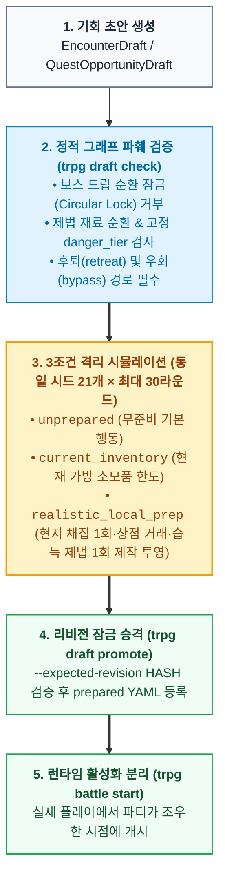
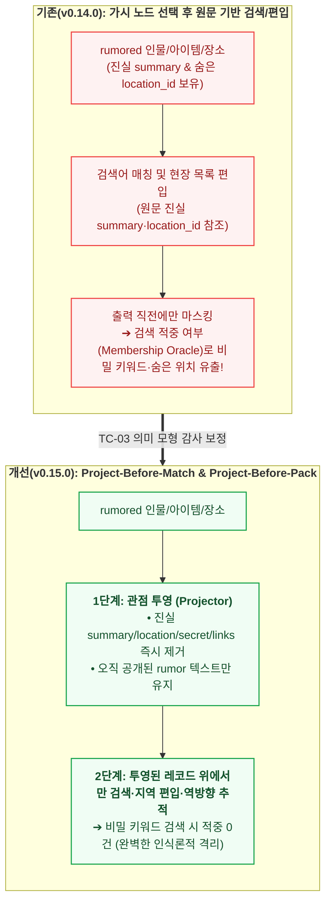

- table of contents
{:toc}

본 문서는 온톨로지 엔지니어링 시리즈 **[[6편]](/tag-ontology-engineering/6-trpg-kinetic-action-layer/)**, **[[8편]](/tag-ontology-engineering/8-code-on-graph-and-epilogue/)**, **[[9편]](/tag-ontology-engineering/9-knowledge-blog-compiler-and-semantic-critique/)** 본문에서 다룬 `trpg-ontology`(`v0.12.1` ~ `v0.15.0`)의 상세 도메인 패키지 구조, `fsync` Undo Journal 프로토콜, 7.5MB `World Canon` YAML-First 통합과 3조건 격리 시뮬레이션, 22개 캐시 보안·경계 반례 방어, 그리고 `TC-01~09` 의미 모형 감사 영수증을 수록한 심화 레퍼런스다.

---

## Action Layer와 fsync 저널·3단서·연금술 도감 계약 (v0.12.1) {#action-layer}

### 세 세계의 온톨로지 5축 비교표: Vault에서 Repo를 거쳐 TRPG까지

개인 지식 볼트(`vault-ontology`)와 실무 코드 레포지토리(`repo-ontology`), 그리고 라이브 캠페인 런타임(`trpg-ontology`)이 각각 어떤 대상을 다루며 왜 TRPG에 이르러서야 온전한 의미의 `Kinetic / Action Layer`에 도달했는지는 아래 5축 비교표에서 드러난다.

| 자체 평가 축 | Vault Ontology (`v0.1.1`) | Repo Ontology (`v0.2.0`) | TRPG Ontology (`v0.12.1`) |
|:---|:---|:---|:---|
| **관리 대상과 체제** | 개인 지식 마크다운 문서와 관계 (`knowledge_graph`) | 실무 코드에 바인딩된 도메인 명세 (`code_specification`) | 캠페인 세계·라이브 수치·장비·전투·산문 도감·서사 연대기 (`live_state`) |
| **Semantic (명사와 관계)** | 13종 문서 타입·프론트매터 속성·구조 및 의미 관계 | 객체(`Object`)·링크(`Link`)·화면(`Sitemap`)·코드 심볼 바인딩 | 10개 강타입 도메인·아키텍처 패키지(`world`, `actors`, `alchemy`, `combat` 등) + YAML·Markdown 양방향 바인딩(`doc_binding`) |
| **Logic / Preflight (사전 검증)** | 스키마 필수값·위키링크·태그 어휘 화이트리스트 검사 | 사전 조건·규칙 명세와 파이썬 AST 선언 존재 및 드리프트 검사 | `2d6` 판정(장비 보너스 1회 합산)·고정 암호(`CipherSpec`)·3단서 법칙·`3·3·3` 연금 도감 토폴로지·장착 수량 교차 검증 + `scene`의 가용 행동(`available_actions`) 브리핑 |
| **Kinetic (행동과 상태 전이)** | `vault new / ingest` 생성·이관 게이트 | Action 포인터 명세 및 개발 워크플로우(`intake`, `translate`) | **등록 Action 8종**(`trpg act` 단일 트랜잭션 핸들러 7종 + `trpg battle` 턴제 루프 1종) + `fsync` Undo Journal + `--request-id` 멱등 영수증 캐시 |
| **Governance (보안 투영과 무결성)** | 볼트 경로 경계·읽기 전용 SQL authorizer·원자적 캐시 교체 | 코드·명세·테스트 분업 및 미검증 심볼 경고 분리 | 2단계 파일 락(`workspace` -> `campaign`) + 과거 사건 불변 체크섬(`sync.json`) + 전투 아카이브 `SHA256` 봉인 + 비공개 설정 필터(`--perspective pc | gm`) |

### 도메인 패키지와 Frontmatter v1 양방향 바인딩

`trpg-ontology`의 코드베이스는 `core`와 7개 핵심 도메인(`world`, `actors`, `campaign`, `compendium`, `alchemy`, `bestiary`, `combat`), 그리고 실행 조정(`application`)·저장소 잠금(`infrastructure`)·CLI 및 조회 투영(`presentation`)·엔진 브리지(`integrations`) 계층으로 분리되어 있다. 기존 루트 모듈 경로는 호환 퍼사드(Facade)로 유지하며, 공개 함수·메서드·프로퍼티 105개의 시그니처 하위 호환성을 `scripts/verify_import_compatibility.py`로 상시 대조한다.

```text
trpg_ontology/
  core/                 base.py, config.py, text.py, validation.py
  domains/
    world/              models.py (Place·경로·감각·설비)
    actors/             models.py, state.py (Actor·특성·5슬롯 장비·개인 상태)
    campaign/           models.py, state.py (미스터리·위협 시계·사건·Action 명세)
    compendium/         models.py, lint.py, frontmatter.py, documents.py
    alchemy/            models.py, service.py (제법·기법 수준·3·3·3 제작 그래프)
    bestiary/           models.py, lint.py (Monster 종·서식지·전투 바인딩)
    combat/             models.py, items.py, conversation.py (전투 계산·소모품)
  application/          actions.py, commit.py, runtime.py, lint.py
  infrastructure/       loader.py, storage.py
  presentation/         cli.py, scene.py, trace.py
  integrations/         engine_bridge.py, dispatch.py
```

연금술 도감과 장비 시스템은 이 패키지 구조 위에서 다음과 같은 불변식을 집행한다.

- **3·3·3 연금술 조합 트리와 바이옴 다양성(`trpg craft-tree`)**: 아이템 59종과 연금술 제법 50종을 강타입 스키마로 엮어 정방향(원재료 -> 제법 -> 파생물)과 역방향(완제품 -> 제법 -> 대체 코어·정수·수급처) 양방향 탐색을 지원한다. 대체 주재료는 `core_options`(OR 관계)로, 공통 재료와 정수는 `inputs`/`essences`(AND 관계)로 구분한다. 완제품 제법은 특정 재료 하나에 종속되지 않도록 **2~3개의 대체 코어**를 가져야 하며, 각 대체 코어마다 유효한 수급 경로가 실존하는지, 합산 원산 바이옴(Biome)이 2개 이상인지(공통 교역처는 별도 원산지로 세지 않음), 그리고 원재료의 가공 산출물 2~3종과 모든 대체 경로 사이에 순환 참조(Cycle)가 없는지를 `3·3·3` 토폴로지 린트가 검증한다.
- **`Frontmatter v1` 양방향 문서 바인딩**: `world/compendium/alchemy/` 산하의 마크다운 도감 문서 58개(템플릿 4, 미등록 참조 37, 바인딩 아이템 17)는 JSON Schema 기반 `Frontmatter v1` 계약과 `doc_binding`을 통해 YAML 정본 카탈로그와 양방향으로 묶인다. `stage`(`raw`/`prepared`/`transmuted`/`finished`), `rarity`(`1~7`), `element`, `scope`, `visibility`, `craftable` 필수 키와 주산물·부산물 제법 역참조가 어긋나면 `trpg docs lint --strict`가 즉시 검출한다.
- **5슬롯 장비 파생 연산(`EquipmentState`)과 회복 꼼수 차단**: 전 파티원의 기본 최대 체력(`base_max_hp`)을 `50`으로 통일하고, 캐릭터별 무기(`weapon`)·갑옷(`armor`)·장신구(`accessory`)·머리(`head`)·신발(`feet`) 5슬롯을 인벤토리 실물 `equipment_id`와 연결한다. 예를 들어 동료 브륀힐데의 최대 체력 `70`은 기본값 `50`에 실착용 중인 방어구(`+10`)와 방패(`+10`)에서 파생된 결과다. 기본 능력치를 덮어쓰지 않고 판정(`check`)·내성(`save`)·전투 개시 시점에 정확히 1회만 파생 합산하며, 실물 보유 수량을 초과한 중복 착용, 착용 중인 장비의 판매·삭제, 그리고 부상 상태에서 장비를 벗었다 입으며 체력을 공짜로 회복하려는 시도(`capped_resources`)를 엔진이 원천 차단한다.

### 원자적 트랜잭션(`trpg act`)과 v0.12.1 반례 점검 및 설계 보강 (T-01 ~ T-16)

등록된 8종의 Action이 실행될 때 `infrastructure/storage.py`와 `application/commit.py`는 다음 로컬 트랜잭션 규율을 따른다.

1. **2단계 파일 잠금과 `fsync` Undo Journal**: 워크스페이스 잠금과 캠페인 잠금(`campaign.lock`)을 순서대로 획득해 동시 CLI 프로세스를 직렬화하고, 변경 대상 파일들의 원본 바이트를 `fsync`가 보장되는 Undo Journal에 먼저 기록한다. 프로세스가 중간에 강제 종료(`os._exit`)되더라도 다음 조회나 `trpg recover`가 저널을 읽어 원자적으로 롤백한다.
2. **미확정 변경 추적(`pending.json`)과 대가 강제**: 자유 행동으로 소지금이나 체력을 변경하면 변경 전후 상태 스냅샷 체크섬이 `pending.json`에 기록되며, 사건(`trpg record`)으로 확정하기 전까지 strict lint는 `UNCOMMITTED_STATE`를 보고한다. 부분 성공(6~9) 판정이 포함된 경우 실제 자원 차감(`--cost-money`)이나 위협 시계 전진(`--cost-threat`) 없이는 사건 커밋 자체가 거부된다.
3. **서사 연대기(`chronicle.json`)와 `Ontology Scribe`**: 매 사건마다 선택 의도(`--intent`), 원문(`verbatim`)과 요약(`paraphrase`)이 분리된 대화(`--dialogue-json`), 연출 지문(`--beat`)을 불변 사건과 append-only 연대기에 보존하여 `trpg story --format novel|script`로 재조립한다. 세션 중 즉흥 등장한 엔티티는 `trpg draft observe --promote`를 통해 필수 참조와 한·영 외형 묘사(`appearance`, `image_prompt_en`) 검증 후 정본으로 승격한다.

`v0.12.0` 직후 무결성·가시성·인과율 경계를 기준으로 수행한 반례 점검(`T-01` ~ `T-16`)과 `v0.12.1` 설계 보강 결과는 다음과 같다.

| ID | 점검한 반례 및 경계 시나리오 | 설계 판단 | `v0.12.1` 보강 조치 및 설계 경계 |
|:---|:---|:---|:---|
| **`T-01`** | 사건 기록 밖 전투 아카이브 JSON에서 처치한 적(`enemy_id`)을 변조해도 `integrity_errors`가 빈 목록 반환 | **설계 반영** | 신규 `EventSpec`에 `battle_log_sha256` 해시 봉인 도입. 무결성 검사·퀘스트 목표 평가·`sync`에서 아카이브 변조 및 삭제를 즉시 거부 |
| **`T-02`** | 해시 봉인 후 시뮬레이션 `provenance`를 덧씌우면 스스로 봉인을 깨뜨림 | **설계 반영** | 최종 `provenance`를 커밋 전에 확정하여 사건 기록과 아카이브를 단일 트랜잭션에서 한 번만 봉인 |
| **`T-03` · `T-04`** | 봉인 도입 전 과거 전투 사건 2건을 현재 파일 해시로 소급 보강하는 경우 | **원칙 유지 (소급 배제)** | 과거 사건과 라이브 플레이 데이터를 사후 조작해 소급 인증하지 않음. 안전한 경로와 파일 실존만 검사하고 미봉인 역사적 사실로 정직하게 분리 보존 |
| **`T-05` · `T-06`** | 소문(`rumor`) 단서가 전체 원문으로 폴백되거나, 미학습 제법 역방향 트리에서 숨은 재료·채집지 노출 | **설계 반영** | 탐색 전 공통 PC 투영 필터 적용. 부분 단서와 완전 발견 분리 및 미학습 제법 하위 경로·비공개 채집지 차단 |
| **`T-07` · `T-08`** | 숨김 장비 착용 시 PC에게 가짜 HP 합계를 보여주거나 자유 산문의 모든 의역 비밀을 자동 탐지하는 방식 | **부분 반영 / 범위 제외** | 실효 HP 총합은 정본 유지하되 비공개 장비명·장착 내역·보너스 분해만 은닉. 자유 산문의 문맥적 의역 비밀 자동 독해는 정적 도구의 범위 밖임을 명시 |
| **`T-09`** | 이미 사망했거나 `gm_only`인 NPC를 3단서 법칙의 유효한 단서 획득 경로로 집계 | **설계 반영** | 단서 출처의 실제 공개 여부·생존/활성 상태·장소 가시성 교차 검증 및 선행 단서 순환(Cycle) 검출 추가 |
| **`T-10`** | 같은 날짜(`day`) 안에서는 '밤' 사건이 '오전' 사건의 원인(`causes`)이어도 통과됨 | **설계 반영** | 하루 네 시간 블록(`오전 -> 오후 -> 저녁 -> 밤`) 순서를 대조하여 같은 날의 미래 사건이 과거 사건의 원인이 되는 시간 역행 인과 차단 |
| **`T-11` ~ `T-16`** | `partial_discovery_event`/`Rule.scope` 유령 참조, 대체 코어 개별 수급 경로 누락, 거버넌스 AST 바인딩 불일치 | **설계 반영** | 명시 참조 검증 강화, 대체 코어마다 개별 유효 수급 경로 필수화, `check_governance_contract.py`로 로컬 바인딩·중첩 규칙 전수 검사(`322 passed`) |

- [6편 본문으로 돌아가기](/tag-ontology-engineering/6-trpg-kinetic-action-layer/)

---

## World Canon 7.5MB YAML-First 통합과 3조건 격리 시뮬레이션·핀포인트 캐시 (v0.14.0) {#three-condition-simulation}

### 4계층 지식 아키텍처와 13개 정본 YAML 카탈로그 1,701건 통합

`trpg-ontology v0.14.0`(`F15`)에서는 세계관 배경지식과 현재 플레이 상태가 섞여 오염되는 문제를 막기 위해 데이터를 **4계층(`World Canon` / `Ruleset` / `Campaign` / `Candidate & Prepared`)**으로 분리하고, 기존 418개의 세계관 마크다운 문서와 글뤼엔(Glühen) 연금술 아카이브 1,478개 항목(`~7.5MB`)을 `world/canon/manifest.yml` 및 13개 정본 YAML 파일로 무손실 통합했다.

| 지식 계층 (`4-Layer Architecture`) | 저장 경로 및 정본 파일 | 핵심 역할 및 불변식 경계 |
|:---|:---|:---|
| **`World Canon` (공유 세계 사실)** | `world/canon/manifest.yml` 외 13개 YAML (`~7.5MB`) | 장소 26곳, 바이옴 8종, 종족·생물 115종, 출처별 카탈로그 1,701건, 세력 6개, 역사 인물 38명, 전승 16건, 외형 48건, 연대기 81건, 레퍼런스 문서 49건 정의. **Canon을 읽었다고 해서 파티가 재료나 제법을 습득하지 않음** |
| **`Ruleset` (규칙 및 계산기)** | `domains/combat/conversation.py` 및 규칙 스키마 | 대화형 `2d6` 판정, `shield`/`break_shield`/`latent_power`, 고정 권역 위험도(`T1~T7`), 수평 성장(`milestone_growth_only: true`) |
| **`Campaign` (라이브 상태 관리 기록)** | `campaigns/<id>/.ontology/` (`world_binding` 해시 고정) | 파티가 실제로 발견한 단서, 습득한 제법(`known_recipes`), 연구한 재료(`studied_materials`), 현재 소지품 수량, 사건 기록(`events`) |
| **`Candidate` & `Prepared` (창발 기회)** | `state/emergent.json` -> `encounters/*.yml`, `quest_opportunities/*.yml` | 세션 중 생성된 `EncounterDraft` / `QuestOpportunityDraft` 및 3조건 시뮬레이션 통과 후 `prepared` 상태로 대기 중인 기회 |

현행 도감과 글뤼엔 유산에 동명이인 아이템(예: 동일한 이름의 고약이나 정수)이 존재할 때 서로 덮어쓰지 않도록 공유 카탈로그 식별자는 `<파일 stem>:<source_path 또는 original_path 또는 item/id>` 형식으로 보존했다. 또한 `RichEntity` 공통 모델을 통해 `appearance_ko`, `image_prompt_en`, `process_note`, `efficacy_note`, `game_effect`, `lore_note`, `vocab_en_ko`, `color_hex`, `danger_tier`, `folklore_claims` 등 모든 서사 필드를 로드·덤프·승격 전 과정에서 무손실로 유지하며, 마크다운 파일 바인딩(`doc_binding`)은 선택 사항(`--write-markdown` 요청 시에만 생성)으로 전환해 빈 껍데기 스텁 파일 의존성을 제거했다.

### 대화형 2d6 파훼·연금 전투 계산기 (`domains/combat/conversation.py`)

세션의 대화형 서사 몰입을 끊던 외부 `LÖVE 11.5` 그래픽 창과 JSON-RPC 브리지를 폐기하고, 고전 JRPG의 약점 파훼(`Break`)와 자원 집중 메커니즘을 테이블탑 대화형 호흡에 맞게 재설계한 순수 파이썬 계산기(`domains/combat/conversation.py`)로 일원화했다.

| 전투 상태 및 메커니즘 | `domains/combat/conversation.py` 동작 명세 | 설계 의도 (약점 파훼 전술 및 수평 밸런싱 반영) |
|:---|:---|:---|
| **`hp / max_hp` & `shield`** | 등록된 생명력과 별개로 피해 흡수 보호막(`shield`) 작동 | 단순 체력 깎기 대신 보호막과 약점 게이지의 이중 전술 구조 형성 |
| **`break_shield / max_break_shield`** | 등록된 원소·연금 `weaknesses` 또는 `gimmick_counter` 적중 시 `1` 차감 | 무지성 평타 대신 사전 정보 수집과 연금술 아이템 조합을 강제 |
| **`gimmick_counter` & `broken`** | 기믹 카운터 적중 시 적의 `signature_power` 위협 비활성화. 게이지 `0` 도달 시 `broken=True` (다음 자기 행동 1회 기절 + 노출 피해 `×1.5` 내림, Break 유발 타격에는 소급 미적용) | 보스의 핵심 기믹을 사전 준비된 연금 아이템으로 파훼했을 때의 극적인 카타르시스와 리턴 부여 |
| **`latent_power` (저력 `0~100`)** | 약점 적중 시 `+20`, HP 피해 피격 시 `+10`. `100` 도달 시 동일 소모품 2개를 동시 소비해 등록 효과를 `2×`로 터뜨리는 연금 폭발 지원 | 위기 상황을 역전시키는 하이라이트 자원 소모(Consumable Sink) 메커니즘 |
| **고정 `danger_tier` (`T1~T7`)** | 장소별 고정 위험도 또는 명시적 심층(`depth`)/야간(`night`) 가산값만 적용, 플레이어 레벨 자동 스케일링 전면 배제 (`milestone_growth_only: true`) | 세계관의 지리적 개연성 보존 및 숫자 인플레이션 없는 수평적 숙련·도구 성장 지향 |

2d6 판정은 합 `2~6` 빗나감, `7~9` 기본 효과, `10~12` 공격 피해 `+1`로 동작한다. 공격이 빗나가도 투척을 시도한 소모품은 차감되며(기절로 행동을 못 한 경우 제외), 모든 `trpg battle act` 명령은 고유 `command_id`, 순번 `seq`, 자원 `revision`을 검증해 동일 명령 재시도 시 이중 소비를 막고 단일 트랜잭션으로 체크포인트를 갱신한다.

### EncounterDraft 정적 파훼 검증과 3조건 격리 시뮬레이션 게이트

세션 도중 창발적으로 생성된 전투 조우 초안(`EncounterDraft`)과 퀘스트 기회(`QuestOpportunityDraft`)는 `trpg draft check Draft_ID --json`을 통해 정적 그래프 검증과 3조건 격리 시뮬레이션을 통과해야만 `prepared` 상태로 승격될 수 있다.



- **보스 드랍 순환 잠금(Boss Drop Circular Lock) 거부**: 보스의 기믹을 파훼하기 위한 필수 카운터 아이템(`required_counters`)의 재료 수급처를 역추적했을 때, 그 재료가 오직 '지금 처치해야 하는 바로 그 보스의 전리품(`drop`)'에만 의존하는 순환 모순이면 즉시 거부한다. 또한 퇴각 허용 여부(`retreat_allowed`)와 비전투·우회 선택지(`bypass_or_noncombat_options`)가 비어 있는 초안도 통과시키지 않는다.
- **21시드 × 30라운드 3조건 준비도 비교 시뮬레이션**: 메모리 내 샌드박스 복사본 위에서 동일 난수 시드 21개에 대해 세 가지 준비 조건을 각각 시뮬레이션한다.
  1. `unprepared`: 소비 아이템 없이 기본 행동만으로 맞붙는 기저 난이도 측정.
  2. `current_inventory`: 현재 `character.json`에 실제로 보유한 발견 소모품 수량만 사용(중복 소비 금지).
  3. `realistic_local_prep`: 현재 장소의 공개된 채집 경로 1회 실행, 명시된 단가·재고가 있는 현지 상점 거래, 그리고 이미 습득한 제법(`known_recipes`)을 연구된 재료(`studied_materials`)·숙련도·설비·실제 제작비 범위 안에서 최대 1회씩 제작(투영 과정에서 재료와 금화 실제 차감)한 인벤토리로 시뮬레이션 수행.
- **미지원 효과의 정직한 `incomplete` 반환**: 과거 CTB 시절의 광역기나 상태이상처럼 경량 계산기에 바인딩이 없는 아이템이 포함되면, 이를 무시하고 완전한 검증으로 포장하는 대신 `status: incomplete`와 `unsupported_items`를 반환한다.

```bash
# 기회 초안의 스키마 확인부터 3조건 샌드박스 검증, prepared 승격, 대화형 전투 실행까지의 파이프라인
trpg draft schema encounter --json
trpg draft check Draft_ID --json
trpg draft promote Draft_ID --expected-revision HASH
trpg battle sim PreparedEncounter --json
trpg battle start PreparedEncounter --seed 7 --json
trpg battle status --json
trpg battle act Hero Enemy --tag physical --command-id TURN-1 --seq 0 --json
trpg battle act Hero Enemy --item FireBottle --latent --command-id TURN-3 --seq 2 --json
trpg battle act Hero Enemy --retreat --command-id TURN-5 --seq 4 --json
trpg battle end --id EVT-BATTLE --summary "연금 폭발로 보스 기믹 파훼 후 제압" --json
```

### 핀포인트 서브그래프 조회 (`trpg start` · `trpg canon`)와 22개 캐시 경계 반례 방어

세션 재개 명령인 `trpg start`(`trpg guide`)는 전체 매뉴얼 대신 현재 캠페인 스냅샷과 핵심 수칙 정확히 10줄, 그리고 토픽 포인터(`trpg://guide/<topic>/<label>`)만 출력하는 점진적 공개(Progressive Disclosure) 진입점이다. 7.5MB의 `World Canon`은 개인 디렉토리 캐시(`${XDG_CACHE_HOME:-~/.cache}/trpg-ontology/canon-v4/`, `v0.15.0`에서 `canon-v5`로 상향)를 통해 요약 슬라이스(`--section summary`) 단위로 핀포인트 조회한다. 단일 프로세스 측정 기준 원본 13개 파일 강제 재구축(`--refresh`)은 약 `0.45초`, 디스크 캐시 적중은 약 `0.17초`, 메모리 캐시 적중은 약 `0.03초`가 소요된다.

```bash
# 점진적 공개 진입점(trpg start)과 7.5MB 세계관 정본에 대한 핀포인트 슬라이스 조회(trpg canon)
trpg start
trpg guide cog
trpg canon stats --json
trpg canon search "자극" --kind item --limit 5 --json
trpg canon show "compendium_alkaline_salve:world/compendium/salves.md" --kind item --section recipe --json
trpg canon recommend --place muelden --limit 3 --json
```

`trpg canon`과 캐시 계층에 대해 수행한 22개 보안·경계 반례 검토(`tests/test_canon_adversarial.py`, 전체 `338 passed`)의 핵심 방어 설계는 다음과 같다.

| 심각도 | 재현한 보안 위협 및 엣지 케이스 시나리오 | `trpg-ontology v0.14.0` 방어 아키텍처 (`338 passed`) |
|:---|:---|:---|
| **Critical** | 공유 임시 경로의 `pickle` 캐시 파일을 변조해 역직렬화 시 임의 코드 실행(RCE) 유도 | `pickle` 읽기·쓰기 전면 제거. 부모 소유권·심볼릭 링크를 검증한 `0700` 디렉토리 / `0600` 파일 권한의 개인 경로 JSON만 사용하며 읽기는 `O_NOFOLLOW`, 쓰기는 `fsync` 후 원자적 교체 적용 |
| **High** | 파일 크기·`mtime`을 유지한 채 내용을 변조하거나, 같은 실제 파일을 다른 상대 경로로 선언 | 상대/실제 경로·`device`·`inode`·`size`·`mtime_ns`·`ctime_ns` 메타데이터 서명과 정규화 JSON `SHA-256` 체크섬을 매니페스트 및 파일 집합 전체에 결합 |
| **High** | 파일을 읽는 도중 원본을 교체(TOCTOU)하여 혼합 스냅샷이 정상 캐시 키로 발행되게 유도 | 적재 전후 매니페스트·파일 집합·서명을 재확인하여 불일치 시 최대 3회 재시도하고, 지속 변경 시 명시적 실패 처리 |
| **High** | `load`, `show all`, 검색 결과 카드의 중첩 딕셔너리를 수정해 메모리 캐시 원본 오염 | 매 호출 스냅샷과 반환 데이터를 깊은 복사(Deep Copy)로 격리하고 프로세스 내 메모리 캐시 LRU 상한(최대 4개) 적용 |
| **High** | 플레이어(`--perspective pc`)가 `trpg canon`을 호출해 `gm_vault`, 미스터리 진상, 보스 진명 프롬프트 열람 시도 | `World Canon` 전체를 GM 전용 저작 지식으로 못 박고, 모든 조회 API와 CLI에서 `--perspective pc` 요청을 **데이터 로드 전에 즉시 거부**(`context --perspective pc` 안내) |
| **High** | 현행 도감과 글뤼엔 유산에 동명이인 아이템이 있을 때 첫 번째 결과를 임의 선택해 반환 | 완전 ID 일치 우선. 동일 우선순위 후보가 2개 이상이면 임의 선택 대신 **명시적 모호성 오류(Ambiguity Error)**를 반환하고 `kind`와 완전 ID 지정을 요구(NFC·대소문자·별칭 지원) |
| **High** | 지역 생태 추천(`recommend`)이 서식지와 무관한 같은 티어 전역 후보를 반환하거나, 아이템 희귀도(`R`)를 권역 위험도(`T`)와 혼동 | 장소/바이옴 명시 연결(`habitat_ids`, `biome_ids`, `place_ids`) 확인 후 한도 적용. 희귀도(`R`)와 고정 위험도(`T`)를 분리하고, 자연어 서식지 문장뿐인 종 115개는 억지 추론 대신 정직하게 `미확인(unlinked)`으로 보고 |
| **High** | 빠른 CLI 경로가 Registry를 우회해 캠페인의 `world_binding` 해시 고정을 검사하지 않음 | 경량 캠페인 설정을 직접 검증하여 `revision`/`dataset_hash` 고정을 모든 `canon` 하위 명령에 일관되게 강제 |
| **Medium** | 조상 경로 추측으로 다른 워크스페이스를 열거나, 최상위 제국을 현재 장소 추천 기준으로 선택, 비정상 `kind`/`limit`/중복 ID 통과 | 등록 워크스페이스 루트만 사용, 최하위 현재 장소 기준 탐색, `kind`·`section`·`tier` 및 `limit`(1~50) 엄격 검증, 모든 인덱스의 NFC 정규화 중복 ID 즉시 거부 |

- [8편 본문으로 돌아가기](/tag-ontology-engineering/8-code-on-graph-and-epilogue/)

---

## v0.15.0 의미 모형 감사: Project-Before-Match와 TC-01~09 회귀 검증 {#pc-perspective-audit}

### Semantic Modeling for Data 3대 관점(E/S/P)과 TC-01~09 전수 점검표

Panos Alexopoulos의 『Semantic Modeling for Data』를 기반으로 수립한 `ontology-critique-practices`의 3대 관점, 즉 **P1 의미 명시성(Expressiveness)**, **P2 의미 공유성(Sharedness)**, **P3 실용성(Practicality)**을 기준으로 `trpg-ontology`의 코드와 실제 아우렐리우스 캠페인 코퍼스를 교차 점검하여 도출·보강한 `TC-01 ~ TC-09` 전수 명세는 다음과 같다.

| ID · 중대도 | 재현한 최소 반례 및 관측 내용 | 점검 결과 및 적용 범위 | `v0.15.0` 실제 구현 및 회귀 계약 (`386 passed`) |
|:---|:---|:---|:---|
| **`TC-01`**<br>(`HIGH`) | 준비된(`prepared`) `Encounter`를 없는 장소(`place_id`)와 이유 없는 `tier_modifier`로 교체해도 전역 `lint`가 미검출하며, `trace`와 `node_visible`에서 준비된 기회 노드가 조회되지 않음 | 참조 검사·노드 조회 누락 확인 (`draft check/promote` 단계는 이미 검사하므로 생성 경로 전체가 무검증은 아님) | `encounters`와 `quest_opportunities`의 `reference_errors`를 전역 `lint` ERROR로 수집하고 `all_node_ids`, `node_visible`, `trace`에 연결(`domain` 필수화 없이 `prepared` 상태 유지) |
| **`TC-02`**<br>(`HIGH`) | `Actor`에 `visibilty: gm_only`(오타)를 적으면 자유 `extra` 필드로 흡수되고 실제 `visibility`는 기본값 `discovered`로 풀려 노출됨 (`Place`의 `require_clues` 오타도 빈 목록 처리) | 핵심 계약 키 오타 무음 통과 결함 확인 (단, `Monster`·`Item` 등 기본값이 `gm_only`인 타입까지 전부 유출되지는 않음) | 자유 서사 `extra`는 유지하되, 선언 필드 및 별칭에 대해 **편집 거리 2 이하 핵심 계약 키 오타(`visibilty`, `require_clues`, `locaton_id` 등)**와 짧은 핵심 키 명시 오타를 모델 검증·린트에서 즉시 거부 |
| **`TC-03`**<br>(`CRITICAL`) | `rumored`(소문) 아이템 조회 시 PC 도감이 진실 `summary`를 출력하고, `rumored` 인물의 숨은 `summary` 키워드로 `trpg trace --perspective pc` 검색 시 `matched_ids`에 적중(Membership Oracle). 소문 단서만으로 미스터리 진실 제목·질문이 노출되며 숨은 `location_id`로 현장 목록에 편입됨 | 투영 전 검색·지역 선정 누출 확인 (`Actor` `trace`가 `summary`를 직접 출력하는 것이 아니라 검색 적중 오라클로 노출되는 문제로 범위 특정) | **`Project-Before-Match` & `Project-Before-Pack`** 전면 도입. 검색·이웃 탐색·지역 편입 전에 관점 투영기(Projector)를 먼저 통과시켜 진실 `summary`, 숨은 `location`, `attitude`, `goal`, `secret`, `links`, 미확인 `facilities`를 원천 제거 |
| **`TC-04`**<br>(`HIGH`) | 하나의 YAML 매핑 안에 `visibility: gm_only` 뒤 `visibility: discovered`를 중복 작성하면 `SafeLoader`가 뒤 값으로 조용히 덮어씀 | YAML 입력 계약 결함 확인 (검사한 실제 27개 파일에 중복 키가 존재하지는 않았으나 구조적 차단 필요) | 캠페인·Canon·매니페스트·런타임 읽기 전역에 공통 `UniqueKeyLoader` 적용. 병합(`<<`) 평탄화 이전 전체 노드 그래프와 병합 내부 중복 키까지 명시 거부(정상 상속 후 명시 오버라이드는 허용, Canon 캐시 `v5`로 상향) |
| **`TC-05`**<br>(`MEDIUM`) | `update_node`가 파일을 다시 쓸 때 저자가 적어둔 YAML 주석을 유실하며, 공유 앵커 수정 시 비대상 정본이 함께 변경될 위험 존재 | 주석 보존 및 라운드트립 갱신 필요 확인 (빈 컬렉션 생략 시 마지막 항목 삭제 탐지는 키 합집합 비교로 이미 방어됨) | 쓰기 경로에 한해 `ruamel.yaml` round-trip 파서를 도입하여 주석·인용·기존 별칭 철자를 보존하고, 공유 앵커는 복사 후 덮어쓰며 파서 간 비대상 값 의미 불일치 시 저장 거부 |
| **`TC-06` · `TC-07`**<br>(`HIGH`) | `build_context(max_chars=100000)`가 상위에서 `status=answered, omitted_count=0`을 반환하는데 하위 `actions.omitted.craft_blocked=5`가 숨어 있고 `travel`/`drafts` 절단 수가 누락됨 (`scene`/`trace`에 공통 완결성 봉투 부재) | 상위 완결성 부정확 보고 및 공통 기계 계약 누락 확인 | `scene`과 `trace`에 기존 페이로드 호환을 유지하며 `status`(`answered`/`incomplete`)와 `omitted_count` 추가. `available_actions`의 `travel`/`drafts` 생략까지 집계하고 `context`가 하위 생략 합계를 상위에 정직하게 반영(`quests` 이중 합산 방지) |
| **`TC-08`**<br>(`HIGH`) | `Actor`에 별칭 관계인 `attitude: 1`과 `disposition: -3`을 동시 입력하면 메모리 속성은 `1`인데 직렬화(`model_dump`) 후 재검증하면 `-3`으로 뒤집힘 | `AliasChoices`와 `extra` 잔류로 인한 왕복 불변식(Round-trip Invariant) 깨짐 확인 | `OntologyModel` 공통 계층에서 `attitude`/`disposition`, `character_traits`/`bift`, `visibility`/`epistemic_status`, `threat`/`front` 등 canonical·별칭 키 동시 입력(런타임 `changes` 포함)을 즉시 오류로 거부하고 단일 별칭은 `extra`에 남기지 않음 |
| **`TC-09`**<br>(`HIGH`) | 실제 캠페인 설정이 `battle_mode: conversational`(2d6 대화형 전투)인데 `context --include-combat-rules`가 레거시 CTB 수식(`SPD`, `ATK×power×K/(K+DEF)`)을 안내함 | 전투 모드별 정본 드리프트 확인 (레거시 엔진 일괄 삭제 대신 모드별 분기로 처리) | `reg.config.battle_mode`별 규칙 프로바이더 분리. `conversational` 모드는 2d6 규칙과 활성 `conversation-battle.json`만 참조하고, 종료된 세션이나 stale 레거시 상태를 현재 자원으로 읽지 않도록 차단 |

### Project-Before-Match & Pack 아키텍처와 독립 코드 리뷰 보강

`TC-03`에서 드러난 '검색 적중 오라클(Membership Oracle)'과 소문 위치 누출을 막기 위해 재설계한 관점 투영 파이프라인의 전후 비교는 다음과 같다.



1. **엄격한 `known` 판정과 `rumor` 격리**: GM 관점이거나 실효 가시성(`effective visibility`, 연금술의 `known_items`/`known_recipes` 승격 포함)이 `discovered`인 경우만 `known`으로 취급한다. `rumored` 상태인 객체는 진실 `summary`와 원시 별칭(`aliases`)을 검색어나 출력으로 쓰지 않으며, 공개된 `rumor` 문구만 노출한다.
2. **현장 조사 공개 가정(Affordance)과 비밀 위치 복원 차단**: 이미 해금(`available=True` 및 `requires_clues` 발견 완료)된 소문 단서가 현재 장소에서 조사 가능하다는 사실 자체는 플레이어에게 열려 있는 행동 기회(Affordance)로 유지하되, 숨겨진 하위 장소나 비공개 소유자 ID는 제외한다. 특히 일반 `trace` 탐색이 이 현장 단서를 역방향 간선으로 타고 올라가 숨겨진 위치나 미발견 원인 사건 ID를 전역 그래프에 복원하지 못하도록 차단했다. 또한 소문 장소의 숨은 부모(`parent_id`)를 통한 이동 경로 누출과 미확인 시설(`facilities`)에 의존하는 레시피 제작 가능 여부 추론도 막아, PC `preflight`에서는 해당 레시피를 `unknown` 사유로 정직하게 보고한다.

### v0.15.0 최종 회귀 검증 및 보호 파일 275개 해시 영수증

`tests/test_semantic_critique.py`에 추가된 37개 의미 감사 회귀 테스트를 포함해 전체 테스트 스위트 **`386 passed`**를 달성했으며, 실제 설치된 글로벌 CLI(`trpg`, `totlg v0.15.0`)와 아우렐리우스 캠페인 위에서 확인한 검증 영수증(`docs/v0150-verification.json`)의 핵심 지표는 다음과 같다.

```json
{
  "version": "0.15.0",
  "date": "2026-11-18",
  "tests": {
    "command": "uv run pytest -q",
    "passed": 386,
    "semantic_regressions": 37,
    "red_before": { "failed": 11, "passed": 1 }
  },
  "live": {
    "docs-lint": { "exit_code": 0, "issue_count": 0 },
    "context-gm": {
      "status": "incomplete",
      "omitted_count": 9,
      "combat_mode": "conversational",
      "action_omissions": { "investigate": 0, "craft_ready": 0, "craft_blocked": 5, "travel": 4, "drafts": 0 }
    },
    "context-pc": {
      "status": "incomplete",
      "omitted_count": 53,
      "combat_mode": null,
      "action_omissions": { "investigate": 0, "craft_ready": 0, "craft_blocked": 5, "travel": 4 }
    },
    "scene-truncated": { "status": "incomplete", "omitted_count": 22 },
    "scene-full": { "status": "answered", "omitted_count": 0 },
    "prepared-trace": { "status": "answered", "omitted_count": 0, "prepared_rows": 1 },
    "prepared-trace-pc": { "status": "answered", "omitted_count": 0, "prepared_rows": 0 },
    "canon-pc-rejected": {
      "exit_code": 1,
      "output": "Canon: Canon is GM-only authoring knowledge; use campaign context --perspective pc"
    }
  },
  "protected_corpus": {
    "files": 275,
    "changed_files": [],
    "before_manifest_sha256": "b7802d38a24b020003e90323ca9d9ede6822cc56543dea148f830dbd56498070"
  },
  "assurance": {
    "semantics": "not_assessed",
    "esbi": null,
    "campaign_commit_performed": false
  }
}
```

감사 및 구현 전 과정에서 실제 플레이 중인 세계관·캠페인 보호 파일 **275개**의 매니페스트 `SHA-256` 해시(`b7802d38a24b...`)는 단 1바이트의 변경도 없이 보존되었으며, 측정하지 않은 의미 품질 점수(`E/S/P`, `ESBI`)는 가짜 정량 수치를 부여하지 않고 `null`(`N/A`)로 정직하게 기록했다.

- [9편 본문으로 돌아가기](/tag-ontology-engineering/9-knowledge-blog-compiler-and-semantic-critique/)
