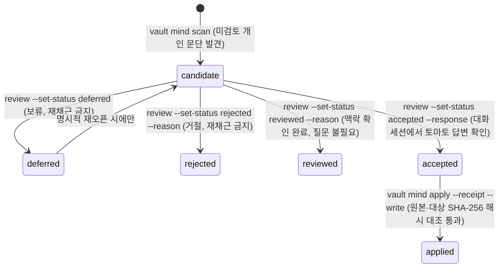

- table of contents
{:toc}

> 이 문서는 **[[2편] 4,400개의 흩어진 생각에 척추를 세우고 도구의 착각까지 도려내다](/tag-ontology-engineering/2-vault-knowledge-ontology/)**와 **[[10편] 경험이 글이 되고 의미가 스스로를 증명하기까지, 지식·성찰 컴파일러와 3대 의미 모형 감사](/tag-ontology-engineering/10-knowledge-blog-compiler-and-semantic-critique/)** 본편의 호흡을 해치지 않기 위해 분리한 심화 레퍼런스다. `vault-ontology`(`v0.1.0 ~ v0.6.0`)와 `vault-vector`(`v0.1.0`)의 정본 스키마, SQLite·RDF·SHACL 이중 검증 계약, 적대적 운영 감사 19건(`V-01~M-05`), 블로그 초안 및 `Mind Compiler` 파이프라인 규격, 그리고 의미 모형 감사 16건(`V060-01~16`)의 전수 판정 기록을 담고 있다.

---

## 스키마 게이트와 SQLite·SHACL 이중 검증 아키텍처 {#vault-schema-and-sqlite}

### 정본 Frontmatter 스키마와 13종 `type` 타이브레이커

볼트 안의 모든 마크다운 문서는 파일 경로와 `Git` 이력만으로 유도할 수 있는 중복 메타데이터(`updated`, 폴더 소속 `part_of` 등)를 배제하고, 오직 역량 질문(Competency Questions)에 답하는 필수·선택 필드만을 상단 frontmatter에 선언한다.

```yaml
---
type: concept          # 전역 필수. 13개 고정 어휘 중 택 1
tags:                  # 태그의 유일한 정본 자리 (type 직후 고정). 본문 인라인 태그(#태그) 금지
  - Stack/Python
summary: "한 줄 요약"  # 핵심 판단 구간(concept·procedure·reference·case) 전역 필수 (80자 이내)
builds_on:             # 선택. 이 문서를 이해하기 위한 직접 전제 개념 (최대 3개, 들여쓰기 리스트)
  - "[[CIDR]]"
derived_from:          # 선택. 직접 파생 출처 (문서 위키링크, experience 센티넬, 또는 ext: URI)
  - "[[실서비스 DB 커넥션 고갈 사건]]"
created: 2026-08-10    # 전역 필수 (실제 달력상 유효한 YYYY-MM-DD)
---
```

`type` 필드는 문서의 외형적 길이나 포맷이 아니라 **'어떤 상황에서 이 문서를 찾는가(쓰임)'**를 기준으로 단 13개의 값만 허용한다. `etc`나 `misc` 같은 회피용 배출구를 두지 않는 대신, 경계가 모호할 때는 아래의 타이브레이커 질문으로 판정한다.

| 구간 분류 | `type` 값 | 정의 및 경계 판정 기준 (Tie-breaker) | `summary` 계약 |
| :--- | :--- | :--- | :---: |
| **핵심 판단** | `concept` | 도메인 독립적 원리·이론 ("무엇인가 / 왜 그렇게 작동하는가?") | **필수 (80자 이내)** |
| **핵심 판단** | `procedure` | 따라 하면 같은 결과가 나오는 재현 절차 ("읽으면서 터미널이나 설정 창을 여는가?") | **필수 (80자 이내)** |
| **핵심 판단** | `reference` | 원리 설명이 아닌 규격·명령어·옵션·사실의 빠른 대조표 | **필수 (80자 이내)** |
| **핵심 판단** | `case` | 원칙이나 의사결정을 낳은 실제 사건·장애·실험의 시간순 전말 | **필수 (80자 이내)** |
| **거버넌스** | `principle` | 프로젝트와 일상을 관통해 지키는 불변 행동 규칙 (`299 Principles`) | 권장 |
| **거버넌스** | `decision` | 특정 시점·맥락에서 내린 아키텍처 및 기술 선택 선언 (`Decision Node`) | 권장 |
| **거버넌스** | `tradeoff` | 선택지 간의 득실과 기각 사유를 대조한 분석 노트 (`Trade-offs`) | 권장 |
| **실행·문서** | `project-doc` | 개별 프로젝트에 귀속된 요구사항·설계·운영 실무 문서 | 권장 |
| **실행·문서** | `hub` | 하위 폴더나 도메인 구역의 진입점 역할을 하는 목차·인덱스 노트 | 권장 |
| **실행·문서** | `log` | 시간순 사실 기록 위주의 작업 일지 및 데이 노트 | 권장 |
| **수집·성찰** | `capture` | 외부 도서·논문·아티클의 발췌 및 요약 (저자의 말) | 권장 |
| **수집·성찰** | `review` | 책·영화·게임·도구를 경험한 뒤 남긴 내 주관적 감상과 평가 | 권장 |
| **수집·성찰** | `reflection` | 개인의 경험에서 길어 올린 삶의 가치관·태도·내면 성찰 | 권장 |

### 7종 의미 관계와 한국어 시험 문장(Test Sentence) 계약

본문 안의 일반 위키링크(`links_to`)는 자유로운 연상 탐색을 위해 무명(untyped) 간선으로 유지하고, 에이전트와 그래프 엔진이 지식의 선후 맥락과 논리적 계보를 추론할 때 사용하는 핵심 관계만 frontmatter에 선언한다. 작성자의 주관적 기분에 따라 관계가 남발되는 것을 막기 위해, **한국어 시험 문장에 대입해 읽었을 때 참이 되는 경우에만 부여**한다.

| 관계 어휘 | 계층 | 한국어 시험 문장 (판정 기준) | 표준 어휘 매핑 및 실전 연결 예시 (`A` ➔ `B`) |
| :--- | :---: | :--- | :--- |
| **`builds_on`** | 구조(선행) | **A를 이해하려면 B를 먼저 읽어야 한다** | 최대 3개 직접 부모만 선언 (이행 폐쇄로 전체 학습 경로 계산) |
| **`derived_from`** | 의미(근거) | **A는 B에서 나왔다** (B가 없었으면 A를 못 썼다) | `prov:wasDerivedFrom` / `커넥션 풀 산정 원칙` ➔ `DB 커넥션 고갈 사건` |
| **`contradicts`** | 의미(대립) | **A와 B는 둘 다 참일 수 없다** | 대칭 반박 관계 / 상충하는 두 설계 대안 또는 구버전 가설에 대한 반례 |
| **`diverges_from`** | 의미(변형) | **A는 B를 바탕으로 삼되 일부 조건·방식을 바꿨다** | 오픈소스 레퍼런스 패턴을 로컬 환경 제약에 맞게 변형한 가이드 |
| **`applies`** | 의미(적용) | **A는 B라는 원칙·개념을 실제 사례에 적용했다** | 특정 프로젝트 설계서(`project-doc`) ➔ `측정 없이 최적화하지 마라`(`principle`) |
| **`informed_by`** | 의미(영향) | **A는 B의 영향을 받았다** (직접 파생 증거나 전제는 아님) | `prov:wasInfluencedBy` / 외부 키노트나 도서에서 영감을 얻은 설계 노트 |
| **`expresses`** | 의미(구현) | **A는 B라는 철학·가치를 구체적 형태로 구현한다** | 전용 CLI 하네스 설계 ➔ `자연어 규칙보다 기계적 강제가 우선한다` |
| **`answered_by`** | 의미(응답) | **A라는 질문이 B에서 실마리나 답을 얻는다** | `Mind Compiler` 질문 노트 ➔ 해결의 실마리를 찾은 성찰·기술 노트 |

설계 초기에는 '영향을 받았다'를 `informs`로 표기했으나, 표준 어휘 `prov:wasInfluencedBy`와 결합할 때 영어 능동태(`A informs B`)와 한국어 시험 문장('A는 B의 영향을 받았다')의 주어·목적어 방향이 역전되는 문제를 발견해 `informed_by`로 바로잡았다. 또한 '원칙을 어겼다'는 뜻의 `violates`는 실제 볼트 전수 조사 결과 문서를 작성하는 시점에 어긋남을 교정해 해소하므로 정적 문서 간 관계로 남지 않는다는 사실을 확인하고 제거했으며, 과거 문서 대체 이력을 뜻하던 `supersedes` 역시 `v0.4.0`에서 평문 `Changelog` 기록 방식으로 일원화하며 은퇴시켰다.

### `SQLite` 속성 그래프 vs `RDF/OWL` 추론기 9단계 실증 비교

동일한 볼트 코퍼스(실험 당시 4,200~4,400여 개 문서)를 `SQLite` 속성 그래프와 `W3C` 표준 `RDF/OWL` 트리플(`.ttl`)로 이중 모델링하여 `SPARQL` 및 `owlrl` 추론기를 대조한 실측 수치는 다음과 같다.

| 비교 축 | `SQLite` 속성 그래프 (`vault` CLI) | `RDF / OWL` 그래프 + `owlrl` 추론기 | 엔지니어링 판정 |
| :--- | :--- | :--- | :--- |
| **그래프 빌드 시간** | **0.8초** (`node` / `edge` / `tag` 단일 트랜잭션 적재) | **16.6초** (RDFS/OWL RL 추론 물질화 포함) | 상시 CLI 응답성에서 `SQLite` 압도적 우위 |
| **트리플 / 엣지 규모** | 12,266 ~ 16,467 엣지 (선언된 관계만 유지) | 27,587개 ➔ 추론 후 **77,478개 (2.81배 팽창)** | 증가분의 절반(14,656개)이 자기동일성 등 무의미한 공리 잡음 |
| **핵심 역량 질문 6종 응답** | **0.5ms** (`WITH RECURSIVE` 재귀 CTE) | 5ms ~ 300ms (`rdflib` `SPARQL` 파싱·탐색 오버헤드) | 전 질의에서 `SQLite`가 **10~600배 고속** |
| **추론기가 찾은 새 사실** | 기준선 (`q path`, `q near`, 역방향 조인) | **0건** | `SQLite` 재귀 CTE와 역조인으로 답할 수 없던 새 사실 없음 |
| **스키마 위반 검출** | `Python` 닫힌 세계(CWA) 검증기로 즉시 거부 | `OWL` 공리만으로는 **적발 0건** (`SHACL` 별도 필수) | `OWL`은 열린 세계 가정(OWA) 및 타입 강제 추론으로 작동 |

`SQLite`에서는 무거운 추론기 없이 아래의 재귀 CTE와 읽기 전용 `authorizer` 방어 계약을 결합해 안전하고 즉각적인 그래프 탐색을 수행한다.

```sql
-- 1. builds_on 선행 개념 이행 폐쇄(Transitive Closure) 탐색 (평균 0.5ms)
WITH RECURSIVE ConceptChain AS (
    SELECT src AS current_doc, dst AS prereq_doc, 1 AS depth
    FROM edge
    WHERE src = :target_doc AND kind = 'builds_on' AND dst IS NOT NULL
    UNION ALL
    SELECT c.current_doc, e.dst, c.depth + 1
    FROM edge e
    JOIN ConceptChain c ON e.src = c.prereq_doc
    WHERE e.kind = 'builds_on' AND e.dst IS NOT NULL AND c.depth < 6
)
SELECT prereq_doc, MIN(depth) AS min_depth
FROM ConceptChain
GROUP BY prereq_doc
ORDER BY min_depth DESC;
```

```python
# 2. vault q sql의 읽기 전용 다중 잠금 계약 (mode=ro + query_only + authorizer)
ALLOWED_SQLITE_ACTIONS = {
    sqlite3.SQLITE_SELECT,
    sqlite3.SQLITE_READ,
    sqlite3.SQLITE_FUNCTION,
}
ALLOWED_READONLY_PRAGMAS = {"table_info", "index_list", "index_info", "foreign_key_list"}

def readonly_authorizer(action: int, arg1: str | None, arg2: str | None, dbname: str | None, source: str | None) -> int:
    if action in ALLOWED_SQLITE_ACTIONS:
        return sqlite3.SQLITE_OK
    if action == sqlite3.SQLITE_PRAGMA and (arg1 or "").lower() in ALLOWED_READONLY_PRAGMAS:
        return sqlite3.SQLITE_OK
    # ATTACH DATABASE, INSERT, UPDATE, DELETE, CREATE 등 파일 생성·변조 시도 원천 차단
    return sqlite3.SQLITE_DENY
```

### `SHACL` 닫힌 세계 의미 검증과 `vault-vector`(`vv`) 4부작 작성 루프

`OWL`의 열린 세계 가정(OWA)이 놓치는 의미론적 계약(예: `applies` 관계의 대상이 반드시 `principle` 문서이거나 아카이브된 근거여야 한다는 규칙, 핵심 판단 문서의 근거 연결 권고 등)은 닫힌 세계 검증 표준인 `SHACL`(`pyshacl`)과 `Python` 정적 검증기로 이원화하여 검사한다. 동시에 선언된 간선이 없는 문서들 사이의 의미적 거리는 로컬 교차언어 임베딩(`dragonkue/snowflake-arctic-embed-l-v2.0-ko`, 49,105 청크) 기반의 `vault-vector`(`vv`)가 담당한다.

| 작성 단계 | 실행 명령 | 내부 동작 및 검증 지표 |
| :--- | :--- | :--- |
| **1부: 배치 (Placement)** | `vv place --title ... --summary ... --type ...` | 743개 폴더의 문서 평균 벡터(centroid) 카드와 `--type` 필터 결합. Leave-one-out 검증 기준 **Top-5 정답률 83.4%** (대분류 99.5%) |
| **2부: 대조 (Contrast)** | `vv search "..." -k 10 --near` | 코사인 유사도 Top-K 후보(골드 질의 캘리브레이션 임계치 `0.423` / `0.468`)와 각 후보의 `SQLite` 1홉 선언 이웃을 동시 인출해 중복·모순 사전 해소 |
| **3부: 생성 (Creation)** | `vault new --type ... --title ... --dir ...` | 쓰기 경계·심볼릭 링크·스키마·태그 화이트리스트(`vault tags`)·본문 인라인 태그 금지 통과 시에만 원자적 파일 생성 후 `vv index` 증분 갱신(무변경 시 1초) |
| **4부: 연결 (Linking)** | 인간 승인 또는 `proposed:` 격리 | 본문에 이미 명시된 출처만 즉시 `asserted` 간선으로 기록하고, 검색으로 발견한 후보는 인간 승인 전까지 `proposed:` 블록에 분리 |

[2편 본문으로 돌아가기](/tag-ontology-engineering/2-vault-knowledge-ontology/)

---

## v0.1.1 적대적 운영 감사: V-01~M-05 전수 판정과 doctor 진단 {#vault-v011-audit}

단위 테스트 466건이 통과하던 `v0.1.0` 상태에서 `Antigravity`의 조율 아래 `Codex`와 `Gemini`가 격리된 합성 볼트와 읽기 전용 실자료 대조를 통해 찾아낸 **19개 운영 경계 반례(`V-01 ~ M-05`)의 전수 판정 및 수정 기록**은 아래와 같다.

### 적대적 반례 19건(`V-01 ~ M-05`) 전수 판정 및 방어 계약표

| ID | 재현된 반례 및 취약점 | 판정 | `v0.1.1` 반영 및 방어 계약 |
| :--- | :--- | :---: | :--- |
| **`V-01`** | `vault new`에 상대·절대 경로 탈출 지정 시 볼트 밖에 폴더(`mkdir`)가 먼저 생성됨 | 수용 | 쓰기 경계·심볼릭 링크·제목 구분자 검사와 스키마 검증이 모두 성공한 뒤에만 디렉토리 생성 및 원자적 게시 |
| **`V-02`** | `vault ingest` 시 관계 옵션 미지정(`None`)이 초안의 기존 관계를 덮어써 유실시킴 | 수용 | 옵션 미지정(`None`)과 빈 리스트를 구분해 초안의 `builds_on`/`derived_from` 보존, `tags`를 `type` 직후로 고정 |
| **`V-03`** | `src=dest` 동일 파일에 `--force --rm` 실행 시 결과물까지 스스로 삭제(`self-deletion`) | 수용 | 동일 실체 파일 자기 삭제 원천 거부. 내부 `--rm` 이동 시에만 출발지 자신을 동명이인 후보에서 제외(제3의 동명이인은 유지) |
| **`V-04`** | `vault new`가 본문 인라인 태그(`#태그`) 위반 문서를 생성 단계에서 통과시킴 | 수용 | 생성·이관 단계에서도 `lint`와 동일한 본문 태그 금지 정책 강제 (단, 미작성 미래 문서에 대한 본문 링크 전면 거부는 기각) |
| **`V-05`** | `vault build` 도중 파일 읽기 실패 시 기존 `SQLite` 테이블이 `DROP`된 빈 캐시만 남음 | 수용 | 임시 `SQLite` 파일에 빌드를 완주한 뒤에만 원자적 교체, 실패 시 직전 정상 캐시 유지(`WAL` 동시 사용 감지 시 중단) |
| **`V-06`** | `vault q sql`에서 `SELECT` 뒤 세미콜론·주석 우회나 `ATTACH DATABASE`로 임의 파일 생성 | 수용 | 단순 `SELECT` 접두사 검사를 폐기하고 `mode=ro`, `query_only`, 확장 로딩 비활성화, `authorizer` 화이트리스트 다중 잠금 |
| **`V-07`** | `summary`에 개행·콜론·따옴표 포함 시 YAML 파손 및 중복 top-level 키 허용 | 수용 | 큰따옴표 안전 인용(이스케이프)·역변환 복원 적용 및 중복 최상위 키 명시적 거부 (기존 노트 일괄 재포맷은 미수행) |
| **`V-08/09`** | 명시적 상대 경로보다 정렬상 앞선 동명이인이 우선 선택되거나 확장자·`NFC` 비대칭 발생 | 수용 | 완전 경로 일치를 suffix보다 우선 해석하고 CLI 입력의 유니코드 `NFC`·`.md` 확장자 유무를 일관되게 정규화 |
| **`G-01`** | `vault doctor`가 `Git` 기본 8진수 이스케이프 때문에 한글 노트의 삭제·축소를 100% 놓침 | 수용 | `git ls-files -z`·`diff --name-only -z`의 `NUL` 바이트 분리와 `--literal-pathspecs` 복구 도입 (무조건 `NFC` 변환안은 기각) |
| **`G-02`** | `derived_from: experience` 등 스칼라 표기를 `SQLite`와 `RDF`가 서로 다르게 해석 | 수용 | 단일 관계 해석 도우미 공유, `experience` 센티넬·`ext:` 외부 출처·단일 문서·빈 목록(`[]`)을 일관되게 구분 |
| **`G-03a`** | `900 Archive`에 실존하는 문서를 참조해도 무조건 깨진 링크(`broken`)로 판정 | 수정 수용 | 전체 Archive를 활성 노드로 편입하는 안은 기각하고, 파일 실존 시 `*_archived` 리터럴로 경로·상태만 보존해 `broken`과 분리 |
| **`G-03b`** | 동명이인 문서에 대한 섹션 링크(`[[동명이인#섹션]]`)가 첫 번째 후보에 조용히 오결합 | 수용 | 관계 필드와 본문 링크에서 동명이인 섹션 참조 시 유일한 폴더 경로 명시 강제 (`summary` 내 예시 문자열 검사는 과잉으로 제외) |
| **`G-03c`** | 문서 IRI 변환 시 `%25`, `%7B`, `%5C` 등 퍼센트 인코딩 문자가 이중 디코딩되어 파손 | 수용 | IRI 인코딩 시 1회, 디코딩 시 정확히 1회만 역변환하도록 교정하고 특수문자 반례 회귀 테스트 추가 |
| **`G-04`** | 같은 폴더 소속(`part_of`)이라는 이유만으로 `knowledge-elevate` 승격 추천이 과잉 발화 | 수정 수용 | 추천 근거 조회에서만 `part_of` 제외 (`near` 화면의 폴더 문맥 표시와 실제 링크 기반의 추가 승격 제안 기능은 보존) |
| **`M-01`** | 아카이브된 문서를 가리키는 `applies` 관계가 `SHACL`에서 근거 누락 경고로 오탐됨 | 수용 | `SHACL` 규칙에서 `applies_raw` 및 `applies_archived`를 유효한 근거 표기로 인정하도록 보완 |
| **`M-02`** | 스칼라 관계나 한 문서를 특정하지 못하는 부분 폴더 경로 섹션 링크가 검증을 통과 | 수용 | `relation_links` 검증 공유, 후보가 2개 이상 남는 부분 경로 섹션 링크도 거부하되 기존 `lint` 예외는 유지 |
| **`M-03`** | `vault q sql`에서 대문자 `PRAGMA TABLE_INFO(...)` 실행 시 `authorizer`가 거부 | 수용 | `authorizer` 내부에서 PRAGMA 이름을 소문자로 정규화한 뒤 읽기 전용 화이트리스트와 대조 |
| **`M-04`** | `ingest --rm` 복사 후 원본이 외부에서 변경·삭제되었을 때 스키마 에러(코드 1)로 오안내 | 수용 | 삭제 전 원본 변경 감지 시 삭제를 중단하고, 목적지 파일 작성 여부를 명시한 운영 오류(종료 코드 `2`)로 분리 |
| **`M-05`** | 숨김 폴더나 `.`으로 시작하는 경로에 노트를 생성하면 스캔에서 영구 누락됨 | 수용 | 볼트 루트를 뜻하는 `--dir .`은 허용하되, 스캐너가 읽지 않는 숨김 디렉토리·파일 경로 생성은 사전 거부 |

### 실제 볼트 읽기 전용 대조 및 `vault doctor` 173건 정밀 분류

격리된 복사본에서 기존 466건에 새 반례 57건을 더한 **`523 passed`**를 확인하고, 실제 볼트에서는 내가 명시적으로 승인한 단 두 줄(특수문자가 포함된 박제 노트의 `summary` 인용 보강 1줄, 임베디드 PoC 가이드의 동명이인 설계서 섹션 링크 폴더 경로 보강 1줄)만 최소 교정한 뒤 수정 전후 코드를 읽기 전용으로 대조했다.

| 읽기 전용 실측 항목 | 기존 코드 (`v0.1.0`) | 수정 코드 (`v0.1.1`) | 세부 내역 및 운영 경계 해석 |
| :--- | :---: | :---: | :--- |
| **`vault lint` 위반 총계** | 919건 | 919건 | `unresolved body link` 888건, `summary missing` 21건, `type missing` 3건, `created missing` 3건, `unresolved builds_on` 3건, `summary too long` 1건 (기존 코퍼스 부채로 분리) |
| **`SHACL` violation** | 21건 | 21건 | 필수 필드 누락 등 닫힌 세계 제약 위반 수 동일 유지 (종료 코드 `1` 정상 반환) |
| **`SHACL` warning** | 49건 | **45건** | 스칼라 `derived_from` 및 `archived` 근거 인식으로 도구의 오탐 경고 4건 감소 |
| **RDF `archived` 의미 참조** | 0건 (`broken` 오분류) | **3건** (전체 간선 66건) | 의미 관계의 아카이브 참조 3건과 일반 본문 링크를 포함한 전체 아카이브 간선 66건을 구분 보존 |
| **`SQLite` 노드 / 엣지 / 태그** | 4,251 / 16,467 / 3,637 | 4,251 / 16,467 / 3,637 | 활성 그래프 위상 무변화 확인 |

또한 `G-01` 수정으로 한글 경로 파싱이 정상화된 `vault doctor`를 복구 옵션(`--restore`) 없이 읽기 전용으로 실행했을 때 `missing 173건`, `shrunk 1건`, `iCloud placeholder 0건`이 관측되었다. 이를 무작정 파일 유실 사고로 단정하지 않고 전수 분류한 결과는 다음과 같다.

- **내용이 100% 동일한 파일이 다른 경로에 존재하는 경우 (`120건`)**: 과거 디렉토리 구조 개편 과정에서 파일이 이동되었으나 이전 경로 기록과 대조된 후보들이다.
- **동일한 파일명은 존재하나 본문 내용이 일부 달라진 경우 (`11건`)**: 이동 후 후속 편집이 일어났거나 동명이인 문서인 후보들이다.
- **동일한 이름의 후보를 찾지 못한 경우 (`40건`)**: 문서 제목 자체가 변경되어 이동되었거나 의도적으로 폐기된 후보들이다.
- **개인 기록 구역의 삭제 후보 (`2건`) 및 축소 후보 (`1건`)**: 에이전트가 원문 의미를 임의로 해석하거나 자동 복구하지 않고 인간 저자의 직접 확인 대상으로 남겼다.

[2편 본문으로 돌아가기](/tag-ontology-engineering/2-vault-knowledge-ontology/)

---

## v0.3.0 ~ v0.5.0: 저장소 사건에서 단일 블로그 초안까지의 파이프라인 {#blog-pipeline}

### 저장소 패킷(`otlg work-pack`)의 5분류 편차와 ADR 5축 상태 계약

코드 저장소(`repo-ontology v0.4.0`)와 지식 볼트(`vault-ontology v0.3.0 ~ v0.5.0`)는 각자의 정본(SSOT) 주권을 침범하지 않는다. 계획서(`docs/plans`), 아키텍처 결정(`docs/adr`), 실행 대장(`Worklog`), 소스 코드는 저장소가 정본을 쥐고, 볼트는 휴대용 JSON 패킷(`repo-work-pack/1`)을 인수해 사건(`Case`)과 교훈(`Learnings`), 범용 지식(`Principle`/`Decision`) 및 블로그 초안으로 정제한다.

이 과정에서 에이전트가 작업 결과를 과장하거나 왜곡하지 못하도록 두 가지 분류 계약을 강제한다.

1. **`plan_vs_actual` 5분류**: 계획과 실제 실행의 관계를 `matched_plan`(계획대로 일치), `adapted_within_goal`(목표 안에서 구현 방식 조정), `considered_not_taken`(후보로 검토만 하고 채택하지 않은 대안), `tried_and_rejected`(실제 구현·실험 후 기각한 시도), `expected_red` vs `actual_failure`(TDD의 정상적인 첫 RED 실패와 예기치 못한 실제 장애 분리)로 엄격히 구분한다.
2. **ADR 5축 상태 분리**: 저장소 ADR 문서의 상태가 `accepted`라고 해서 코드 구현이나 성능 효과가 입증되었다고 추론하지 않는다. `decision`(결정 여부), `implementation`(코드 반영 여부), `validation`(테스트·실측 검증 여부), `deployment`(배포 여부), `current_comparison`(현행 코드와의 일치·드리프트 여부)을 분리 기록하며, 미구현 ADR을 시드로 삼을 때는 주장 상한을 `claim_ceiling: design_rationale_only`로 못 박는다.

### 역할 매핑(`vault work-intake`)과 `v0.4.0` 지식 Closure

`vault work-intake PACKET.json --map workspaces.json --write` 명령은 폴더 번호에 의존하지 않고 아래와 같은 역할 매핑(`vault-workspaces/1`)을 통해 패킷을 인수한다. 원본 증거 패킷은 비공개 `.vault-work/evidence/` 디렉토리에 제한된 권한으로 보존되며, 동일 패킷을 재실행하면 중복 노트를 찍어내지 않고 `already_received`를 반환한다.

```json
{
  "schema_version": "vault-workspaces/1",
  "projects": {
    "cupus": {
      "repository_ids": ["cupus-mvp"],
      "roles": {
        "hub": "300 Runtime/303 Personal/303.10. CUPUS/303.10.0. Core Files",
        "references": "300 Runtime/303 Personal/303.10. CUPUS/303.10.2. References",
        "ideas": "300 Runtime/303 Personal/303.10. CUPUS/303.10.3. Ideas",
        "learnings": "300 Runtime/303 Personal/303.10. CUPUS/Learnings",
        "cases": "300 Runtime/303 Personal/303.10. CUPUS/Learnings/Cases"
      }
    }
  }
}
```

이어진 `v0.4.0`(`558 passed`)에서는 저장소와 볼트 사이의 이중 관리 부채를 걷어내는 **Knowledge Closure**를 단행했다.
- **`supersedes` 완전 은퇴**: 새 문서 생성·이관·수정 시 빈 값을 포함한 모든 `supersedes` 입력을 거부하고 `SQLite`/`RDF`/`SPARQL`/`blog-pack`에서 대체 간선을 제거했다. 기존 볼트 문서 9개에 남아 있던 13개 대체 제목은 가짜 `derived_from`이나 외부 URI로 날조하지 않고 각 문서의 평문 `Changelog`에 이관했다.
- **`Progress Note` 스테이징 폴더 은퇴**: 중간 복사본 폴더에 남아 있던 9개 파일을 실제 성격에 따라 역사적 저장소 산출물(4건), 미가용 저장소 계획 레퍼런스(1건), 사건 `Case`(1건), 벤치마크 레퍼런스(1건), 월간 로그(1건), 프로젝트 학습 노트(1건)로 정밀 분류해 이관하고 빈 폴더만 정리했다.
- **실무 대장 정본 일원화 및 TDD `/go Step 7` 분리**: 두 실무 프로젝트의 볼트 대장과 저장소 대장을 행 단위로 전수 대조하여 볼트에만 있던 고유 기록(10행 및 1행)을 보존한 뒤 저장소 단일 정본으로 통합했다. 또한 TDD 워크플로우의 마지막 단계인 `Step 7 (Knowledge & Feature Closure)`은 코드 테스트 게이트 통과 여부와 독립적으로 동작하여, 지식 정리 미완료가 다음 코드 사이클 진입을 막거나 가짜 RED 테스트가 되지 않도록 분리했다.

### `vault blog-pack` 5채널 예산과 장르별(`A/E/C/G` 및 `C/study`) 검수 슬롯

시드 문서에서 출발하는 `vault blog-pack`은 기본 예산(최대 40노드, 500엣지, 원문 보존 600KB, 단일 소스 최대 500KB, 발췌문 조각당 최대 6,000자, 탐색 깊이 2홉) 안에서 5개 채널(`promotions`, `prerequisites`, `provenance`, `references`, `discovery`)과 6종 특수 의미 참조(`semantic_references`)를 수집한다. 6,000자 상한에 걸려 잘린 발췌 조각(`truncated: true`)은 검수 슬롯의 근거로 인정되지 않는다.

1차 실행이 반환한 `fragment_id` 목록을 실제로 읽은 뒤, 장르와 프로파일에 맞는 필수 검수 슬롯(`--slots review.json`)을 제출해야 패킷 상태가 `incomplete`에서 `answered`로 전이된다.

| 장르 및 프로파일 | 주장 상한 (`claim_ceiling`) | 필수 검수 슬롯 (`required_slots`) | 핵심 제약 및 검증 규칙 |
| :--- | :--- | :--- | :--- |
| **`Genre A`** (실무 사건·트러블슈팅) | 실측된 사건 및 조치 범위 | `situation`, `action`, `observed_result`, `time_bounds`, `privacy_review` | 실제 관측 결과와 사건의 시간 경계 필수 |
| **`Genre E`** (아키텍처·설계 결정) | `design_rationale_only` (미구현 ADR 시) | `decision`, `alternatives`, `forces`, `costs`, `review_conditions`, `privacy_review` | 드리프트·대체된 ADR은 `current_drift_note` 추가 필수 |
| **`Genre C / applied`** (독서·학습 실전 적용) | 실제 적용 및 관측 범위 | `reading_source`, `applied_change`, `observation`, `limits`, `privacy_review` | 원문 출처와 코드/시스템에 실제 적용한 변화·관측 필수 |
| **`Genre C / study`** (`v0.5.0` 대화형 학습) | `understanding_and_assessment_only` | `reading_source`, `worked_example`, `learning_questions`, `understanding_delta`, `author_assessment`, `limits`, `privacy_review` | 배포·벤치마크 재현 주장 금지. 논문 사실·예제·질문·저자 평가를 엄격히 분리 |
| **`Genre G`** (개인 성찰 에세이) | 개인 성찰 범위 | `author_question`, `author_position`, `privacy_review` | 에이전트가 요약한 `Harvest` 텍스트는 저자의 성찰 근거로 사용 불가 |

```json
{
  "reading_source": {"reviewed": true, "reviewer": "human:declared", "fragment_ids": ["frag-01"]},
  "worked_example": {"reviewed": true, "reviewer": "agent:Codex", "fragment_ids": ["frag-02"]},
  "learning_questions": {"reviewed": true, "reviewer": "human:declared", "fragment_ids": ["frag-03"]},
  "understanding_delta": {"reviewed": true, "reviewer": "human:declared", "fragment_ids": ["frag-03"]},
  "author_assessment": {"reviewed": true, "reviewer": "human:declared", "fragment_ids": ["frag-04"]},
  "limits": {"reviewed": true, "reviewer": "agent:Codex", "fragment_ids": ["frag-04"]},
  "privacy_review": {"reviewed": true, "reviewer": "human:declared", "fragment_ids": ["frag-01", "frag-04"]}
}
```

### 단일 초안(`vault blog-draft`) 비공개 영수증과 `vault blog-gate` 충돌 보호

`v0.5.0`부터는 과거의 `뼈대.md` + `post.md` 이중 파일 생성을 폐기하고, 시드 문서에 `derived_from`으로 직결되는 **단 하나의 초안 마크다운 파일**(`{sequence} {title}.md` 또는 편집 ID를 지정한 `{file_prefix} {title}.md`)과 **비공개 JSON 영수증(`.vault-work/blog/<request_id>.json`)**만 생성한다.

```json
{
  "file_prefix": "C5",
  "title": "고정된 CLI를 넘어 코드를 합성하는 그래프로",
  "directory": "300 Runtime/330 Blog/330.1. Tech/C. 독서·학습 (배운 것)",
  "privacy": {
    "reviewed_by": "토마토",
    "literals": ["PRIVATE_PROJECT_NAME"],
    "patterns": ["\\b\\d{12}\\b"]
  },
  "public_brief": {
    "one_sentence": "Code-on-Graph 논문의 핵심 메커니즘과 한계를 대화형 학습으로 해부한다.",
    "sections": [
      {
        "heading": "고정된 도구의 한계와 코드 합성",
        "question": "왜 정적 쿼리만으로 부족한가?",
        "facts": ["논문 Table 4와 Figure 8·9의 지표를 구분해 서술한다."]
      }
    ]
  }
}
```

생성된 초안은 `vault blog-gate`의 2단계 결정론적 검사를 거친다.
- **`--stage draft` (자동화 검증 단계)**: 본문·코드 블록·주석 내 비공개 리터럴 및 정규식 패턴 노출, 본문 내 `# `(H1) 사용, 엠대시, 장식용 이모지, 습관적 번호 헤딩(`## 1. `)을 차단한다. 동시에 원본(`--original`) 대비 작가 고유의 익살 표현(취소선 `~~...~~`, 이탤릭 괄호 독백 `*(...)*`, 여담 콜아웃)이 100% 보존되었는지 대조한다. 만약 보호된 익살 구절 내부에 비공개 금칙어가 포함된 경우에는 기계가 문장을 임의로 뜯어고치지 않고 **`AUTHOR_WIT_PRIVACY_CONFLICT`** 진단을 반환해 인간 저자에게 결정을 위임한다.
- **`--stage publication` (최종 발행 게이트, 기본값)**: 자동화 검사를 모두 통과했더라도 인간 저자의 최종 익명화·문체 승인(`reviewed_by`)이 완료되기 전까지는 `status: incomplete`(`review_diagnostics`)를 반환하여 성급한 발행을 막는다.

[10편 본문으로 돌아가기](/tag-ontology-engineering/10-knowledge-blog-compiler-and-semantic-critique/)

---

## 외부 도서 아카이브(ext:)와 내면 성찰 Mind Compiler {#mind-compiler}

### 외부 아카이브 참조(`ext:repo:...`) 문법과 POSIX `O_NOFOLLOW` 검증 계약

도서 챕터 필사본을 볼트 외부 로컬 아카이브(`~/Documents/books-notes`)로 분리하면서, 볼트 내부의 해석 노트에서 외부 원문의 정확한 장·절을 가리키기 위해 도입한 논리적 URI 규격은 다음과 같다.

- **정규 문법**: `ext:repo:<repository-id>:<relative-path>[#<literal heading>]`
  - `<repository-id>`는 영숫자로 시작하는 ASCII 영숫자·점(`.`)·밑줄(`_`)·하이픈(`-`)만 허용한다.
  - `<relative-path>`는 상대 경로여야 하며 빈 세그먼트, `.`, `..`, 백슬래시(`\`), 제어문자, 드라이브 문자, 절대 경로(`ext:/Users/...`)를 전면 거부한다.
  - 옵시디언의 위키링크 별칭(`|`) 및 블록 참조(`^`) 문법과 충돌하지 않도록 리터럴 `|`와 `^`는 각각 `%7C`, `%5E`로 퍼센트 인코딩하며, 파일시스템 조회 시 정확히 1회만 디코딩해 경로 탈출 여부를 재검사한다.
- **관계 허용 경계**: 7대 의미 관계(`derived_from`, `informed_by`, `diverges_from`, `contradicts`, `applies`, `expresses`, `answered_by`)는 `ext:` 참조를 허용하지만, 볼트 내부의 학습 선행 순서를 뜻하는 **`builds_on`은 모든 `ext:` 값을 거부**한다.
- **오프라인 기본 검사와 `--external` 실존 검증의 분리**:

| 실행 명령 | 검증 범위 | 반환 상태 (`status`) | 보안 및 그래프 처리 원칙 |
| :--- | :--- | :--- | :--- |
| `vault lint --json` (기본) | 오프라인 정규식 문법 및 관계 허용 정책만 검사 | `unchecked` 또는 `invalid_uri` | 외장 디스크 미마운트 상태에서도 생성·린트가 실패하지 않음 |
| `vault lint --external --json`<br>`vault validate --external --json` | `.vault-external.json` / `VAULT_EXTERNAL_REPOS` 매핑 기반 실제 파일 및 ATX/Setext 헤딩 대조 | `resolved`, `missing_file`, `missing_anchor`, `unavailable`, `invalid_uri` | POSIX `O_NOFOLLOW`(`openat`)로 심볼릭 링크 루트 탈출 및 TOCTOU 디렉토리 바꿔치기 차단. 동명 중복 헤딩은 모호성 진단과 함께 `missing_anchor` 반환 |
| `vault build` & `vault q external` | `SQLite` `external_edge(src, kind, uri)` 적재 | 정상 의미 간선 유지 | 가짜 Vault 문서 노드를 만들지 않아 고아 노트나 미해결 내부 링크 통계를 오염시키지 않음 |

### 발화 주체(Authorship) 공유 선택기(`vault.mind_sources`)와 `vaultvec weave`

개인의 내면 기록을 `500 Mind Compiler`의 삶의 질문들과 연결할 때 가장 중요한 원칙은 **'에이전트가 작성한 요약문이나 외부 책의 문장을 토마토 본인의 생각으로 둔갑시키지 않는 것'**이다. 이를 위해 `vault-ontology`와 `vault-vector`는 단일 선택기 모듈인 `vault.mind_sources`를 공유한다.

| 대상 경로 및 구역 | 채택하는 개인 발화 범위 (`Included`) | 원천 배제하는 영역 (`Excluded`) |
| :--- | :--- | :--- |
| **`300 Runtime/301 Day Notes`** | `Track`, `Memo`, `Echo` 섹션의 개인 산문 | 에이전트 작업 요약인 **`Harvest` 및 그 하위 섹션 전체**, 출처가 혼합된 `Seeds` 섹션 |
| **`100 Private Log/102 Monthly Diary`** | 개인이 작성한 월간 일기 본문 전체 | AI 작성으로 명시된 분석 블록 및 코드 펜스 블록 |
| **`100 Private Log/103 Debugger`** | `103.1` ~ `103.4` 하위의 개인 내면 디버깅 구절 | 외부 인용문 및 코드 블록 |
| **`300 Runtime/320 Career/320.6 Reflection`** | 커리어 회고 내 개인 성찰 문단 | 에이전트 첨삭·요약 구절 |
| **`600 Content Observatory/601 Books`** | 도서 대표 카드 노트의 **개인 감상·내 생각·독서 이유** 섹션에 한정 | 도서 갤러리, **챕터별 원문 요약(`capture`)**, 책 속 코드 예제 |

이 선택기 위에서 동작하는 `vaultvec weave`와 `vault mind`는 기존 초기 구현의 두 가지 구조적 결함을 제거했다.
1. **8구간 샘플링 폐기와 900자 전수 검색**: 긴 월간 일기에서 임의로 8개 구간만 샘플링하던 방식을 폐기하고, 선택된 모든 개인 문단을 최대 900자 검색 구간으로 나누어 **마지막 짧은 꼬리 문단까지 빠짐없이 전수 검색**한다. 전체 개인 본문이 40자 미만이면 모델을 적재하지 않고 조용히 종료하며, 개인 일기 구절은 벡터 미적중 로그(`absent.jsonl`)에 절대 기록하지 않는다.
2. **실제 질문 폴더 고유 ID 보존**: `500 Mind Compiler/Q*/_Question.md`를 직접 스캔해 카탈로그를 구성한다. 결번인 `Q3` 때문에 네 번째 폴더인 `Q4. Enriching Life`를 배열 순번에 맞춰 `Q3`으로 잘못 압축하던 버그를 제거하고, `status: archived`인 질문을 제외한 실제 고유 질문 ID를 그대로 사용한다.

### `.vault-mind/ledger.json` 상태 전이와 `apply --receipt` SHA-256 봉인 규격

`vault mind` CLI는 그 어떤 경우에도 마크다운 파일을 직접 수정하거나 개인의 성찰 결론을 지어내지 않는다. 모든 발견과 검토 상태는 볼트 루트에 바인딩된 비공개 대장(`.vault-mind/ledger.json`, 논블로킹 파일 락 및 원자적 교체 적용)에서 관리되며, 후보 ID는 `(source_path, heading, normalized_paragraph_hash, occurrence)`로 결정론적 식별성을 유지한다.



메인 대화 세션에서 토마토와 문답을 거쳐 `_Question.md` 또는 하위 질문 문서를 직접 갱신한 뒤에는, 아래와 같은 영수증 JSON을 `vault mind apply --id CANDIDATE_ID --receipt receipt.json --write --json`에 제출해 완료를 봉인한다.

```json
{
  "items": [
    {
      "candidate_id": "mc_8f3a19c2e4b0...",
      "source_sha256": "a1b2c3d4e5f60718293a4b5c6d7e8f90123456789abcdef0123456789abcdef0",
      "target": "500 Mind Compiler/Q5. Healthy Mind Body/_Question.md",
      "target_sha256": "f0e1d2c3b4a5968778695a4b3c2d1e0f9a8b7c6d5e4f3a2b1c0d9e8f7a6b5c4d",
      "response": "대화 세션에서 토마토가 직접 확인하고 답한 성찰 원문"
    }
  ]
}
```

`apply` 명령은 기본값이 `--dry-run`이며, 제출된 모든 항목의 원본 파일 64자리 소문자 `SHA-256` 해시, 이미 수정된 대상 마크다운 파일의 `SHA-256` 해시, 그리고 `accepted` 단계에 기록된 응답 문자열이 1바이트의 오차도 없이 일치할 때만 대장 상태를 `applied`로 전이한다.

[10편 본문으로 돌아가기](/tag-ontology-engineering/10-knowledge-blog-compiler-and-semantic-critique/)

---

## v0.6.0 의미 모형 감사: V060-01~16 반례와 해시 고정 베이스라인 {#vault-v060-audit}

### 『Semantic Modeling for Data』 기반 E / S / P 3관점 논박과 설계 합의

Panos Alexopoulos의 『Semantic Modeling for Data』를 바탕으로 정제한 `ontology-critique-practices v1.0.0`을 `vault-ontology`에 적용할 때, 우리는 무거운 학술 어휘를 추가하는 대신 **"기존 스키마와 쿼리가 원래의 의미를 왜곡하거나 불완전성을 숨기고 있지 않은가"**를 세 가지 관점(P1 의미 명시성 `E`, P2 공유성 `S`, P3 실용성 `P`)에서 먼저 논박했다.

| 감사 관점 | 초기 발제 요구 | 상호 논박 및 `v0.6.0` 최종 설계 선택 |
| :--- | :--- | :--- |
| **P1 의미 명시성 (`E`)** | 질의·투영·검증 과정에서 술어(Predicate), 정체성, 상태, 미확인 범위의 누락 제거 | `shared_ground`와 `blog_pack`에서 원래 간선의 실제 술어를 끝까지 보존하고, `raw`/`archived`/탐색 깊이 절단(`DEPTH_LIMIT`) 진단을 명시적 봉투 상태로 노출 |
| **P2 의미 공유성 (`S`)** | `experience`, `Question`, `informed_by`를 도구와 인간이 동일한 의미로 해석하는가 | `experience`는 공통 사건 개체가 아닌 '문서화되지 않은 경험' 출처 양식(Modality)으로 격리, `Question`은 문서와 섹션의 이중 역할로 정의 교정, `informed_by`는 직접 증거가 아닌 영향으로 명시 |
| **P3 실용성 (`P`)** | 형식성을 높이는 비용이 실제 역량 질문(`CQ`) 응답 품질을 개선하는가 | 6홉 경계 질의와 SQLite/SPARQL 얇은 투영 정렬만 보강. **거대한 상위 온톨로지(`BFO`), 전면 `OWL` 추론 물질화, 모든 간선의 Reification, 새로운 영구 문서 ID 도입은 과잉 규율로 기각** |

### `V060-01 ~ V060-16` 16개 반례 전수 판정 및 적용 기록

`Codex`의 읽기 전용 코드·실자료 최소 반례 재현과 `Antigravity`의 합의안 도출, 그리고 구현 중 독립 리뷰 에이전트가 추가 발굴한 후속 반례(`V060-11~16`)까지 총 16개 항목의 전수 기록은 다음과 같다.

| ID | 재현된 의미 왜곡 반례 | `v0.6.0` 해결 방식 및 계약 변경 |
| :--- | :--- | :--- |
| **`V060-01`** | `A contradicts X`와 `B informed_by X`가 `vault ask together`에서 모두 **`derived_from` 두 개로 둔갑** (술어 증발) | `shared_ground`가 `(target, [(subject, predicate), ...])` 형태로 원래 술어를 보존하도록 교정. 기본 공통 배경은 긍정적 4관계(`derived_from`, `diverges_from`, `applies`, `informed_by`)로 제한하고 `--all-relations` 옵션 분리 |
| **`V060-02`** | 서로 다른 시점의 개인 성찰·원칙 노트 **35개가 `experience`라는 하나의 공통 사건을 겪은 것처럼 묶임** | `experience` 센티넬을 일반 문서 ID 그룹핑 키에서 원천 제외하여 '문서화되지 않은 직접 경험'이라는 원래의 출처 양식(Modality) 의미 복원 |
| **`V060-03`** | 정상 경로와 미해결(`raw`) 경로가 섞이거나 끝단이 `Missing_raw`인데도 `status: answered`, `complete: true` 반환 | 깨진 경로만 있으면 `domain_status=broken`(봉투 `failed`), 정상과 미해결/아카이브가 섞이면 부분 경로와 함께 `status: incomplete` 반환 |
| **`V060-04`** | 8홉짜리 계보 사슬이 6홉 탐색 한계에서 잘렸는데도 `omitted_count: 0`, `complete: true`로 보고됨 | 실제 6홉에서 끝난 사슬과 미탐색 간선이 남은 6홉 프런티어를 구분해, 후자에는 `DEPTH_LIMIT` 진단과 `status: incomplete`, `complete: false`, `omitted_count: null`(미탐색 모집단 크기 미상) 부여 |
| **`V060-05`** | 스칼라 형태의 `builds_on: "[[A]]"`나 YAML flow-list(`[...]`)가 검증 후 그래프에서 조용히 증발 | `builds_on` 등 리스트 전용 관계의 스칼라 표기와 flow-list를 명시적 문법 오류로 거부. `ingest`는 정규화 덮어쓰기 전에 원문 문법을 먼저 검사 |
| **`V060-06`** | `SPARQL` 고아 노트 탐색에서 마크다운 내부의 `Insight` 섹션이 `A#인사이트 1.md`라는 가짜 고아 문서로 반환 | 고아 후보 주어를 문서 네임스페이스의 문서 클래스로만 한정하고, 섹션에 걸린 참조는 소유 문서로 투영해 `SQLite`와 정합성 일치 |
| **`V060-07`** | 한 문서 안에 `인사이트 1: A`와 `인사이트 1: B`가 함께 있을 때 축약 섹션 참조가 첫 항목에 임의 결합 | 완전한 헤딩 제목의 유일한 일치와 모호한 번호 축약을 구분하여, 동명·중복 번호 섹션이 존재할 때 첫 후보로 임의 확정하는 동작 제거 |
| **`V060-08`** | 선택 상태 필드(`status`, `as_of`, `needs_review`, `source_unknown`)가 스키마 문서에는 있으나 실제 문서 RDF 트리플에 미방출 | 4개 선택 상태 필드의 파서 검증·RDF 트리플 방출·`SHACL` 상태 계약을 일관되게 연결 |
| **`V060-09`** | 어휘 정의서의 `Question is NOT the document` 설명과 실제 `_Question.md` 문서/섹션 이중 역할이 충돌 | 과거 도메인 오염 공리까지 일괄 삭제하는 안은 기각하고, 문서와 섹션이 모두 보유할 수 있는 이중 역할(Role)로 자연어 정의와 계약 정렬 |
| **`V060-10`** | 외부 도서 참조(`ext:`)가 7종 의미 관계로 확장되었으나 `blog_pack`은 `derived_from`만 수집 | `blog_pack`에 6종 특수 의미 관계를 담는 `semantic_references` 채널을 추가하고 원래 술어·셀렉터·출처 양식(`lived`/`external_unchecked`/`resolved`) 보존 |
| **`V060-11`** | `.vault-warning-baseline.json`에 `[]`나 `null`, 잘못된 해시 형식이 들어오면 비구조화 예외(Traceback) 발생 | 베이스라인 최상위 JSON 타입과 64자리 해시 형식을 엄격히 검증하여 구조화된 입력 오류로 반환 |
| **`V060-12`** | `crossing` 교차 탐색에서 교차점이 발견된 경로에만 진단을 붙여, 교차 전 6홉 절단(`DEPTH_LIMIT`)이 은폐됨 | 교차 성립 여부와 무관하게 탐색 중 발생한 프런티어 절단(`DEPTH_LIMIT`)과 미해결 진단을 상위 봉투로 전파 |
| **`V060-13`** | 볼트에 실제로 `experience.md`라는 제목의 노트가 생기면 `blog_pack`의 경험 센티넬 출처가 그 노트로 빨려 들어감 | 파일 리졸버를 호출하기 전에 `experience` 센티넬을 먼저 분기하여 `dst`와 추가 홉 탐색을 비우도록 보호 |
| **`V060-14`** | frontmatter에 `"builds_on":`처럼 따옴표로 감싼 예약 관계 키를 적으면 파서와 `ingest` 검증을 우회 | 따옴표로 인용된 예약 관계 키 표기(quoted spelling)를 명시적 문법 오류로 거부 |
| **`V060-15`** | 잘못된 `status`나 날짜 값을 적었을 때 RDF 방출만 생략되어 `vault validate`가 에러 없이 통과 | 예약 관계 문법 오류와 상태·날짜 필드 검증 오류를 `validate` 리포트에 병합해 누락 없이 차단 |
| **`V060-16`** | 유효한 섹션 참조의 소유 문서 계산과 폴더 허브(`hub`) 연결 인정 범위가 `SQLite`와 `SPARQL`에서 불일치 | 공통 문서 투영 규칙, 7종 의미 관계, 폴더 허브 멤버십의 의미를 양쪽 엔진에서 동일하게 정렬하고 회귀 테스트 추가 |

### 선택 상태 필드의 RDF 매핑과 역량 질문(CQ) 회귀 맵

`V060-08` 및 `V060-15`를 통해 정렬된 선택적 frontmatter 상태 필드의 검증·방출 계약과 역량 질문(CQ) 회귀 대응표는 다음과 같다.

| Frontmatter 필드 | 허용 선언 값 | RDF 방출 형식 (`Turtle`) | 의미론적 해석 경계 |
| :--- | :--- | :--- | :--- |
| **`status`** | `archived`만 명시 허용 (활성 문서는 생략) | `v:status v:archived` | 활성 상태를 기본값으로 두며 임의의 상태 문자열 선언 거부 |
| **`as_of`** | 달력상 유효한 `YYYY-MM-DD` | `v:as_of "..."^^xsd:date` | 문서 전체의 기준 시점 (개별 섹션 날짜로 자동 복사하지 않음) |
| **`needs_review`** | 불리언 (`true` / `false`) | `v:needs_review true/false` | `false`를 명시한 경우에도 타입이 지정된 불리언 리터럴로 방출 |
| **`source_unknown`** | 불리언 (`true` / `false`) | `true`일 때만 부재 확인 사실 방출 | 출처를 찾아보았으나 없음을 확인한 상태 (`false`는 별도 주장을 방출하지 않음) |

| 역량 질문 (`CQ`) 및 목적 | `v0.6.0` 핵심 회귀 검증 내용 (`tests/test_semantic_integrity.py`) |
| :--- | :--- |
| **`C05 / C06` 공통 배경 탐색** | 원래 술어(`predicate`) 보존, `experience` 센티넬 그룹핑 제외, `--all-relations` 대칭 `contradicts` 질의 시점 계산 |
| **`C02 / C04` 출처 및 계보 추적** | 정상+`raw` 혼합 시 `incomplete` 전파, `broken` 단독 시 `failed`, `archived` 종단 분리, 6홉 `DEPTH_LIMIT`(`omitted_count: null`) |
| **`C07 / C09` 영역 간 교차 탐색** | 문서/섹션 역할 구분 및 프런티어 절단·미해결 진단의 누락 없는 상위 전파 |
| **`C08 / C30` 시간 및 상태 검토** | `status`, `as_of`, `needs_review`, `source_unknown`의 파서·RDF·`validate` 일관성 |
| **`C27` 질문 중심 탐색** | `Question`의 문서·섹션 이중 역할 유지 및 `SPARQL` 고아 노트 후보의 문서 클래스 한정 |
| **`Blog Evidence Handoff`** | 7종 의미 관계 전체 수집(`semantic_references`), `lived`/`external_unchecked`/`resolved` 구분, 외부 도서 본문 자동 반입 금지 |

### 해시 고정 경고 베이스라인(`.vault-warning-baseline.json`)과 `ESBI = N/A` 원칙

과거에 작성된 노트의 경미한 경고 때문에 새로 작성하는 노트의 검증 게이트까지 느슨해지는 일을 막기 위해, `v0.6.0`은 전역 면책 스위치 대신 **원문 파일 전체의 `SHA-256` 해시와 개별 경고 항목을 1:1로 묶은 베이스라인**을 도입했다.

```bash
# 1. 현재 볼트의 기존 경고(3건)를 파일 전체 SHA-256 해시와 함께 스냅샷으로 기록 (덮어쓰기 방지)
$ vault validate --write-baseline .vault-warning-baseline.json --json

# 2. 베이스라인 대조 감사: 해시가 그대로인 기존 경고는 baseline_findings로 분리하고,
#    새로 추가되었거나 파일이 1바이트라도 수정된 노트의 의미 링크 경고는 즉시 violation으로 격상
$ vault validate --baseline .vault-warning-baseline.json --audit --json
```

이 계약을 통해 수정된 문서는 과거의 경고 면책을 절대 물려받을 수 없으며, `SHACL` 위반(`violation`)이나 잘못된 외부 URI(`ext:` 절대경로 등)는 베이스라인으로도 면책되지 않는다. 또한 `vault new`와 `vault ingest`는 베이스라인 옵션과 무관하게 언제나 가장 엄격한 정적 검증을 집행한다.

최종적으로 `v0.6.0`은 전체 회귀 테스트 **`638 passed`** 및 런타임·테스트 `ruff check`를 통과했으며, 실제 볼트 빌드(`3,348 nodes`, `28,184 triples`)에서 `together` 질의의 `experience` 가짜 공통 타깃이 `0건`으로 소멸하고 각 간선의 고유 술어가 보존됨을 실증했다. 단, 독립된 인간 주석자 간 합의도($\kappa$) 실험이나 정밀도·재현율 측정을 수행하지 않았으므로 온톨로지 품질 점수인 **`ESBI`는 지어내지 않고 정직하게 `N/A`로 기록**하며, 기존 볼트에 남아 있던 `CUPUS` 노트의 절대경로 `ext:` 오류 2건(종료 코드 `1`) 역시 도구의 테스트 통과로 포장하지 않고 별도의 코퍼스 교정 과제로 명확히 분리해 두었다.

[10편 본문으로 돌아가기](/tag-ontology-engineering/10-knowledge-blog-compiler-and-semantic-critique/)
