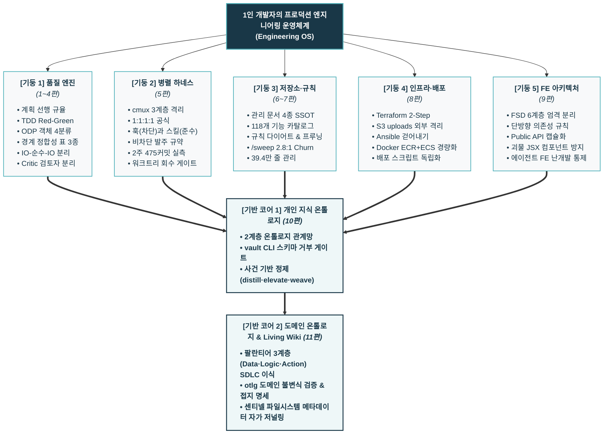
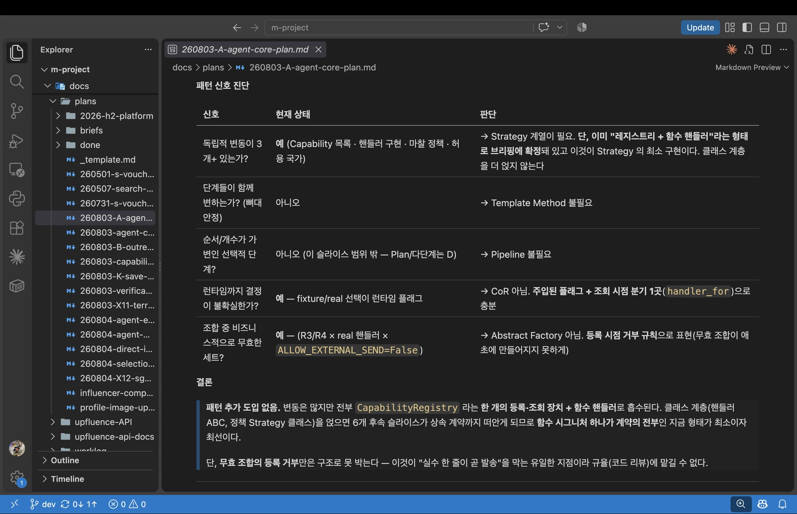

- table of contents
{:toc}

## 전체 시리즈 로드맵 안내

이 시리즈를 구성하는 12편의 실전 에세이와 다루는 핵심 화두다. 관심 있는 주제부터 먼저 살펴보면 되겠다.

| 글 제목 | 핵심 주제 |
|:---|:---|
| [[0편] 1인 개발자는 어떻게 자신만의 운영체계를 만드는가](/tag-ai-agent-architecture/0-engineering-os/) | 곱연산 통제 공식으로 쌓아 올린 1인 풀사이클 엔지니어링 운영체계(Engineering OS) 조감도 |
| [[1편] AI에게 욕하던 신입이 선생님을 위한 규칙을 만들기까지](/tag-ai-agent-architecture/1-ground-rules/) | 사수 없는 현장의 첫 실패, 즉각 코딩을 멈추고 계획(Plan)을 선행시키는 작업 규율 확립 |
| [[2편] 토큰 낭비라던 TDD가 어느새 제 종교가 되었습니다](/tag-ai-agent-architecture/2-tdd-religion/) | 비효율이라는 편견을 깬 TDD 루틴, 책·영상·실전 지식을 모듈형 검진 시스템으로 자산화 |
| [[3편] 객체지향을 배웠으니 선생님을 가르쳐보겠습니다](/tag-ai-agent-architecture/3-teach-object-design/) | 원시값 집착을 해결하는 객체 분류, 계획 단계에 주입하는 CQS와 불변성·설계 압력 |
| [[4편] 역시 내 테스트 스위트는 잘못됐다](/tag-ai-agent-architecture/4-all-passed-empty-screen/) | FE-BE 경계 정합성 표 3종, IO-Pure-IO 분리와 확증 편향을 깨는 독립 검토자(`/test-harden`) |
| [[5편] 같은 브랜치에서 에이전트끼리 사이좋게 코딩할 리가 없어](/tag-ai-agent-architecture/5-cmux-parallel-worktree/) | cmux 워크트리 1:1:1:1 격리, 하드 바운더리 훅과 2주 475커밋 Non-blocking 발주 체계 |
| [[6편] 에이전트가 기억상실증입니다만, 문제라도?](/tag-ai-agent-architecture/6-repo-governance/) | 휘발되는 기억을 대체하는 저장소 SSOT 문서 4종과 arc42·C4 기반 10초 온보딩 체계 |
| [[7편] 규칙이 64개나 있는데 왜 코드를 못 짜니](/tag-ai-agent-architecture/7-rule-pruning/) | 64개 규칙 과잉이 부른 컨텍스트 질식, 린터 승격 프루닝과 2.8:1 Churn 방어 `/sweep` |
| [[8편] 어차피 도커인데 앤서블은 왜 썼을까](/tag-ai-agent-architecture/8-cloud-infra-evolution/) | Terraform 2-Step과 S3 외부 격리, Ansible 폐기 후 ECR+ECS 3중 안전망 배포 파이프라인 |
| [[9편] 어차피 프론트엔드인데 아키텍처가 왜 필요해?](/tag-ai-agent-architecture/9-frontend-fsd/) | 13만 줄 컴포넌트와 104건 순환 참조, FSD 6계층 단방향 의존성과 Public API 무결 이관 |
| [[10편] 기록의 악마는 고립된 노트의 꿈을 꾸지 않는다](/tag-ai-agent-architecture/10-knowledge-ontology/) | 5천 개 노트를 엮는 2계층 관계망, vault CLI 스키마 게이트와 사건 기반 개인 지식 온톨로지 |
| [[11편] 우리는 이미 각자의 운영체제를 짜고 있었다](/tag-ai-agent-architecture/11-external-workflow-and-ai-os/) | 팔란티어 3계층(Data·Logic·Action) 기반 코드 바인딩 도메인 온톨로지(otlg)와 Living Wiki |

### 심화 자료 (Deep-Dive) 아카이브

본편에서 덜어낸 상세 규칙 카탈로그, 코드 전문, 스크립트, 비교 매트릭스는 아래 심화편에 수록했다.

| 심화편 제목 | 연결 본편 | 핵심 수록 근거 및 레퍼런스 |
|:---|:---:|:---|
| [심화 \| 객체 설계 46규칙과 테스트 하든·QA 게이트](/tag-ai-agent-architecture/deep-dive/tdd-and-object-design/) | `3·4편` | Object Design 46규칙, `/tdd-plan`·`/go` 코드 전문, `/test-harden` 매트릭스 및 Playwright QA |
| [심화 \| 병렬 워크트리 오케스트레이션과 저장소·규칙 거버넌스](/tag-ai-agent-architecture/deep-dive/worktree-and-repo-governance/) | `5·6·7편` | cmux 격리와 `spoke-guard` 훅, 6단계 Teardown, SSOT 문서 4종, 규칙 프루닝 및 `/sweep` 규격 |
| [심화 \| 인프라 자동화·FSD 슬라이스·외부 에이전트 생태계 비교](/tag-ai-agent-architecture/deep-dive/infra-fsd-and-ecosystem/) | `8·9·10·11편` | Terraform·ECS 배포 스크립트, FSD Steiger 설정, `vault` 스키마와 외부 하네스 비교표 |

---

## 이 글을 읽는 분들께: 곱연산 공식과 에이전트 통제 철학

2025년 여름, 사수도 리뷰어도 인수인계 문서도 없는 초기 스타트업에서 유일한 엔지니어로 첫 커리어를 시작했다. 손에 쥐어진 것이라곤 몇 편의 `AWS` 콘솔 녹화 영상과 초기 AI 에이전트뿐이었다. 기초 CS 지식도 운영 경험도 부족했던 내게 에이전트는 구원투수처럼 보였으나, 기능을 맡길수록 쏟아져 나온 것은 스파게티 코드와 런타임 에러, 살얼음판 같은 배포의 연속이었다.

그 실패의 늪에서 나를 건져 올린 것은 원인을 끝까지 물고 늘어져 고쳐내는 **'<mark class="kw-term">개선의 관성</mark>'** 하나였다. 현장에서 깨달은 답은 엔지니어링 산출물이 덧셈이 아니라 냉혹한 **곱연산 공식**을 따른다는 사실이었다.

$$\text{프로덕션 산출물} = \text{모델 지능} \times \text{사전 계획·검증 엔진} \times \text{물리적 격리 하네스} \times \text{아키텍처·저장소 거버넌스}$$

첫 항(모델 지능)을 아무리 높여도, 나머지 통제 항 중 하나라도 `0`이면 최종 산출물의 신뢰도는 `0`으로 수렴한다. 결정론적 제약이 없는 공간에서 에이전트는 기술 부채를 5배 속도로 증폭시킬 뿐이다. 1년 넘게 장애를 마주할 때마다 제약을 세운 끝에 나는 가장 본질적인 진실과 마주했다.

**"AI에게 코드를 맡겼을 때, 내가 지난 1년 동안 집요하게 고치고 통제해 온 대상은 결국 코드가 아니었다."**

정작 고쳐야 했던 것은 코드 작성 전의 계획과 검증 체계, 클라우드 인프라 경계, 다중 에이전트 격리 하네스, 그리고 기계의 망각을 이겨내는 저장소와 온톨로지 거버넌스였다. 이 글은 비전공자 1인 개발자가 쌓아 올린 **'1인 풀사이클 프로덕션 <mark class="kw-term">엔지니어링 운영체계(Engineering OS)</mark>'**의 총괄 조감도다.

---

## 한눈에 보는 엔지니어링 운영체계 5대 기둥 + 기반 온톨로지

{:width="700" loading="lazy"}

코드 작성 전 가변성과 결합도를 진단하고 객체 역할과 경계 정합성을 못 박는 TDD 계획서.
{:.figcaption}

- **품질 엔진 (`1~4편`)과 병렬 하네스 (`5편`)**: 계획(`Plan`)·실패 테스트(`RED`) 선행, 객체 분류와 CQS, FE-BE 경계 표 3종 및 독립 검토자(`/test-harden`)로 단일 세션 품질을 완성했다. 그 위에서 `작업 단위 = 브랜치 = 워크트리 = 에이전트 = 1:1:1:1` 격리와 하드 바운더리 훅, <mark class="kw-isolation">비차단(Non-blocking)</mark> 발주 및 <mark class="kw-term">6단계 Teardown 회수 게이트</mark>로 2주 475커밋을 소화했다.
- **저장소·인프라·FE 아키텍처 (`6~9편`)**: 휘발되는 기억을 <mark class="kw-ssot">관리 문서 4종</mark>과 `C4 Model`로 저장소에 외주화하고, 64개 규칙을 린터·훅으로 승격해 깎아내며 `/sweep`으로 39.4만 줄 코드의 Churn을 2.80:1로 방어했다. 인프라는 <mark class="kw-term">Terraform IaC</mark>와 `ECS` 3중 안전망으로 단순화했고, 프론트엔드 13만 줄은 `FSD` 6계층과 `steiger` 린터로 순환 참조 104건을 박멸했다.
- **지식·도메인 온톨로지 (`10~11편`)**: 5,000개 노트를 `vault` CLI 스키마 게이트와 정제 스킬로 엮어 <mark class="kw-term">Second Brain</mark>을 세우고, 팔란티어 3계층 기반 도메인 온톨로지(`otlg`)와 자가 저널링(`Living Wiki`)으로 운영체제를 완성했다(후속 **[온톨로지 엔지니어링 시리즈](/tag-ontology-engineering/)**로 확장).

---

## 개발자는 코더가 아니라 시스템 아키텍트다

코드를 찍어내는 비용이 `0`에 수렴할수록 타이핑 속도는 무기가 되기 어렵다. 대신 **"무엇을 만들 것인가", "어디에 어떤 경계를 세울 것인가", "산출물이 도메인 불변식과 부합하는지 어떻게 결정론적으로 검증할 것인가"**를 설계하고 심판하는 아키텍처적 사고의 가치는 비교할 수 없을 만큼 높아진다.

AI 시대의 1인 개발자는 요술 방망이에 매달리는 '코더'가 아니라, **시스템의 경계를 설계하고 엄격한 제약을 부여하며 다중 에이전트와 인프라가 오차 없이 맞물려 돌아가도록 자신만의 엔지니어링 운영체계(OS)를 구축하고 지휘하는 '시스템 아키텍트'**다. 첫 페이지인 **[[1편] AI에게 욕하던 신입이 선생님을 위한 규칙을 만들기까지](/tag-ai-agent-architecture/1-ground-rules/)**부터, 혹은 후속 연재인 **[[0편] 내가 사랑하는 네 개의 세계에 온톨로지를 이식하기까지](/tag-ontology-engineering/0-ontology-engineering-intro/)**부터 여정을 함께해 주시기를 바란다.
