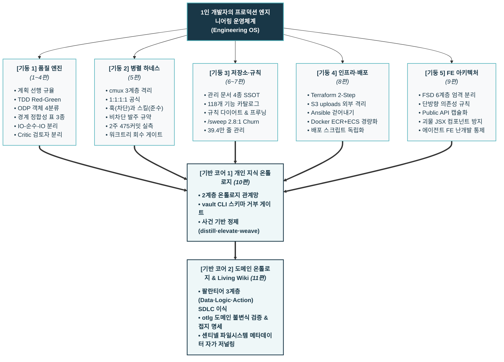

- table of contents
{:toc}

## 전체 시리즈 로드맵 안내

아래는 이 시리즈에서 이야기하는 운영체계를 구성하는 11편의 실전 에세이와 다루는 핵심 주제 안내이다. 관심 있는 주제부터 먼저 살펴보면 되겠다.

<!-- ═══════════════════════════════════════════════════════════════
     [로드맵 표 작성 및 유지 가이드라인]
     작성 원칙:
      - 'AI'라는 단어를 매 행마다 남발하지 않는다.
      - [실무 위험·결함(Pain Point) ➔ 엔지니어링적 통제 및 아키텍처 솔루션(Engineering Solution)]
        구조로 2개의 구(phrase)를 명쾌하게 대비시켜, 기술적 깊이와 문제 해결 역량에
        채용 담당자의 구미가 당겨 클릭하도록 작성한다.
      - 정통 소프트웨어 엔지니어링 어휘(TDD, 객체지향, CQS, 인터페이스 계약, 독립 검토)를
        사용하여 프로덕션 품질을 온전히 통제하는 1인 풀사이클 엔지니어의 품격을 드러낸다.
     ═══════════════════════════════════════════════════════════════ -->

| 글 제목 | 핵심 주제 |
|:---|:---|
| [[1편] AI에게 욕하던 신입이 선생님을 위한 규칙을 만들기까지](/tag-ai-agent-architecture/1-ground-rules/) | 사수 없는 현장의 첫 실패, 무작정 코딩을 멈추고 계획(Plan)을 선행시키는 작업 규율의 확립 |
| [[2편] 토큰 낭비라던 TDD가 어느새 제 종교가 되었습니다](/tag-ai-agent-architecture/2-tdd-religion/) | 비효율이라는 편견을 깬 TDD 개발 루틴, 책·영상·실전 지식을 모듈형 검진 시스템으로 자산화 |
| [[3편] 객체지향을 배웠으니 선생님을 가르쳐보겠습니다](/tag-ai-agent-architecture/3-teach-object-design/) | 파편화된 로직과 원시값 집착(Primitive Obsession)을 구조적으로 해결하는 객체 4분류, 계획 단계에 주입하는 CQS와 5단계 설계 압력 |
| [[4편] 역시 내 테스트 스위트는 잘못됐다](/tag-ai-agent-architecture/4-all-passed-empty-screen/) | FE-BE 계약을 대조하는 경계 정합성 표 3종, IO-Pure-IO 분리와 확증 편향을 깨는 독립 검토자 |
| [[5편] 같은 브랜치에서 에이전트끼리 사이좋게 코딩할 리가 없어](/tag-ai-agent-architecture/5-cmux-parallel-worktree/) | 동시 세션의 브랜치 충돌과 일탈을 원천 차단하는 cmux 워크트리 1:1:1:1 격리, 하드 바운더리 훅과 2주 475커밋을 견인한 Non-blocking 발주 체계 |
| [[6편] 에이전트가 기억상실증입니다만, 문제라도?](/tag-ai-agent-architecture/6-repo-governance/) | 세션 종료와 함께 사라지는 에이전트의 망각, 저장소 SSOT 관리 문서 4종과 arc42·C4 아키텍처 나침반으로 완성한 10초 온보딩 체계 |
| [[7편] 규칙이 64개나 있는데 왜 코드를 못 짜니](/tag-ai-agent-architecture/7-rule-pruning/) | 64개 규칙 과잉(Rule Bloat)이 부른 컨텍스트 질식, 프롬프트에서 도구·린터로 지워내는 규칙 거버넌스와 끊임없는 신규 기능 개발 속에서도 2.8:1 Churn을 방어한 /sweep |
| [[8편] 어차피 도커인데 앤서블은 왜 썼을까](/tag-ai-agent-architecture/8-cloud-infra-evolution/) | 마우스 클릭질의 공포와 배포 참사를 끝낸 Terraform 2-Step 도입, Ansible을 걷어내고 Docker ECR+ECS와 3중 안전망 스크립트로 완성한 1인 인프라 파이프라인 |
| [[9편] 어차피 프론트엔드인데 아키텍처가 왜 필요해?](/tag-ai-agent-architecture/9-frontend-fsd/) | 13만 줄 괴물 컴포넌트와 104건의 도메인 순환 참조 지옥, FSD 6계층 단방향 의존성과 Public API 방화벽으로 614개 테스트를 지켜낸 무결 마이그레이션 |
| [[10편] 기록의 악마는 고립된 노트의 꿈을 꾸지 않는다](/tag-ai-agent-architecture/10-knowledge-ontology/) | 5천 개 노트의 고립을 넘어선 2계층 관계망(구조 2종·의미 7종), vault CLI 스키마 거부 게이트, 사건 기반 정제 스킬로 지식 엔트로피를 통제하는 개인 지식 온톨로지(Personal Knowledge Ontology) |
| [[11편] 우리는 이미 각자의 운영체제를 짜고 있었다](/tag-ai-agent-architecture/11-external-workflow-and-ai-os/) | 폭발하는 작업 속에서 사람이 겪는 문서화 병목, 팔란티어 3계층(Data·Logic·Action)을 이식한 코드 바인딩 도메인 온톨로지(otlg)와 파일시스템 저널링 방식의 자가 갱신형 거버넌스(Living Wiki, 2026-09-27 고도화) |

## 이 글을 읽는 분들께

2025년 여름, 사수도 코드 리뷰어도 인수인계 문서도 없는 초기 스타트업에서 유일한 엔지니어로 첫 개발 커리어를 시작했다. 당시 내 손에 쥐어진 것이라곤 대표님이 찍어준 몇 편의 `AWS` 콘솔 녹화 영상과 막 시장에 등장하기 시작한 초기 AI 에이전트 도구들뿐이었다. 기초적인 CS 지식도 프로덕션 운영 경험도 부족했던 내게 에이전트는 모든 문제를 해결해 줄 구원투수처럼 보였으나, 그러한 기대는 순식간에 참담한 실패로 바뀌고 말았다. 에이전트에게 기능을 맡길수록 쏟아져 나온 것은 그럴듯한 외형 뒤에 숨은 엉망진창 스파게티 코드와 끝없는 런타임 에러, 그리고 언제 서비스가 멈출지 몰라 가슴을 졸이던 살얼음판 같은 배포의 연속이었기 때문이다. 남들보다 똑똑하다는 최신 모델을 마음껏 호출할 수 있었음에도, 정작 나는 매일같이 내가 쏟아낸 코드의 부채에 짓눌려 허덕이고 있었다.

그 처참한 실패의 구렁텅이에서 나를 건져 올린 것은 무슨 거창한 아키텍처 이론이나 갑작스러운 깨달음이 아니었다. 단지 어제보다 오늘 덜 헤매고 덜 고통받고 싶다는 절박함, 그리고 문제가 터질 때마다 원인을 끝까지 물고 늘어져 기어코 고쳐내고야 마는 **'<mark class="kw-term">개선의 관성</mark>'** 하나였다. 에이전트가 의도와 다른 엉뚱한 코드를 짜내면 구현 전에 `Plan`(계획)을 먼저 승인받도록 강제했고, 멀쩡하던 코드가 자꾸 깨지니 `TDD`와 객체지향 설계를 악착같이 공부해 가드레일로 둘렀으며, 프론트엔드와 백엔드 사이에서 `422` 에러가 터지면 경계 정합성 표를 만들어 계획 단계에 끼워 넣었다. 장애와 결함을 마주할 때마다 포기하거나 임시방편으로 덮는 대신, 도구를 깎고 시스템을 보강하며 매일 하나씩 벽돌을 쌓아 올렸던 셈이다.

그렇게 하루하루 치열하게 부딪히며 1년이 조금 넘는 시간을 보낸 끝에, 나는 그간의 궤적이 가리키는 가장 본질적인 진실과 마주할 수 있었다.

**"AI에게 코드를 맡겼을 때, 내가 지난 1년 동안 집요하게 고치고 통제해 온 대상은 결국 코드가 아니었다."**

코드를 직접 고치는 일은 당장의 불을 끄는 지엽적인 미봉책에 불과했다. 정작 고쳐야 했던 것은 코드가 작성되기 전의 계획과 검증 체계, 코드가 살아 숨 쉬는 클라우드 인프라의 경계, 여러 에이전트가 충돌 없이 작업할 수 있는 워크스페이스 격리 하네스, 그리고 기계의 망각을 이겨내기 위한 저장소의 영구 거버넌스였다. 당장 눈앞의 코드 한 줄과 씨름하는 대신 에이전트가 일하는 환경과 제약 조건을 관성처럼 하나하나 개선해 나갔던 무수한 시도들이 모여, 비로소 나를 지탱하는 하나의 단단한 운영체계가 되어 있었다고 생각한다.

이 글은 비전공자 1인 개발자가 사수 없는 현장에서 살아남기 위해, 오직 개선하고자 하는 관성 하나로 밑바닥부터 쌓아 올린 **'1인 풀사이클 프로덕션 <mark class="kw-term">엔지니어링 운영체계(Engineering OS)</mark>'**의 1년 연대기를 집약한 종합 회고록이자 전체 시리즈의 정주행 로드맵이다.

---

## 한눈에 보는 엔지니어링 운영체계 5대 기둥 + 기반 온톨로지

---

## 첫 번째 코어: 코드보다 계획과 검증 (1~4편 요약)

에이전트에게 "이 기능을 구현해 줘"라고 입력하면 불과 몇 초 만에 수백 줄의 코드가 쏟아져 나오는데, 화면상으로는 더없이 완벽해 보이지만 막상 실행하는 순간 런타임 오류가 터지거나 멀쩡하던 기존 기능이 깨지기 일쑤다. AI를 실무에 투입할 때 마주하는 가장 큰 위험은 **"엉터리인 코드를, 자신감 넘치고 그럴듯한 어조로 출력한다"**는 점에 있으며, 이는 모델의 컨텍스트 한계 때문에 레포지토리가 비대해질수록 더욱 치명적으로 부각되기 마련이다. 나는 이 문제를 정면으로 돌파하기 위해 기술 서적과 강의에서 흡수한 이론을 실전 실패 경험과 결합했고, 코드 구현 이후의 디버깅이 아니라 구현 이전의 계획(`Plan`)과 검증(`Test`) 단계에 통제력을 집중시킴으로써 저장소 차원의 아키텍처 무결성을 지켜내는 **'품질 엔진'**을 구축할 수 있었다.

{:width="700" loading="lazy"}

실제 코드 작성 전 가변성과 결합도를 진단하고 불필요한 패턴 과설계를 배제한 TDD 계획서. '있으면 좋을 것 같은' 패턴을 거부하고 최소 구조를 선택하는 엔지니어링 의사결정이 계획 단계에 못 박힌다.
{:.figcaption}

첫 번째 단추는 **[즉각 구현 금지와 계획(Plan)의 선행 (1편)](/tag-ai-agent-architecture/1-ground-rules/)**이었다. 사수도 가이드도 없던 초기 시절, 에이전트를 만능 프로그래머라 믿고 비대해진 레포지토리에 정제되지 않은 요구사항을 마구 쏟아부었을 때 돌아온 것은 뒤엉킨 스키마에서 비롯된 스파게티 코드와 참담한 실패뿐이었다. 그때 에이전트에게 화를 내거나 프롬프트 요령을 찾아 헤매는 대신, **"AI는 알아서 코드를 짜주는 하인이 아니라, 엄격한 입력과 검증 규칙으로 통제해야 하는 강력한 연산 기계"**라는 엔지니어링적 인식 전환의 첫걸음을 뗐다. 기계가 성급히 코드를 찍어내지 못하도록 즉각적인 구현을 금지하고, `Plan`을 먼저 수립하게 한 뒤 인간이 설계를 검토·승인하는 작업 규율을 확립하는 계기가 되었다.

그 규율 위에서 두 번째로 자리 잡은 축이 **[TDD의 전격 도입 (2편)](/tag-ai-agent-architecture/2-tdd-religion/)**이다. 한때는 나 역시 "AI에게 테스트 코드까지 짜게 하면 토큰 낭비 아닌가?"라고 의심하곤 했다. 하지만 본 구현에 앞서 실패하는 테스트(`RED`)를 먼저 작성하도록 강제해 작업의 스코프를 명확히 좁혀주자, **에이전트는 거대한 레포지토리에서도 길을 잃지 않고 요구사항을 적확하고 빠르게 처리하는 최고의 파트너로 탈바꿈했다**. 테스트 코드가 곧 에이전트가 절대 벗어나선 안 될 물리적 가드레일로 작동하는 것을 체감한 뒤로, 나는 `TDD`의 가장 열렬한 신봉자가 되었다.

세 번째로는 테스트의 품질 자체를 끌어올리기 위해 **[객체 설계 규칙(ODP 4분류)의 계획 단계 주입 (3편)](/tag-ai-agent-architecture/3-teach-object-design/)**을 단행했다. Matthias Noback의 『Object Design Style Guide』를 깊이 파고들며, 시스템의 모든 객체를 서비스(`Service`), 개체(`Entity`), 값 객체(`Value Object`), 데이터 전송 객체(`DTO`)의 4가지 역할로 분류하는 원칙을 정립했다. 이를 작업 워크플로우의 첫 관문인 `tdd-plan` 스킬의 메타 구조에 심어, 에이전트가 코드를 한 줄이라도 짜기 전에 각 객체의 역할과 테스트 전략(명령은 `Mock`, 쿼리는 `Stub`)을 표로 먼저 선언하게 만들었다. 이로써 AI가 습관적으로 빈약한 도메인 모델(Anemic Domain Model)이나 무분별한 `Setter`를 양산하지 못하도록 설계 수준에서 원천 봉쇄할 수 있었다.

네 번째 안전망은 프로덕션 장애를 겪으며 탄생한 **[경계 정합성 표 3종(계약·셰이프·트리거) (4편)](/tag-ai-agent-architecture/4-all-passed-empty-screen/)**이다. 사내 학원 관리 서비스의 청구 기능을 배포하던 날, 분명 모든 단위 테스트가 `GREEN`으로 통과했음에도 브라우저를 열자마자 `422 Unprocessable Entity` 에러와 함께 텅 빈 학생 목록이 출력되는 사고가 터졌다. 원인을 추적해 보니 프론트엔드가 보낸 빈 문자열 기본값(`''`)과 백엔드의 필수 쿼리(`Query(...)`) 조건이 경계에서 충돌했고, 정작 "매월 자동 청구"라는 핵심 행위 사양을 호출하는 진입점 코드가 통째로 누락되어 있었다. 이 뼈아픈 실패를 겪은 뒤, 코드 작성 전에 프론트엔드와 백엔드의 입출력 계약, 데이터 셰이프, 실행 트리거를 1:1로 대조하는 3종 표를 계획서에 의무화함으로써 시스템 경계의 불일치와 누락을 사전에 차단하게 되었다.

마지막 다섯 번째 퍼즐은 **['All Passed'의 착시와 자가 검토자 해고 (4편)](/tag-ai-agent-architecture/4-all-passed-empty-screen/)**로 완성되었다. 테스트 통과 숫자만으로는 결코 안심할 수 없었는데, 에이전트가 `Mock`을 남발하여 자기가 만든 가짜 데이터만 확인하고 끝내는 '동어반복 테스트(Mock Tautology)'가 곳곳에 숨어 있었기 때문이다. 이를 해결하기 위해 Gary Bernhardt의 경계 이론을 차용해 비즈니스 규칙을 `IO-Pure-IO` 구조로 분리하여 순수 단위 테스트로 실행 속도를 확보하는 한편, 중복되는 상위 통합 테스트를 과감히 프루닝했다. 무엇보다 **"자신이 짠 코드를 자신이 검토하면 합격률은 언제나 100%다"**라는 확증 편향을 깨뜨리기 위해, 구현을 담당하는 Builder와 완전히 격리된 별도의 Critic 에이전트를 투입해 상호 검증하게 만드는 Coordinator 패턴을 정착시킬 수 있었다.

---

## 두 번째 코어: 한 세션보다 병렬 하네스 (5편 요약)

단일 에이전트와 터미널 한 칸에서 도란도란 대화하며 코드를 짜는 방식은 장인의 훌륭한 '수공업'일 수는 있어도, 빗발치는 프로덕션의 요구사항을 홀로 감당해야 하는 1인 개발자의 '엔지니어링'은 되지 못했다. 그렇다고 아무런 격리 장치 없이 한 브랜치에서 여러 에이전트 세션을 동시에 띄우자, A 세션이 진행 중이던 실패하는 테스트(`RED`)를 B 세션이 자신의 에러로 착각해 엉뚱한 프로덕션 코드를 뜯어고치는 참사가 벌어지곤 했다. 결국 병렬 처리의 첫 번째 전제 조건은 **'완벽한 공간적 격리'**에 있었고, `Git Worktree`를 활용해 에이전트마다 완전히 독립된 물리 디렉토리를 내어주는 `Conductor`를 거쳐 마침내 터미널 멀티플렉서 기반의 **`cmux` 워크트리 하네스**로 정착하게 되었다. 이를 통해 **`작업 단위 = 브랜치 = 워크트리 = 에이전트 = 1:1:1:1`**이라는 흔들리지 않는 격리 공식을 확립할 수 있었다.

{:width="700" loading="lazy"}

실제 git worktree 기반 물리적 격리를 구현한 cmux 작업 환경. 사이드바의 워크스페이스마다 독립된 Git 워크트리를 매핑하고, 분할 화면으로 에이전트 실행과 실시간 테스트·로그 관찰을 병행한다.
{:.figcaption}

하지만 독립된 방을 마련해 주는 것만으로는 충분하지 않았다. 에이전트들은 "이번 수정은 사소하니까 굳이 워크트리를 파지 않고 메인(Hub) 브랜치에서 바로 고칠게요"라며 끊임없이 격리 규칙을 우회하려 들었기 때문이다. 이 실랑이 끝에 나는 **"훅(Hook)은 타협 없는 하드 바운더리(Hard Boundary)이고, 스킬(SKILL)은 안전한 준수 경로(Compliance Path)다"**라는 결정적 교훈을 얻었다. 모델이 스스로 호출 여부를 판단하는 자연어 지침이나 스킬은 유연한 대신 언제든 무시될 수 있는 반면, 하네스가 도구 실행 직전에 가로채는 `PreToolUse` 같은 훅은 모델의 판단과 무관하게 작동하는 '물리적 차단벽'으로 기능한다. 즉, 메인 브랜치 오염이나 작업 유출 같은 치명적 일탈은 오직 훅이라는 하드 바운더리로만 완벽히 제어할 수 있었던 셈이다.

나아가 병렬 파이프라인의 최대 적인 '대기 시간'을 없애기 위해 **'질문 없는 허브-스포크 발주 규약'**을 수립했다. 사람이 자리를 비운 사이 스포크 에이전트가 사소한 설계 질문을 던지고 응답을 기다리는 순간, 병렬 개발 라인 전체가 그 자리에서 멈춰 서게 된다. 이를 방지하기 위해 중앙의 허브 에이전트가 사전 기획 단계에서 모든 의사결정을 끝내 구체적인 작업 명세서를 발행하고, 격리된 워크트리의 스포크 에이전트는 추가 질문 없이 안전한 기본값으로 끝까지 질주하며 커밋 메시지에 결정 근거를 남기는 <mark class="kw-isolation">비차단(Non-blocking)</mark> 발주 체계를 완성했다.

여기에 터미널 화면에 찍힌 `"11 passed"` 같은 허위 보고에 속지 않도록 **<mark class="kw-harness">센티넬 파일</mark>과 `git status` 클린 상태를 교차 대조하는 결정론적 완료 검증**을 세웠으며, 워크트리를 삭제하는 순간 `.gitignore` 처리된 관리 문서가 통째로 증발했던 뼈아픈 사고(2026-08-03)를 겪은 뒤에는 **'관리 문서 사전 회수 ➔ 통합 테스트 ➔ 안전 삭제'로 이어지는 엄격한 <mark class="kw-term">6단계 Teardown 회수 게이트</mark>**를 파이프라인에 못 박았다. 그 결과 **단 2주 만에 475개의 커밋을 소화하고, 24시간 만에 561개 파일·8.5만 줄에 달하는 대규모 프론트엔드 아키텍처 개편을 15개 병렬 슬라이스로 무결하게 완수**하는 1인 프로덕션 생산성을 실증할 수 있었다. 이 1:1:1:1 물리적 격리 하네스와 비차단 발주 규약의 상세한 구축 과정은 **[[5편] 같은 브랜치에서 에이전트끼리 사이좋게 코딩할 리가 없어](/tag-ai-agent-architecture/5-cmux-parallel-worktree/)**에서 깊이 있게 다룬다.

---

## 세 번째 코어: 사람의 기억보다 저장소와 규칙 거버넌스 (6~7편 요약)

병렬 워크트리 하네스를 통해 한 번에 수많은 에이전트를 굴릴 수 있게 되자, 이번에는 **'기억의 휘발'**과 **'규칙의 비대화'**라는 두 가지 새로운 병목이 수면 위로 떠올랐다. 세션이 종료되는 순간 에이전트는 직전 작업의 맥락을 전부 잊어버리는데, "그때 왜 그런 설계 결정을 내렸는지"나 "미처 갚지 못한 기술 부채가 어디에 남았는지"를 매번 사람이 기억해 내어 새 세션에 설명하는 것은 물리적으로 불가능에 가까웠다. 이에 나는 기억의 주체를 사람이나 에이전트의 단기 컨텍스트에 두는 대신, 코드가 담긴 **저장소(Repository) 자체로 영구 외주화**하는 방식을 택했다.
- 현재 진행 중인 작업과 직전 세션의 마디를 기록하는 `WORKLOG.md`
- 당장 해결하지 않고 의도적으로 유예한 보류 목록인 `docs/deferred-watchlist.md`
- 시스템의 기술 부채와 명확한 상환 트리거를 관리하는 `docs/tech-debt.md`
- 핵심 아키텍처 의사결정을 Nygard 5부 구조로 남기는 `docs/adr/`
여기에 **`arc42`(5개 핵심 섹션)**와 **`C4 Model`(3단계 줌인)** 기준을 결합함으로써, 완전히 백지상태로 시작하는 새 에이전트라도 세션 시작 10초 만에 시스템의 전체 지형과 맥락을 파악할 수 있는 **<mark class="kw-ssot">관리 문서 4종</mark> + 아키텍처 나침반** 체계를 완성할 수 있었다 (**[[6편] 에이전트가 기억상실증입니다만, 문제라도?](/tag-ai-agent-architecture/6-repo-governance/)**).

{:width="700" loading="lazy"}

세션이 리셋된 에이전트에게 10초 온보딩 지도가 되어준 실제 아키텍처 문서화 체계. docs/adr/ 의사결정 기록과 arc42·C4 Model 기반의 시스템 컨텍스트 다이어그램이 코드베이스 내 단일 진실 공급원(SSOT)으로 살아 숨 쉰다.
{:.figcaption}

다른 한편으로는 장애나 실수가 발생할 때마다 `AGENTS.md`(`CLAUDE.md`)에 주의사항을 한 줄씩 덧붙이다 보니, 어느새 지침서가 무려 64개 조항까지 불어난 '규칙의 괴물'과 마주해야 했다. 규칙 문서가 길고 무거워질수록 에이전트는 정작 중요한 핵심 원칙을 놓치는 컨텍스트 질식(Lost in the Middle) 현상을 일으키기 마련이다. 나는 이 문제를 해결하기 위해 켄트 벡의 테스트 프루닝 철학을 규칙 거버넌스에 그대로 이식했다.
- 실효성이 떨어지거나 중복된 하위 규칙의 가차 없는 숙청
- 자연어 지침으로 적혀 있던 아키텍처 제약을 린터(`eslint-plugin-boundaries`) 및 하네스 훅으로 승격해 문서에서 제거
- 당장 자주 발생하지 않는 예외 규칙의 Watchlist 유예 격리
- 나아가 신규 기능을 쉼 없이 찍어내는 개발 폭풍 속에서도 정기 종합검진 도구인 **`/sweep`**을 상시 가동하여, 39.4만 줄 규모의 코드베이스에서 **누적 2.80:1(월간 1.81:1)이라는 건강한 Churn(추가:삭제) 방어선**을 지켜내며 코드와 규칙 양쪽의 군살을 날렵하게 깎아낼 수 있었다 (**[[7편] 규칙이 64개나 있는데 왜 코드를 못 짜니](/tag-ai-agent-architecture/7-rule-pruning/)**).

---

## 네 번째 코어: 콘솔 클릭보다 통제 가능한 파이프라인 (8편 요약)

로컬 개발 하네스와 저장소 거버넌스를 아무리 정교하게 다듬었더라도, 그 코드로 빌드한 애플리케이션이 올라갈 프로덕션 인프라가 불안정하다면 1인 개발자는 매일같이 터지는 운영 잡무의 늪에서 빠져나올 수 없다. 입사 초기 대표님께 건네받았던 `AWS` 콘솔 수동 클릭 녹화본은 단 한 번의 마우스 클릭 실수로도 실서비스를 마비시킬 수 있는 시한폭탄이나 다름없었고, 무엇보다 현재 인프라 상태를 한눈에 파악하고 유지보수하기에 턱없이 버거운 방식이었다.

{:width="700" loading="lazy"}

실제 Terraform ecs.tf 코드. 배포 파이프라인과의 충돌 및 구버전 롤백 참사를 막기 위해 ignore_changes로 소유권을 엄격히 분리하고, 서킷 브레이커로 1인의 배포 안전망을 세웠다.
{:.figcaption}

나는 이러한 수동 운영의 공포와 비효율을 걷어내기 위해 **<mark class="kw-term">Terraform IaC</mark>**를 전격 도입하여 `VPC` 네트워크부터 `ECS` 클러스터에 이르는 모든 기반 인프라를 코드로 선언해 버전 관리 아래 두었다. 특히 인프라를 재구축하거나 변경할 때 고객사의 소중한 파일 자산이 실수로라도 휘발되지 않도록, **`S3` uploads 버킷만큼은 `Terraform` 상태 관리 바깥으로 과감히 격리**하는 물리적 보호 경계를 세우기도 했다.

또한 초기에 서버 설정 자동화를 위해 도입했던 **`Ansible`이 컨테이너 환경의 1인 개발자에게는 불필요한 이중 관리 오버헤드**만 안겨준다는 사실을 직시하고 이를 전면 폐기한 뒤, **`Docker` 불변 이미지 기반의 `ECR` + `ECS Fargate` 구조로 인프라를 극도로 단순화**했다. 아울러 상태 변경이 드문 기반 인프라 프로비저닝(`Terraform`)과 하루에도 수차례 일어나는 애플리케이션 배포(3중 안전망 배포 스크립트)의 소유권 경계를 `ignore_changes`로 명확히 분리함으로써, 1인 개발자가 인프라 사고 걱정 없이 오직 비즈니스 제품 개발에만 몰입할 수 있는 안전한 배포 파이프라인을 구축할 수 있었다 (**[[8편] 어차피 도커인데 앤서블은 왜 썼을까](/tag-ai-agent-architecture/8-cloud-infra-evolution/)**).

---

## 다섯 번째 코어: 화면 구현보다 계층적 아키텍처 (9편 요약)

백엔드 로직과 클라우드 인프라를 단단하게 다져놓았음에도, 정작 사용자와 맞닿는 프론트엔드 코드가 무너지면 프로덕션의 개발 속도는 급격히 얼어붙기 마련이다. 특히 프론트엔드 지식이 부족했던 초기에 AI 에이전트에게 화면 구현을 일임했을 때 가장 빈번하게 마주한 재앙은, 한 파일이 1,000줄을 훌쩍 넘기는 괴물 `JSX` 컴포넌트의 출현과 도메인 경계를 무시하고 사방으로 `import`를 찔러대는 **'지옥의 순환 참조(Cross-domain circular import)'**였다. 지금 와서 짚어보면, 그렇게 구조 없이 뒤엉킨 거대 컴포넌트야말로 에이전트의 컨텍스트를 오염시켜 바보로 만드는 가장 빠른 지름길이었던 셈이다.

{:width="700" loading="lazy"}

실제 프로덕션 프론트엔드 작업 환경. 좌측 탐색기의 FSD 6계층(app, pages, widgets, features, entities, shared)과 에디터의 steiger.config.js 설정, 그리고 터미널에서 steiger 린터가 계층 위반을 기계적으로 전수 검증하고 통과(No problems found!)한 모습이다.
{:.figcaption}

사내 핵심 서비스의 프론트엔드(13.2만 줄, 635개 파일)에서 무려 104건에 달하는 도메인 교차 참조 위반이 식별되었을 때, 나는 이 사슬을 끊어내기 위해 **Feature-Sliced Design(`FSD`)** 아키텍처를 전격 도입했다.
- `app ➔ pages ➔ widgets ➔ features ➔ entities ➔ shared`로 흐르는 **엄격한 6계층 단방향 의존성 규칙**을 수립하고,
- 각 슬라이스의 **Public API(`index.ts`)** 뒤로 내부 구현 세부사항을 철저히 캡슐화하여,
- 에이전트가 다른 도메인 슬라이스의 내부 파일을 직접 참조하거나 하위 계층에서 상위 계층을 거슬러 호출하려 할 때 `steiger`와 `eslint-plugin-boundaries` 린터가 빌드 단계에서 즉시 에러를 뱉으며 물리적으로 차단하도록 강제했다.

기존 레거시 도메인 폴더를 임시 완충 계층으로 활용하는 점진적 이전 전략을 택한 덕분에, 기존 614개의 테스트가 단 하나도 깨지지 않는 무회귀 상태를 유지하며 **단 이틀(26커밋 / 25 Phase) 만에 13만 줄 전체를 `FSD` 6계층 구조로 안전하게 분해·안착**시킬 수 있었다. 이로써 6편에서 구축한 118개 기능 카탈로그와 맞물려, 에이전트가 프론트엔드에서도 스파게티 코드를 양산하지 못하도록 통제하는 견고한 UI 아키텍처 레일이 완성되었다 (**[[9편] 어차피 프론트엔드인데 아키텍처가 왜 필요해?](/tag-ai-agent-architecture/9-frontend-fsd/)**).

---

## 기반 코어: 고립된 기록보다 연결된 온톨로지 (10편 요약)

코드베이스 바깥에서 엔지니어의 사고를 지탱하는 기록 역시 마찬가지여서, 수천 개의 마크다운 노트를 부지런히 작성하더라도 맥락과 구조로 연결되지 않으면 그저 고립된 텍스트 섬으로 남을 뿐이다. 나는 약 5,000개에 달하는 `Obsidian` 노트가 단순히 파편화된 메모들로 전락하는 것을 막기 위해, 볼트 전역 CLI(`vault`/`vo`)를 직접 개발하여 13가지 문서 타입의 프론트매터 스키마를 기계적으로 검증하고 통과한 문서만 파일로 생성되게 강제했다. 또한 문서 간에 `builds_on`(선행 전제)과 `supersedes`(대체)를 비롯한 2계층 관계망을 명시함으로써 지식 엔트로피를 통제하는 **'개인 지식 온톨로지(Personal Knowledge Ontology)'**를 세울 수 있었다.

{:width="700" loading="lazy"}

실제 Obsidian Vault Graph View. 글을 적고 있는 현시점 기준 4,400여 개의 노드와 1만 2천 개의 엣지가 유기적으로 결합된 모습이다. 단순한 메모 수집이 아닌, 엄격한 스키마 검증과 온톨로지 관계망을 통해 코드베이스 저장소 거버넌스와 프로젝트 고도화를 견인하는 단일 진실 공급원(SSOT)의 역할을 수행한다.
{:.figcaption}

나아가 과거에 관성적으로 수행하던 일·월 단위의 수동 요약 대신, 프로젝트 작업 노트나 회고가 생성되는 실제 사건(Event)에 반응해 지식을 추출하고 승격시키는 정제 스킬(`experience-distill`, `knowledge-elevate`, `reflection-weave`)을 파이프라인으로 연동했다. 이를 통해 실무에서 겪은 시행착오가 일회성 기록으로 휘발되지 않고 범용 엔지니어링 원칙과 아키텍처 판단 기준으로 끊임없이 정제되어 흐르는, 인간과 에이전트 모두의 유일무이한 <mark class="kw-term">Second Brain</mark>을 완성할 수 있었다 (**[[10편] <mark class="kw-devil">기록의 악마</mark>는 고립된 노트의 꿈을 꾸지 않는다](/tag-ai-agent-architecture/10-knowledge-ontology/)**, 심화 설계는 **온톨로지 엔지니어링 [[2편] 4,400개의 흩어진 생각에 척추를 세우다](/tag-ontology-engineering/2-vault-knowledge-ontology/)** 참조).

---

## 미래 지향: 단순한 도구 연동보다 나만의 엔지니어링 OS (11편 요약)

혼자서 사내 시스템을 바닥부터 깎고 다듬던 중 마주한 외부의 실전 워크플로우(우주초월의 `기획 ➔ 개발 ➔ QA ➔ 위키` 파이프라인)와 랄프가 제시한 `AI Agent OS` 비전, 그리고 변우철 본부장이 설파한 팔란티어 온톨로지 3대 레이어(`Data`, `Logic`, `Action`) 철학은 내가 지난 1년간 치열하게 구축해 온 체계가 결코 우연이 아닌 필연적인 수렴 진화였음을 확신하게 해 준 계기가 되었다.

{:width="700" loading="lazy"}

docs/features/ 기능 카탈로그에서 한 단계 더 진화하여 실제 코드베이스에 적용된 `.ontology/` 아키텍처. 좌측 탐색기의 엔티티(objects), 비즈니스 권한 및 행위(actions), 규칙(rules) 구조와, 에디터에 열린 비즈니스 액션 사양이 도메인의 엄격한 실행 바운더리를 선언하고 있다.
{:.figcaption}

나는 여기서 한 걸음 더 나아가 볼트의 개인 지식 온톨로지를 넘어, 프로덕션 코드베이스 자체와 직접 바인딩되는 **'코드 바인딩 도메인 온톨로지 명세(Repo Ontology, `otlg`)'**와 **'자가 갱신형 거버넌스(Living Wiki Engine)'**를 설계하고 실무에 이식했다. 팔란티어가 기업의 비즈니스 데이터를 객체와 불변식, 액션으로 통제하듯, 소프트웨어 개발 생명주기(SDLC) 도메인의 객체와 실제 코드 심볼 매핑(`Data`), 시스템 전역 불변식(`Logic`), 그리고 허용된 상태 전이 동사(`Action`)를 저장소 내부의 `.ontology/`에 명시적으로 선언하는 구조다.

이 체계 안에서 온톨로지는 결코 환각을 부르는 만능 실행기가 아니라 에이전트의 추론을 현실 코드에 묶어두는 '검증 가능한 접지 명세(Grounding Spec)'로 작동하며, 실제 쓰기(Write-back) 실행은 `spoke-guard` 훅과 `TDD`, 브라우저 QA를 통과한 에이전트와 검증 파이프라인이 전담하게 된다. 스포크 에이전트가 작업을 마치고 퇴장할 때 실제 코드 diff와 도메인 사양을 바탕으로 자신의 기능 명세서와 관리 문서를 스스로 저널링하고 돌아가는 셈인데, 마치 리눅스 커널이 파일시스템 메타데이터를 백그라운드에서 트랜잭션 단위로 갱신하듯 운영체제 스스로 숨 쉬고 진화하는 거버넌스의 청사진을 **[[11편] 우리는 이미 각자의 운영체제를 짜고 있었다](/tag-ai-agent-architecture/11-external-workflow-and-ai-os/)**에 담았다. 그리고 10편과 11편 끝자락에서 던진 이 온톨로지 기반의 지식·코드 통제 방법론은 이후 별도의 후속 연재인 **[온톨로지 엔지니어링 시리즈](/tag-ontology-engineering/)**(총괄 현관문인 **[[0편] 온톨로지를 활용한 레포지토리 방법론에 대하여](/tag-ontology-engineering/0-ontology-engineering-intro/)**부터 **[[3편] 문서는 명사로 정리되지만 코드는 동사로 움직인다](/tag-ontology-engineering/3-nouns-to-verbs-paradigm-shift/)**, **[[4편] 에이전트에게 매번 설명하기 귀찮다면 레포지토리가 직접 말하게 하면 되지 않을까](/tag-ontology-engineering/4-repo-ontology-primitives-and-trace/)**, **[[6편] 문서는 스스로 숨 쉰다](/tag-ontology-engineering/6-living-wiki-and-metadata-journaling/)**까지 총 8편)로 확장되어 한층 깊은 아키텍처 실전기로 이어진다.

---

## 1인 풀사이클 엔지니어링의 정체성: "개발자는 코더가 아니라 아키텍트다"

지난 1년여간 사수 없는 현장에서 온몸으로 부딪히며 시스템을 깎아온 끝에, 나는 AI 시대의 엔지니어가 가져야 할 본질적인 정체성에 대해 나만의 확고한 결론에 도달할 수 있었다. 세간에서는 흔히 "AI가 코딩을 다 해주면 개발자는 이제 필요 없어지는 것 아니냐"고 묻거나, 반대로 "프롬프트를 얼마나 잘 작성하느냐가 개발자의 핵심 역량"이라고 말하곤 한다. 하지만 아무런 안전망 없던 초기 스타트업에서 다수의 프로덕션 시스템 전체를 홀로 감당하며 생존해 낸 내 대답은 단호히 **"아니다"**에 가깝다.

AI에게 코드를 맡겼을 때, 정작 내가 밤낮으로 뜯어고치고 정교하게 통제해야 했던 대상은 코드가 아니었기 때문이다.
- 코드가 출력되기 전에 무엇을 어떻게 검증할지 정의하는 **사양과 테스트 계획**을 고쳐야 했다.
- 작성자와 검토자의 한통속 확증 편향을 원천 제거하는 **에이전트 역할 분리 구조**를 고쳐야 했다.
- 어떤 인적·기계적 실수가 발생해도 고객 데이터만큼은 날아가지 않는 **클라우드 인프라의 물리적 경계**를 고쳐야 했다.
- 여러 에이전트가 서로의 작업을 망가뜨리지 않고 전속력으로 달릴 수 있는 **워크스페이스 격리 하네스와 하드 바운더리 훅**을 고쳐야 했다.
- 나아가 세션마다 초기화되는 기계의 망각과 인간의 인지 한계를 함께 지탱해 줄 **저장소 관리 문서와 도메인·지식 온톨로지**를 고쳐야 했다.

물론 작성되는 코드의 의미를 정확히 독해하고 시스템 전체의 조감도를 그릴 수 있는 엔지니어링 기본기는 여전히 무엇보다 중요하다고 생각하지만, 한 줄의 코드를 키보드로 빠르게 타이핑하는 속도 자체는 더 이상 엔지니어의 무기가 되기 어렵다. 코드를 찍어내는 비용이 0에 수렴할수록, **"무엇을 만들 것인가", "어디에 어떤 경계를 세울 것인가", "쏟아져 나온 결과물이 프로덕션의 가치 및 도메인 불변식과 부합하는지 어떻게 결정론적으로 검증할 것인가"**를 설계하고 심판하는 아키텍처적 사고의 가치는 오히려 이전보다 비교할 수 없을 만큼 높아지기 마련이다.

결국 AI 시대의 1인 개발자는 코드를 대신 짜주는 요술 방망이에 매달리는 '코더'가 아니라, **시스템의 경계를 설계하고 엄격한 제약을 부여하며 다중 에이전트와 클라우드 인프라가 한 치의 오차도 없이 맞물려 돌아가도록 자신만의 엔지니어링 운영체계(OS)를 구축하고 지휘하는 '시스템 아키텍트'이자 '오케스트레이터'**라고 생각한다. 사수 없는 현장에서 수많은 실패와 시행착오를 겪으면서도 타협하지 않고 밑바닥부터 쌓아 올린 이 운영체계는, 앞으로 마주할 그 어떤 거대한 복잡성 앞에서도 흔들리지 않을 나의 가장 단단한 엔지니어링 무기다. 이 치열했던 구축기의 가장 첫 번째 페이지인 **[[1편] AI에게 욕하던 신입이 선생님을 위한 규칙을 만들기까지](/tag-ai-agent-architecture/1-ground-rules/)**부터, 혹은 이 운영체계의 기반을 이루는 후속 연재인 **[[0편] 온톨로지를 활용한 레포지토리 방법론에 대하여](/tag-ontology-engineering/0-ontology-engineering-intro/)**부터 편하게 여정을 함께해 주시기를 바란다.

---
