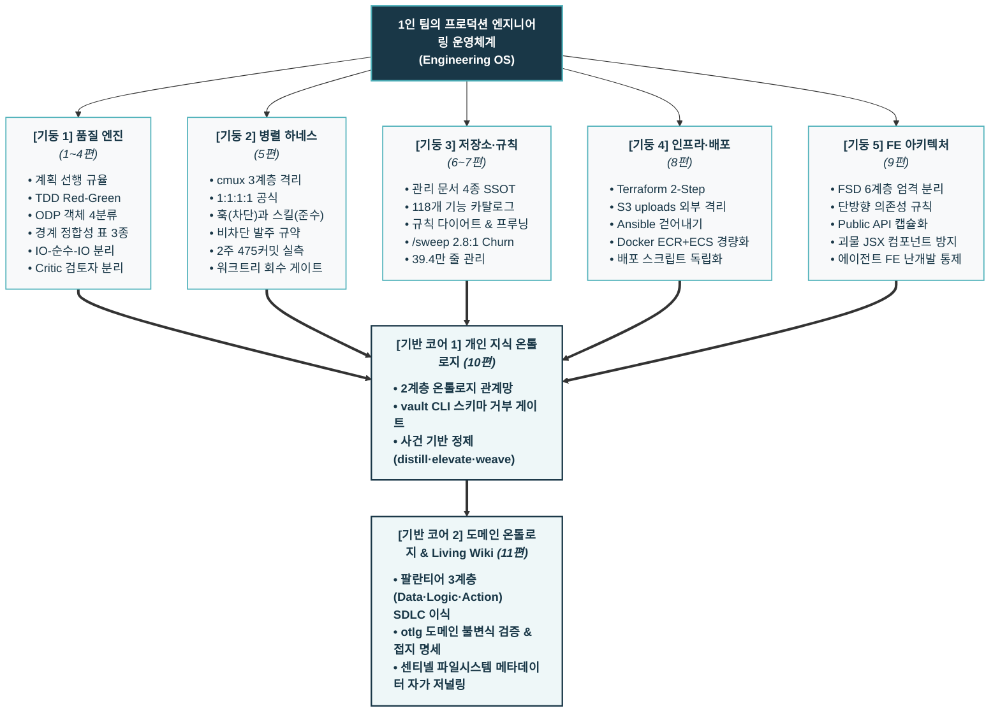
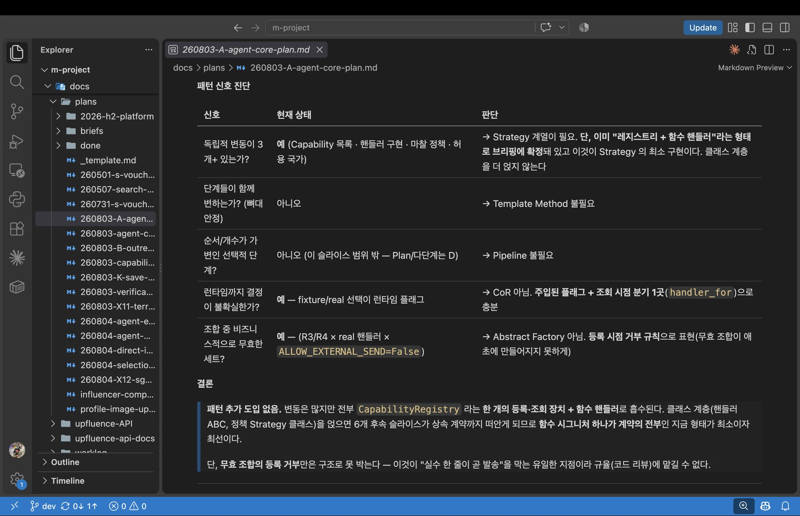

- table of contents
{:toc}

## 전체 시리즈 로드맵 안내

이 시리즈를 구성하는 12편의 실전 에세이와 다루는 핵심 화두다. 관심 있는 주제부터 먼저 살펴보면 되겠다.

| 글 제목 | 핵심 주제 |
|:---|:---|
| [[0편] 1인 팀은 어떻게 자신만의 운영체계를 만드는가](/tag-ai-agent-architecture/0-engineering-os/) | 1인 풀사이클 프로덕션을 지탱하는 엔지니어링 운영체계(Engineering OS) 조감도 |
| [[1편] AI에게 욕하던 신입이 선생님을 위한 규칙을 만들기까지](/tag-ai-agent-architecture/1-ground-rules/) | 사수 없는 현장의 첫 실패, 즉각 코딩을 멈추고 계획(Plan)을 선행시키는 작업 규율 확립 |
| [[2편] 토큰 낭비라던 TDD가 어느새 제 종교가 되었습니다](/tag-ai-agent-architecture/2-tdd-religion/) | 비효율이라는 편견을 깬 TDD 루틴, 책·영상·실전 지식을 모듈형 검진 시스템으로 자산화 |
| [[3편] 객체지향을 배웠으니 선생님을 가르쳐보겠습니다](/tag-ai-agent-architecture/3-teach-object-design/) | 원시값 집착을 해결하는 객체 분류, 계획 단계에 주입하는 CQS와 불변성·설계 압력 |
| [[4편] 역시 내 테스트 스위트는 잘못됐다](/tag-ai-agent-architecture/4-all-passed-empty-screen/) | FE-BE 경계 정합성 표 3종, IO-Pure-IO 분리와 확증 편향을 깨는 독립 검토자(`/test-harden`) |
| [[5편] 같은 브랜치에서 에이전트끼리 사이좋게 코딩할 리가 없어](/tag-ai-agent-architecture/5-cmux-parallel-worktree/) | cmux 워크트리 1:1:1:1 격리, 하드 바운더리 훅과 2주 475커밋 Non-blocking 발주 체계 |
| [[6편] 에이전트가 기억상실증입니다만, 문제라도?](/tag-ai-agent-architecture/6-repo-governance/) | 휘발되는 기억을 대체하는 저장소 SSOT 문서 4종과 arc42·C4 기반 10초 온보딩 체계 |
| [[7편] 규칙이 64개나 있는데 왜 코드를 못 짜니](/tag-ai-agent-architecture/7-rule-pruning/) | 64개 규칙 과잉이 부른 컨텍스트 질식, 린터 승격 프루닝과 2.8:1 Churn 방어 `/sweep` |
| [[8편] 어차피 도커인데 앤서블은 왜 썼을까](/tag-ai-agent-architecture/8-cloud-infra-evolution/) | Terraform 2-Step과 S3 외부 격리, Ansible 폐기 후 ECR+ECS 3중 안전망 배포 파이프라인 |
| [[9편] 어차피 프론트엔드인데 아키텍처가 왜 필요해?](/tag-ai-agent-architecture/9-frontend-fsd/) | 13만 줄 컴포넌트와 104건 순환 참조, FSD 6계층 단방향 의존성과 Public API 무결 이관 |
| [[10편] 기록의 악마는 고립된 노트의 꿈을 꾸지 않는다](/tag-ai-agent-architecture/10-knowledge-ontology/) | 5천 개 노트를 엮는 2계층 관계망, vault CLI 스키마 게이트와 사건 기반 개인 지식 온톨로지 |
| [[11편] 우리는 이미 각자의 운영체제를 짜고 있었다](/tag-ai-agent-architecture/11-external-workflow-and-ai-os/) | 팔란티어 3계층(Data·Logic·Action) 기반 코드 바인딩 도메인 온톨로지(otlg)와 Living Wiki |
{:.roadmap-table}

### 심화 자료 (Deep-Dive) 아카이브

본편에서 덜어낸 상세 규칙 카탈로그, 코드 전문, 스크립트, 비교 매트릭스는 아래 심화편에 수록했다.

| 심화편 제목 | 관련 회차 | 핵심 수록 근거 및 레퍼런스 |
|:---|:---:|:---|
| [심화 \| 객체 설계 46규칙과 테스트 하든·QA 게이트](/tag-ai-agent-architecture/deep-dive/tdd-and-object-design/) | `3·4편` | Object Design 46규칙, `/tdd-plan`·`/go` 코드 전문, `/test-harden` 매트릭스 및 Playwright QA |
| [심화 \| 병렬 워크트리 오케스트레이션과 저장소·규칙 거버넌스](/tag-ai-agent-architecture/deep-dive/worktree-and-repo-governance/) | `5·6·7편` | cmux 격리와 `spoke-guard` 훅, 6단계 Teardown, SSOT 문서 4종, 규칙 프루닝 및 `/sweep` 규격 |
| [심화 \| 인프라 자동화·FSD 슬라이스·외부 에이전트 생태계 비교](/tag-ai-agent-architecture/deep-dive/infra-fsd-and-ecosystem/) | `8·9·10·11편` | Terraform·ECS 배포 스크립트, FSD Steiger 설정, `vault` 스키마와 외부 하네스 비교표 |
{:.deep-dive-table}

---

## 이 글을 읽는 분들께: 에이전트 통제 철학과 시스템의 시너지

2025년 여름, 사수도 리뷰어도 인수인계 문서도 없는 초기 스타트업에서 유일한 엔지니어로 첫 커리어를 시작했다. 손에 쥐어진 것이라곤 몇 편의 `AWS` 콘솔 녹화 영상과 초기 AI 에이전트뿐이었다. 기초 CS 지식도 운영 경험도 부족했던 내게 에이전트는 구원투수처럼 보였으나, 기능을 맡길수록 쏟아져 나온 것은 스파게티 코드와 런타임 에러, 살얼음판 같은 배포의 연속이었다.

그 실패의 늪에서 나를 건져 올린 것은 원인을 끝까지 물고 늘어져 고쳐내는 **'<mark class="kw-term">개선의 관성</mark>'** 하나였다. 현재까지 현장에서 부딪히며 내가 느낀 건, 결국 **사전 계획과 검증 엔진, 물리적 격리 하네스, 아키텍처와 저장소 거버넌스 등이 맞물려 내는 시너지가 곧 프로덕션 산출물의 퀄리티를 결정한다**는 사실이었다. 어느 한 축이라도 비어 있으면 결정론적인 제약이 사라지고, 에이전트는 그 틈을 타 빠른 속도로 기술부채를 증폭시키기 일쑤였다. 1년 넘게 장애를 마주할 때마다 제약을 세운 끝에 나는 가장 본질적인 진실과 마주했다.

**"AI에게 코드를 맡겼을 때, 내가 지난 집요하게 고치고 통제해 온 대상은 결국 코드가 아니었다."**

정작 고쳐야 했던 것은 코드 작성 전의 계획과 검증 체계, 클라우드 인프라 경계, 다중 에이전트 격리 하네스, 그리고 기계의 망각을 이겨내는 저장소와 온톨로지 거버넌스였다. 이 글은 비전공자 출신으로 1인 개발팀을 꾸려 쌓아 올린 **'1인 팀 풀사이클 프로덕션 <mark class="kw-term">엔지니어링 운영체계(Engineering OS)</mark>'**의 총괄 조감도다.

---

## 한눈에 보는 엔지니어링 운영체계 5대 기둥 + 기반 온톨로지

{:width="700" loading="lazy"}

코드 작성 전 가변성과 결합도를 진단하고 객체 역할과 경계 정합성을 못 박는 TDD 계획서.
{:.figcaption}

### 품질 엔진 (1~4편)과 병렬 하네스 (5편)

에이전트가 성급하게 코드부터 찍어내지 못하도록, 구현 전에 설계 계획서와 실패하는 테스트(TDD)를 먼저 작성해 작업 범위를 좁히는 것에서 출발했다. 여기에 객체의 역할을 네 가지로 분류하는 객체지향 설계 원칙과 프론트엔드·백엔드 사이의 데이터 경계 검증 표, 그리고 코드를 짠 에이전트 대신 별도의 검토 에이전트(`/test-harden`)가 테스트의 허점을 감사하는 구조를 더해 단일 작업의 품질을 끌어올렸다.

이렇게 한 세션의 품질이 보장되자 비로소 여러 에이전트를 동시에 돌릴 수 있는 기반이 마련되었고, 작업마다 독립된 브랜치와 워크트리를 하나씩 할당해 물리적으로 격리한 뒤 허용된 경로 밖의 수정을 훅(Hook)으로 차단하는 <mark class="kw-isolation">비차단(Non-blocking)</mark> 병렬 발주 및 <mark class="kw-term">6단계 회수 게이트</mark>를 통해 2주 동안 475개의 커밋을 흔들림 없이 소화해 냈다.

### 저장소 거버넌스·인프라·프론트엔드 아키텍처 (6~9편)

세션이 끝날 때마다 리셋되는 에이전트의 기억상실증을 해결하기 위해, 파편화된 메모 대신 <mark class="kw-ssot">4종의 핵심 관리 문서</mark>와 아키텍처 다이어그램을 저장소 안에 두어 에이전트가 10초 만에 프로젝트 맥락을 파악하도록 만들었다. 동시에 프롬프트만 어지럽히던 64개의 자연어 규칙은 정적 린터와 자동 검증 훅으로 옮겨 과감히 덜어내고, 주기적인 코드베이스 검진 워크플로우(`/sweep`)로 39.4만 줄 규모 코드의 비대화를 방어했다.

수동 스크립트에 의존하던 클라우드 인프라 역시 <mark class="kw-term">Terraform IaC</mark>와 컨테이너 기반의 3중 배포 안전망으로 단순화했으며, 13만 줄에 달하던 프론트엔드는 단방향 계층 아키텍처(FSD)와 구조 검증 린터를 도입해 도메인 간에 얽혀 있던 104건의 순환 참조를 모두 끊어냈다.

### 개인 지식과 코드 도메인 온톨로지 (10~11편)

코드베이스 바깥에 흩어져 있던 5,000여 개의 옵시디언 노트 또한 단순한 메모장으로 방치하지 않고, 전용 CLI(`vault`)로 문서의 스키마와 선후 관계망을 검증해 실무의 시행착오가 범용 엔지니어링 원칙으로 정제되어 흐르는 <mark class="kw-term">Second Brain</mark>을 구축했다.

나아가 마지막에는 팔란티어의 온톨로지 철학(데이터·로직·액션 3계층)을 소프트웨어 개발 주기에 이식하여, 비즈니스 규칙을 실제 소스 코드 심볼에 연결해 검증하는 도메인 온톨로지(`otlg`)와 작업 종료 시 문서가 스스로 갱신되는 자가 저널링 위키까지 결합함으로써 마침내 나만의 엔지니어링 운영체제를 완성할 수 있었다(이 온톨로지 여정은 후속 **[온톨로지 엔지니어링 시리즈](/tag-ontology-engineering/)**로 이어진다).

---

## 개발자는 코더가 아니라 시스템 아키텍트다

코드를 찍어내는 비용이 `0`에 수렴할수록 타이핑 속도는 무기가 되기 어렵다. 대신 **"무엇을 만들 것인가", "어디에 어떤 경계를 세울 것인가", "산출물이 도메인 불변식과 부합하는지 어떻게 결정론적으로 검증할 것인가"**를 설계하고 심판하는 아키텍처적 사고의 가치는 비교할 수 없을 만큼 높아진다.

AI 시대에 1인 팀을 이끄는 개발자는 AI 에이전트에 매달리는 '코더'가 아니라, **시스템의 경계를 설계하고 엄격한 제약을 부여하며 다중 에이전트와 인프라가 오차 없이 맞물려 돌아가도록 자신만의 엔지니어링 운영체계(OS)를 구축하고 지휘하는 '시스템 아키텍트'**로 진화해야 하는 것은 아닐까. 첫 페이지인 **[[1편] AI에게 욕하던 신입이 선생님을 위한 규칙을 만들기까지](/tag-ai-agent-architecture/1-ground-rules/)**부터, 혹은 후속 연재인 **[[0편] 개념 공부를 넘어 실전으로, 네 개의 도메인에 온톨로지를 구축하기까지](/tag-ontology-engineering/0-ontology-engineering-intro/)**부터 여정을 함께해 주시기를 바란다.
