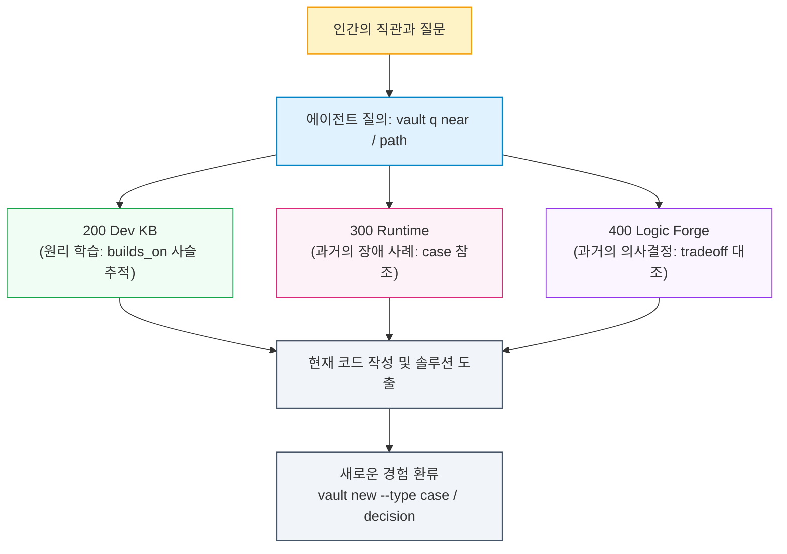

- table of contents
{:toc}

지난 [[1편]](/tag-ai-agent-architecture/1-ground-rules/)에서 나는 나 자신을 '<mark class="kw-devil">기록의 악마</mark>'라고 소개한 바 있다. 군대 시절 600일간의 수기 일기에서 출발해 `Notion`의 <mark class="kw-term">PARA 체계</mark>를 거쳐 지금의 <mark class="kw-term">옵시디언 볼트(Obsidian Vault)</mark>에 이르기까지, 내가 겪고 배운 거의 모든 시행착오와 깨달음을 기록으로 남겨왔기 때문이다. 앞선 아홉 편에 걸쳐 소개한 계획 선행 규율([[1편]](/tag-ai-agent-architecture/1-ground-rules/)), `TDD`와 객체 설계([[2편]](/tag-ai-agent-architecture/2-tdd-religion/), [[3편]](/tag-ai-agent-architecture/3-teach-object-design/), [[4편]](/tag-ai-agent-architecture/4-all-passed-empty-screen/)), 워크트리 격리와 거버넌스([[5편]](/tag-ai-agent-architecture/5-cmux-parallel-worktree/), [[6편]](/tag-ai-agent-architecture/6-repo-governance/), [[7편]](/tag-ai-agent-architecture/7-rule-pruning/)), 그리고 불변 인프라와 프론트엔드 `FSD`([[8편]](/tag-ai-agent-architecture/8-cloud-infra-evolution/), [[9편]](/tag-ai-agent-architecture/9-frontend-fsd/))까지 모든 워크플로우는 결국 날마다 쌓아 올린 기록에서 탄생했다. 이 글은 수천 개의 노트가 거대한 '<mark class="kw-term">디지털 쓰레기 매립지</mark>'로 변해가던 막막함을 넘어, 디렉토리별 공간(000~900)과 3대 신진대사 루프, 그리고 `vault-ontology` 스키마 게이트와 2계층 관계망으로 인간과 AI가 공유하는 외부 두뇌를 구축한 기록이다.

---

## 600일의 수기 일기에서 5,000개의 옵시디언 노트로: 고립된 노트들의 무덤

내가 기록을 시작한 이유는 나중에 다시 꺼내 읽기 위해서였다. 사람의 기억은 유한하기에 당시에 품었던 생각과 지식을 시간이 흐른 뒤 다시 펼쳐보면 실무와 삶에 든든한 밑거름이 될 것이라 여겼기 때문이다.

{:width="700" loading="lazy"}

최근에 재미있게 본 영화평론가 이동진 님의 유튜브 채널 영상 중, '기록하는 행위의 중요성'에 대해 실용적인 이유와 철학적인 이유를 들어 설명하는 장면이 있었다.
{:.figcaption}

> "실용적인 이유는 인간의 기억력이 시원찮고 스스로를 자꾸 속이니까요. '희미한 잉크가 선명한 기억보다 낫다'는 말처럼, 기록해 놓은 희미한 글자가 '분명히 기억하고 있다'는 확신보다 훨씬 더 정확합니다. (...) **기록이라는 것은 어떻게 생각하면 시간을 두 번 살 수 있는 행위이기도 합니다.**"  
> [이동진이 말하는 기록하는 삶 (26:45~28:25)](https://www.youtube.com/watch?v=ud9r1J85cTg&t=1605s) 중에서 발췌.

하지만 기록을 남긴다고 해서 그 내용이 저절로 살아 숨 쉬지는 않았다. 매일의 작업 일지(<mark class="kw-term">Day Notes</mark>), 기술 문서(<mark class="kw-term">Dev KB</mark>), 장애 회고, 아키텍처 결정(<mark class="kw-term">Decision Node</mark>), 도서 필사까지 적다 보니 볼트 문서는 한때 6,000개를 돌파했다가 취미 분야 격리 후에도 4,400여 개(위키링크 24,783개)에 달했다. 이 모든 것을 구성한 나조차 전체 노트의 위치를 외울 수 없었고, AI 에이전트에게 적절한 노트/디렉토리를 찾으라고 지시하면 볼트 전체를 헤매며 막대한 토큰을 허비했다. 몇 개월 전 적어둔 `Docker` 빌드 에러 노트가 검색으로 찾을 수 없어 같은 문제를 처음부터 다시 들여다봐야 했을 때, **검색되지 않는 노트는 존재하지 않는 것이나 다름없고 맥락 없이 흩어진 노트는 조용히 시간과 토큰을 갉아먹는 부채**라는 사실을 통감했다.

`Obsidian`의 '<mark class="kw-term">그래프 뷰(Graph View)</mark>'를 켜보아도, 수천 개의 점과 선들은 아무런 해답도 주지 못했다. 겉보기에는 뇌신경망처럼 경이로워 보였으나 까뒤집어보면 서로 왜 이어져 있는지조차 알 수 없는 실타래 뭉치, 즉 **'예쁜 쓰레기 은하수'**에 불과했다 ~~*(근데 정말 예뻐서 감상하기 좋긴하다 흐흐흐)*~~.

{:width="700" loading="lazy"}

글을 적고 있는 현시점의 Obsidian Graph View. 현재 4,400여 개의 노드와 1만 2천 개의 엣지가 유기적으로 얽혀 있다. 단순한 감상용 시각화를 넘어, 엄격한 온톨로지와 CLI 검증 체계를 통해 여러 프로젝트 저장소의 아키텍처와 규칙을 통제하는 중심 사령탑으로 진화했다.
{:.figcaption}

---

## 폴더의 역할 분리(000~900)와 2계층 관계망: 구조와 의미

Obsidian을 처음 구성할 때 맨 처음 한 것은 디렉토리를 설정하는 것이었다. 초기에 도입했던 PARA 체계는 Area와 Resource의 모호한 경계 때문에 PARA로만 관리하기는 어렵겠다는 생각을 하게 되었다. 나는 단일 책임 원칙과 십진분류법을 결합해 **000 Index**(관제탑), **100 Private Log**(개인 일기와 노트), **200 Dev Knowledge Base**(보편적인 개발 관련 지식), **300 Runtime**(활발히 진행 중인 프로젝트), **400 Logic Forge**(의사결정·트레이드오프), **500 Mind Compiler**(성찰 질문), **600 Content Observatory**(외부 컨텐츠 관련 노트), **700 Life Stack**(간단한 지식 사항들 - PARA의 Resources에 해당), **900 Archive**(아카이브)처럼 각 폴더마다 하나의 명확한 역할만 맡도록 볼트를 구획했다.

이어 2만 4천여 개에 달하는 위키링크의 의미적 공백을 메우기 위해, 본문 위키링크는 자유로운 연상 엣지로 남겨두고 프론트매터에 **구조 관계(1종)와 의미 관계(7종)**만 선언하는 **<mark class="kw-term">2계층 Minimalism</mark>**을 도입했다.

1. **구조 관계 (`builds_on`)**: "B를 모르면 A를 읽을 수 없는가?"라는 막힘 테스트를 통과한 볼트 내부의 직계 선행 개념(최대 3개)만 적으며, 로컬 SQLite <mark class="kw-term">재귀 CTE</mark>로 0.5ms 만에 선행 학습 경로(`vault q path`)를 정렬한다(상세는 **온톨로지 엔지니어링 [[2편]](/tag-ontology-engineering/2-vault-knowledge-ontology/)** 참조).
2. **의미 관계 7종과 시험 문장(Test Sentence)**: 문서가 탄생한 맥락을 설명하는 7가지 관계(파생 출처, 상호 모순, 조건 변형, 원칙 적용, 영감·영향, 철학 구현, 질문에 대한 답변)는 소리 내어 읽었을 때 참이 되는 한국어 시험 문장을 통과할 때만 부여하며, 볼트 내부 문서뿐 아니라 외부 도서 아카이브나 문서화되지 않은 직접 경험까지 출처의 성격을 구분해 연결한다.
3. **섹션 단위 연결과 제안(`proposed:`) 격리**: 문서 전체가 아니라 특정 문단의 통찰을 정확히 가리킬 수 있도록 폴더 경로를 명시한 헤딩(`#`) 앵커 연결을 정식 타겟으로 흡수했고, AI가 제안한 연결 후보는 내가 직접 확인해 승인하기 전까지 `proposed:` 블록에 따로 격리해 환각 간선을 차단했다.

---

## 스키마를 통과한 노트만 파일이 된다: 전용 CLI(vault new) 생성 게이트

위와 같은 프론트매터 규칙을 도입함으로써 vault 내의 문서들은 전부 그 내용을 지켜야하는 규약이 생긴 셈이었다. 이를 효과적으로 작성하기위해 파이썬 표준 라이브러리만으로 동작하는 **<mark class="kw-term">vault CLI</mark>**(`vault-ontology`)를 구축하고 철칙을 세웠다.

> **"새 문서는 반드시 `vault new`로 만든다. Write 도구로 볼트에 `.md` 파일을 직접 생성하는 것을 일절 금지한다."**

올해 1~2분기 즈음에 AI 에이전트와 협업할 때 MCP, CLI 어느 쪽이 더 좋을까 하는 이야기가 화두가 된 적이 있었다. 나는 직관적으로 CLI가 더 가볍다고 판단하여 그 이전부터 AI에게 이러한 추상화된 작업을 시킬 때 종종 CLI를 직접 만들어 사용하곤 했는데, 최근에 MCP를 Stateless로 만드는 것을 보편화하는 작업들이 이뤄지고 있는 것 같아서 또 한 번 비교해볼 때가 온 것 같기도 하다. 최근 확인해본 바로는, 결론만 이야기하면 개인이 로컬에서 작업하는 거면 CLI, 기업차원에서 다수에게 열어줘야하는 기능이라면 MCP라고 하더라. <!--블로그 글 쓰게되면 여기에 링크-->
{:.note title="여담"}

`vault new`와 `vault lint`는 동일한 프론트매터 검증 로직을 공유한다. 개념, 절차, 원칙, 의사결정, 사건 회고, 성찰 등 사전에 정의된 **13가지 문서 유형(type)**에서 벗어나거나, 80자를 넘긴 한 줄 요약, 화이트리스트에 없는 임의의 태그, 존재하지 않는 선행 문서 연결이 하나라도 발견되면 즉시 **파일 생성 자체를 거부**한다.

---

## AI와 인간의 공통 메모리, 그리고 3대 지식 신진대사 루프

이 온톨로지 볼트는 세션을 넘어 나와 AI 에이전트가 영속적으로 공유하는 **<mark class="kw-term">공통 메모리(Shared Brain)</mark>**가 되었다.

나아가 기록이 기록에서 멈추지 않도록, 작업이 끝나거나 새 기록이 생길 때마다 작동하는 **<mark class="kw-term">사건 기반 3대 지식 신진대사 루프</mark>**를 적용하고 있는 중이다.

1. **1차 정제 (작업 경험에서 프로젝트 교훈으로 · <mark class="kw-term">experience-distill</mark>)**: 코드 레포지토리에서 기능 구현이나 트러블슈팅이 끝나면, 그때 겪은 시행착오와 해결 과정을 볼트로 넘겨받아 일회성 로그 노이즈는 걷어내고 해당 프로젝트의 사건 기록(Case)과 교훈(Learnings) 문서로 압축한다.
2. **2차 승격 (프로젝트 교훈에서 보편 원칙과 블로그 글로 · <mark class="kw-term">knowledge-elevate</mark>)**: 특정 프로젝트에만 머물지 않고 다른 곳에서도 재사용할 수 있는 교훈들을 추려내어 나만의 실천 철칙(299 Principles), 보편 기술 지식(200 Dev KB), 아키텍처 의사결정 문서(400 Logic Forge)로 한 단계 승격시킨다. 이렇게 연결된 지식 그래프는 이후 관련 근거들을 한데 모아 블로그 초안으로 엮어내는 밑거름이 된다.
3. **성찰 직조 (일상의 기록에서 삶의 질문으로 · <mark class="kw-term">reflection-weave</mark>)**: 개발 지식뿐만 아니라 개인 일기와 회고록 속 내 생각들도 놓치지 않는다. 에이전트가 요약한 텍스트는 철저히 배제하고 오직 내가 직접 쓴 문장만 골라내어, 내가 삶에서 중요하게 여기는 화두들을 모아둔 **500 Mind Compiler**의 질문들과 연결한다. 이때 AI는 과거의 내 생각과 맞닿은 질문만 던져줄 뿐 스스로 결론을 쓰지 못하며, 반드시 나와 대화를 나누어 내 답변을 확인한 뒤에야 성찰 노트에 반영한다.

이렇게 2차 승격까지 마친 엔지니어링 원칙들은 스크립트를 통해 에이전트가 읽는 글로벌 스킬로 자동 변환되며, [[9편]](/tag-ai-agent-architecture/9-frontend-fsd/)에서 다룬 프론트엔드 FSD 아키텍처 규칙처럼 각 코드 레포지토리의 린터와 CI 검증 게이트로 다시 환류된다.

- [심화 근거: Vault 폴더 구조(000~900)와 3대 지식 신진대사 스킬 상세 프로토콜 보러가기](/tag-ai-agent-architecture/deep-dive/infra-fsd-and-ecosystem/#vault-os-architecture)
- [심화 근거: Vault Ontology 스키마 게이트, 적대적 검수 및 블로그·성찰 컴파일러 상세 보러가기](/tag-ontology-engineering/deep-dive/vault-knowledge-compiler/)

---

## 마치며: 개인 지식 온톨로지에서 코드 도메인 온톨로지 명세로

무의미한 링크의 거미줄을 걷어내고 2계층 관계망과 `vault new` 게이트를 세운 끝에, 볼트는 과거의 통찰을 0.5ms 만에 쏘아 올리고 경험과 사유를 글과 성찰로 길어 올리는 지식 컴파일러가 되었다. 그리고 이 **'<mark class="kw-term">개인 지식 온톨로지</mark>'**의 성공은 마크다운 문서라는 '명사(Noun)'의 세계를 넘어, 프로덕션 코드베이스의 아키텍처와 TDD 테스트 계약까지 3-Graph로 묶어 검증하는 **'<mark class="kw-term">코드 바인딩 도메인 온톨로지 명세(otlg)</mark>'**로 이어졌다. 그 상세한 여정은 후속 연재인 **[온톨로지 엔지니어링 시리즈](/tag-ontology-engineering/)**(**[[0편]](/tag-ontology-engineering/0-ontology-engineering-intro/)**, **[[2편]](/tag-ontology-engineering/2-vault-knowledge-ontology/)~[[4편]](/tag-ontology-engineering/4-three-graphs-and-tdd-contract-v030/)**, **[[9편]](/tag-ontology-engineering/9-knowledge-blog-compiler-and-semantic-critique/)**)에서 다루며, 본 시리즈의 마지막 글인 다음 **[[11편] 우리는 이미 각자의 운영체제를 짜고 있었다](/tag-ai-agent-architecture/11-external-workflow-and-ai-os/)**에서는 외부 에이전트 워크플로우들을 해부하며 자가 갱신형 거버넌스(`Living Wiki`)와 `AI Agent OS`라는 질문으로 나아간다.
