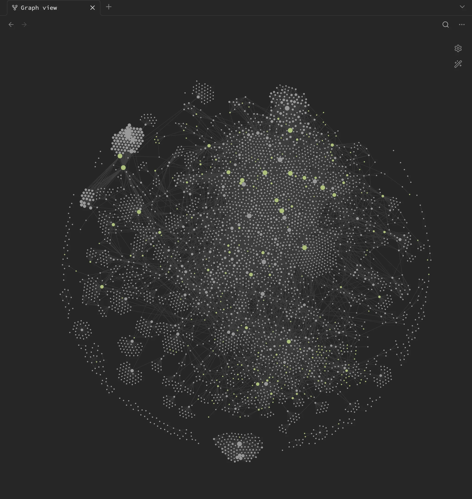
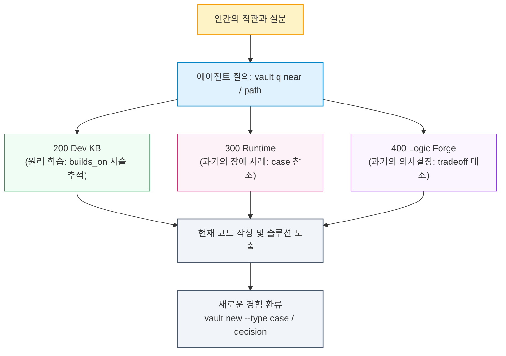

- table of contents
{:toc}

지난 [[1편]](/tag-ai-agent-architecture/1-ground-rules/)에서 나는 나 자신을 '<mark class="kw-devil">기록의 악마</mark>'라고 소개한 바 있다. 군대 시절 600일간의 수기 일기에서 출발해 `Notion`의 <mark class="kw-term">PARA 체계</mark>를 거쳐 지금의 <mark class="kw-term">옵시디언 볼트(Obsidian Vault)</mark>에 이르기까지, 내가 겪고 배운 거의 모든 시행착오와 깨달음을 기록으로 남겨왔기 때문이다. 앞선 아홉 편에 걸쳐 소개한 계획 선행 규율([[1편]](/tag-ai-agent-architecture/1-ground-rules/)), `TDD`와 객체 설계([[2편]](/tag-ai-agent-architecture/2-tdd-religion/), [[3편]](/tag-ai-agent-architecture/3-teach-object-design/), [[4편]](/tag-ai-agent-architecture/4-all-passed-empty-screen/)), 워크트리 격리와 거버넌스([[5편]](/tag-ai-agent-architecture/5-cmux-parallel-worktree/), [[6편]](/tag-ai-agent-architecture/6-repo-governance/), [[7편]](/tag-ai-agent-architecture/7-rule-pruning/)), 그리고 불변 인프라와 프론트엔드 `FSD`([[8편]](/tag-ai-agent-architecture/8-cloud-infra-evolution/), [[9편]](/tag-ai-agent-architecture/9-frontend-fsd/))까지 모든 워크플로우는 결국 날마다 쌓아 올린 기록에서 탄생했다. 이 글은 수천 개의 노트가 거대한 '<mark class="kw-term">디지털 쓰레기 매립지</mark>'로 변해가던 막막함을 넘어, 9대 단일 책임 공간(000~900)과 3대 신진대사 루프, 그리고 `vault-ontology` 스키마 게이트와 2계층 관계망으로 인간과 AI가 공유하는 외부 두뇌를 구축한 기록이다.

---

## 600일의 수기 일기에서 5,000개의 옵시디언 노트로: 고립된 노트들의 무덤

내가 기록을 시작한 이유는 나중에 다시 꺼내 읽기 위해서였다. 사람의 기억은 유한하기에 당시에 품었던 생각과 지식을 훗날 펼쳐보면 실무와 삶에 든든한 밑거름이 될 것이라 여겼기 때문이다.

{:width="700" loading="lazy"}

최근에 재미있게 본 영화평론가 이동진 님의 유튜브 채널 영상 중, '기록하는 행위의 중요성'에 대해 실용적인 이유와 철학적인 이유를 들어 설명하는 장면이 있었다.
{:.figcaption}

> "실용적인 이유는 인간의 기억력이 시원찮고 스스로를 자꾸 속이니까요. '희미한 잉크가 선명한 기억보다 낫다'는 말처럼, 기록해 놓은 희미한 글자가 '분명히 기억하고 있다'는 확신보다 훨씬 더 정확합니다. (...) **기록이라는 것은 어떻게 생각하면 시간을 두 번 살 수 있는 행위이기도 합니다.**"  
> [이동진이 말하는 기록하는 삶 (26:45~28:25)](https://www.youtube.com/watch?v=ud9r1J85cTg&t=1605s) 중에서 발췌.

하지만 기록을 남긴다고 해서 그 내용이 저절로 살아 숨 쉬지는 않았다. 매일의 작업 일지(<mark class="kw-term">Day Notes</mark>), 기술 문서(<mark class="kw-term">Dev KB</mark>), 장애 회고, 아키텍처 결정(<mark class="kw-term">Decision Node</mark>), 도서 필사까지 적다 보니 볼트 문서는 한때 6,000개를 돌파했다가 취미 서고 격리 후에도 4,400여 개(위키링크 24,783개)에 달했다. 나조차 모든 노트의 소재를 외울 수 없었고, AI 에이전트에게 적절한 위치를 찾으라고 지시하면 볼트 전체를 헤매며 막대한 토큰을 허비했다. 몇 개월 전 적어둔 `Docker` 빌드 에러 노트가 검색어로 잡히지 않아 같은 문제를 처음부터 다시 파고들어야 했을 때, **검색되지 않는 노트는 존재하지 않는 것이나 다름없고 맥락 없이 흩어진 노트는 조용히 시간과 토큰을 갉아먹는 부채**라는 사실을 통감했다.

답답한 마음에 `Obsidian`의 '<mark class="kw-term">그래프 뷰(Graph View)</mark>'를 켜보았지만, 수천 개의 점과 선들은 아무런 해답도 주지 못했다. 겉보기에는 뇌신경망처럼 경이로워 보였으나 까뒤집어보면 서로 왜 이어져 있는지조차 알 수 없는 실타래 뭉치, 즉 **'예쁜 쓰레기 은하수'**에 불과했다 ~~*(근데 정말 예뻐서 감상하기 좋긴하다 흐흐흐)*~~.

{:width="700" loading="lazy"}

글을 적고 있는 현시점의 Obsidian Graph View. 현재 4,400여 개의 노드와 1만 2천 개의 엣지가 유기적으로 얽혀 있다. 단순한 감상용 시각화를 넘어, 엄격한 온톨로지와 CLI 검증 체계를 통해 여러 프로젝트 저장소의 아키텍처와 규칙을 통제하는 중심 사령탑으로 진화했다.
{:.figcaption}

---

## 9대 단일 책임 공간(000~900)과 2계층 관계망: 구조와 의미

고립의 늪을 벗어나기 위해 먼저 물리적 공간의 경계를 재편했다. 초기에 도입했던 `PARA` 체계는 `Area`와 `Resource`의 모호한 경계 때문에 노트가 파편화되며 6개월 만에 붕괴했다. 나는 단일 책임 원칙(SRP)과 십진분류법(`Johnny Decimal`)을 결합해 **`000 Index`(관제탑), `100 Private Log`(AI 접근 불가 성역), `200 Dev Knowledge Base`(보편 지식과 `299 Principles`), `300 Runtime`(활성 작업대와 프로젝트), `400 Logic Forge`(의사결정·트레이드오프 쌍), `500 Mind Compiler`(성찰 질문), `600 Content Observatory`(외부 도서·아티클), `700 Life Stack`(생활 격리), `900 Archive`(보관소)**라는 9대 단일 책임 공간으로 볼트를 구획했다.

이어 2만 4천여 개 위키링크(`[[]]`)의 의미적 공백을 메우기 위해, 본문 위키링크는 자유로운 연상 엣지로 남겨두고 프론트매터에 **구조 관계와 의미 관계**만 선언하는 **<mark class="kw-term">2계층 Minimalism</mark>**을 도입했다.

1. **구조 관계 (`builds_on`과 `supersedes`)**: `builds_on`은 "B를 모르면 A를 읽을 수 없는가?"라는 막힘 테스트를 통과한 직계 선행 개념(최대 3개)만 적으며, 로컬 `SQLite` <mark class="kw-term">재귀 CTE</mark>로 0.5ms 만에 선행 학습 경로(`vault q path`)를 정렬한다(상세는 **온톨로지 엔지니어링 [[2편]](/tag-ontology-engineering/2-vault-knowledge-ontology/)** 참조).
2. **의미 관계 7종과 시험 문장(Test Sentence)**: 문서의 탄생 맥락을 설명하는 7가지 관계(`derived_from`, `contradicts`, `diverges_from`, `applies`, `informed_by`, `expresses`, `answered_by`)는 소리 내어 읽었을 때 참이 되는 시험 문장을 통과할 때만 부여한다.
3. **섹션 앵커(`#`)와 `proposed:` 거버넌스**: 특정 통찰을 겨냥하기 위해 `[[Q1. Better Developer/_Insights#인사이트 3]]` 같은 `#헤딩` 앵커를 정식 타겟으로 흡수했고, AI가 제안한 연결 후보는 인간이 승인하기 전까지 `proposed:` 블록에 격리해 환각 간선을 차단했다.

---

## 자연어 규칙을 넘어선 스키마 게이트: `vault new`가 아니면 생성조차 되지 않는다

프론트매터 규칙을 문서에 적어두는 것만으로는 에이전트의 필드 누락이나 급한 날림 작성을 막을 수 없었다. 결정론적으로 시스템을 지키는 것은 권고가 아니라 규칙 위반 시 프로세스를 멈춰 세우는 도구(`CLI`)뿐이기에, 파이썬 표준 라이브러리만으로 동작하는 **<mark class="kw-term">vault CLI</mark>**(`vault-ontology`)를 구축하고 철칙을 세웠다.

> **"새 문서는 반드시 `vault new`로 만든다. Write 도구로 볼트에 `.md` 파일을 직접 생성하는 것을 일절 금지한다."**

올해 1~2분기 즈음에 AI 에이전트와 협업할 때 MCP, CLI 어느 쪽이 더 좋을까 하는 이야기가 화두가 된 적이 있었다. 나는 직관적으로 CLI가 더 가볍다고 판단하여 그 이전부터 AI에게 이러한 추상화된 작업을 시킬 때 종종 CLI를 직접 만들어 사용하곤 했는데, 최근에 MCP를 Stateless로 만드는 것을 보편화하는 작업들이 이뤄지고 있는 것 같아서 또 한 번 비교해볼 때가 온 것 같기도 하다. 언제 한번 날 잡고 깊이 연구한 뒤 블로그 글로 공유해볼까 한다. <!--블로그 글 쓰게되면 여기에 링크-->
{:.note title="여담"}

`vault new`와 `vault lint`는 동일한 단일 검증 함수(`validate_frontmatter`)를 공유하며, 허용된 **13개의 엄격한 `type`**(`concept`, `procedure`, `principle`, `decision`, `tradeoff`, `case`, `capture`, `review`, `reflection`, `project-doc`, `reference`, `log`, `hub`) 이탈이나 80자 초과 `summary`, 화이트리스트(`vault tags`) 외 태그, 미해결 `builds_on`이 발견되면 즉시 **파일 생성 거부(종료 코드 `1`)**로 응답한다.

---

## AI와 인간의 공통 메모리, 그리고 3대 지식 신진대사 루프

이 온톨로지 볼트는 세션을 넘어 나와 AI 에이전트가 영속적으로 공유하는 **<mark class="kw-term">공통 메모리(Shared Brain)</mark>**가 되었다.

나아가 지식이 화석처럼 굳지 않도록, 달력 주기의 기계적 정리를 걷어내고 실제 작업 완료와 기록 생성에 즉각 반응하는 **<mark class="kw-term">사건 기반 3대 지식 신진대사(Knowledge Metabolism) 루프</mark>**를 가동했다.

1. **1차 정제 (`<mark class="kw-term">experience-distill</mark>`)**: 작업 기록에서 일회성 로그 노이즈를 걷어내고 프로젝트의 순도 높은 교훈(`Learnings`) 문서로 압축한다.
2. **2차 범용 승격 (`<mark class="kw-term">knowledge-elevate</mark>`)**: 여러 프로젝트의 `Learnings`를 횡단 비교하여 실천 철칙(`299 Principles`), 보편 기술 지식(`200 Dev KB`), 아키텍처 결정 노드(`400 Logic Forge`)로 승격시킨다.
3. **성찰 직조 (`<mark class="kw-term">reflection-weave</mark>` & `<mark class="kw-term">Mind Compiler</mark>`)**: 개인 기록에서 벡터 검색(`vv weave`)으로 관련 근거를 찾아내면, AI가 과거 발언과 현재 행동의 모순을 질문으로 제안하고 내 응답을 거쳐 `500 Mind Compiler` 질문 체계(`_Question.md`)와 직조한다.

2차 승격을 마친 원칙들은 `build_skill_runtime.py`를 통해 글로벌 스킬(`object-design-practices`, `principles-audit`)로 컴파일되며, [[9편]](/tag-ai-agent-architecture/9-frontend-fsd/)의 프론트엔드 `FSD` 규칙(`INV-005`)처럼 각 코드 저장소의 린터와 CI 게이트로 직결된다.

- [심화 근거: Vault 9대 공간(000~900) 구조와 3대 지식 신진대사 스킬 상세 프로토콜 보러가기](/tag-ai-agent-architecture/deep-dive/infra-fsd-and-ecosystem/#vault-os-architecture)
- [심화 근거: Vault Ontology 스키마 게이트, 적대적 검수 및 블로그·성찰 컴파일러 상세 보러가기](/tag-ontology-engineering/deep-dive/vault-knowledge-compiler/)

---

## 마치며: 개인 지식 온톨로지에서 코드 도메인 온톨로지 명세로

무의미한 링크의 거미줄을 걷어내고 2계층 관계망과 `vault new` 게이트를 세운 끝에, 볼트는 과거의 통찰을 0.5ms 만에 쏘아 올리는 지식 그래프가 되었다. 그리고 이 **'<mark class="kw-term">개인 지식 온톨로지</mark>'**의 성공은 마크다운 문서라는 '명사(Noun)'의 세계를 넘어, 프로덕션 코드베이스의 런타임 물리 상태(소스 경로, DB 제약 조건, 상태 전이 규칙)를 직접 바인딩하는 **'<mark class="kw-term">코드 바인딩 도메인 온톨로지 명세(otlg)</mark>'**로 이어졌다. 그 상세한 여정은 후속 연재인 **[온톨로지 엔지니어링 시리즈](/tag-ontology-engineering/)**(**[[0편]](/tag-ontology-engineering/0-ontology-engineering-intro/)**, **[[3편]](/tag-ontology-engineering/3-nouns-to-verbs-paradigm-shift/)**, **[[4편]](/tag-ontology-engineering/4-zero-lint-error-illusion-and-v020/)·[[5편]](/tag-ontology-engineering/5-three-graphs-and-tdd-contract-v030/)**)에서 다루며, 본 시리즈의 마지막 글인 다음 **[[11편] 우리는 이미 각자의 운영체제를 짜고 있었다](/tag-ai-agent-architecture/11-external-workflow-and-ai-os/)**에서는 외부 에이전트 워크플로우들을 해부하며 자가 갱신형 거버넌스(`Living Wiki`)와 `AI Agent OS`라는 질문으로 나아간다.
