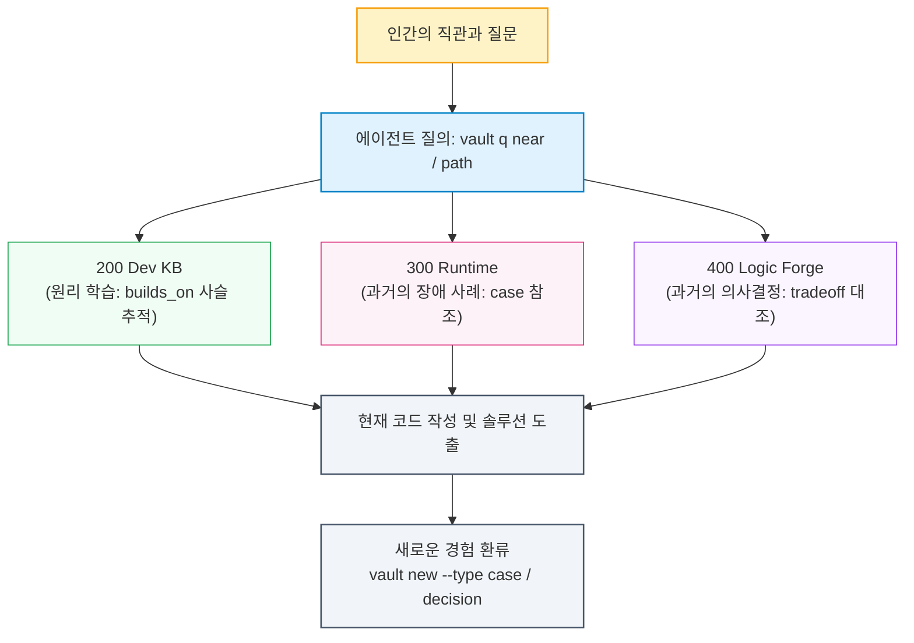

- table of contents
{:toc}

지난 [[1편]](/tag-ai-agent-architecture/1-ground-rules/)에서 나는 나 자신을 '기록의 악마'라고 소개한 바 있다. 군대 시절 600일간 하루도 빠짐없이 썼던 수기 일기에서 출발해 `Notion`의 <mark class="kw-term">PARA 체계</mark>를 거쳐 지금의 <mark class="kw-term">옵시디언 볼트(Obsidian Vault)</mark>에 이르기까지, 내가 직접 겪고 배운 거의 모든 시행착오와 깨달음을 기록으로 남겨왔기 때문이다.

이 시리즈를 따라오며 우리는 참으로 먼 길을 함께 걸어왔다. 에이전트의 즉각 구현을 금지하고([[1편]](/tag-ai-agent-architecture/1-ground-rules/)), `TDD`를 타협 없는 종교로 받아들였으며([[2편]](/tag-ai-agent-architecture/2-tdd-religion/)), 객체지향 설계 원칙으로 에이전트를 가르치고([[3편]](/tag-ai-agent-architecture/3-teach-object-design/)), 'All Passed' 착시의 함정을 부쉈다([[4편]](/tag-ai-agent-architecture/4-all-passed-empty-screen/)). 나아가 다중 에이전트를 워크트리로 물리 격리하고([[5편]](/tag-ai-agent-architecture/5-cmux-parallel-worktree/)), 세션의 망각을 이겨내기 위해 저장소에 관리 문서를 세웠으며([[6편]](/tag-ai-agent-architecture/6-repo-governance/)), 비대해진 규칙집을 깎아내는 다이어트와 코드 청소([[7편]](/tag-ai-agent-architecture/7-rule-pruning/))를 거쳐, 홀로 클라우드 인프라와 배포 파이프라인을 단순화하고([[8편]](/tag-ai-agent-architecture/8-cloud-infra-evolution/)), 거대한 프론트엔드 UI 스파게티를 `FSD` 아키텍처로 썰어내기까지 했다([[9편]](/tag-ai-agent-architecture/9-frontend-fsd/)).

앞선 아홉 편에 걸쳐 소개한 모든 엔지니어링 워크플로우는 결국 날마다 쌓아 올린 기록들을 바탕으로 치열하게 정제해 낸 결과물이다. 광범위한 분야의 지식을 유실 없이 담아내기 위해 나는 늘 `Obsidian Vault`를 매만지고 고도화해 왔는데, 그 심장부에는 언제나 **"매일 쏟아져 나오는 노트들을 어떻게 관리할 것이며, 어떻게 유기적인 생명력을 불어넣을 것인가?"**라는 무거운 질문이 자리 잡고 있었다. 기록을 좋아하는 사람이라면 노트 관리 앱에 문서가 쌓일수록 지식의 보고가 아니라 거대한 '<mark class="kw-term">디지털 쓰레기 매립지</mark>'로 변해가는 막막함을 한 번쯤 겪어보았을 것이다. 이 글은 수천 개의 파편화된 노트를 하나의 유기적인 <mark class="kw-term">지식 온톨로지</mark>로 엮어내기 위해 문서 사이의 2계층 관계를 정의하고, `CLI` 관문으로 스키마를 강제하며 지식 승격 파이프라인을 세우기까지의 엔지니어링 기록이다. 지금의 역학관계를 확립하기까지 무수한 고도화 시도와 실패를 거듭해 왔기에, 이번 글에서는 내 `Obsidian Vault`에 도입한 <mark class="kw-term">온톨로지(Ontology)</mark> 체계를 집중적으로 살펴보고 전반적인 태그 체계와 <mark class="kw-term">Personal Knowledge Management System(PKM)</mark>은 추후 별도의 시리즈로 상세히 다뤄볼까 한다. <!-- Obsidian 시리즈 쓰면 링크 삽입 -->

---

## 600일의 수기 일기에서 5,000개의 옵시디언 노트로: 고립된 노트들의 무덤

내가 기록을 시작한 이유는 당연하게도 나중에 다시 꺼내 읽기 위해서였다. 사람의 기억은 유한하기 마련이니, 당시에 내가 어떤 생각을 품었고 어떤 지식을 얻었는지를 훗날 다시 펼쳐보면 그 자체로 흥미로울 뿐만 아니라 실무와 삶에 꽤나 유익한 밑거름이 될 것이라 여겼기 때문이다.

{:width="700" loading="lazy"}

최근에 재미있게 본 영화평론가 이동진 님의 유튜브 채널 영상 중, '기록하는 행위의 중요성'에 대해 실용적인 이유와 철학적인 이유를 들어 설명하는 장면이 있었다.
{:.figcaption}

> "왜 기록을 하는 것이 중요할까요?"
> 
> "실용적인 이유는 인간의 기억력이 시원찮고 스스로를 자꾸 속이니까요. '희미한 잉크가 선명한 기억보다 낫다'는 말처럼, 기록해 놓은 희미한 글자가 '분명히 기억하고 있다'는 확신보다 훨씬 더 정확합니다. 실제로 나한테 무슨 일이 일어났고 그때 어떻게 느꼈고 내 삶에 무슨 의미가 있었는지를 나중에 알 수가 있잖아요.  
> 
> 철학적으로는 시간에 대한 두려움 때문이라고 생각해요. 인간은 누구나 시간 내 존재이고, 가장 두려운 건 흘러가면 되돌릴 수 없다는 시간의 비가역성이잖아요. 그런 상황에서 **기록이라는 것은 어떻게 생각하면 시간을 두 번 살 수 있는 행위이기도 합니다.**"  
> 
> [이동진이 말하는 기록하는 삶 (26:45~28:25)](https://www.youtube.com/watch?v=ud9r1J85cTg&t=1605s) 중에서 발췌. 관심 있는 사람은 해당하는 2분 정도를 보는 것도 추천한다.

하지만 기록을 한 번 남긴다고 해서 그 내용이 마법처럼 영원히 내 머릿속에 살아 숨 쉬지는 않는다. 군대에서 쓰던 일기가 서랍 깊숙이 쌓여갈 때도 그랬고, `Notion`에 읽은 책과 플레이한 게임, 공부한 코드 스니펫들을 부지런히 정리할 때도 마찬가지였다. 특히 `Obsidian`으로 이주한 뒤에는 나의 노트 수집 강박이 걷잡을 수 없이 폭발했는데, 매일의 작업 일지(<mark class="kw-term">Day Notes</mark>), 학습한 기술 문서(<mark class="kw-term">Dev KB</mark>), 장애 회고(Incident Response), 아키텍처 결정(<mark class="kw-term">Decision Node</mark>), 그리고 책과 유튜브의 필사 노트까지 닥치는 대로 적어 내려가다 보니 어느덧 볼트 안의 문서는 4,400여 개를 넘어 5,000개에 육박했고 위키링크는 2만 4천 개를 훌쩍 넘어섰다. 이 방대한 노트들을 적절한 디렉토리 구조로 나누어 담는 작업만 해도 상당한 품이 들었으며, 그에 얽힌 시행착오는 추후 옵시디언 관련 시리즈에서 별도로 풀어볼 생각이다.

그렇게 불어나는 노트들과 씨름하던 어느 날, 문제의식 하나가 머리를 스쳤다. 볼트의 주인인 나조차 디렉토리 구조를 더듬어가며 위치를 짐작할 뿐 모든 노트의 소재를 다 외울 수는 없었는데, 하물며 문서화 작업을 함께 수행하는 AI 에이전트에게 아무런 구조적 단서 없이 적절한 위치를 찾거나 유사한 노트의 존재 여부를 판단하라고 지시하면 에이전트가 볼트 전체를 헤매며 막대한 토큰을 허비하고 있었기 때문이다. 한번은 몇 개월 전에 `Docker` 멀티스테이지 빌드에서 마주친 에러를 해결하고 분명 어딘가에 적어둔 기억이 나는데도, 검색창(`Cmd+O`나 `grep`)에 떠오르는 키워드를 몇 개 쳐봐도 도무지 문서가 잡히지 않던 날이 있었다. 당시에 내가 제목을 무엇이라 붙였고 어떤 어휘로 요약했는지가 정확히 기억나지 않는 순간, 그 노트는 영원히 디지털 심해 속으로 가라앉아 버렸으며 결국 나는 3개월 전의 내가 이미 풀어둔 문제를 구글링과 AI 검색을 통해 첫 문맥부터 다시 바닥부터 파고들어야 했다. **검색되지 않는 노트는 존재하지 않는 것이나 다름없었고, 맥락 없이 흩어진 노트는 조용히 시간과 토큰을 갉아먹는 부채가 되어 있었다.**

답답한 마음에 `Obsidian`이 자랑하는 화려한 '<mark class="kw-term">그래프 뷰(Graph View)</mark>'를 켜보았지만, 화면 가득 반짝이는 수천 개의 점과 선들은 내게 아무런 해답도 주지 못했다. 노트가 수십 개 수준이라면 시각화된 망을 눈으로 쫓으며 인지적으로 충분히 수용할 수 있겠지만, 수천 개의 노트가 뒤엉킨 거대한 성운 앞에서 그 유기적인 연결 고리를 사람의 머릿속으로 그려내는 것은 애초에 불가능에 가까웠다. 겉보기에는 인간의 뇌신경망처럼 경이로워 보였으나 냉정하게 까뒤집어보면 그것은 서로 어디로 이어지는지조차 알 수 없는 실타래 뭉치, 즉 **'예쁜 쓰레기 은하수'**에 불과했다 ~~*(근데 정말 예뻐서 감상하기 좋긴하다 흐흐흐)*~~. 단순히 노트를 많이 적고 링크를 걸어두는 관성만으로는 아무것도 해결할 수 없었으며, 고립된 노트들의 무덤 위에서 나도 AI도 함께 길을 잃고 있던 셈이다.

{:width="700" loading="lazy"}

글을 적고 있는 현시점의 Obsidian Graph View. 현재 4,400여 개의 노드와 1만 2천 개의 엣지가 유기적으로 얽혀 있다. 단순한 감상용 시각화를 넘어, 엄격한 온톨로지와 CLI 검증 체계를 통해 여러 프로젝트 저장소의 아키텍처와 규칙을 통제하는 중심 사령탑으로 진화했다.
{:.figcaption}

> **[기술적 사실 및 볼트 원천 근거]**
> - **볼트 실제 규모 측정치** (`vault CLI` 기준): 글을 적고 있는 현시점 기준 4,400여 개 노드, 엣지 12,256개, 위키링크 24,783개.
> - **스키마 정본의 문제의식** (`Vault 온톨로지 스키마 정본`): "위키링크 24,783개가 있지만, 단순 링크만으로는 문서의 역할과 관계를 기계가 일관되게 해석하기 어렵다."
> - **검색 4단계 이론**: 찾아보기(Lookup) ➔ 둘러보기(Browse) ➔ 태그(Tag) ➔ 뜻밖의 발견(Serendipity). 단순 전문 검색(Full-text search)과 키워드 매칭은 1·2단계만 해결할 뿐, 지식 간의 유기적 탐색(3·4단계)을 지원하지 못함.

---

## 단순 링크(`[[]]`)를 넘어 2계층 관계로: 구조와 의미

그 고립의 늪을 벗어나기 위해 가장 먼저 정면으로 마주해야 했던 본질적인 과제는 **문서와 문서 사이의 연결, 즉 위키링크(`[[]]`)의 의미적 공백**이었다. `Obsidian`의 가장 강력한 무기는 문서 이름을 대괄호 두 개로 묶기만 하면 즉각 이어지는 양방향 링크이기에, 나 역시 노트를 작성할 때마다 관련 있어 보이는 문서들을 수십 개씩 아낌없이 연결해 두곤 했다. 예를 들어 네트워크 관련 노트를 쓰면서 본문 곳곳에 `[[CIDR]]`, `[[서브넷 마스크]]`, `[[VPC]]`, `[[라우팅 테이블]]`을 줄줄이 걸어두는 식이었다. 하지만 그렇게 만들어진 2만 4천여 개의 링크들은 기계에게는 물론이고 1년 뒤의 나에게조차 두 문서가 왜 연결되어 있는지 아무런 맥락을 설명해 주지 못했다.

- 이 링크는 현재 문서를 이해하기 위해 **반드시 먼저 읽어야 하는 선행 지식**인가?
- 아니면 단순히 **비슷한 주제를 다룬 주변 참고 자료**에 불과한가?
- 그것도 아니면 이 문서가 저 문서의 주장을 **정면으로 반박**하거나, 과거의 잘못된 설정을 **폐기하고 대체**했다는 뜻인가?

화살표에 이름표가 붙어 있지 않은 그래프는 그저 거대한 미로일 뿐이어서, 한 문서를 열었을 때 주렁주렁 매달린 수십 개의 링크 중 지금 당장 내게 필요한 문맥이 무엇인지 가려내는 데만 한참의 에너지를 쏟아야 했다. 그렇다고 학계의 <mark class="kw-term">시맨틱 웹(Semantic Web)</mark>이나 무거운 `RDF`/`OWL` 온톨로지처럼 2만 개가 넘는 모든 인라인 링크 하나하나에 복잡한 술어(Predicate)를 일일이 부여하려 드는 것은, 1인 개발자에게 배보다 배꼽이 더 큰 자살행위나 다름없었다. 관리하고 유지보수하는 데 드는 인지적 비용이 정작 지식이 주는 실용적 가치를 압도해 버리기 마련이기에, 나는 자유로운 발상과 엄격한 기계 가독성 사이의 균형을 잡는 철저한 **<mark class="kw-term">2계층 Minimalism</mark>**을 택했다.

1. **일반 위키링크**: 본문 안에서 예상치 못한 연결과 뜻밖의 발견(Serendipity)을 이끌어내는 자유로운 untyped 엣지로 그대로 남겨두어, <mark class="kw-term">Zettelkasten(제텔카스텐)</mark> 필기법 본연의 연상 작용을 온전히 보전한다.
2. **구조 관계 2종**: 시스템과 AI 에이전트가 문서를 읽어야 할 선후 순서와 신구 교체 계보를 즉각 파악하도록 프론트매터에 명시하는 뼈대 관계다.
3. **의미 관계 7종**: 이 문서가 볼트 안에서 대체 왜 존재하는지, 어떤 경험과 원칙에서 비롯되었는지 존재 이유를 증명하는 핵심 관계다.

```yaml
---
type: concept
summary: VPC 피어링의 동작 원리와 라우팅 정책
builds_on:
  - "[[VPC]]"
  - "[[라우팅 테이블]]"
derived_from:
  - "[[사내 멀티 테넌트 VPC 장애 회고]]"
applies:
  - "[[최소 권한의 원칙]]"
---
```

---

### 구조 관계 2종: 읽는 순서와 대체 이력

구조 관계는 볼트 안의 문서들이 어떤 학습 순서로 배치되고, 시간의 흐름에 따라 어떻게 역사를 이어받는지를 규율한다.

#### `builds_on`: "무엇을 먼저 읽어야 하는가?" (학습 사슬과 이행 폐쇄)
첫 번째 축인 `builds_on`은 지식의 선행 조건을 정의하며, "문서 A를 온전히 이해하기 위해 사전에 반드시 통과해야 하는 바탕 개념은 무엇인가?"라는 질문에 답한다. 흔히 관련 있어 보이는 문서를 전부 선행 개념으로 적어넣고 싶은 유혹에 빠지기 쉬운데, 이러한 무분별한 간선 오염을 막기 위해 세 가지 엄격한 통과 테스트를 세웠다.

- **막힘 테스트**: "B를 모르면 A를 아예 읽을 수 없는가?" (알면 도움이 되는 수준이라면 `builds_on`이 아니라 본문 일반 위키링크의 몫이다.)
- **비대칭 테스트**: "`B builds_on A`가 성립하지 않는가?" (양쪽 모두 그럴듯하게 읽힌다면 그것은 개념적 선후 관계가 아니라 대등한 연관 개념이다.)
- **이행 건전성 테스트**: "A→B이고 B→C일 때, A를 이해하려면 C가 반드시 참인가?" (중간에 낀 가짜 간선을 걸러내는 리트머스 시험지 역할을 한다.)

여기에 **"오직 직접 부모만 적는다"**는 그래프 불변식을 더했다. A가 B를 필요로 하고 B가 C를 필요로 한다면, A의 프론트매터에는 C를 중복 기입하지 않고 직계 부모인 B만 적는다. 더 상위에 있는 조상 개념들은 그래프 추론 엔진이 <mark class="kw-term">이행 폐쇄(Transitive Closure)</mark>를 타고 자동으로 계산해 도달할 수 있기 때문인데, 이 원칙을 엄격히 적용한 덕분에 각 문서의 선행 개념은 억지스러운 제한 없이도 자연스럽게 1~3개 이내로 수렴했다. 이렇게 정제된 관계망은 별도의 무거운 그래프 DB 서버를 띄우는 대신 로컬 `SQLite`의 <mark class="kw-term">재귀 CTE(Common Table Expression)</mark>를 통해 단 0.5ms 만에 터미널에 선행 학습 체인을 정렬해 주며(`vault q path "VPC 피어링"` ➔ `CIDR` ➔ `서브넷 마스크` ➔ `라우팅 테이블` ➔ `VPC` ➔ `VPC 피어링`), 에이전트에게 도메인 맥락을 주입할 때 이보다 명쾌한 읽기 순서는 없다. (`Obsidian Vault` 지식 온톨로지의 상세한 스키마 설계 과정과 왜 무거운 `RDF/OWL` 대신 `SQLite` 재귀 `CTE`를 택했는지에 관한 깊이 있는 기술적 트레이드오프는 후속 심화 글인 **온톨로지 엔지니어링 [[2편] 4,400개의 흩어진 생각에 척추를 세우다](/tag-ontology-engineering/2-vault-knowledge-ontology/)**에서 한층 자세하게 파헤친다.)

#### `supersedes`: "이 문서는 과거의 무엇을 대체했는가?" (지식의 진화와 폐기)
두 번째 구조 관계인 `supersedes`는 지식의 진화와 폐기를 다룬다. 엔지니어링 지식은 결코 영원하지 않아서 기술 스택이 발전하거나 아키텍처가 개편되면 과거의 문서는 폐기되거나 더 나은 정본 문서로 통폐합되기 마련이다. 이때 판단 기준은 명쾌한데, 원본 문서가 여전히 유효한 선행 개념으로서 볼트에 계속 살아 남아 있다면 `builds_on`을 쓰고, 옛 문서를 완전히 지우거나 새 문서가 그 내용을 온전히 흡수해 대체했다면 `supersedes`를 선언한다. 따라서 `supersedes`가 가리키는 대상은 이미 볼트에서 삭제된 옛 문서이므로 린트 검사에서 미해결 링크(Unresolved link)로 잡히는 것이 오히려 정상이며, 이는 과거의 레거시 지식을 명시적으로 끊어내어 볼트 내부의 기술 부채를 청산하는 공식 폐기 선언이 되어준다.

---

### 의미 관계 7종과 '시험 문장' 판정법

구조 관계인 `builds_on`이 "무엇을 먼저 읽어야 하는가"라는 탐색 경로를 묻는다면, 의미 관계는 **"이 문서가 대체 왜 존재하는가"**라는 탄생 맥락을 설명한다. 볼트를 운영하며 실제로 던졌던 수십 가지 역량 질문(Competency Questions)을 분류하고 압축하여 최종적으로 7가지 핵심 의미 관계를 추려냈는데, 관계 부여가 작성자의 기분에 따라 자의적으로 흐르지 않도록 사람이 소리 내어 읽었을 때 참과 거짓을 즉각 판별할 수 있는 **'<mark class="kw-term">시험 문장(Test Sentence)</mark>'**을 통과할 때만 관계를 선언하도록 못 박았다.

| 의미 관계 | 시험 문장 (이대로 읽어서 참일 때만) | 실전 용례 |
|---|---|---|
| **`derived_from`** | **"A는 B에서 나왔다"** | 원칙이나 설계의 뿌리가 된 실전 장애 사건(`case`)이나 도서 필사(`capture`) |
| **`contradicts`** | **"A와 B는 둘 다 참일 수 없다"** | 서로 다른 설계 원칙 간의 상충이나 양립 불가능한 결정 |
| **`diverges_from`**| **"A는 B를 바탕으로 삼되 일부를 바꿨다"** | 오픈소스나 표준 패턴을 우리 프로젝트의 특수성에 맞게 변형한 결정 |
| **`applies`** | **"A는 B라는 원칙을 적용했다"** | 실전 구현체나 설계서가 `299 Principles`의 특정 원칙을 채택한 것 |
| **`informed_by`** | **"A는 B의 영향을 받았다"** (직접 근거는 아님) | 직접적 도출은 아니지만 사고의 틀에 깊은 영감을 준 외부 아티클이나 강연 |
| **`expresses`** | **"A는 B라는 가치를 구현한다"** | 구체적 도구 체계나 규칙이 추상적인 엔지니어링 철학을 대변할 때 |
| **`answered_by`** | **"A라는 질문이 B에서 답을 얻는다"** | 호기심이나 고민을 담은 의문 노트가 해결 노트를 만났을 때 |

실전에서 특히 혼동하기 쉬운 인접 관계들은 단 한 줄의 대조 질문으로 명쾌하게 갈라낼 수 있었다.
- **`derived_from` vs `informed_by`**: "B가 없었으면 A를 아예 작성하지 못했는가?" 그렇다면 직접적 원천인 `derived_from`이고, 단순히 사고의 참고나 영감에 그쳤다면 `informed_by`를 부여한다.
- **`contradicts` vs `diverges_from`**: "두 주장이 한 시스템 안에서 동시에 참일 수 있는가?" 양립할 수 없는 배타적 충돌이라면 `contradicts`이고, 표준 패턴의 일부를 우리 환경에 맞게 고쳐 쓴 변형이라면 `diverges_from`이다.

#### 설계 비화 1: 한국어 시험 문장과 영어 문법이 싸우면 영어 문법이 이긴다
초기 스키마를 설계할 때는 「A가 B에게 영감을 주었다」라는 능동적 어감에 이끌려 관계 이름을 `informs`라고 붙인 적이 있었다. 하지만 정작 한국어 시험 문장은 주어가 영향을 받는 「A는 B의 영향을 받았다」라는 수동태로 정의되어 있었고, `W3C`의 `PROV-O` 상위 표준인 `prov:wasInfluencedBy` 역시 현재 문서(주어)가 대상 문서(목적어)로부터 영향을 받는 방향으로 설계되어 있었다. 즉, 필드 이름의 문법적 방향과 실제 의미 방향이 정반대로 뒤집혀 있었던 셈인데, 이를 발견한 즉시 지체 없이 필드명을 수동태인 **`informed_by`**로 바로잡았다. 기계가 국제 표준 온톨로지와 결합하고 추론을 수행하는 접점에서는 모호한 직관보다 엄밀한 영어 문법과 방향성이 우선해야 하기 때문이다.

#### 설계 비화 2: 「어겼다(`violates`)」는 관계가 아니다
비슷한 맥락에서 온톨로지 초안에는 특정 원칙을 위반한 사례를 가리키는 `violates`라는 관계도 포함되어 있었으나, 수천 개의 볼트 문서를 전수조사해 본 결과 실제 `violates`의 사용 빈도는 놀랍게도 **0회**였다. 곰곰이 따져보니 이유는 아주 단순했는데, **원칙을 어긴 주체는 과거의 미숙했던 코드나 실행이었지 그 사건을 회고하며 작성한 문서 자체가 아니었기 때문이다.** 볼트에 남는 문서는 이미 그 실패를 분석하고 교정한 결과물이어서 오히려 원칙의 정당성을 증명하는 근거(`derived_from`)가 되며, 설령 문서를 작성하는 도중에 기존 원칙과의 충돌을 발견하더라도 그 자리에서 내용을 수정해 정합성을 맞추므로 시스템 안에는 영구적인 '위반' 관계가 남을 일이 없었다. 작성하는 시점에 이미 해소되어 사라질 일시적 상태를 온톨로지의 영구 관계망으로 남겨둘 필요는 없었던 것이다.

---

### 문서보다 작은 단위: 섹션 앵커 (`#`) 문법

문서와 문서를 1:1로 연결하는 것만으로는 정밀도의 한계에 부딪히는 순간이 찾아왔다. 예컨대 `Q1. Better Developer/_Insights.md`라는 단일 문서 안에 분기별로 건져 올린 핵심 인사이트 24개가 빼곡하게 정리되어 있을 때, 새로 만든 원칙 문서에서 단순히 `_Insights` 문서 전체를 `derived_from`으로 가리켜 버리면 24개의 통찰 중 대체 어느 대목에서 파생된 원칙인지 핀포인트 맥락이 통째로 증발해 버리고 만다.

```yaml
# X: 24개 중 어느 것에서 나온 원칙인지 기계도 인간도 알 수 없다
derived_from: ["[[Q1. Better Developer/_Insights]]"]

# O: 3번 인사이트라는 핀포인트 맥락이 완벽히 보존된다
derived_from: ["[[Q1. Better Developer/_Insights#인사이트 3]]"]
```

이 문제를 풀기 위해 마크다운 원문을 어지럽히는 인위적인 블록 ID(`^abc123`)를 도입하는 대신, `Obsidian`이 기본으로 지원하는 **<mark class="kw-term">섹션 앵커(#헤딩)</mark>**를 온톨로지의 정식 타겟 문법으로 흡수했다. 지난 수개월간의 볼트 `Git` 이력을 전수조사해 보았을 때 번호가 매겨진 핵심 헤딩은 수정되거나 삭제된 적이 단 한 번도 없었기에, 가독성을 해치지 않으면서도 문단 단위의 출처를 정확히 겨냥하는 가장 안정적인 미세 식별자가 되어주었다.

---

### AI의 폭주를 막는 `proposed:` 거버넌스와 메타 상태

아무리 정교한 관계 문법을 정의해 두더라도 AI 에이전트에게 온톨로지 관계 선언의 전권을 곧바로 위임해 버리면, 그럴듯해 보이는 문서들을 마구잡이로 엮어내는 환각(Hallucination) 간선이 순식간에 지식 그래프를 오염시킨다. 이러한 에이전트의 과잉 연결을 통제하기 위해 인간이 최종 확정하기 전까지 후보 관계를 격리해 두는 **'<mark class="kw-term">승인 대기 블록(proposed:)</mark>'**을 도입했다.

```yaml
derived_from:              # 인간이 확인하고 보증한 확정 관계 (asserted)
  - "[[사내 멀티 테넌트 VPC 장애 회고]]"
proposed:                  # 에이전트가 제안한 후보 관계 (승인 대기)
  derived_from:
    - "[[CIDR 서브넷 마이그레이션 일지]]"
```

에이전트가 문서를 정제하거나 탐색하다가 새로운 연결 고리를 발견했을 때는 오직 `proposed:` 하위 블록에만 후보로 등록할 수 있으며, 이 상태의 간선은 정식 추론 경로에 섞이지 않는다. 이후 내가 리뷰 과정에서 시험 문장에 비추어 타당성을 검토한 뒤 고개를 끄덕이면, 에디터에서 단 한 줄을 상위 필드로 옮기는 것만으로 공식 온톨로지 관계(`asserted`)로 승격되는 거버넌스다.

여기에 문서가 처한 시간적·운영적 맥락을 명확히 규정하는 **네 가지 메타 상태**를 더해 지식 탐색의 잡음을 한 겹 더 걷어냈다.
- **`source_unknown: true` ("찾아보았으나 출처가 없었다")**: 단순히 필드 값이 비어 있는 상태(`null`)와 "과거 이력을 철저히 추적했으나 원천 기록이 유실되었음을 최종 확인한 상태"는 기계 입장에서 천지 차이다. 이 불리언 플래그가 명시된 문서는 에이전트가 출처를 찾겠다며 불필요하게 과거 커밋과 일기를 다시 뒤적이느라 토큰을 낭비하는 헛발질을 영구히 차단한다.
- **`as_of: YYYY-MM-DD`**: 문서를 볼트에 생성한 날짜(`created`)와 구별하여, 해당 장애나 기술적 의사결정이 실제 프로덕션에서 발생했던 역사적 시점을 정확히 박제한다.
- **`status: archived`**: 현재는 관심사가 옮겨갔거나 프로젝트 임무를 마쳐 보관함(`900 Archive`)으로 이동한 상태다. 결코 내용에 오류가 있거나(`invalid`) 폐기된(`deprecated`) 지식이 아니므로, 향후 유사한 도메인을 다룰 때 언제든 다시 현역으로 복귀할 수 있다.
- **`needs_review: true`**: 상위 아키텍처나 의존 기술의 변경으로 인해 조만간 재검토가 필요한 문서를 `CLI` 점검 시 수면 위로 즉시 끌어올리는 알람 플래그다.

단순한 메모장에 불과했던 마크다운 파일들이 이처럼 엄밀한 구조 관계, 의미 관계, 섹션 앵커, 그리고 검증 메타데이터를 갖추게 되면서, 볼트는 비로소 인간과 AI가 한 치의 오해도 없이 투명하게 맥락을 주고받을 수 있는 **'진짜 지식 온톨로지'**로 거듭날 수 있었다.

---

## CLI로 검증하는 온톨로지 스키마: `vault new`가 아니면 생성조차 되지 않는다

지난 [[4편]](/tag-ai-agent-architecture/4-all-passed-empty-screen/)와 [[6편]](/tag-ai-agent-architecture/6-repo-governance/)를 거치며 우리는 **"규칙을 문서에 적어두는 것만으로는 아무것도 지켜지지 않는다"**는 값비싼 교훈을 뼈저리게 확인한 바 있다. 에이전트에게 "앞으로는 프론트매터 규칙을 잘 지켜서 문서를 만들어줘"라고 시스템 프롬프트에 아무리 간곡히 적어두어 봤자, 컨텍스트가 길어지고 토큰 몇 개가 빗나가면 금세 필수 필드를 빼먹거나 스키마에 없는 `type`을 멋대로 지어내기 일쑤였다. 솔직히 고백하자면 인간인 나 역시 마음이 급할 때면 프론트매터를 대충 건너뛰고 본문부터 갈겨쓰곤 했으니, 모델이 무시하면 그만인 프롬프트나 스킬 문서의 권고만으로는 온톨로지의 정합성을 도무지 지탱할 수 없었다. **결국 결정론적으로 시스템을 지켜내는 것은 선의에 기댄 당부가 아니라, 규칙 위반 시 그 자리에서 프로세스를 멈춰 세우는 도구(`CLI`)와 훅(`Hook`)뿐이었다.** 그렇게 해서 나는 볼트 전역 관리 도구인 **<mark class="kw-term">vault CLI</mark>**를 직접 구축하고, 에이전트 운영 교칙에 타협 없는 철칙 하나를 못 박았다.

> **"새 문서는 반드시 `vault new`로 만든다. Write 도구로 볼트에 `.md` 파일을 직접 생성하는 것을 일절 금지한다."**

올해 1~2분기 즈음에 AI 에이전트와 협업할 때 MCP, CLI 어느 쪽이 더 좋을까 하는 이야기가 화두가 된 적이 있었다. 나는 직관적으로 CLI가 더 가볍다고 판단하여 그 이전부터 AI에게 이러한 추상화된 작업을 시킬 때 종종 CLI를 직접 만들어 사용하곤 했는데, 최근에 MCP를 Stateless로 만드는 것을 보편화하는 작업들이 이뤄지고 있는 것 같아서 또 한 번 비교해볼 때가 온 것 같기도 하다. 언제 한번 날 잡고 깊이 연구한 뒤 블로그 글로 공유해볼까 한다. <!--블로그 글 쓰게되면 여기에 링크-->
{:.note title="여담"}

```bash
vault new --type concept --title "이벤트 루프" --dir "200 Dev Knowledge Base/201 CS" --summary "비동기 I/O 처리를 위한 이벤트 루프의 동작 원리" --builds-on "[[동시성과 병렬성]]"
```

이 생성 관문이 작동하는 방식은 매정할 정도로 엄격하다.
1. `vault new` 명령어는 파일 시스템에 마크다운 파일을 쓰기 전에, `Python`으로 작성된 스키마 검증 엔진(`validate_frontmatter`)을 가장 먼저 구동한다.
2. 스키마 조건을 단 하나라도 통과하지 못하면(예: 허용되지 않은 `type`, 80자를 초과한 `summary`, 화이트리스트에 없는 태그, 볼트 내에 존재하지 않는 미해결 `builds_on` 등), **파일은 생성조차 되지 않으며 즉시 프로세스가 에러 코드(`1`)를 뱉고 중단된다.**
3. 에이전트는 파일 생성을 거부당하고 터미널에 쏟아지는 구체적인 에러 로그를 마주한 뒤에야 비로소 자신이 어떤 제약을 어겼는지 깨닫고, 올바른 메타데이터를 갖추어 명령을 재실행하게 된다.

### 설계 불변식 세 가지
이 `CLI` 도구를 설계하고 다듬으며 세운 세 가지 **<mark class="kw-term">불변식(Invariants)</mark>**은 온톨로지 운영이 흔들리지 않게 붙들어 주는 척추가 되었다.

1. **생성과 검사가 코드를 공유한다 (`vault new`와 `vault lint`의 단일 검증 함수)**
   새 문서를 생성하는 `vault new`와 기존 볼트 문서를 전수 검사하는 `vault lint`는 토씨 하나 다르지 않은 완전히 동일한 검증 함수(`validate_frontmatter`)를 호출한다. 만약 생성 단계의 게이트와 사후 검증 단계의 규칙이 서로 다른 코드로 관리된다면 시간이 흐르며 필연적으로 기준이 어긋나기 마련이기에, 단일 검증 함수를 공유함으로써 **"새로 생성된 문서는 동일한 조건의 `lint`를 무조건 100% 통과한다"**는 공리를 구조적으로 보장했다.
2. **필수 규칙 위반은 경고가 아니라 '거부'로 처리한다**
   "좋은 게 좋은 거지"라며 터미널에 워닝(Warning)만 띄우고 파일 생성을 허용해 주면, 인간도 에이전트도 그 경고를 공기처럼 무시하게 된다. 유일한 예외는 디렉토리와 문서 타입이 칼같이 1:1로 매칭되지 않는 실무의 유연성을 감안한 라우팅 권고뿐이며, 그 외 모든 필수 스키마 위반은 가차 없이 작업 거부(Hard Reject)로 단절한다.
3. **파생 가능한 사실은 저장하지 않는다**
   파일의 디렉토리 경로에서 즉시 유도할 수 있는 `part_of`나 `Git` 커밋 로그에서 계산할 수 있는 `updated` 같은 파생 정보는 프론트매터에 중복해서 적지 않는다. 데이터의 중복은 언젠가 반드시 불일치를 낳기 때문에, 그래프 빌더가 런타임에 계산할 수 있는 사실은 프론트매터에서 과감히 걷어냈다.

### 엄격한 13개 `type`과 타이브레이커
온톨로지의 뼈대를 이루는 문서 분류 체계는 단 **13개의 `type`**으로 단단히 고정했다. `concept`(개념), `procedure`(절차), `principle`(원칙), `decision`(결정), `tradeoff`(비교), `case`(실제 사건 및 장애), `capture`(타인의 글 필사), `review`(내 감상과 비평), `reflection`(성찰), `project-doc`(프로젝트 문서), `reference`(참조 사실), `log`(시간 기록), `hub`(인덱스)가 그것인데, 문서를 만들 때마다 두 유형 사이에서 고민하느라 시간을 허비하지 않도록 애매한 경계를 즉각 갈라내는 실전 **<mark class="kw-term">타이브레이커(Tie-breaker)</mark>**도 함께 명문화했다.

- *`concept` vs `procedure`*: "이 문서를 읽으면서 터미널이나 설정 화면을 함께 여는가?" 당장 손을 움직여 따라 하는 문서라면 `procedure`, 원리를 이해하는 문서라면 `concept`이다.
- *`case` vs `procedure`*: 시간 순서에 따른 사건의 서사(Narrative)가 담겨 있으면 `case`, 사건에서 교훈을 뽑아내어 언제든 재현 가능한 절차로 정립했으면 `procedure`다.
- *`capture` vs `review`*: 타인의 말이나 도서 구절을 옮겨 적은 발췌가 본문의 주류라면 `capture`, 그에 대한 내 비판과 감상이 본문의 중심이라면 `review`다.
- *`hub` 판정*: "본문에서 위키링크를 전부 지웠을 때 빈 껍데기만 남는가?" 그렇다면 탐색의 분기점 역할을 하는 `hub`다.

여기서 핵심은 어느 유형에도 속하지 않는 문서를 위한 '기타(`etc`)'나 '`fallback`' 값을 의도적으로 만들지 않았다는 점이다. 그런 도피처를 하나라도 열어두는 순간 분류하기 까다로운 모든 문서가 그 쓰레기통으로 도망치며 온톨로지가 형해화되기 때문인데, 이처럼 타협 없는 관문이 세워지자 볼트는 단 한 장의 오염된 문서도 허락하지 않는 정밀한 지식 기지가 될 수 있었다.

> **[기술적 사실 및 볼트 원천 근거]**
> - **vault CLI 구현 스펙**: 단일 파이썬 파일, 의존성 제로(Python 표준 라이브러리 `sqlite3`, `pathlib`, `re`, `urllib`만 사용). iCloud 동기화 환경에서 외부 가상환경 의존성 배제.
> - **성능 실측**: 그래프 빌드 `vault build` 0.8초, 단일 질의 40ms.
> - **거부 조건 목록**: type 13값 이탈, summary 누락 또는 80자 초과, builds_on 미해결, created 날짜 포맷 에러(`2026-13-99` 같은 허수 탐지), 인라인 태그 잔존, 파일명 특수문자(백틱, 대괄호 등), 중복 파일명.
> - **Git pre-commit 훅 연동**: `vault install-hook`을 통해 커밋 시점에 파일 삭제 및 급격한 용량 감소를 감지하여 유실 방지.

---

## 인간의 뇌와 AI 에이전트의 공통 메모리: 지식 온톨로지가 만든 공생

이처럼 온톨로지 스키마를 세우고 2계층 관계망을 엮어내며 `CLI` 관문으로 지식 베이스를 방어해 낸 끝에 우리가 손에 쥔 실질적인 변화는 무엇이었을까. 처음 이 작업에 착수할 때만 해도 내 목표는 어디까지나 인간인 나 자신의 '두 번째 뇌(<mark class="kw-term">Second Brain</mark>)'를 말끔하게 정돈하는 데 있었다. 하지만 시스템이 형태를 갖추고 실제 개발 루프와 맞물려 돌아갈수록, 이 볼트가 향하고 있는 진짜 수혜자는 나 혼자가 아니라는 사실을 깨닫게 되었다. 에이전트와 협업할 때 겪는 가장 고질적인 병목은 터미널 세션이 닫히는 순간 이전의 모든 작업 맥락이 증발해 버리는 '기억의 단절'인데, 백지상태로 새로 뜬 에이전트에게 매번 프로젝트 전체 코드를 쏟아붓는 방식은 막대한 토큰 낭비이자 환각으로 가는 지름길이었기 때문이다. **결국 정교하게 구조화된 이 온톨로지 볼트는 나와 AI 에이전트가 세션을 넘어 영속적으로 공유하는 단 하나의 '<mark class="kw-term">신뢰할 수 있는 단일 원천(SSOT, Single Source of Truth)</mark>'이자 <mark class="kw-term">공통 메모리(Shared Brain)</mark>가 되어주었다.**

### 구역별 온톨로지와 공통 메모리 질의

온톨로지가 자리 잡은 뒤로 새로운 작업에 투입된 에이전트는 무작정 파일 트리를 헤매는 대신, 볼트의 구역별 온톨로지 성격을 명확히 구분하며 탐색을 시작한다.
- **`200 Dev KB`**: 특정 프로젝트에 종속되지 않는 객관적 사실과 범용 컴퓨터 공학 원리 (예: "`PostgreSQL` 커넥션 풀링의 일반 동작 원리")
- **`300 Runtime`**: 실제 프로덕션 프로젝트에서 피땀 흘리며 겪었던 생생한 사건과 장애 기록 (`type: case`) (예: "프로덕션 트래픽 폭주 당시 커넥션 고갈 장애 사건")
- **`400 Logic Forge`**: 여러 대안을 두고 치열하게 저울질하며 내렸던 의사결정과 트레이드오프 (`type: decision`, `tradeoff`) (예: "풀 크기 확장 vs 지연 시간 제어의 결정 노드")



예를 들어 에이전트에게 "지금 이 결제 모듈 리팩토링에서 발생할 수 있는 동시성 문제를 검토해 줘"라고 지시하면, 에이전트는 `vault q near` 명령을 통해 연관된 엔지니어링 원칙과 과거에 겪었던 `case` 문서를 스스로 질의해 찾아낸다. 이어서 `builds_on` 사슬을 따라 우리가 과거에 정립해 둔 '낙관적 락 vs 비관적 락'의 트레이드오프 문서를 읽어 들인 뒤, 내 설계 철학과 도메인 맥락에 정확히 부합하는 솔루션을 도출해 낸다. 그리고 리팩토링과 검증이 마무리되면 그 과정에서 새롭게 얻은 실전 교훈은 다시 `vault new` 관문을 거쳐 새로운 `case`와 `principle` 노트로 볼트에 환류되며 공통 메모리의 밀도를 한층 더 높여준다.

---

### 지식 대사작용: 날것의 기록에서 글로벌 스킬로의 정제 루프 (Distillation Loop)

이처럼 경험이 끊임없이 환류되다 보니 볼트 안의 문서는 서랍 속에 얌전히 박제된 화석으로 머물지 않는다. 생명체가 음식을 섭취해 에너지를 얻고 노폐물을 걸러내듯, 기록된 지식 역시 날것의 상태에서 출발해 점진적으로 순도를 높여가는 '<mark class="kw-term">지식 대사작용(Knowledge Metabolism)</mark>'의 순환 루프를 돌게 된다. 사실 얼마 전까지만 해도 나는 일·주·월이라는 달력 주기에 맞춰 `daily-distill`, `weekly-weave`, `monthly-elevate`라는 정제 스킬을 구동하곤 했는데, 수많은 시행착오 끝에 다듬어낸 도구였음에도 날짜에 종속되어 정작 유의미한 사건이 없는 날까지 기계적으로 스킬을 돌리는 것이 불필요한 요식행위처럼 느껴졌다. 이에 2026년 9월 27일, 달력 기반의 수동적인 주기를 과감히 걷어내고 실제 작업 완료와 기록 생성이라는 이벤트에 즉각 반응하는 **<mark class="kw-term">사건 기반(Event-driven) 3대 정제 스킬 체계</mark>**로 파이프라인을 전면 재편했다.

1. **최초 생산되는 날것의 기록 (`Daily Progress Notes` / `Worklog`)**:
   그날그날 프로젝트에서 구현한 내역, 디버깅하며 마주친 기묘한 현상, 흥미롭게 들여다본 기술 주제 등을 분야에 구애받지 않고 생생하게 기록한다.
2. **프로젝트 경험의 1차 정제 (`<mark class="kw-term">experience-distill</mark>` SKILL)**:
   `Progress Note` 작성이 완료되거나 기록 안에서 재사용할 만한 기술적 교훈이 포착되는 즉시 트리거되어, 일회성 작업 로그의 노이즈를 걷어내고 객관적이면서 순도 높은 교훈(`Learnings`) 문서로 1차 압축한다.
3. **범용 지식의 2차 승격 (`<mark class="kw-term">knowledge-elevate</mark>` SKILL)**:
   새로운 `Learnings`가 축적되거나 기존 지식 문서에 의미 있는 변경이 감지될 때 가동되며, 여러 프로젝트에서 모인 `Learnings`를 횡단 비교하여 특정 저장소를 넘어 통용되는 엔지니어링 원칙(`299 Principles`), 공통 기술 지식(`200 Dev KB`), 아키텍처 결정 노드(`400 Logic Forge`)로 지식을 한 단계 승격(Elevate)시킨다.
4. **개인 고찰과 질문의 대화형 융합 (`<mark class="kw-term">reflection-weave</mark>` SKILL)**:
   `Day Note`나 월기를 작성한 뒤 벡터 기반 연관 분석(`vv weave`)에서 유의미한 근거가 확인되면 트리거되어, 파편화된 개인의 실전 경험과 내면의 고찰을 `Mind Compiler` 질문 체계(`_Question.md`)와 깊이 있게 엮어내며 나만의 엔지니어링 서사로 직조한다.
5. **글로벌 스킬 컴파일 (`book-to-skill`, `build_skill_runtime.py`)**:
   2차 승격까지 마친 원칙들은 볼트 안의 마크다운 문서로만 잠자지 않고, 빌드 스크립트를 통해 `Claude`, `Codex`, `Antigravity` 등 모든 에이전트가 즉시 호출해 실행할 수 있는 글로벌 프로젝트 스킬(예: `object-design-practices`, `backend-db-practices`, `principles-audit`)로 컴파일되어 로컬 개발 환경 전역에 장착된다.

어제 프로덕션 장애를 수습하며 흘린 디버깅의 피땀이, 오늘 볼트의 정제 파이프라인을 거쳐 내일 모든 프로젝트 저장소의 에이전트가 준수해야 할 '실행 강령'이자 '자동 감사 도구'로 거듭나는 선순환 체계가 비로소 완성된 셈이다.

---

### 저장소 거버넌스 연동: 볼트의 온톨로지가 코드베이스의 불변식(Invariants)이 되다

이 지식 대사작용이 실무에서 발휘하는 가장 묵직한 위력은, `Obsidian Vault`가 개인의 공부 노트를 넘어 **여러 상용 프로젝트 저장소(Repository)를 일관된 기준으로 지휘하는 상위 관제탑(Control Tower)**으로 기능한다는 데 있다. 지난 [[6편]](/tag-ai-agent-architecture/6-repo-governance/)에서 다루었던 레포지토리 **<mark class="kw-term">관리 문서 4종</mark>**(`ADR`, `WORKLOG`, `docs/deferred-watchlist.md`, `docs/tech-debt.md`)과 아키텍처 나침반(<mark class="kw-term">arc42</mark>, <mark class="kw-term">C4 Model</mark>)의 설계 표준 역시 모두 이 볼트 온톨로지에서 먼저 정립된 뒤 각 코드 저장소로 전파된 결과물이다. 나아가 [[9편]](/tag-ai-agent-architecture/9-frontend-fsd/)에서 실증했던 프론트엔드 <mark class="kw-term">FSD 6계층 단방향 규칙</mark>처럼, 볼트에서 치열한 실패 끝에 정의된 아키텍처 불변식(Invariants)은 각 코드베이스 내부의 물리적 강제 장치로 곧장 이식된다.

- **`<mark class="kw-term">INV-005</mark>` 불변식 정의**: "프론트엔드 `FSD` 아키텍처는 `steiger`가 물리적으로 강제한다 (상위 계층에서 하위 계층으로만 `import` 허용, 동일 계층 슬라이스 간 직접 참조 금지)."
- **코드베이스 물리 바운더리 이식**: 볼트에 선언된 이 불변식은 각 프로젝트 레포지토리의 `steiger.config.js`, `eslint.config.js`, `git pre-commit hook`, 그리고 `GitHub Actions Gate` 설정으로 직결되어 위반 코드의 머지를 원천 차단한다.

볼트가 이처럼 모든 프로젝트의 엔지니어링 '헌법(Constitution)' 역할을 수행해 주었기에, 1인 개발자로서 서로 다른 도메인과 기술 스택을 가진 여러 상용 프로덕트를 동시에 병렬로 개발하고 운영하면서도 아키텍처의 일관성과 코드 품질 기준을 흔들림 없이 유지할 수 있었다.

---

### 프로젝트를 '코드 덩어리'가 아닌 '고도화된 개념 체계'로 다루기

수십만 줄에 달하는 프로덕션 코드베이스를 홀로 감당할 때 가장 빠지기 쉬운 함정은, 당장 눈앞에 보이는 파일 하나와 함수 한 줄이라는 지엽적인 구현 디테일에 매몰되어 시스템 전체의 구조적 균형을 잃어버리는 것이다. 볼트에 구축한 온톨로지 체계(`builds_on`, `supersedes`, `type: case / decision / principle / tradeoff`)는 프로젝트를 단순한 '소스 코드 파일의 집합'으로 보는 대신, **도메인 엔티티, 시스템 불변식, 의사결정 트레이드오프**가 맞물려 돌아가는 고도화된 개념(Concept) 체계로 조망할 수 있는 시야를 열어주었다. 새로운 기능을 착수하기 전에 볼트에서 선행 개념 사슬(`builds_on`)과 과거의 설계 트레이드오프(`400 Logic Forge`)를 먼저 명확히 짚어내고, 에이전트에게 좁고 정밀한 개념적 바운더리를 주입함으로써 에이전트의 환각과 난개발을 사전에 차단할 수 있었다. 세션이 끝나면 기억을 잃어버리는 기계는 영속적인 온톨로지 저장소에서 도메인 맥락을 길어 올리고, 시간 앞에 망각하기 쉬운 인간은 엄격한 스키마로 정렬된 지식 그래프를 통해 과거의 통찰과 다시 마주한다. 이것이야말로 단 한 명의 개발자가 수십 명 규모의 엔지니어링 조직에 버금가는 설계 일관성을 끝까지 밀고 나갈 수 있었던 핵심 동력이다.

> **[기술적 사실 및 볼트 원천 근거]**
> - **스키마 정본 사용 시나리오**: 200 Dev KB(객관적 사실) vs 300 Runtime(실제 사건) vs 400 Logic Forge(선택의 trade-off). 에이전트가 문서의 물리적 위치뿐 아니라 역할과 성격을 구분해 질의.
> - **`type: case`의 event 독법**: `case`는 단순 장애(incident)에 국한되지 않고, "원칙, 결정, 인사이트를 낳은 실제 사건의 전말(Event)" 전체를 포괄. 방금 겪은 프로덕션 사건은 그 자리에서 `vault new`로 생성.
> - **Second Brain 핵심 철학의 코드화**: "미래의 나 = 까다로운 고객" (어떤 질문에 답하는지 모르는 필드는 삭제), "정리는 장소가 아니라 쓰임" (`type`은 문서 형식이 아니라 '어떤 상황에서 찾는가'로 결정).
> - **지식 대사작용 파이프라인 (2026-09-27 고도화)**: 수동 일정(일·주·월)을 걷어내고 사건 기반(Event-driven) 트리거로 전환된 정제 루프 (사건 발생 ➔ `experience-distill` / `knowledge-elevate` / `reflection-weave` ➔ `build_skill_runtime.py`).
> - **불변식의 코드베이스 투영**: 볼트의 `INV-005`(FSD Steiger 규칙)가 `steiger.config.js` 및 GitHub Actions Gate와 1:1로 결합.

---

## 마치며: 기록의 악마는 노트 선별을 깐깐하게 한다

군대 시절 저녁 점호 직전, 펜 끝으로 꾹꾹 눌러쓰던 600일간의 수기 일기장을 떠올려 본다. 그때의 나는 거창한 방법론이나 시스템 같은 것은 모른 채, 그저 하루를 돌아보며 기록을 남기는 행위 자체가 마음의 균형을 잡아주고 언젠가 다시 펼쳐보았을 때 꽤 즐거운 기억이 되리라는 소박한 마음으로 노트를 채워 나갔다. 하지만 개발자로서 복잡한 프로덕션 시스템을 책임지고 AI 에이전트라는 거대한 파도와 매일 호흡하게 되면서, 기록을 대하는 나의 태도는 그때와 사뭇 달라졌다. **기록은 그저 성실하게 쌓아두는 것만으로는 아무런 힘을 발휘하지 못하기 때문이다.** 명확한 기준으로 분류되지 않고, 기계적으로 검증되지 않으며, 인과관계로 연결되지 않은 채 방치된 수천 개의 노트는 자산이 아니라 인지 부채나 다름없어서, 과거의 자신을 가두는 감옥이 되거나 에이전트의 눈을 멀게 만드는 환각의 먹잇감이 될 뿐이다.

그렇기에 나는 어디로 이어지는지 알 수 없던 무의미한 링크의 거미줄을 걷어내고 `builds_on`과 7가지 의미 관계라는 뚜렷한 학습의 족보를 세웠으며, 인간과 기계 모두가 예외 없이 통과해야만 하는 엄격한 생성 게이트로서 `vault new` `CLI`를 구축했다. 그 치열한 구조화 끝에 내 손끝에서 탄생한 볼트는 더 이상 파편화된 메모들이 잠든 고요한 묘지가 아니다. 기술적 난관에 부딪힐 때마다 과거에 겪어낸 통찰과 트레이드오프를 0.5ms 만에 쏘아 올려주는 살아 숨 쉬는 지식 그래프이자, AI 에이전트와 내가 한 몸처럼 호흡하며 프로덕션을 지탱하는 가장 단단한 외골격이 되어주었다. 기록의 악마는 더 이상 고립된 노트의 꿈을 꾸지 않으며, 어제보다 더 촘촘하고 단단하게 연결된 지식의 우주를 오늘도 묵묵히 지어 올리고 있다.

---

### 못다 한 이야기: 개인 지식 온톨로지에서 코드 도메인 온톨로지 명세로

2026년 9월 27일, 팔란티어(Palantir)의 온톨로지 3대 레이어 아키텍처를 깊이 있게 해부하고 내 시스템과 대조해 보면서 내가 만든 체계의 정체성을 한층 또렷하게 정의할 수 있었다. 요컨대 내가 `Obsidian Vault` 안에 구축한 이 시스템은 엄밀히 말해 **'<mark class="kw-term">개인 지식 온톨로지(Personal Knowledge Ontology)</mark>'**다. 13가지 문서 객체(Semantic Layer)와 전역 린트 불변식(Kinetic/Logic Layer), 그리고 `vault new` 파일 생성 게이트와 사건 기반 정제 스킬(`experience-distill`, `knowledge-elevate`, `reflection-weave`)이라는 실천 계층(Action Layer)을 유기적으로 결합해 지식의 엔트로피를 통제하는 지식 운영체제인 셈이다. (이 10편에서 다룬 `Obsidian Vault` 지식 온톨로지 스키마의 세부 설계 과정과 왜 `RDF/OWL` 대신 `SQLite` 재귀 `CTE`를 선택했는지에 관한 기술적 트레이드오프는 **온톨로지 엔지니어링 [[2편] 4,400개의 흩어진 생각에 척추를 세우다](/tag-ontology-engineering/2-vault-knowledge-ontology/)**에서 한층 깊이 있게 다룬다.)

하지만 소프트웨어 엔지니어링의 치열한 실전 현장에서는 곧이어 또 다른 차원의 갈증이 고개를 들었다. 아무리 볼트 안의 지식 문서가 정교하게 정렬되어 있더라도, 마크다운 문서는 결국 인간과 에이전트가 읽고 참고하는 '명사(Noun)'의 세계에 머물 뿐 코드베이스의 런타임 물리 상태(DB 제약 조건, 실제 소스 경로, 상태 전이 규칙)를 직접 통제하지는 못하기 때문이다. 실제로 프로덕션 코드를 작성하고 수정하는 에이전트에게 절실했던 것은 단순한 '문서 분류 체계(Taxonomy)'를 넘어, 도메인 엔티티가 소스 코드의 어느 경로와 바인딩되는지, 어떤 사전 조건에서만 상태를 전이할 수 있는지, 결코 깨뜨려서는 안 되는 코드 불변식이 무엇인지를 기계 가독형으로 0.01초 만에 주입하는 **'<mark class="kw-term">코드 바인딩 도메인 온톨로지 명세(Code-bound Domain Ontology Specification, otlg)</mark>'**였다. 팔란티어의 온톨로지 철학을 소프트웨어 개발 라이프사이클(SDLC) 도메인에 본격적으로 이식하여 에이전트의 코드 파괴를 사전에 차단하는 AI-Native 하네스로 진화시킨 실전 기록은, 별도의 연재인 **[온톨로지 엔지니어링 시리즈](/tag-ontology-engineering/)**(총괄 현관문: **[[0편] 온톨로지를 활용한 레포지토리 방법론에 대하여](/tag-ontology-engineering/0-ontology-engineering-intro/)**, 명사에서 동사로의 전환을 다룬 **[[3편] 문서는 명사로 정리되지만 코드는 동사로 움직인다](/tag-ontology-engineering/3-nouns-to-verbs-paradigm-shift/)**, 그리고 `otlg` 엔진을 해부한 **[[4편] 에이전트에게 매번 설명하기 귀찮다면 레포지토리가 직접 말하게 하면 되지 않을까](/tag-ontology-engineering/4-repo-ontology-primitives-and-trace/)**)에서 이어진다.

---

### [시리즈의 다음 이야기]
다음 글인 **[[11편] 우리는 이미 각자의 운영체제를 짜고 있었다](/tag-ai-agent-architecture/11-external-workflow-and-ai-os/)**에서는, 외부의 실전 에이전트 워크플로우를 해부하고 나의 체계와 대조해보며, 스스로 숨 쉬는 자가 갱신형 거버넌스(Living Wiki)와 미래의 AI Agent OS라는 거대한 질문으로 나아가 본다.
