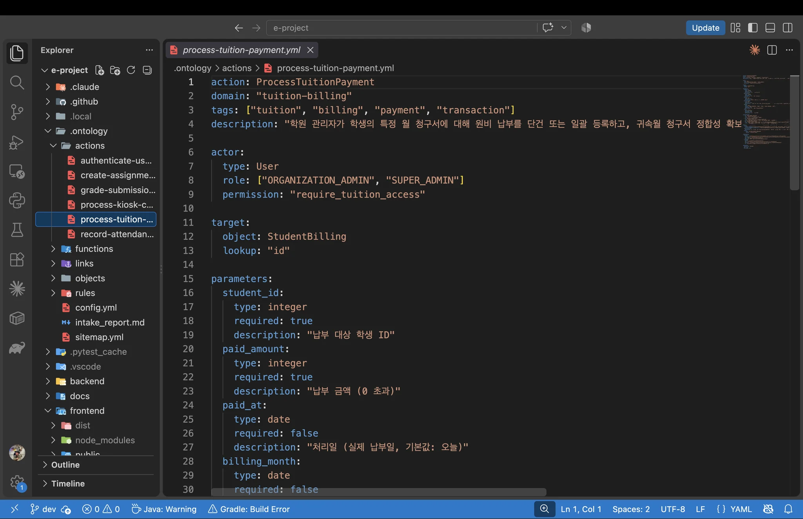

- table of contents
{:toc}

지난 [[10편]](/tag-ai-agent-architecture/10-knowledge-ontology/)까지 1인 개발팀을 꾸리며 빚어낸 워크플로우의 진화 여정을 기록해 왔다. 주말마다 '덕질'하듯 시스템을 손보던 중, 외부 에이전트 하네스들(`Ralph`, `gstack`, `oh-my-openagent`)과 유튜브 **'우주초월'**님의 발표 영상([에이전트 워크플로우의 실체](https://www.youtube.com/watch?v=woSiT_kytXo))을 보며 묘한 기시감에 사로잡혔다. 다른 엔지니어들이 구축한 파이프라인이 지난 1년간 홀로 깎아 만든 내 체계와 상당 부분 닮아 있었기 때문이다.

---

## 에이전트 워크플로우의 수렴 진화, 그리고 내 시스템의 빈틈 메우기

서로 다른 환경에서 각자 부딪히며 만든 구조가 비슷해진다는 건, 에이전트를 실무에 제대로 쓰기 위해 필요한 조건들이 결국 같은 방향으로 모이고 있다는 뜻이다. 완료될 때까지 프롬프트를 반복해서 넣어주는 `Ralph` 루프나 역할별로 서브에이전트를 나누는 오픈소스 하네스(`gstack`, `oh-my-openagent`), 그리고 마스터 AI가 기획부터 개발·QA·위키 정리까지 총괄하는 우주초월님의 워크플로우를 내 시스템과 나란히 놓고 비교해 보니 핵심 구조 세 가지가 놀라울 만큼 겹쳤다.

- **구현과 검수의 분리**: 코드를 짜는 모델(Codex)과 읽기 전용으로 검토만 하는 모델(Claude)을 나누는 방식은, 내가 [[4편]](/tag-ai-agent-architecture/4-all-passed-empty-screen/)에서 구현 세션과 독립 검토 에이전트(`/test-harden`)를 분리했던 것과 똑같았다.
- **말이 아닌 증거로 완료 판정**: 에이전트의 완료 보고를 그대로 믿지 않고 완료 파일(<mark class="kw-term">SPOKE_DONE</mark>) 생성과 테스트 통과 여부를 기계적으로 확인하는 규칙이 일치했다.
- **중앙 조율과 독립 작업의 분업**: 마스터 AI가 전체 작업을 쪼개어 하위 에이전트에게 나눠주고 결과를 합치는 구조 역시 [[5편]](/tag-ai-agent-architecture/5-cmux-parallel-worktree/)의 '<mark class="kw-term">허브와 스포크</mark>' 방식과 같은 모양이었다.

공통점을 확인하고 나니 자연스럽게 **"그렇다면 지금 내 시스템에 부족한 점은 무엇인가?"**가 보였고, 외부 사례들에서 배운 네 가지 장점을 내 워크플로우에 곧바로 흡수했다.

1. **작업 전 해야 할 일과 건드리면 안 될 일 명시**: 하위 에이전트가 공용 모듈을 멋대로 고치거나 모호한 요구사항을 어림짐작으로 구현하지 못하도록, 착수 전에 수정 허용 범위(Do & Don't)를 명확히 적어주고 중요한 판단이 필요하면 작업을 멈추고 허브에 물어보게 했다.
2. **공통 맥락 세션(Seed Session) 재사용**: 새 에이전트를 띄울 때마다 처음부터 문서를 다시 읽느라 토큰과 시간을 낭비하지 않도록, 프로젝트 기본 구조와 문서를 미리 읽혀둔 공통 세션을 복제(Fork)해 쓰는 방식으로 프롬프트 캐시 효율을 높였다.
3. **실제 브라우저 화면 캡처(`Playwright`) 검증**: 단위 테스트는 통과했는데 정작 화면은 하얗게 비어 있던 사고를 막기 위해, 헤드리스 브라우저로 직접 화면을 띄워 조작하고 <mark class="kw-term">렌더링 스냅샷</mark>을 증거로 남기도록 강제했다.
4. **작업 종료 전 문서 갱신 의무화**: 코딩이 끝난 뒤 나중에 따로 문서를 정리하는 대신, 에이전트가 작업을 마치고 퇴장하기 직전에 바뀐 설계와 작업 기록을 스스로 업데이트하는 단계를 공식 절차로 편입시켰다.

- [심화 근거: 외부 에이전트 워크플로우(Ralph·gstack·oh-my-openagent)와 토마토 AI Agent OS 상세 비교 매트릭스 보러가기](/tag-ai-agent-architecture/deep-dive/infra-fsd-and-ecosystem/#external-workflow-comparison)

---

## 거시적 관점에서의 깨달음: AI Agent OS라는 커널과 Repo Ontology(otlg)

얼마 전, 지난 [[2편]](/tag-ai-agent-architecture/2-tdd-religion/)에서 잠시 언급했던 과천 개발자 모임에 참석해 랄프(Ralph) 창시자가 제시한 아이디어를 확장해 이야기를 나눈 적이 있었다. 그때 화두가 되었던 차세대 에이전트 워크플로우의 큰 그림은, 한마디로 여러 AI 에이전트를 시스템 레벨에서 통제하고 조율하는 일종의 **'<mark class="kw-term">운영체제(AI Agent OS)</mark>'**를 만드는 것이었다.

전통적인 `Linux` 커널이 컴퓨터의 한정된 물리 자원인 CPU 코어와 메모리, 디스크 I/O를 수많은 프로세스에 효율적으로 분배하듯, 다가올 시대의 AI OS는 **'토큰(Token)'과 '컨텍스트(Context)'라는 새로운 컴퓨팅 자원을 스케줄링**해야 한다는 시각이었다. 탐색·요약처럼 가벼운 작업과 정밀한 아키텍처 설계 작업을 구분해 최적의 모델로 분배하는 **<mark class="kw-term">요청 라우팅(Request Routing)</mark>**, 그리고 전체 토큰 예산과 컨텍스트 윈도우를 하위 작업 단위로 치밀하게 할당하고 회수하는 **<mark class="kw-term">토큰 매니지먼트(Token Management)</mark>**를 통해 최소한의 비용으로 가장 높은 품질의 산출물을 결정론적으로 뽑아내자는 구상이었다.

이 거시적인 '운영체제'라는 관점을 접하는 순간, 지난 1년간 필요에 쫓겨 하나씩 만들어 왔던 내 워크플로우의 조각들이 하나의 선으로 선명하게 이어지는 전율을 느꼈다. 가만히 대조해 보니 내가 현장에서 부딪히며 손수 깎아 만든 도구들이 곧 운영체제 커널의 핵심 서브시스템들과 일대일로 대응하고 있었기 때문이다. [[5편]](/tag-ai-agent-architecture/5-cmux-parallel-worktree/)의 `cmux`와 워크트리 격리는 프로세스마다 독립된 가상 메모리를 할당하는 **메모리 매니저**였고, 하위 작업을 발주하고 회수하는 허브는 **프로세스 스케줄러**였으며, 완료 센티넬(`SPOKE_DONE`)과 훅은 커널의 **시그널(`SIGCHLD`) 및 시스템 콜 권한 통제**, 그리고 뒤이어 다룰 위키 자동화는 **저널링 파일시스템(`ext4`)**과 정확히 맞닿아 있었다.

결국 우리가 각자의 현장에서 수작업으로 만들어 온 이 하네스들이 언젠가 리눅스처럼 표준화되어 모든 개발자의 기본 인프라가 될 것이라는 통찰이 바로 랄프 창시자가 바라보던 방향이었다. 그리고 이 운영체제의 시선으로 내 체계를 다시 내려다보며 몰두한 다음 과제는, [[6편]](/tag-ai-agent-architecture/6-repo-governance/)에서 만들었던 저장소 관리 문서들을 사람이 일일이 챙기지 않아도 되도록 **"문서와 코드의 동기화를 완전히 자동화하는 것"**이었다.

그 해답은 우주초월님의 위키 자동화 단계와 변우철 본부장님의 <mark class="kw-term">팔란티어 AIP</mark> 강연(데이터·로직·액션 3대 계층)을 결합하는 데서 나왔다. [[10편]](/tag-ai-agent-architecture/10-knowledge-ontology/)의 옵시디언 볼트가 '<mark class="kw-term">개인 지식 온톨로지</mark>'라면, 코드 저장소 안에 세운 **<mark class="kw-term">코드 바인딩 도메인 온톨로지(otlg)</mark>**와 **<mark class="kw-term">Living Wiki Engine</mark>**은 비즈니스 객체와 행위 규칙, 아키텍처 의존 방향, 그리고 테스트 계약을 실제 소스 코드 위치와 하나로 묶어 에이전트가 스스로 정합성을 검증하고 갱신하게 만든다.

{:width="700" loading="lazy"}

실제 코드베이스에 구축된 .ontology 아키텍처. 탐색기의 객체(objects), 비즈니스 행위(actions), 불변 규칙(rules) 구조와 에디터에 열린 비즈니스 액션 사양이 도메인의 엄격한 실행 바운더리를 선언하고 있다.
{:.figcaption}

물론 팔란티어의 엔터프라이즈 온톨로지가 실제 운영 중인 ERP나 물류 DB의 레코드를 실시간으로 바꾸는 '런타임 실행 엔진'이라면, 내가 코드 저장소에 만든 도메인 온톨로지(`otlg`)는 역할이 조금 다르다. 소스 코드의 클래스·함수 위치와 아키텍처 경계, 테스트 통과 여부를 기계가 읽을 수 있는 그래프로 연결해 두고, 코드를 고칠 때 어디가 영향을 받는지와 어떤 규칙을 지켜야 하는지를 0.01초 만에 알려주는 **'<mark class="kw-term">검증 가능한 접지 명세(Grounding Specification)</mark>'**에 가깝다. 실제 코드를 수정하고 저장소에 반영하는 일은 온톨로지가 혼자 처리하는 것이 아니라, 허용된 경로만 열려 있는 <mark class="kw-term">하드 바운더리</mark> 훅(`spoke-guard`) 안에서 TDD와 브라우저 검증을 통과한 **에이전트와 테스트 파이프라인**이 함께 마무리한다. 즉 온톨로지는 도메인의 헌법을 제시하고 에이전트는 그 헌법이 허용한 경계 안에서만 코드를 고치는 분업 구조인 셈이다(이 헌법과 집행관의 분업은 온톨로지 엔지니어링 **[[6편] 아무리 똑똑한 알바생이라도 금고 열쇠를 통째로 맡기는 사장님은 없다](/tag-ontology-engineering/6-sdlc-harness-and-living-wiki/)**에서 자세히 다룬다).

한편 코드 저장소에서는 이처럼 명세와 검증에 집중하는 것이 가장 실용적이었지만, 온톨로지 엔진 자체가 사전 조건을 검사하고 세계의 상태를 직접 바꾸는 진짜 런타임 실행 계층(`Action Layer`)까지 내 손으로 끝까지 구현해 보고 싶다는 호기심도 남았다. 그리고 이 갈증은 취미로 만든 **AI 에이전트 기반 TRPG 시스템**에서 에이전트가 정해진 액션 핸들러를 호출해 캐릭터의 체력과 인벤토리, 대화형 2d6 약점 파훼 전투, 세계관 시뮬레이션, 그리고 플레이어와 마스터의 시야 분리(<mark class="kw-term">인식론적 전장의 안개</mark>)를 실시간 트랜잭션으로 직접 집행하는 구조에 도달하면서 비로소 풀리게 된다(이 이야기는 온톨로지 엔지니어링 **[[7편] 주사위는 거짓말을 하지 않는다, TRPG에서 비로소 도달한 진짜 Action Layer](/tag-ontology-engineering/7-trpg-kinetic-action-layer/)**와 **[[9편]](/tag-ontology-engineering/9-code-on-graph-and-epilogue/)·[[10편]](/tag-ontology-engineering/10-knowledge-blog-compiler-and-semantic-critique/)**으로 이어진다).
{:.note title="여담: 코드 명세 온톨로지에서 런타임 실행 온톨로지(TRPG)로의 확장"}

이 구조 위에서 하위 에이전트(스포크)는 작업 완료 신호(`SPOKE_DONE`)를 내기 직전에 ① 온톨로지 명세와 테스트 계약 동기화, ② 정적 린터(`otlg lint --strict`) 검증, ③ 아키텍처·기술 부채·의사결정·보류 문서 업데이트, ④ 작업 이력 기록이라는 4단계 마감 절차를 스스로 마친다. 리눅스 파일시스템의 **'<mark class="kw-term">메타데이터 저널링</mark>'**과 닮은 이 루프 덕분에, 레포지토리는 사람이 뒤따라다니며 문서를 고치지 않아도 매 순간 스스로 최신 상태를 유지하는 살아 있는 위키(<mark class="kw-term">Living Wiki</mark>)로 자리 잡았다.

---

## 곱연산의 재확인: 이론이 도구를 결정한다

외부의 뛰어난 실전가들과 호흡을 맞춰보고 온톨로지 기반의 에이전트 운영체제까지 구축하며 내가 다시금 도달한 결론은, 우주초월님이 발표 말미에 강조했던 **"<mark class="kw-term">개인 역량 x AI 활용 능력 = 시너지</mark>"**라는 곱연산의 법칙과 정확히 맞닿아 있었다. 기초 엔지니어링 이론과 설계 근육이 탄탄한 개발자는 AI라는 도구를 조금만 얹어도 폭발적인 레버리지를 일으키는 반면, 도메인을 구조화할 기초 체력이 부족한 상태에서는 아무리 최신 에이전트와 화려한 프롬프트를 동원해도 산출물의 품질이 금세 한계에 부딪히고 만다. 나에게 있어서 퇴근 후와 주말을 반납하며 이어갔던 프로그래밍 공부와 하네스 개선이란 누가 등 떠밀어 하는 과제가 아니라 순수하게 좋아서 몰입하는 '덕질'이었기에, 당장 눈앞의 기능만 돌아가게 만들면 충분했던 1인 팀 환경에서도 아무도 시키지 않은 객체지향 설계 원칙과 테스트 코드, 아키텍처와 온톨로지까지 스스로 기준을 높여 실무 프로덕트에 끊임없이 이식할 수 있었다. 지식이 늘어가는 즐거움과 배운 이론을 코드베이스에 즉시 적용해 시스템이 실제로 단단해지는 과정을 피부로 느끼는 경험이 더없이 큰 보람이었고, 그렇게 축적한 시간들은 에이전트의 속도에 휩쓸리지 않고 내 일하는 방식을 지탱해 주는 든든한 **'닻'**이 되어 주었다.

결국 **에이전트 워크플로우를 설계하고 통제하는 힘은 화려한 AI 툴 사용법이 아니라, 자신의 <mark class="kw-term">업무와 도메인을 빈틈없이 구조화하는 엔지니어링 기초 체력</mark>에서 나온다.** 기획부터 개발, 독립 검증과 위키 저널링으로 이어지는 파이프라인을 정의하고, 각 단계의 입출력 계약과 불변식을 명세하며, 실패 시의 결정론적 롤백 경로를 설계하는 일은 본질적으로 컴퓨터 공학이 수십 년간 다뤄온 시스템 설계의 영역이기 때문이다. AI 활용법 자체는 누구나 짧은 시간 안에 익힐 수 있을 만큼 진입 장벽이 낮아지고 있지만, 에이전트가 마음껏 뛰어놀 수 있는 단단한 운동장과 가드레일을 설계하는 이론적 내공은 하루아침에 만들어지지 않는다. 지난 [[1편] AI에게 욕하던 신입이 선생님을 위한 규칙을 만들기까지](/tag-ai-agent-architecture/1-ground-rules/)의 계획 선행 규율부터 [[2편] 토큰 낭비라던 TDD가 어느새 제 종교가 되었습니다](/tag-ai-agent-architecture/2-tdd-religion/)의 테스트 주도 개발, [[3편] 객체지향을 배웠으니 선생님을 가르쳐보겠습니다](/tag-ai-agent-architecture/3-teach-object-design/)의 객체지향 설계와 [[4편] 역시 내 테스트 스위트는 잘못됐다](/tag-ai-agent-architecture/4-all-passed-empty-screen/)의 경계 정합성에 이르기까지, 우리가 이 시리즈 내내 집요하게 다져왔던 기본기들이야말로 곱연산의 시대에 엔지니어가 끝까지 붙들어야 할 진짜 무기인 셈이다.

---

## 마치며: 운영체제는 멈추지 않는다

혼자 나만의 워크플로우를 깎고 다듬다 보면, 어느 순간 똑같은 문제의식을 품고 비슷한 구조에 독립적으로 도달한 동료 엔지니어들을 발견하게 된다. 우주초월님의 발표 영상과 랄프 창시자의 비전, 그리고 코딩하는 기술사님의 온톨로지 통찰은 내게 그러한 시대적 공명을 확인시켜 준 가장 선명한 이정표였다. 마스터와 워커의 물리적 격리, 이종 컨텍스트 간 교차 검수, 센티넬과 스냅샷을 통한 증거 기반 완료 판정, 그리고 메타데이터 자가 저널링에 이르기까지, 이 패턴들이 서로 다른 현장에서 약속이나 한 듯 반복적으로 출현한다는 사실은 **에이전트와 협업하는 소프트웨어 엔지니어링에 이미 거스를 수 없는 어떤 '정석'이 형성되고 있음**을 의미한다고 생각한다. 과거 `Linux`가 복잡한 하드웨어 제어를 커널 뒤로 추상화하여 프로그래머에게 일관된 시스템 콜을 선물했듯, 지금 우리가 수작업으로 빚어내고 있는 이 에이전트 하네스들 역시 머지않아 토큰과 컨텍스트의 복잡성을 감추고 결정론적 품질을 보장하는 범용 운영체제로 수렴해 갈 것이다.

내 체계의 빈틈을 정면으로 인정하고 외부의 탁월한 해법들을 주저 없이 흡수한 결단은 내 엔지니어링 운영체계를 한 차원 높은 단계로 끌어올리는 결정적 계기가 되었다. 여기에 지난 [[6편]](/tag-ai-agent-architecture/6-repo-governance/)의 저장소 거버넌스와 [[10편]](/tag-ai-agent-architecture/10-knowledge-ontology/)의 지식 그래프를 잇는 도메인 온톨로지(`otlg`)까지 결합하면서, 비로소 파일시스템 메타데이터 저널링까지 스스로 완결 짓는 1인 팀만의 '<mark class="kw-term">AI Agent OS</mark>'가 온전한 형태를 갖추게 되었다. 이 글 후반부에서 소개한 팔란티어 온톨로지 철학의 코드베이스 이식 여정과 `repo-ontology`의 내부 구조, 자가 갱신형 위키 엔진, 나아가 TRPG와 AI 안전 검수 도메인까지 확장된 네 세계의 온톨로지 아키텍처가 궁금하다면, 이를 본격적으로 해부한 후속 연재 **[온톨로지 엔지니어링 시리즈](/tag-ontology-engineering/)**(전체 여정의 현관문인 **[[0편] 개념 공부를 넘어 실전으로, 네 개의 도메인에 온톨로지를 구축하기까지](/tag-ontology-engineering/0-ontology-engineering-intro/)**, 레포지토리가 스스로 말하게 만드는 `otlg` 엔진과 3-Graph 진화 및 SDLC 하네스를 다룬 **[[3편]](/tag-ontology-engineering/3-nouns-to-verbs-paradigm-shift/)~[[6편]](/tag-ontology-engineering/6-sdlc-harness-and-living-wiki/)**, 메타 워크벤치와 `Code-on-Graph` 기반 코드 합성·시뮬레이션을 다룬 **[[8편]](/tag-ontology-engineering/8-meta-ontology-workbench-and-redteam/)·[[9편]](/tag-ontology-engineering/9-code-on-graph-and-epilogue/)**, 그리고 저장소 사건에서 블로그 초안으로 이어지는 지식 컴파일러와 3대 의미 모형 감사를 다룬 대단원 **[[10편]](/tag-ontology-engineering/10-knowledge-blog-compiler-and-semantic-critique/)**)에서 이어지는 이야기를 확인해 보길 권한다.

물론 이 운영체계는 여기서 멈추지 않고 내일도 실전의 마찰 속에서 계속 진화할 것이며, 또다시 나눌 만한 경험이 쌓이면 언제든 새로운 기록을 보태보도록 하겠다. 그것이 이 시리즈의 방식이니까...
