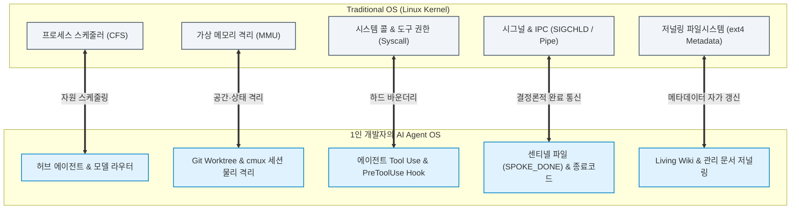
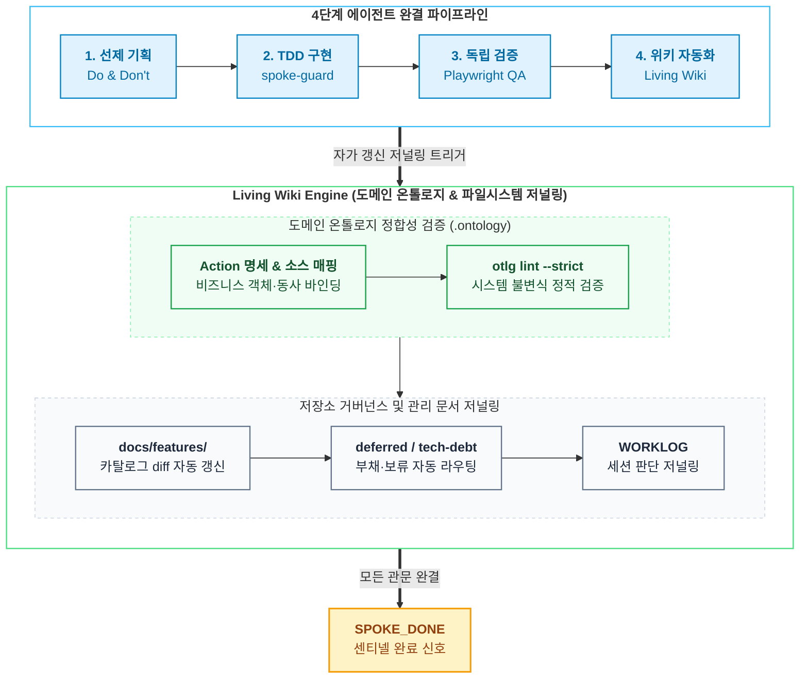

- table of contents
{:toc}

지난 [[10편]](/tag-ai-agent-architecture/10-knowledge-ontology/)에 이르기까지, 이 시리즈는 1인 개발자로서 부딪히며 빚어낸 워크플로우의 진화 여정을 차곡차곡 기록해 왔다. 애초에 이 연재는 정해진 완결을 못 박아둔 구성이 아니었는데, 엔지니어링 운영체계라는 것 자체가 매일 실전에서 쓰면서 날마다 고쳐 나가는 살림살이와 같아서 유의미한 경험이 쌓일 때마다 기록을 보태는 편이 자연스러웠기 때문이다. 그렇게 열 편의 기록을 갈무리하고 나서도 퇴근 후나 주말마다 좋아하는 '덕질'을 하듯 시스템을 조금씩 손보는 일상은 멈추지 않았는데, 그러던 어느 날 우연히 알고리즘을 타고 흘러든 유튜브 영상 하나를 보다가 묘한 기시감에 사로잡히고 말았다. 전혀 일면식도 없는 다른 엔지니어가 화면 위에서 시연하는 에이전트 파이프라인의 뼈대가, 지난 1년 남짓 홀로 시행착오를 겪으며 깎아 만든 내 체계와 놀라울 만큼 닮아 있었기 때문이다.

**"이 사람이 보여주는 워크플로우, 내가 만든 것과 너무나 닮아 있다."**

---

## 우주초월님의 에이전트 워크플로우

유튜브 채널 **'우주초월'**님의 발표 영상([에이전트 워크플로우의 실체](https://www.youtube.com/watch?v=woSiT_kytXo))은 자신이 구축한 에이전트 워크플로우를 회사 동료들 앞에서 가감 없이 시연한 실전 기록이다. AI 에이전트 기반 개발을 깊이 접해보지 못했던 동료가 시연을 보고 나서 "40년 인생이 부정당한 느낌"이라며 당혹감을 감추지 못했을 정도로 현장의 반향은 꽤나 묵직했다고 한다. 영상에서 소개된 핵심 아키텍처를 추려보면 다음과 같은 다섯 가지 기둥으로 요약할 수 있다.

1. **<mark class="kw-term">마스터 AI 오케스트레이션</mark>**: 기획 ➔ 개발 ➔ QA ➔ 위키로 이어지는 전체 파이프라인에서 사람은 마스터 AI와만 대화하고, 하위 실행은 마스터 AI가 전담하여 조율
2. **<mark class="kw-term">교차 검수 체계</mark>**: `Codex`가 구현 작업을 수행하면 `Claude`가 읽기 전용(Read-only) 권한으로 코드를 검수하며, 최종 승인(Approve)이 떨어질 때까지 루프를 반복
3. **<mark class="kw-term">증거 기반 완료 판정</mark>**: TODO 항목을 체크할 때 반드시 완료 근거를 명시하도록 강제하고, QA 단계에서는 실제 화면 조작 결과를 캡처하여 물리적 증거로 제출
4. **비용 최적화**: 작업 단계별로 최적의 모델을 차등 배치하고, <mark class="kw-term">Forked Session(Seed AI)</mark> 기법으로 프롬프트 캐시 히트율을 극대화
5. **<mark class="kw-term">병렬 분기</mark>**: 덩치가 큰 작업을 마스터 AI가 독립된 단위로 분할해 동시에 실행하고, 각 작업이 완료된 뒤 하나로 합쳐 통합 재검증 수행

발표자가 짚어주는 이 다섯 가지 원칙을 하나씩 따라가다 보니, 사수 없는 환경에서 밤마다 홀로 부딪히며 세웠던 내 하네스의 설계 규칙들이 거울처럼 겹쳐 보이기 시작했다.

> **[기술적 사실 및 원천 영상]**
> - **참조 영상**: 유튜브 우주초월님, [에이전트 워크플로우의 실체](https://www.youtube.com/watch?v=woSiT_kytXo) (회사 발표 시연)
> - **자체 워크플로우 체계**: `Development Philosophy (Hive Mind)`, `cmux worktree workflow`

---

## 겹치는 설계 원칙들: 우연의 일치인가, 필연인가

타인이 실전에서 깎아 만든 워크플로우를 내 것과 세밀하게 대조해 보는 일은 단순한 호기심이나 벤치마킹에 그치지 않는다. 서로 다른 도메인과 환경에서 출발했음에도 **같은 문제를 풀기 위해 독립적으로 도달한 설계가 겹친다면, 그것은 곧 그 구조가 에이전트 시대의 필연적인 수렴 진화라는 방증**이기 때문이다.

### 교차 검수 = Coordinator Pattern의 Builder/Critic 분리

우주초월님의 파이프라인에서 가장 먼저 눈길을 사로잡은 대목은 `Codex`가 코드를 작성하고 `Claude`가 읽기 전용 모드로 검수하는 교차 검증 구조였다. 여기서 핵심은 **검수 AI가 절대 직접 프로덕션 코드에 손을 대지 않는다**는 점인데, 리뷰어는 오직 결함을 지적하는 훈수만 두고 실제 코드 수정은 다시 작업자 AI가 수행하도록 권한을 엄격히 분리해 두었다. 이는 우리가 정립해 온 <mark class="kw-term">Builder/Critic 분리</mark> 원칙과 정확히 같은 지향점을 공유한다. "자기가 짠 코드를 자기가 검증하지 않는다"는 대원칙 아래, 에이전트 특유의 <mark class="kw-term">확증 편향</mark>을 구조적으로 차단하기 위해 작업 컨텍스트와 평가 컨텍스트를 물리적으로 떼어놓는 셈이다. 우주초월님은 이를 '서로 다른 모델 벤더'의 교차 배치로 풀어냈고 나는 '격리된 에이전트 역할'로 구현했다는 차이만 있을 뿐, 근본에 흐르는 설계 원리는 완전히 동일했다. 당시 회사에서는 단일 벤더 환경만 지원받아 `Claude` 위주로 파이프라인을 구성했지만, 이처럼 이종 모델의 강점을 교차 검수에 결합하는 방식 역시 추후 실험적으로 도입해 볼 만한 매력적인 카드라는 생각이 들었다.

### 증거 기반 완료 판정 = 센티넬 파일 + 완료 게이트

"거짓말하지 말고 반드시 입증 가능한 근거를 제시하라"는 발표 속의 단호한 규율은, 지난 [[5편]](/tag-ai-agent-architecture/5-cmux-parallel-worktree/)에서 다룬 `cmux` 워크트리 하네스의 완료 게이트와 정확히 맞닿아 있다. 에이전트가 텍스트로 쏟아내는 "모든 구현과 테스트를 성공적으로 마쳤습니다"라는 자기보고를 맹신하다가 숱하게 뒤통수를 맞은 끝에, 우리는 오직 **물리적인 <mark class="kw-term">센티넬 파일(`SPOKE_DONE`)</mark>의 존재 여부와 실제 커밋 카운트, 그리고 테스트 프로세스의 종료 코드(`exit code 0`)**만으로 완료를 판정하는 구조를 세웠다. 결국 표현 방식만 다를 뿐, 확률적 언어 모델의 낙관적인 착각을 결정론적인 시스템 증거로 통제하려는 '건강한 불신'의 철학에서 함께 출발하고 있었던 것이다.

### 마스터 AI 오케스트레이션 = 허브/스포크 발주 체계

마스터 AI가 전체 생명주기를 관장하고 인간 엔지니어는 오직 마스터와만 소통하는 위임 구조 또한, 우리가 구축한 '<mark class="kw-term">허브 + 스포크</mark>' 오케스트레이션 체계와 본질적으로 같은 궤적을 그린다. 거대한 요구사항을 독립적인 작업 단위로 쪼개어 격리된 자식 프로세스(Spoke)들에게 발주하고, 검증을 통과한 산출물만 회수하여 다음 단계로 통합해 나가는 흐름은 다중 에이전트 환경에서 병목을 없애기 위해 도달할 수밖에 없는 공통 분모라 할 수 있다.

---

## 겹치지 않았던 설계 원칙들: 뼈아픈 빈틈과 흡수의 결단

물론 다른 엔지니어의 뛰어난 체계를 보며 내 것과 닮은 점을 찾아내고 안도하는 데 그친다면 아무런 성장도 일어나지 않을 것이다. 진정한 자극과 도약은 공통점 너머의 차이점, 즉 **"지금 내 체계에는 무엇이 결핍되어 있는가?"**를 자존심 내려놓고 냉정하게 직시할 때 비로소 시작된다. 당시 내가 운영하던 워크플로우(<mark class="kw-term">Hive Mind TDD</mark>와 <mark class="kw-term">cmux 워크트리</mark>)는 단위 테스트의 신뢰성과 작업 공간의 물리적 격리 면에서는 제법 단단한 기틀을 갖추고 있었지만, 매일 수십 개의 기능 슬라이스를 쳐내야 하는 프로덕션 현장에서는 여전히 몇 가지 구조적 병목과 맥락 누수에 시달리고 있었다. 우주초월님의 발표 영상은 바로 그 가려운 구석과 내 체계의 뼈아픈 빈틈들을 정면으로 비추어 주었는데, 보자마자 "아, 내가 겪던 병목을 저렇게 우아하게 돌파할 수 있었구나!" 하고 감명깊게 봤던 네 가지 결핍은 다음과 같았다.

### 스포크의 스코프 팽창과 무언의 추측(Guessing) ➔ 선제 Do & Don't 명세표

당시 내 발주 체계에서는 중앙의 허브가 기능 단위의 안건을 던져주면, 개별 스포크 에이전트가 독립된 워크트리 안에서 `/tdd-plan` 스킬을 호출해 스스로 구현 계획을 수립하곤 했다. 하지만 하위 에이전트에게 구현 계획이라는 백지를 온전히 위임해 버리면 필연적으로 **<mark class="kw-term">스코프 팽창(Scope Creep)</mark>**이라는 부작용이 고개를 들었다. 시키지도 않은 공용 유틸리티 모듈을 '친절하게' 리팩터링한다며 건드렸다가 다른 도메인 컴포넌트에 회귀 버그를 일으키거나, 기획 명세에 자그마한 빈틈이라도 보이면 사람에게 묻는 대신 혼자 임의로 합리화하여 DB 스키마나 권한 검증 로직을 멋대로 추측(Guessing)해 짜버리는 식이었다. 그렇다고 스포크가 사소한 의문마다 작업을 멈추고 사람에게 질문을 던지게 만들면 병렬 오케스트레이션의 생명인 비동기 속도가 마비되고, 반대로 질문을 금지하면 엉뚱한 코드를 양산하는 진퇴양난의 딜레마가 반복되었다.

우주초월님의 워크플로우는 이 해묵은 딜레마를 마스터 단의 **'선제 기획'**으로 깔끔하게 돌파하고 있었다. 하위 작업자가 코딩에 착수하기 전에 마스터 AI가 작업의 경계를 닫힌 형태(Closed-world)로 완전히 규정하여, 이번에 반드시 구현해야 할 핵심 비즈니스 로직(Do)과 절대로 손대서는 안 되는 공용 모듈 및 호출 금지 대상(Don't)을 명시적인 **<mark class="kw-term">Do & Don't 명세표</mark>**로 사전에 못 박아 스포크의 월경을 원천 차단하는 방식이었다. 실행 에이전트에게 계획 수립의 어설픈 자유를 허락하는 대신, 처음부터 흔들리지 않는 좁고 단단한 가드레일을 쥐여주는 설계의 지혜가 돋보이는 대목이었다.

### 매번 백지에서 시작하는 에이전트 ➔ Seed Session과 Context Caching

두 번째로 뼈아팠던 지점은 세션 기동 비용이었는데, `cmux`로 새로운 워크트리와 에이전트 세션을 띄울 때마다 스포크는 레포지토리에 대해 아무것도 모르는 완전한 백지(<mark class="kw-term">Cold Start</mark>) 상태로 깨어나곤 했다. 그러다 보니 매 작업마다 프로젝트의 전체 디렉터리 구조와 DB 스키마, 아키텍처 불변식과 코딩 컨벤션을 처음부터 파악하느라 파일 검색 및 읽기 도구를 수십 번씩 중복 호출하며 세션 초반에만 수만 토큰과 수 분의 시간을 허비하기 일쑤였다. 금전적인 토큰 낭비도 문제였지만, 에이전트가 사전 탐색 과정에서 귀중한 컨텍스트 윈도우를 과도하게 소모한 나머지 정작 고도의 추론이 필요한 핵심 구현 단계에서 집중력을 잃거나 API의 TPM/RPM 한도에 가로막히는 병목이 잦았다. 우주초월님은 이 문제를 **<mark class="kw-term">Forked Session(Seed AI)</mark>**이라는 기법으로 명쾌하게 해결하고 있었는데, 레포지토리의 핵심 도메인 지식과 위키를 미리 완벽히 숙지해 둔 공통의 'Seed 세션'을 베이스라인으로 띄워두고 각 작업 단위마다 이를 분기(Fork)하여 기동함으로써 프롬프트 캐시 적중률(**<mark class="kw-term">Context Caching</mark>** 75~90%)을 극한으로 끌어올리고 있었다. "왜 나는 똑같은 코드베이스의 구조를 매번 새로운 에이전트에게 처음부터 다시 읽히고 있었을까?"라는 탄식과 함께 머리를 한 대 세게 얻어맞은 듯한 전율이 일었다.

### 'All Passed' 착시와 화면의 침묵 ➔ 브라우저 조작과 스냅샷 증거 (Playwright QA)

지난 [[4편]](/tag-ai-agent-architecture/4-all-passed-empty-screen/)에서 절절하게 다루었듯, 백엔드와 프론트엔드의 단위·통합 테스트가 모두 `GREEN`(`exit code 0`)을 띄우고 센티넬 파일이 정상 생성되었음에도 정작 실제 브라우저를 열어보면 `422 Unprocessable Entity` 에러가 터지거나 하얀 빈 화면(<mark class="kw-term">Empty Screen</mark>)만 덩그러니 출력되는 참사를 겪은 적이 있다. 당시 백엔드 API 계약과 프론트엔드 목(Mock) 데이터 사이의 괴리에 속지 않기 위해 3종 정합성 대조표를 도입하며 급한 불을 껐지만, 실제 브라우저 엔진 위에서 UI 컴포넌트가 온전히 렌더링되고 사용자 인터랙션이 끝까지 작동한다는 사실을 기계적으로 입증할 물리적 장치는 여전히 목마른 상태였다. 우주초월님의 QA 파이프라인은 에이전트의 텍스트 보고나 단순 테스트 통과 로그조차 믿지 않는 **'철저한 불신 기반 검증'**의 끝을 보여주었는데, QA 에이전트가 직접 헤드리스 브라우저를 띄워 버튼을 클릭하고 폼을 입력한 뒤 **최종 렌더링된 결과 화면의 스크린샷 캡처를 '물리적 증거'로 제출해야만 완료로 인정**하는 구조를 갖추고 있었다. 백엔드의 `exit code 0`를 넘어 프론트엔드의 실제 시각적 상태까지 <mark class="kw-term">Playwright 스냅샷</mark>이라는 빼박캔트 증거로 못 박는 이 검문소야말로 내 하네스에 절실했던 마지막 퍼즐 조각이었다.

### 사람의 손에 머물던 뒤처리 ➔ 위키 저널링과 자율 회복 루프

마지막 결핍은 코드가 머지된 직후에 찾아오는 문서화의 역설이었다. 병렬 스포크들이 눈부신 속도로 기능 구현을 끝내고 퇴장하면, 정작 `docs/features/` 카탈로그에 변경 이력을 업데이트하고 구현 중 미뤄둔 기술 부채를 <mark class="kw-term">관리 문서</mark>(`deferred-watchlist.md`, `tech-debt.md`)에 분류해 넣는 뒤치다꺼리는 여전히 인간인 나의 손에 남아 있었기 때문이다. 코드는 기계가 순식간에 짰는데 그 뒷감당을 하느라 사람이 밤늦도록 마크다운 문서와 씨름하는 주객전도가 벌어진 셈이었고, 간헐적으로 API <mark class="kw-term">Rate Limit</mark>에 걸릴 때면 터미널 앞에서 수동으로 대기 후 재시작을 눌러줘야 하는 번거로움도 여전했다. 반면 우주초월님의 체계에서 위키 갱신은 개발이 끝난 뒤 사람이 짬을 내어 적는 부산물이 아니라 에이전트가 퇴장하기 전 반드시 완수해야 하는 **공식 생명주기 관문**으로 편입되어 있었으며, Rate Limit 역시 백그라운드 스케줄러가 토큰 리셋 시점을 계산해 스스로 재개하는 <mark class="kw-term">자율 복구(Self-healing)</mark> 루프로 매끄럽게 처리되고 있었다.

---

내 체계에 무엇이 비어 있는지 이토록 선명하게 확인했다면, 부러워하거나 주저할 이유가 없었다. 본래 더 나은 아키텍처와 도구를 발견했을 때 이를 분해하여 내 시스템의 체질에 맞게 이식하는 과정이야말로 엔지니어링에서 가장 짜릿한 즐거움이기에, 남은 과제는 이 네 가지 해법을 기존의 `TDD` 규율 및 `cmux` 하네스, 그리고 볼트 온톨로지와 어떻게 유기적으로 융합할 것인가로 좁혀졌다. 바로 그 구조적 결합을 궁리하던 무렵, 나는 과천의 개발자 모임에서 랄프(Ralph) 창시자에 대한 대화를 나누며 **'<mark class="kw-term">AI Agent OS</mark>'**라는 한 차원 높은 질문과 마주하게 되었다.

---

## 랄프의 꿈: AI Agent OS라는 다음 질문

얼마 전, 지난 [[2편]](/tag-ai-agent-architecture/2-tdd-religion/)에서 잠시 언급했던 과천 모임에 참석해 랄프(Ralph) 창시자의 아이디어를 확장하는 이야기를 나눴다. 그 때 나눈 이야기의 차세대 AI workflow 구상은 한마디로 AI 에이전트들을 시스템 레벨에서 통제하고 조율하는 일종의 **운영체제(OS)**를 만드는 것이었다. 전통적인 `Linux` 커널이 컴퓨터의 한정된 물리 자원인 CPU 코어와 메모리, 디스크 I/O를 수많은 프로세스에 효율적으로 분배하듯, 다가올 시대의 AI OS는 **'토큰(Token)'과 '컨텍스트'라는 새로운 컴퓨팅 자원을 스케줄링**해야 한다는 통찰이었다. 이 청사진의 핵심 메커니즘을 정리하면 다음과 같다.

- **<mark class="kw-term">요청 라우팅(Request Routing)</mark>**: 사용자의 요청이 인입되었을 때, 작업의 난이도와 성격에 맞춰 최적의 모델로 트래픽을 분배한다.
  - 탐색 및 요약 중심 작업: 응답 속도가 빠르고 비용이 저렴한 경량 모델로 라우팅
  - 핵심 아키텍처 설계 및 정밀 코딩: 깊은 추론 능력을 갖춘 고성능 모델로 라우팅
  - 단일 모델 만능주의에서 벗어나 각 모델의 고유 강점을 조합해 전체 파이프라인의 효율을 극대화하는 것이 라우팅의 본질이다.
- **<mark class="kw-term">토큰 매니지먼트(Token Management)</mark>**: `Linux`의 프로세스 스케줄러(`CFS`)가 타임 슬라이스를 쪼개어 CPU 시간을 분배하듯, 전체 토큰 예산과 컨텍스트 윈도우를 하위 작업 단위로 치밀하게 할당하고 회수한다.
- **궁극적 목표**: 최소한의 토큰 비용과 지연 시간으로 가장 높은 품질의 엔지니어링 산출물을 결정론적으로 뽑아내는 것이다.

이 '운영체제'라는 메타포를 듣는 순간, 지난 1년간 파편적으로 만들어왔던 내 워크플로우의 조각들이 마치 거대한 성좌처럼 하나의 선으로 선명하게 이어지는 전율을 느꼈다. 가만히 대조해 보면 우리가 현장에서 치열하게 부딪히며 손수 깎아 만든 도구들이 곧 운영체제 커널의 핵심 서브시스템들과 일대일로 정확히 대응하고 있었기 때문이다.

- **[[5편] 같은 브랜치에서 에이전트끼리 사이좋게 코딩할 리가 없어](/tag-ai-agent-architecture/5-cmux-parallel-worktree/)의 `cmux` 하네스**는 에이전트 세션이라는 '프로세스'를 `git worktree`라는 독립된 가상 메모리 공간에 충돌 없이 배치하는 **<mark class="kw-term">프로세스 및 메모리 매니저</mark>**다.
- **마스터 AI(허브)**는 하위 스포크들에게 도메인 작업을 발주하고 완료 상태를 폴링하여 결과를 회수하는 **<mark class="kw-term">스케줄러</mark>**다.
- **단계별 모델 선택과 Seed Session**은 토큰이라는 값비싼 컴퓨팅 자원의 **예산 배분 및 캐시 메모리 최적화**다.
- **교차 검수 체계와 센티넬 파일(`SPOKE_DONE`)**은 부모와 자식 프로세스 사이의 신뢰할 수 있는 **<mark class="kw-term">프로세스 간 통신(IPC)</mark>과 시그널 핸들링(`SIGCHLD`)**이다.

결국 우주초월님이 발표에서 시연한 워크플로우나 내가 현장에서 구축해 온 하네스 모두, 본질적으로는 인간과 LLM 사이에서 **<mark class="kw-term">토큰과 컨텍스트를 스케줄링하는 커널</mark>**을 짜는 작업이었던 셈이다. 우리는 각자의 프로덕션 환경에서 살아남기 위해 이름을 붙이지 않은 채 손수 프로세스 스케줄러를 구현했고, 메모리 격리 장치를 세웠으며, 결정론적 IPC 프로토콜을 설계하고 있었다. 그리고 이처럼 각자의 공방에서 수작업으로 벼려낸 원시 운영체제들이 언젠가 `Linux`처럼 표준화되고 추상화되어 모든 개발자의 기본 인프라가 될 것이라는 통찰이 바로 랄프 창시자가 바라보는 지평선이었다.

---

## 거버넌스의 최종 진화: 저장소 관리 문서와 위키 루프가 만날 때

외부 엔지니어들의 실전 워크플로우를 대조하고 'AI Agent OS'라는 커널의 관점으로 내 체계를 다시 내려다보는 과정에서, 내 머릿속을 가장 강렬하게 때린 화두는 바로 **"거버넌스의 완전 자동화"**였다. 지난 [[6편] 에이전트가 기억상실증입니다만, 문제라도?](/tag-ai-agent-architecture/6-repo-governance/)에서 우리는 세션 리셋으로 인한 맥락 증발을 막기 위해 저장소 내부에 <mark class="kw-term">4대 관리 문서</mark>(`WORKLOG`, `deferred-watchlist`, `tech-debt`, `ADR`)와 118개의 <mark class="kw-term">기능 카탈로그</mark>(`docs/features/`)라는 <mark class="kw-term">SSOT</mark> 인프라를 구축했고, 덕분에 새로운 에이전트가 투입되더라도 문서를 읽고 즉시 맥락을 이어받을 수 있는 기반을 마련했다. 하지만 병렬 스포크 에이전트들을 극한으로 가동하며 마주한 새로운 고통은, **에이전트의 코드 생산 속도가 기하급수적으로 빨라질수록 그 코드와 문서 사이의 정합성을 유지하는 관리 비용 또한 비례해서 폭증한다**는 냉혹한 현실이었다. 스포크들이 단 한 시간 만에 서너 개의 기능 슬라이스를 동시에 쳐내고 나면, 그 변경 내역을 각 기능 카탈로그의 Changelog에 반영하고 작업 중 발생한 기술 부채나 보류 항목을 관리 문서에 기입하는 일은 고스란히 인간 개발자의 병목으로 되돌아왔다.

바로 이 문서 정합성의 병목을 어떻게 구조적으로 끊어낼지 몰두하던 차에, 우주초월님의 위키 파이프라인과 유튜브 '빅데이터닥터' 채널에서 접한 변우철 KT 피테크 본부장님의 팔란티어 온톨로지 강연이 결정적인 해답의 실마리를 건네주었다. 우주초월님의 체계에서 '위키'가 개발 종료 후 사람이 적는 부록이 아니라 에이전트가 퇴장하기 전 반드시 통과해야 하는 공식 생명주기 관문이었던 것처럼, 변우철 본부장님이 설파한 <mark class="kw-term">팔란티어 AIP(Artificial Intelligence Platform)</mark>의 핵심 역시 확률적 언어 모델이 기업 시스템을 안전하게 조작하려면 반드시 **데이터(Objects), 규칙(Logic), 그리고 행동(Action)**이라는 <mark class="kw-term">3대 온톨로지 레이어</mark> 위에서만 움직여야 한다는 데 있었다. 순간 "위키 자동화 단계를 단순한 마크다운 요약에 머물게 하는 대신, 6편에서 구축한 엔지니어링 메타데이터 관리 문서와 팔란티어식 3대 온톨로지 구조체를 정면으로 결합해 에이전트가 스스로 코드와 문서의 정합성을 검증·갱신하게 만들면 어떨까?"라는 생각이 번뜩였다. 그 짜릿한 발상에서 출발해 밤낮으로 설계하고 깎아내어 탄생한 결과물이 바로 **<mark class="kw-term">자가 갱신형 거버넌스(Living Wiki Engine)</mark>**이자 **<mark class="kw-term">코드 바인딩 도메인 온톨로지(Repo Ontology, `otlg`)</mark>**다. 이 팔란티어 온톨로지 철학의 해부부터 `otlg` 엔진의 구체적인 구축기까지 전 과정은 후속 연재인 **[온톨로지 엔지니어링 시리즈](/tag-ontology-engineering/)**의 총괄 현관문인 **[[0편] 온톨로지를 활용한 레포지토리 방법론에 대하여](/tag-ontology-engineering/0-ontology-engineering-intro/)**와 **[[1편] 온톨로지가 없는 AI는 현학적인 수다쟁이일 뿐이다](/tag-ontology-engineering/1-palantir-3rd-generation-platform/)**, 그리고 레포지토리 이식 실전을 다룬 **[[4편] 에이전트에게 매번 설명하기 귀찮다면 레포지토리가 직접 말하게 하면 되지 않을까](/tag-ontology-engineering/4-repo-ontology-primitives-and-trace/)**에서 총 8편에 걸쳐 깊이 있게 풀어두었다.

### 팔란티어 3계층의 SDLC 이식: 정적 위키에서 동사 명세(Action Spec)로

팔란티어가 엔터프라이즈의 방대한 비즈니스 데이터를 객체(Objects & Links)로 모델링하고 그 위에 불변 규칙(Logic)과 실행 단위(Action)를 얹어 AI의 자의적인 오작동을 통제하듯, 나는 이 아키텍처 철학을 **소프트웨어 개발 라이프사이클(SDLC)**이라는 1인 개발자의 코드베이스에 정밀하게 이식했다. 지난 [[10편] 기록의 악마는 고립된 노트의 꿈을 꾸지 않는다](/tag-ai-agent-architecture/10-knowledge-ontology/)에서 다룬 볼트 온톨로지가 파편화되는 개인의 생각과 문서 엔트로피를 통제하는 '<mark class="kw-term">개인 지식 온톨로지(Personal Knowledge Ontology)</mark>'였다면, 프로덕션 레포지토리 루트의 `.ontology/` 디렉터리에 자리 잡은 `otlg`는 에이전트의 섣부른 코드 파괴를 막아내는 **'<mark class="kw-term">코드 바인딩 도메인 온톨로지 명세(Code-bound Domain Ontology Specification)</mark>'**로서 다음 세 가지 계층을 선언한다.

1. **Data Layer (Objects & Code Mapping)**: 비즈니스 도메인 객체가 실제 소스 코드의 어느 모델 파일, 어떤 API 엔드포인트 및 프론트엔드 슬라이스와 물리적으로 바인딩되는지 명시한다.
2. **Logic Layer (Rules & Preconditions)**: 어떠한 기능 추가나 리팩터링 속에서도 결코 깨져서는 안 되는 시스템 전역 불변식과 선행조건을 선언한다.
3. **Action Layer (Action Specification)**: 에이전트가 코드베이스 위에서 수행할 수 있는 비즈니스 상태 전이 동사(예: 청구 생성, 결제 취소, 권한 위임)의 입출력 계약과 영향 범위를 명세한다.

{:width="700" loading="lazy"}

실제 코드베이스에 구축된 .ontology 아키텍처. 탐색기의 객체(objects), 비즈니스 행위(actions), 불변 규칙(rules) 구조와 에디터에 열린 비즈니스 액션 사양이 도메인의 엄격한 실행 바운더리를 선언하고 있다.
{:.figcaption}

여기서 반드시 짚고 넘어가야 할 엔지니어링적 정직성이 하나 있는데, 나는 결코 팔란티어 AIP와 동일한 런타임 트랜잭션 엔진을 재창조했다고 과장하고 싶지 않다. 팔란티어의 엔터프라이즈 온톨로지가 실제 운영 중인 ERP나 물류 DB의 레코드를 실시간으로 변경하는 '런타임 실행 엔진'이라면, 우리가 만든 `Repo Ontology(otlg)`는 코드베이스의 물리적 상태(소스 심볼, DB 제약조건, 마이그레이션 계보)를 기계가 읽을 수 있는 그래프로 설명하고 코드 변경 시의 파급 경로를 0.01초 만에 추적해 주는 **'<mark class="kw-term">검증 가능한 접지 명세(Grounding Specification)</mark>'**에 해당한다. 실제 코드를 수정하고 저장소에 반영하는 쓰기(Write-back) 행위는 온톨로지 엔진 단독으로 수행하는 것이 아니라, `spoke-guard` 훅이라는 물리적 <mark class="kw-term">하드 바운더리</mark>를 차고 `TDD` 사이클과 `Playwright` 브라우저 검증을 통과한 **에이전트와 테스트 파이프라인**이 함께 완결 짓는다. 즉, 온톨로지는 도메인의 엄격한 헌법(Spec)을 제시하고 에이전트는 그 헌법이 허용한 경계 안에서만 안전하게 코드를 집행하는 분업 구조인 셈이며, 이 헌법과 집행관의 역학 관계는 온톨로지 엔지니어링 시리즈 **[[5편] 아무리 똑똑한 알바생이라도 금고 열쇠를 통째로 맡기는 사장님은 없다](/tag-ontology-engineering/5-aip-action-and-sdlc-harness/)**에서 상세히 해부한다. (참고로 코드 저장소라는 도메인 특성상 `otlg`를 명세와 검증에 집중시킨 것은 가장 실용적인 선택이었지만, 한편으로는 온톨로지 엔진 자체가 제출 사전 조건을 검증하고 세계의 상태를 직접 바꾸는 진짜 팔란티어식 런타임 `Kinetic / Action Layer`도 끝까지 구현해 보고 싶다는 공학적 호기심이 남았다. 그리고 이 갈증은 최근 취미로 몰두하고 있는 **AI 에이전트 기반 TRPG 시스템(`trpg-ontology`)**에서 에이전트가 등록된 `Action`을 호출해 로컬 파일 잠금과 `fsync` 저널 트랜잭션으로 캠페인 세계의 수치와 장비, 네이티브 `LÖVE` 전투, 그리고 불변의 서사 연대기(`chronicle`)를 직접 변경·환류시키는 구조에 도달하면서 비로소 결실을 맺게 된다. 이 흥미진진한 TRPG 온톨로지 구축기 역시 조만간 별도의 시리즈로 풀어낼 예정이다.)

이 아키텍처 위에서 개별 스포크 에이전트는 구현과 브라우저 QA를 모두 통과한 직후, 최종 종료 신호(`SPOKE_DONE`)를 생성하기 전에 다음 네 단계의 마무리 관문을 스스로 완결 짓도록 강제된다.

1. **도메인 온톨로지 무결성 검증 (`otlg lint --strict`)**:
   자신이 수정한 프로덕션 코드가 `.ontology/`에 선언된 비즈니스 객체, 불변 규칙, 액션 바인딩 경로와 한 치의 어긋남 없이 일치하는지 정적 린터로 검증한다.
2. **기능 카탈로그 자동 갱신 (`docs/features/`)**:
   자신이 일으킨 코드 diff와 액션 사양을 바탕으로, 해당 기능 문서의 구현 상태와 엔드포인트·컴포넌트 매핑, 그리고 변경 이력(Changelog)을 직접 갱신한다.
3. **부채와 보류 사항의 자동 라우팅 (`deferred-watchlist`, `tech-debt`)**:
   구현 과정에서 불가피하게 타협한 지점이나 스코프 밖이라 미뤄둔 이슈를 정해진 스키마(F-식별자, Fowler 4분면 분류, 상환 트리거)에 맞춰 관리 문서에 스스로 기입한다.
4. **세션 저널링 (`WORKLOG`)**:
   이번 세션에서 내린 아키텍처적 판단과 최종 커밋 해시 요약을 저널에 기록한 뒤에야 비로소 센티넬 파일을 남기고 워크트리에서 퇴장한다.

이 일련의 자가 갱신 프로세스는 앞서 살펴본 **AI Agent OS의 관점에서 볼 때 리눅스 커널의 '<mark class="kw-term">파일시스템 메타데이터 저널링(Journaling File System)</mark>'과 정확히 일대일로 대응**한다. `ext4` 파일시스템이 디스크에 데이터 블록 쓰기 트랜잭션을 마칠 때 `inode`와 디렉터리 메타데이터를 저널 영역에 원자적으로 기록하듯, 에이전트 운영체제 역시 코드 변경 트랜잭션이 끝나는 즉시 저장소의 거버넌스 메타데이터를 스스로 갱신하고 커밋으로 봉인하는 것이다. 이제 인간 개발자가 밤늦게 에이전트의 뒤를 따라다니며 문서를 복사하고 싱크를 맞출 필요가 없어진 셈이다. 레포지토리는 에이전트의 호흡과 함께 매 순간 스스로를 최신화하는 살아 숨 쉬는 위키(<mark class="kw-term">Living Wiki</mark>)가 되었고, 다음 날 아침 새로 기동되는 에이전트는 단 1초의 부연 설명 없이도 가장 완벽하게 정돈된 최신 상태의 도메인 기억을 물려받게 되는데, 코드가 변경되는 순간 문서가 트랜잭션 단위로 숨 쉬며 갱신되는 이 저널링 아키텍처의 실체는 온톨로지 엔지니어링 시리즈 **[[6편] 문서는 스스로 숨 쉰다](/tag-ontology-engineering/6-living-wiki-and-metadata-journaling/)**에서 한층 깊이 있게 만나볼 수 있다.

---

## 곱연산의 재확인: 이론이 도구를 결정한다

외부의 뛰어난 실전가들과 호흡을 맞춰보고 온톨로지 기반의 에이전트 운영체제까지 구축하며 내가 다시금 도달한 결론은, 우주초월님이 발표 말미에 강조했던 **"<mark class="kw-term">개인 역량 x AI 활용 능력 = 시너지</mark>"**라는 곱연산의 법칙과 정확히 맞닿아 있었다. 기초 엔지니어링 이론과 설계 근육이 탄탄한 개발자는 AI라는 도구를 조금만 얹어도 폭발적인 레버리지를 일으키는 반면, 도메인을 구조화할 기초 체력이 부족한 상태에서는 아무리 최신 에이전트와 화려한 프롬프트를 동원해도 산출물의 품질이 금세 한계에 부딪히고 만다. 나에게 있어서 퇴근 후와 주말을 반납하며 파고들었던 프로그래밍 공부와 하네스 개선이란 누가 등 떠밀어 하는 과제가 아니라 순수하게 좋아서 몰입하는 '덕질'이었기에, 당장 눈앞의 기능만 돌아가게 만들면 충분했던 1인 개발 환경에서도 아무도 시키지 않은 객체지향 설계 원칙과 테스트 코드, 아키텍처와 온톨로지까지 스스로 기준을 높여 실무 프로덕트에 끊임없이 이식할 수 있었다. 지식이 늘어가는 즐거움과 배운 이론을 코드베이스에 즉시 적용해 시스템이 실제로 단단해지는 과정을 피부로 느끼는 경험이 더없이 큰 보람이었고, 그렇게 축적한 시간들은 에이전트의 속도에 휩쓸리지 않고 내 일하는 방식을 지탱해 주는 든든한 **'닻'**이 되어 주었다.

결국 **에이전트 워크플로우를 설계하고 통제하는 힘은 화려한 AI 툴 사용법이 아니라, 자신의 <mark class="kw-term">업무와 도메인을 빈틈없이 구조화하는 엔지니어링 기초 체력</mark>에서 나온다.** 기획부터 개발, 독립 검증과 위키 저널링으로 이어지는 파이프라인을 정의하고, 각 단계의 입출력 계약과 불변식을 명세하며, 실패 시의 결정론적 롤백 경로를 설계하는 일은 본질적으로 컴퓨터 공학이 수십 년간 다뤄온 시스템 설계의 영역이기 때문이다. AI 활용법 자체는 누구나 짧은 시간 안에 익힐 수 있을 만큼 진입 장벽이 낮아지고 있지만, 에이전트가 마음껏 뛰어놀 수 있는 단단한 운동장과 가드레일을 설계하는 이론적 내공은 하루아침에 만들어지지 않는다. 지난 [[1편] AI에게 욕하던 신입이 선생님을 위한 규칙을 만들기까지](/tag-ai-agent-architecture/1-ground-rules/)의 계획 선행 규율부터 [[2편] 토큰 낭비라던 TDD가 어느새 제 종교가 되었습니다](/tag-ai-agent-architecture/2-tdd-religion/)의 테스트 주도 개발, [[3편] 객체지향을 배웠으니 선생님을 가르쳐보겠습니다](/tag-ai-agent-architecture/3-teach-object-design/)의 객체지향 설계와 [[4편] 역시 내 테스트 스위트는 잘못됐다](/tag-ai-agent-architecture/4-all-passed-empty-screen/)의 경계 정합성에 이르기까지, 우리가 이 시리즈 내내 집요하게 파고들었던 기본기들이야말로 곱연산의 시대에 엔지니어가 끝까지 붙들어야 할 진짜 무기인 셈이다.

---

## 마치며: 운영체제는 멈추지 않는다

사수 없이 홀로 나만의 워크플로우를 깎고 다듬다 보면, 어느 순간 바다 건너 혹은 옆 동네에서 똑같은 문제의식을 품고 비슷한 구조에 독립적으로 도달한 동료 엔지니어들을 발견하게 된다. 우주초월님의 발표 영상과 랄프 창시자의 비전, 그리고 코딩하는 기술사님의 온톨로지 통찰은 내게 그러한 시대적 공명을 확인시켜 준 가장 선명한 이정표였다. 마스터와 워커의 물리적 격리, 이종 컨텍스트 간 교차 검수, 센티넬과 스냅샷을 통한 증거 기반 완료 판정, 그리고 메타데이터 자가 저널링에 이르기까지, 이 패턴들이 서로 다른 현장에서 약속이나 한 듯 반복적으로 출현한다는 사실은 **에이전트와 협업하는 소프트웨어 엔지니어링에 이미 거스를 수 없는 어떤 '정석'이 형성되고 있음**을 뜻한다. 과거 `Linux`가 복잡한 하드웨어 제어를 커널 뒤로 추상화하여 프로그래머에게 일관된 시스템 콜을 선물했듯, 지금 우리가 수작업으로 빚어내고 있는 이 에이전트 하네스들 역시 머지않아 토큰과 컨텍스트의 복잡성을 감추고 결정론적 품질을 보장하는 범용 운영체제로 수렴해 갈 것이다.

내 체계의 뼈아픈 빈틈을 정면으로 인정하고 외부의 탁월한 해법들(선제 Do & Don't 명세, Seed Session 캐싱, `Playwright` 스냅샷 검수, 위키 생명주기 편입)을 주저 없이 흡수한 결단은 내 엔지니어링 운영체계를 한 차원 높은 단계로 끌어올리는 결정적 계기가 되었다. 여기에 지난 [[6편] 에이전트가 기억상실증입니다만, 문제라도?](/tag-ai-agent-architecture/6-repo-governance/)의 저장소 거버넌스와 [[10편] 기록의 악마는 고립된 노트의 꿈을 꾸지 않는다](/tag-ai-agent-architecture/10-knowledge-ontology/)의 지식 그래프를 잇는 도메인 온톨로지(`otlg`)까지 결합하면서, 비로소 파일시스템 메타데이터 저널링까지 스스로 완결 짓는 1인 개발자만의 '<mark class="kw-term">AI Agent OS</mark>'가 온전한 형태를 갖추게 되었다. 이 글 후반부에서 소개한 팔란티어 온톨로지 철학의 코드베이스 이식 여정과 `repo-ontology(otlg)`의 내부 구조, 그리고 자가 갱신형 위키 엔진의 실전 아키텍처가 궁금하다면, 이를 총 8편에 걸쳐 본격적으로 해부한 후속 연재 **[온톨로지 엔지니어링 시리즈](/tag-ontology-engineering/)**(특히 전체 여정의 현관문인 **[[0편] 온톨로지를 활용한 레포지토리 방법론에 대하여](/tag-ontology-engineering/0-ontology-engineering-intro/)**, 레포지토리가 스스로 말하게 만드는 `otlg` 엔진을 다룬 **[[4편] 에이전트에게 매번 설명하기 귀찮다면 레포지토리가 직접 말하게 하면 되지 않을까](/tag-ontology-engineering/4-repo-ontology-primitives-and-trace/)**, 그리고 메타데이터 저널링의 완결판을 다룬 **[[6편] 문서는 스스로 숨 쉰다](/tag-ontology-engineering/6-living-wiki-and-metadata-journaling/)**)에서 이어지는 이야기를 확인해 보길 권한다.

물론 우리의 운영체계는 여기서 멈추지 않고 내일도 실전의 마찰 속에서 계속 진화할 것이며, 또다시 나눌 만한 경험이 쌓이면 언제든 새로운 기록을 보태보도록 하겠다. 그것이 이 시리즈의 방식이니까...
