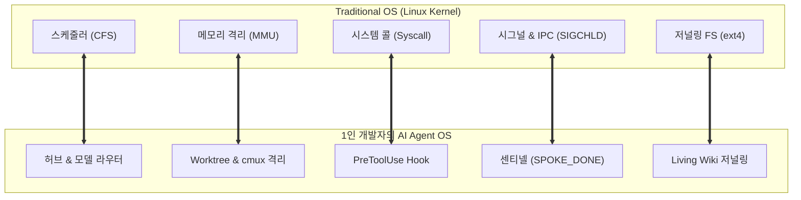

- table of contents
{:toc}

지난 [[10편]](/tag-ai-agent-architecture/10-knowledge-ontology/)까지 1인 개발자로서 빚어낸 워크플로우의 진화 여정을 기록해 왔다. 열 편을 갈무리한 뒤에도 주말마다 '덕질'하듯 시스템을 손보던 중, 외부 에이전트 하네스들(`Ralph`, `gstack`, `oh-my-openagent`)과 유튜브 **'우주초월'**님의 발표 영상([에이전트 워크플로우의 실체](https://www.youtube.com/watch?v=woSiT_kytXo))을 보며 묘한 기시감에 사로잡혔다. 일면식도 없는 엔지니어들이 구축한 파이프라인이 지난 1년간 홀로 깎아 만든 내 체계와 놀라울 만큼 닮아 있었기 때문이다.

**"이 사람들이 보여주는 워크플로우, 내가 만든 것과 너무나 닮아 있다."**

---

## 외부 에이전트 하네스들과의 조우: 수렴 진화와 뼈아픈 빈틈의 흡수

서로 다른 환경에서 독립적으로 도달한 설계가 겹친다면, 그것은 에이전트 시대의 필연적인 수렴 진화라는 방증이다. 완료 신호가 나올 때까지 프롬프트를 반복 공급하는 `Ralph` 루프, 역할 기반 서브에이전트를 분리하는 `gstack`·`oh-my-openagent`, 그리고 마스터 AI가 기획 ➔ 개발 ➔ QA ➔ 위키를 조율하는 우주초월님의 워크플로우를 내 체계(<mark class="kw-term">Hive Mind TDD</mark> + <mark class="kw-term">cmux 워크트리</mark>)와 대조해 보니 세 가지 축이 정확히 포개졌다. `Codex`(구현)와 `Claude`(읽기 전용 검수)의 분리 구조는 우리의 <mark class="kw-term">Builder/Critic 분리</mark>와 맞닿아 있었고, 완료 근거 강제 규율은 물리적 <mark class="kw-term">센티넬(`SPOKE_DONE`)</mark> 및 `exit code 0` 게이트와 동일했으며, 마스터가 하위 작업을 분할·통합하는 구조는 '<mark class="kw-term">허브 + 스포크</mark>' 발주 체계와 같은 궤적을 그렸다.

나아가 **"지금 내 체계에는 무엇이 결핍되어 있는가?"**를 직시하며 외부 워크플로우가 비추어 준 네 가지 빈틈을 흡수해 이식했다.

1. **선제 `Do & Don't` 명세와 에스컬레이션**: 스포크가 공용 모듈을 건드리거나 빈틈을 추측(Guessing)하지 못하도록 허브가 착수 전 `Do`/`Don't`를 닫힌 형태로 확정하고, 중대 결정은 `SPOKE_DECISION_NEEDED`로 에스컬레이션하게 했다.
2. **`Seed Session`과 `Context Caching`**: 매번 백지(<mark class="kw-term">Cold Start</mark>)로 깨어나 토큰을 낭비하던 병목을 풀기 위해, 도메인 지식과 위키를 숙지한 공통 'Seed 세션'을 분기(Fork)해 캐시 적중률(75~90%)을 높였다.
3. **`Playwright` 스냅샷 증거 QA**: 단위 테스트 `GREEN` 뒤의 빈 화면([[4편]](/tag-ai-agent-architecture/4-all-passed-empty-screen/))을 막기 위해 헤드리스 브라우저 조작 후 렌더링 화면의 <mark class="kw-term">Playwright 스냅샷</mark>을 물리적 증거로 제출하게 강제했다.
4. **위키 저널링과 자율 회복 루프**: 위키 갱신을 퇴장 전 필수 관문으로 편입시키고 `Rate Limit` 대기 또한 백그라운드 스케줄러의 <mark class="kw-term">자율 복구</mark> 루프로 전환했다.

- [심화 근거: 외부 에이전트 워크플로우(Ralph·gstack·oh-my-openagent)와 토마토 AI Agent OS 상세 비교 매트릭스 보러가기](/tag-ai-agent-architecture/deep-dive/infra-fsd-and-ecosystem/#external-workflow-comparison)

---

## 랄프의 꿈과 거버넌스의 최종 진화: AI Agent OS와 Repo Ontology(`otlg`)

과천 개발자 모임에서 랄프(Ralph) 창시자의 아이디어를 확장하며 마주한 **'<mark class="kw-term">AI Agent OS</mark>'**는, `Linux` 커널이 CPU와 메모리를 분배하듯 작업 난이도별 **<mark class="kw-term">요청 라우팅</mark>**과 토큰 예산·컨텍스트를 할당·회수하는 **<mark class="kw-term">토큰 매니지먼트</mark>**를 수행하는 커널이었다. 지난 1년간 현장에서 깎아 만든 내 하네스의 조각들이 곧 커널의 서브시스템들과 일대일로 대응하고 있었던 셈이다.

커널의 시선으로 몰두한 화두는 [[6편]](/tag-ai-agent-architecture/6-repo-governance/) 관리 문서(`WORKLOG`, `deferred-watchlist`, `tech-debt`, `ADR`)의 **"거버넌스 완전 자동화"**였고, 우주초월님의 위키 관문과 변우철 본부장님의 <mark class="kw-term">팔란티어 AIP</mark> 강연(`Objects`, `Logic`, `Action` 3대 레이어)이 해답을 주었다. [[10편]](/tag-ai-agent-architecture/10-knowledge-ontology/)의 볼트가 '<mark class="kw-term">개인 지식 온톨로지</mark>'라면, 레포지토리 `.ontology/`에 구축한 **<mark class="kw-term">코드 바인딩 도메인 온톨로지(`otlg`)</mark>**와 **<mark class="kw-term">Living Wiki Engine</mark>**은 객체·규칙·액션 명세를 실제 소스 경로와 바인딩해 에이전트가 스스로 정합성을 검증·갱신하게 만든다.

{:width="700" loading="lazy"}

실제 코드베이스에 구축된 .ontology 아키텍처. 탐색기의 객체(objects), 비즈니스 행위(actions), 불변 규칙(rules) 구조와 에디터에 열린 비즈니스 액션 사양이 도메인의 엄격한 실행 바운더리를 선언하고 있다.
{:.figcaption}

여기서 반드시 짚고 넘어가야 할 엔지니어링적 정직성이 하나 있는데, 나는 결코 팔란티어 AIP와 동일한 런타임 트랜잭션 엔진을 재창조했다고 과장하고 싶지 않다. 팔란티어의 엔터프라이즈 온톨로지가 실제 운영 중인 ERP나 물류 DB의 레코드를 실시간으로 변경하는 '런타임 실행 엔진'이라면, 우리가 만든 `Repo Ontology(otlg)`는 코드베이스의 물리적 상태(소스 심볼, DB 제약조건, 마이그레이션 계보)를 기계가 읽을 수 있는 그래프로 설명하고 코드 변경 시의 파급 경로를 0.01초 만에 추적해 주는 **'<mark class="kw-term">검증 가능한 접지 명세(Grounding Specification)</mark>'**에 해당한다. 실제 코드를 수정하고 저장소에 반영하는 쓰기(Write-back) 행위는 온톨로지 엔진 단독으로 수행하는 것이 아니라, `spoke-guard` 훅이라는 물리적 <mark class="kw-term">하드 바운더리</mark>를 차고 `TDD` 사이클과 `Playwright` 브라우저 검증을 통과한 **에이전트와 테스트 파이프라인**이 함께 완결 짓는다. 즉, 온톨로지는 도메인의 엄격한 헌법(Spec)을 제시하고 에이전트는 그 헌법이 허용한 경계 안에서만 안전하게 코드를 집행하는 분업 구조인 셈이며, 이 헌법과 집행관의 역학 관계는 온톨로지 엔지니어링 시리즈 **[[6편] 아무리 똑똑한 알바생이라도 금고 열쇠를 통째로 맡기는 사장님은 없다](/tag-ontology-engineering/6-sdlc-harness-and-living-wiki/)**에서 상세히 해부한다. (참고로 코드 저장소라는 도메인 특성상 `otlg`를 명세와 검증에 집중시킨 것은 가장 실용적인 선택이었지만, 한편으로는 온톨로지 엔진 자체가 제출 사전 조건을 검증하고 세계의 상태를 직접 바꾸는 진짜 팔란티어식 런타임 `Kinetic / Action Layer`도 끝까지 구현해 보고 싶다는 공학적 호기심이 남았다. 그리고 이 갈증은 최근 취미로 몰두하고 있는 **AI 에이전트 기반 TRPG 시스템(`trpg-ontology`)**에서 에이전트가 등록된 `Action`을 호출해 로컬 파일 잠금과 `fsync` 저널 트랜잭션으로 캠페인 세계의 수치와 장비, 네이티브 `LÖVE` 전투, 그리고 불변의 서사 연대기(`chronicle`)를 직접 변경·환류시키는 구조에 도달하면서 비로소 결실을 맺게 된다. 이 흥미진진한 TRPG 온톨로지 구축기는 온톨로지 엔지니어링 시리즈 **[[7편] 주사위는 거짓말을 하지 않는다, TRPG에서 비로소 도달한 진짜 Action Layer](/tag-ontology-engineering/7-trpg-kinetic-action-layer/)**에서 상세히 만나볼 수 있다.)

이 아키텍처 위에서 스포크 에이전트는 `SPOKE_DONE`을 생성하기 전에 `otlg lint --strict` 정적 검증 ➔ `.ontology/` 바인딩 및 `verified_by` 테스트 계약 갱신 ➔ `deferred-watchlist`·`tech-debt` 라우팅 ➔ `WORKLOG` 기록이라는 4단계 관문을 완결 짓는다. 이는 리눅스 `ext4` 커널의 **'<mark class="kw-term">파일시스템 메타데이터 저널링</mark>'**과 일대일로 대응하며, 레포지토리는 매 순간 스스로를 최신화하는 살아 숨 쉬는 위키(<mark class="kw-term">Living Wiki</mark>)로 거듭났다.

---

## 곱연산의 재확인: 이론이 도구를 결정한다

외부의 뛰어난 실전가들과 호흡을 맞춰보고 온톨로지 기반의 에이전트 운영체제까지 구축하며 내가 다시금 도달한 결론은, 우주초월님이 발표 말미에 강조했던 **"<mark class="kw-term">개인 역량 x AI 활용 능력 = 시너지</mark>"**라는 곱연산의 법칙과 정확히 맞닿아 있었다. 기초 엔지니어링 이론과 설계 근육이 탄탄한 개발자는 AI라는 도구를 조금만 얹어도 폭발적인 레버리지를 일으키는 반면, 도메인을 구조화할 기초 체력이 부족한 상태에서는 아무리 최신 에이전트와 화려한 프롬프트를 동원해도 산출물의 품질이 금세 한계에 부딪히고 만다. 나에게 있어서 퇴근 후와 주말을 반납하며 파고들었던 프로그래밍 공부와 하네스 개선이란 누가 등 떠밀어 하는 과제가 아니라 순수하게 좋아서 몰입하는 '덕질'이었기에, 당장 눈앞의 기능만 돌아가게 만들면 충분했던 1인 개발 환경에서도 아무도 시키지 않은 객체지향 설계 원칙과 테스트 코드, 아키텍처와 온톨로지까지 스스로 기준을 높여 실무 프로덕트에 끊임없이 이식할 수 있었다. 지식이 늘어가는 즐거움과 배운 이론을 코드베이스에 즉시 적용해 시스템이 실제로 단단해지는 과정을 피부로 느끼는 경험이 더없이 큰 보람이었고, 그렇게 축적한 시간들은 에이전트의 속도에 휩쓸리지 않고 내 일하는 방식을 지탱해 주는 든든한 **'닻'**이 되어 주었다.

결국 **에이전트 워크플로우를 설계하고 통제하는 힘은 화려한 AI 툴 사용법이 아니라, 자신의 <mark class="kw-term">업무와 도메인을 빈틈없이 구조화하는 엔지니어링 기초 체력</mark>에서 나온다.** 기획부터 개발, 독립 검증과 위키 저널링으로 이어지는 파이프라인을 정의하고, 각 단계의 입출력 계약과 불변식을 명세하며, 실패 시의 결정론적 롤백 경로를 설계하는 일은 본질적으로 컴퓨터 공학이 수십 년간 다뤄온 시스템 설계의 영역이기 때문이다. AI 활용법 자체는 누구나 짧은 시간 안에 익힐 수 있을 만큼 진입 장벽이 낮아지고 있지만, 에이전트가 마음껏 뛰어놀 수 있는 단단한 운동장과 가드레일을 설계하는 이론적 내공은 하루아침에 만들어지지 않는다. 지난 [[1편] AI에게 욕하던 신입이 선생님을 위한 규칙을 만들기까지](/tag-ai-agent-architecture/1-ground-rules/)의 계획 선행 규율부터 [[2편] 토큰 낭비라던 TDD가 어느새 제 종교가 되었습니다](/tag-ai-agent-architecture/2-tdd-religion/)의 테스트 주도 개발, [[3편] 객체지향을 배웠으니 선생님을 가르쳐보겠습니다](/tag-ai-agent-architecture/3-teach-object-design/)의 객체지향 설계와 [[4편] 역시 내 테스트 스위트는 잘못됐다](/tag-ai-agent-architecture/4-all-passed-empty-screen/)의 경계 정합성에 이르기까지, 우리가 이 시리즈 내내 집요하게 파고들었던 기본기들이야말로 곱연산의 시대에 엔지니어가 끝까지 붙들어야 할 진짜 무기인 셈이다.

---

## 마치며: 운영체제는 멈추지 않는다

사수 없이 홀로 나만의 워크플로우를 깎고 다듬다 보면, 어느 순간 바다 건너 혹은 옆 동네에서 똑같은 문제의식을 품고 비슷한 구조에 독립적으로 도달한 동료 엔지니어들을 발견하게 된다. 우주초월님의 발표 영상과 랄프 창시자의 비전, 그리고 코딩하는 기술사님의 온톨로지 통찰은 내게 그러한 시대적 공명을 확인시켜 준 가장 선명한 이정표였다. 마스터와 워커의 물리적 격리, 이종 컨텍스트 간 교차 검수, 센티넬과 스냅샷을 통한 증거 기반 완료 판정, 그리고 메타데이터 자가 저널링에 이르기까지, 이 패턴들이 서로 다른 현장에서 약속이나 한 듯 반복적으로 출현한다는 사실은 **에이전트와 협업하는 소프트웨어 엔지니어링에 이미 거스를 수 없는 어떤 '정석'이 형성되고 있음**을 뜻한다. 과거 `Linux`가 복잡한 하드웨어 제어를 커널 뒤로 추상화하여 프로그래머에게 일관된 시스템 콜을 선물했듯, 지금 우리가 수작업으로 빚어내고 있는 이 에이전트 하네스들 역시 머지않아 토큰과 컨텍스트의 복잡성을 감추고 결정론적 품질을 보장하는 범용 운영체제로 수렴해 갈 것이다.

내 체계의 뼈아픈 빈틈을 정면으로 인정하고 외부의 탁월한 해법들(선제 Do & Don't 명세, Seed Session 캐싱, `Playwright` 스냅샷 검수, 위키 생명주기 편입)을 주저 없이 흡수한 결단은 내 엔지니어링 운영체계를 한 차원 높은 단계로 끌어올리는 결정적 계기가 되었다. 여기에 지난 [[6편] 에이전트가 기억상실증입니다만, 문제라도?](/tag-ai-agent-architecture/6-repo-governance/)의 저장소 거버넌스와 [[10편] 기록의 악마는 고립된 노트의 꿈을 꾸지 않는다](/tag-ai-agent-architecture/10-knowledge-ontology/)의 지식 그래프를 잇는 도메인 온톨로지(`otlg`)까지 결합하면서, 비로소 파일시스템 메타데이터 저널링까지 스스로 완결 짓는 1인 개발자만의 '<mark class="kw-term">AI Agent OS</mark>'가 온전한 형태를 갖추게 되었다. 이 글 후반부에서 소개한 팔란티어 온톨로지 철학의 코드베이스 이식 여정과 `repo-ontology(otlg)`의 내부 구조, 자가 갱신형 위키 엔진, 나아가 TRPG와 게임 개발 도메인까지 확장된 다섯 세계의 온톨로지 아키텍처가 궁금하다면, 이를 본격적으로 해부한 후속 연재 **[온톨로지 엔지니어링 시리즈](/tag-ontology-engineering/)**(특히 전체 여정의 현관문인 **[[0편] 내가 사랑하는 다섯 개의 세계에 온톨로지를 이식하기까지](/tag-ontology-engineering/0-ontology-engineering-intro/)**, 레포지토리가 스스로 말하게 만드는 `otlg` 엔진과 3-Graph 진화를 다룬 **[[3편]](/tag-ontology-engineering/3-nouns-to-verbs-paradigm-shift/)~[[5편]](/tag-ontology-engineering/5-three-graphs-and-tdd-contract-v030/)**, 그리고 SDLC 하네스와 메타데이터 저널링의 완결판을 다룬 **[[6편] 아무리 똑똑한 알바생이라도 금고 열쇠를 통째로 맡기는 사장님은 없다](/tag-ontology-engineering/6-sdlc-harness-and-living-wiki/)**)에서 이어지는 이야기를 확인해 보길 권한다.

물론 우리의 운영체계는 여기서 멈추지 않고 내일도 실전의 마찰 속에서 계속 진화할 것이며, 또다시 나눌 만한 경험이 쌓이면 언제든 새로운 기록을 보태보도록 하겠다. 그것이 이 시리즈의 방식이니까...
