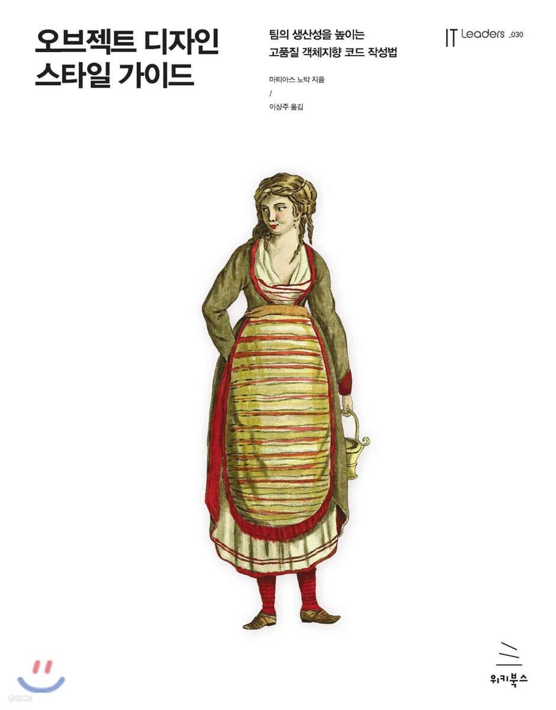
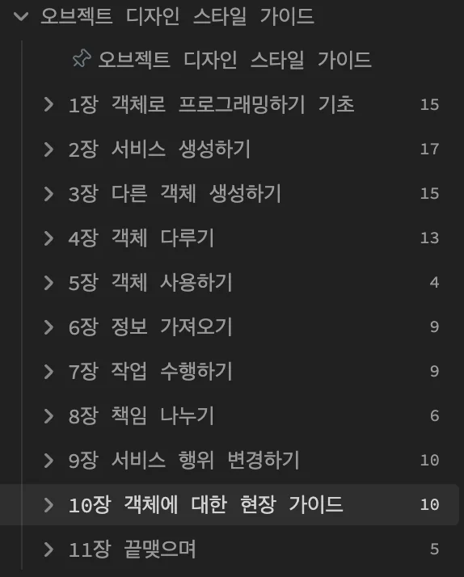

- table of contents
{:toc}

## 테스트는 통과하는데 왜 속은 스파게티일까: 선생님을 가르치기로 결심하기까지

지난 [[2편] 토큰 낭비라던 TDD가 어느새 제 종교가 되었습니다](/tag-ai-agent-architecture/2-tdd-religion/)에서 이야기했듯, 내 개발 프로세스는 `TDD`라는 일상 엔진과 검진 스킬이라는 안전망으로 지탱된다. 하지만 `RED-GREEN-REFACTOR` 루프를 돌린다고 코드 품질이 저절로 우아해지는 것은 아니었다. 설계 가이드 없이 에이전트에게 "테스트 먼저 짜고 통과시켜"라고만 지시하면, 당장 `GREEN`을 띄우기 위해 수백 줄짜리 절차지향 함수를 찍어내거나 원시 타입(`str`, `int`, `dict`)만 덕지덕지 이어 붙인 스파게티 코드를 만들어내기 일쑤였기 때문이다.

켄트 벡의 **『Tidy First?』**가 일깨워 주었듯 행동(Behavior)을 바꾸는 일과 구조(Structure)를 정돈하는 일은 분리되어야 마땅한데, 구조적 기준선이 없는 에이전트는 수정 비용이 폭발하는 분기문만 쌓아 올리고 있었다. 그 한계를 넘도록 내게 **Object-oriented programming(`OOP`)**의 본질을 안내해 준 책이 바로 Matthias Noback의 **『오브젝트 디자인 스타일 가이드』** (Object Design **Style** Guide, Matthias Noback)였다.

{:width="400" loading="lazy"}

Matthias Noback의 『오브젝트 디자인 스타일 가이드』 표지.
{:.figcaption}

울림이 워낙 커서 여러 번 반복해 정독했을 뿐만 아니라, 책에 담긴 원칙을 손끝의 감각으로 체화하고 싶어 전 챕터를 직접 타이핑하며 필사해 두었을 만큼 애착이 깊은 책이다.

{:width="400" loading="lazy"}

옵시디언 볼트에 전 챕터를 타이핑으로 필사해둔 『오브젝트 디자인 스타일 가이드』 디렉토리 구조.
{:.figcaption}

나는 개발과 관련된 공부를 하며 여러 번 마주친 단어 중, '우아하다'라는 단어가 너무 좋더라 *~~(듣고있나 우아한 형제들)~~*. 잘 아는 단어이지만 평상시에는 사용하지 않는 생소함 때문에 더 꽂히는 것 같다. 아무튼, `OOP` 개발 방법론은 나에게 참 '우아해' 보였다.
{:.note title="여담"}

결국 내가 책을 읽으며 감탄했던 그 '우아한' 객체지향 규율들을 내 머릿속에만 남겨두는 대신, 나의 AI 선생님이 코드를 한 줄이라도 짜기 전에 의무적으로 따르도록 스킬 체계(`/tdd-plan`, `/go`, `/object-design-practices`) 안에 구조적으로 이식해야겠다는 발상의 전환에 도달했다.

## 객체의 정체성부터 묻는다: Service, Entity, Value Object와 불변성

설계의 밑그림을 그리는 `/tdd-plan`의 첫걸음은 만들 대상이 어떤 성격의 객체인지 분류하는 작업에서 출발한다. 무작정 클래스부터 정의하는 대신, 도메인을 구성하는 **3대 객체(`Service`, `Entity`, `Value Object`)**와 경계 전송용 예외인 **`DTO`** 중 어디에 해당하는지 먼저 판별해 생성 규칙과 가변성(Mutability), 테스트 방식을 일관되게 결정짓는다.

| 분류 | 핵심 역할 | 동등성 (Equality) | 가변성 (Mutability) | 자기 검증 |
|:---|:---|:---:|:---:|:---:|
| **Service** | 유스케이스 조율 및 흐름 제어 | - | Immutable (생성 후 불변) | - |
| **Entity** | 상태와 생명주기를 지닌 도메인 모델 | Identity (고유 ID) | Mutable (상태 전이) | O |
| **Value Object** | 고유한 불변 속성값과 도메인 연산 표현 | Value (값 동등성) | Immutable (완전 불변) | O |
| **DTO (예외)** | 계층 간 순수 데이터 전송 컨테이너 | - | Mutable / 일괄 검증 | X |

일상적인 비유를 들자면 **값 객체(Value Object)는 '만 원짜리 지폐'**와 같아서 일련번호가 달라도 액면가라는 '값'이 같으면 동일한 만 원으로 취급한다. 반면 **개체(Entity)는 '학생'**과 같아서 이름이나 나이가 같더라도 학번이라는 고유 정체성(Identity)으로 구분해야 한다.

이 분류를 마치면 코드베이스에서 단짝처럼 묶여 다니는 원시값 클러스터를 찾아 <mark class="kw-term">원시값 집착(Primitive Obsession)</mark>을 해소한다. 아래 Before/After 비교를 보면 설계자의 <mark class="kw-intent">의도</mark>가 어떻게 <mark class="kw-term">값 객체(Value Object)</mark>의 응집도를 만드는지 드러난다.

```python
# [Before] 원시값 집착: 인자 순서가 바뀌어도 모르고, 검증과 계산 로직이 호출부마다 파편화된다
def evaluate_exam(score: int, max_score: int, cut_line: int) -> dict:
    if max_score <= 0 or not (0 <= score <= max_score):
        raise ValueError("점수 범위 오류")
    return {"percentage": Decimal(score) / Decimal(max_score) * 100, "is_pass": score >= cut_line}

# [After] 불변 값 객체(Value Object): 생성 시점 자기 검증(Self-validation)과 도메인 행동의 응집
@dataclass(frozen=True)
class Score:
    score: int
    max_score: int

    def __post_init__(self) -> None:
        if self.max_score <= 0 or not (0 <= self.score <= self.max_score):
            raise ValueError("유효하지 않은 점수 범위다")

    def percentage(self) -> Decimal:
        return (Decimal(self.score) / Decimal(self.max_score)) * Decimal(100)

    def is_pass(self, cut: int) -> bool:
        return self.score >= cut
```

만약 `Score`라는 불변 값 객체를 세우지 않았다면 만점 검증과 백분율 계산(`percentage`), 합격 판정(`is_pass`) 로직이 서비스와 라우터 곳곳에 흩어져 있었을 것이다. 내 `/tdd-plan`에서는 새 값 객체 후보가 식별되면 그 단위 테스트를 **Phase 1 맨 앞단에 강제 배치**한다. 앞단에 값 객체가 먼저 자리 잡아야 뒤따르는 서비스 구현 단계에서 AI가 원시값 대신 해당 값 객체를 가져다 쓸 수밖에 없는 구조적 환경*(설계 압력)*이 만들어지기 때문이다.

## CQS와 캡슐화를 지키는 검증 규율

객체의 정체성과 불변성을 세웠다면, 객체 간 협력과 테스트 전략은 <mark class="kw-term">Command Query Separation(CQS)</mark> 원칙이 지배한다. 상태를 변경하는 작업(`Command`)은 값을 반환하지 않아야(`None`) 하고, 값을 반환하는 작업(`Query`)은 내부 상태를 건드리지 말아야 하며, 두 성질을 한 메서드에 절대 섞지 않는다는 규율이다.

이 CQS 원칙은 부수효과 사고를 막아줄 뿐만 아니라 <mark class="kw-term">테스트 대역(Test Double)</mark>의 선택 기준까지 모호함 없이 갈라준다.
- **Query 의존성 (값을 돌려받음)**: 캐시를 쓰든 재호출하든 결과만 올바르면 그만이므로 **`Stub`이나 `Fake`**를 붙이고 결과값으로만 검증한다. 여기에 `Mock`을 쓰면 내가 설정한 반환값을 도로 확인하는 <mark class="kw-term">Mock 동어반복(tautology)</mark>에 빠진다.
- **Command 의존성 (부수효과를 일으킴)**: 외부 상태를 바꾸는 작업이므로 **`Mock`이나 `Spy`**를 붙여 정확한 인자로 호출되었는지를 검증한다.

나아가 테스트 코드가 캡슐화를 허물지 못하도록 두 가지 검증 규칙을 `/tdd-plan`과 `/go`에 못 박았다.
- **생성자 테스트는 오직 실패 케이스만 검증한다**: 정상 생성(happy path)을 확인하겠다고 `assert coords.latitude == 60.0`을 단언하면 비즈니스 로직에서는 안 쓰는 `getter`를 억지로 뚫어야 한다. 정상 생성은 행위 테스트가 증명하므로, 생성자 테스트는 `pytest.raises(..., match=...)`로 잘못된 입력을 튕겨내는지만 검증한다.
- **개체(Entity)의 상태 변경은 getter 대신 도메인 이벤트로 검증한다**: 개체의 상태가 전이되었을 때 내부 필드를 꺼내 비교하면 내부 자료구조에 강결합된다. 대신 `assert PlayerMoved(Position(6, 20)) in player.release_events()`처럼 <mark class="kw-term">도메인 이벤트(Domain Event)</mark>의 포함 여부(`in`)나 공개 `Query` 메서드로만 검증해 정보 은닉을 지켜낸다.

## 객체 분류를 넘어 거시 아키텍처로: Forces Analysis와 결합도 분리

개별 객체를 빚어내는 규율들을 `/object-design-practices`(6대 섹션 46개 규칙)로 묶어내자 단위 클래스들은 단정해졌다. 하지만 여러 도메인이 얽힌 프로덕션 시스템을 운영하다 보니 더 큰 질문과 마주했다. **"비즈니스 정책이 수시로 추가될 때, 기존 코드를 깨뜨리지 않고 어떻게 이 객체들을 조립하고 확장할 것인가?"**

해답을 준 것은 『Beyond Legacy Code』의 저자 데이비드 스콧 번스타인(David Scott Bernstein)의 강의 시리즈(*The Passionate Programmer*)였다. 그는 **"코드를 수정하는 비용은 최초 작성 비용의 5배에 달한다"**는 코드 경제학(Code Economics)을 강조하며, 구조적 모델 없이 절차적 `if/elif`만 찍어내면 기술 부채를 5배 속도로 증폭시킬 뿐이라고 경고한다.

> **"패턴은 해결책이 아니다. 문제 공간에 작용하는 힘(Forces)에 대한 반응이자 신호다. 힘이 존재하지 않는데 패턴을 적용하는 것은 오버엔지니어링이자 연극(theater)에 불과하다."**

고객 유형이 단 두 가지뿐이면 단순한 `if`문 두 줄이 가장 정직한 설계다. 반대로 정책들이 서로 다른 주기로 독립 진화한다는 물리적 압력(Force)이 존재할 때만 패턴이 도출되어야 한다. 나는 이를 `/tdd-plan`의 **Stage 1: Forces Analysis & CVA(공통성·가변성 분석)**에 이식해, 코드 작성 전에 무엇이 변하고(Variability) 어떤 안정된 시그니처(Commonality)를 공유하는지 먼저 진단하게 만들었다.

독립적 변동의 힘이 확인되었을 때 사용하는 핵심 무기가 **Identity Coupling(구체 타입을 판별하는 결합)**과 **Interface Coupling(추상화된 약속을 호출하는 결합)**의 분리다. **"결정을 없애려 애쓰지 말고, 결정을 올바른 자리로 옮겨라 (Eliminate != Relocate)."**

```python
# [Before] 판단(Identity Coupling)과 실행(Interface Coupling)이 뒤엉킨 코드
class MeetingCoordinator:
    def schedule(self, meeting: Meeting) -> str:
        if meeting.kind == "team":
            return self._schedule_team(meeting)
        elif meeting.kind == "one_on_one":
            return self._schedule_one_on_one(meeting)
        raise ValueError(f"Unknown: {meeting.kind}")

# [After] 결정을 Factory(Seam)로 격리하고 실행부는 인터페이스만 바라보는 구조
class MeetingCoordinator:
    def __init__(self, factory: MeetingSchedulerFactory) -> None:
        self._factory = factory

    def schedule(self, meeting: Meeting) -> None:
        self._factory.create_for(meeting.kind).execute(meeting)
```

미래의 변경을 예언해 패턴을 미리 깔아두지는 않는다(YAGNI). 대신 `/go`의 `REFACTOR` 게이트에 **Pattern Signal Detection(패턴 신호 감지)**을 탑재해, 같은 분기문이 3개 이상 길어지거나 거대한 테스트*(테스트 작성의 고통은 객체의 응집도가 부족하다는 사실을 고발하는 가장 정직한 거울이다)*가 나타날 때, 혹은 행위 정체성 상실*(Command 패턴 신호)*·상태 분기 번짐*(State 패턴 신호)*·주기적 상태 조회*(Observer 패턴 신호)*·조정 결합 비대화*(Mediator 패턴 신호)*가 감지될 때만 패턴에 '도착(Emergent Design)'하도록 설계했다.

본편에서 다룬 **『Object Design Style Guide』 기반 6대 섹션 46개 규칙 카탈로그**와 `/tdd-plan`·`/go` 리팩토링 코드 전문은 아래 심화 레퍼런스에서 확인할 수 있다.

- [심화 근거: Object Design Style Guide 6대 섹션 46개 규칙 카탈로그와 TDD Plan·Go 코드 리팩토링 전문 보러가기](/tag-ai-agent-architecture/deep-dive/tdd-and-object-design/#object-design-rules)

## 두 거인의 어깨 위에서 완성한 설계 엔진, 그리고 경계의 배신

결국 내 객체 설계 워크플로우는 **Matthias Noback**의 **'객체 단위 미시 규약'**과 **David Scott Bernstein**의 **'시스템 단위 거시 아키텍처'**가 맞물린 결과물이다. AI에게 단순 문법이 아니라 **힘(Forces)과 경계(Seam), 불변식(Invariant)**의 언어로 맥락을 건네자, 나의 AI 선생님은 시니어 못지않은 견고한 도메인 모델을 풀어내기 시작했다(여기서 정립한 `Entity`·`Command`·`Invariant`는 훗날 **온톨로지 엔지니어링 [[3편]](/tag-ontology-engineering/3-nouns-to-verbs-paradigm-shift/)**과 **[[5편]](/tag-ontology-engineering/5-three-graphs-and-tdd-contract-v030/)**의 핵심 토대로 직결된다).

하지만 개별 객체의 캡슐화를 다듬고 결합도를 분리했음에도, 프로덕션에서는 단위 테스트가 전부 초록불(`All Passed`)인데 정작 브라우저를 열면 화면이 하얗게 비어버리는 **'시스템 경계'와 '가짜 테스트'**의 배신이 기다리고 있었다. 다음 글인 [[4편] 역시 내 테스트 스위트는 잘못됐다](/tag-ai-agent-architecture/4-all-passed-empty-screen/)에서는 경계 정합성 표 3종과 `IO-Pure-IO` 분리, 독립 검토자(`/test-harden`)와 `Playwright` QA 게이트 도입기를 들려드리고자 한다.
