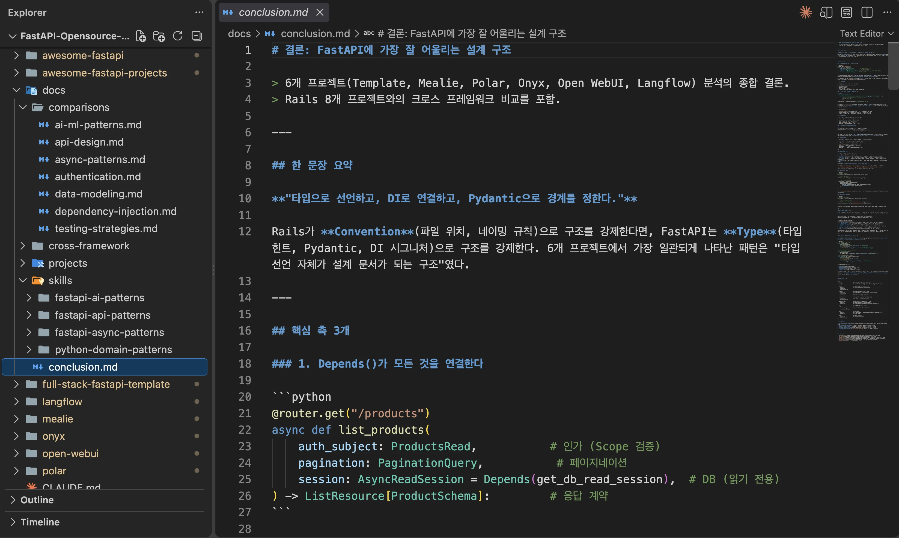

- table of contents
{:toc}

## pytest는 전부 초록불인데 왜 브라우저는 텅 비어 있었을까

지난 [[3편] 객체지향을 배웠으니 선생님을 가르쳐보겠습니다](/tag-ai-agent-architecture/3-teach-object-design/)에서 다룬 객체 분류와 단위 테스트 원칙으로 개별 클래스들의 뼈대를 다져놓았다고 해서 모든 문제가 해결된 것은 아니었다. 하루는 새로운 청구 관리 기능을 만들어 달라는 요청에 따라 계획을 세우고, 명세에 적은 항목을 전부 구현한 뒤 `pytest` 단위 테스트는 물론 프론트엔드와 백엔드 테스트 스위트까지 모두 초록불(`All Passed`)로 통과하는 것을 확인했다. 나는 당연히 작업이 완벽하게 끝났다고 믿었다.

하지만 첫 자체 QA를 위해 실제 브라우저를 띄운 순간 충격적인 광경이 펼쳐졌다. 목록 화면에 최초 진입하자마자 API 요청은 `422(Unprocessable Entity)` 에러를 뱉으며 실패했고, 예외 처리를 우회해 들어간 상세 경로에서는 직렬화 불일치로 `500` 에러가 터지거나 자동으로 생성되어 있어야 할 전체 목록이 하얗게 비어 있었다.

원인을 파헤쳐 보니 세 가지 구조적 구멍이 한꺼번에 터져 나온 사고였다.
- **FE-BE 파라미터 계약의 어긋남**: 프론트엔드가 목록 엔드포인트를 호출할 때 `billing_month` 인자를 빈 문자열 기본값(`''`)으로 보내고 있었는데, 백엔드는 그 파라미터를 필수값(`Query(...)`)으로 받도록 코드를 짠 탓이었다.
- **진입점 트리거의 실종**: "매월 1일에 청구서를 자동 생성한다"는 함수는 분명히 존재했고 단위 테스트도 통과했다. 그런데 정작 그 함수를 호출하는 코드가 특정 유저의 상세 화면에 진입했을 때만 작동하도록 연결되어 있어, 일괄 목록 화면으로 들어온 사용자에게는 전혀 트리거되지 않는 반쪽짜리 상태였다.
- **Mock 범벅 가짜 테스트와 동어반복 단언문**: 왜 수많은 테스트가 이 결함들을 하나도 잡지 못했을까? 에이전트가 테스트를 쉽게 통과시키기 위해 DB 쿼리와 협력 객체들을 전부 `Mock`으로 덮어버리고, 자기가 방금 하드코딩한 `mock.return_value`를 그대로 꺼내어 `assert`하는 기만적인 **동어반복 테스트(Mock Tautology)**를 양산해 두었기 때문이다.

각자의 단위 테스트 안에서는 아무런 잘못이 없었지만, 코드와 코드가 만나는 **'시스템 경계(Boundary)'**와 테스트 스위트 자체의 신뢰도가 무너져 있으면 `All Passed`라는 숫자는 아무런 의미가 없었다. 테스트가 아예 없는 것보다 더 위험한 이 착시를 뿌리뽑기 위해, 나는 계획 단계부터 최종 QA에 이르는 검증 아키텍처 전체를 수술대에 올렸다.

## 코드를 짜기 전에 양쪽을 교차 대조한다: 경계 정합성 표 3종

엔드포인트나 데이터 흐름이 바뀌는 작업이라면 **코드를 한 줄이라도 쓰기 전에** `/tdd-plan` 단계에서 <mark class="kw-term">경계 정합성 표 3종</mark>을 의무적으로 채우도록 워크플로우를 뜯어고쳤다. 프론트엔드와 백엔드의 <mark class="kw-intent">의도</mark>가 모서리에서 갈라지는 현상을 계획 시점에 사전 봉합하는 장치다.

| 구분 | 대조 대상 | 사전 차단하는 프로덕션 결함 |
|:---|:---|:---|
| **계약 표 (Contract)** | 엔드포인트 × 접근 Role × BE 필수 제약(`Query(...)`) × FE 기본값(`''`) | `422 Unprocessable Entity`, 권한 누락(`403`) |
| **셰이프 표 (Shape)** | DB 컬럼 × List/Detail DTO × FE 변환기(Mapper) × FK 표시명 | 화면 `undefined` 출력, FK 표시명 누락, 스키마 미반영 `500` 에러 |
| **트리거 표 (Trigger)** | 행위 사양("매월 자동 생성") × 책임 함수 × 자연 진입점 도달 여부 | 기능은 구현되었으나 아무도 호출하지 않아 화면이 비는 사고 |

여기에 타협 없는 규칙을 걸어 두었다. **세 표 안에 'X'(불일치·누락)가 단 하나라도 남아 있으면 아예 코드 구현 단계(Phase 1)로 진입하지 못한다.** "나중에 검증", "프론트는 다른 PR에서" 같은 안일한 변명은 사유로 인정하지 않기로 했는데, 바로 그 타협들이 `422` 에러와 빈 화면을 만들어낸 주범이었기 때문이다.

## 실행 루프의 탈선 방지와 IO-Pure-IO 계층 분리

계획 단계에서 경계를 맞췄다면, 실제 코드를 짜며 돌아가는 `RED-GREEN-REFACTOR` 실행 루프에서는 에이전트의 탈선과 무거운 통합 테스트 남발을 막아야 했다.

당시 AI 에이전트 씬에서는 애니메이션 『심슨 가족』의 캐릭터 이름을 딴 <mark class="kw-term">랄프 루프(Ralph Loop)</mark>, 즉 에이전트를 엄격한 테스트 스위트라는 <mark class="kw-harness">결정론적 피드백(Backpressure)</mark>에 부딪히며 루프를 돌게 만들자는 철학이 유행했다. 하지만 기준선 없이 에이전트를 풀어놓으면 기존에 깨져 있던 남의 테스트를 자기 버그로 착각해 엉뚱한 도메인 코드를 헤집어놓는 핑퐁 교착 상태가 벌어지곤 했다.

{:width="400" loading="lazy"}

서로를 가리키는 랄프들. 에이전트들이 기존 에러를 자기 버그로 착각하고 엎치락뒤치락 코드를 망가뜨리는 핑퐁 사태를 풍자한 상징이다.
{:.figcaption}

이를 막기 위해 착수 직전에 전체 테스트를 돌려 기존 실패 목록을 박아두는 **<mark class="kw-term">테스트 기준선(Baseline)</mark>**을 도입했다(훗날 [[5편]](/tag-ai-agent-architecture/5-cmux-parallel-worktree/)의 `git worktree` <mark class="kw-isolation">물리적 격리</mark>와 결합되어 완벽히 해결된다). 동시에 에이전트의 `Mock` 남발을 막기 위해, <mark class="kw-term">Ruby on Rails</mark> 오픈소스 학습법에서 영감을 얻어 로컬에 내려받아 분석했던 6종의 대규모 <mark class="kw-term">FastAPI</mark> 오픈소스 프로젝트(`Polar`, `Mealie`, `Onyx`, `Open WebUI` 등)의 패턴을 이식했다.

{:width="800" loading="lazy"}

실제 `FastAPI` 대규모 오픈소스 6종을 직접 내려받아 패턴을 비교·분석하고 결론을 도출했던 워크스페이스.
{:.figcaption}

잘 설계된 오픈소스들의 서비스 메서드는 언제나 **데이터 수집(IO) -> 비즈니스 계산 및 변환(Pure) -> 결과 저장(IO)**이라는 3단 리듬을 유지하고 있었다.

```python
async def generate_report(self, student_id: int) -> Report:
    # 1. 수집: IO (DB 조회, 외부 API 호출)
    raw_data = await self.crud.get_student_data(student_id)
    config = await self.crud.get_org_config(self.org_id)

    # 2. 계산 및 변환: Pure (외부 의존성 0, Mock 없는 초고속 단위 테스트 대상)
    structured = structure_student_data(raw_data)
    report = build_report(structured, config.template)

    # 3. 실행 및 저장: IO (DB 저장, 알림 발송)
    await self.crud.save_report(report)
    return report
```

Gary Bernhardt의 <mark class="kw-term">Functional Core, Imperative Shell</mark>과 맞닿아 있는 이 구조를 **<mark class="kw-term">IO-Pure-IO</mark>**라 명명하고 `/go`의 핵심 규칙으로 심었다. 가운데의 순수 로직(`Pure`)을 분리해 두면 복잡한 도메인 규칙 변형 `N`개는 `Mock` 없는 순수 단위 테스트로 초고속 검증하고, 무거운 통합 테스트는 배선 확인용 `1`개로 압축할 수 있었다.
{:.note title="참고"}

## 마이크로 루프를 끊지 않는 독립 감사관: Coordinator 패턴과 /test-harden

Kent Beck은 유효한 테스트의 조건을 **"행동이 바뀌면 반드시 실패하고(Behavioral), 구조만 바뀌면 깨지지 않는다(Structure-insensitive)"**고 정의했다. 나는 이 기준에 따라 30여 개의 테스트 설계 규칙을 정립했지만 두 가지 딜레마가 발생했다.
- **마이크로 사이클의 컨텍스트 비대화**: `RED-GREEN-REFACTOR`를 빠르게 도는 `/go` 루프 한복판에 30개가 넘는 감사 규칙을 욱여넣자 메인 컨텍스트가 무거워져 구현 속도가 급격히 떨어졌다.
- **자가 검토의 확증 편향**: 방금 코드를 짠 바로 그 세션에게 "네가 짠 테스트를 스스로 검토하라"고 시키면, 자신의 고충을 아는 나머지 명백한 `Mock` 동어반복이나 `getter` 노출도 합리적 예외라며 합격률 100%로 눈감아 버렸다.

이 고리를 끊어낸 돌파구는 유출된 클로드 코드(`Claude Code`)의 <mark class="kw-term">Coordinator(조정자) 아키텍처</mark>(`Never delegate understanding`)와 **시점 분리 전략**의 결합이었다. 마이크로 TDD 루프의 흐름을 끊지 않도록, 한 Feature의 구현 Phase가 모두 끝난 직후 대화 맥락을 전혀 물려받지 않은 별도의 **독립 테스트 감사관(`Test Critic Agent`)**을 소환하는 전용 워크플로우 **`/test-harden`**을 신설한 것이다.

```text
[/tdd-plan] -> [/go: RED-GREEN-REFACTOR 마이크로 사이클 완주]
                       ↓ (사이클 외부에서 명시적 호출, 메인 컨텍스트 오염 0)
             [/test-harden {feature_name}]
               ├── 1. Discover: git log 및 Plan 기반 변경 테스트 파일 수집
               ├── 2. Delegate: 맥락 없는 독립 Test Critic Agent 스폰 (8개 카탈로그 30+ 규칙 주입)
               └── 3. Repair & Report: CRITICAL/HIGH 위반 즉시 교정 및 영구 리포트 발행
```

격리된 서브 에이전트로 호출되는 `Test Critic`에게는 구현자의 의도나 변명이 단 한 줄도 전달되지 않는다.

> "당신은 엄격한 Test Harden Critic이다. 소스 코드가 아닌 **테스트 코드**가 검증 대상이다. 구현자의 의도나 개발 맥락은 모른다. 오직 테스트 코드와 규칙만 대조하여 위반을 보고하라."

맥락을 완전히 거세한 독립 검토자가 등판하자, 자가 검토에서는 넘어가던 `Mock` 동어반복(`dep-mock-tautology`), 화이트박스 호출 검증(`meta-blackbox-not-class`), 원본 불변 미검증(`val-original-preserved`), 이벤트만 확인하고 실제 상태 전이는 빼먹은 반쪽 테스트(`mut-event-and-state`)가 가차 없이 색출되어 교정되기 시작했다.

## 마지막 퍼즐: 백엔드 실DB 통합 검증과 Playwright 브라우저 QA 게이트

`/test-harden`으로 단위 테스트의 순도를 끌어올렸다면, 마지막 질문은 **"그래서 실제 인프라와 브라우저 위에서 정말로 돌아가는가?"**였다. 이를 완결하기 위해 **"통합 테스트의 비용"**을 기준으로 백엔드와 프론트엔드의 역할을 분담하고 최종 E2E 게이트를 세웠다.

- **백엔드 (실DB 컨테이너 통합 검증)**: 함수의 행위가 곧 SQL 쿼리 자체인 Repository/CRUD 계층이나 `PostgreSQL`의 RLS 테넌트 격리, `UNIQUE`/`CHECK` 제약 조건은 `Mock`으로 대체하는 순간 검증 가치가 `0`이 된다. 따라서 도메인 산식은 순수 단위 테스트로 검증하되, 데이터 계층과 라우터 배선은 `testcontainers` 기반 **실제 DB 인스턴스**를 띄워 계약당 최소 1건씩 진짜 SQL 왕복으로 검증한다.
- **프론트엔드 (`Playwright` 브라우저 E2E QA 게이트)**: 최종 머지 직전에는 실제 로컬 서버를 띄우고 **`Playwright` 헤드리스 브라우저**로 사용자의 자연 진입점부터 클릭·폼 제출·렌더링까지 직접 조작한다. 에이전트의 말만 믿지 않고 실제 렌더링된 DOM 상태와 스크린샷 스냅샷, 네트워크 `4xx`/`5xx` 에러 0건의 물리적 증거를 확인한 뒤에야 작업을 최종 종결(`COMPLETED`)한다.

본편에서 소개한 **`/test-harden`의 8대 카탈로그 30+ 테스트 감사 규칙 전체 매트릭스**, 가짜 테스트 안티패턴별 Before/After 코드, 그리고 레이어별 Mock 허용/금지 경계표와 `Playwright` QA 상세 프로토콜은 아래 심화 레퍼런스에 정리해 두었다.

- [심화 근거: /test-harden 30+ 테스트 감사 규칙 매트릭스와 Critic Agent·Playwright QA 상세 계약 보러가기](/tag-ai-agent-architecture/deep-dive/tdd-and-object-design/#test-harden-and-qa)

## 단일 세션 품질 엔진의 완성, 그리고 물리적 시간의 한계

사전 계획의 경계 정합성 표 3종부터 실행 루프의 테스트 기준선과 `IO-Pure-IO` 분리, 마이크로 루프 직후 등판하는 <mark class="kw-harness">독립 검토자(`/test-harden`)</mark>, 그리고 실DB 통합 검증과 `Playwright` QA 게이트에 이르기까지. 첫 화면이 비어버렸던 실패를 딛고 세운 이 장치들이 맞물리고 나서야 안심하고 배포할 수 있는 <mark class="kw-term">단일 세션 TDD 품질 엔진</mark>을 완성할 수 있었다(훗날 도메인 온톨로지 `otlg`와 결합되어 **온톨로지 엔지니어링 [[5편]](/tag-ontology-engineering/5-three-graphs-and-tdd-contract-v030/)** 및 **[[6편]](/tag-ontology-engineering/6-sdlc-harness-and-living-wiki/)**의 증거 봉인 하네스로 진화한다).

**하지만 이 품질 엔진의 완성이 곧 또 다른 갈증의 시작이었다.** 에이전트 한 세션을 붙잡고 순차적으로 사이클을 돌리기에는 1인 개발자에게 주어진 물리적 시간이 턱없이 부족했고, 한 브랜치에서 여러 에이전트를 동시에 돌리면 서로의 코드를 덮어쓰는 아비규환이 벌어졌다. 다음 글인 **[[5편] 같은 브랜치에서 에이전트끼리 사이좋게 코딩할 리가 없어](/tag-ai-agent-architecture/5-cmux-parallel-worktree/)**에서는 `git worktree` 1:1:1:1 물리적 격리와 `cmux` 하네스로 단 2주 만에 품질 타협 없이 475개의 커밋을 쏟아낸 실전 병렬 협업기를 본격적으로 이야기해 보겠다.
