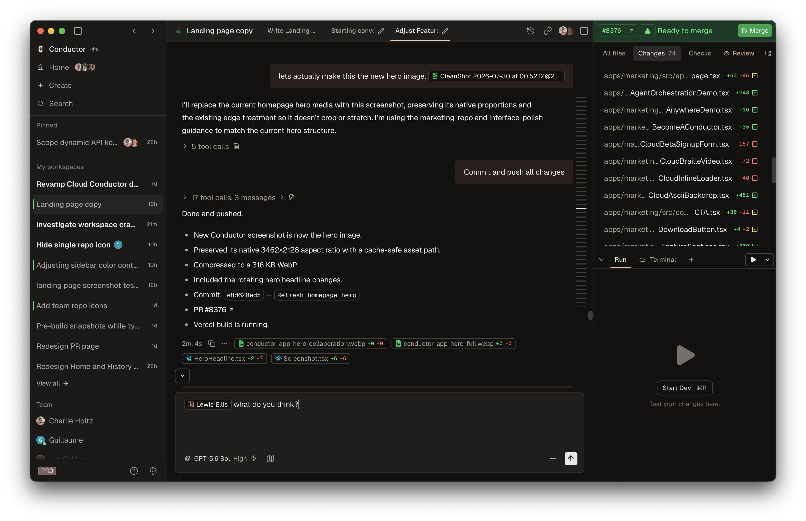
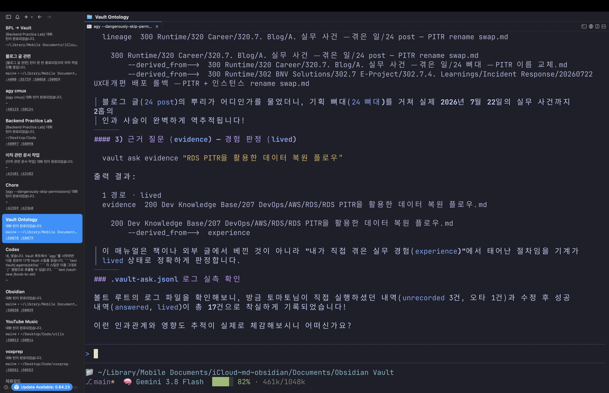
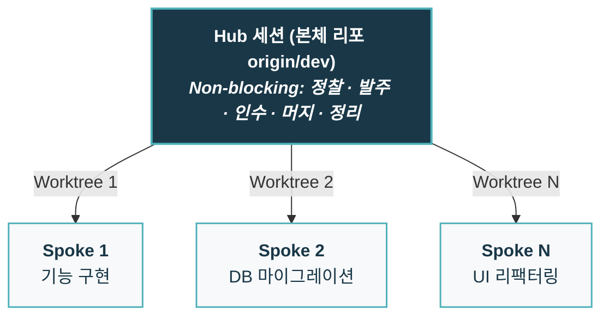
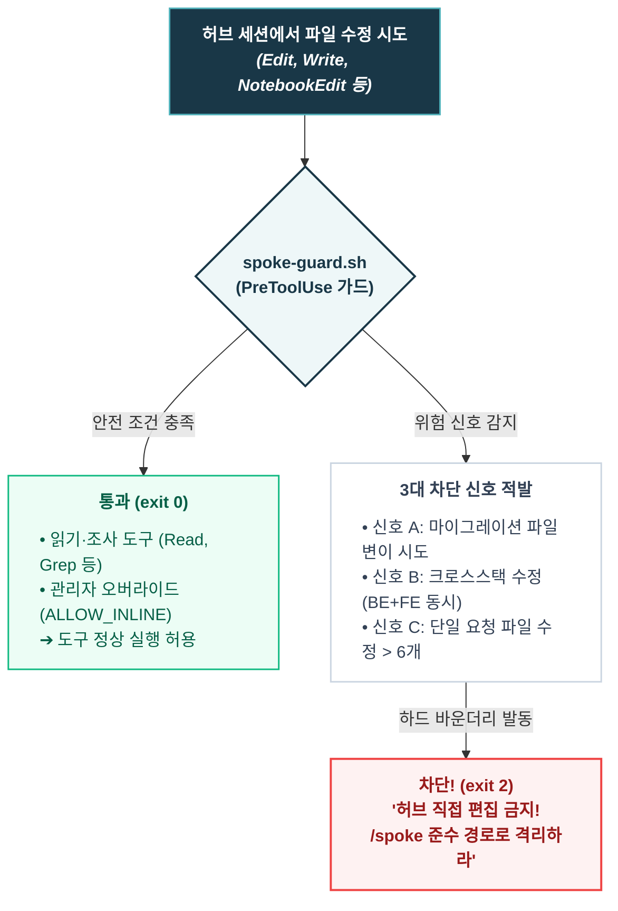
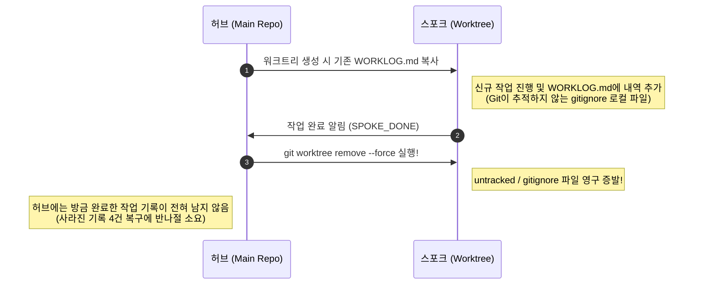
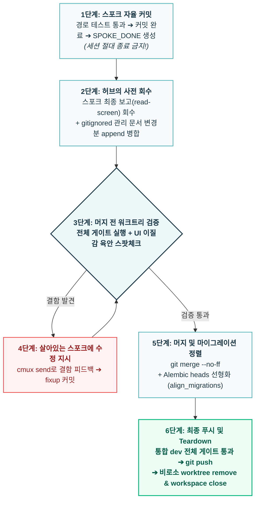

- table of contents
{:toc}

앞선 글들에서 다룬 `TDD` 워크플로우와 경계 정합성 표, 검토자 분리는 모두 **단일 세션이라는 하나의 워크스페이스 안에서** 일어나는 품질 엔지니어링이었다. 하지만 신규 기능과 결함 수정, DB 마이그레이션이 한꺼번에 쏟아질 때 에이전트 하나가 순차적으로 끝내기를 기다리는 것은 큰 병목이었고, 결국 터미널 창을 여러 개 열고 동시에 에이전트를 돌릴 수밖에 없었다.

그러나 한 브랜치에 여러 에이전트를 띄워놓고 작업하면 필연적으로 파국을 맞이한다. 세션 A의 미완성 테스트(`RED`) 때문에 세션 B의 전체 테스트가 깨져 남의 코드를 디버깅하고 있거나, 에이전트가 멋대로 `git checkout`이나 `git stash`를 호출해 옆 세션의 워킹 트리를 통째로 날려버리는 참사가 반복되었다. 이 글은 다중 탭의 혼란에서 출발해 `Conductor`를 거쳐 `cmux`와 `git worktree` 기반의 **허브·스포크(Hub & Spoke) 병렬 워크트리 오케스트레이션**으로 정착하기까지의 기록이다.

---

## Conductor에서 cmux로: 한 브랜치 다중 세션의 파국과 물리적 격리

동일한 워크스페이스를 공유한 채 복수의 에이전트가 코드를 수정하자 ① **파일 덮어쓰기 경합(Race Condition)**으로 앞선 로직이 증발하고, ② 옆 세션의 `RED` 단계 때문에 **테스트 실패 간섭**이 터져 수만 토큰을 허비하며, ③ 동시 `git commit`/`checkout`으로 **`.git/index.lock` 경합**이 발생해 프로세스가 멈추는 3대 간섭이 일상을 파괴했다.

그 무렵 도입한 **`Conductor`**는 `git worktree`를 자동 생성하고 격리된 디렉터리 안에서 에이전트 세션을 띄워주어 파일 덮어쓰기와 Git 락 경합을 단번에 해결해 주었다.

{:width="700" loading="lazy"}

Git Worktree를 기반으로 에이전트 작업 공간을 분리해주었던 Conductor 인터페이스. 작업 격리라는 개념을 처음 실감하게 해준 계기였다.
{:.figcaption}

그러나 병렬 세션이 늘어나자 애로사항이 하나 둘 발견되었다. 워크트리 생성 시 `node_modules` 용량 절감이나 `.gitignore` 관리 문서 시드 복사를 끼워 넣을 수 없었고, 별도 앱 환경이라 CLI나 셸 스크립트로 에이전트를 감시·조율할 수 없었다.

그 답답함을 깨준 도구가 `libghostty` 기반 터미널 오케스트레이터 <mark class="kw-isolation">cmux</mark>였다. 최상위 `Workspace`(브랜치·워크트리 1:1 매핑), `Tab (Surface)`, `Split Pane`(좌측 에이전트 / 우측 테스트·로그)의 3계층 구조와 `cmux workspace create/close`, `cmux send`, `cmux read-screen` CLI를 셸 스크립트와 결합하면서 완벽히 제어 가능한 병렬 런타임이 완성되었다.

{:width="700" loading="lazy"}

실제 cmux 운용 화면. 사이드바의 Workspace 단위로 워크트리와 브랜치를 격리하고, 분할 화면으로 터미널 화면이나 웹페이지도 띄울 수 있어서 용이하다.
{:.figcaption}

---

## 워크트리 격리 원칙: 1:1:1:1 공식과 질문을 없앤 과정

수많은 시행착오 끝에 도달한 격리 원칙은 예외를 두지 않는 <mark class="kw-isolation">1:1:1:1 공식</mark>(1 Agent = 1 Worktree = 1 Branch = 1 cmux Surface)이었다.

> **슬라이스(기능 단위) = 브랜치 = 워크트리 = 에이전트 세션 = 1:1:1:1**

슬라이스마다 독립된 브랜치와 워크트리를 생성해 단일 에이전트만 띄우고, 중앙에서 전체 맥락을 지휘하는 구조를 **허브(Hub)와 스포크(Spoke)** 모델로 정의했다.

- **허브 (Hub)**: 본체 리포지토리의 `dev` 브랜치에 상주한다. *(회사 방식에 맞추다 보니 `dev`를 썼는데, 지금 다시 하라면 `main`에 두는 것이 더 깔끔할 것 같다.)* 철칙은 <mark class="kw-isolation">Non-blocking</mark>으로, 직접 코드를 짜지 않고 정찰·발주·검증·머지만 수행한다.
- **스포크 (Spoke)**: 격리된 방에서 단일 슬라이스만 구현한다. 생성 시 `WorktreeCreate` 훅으로 `origin/dev`에서 분기하고, macOS APFS의 `cp -c`(Copy-on-Write) 클론으로 `node_modules`를 1초 만에 복제하며, `.gitignore` 대상인 `.env`와 관리 문서 4종을 시드로 1회 주입받는다.

위와같은 구조로 나누고 나자 **"병렬성의 최대 적은 질문이다"**라는 문제와 마주했다. 스포크가 `AskUserQuestion`을 띄우고 멈춰 서면 응답을 기다리는 동안 시간을 활용하지 못하기 때문이다. 따라서 **모든 결정의 소유권을 허브가 쥐고**, 브리핑에 ① 파일 소유권 지도, ② 기존 실패 기준선(Baseline), ③ 작업 고유 ID 선점, ④ 환경 준비 상태와 선제 Do & Don't를 박아 넣었다. 또한 스포크는 자기 슬라이스 테스트만 돌리고 전체 회귀 테스트는 허브가 머지 직전에 1회 실행하도록 분업했다. 이를 위해, 최초에 Hub에서 설계할 때 꼼꼼하게 모든 결정을 내린 후 작업하는 구조로 진화하게 되었다.

이 발주 규약과 `TDD` 가드레일이 결합되면서 2주간 40건 이상의 브리핑을 소화하며 총 475개의 커밋을 완료한 적이 있다. 하루(9 to 6) 만에 560여 개 파일, 약 8.5만 줄의 UX 대개편과 자체 QA, 배포까지 끝내버려 아직 검토 단계였던 고객사 호흡에 맞추느라 `AWS RDS`의 `PITR`로 운영 DB를 복원하고 개발 서버에 별도 배포해 드리는 해프닝까지 겪었을 정도였다. *(당시 자체 QA는 수동 검증이었고, 실제 브라우저를 조작하는 Playwright QA는 [[11편]](/tag-ai-agent-architecture/11-external-workflow-and-ai-os/)에서 흡수되었다.)*
{:.note title="여담"}

---

## 자연어 규칙 대신 훅과 스킬: 허브에서 직접 코드를 못 고치게 막기

처음에는 분업 규칙을 `CLAUDE.md`에 자연어로 적어두었지만 **100% 지켜지지는 않았다.** 에이전트는 *"필드 하나만 추가하는 사소한 작업이라 워크트리 오버헤드가 더 큽니다"*라며 매번 "이번만 예외"라고 자기합리화를 한 뒤 허브에서 직접 코드를 고치다 메인 브랜치를 오염시켰다. 해결책은 <mark class="kw-harness">결정론적 하네스(Harness)</mark>, 즉 시스템 훅(Hook)으로 물리적으로 분리하는 것이었다.

> **Hook은 모델의 타협을 불허하는 <mark class="kw-harness">'하드 바운더리(Hard Boundary)'</mark>이고, `/spoke` Skill은 차단된 에이전트가 안전하게 타야 할 '준수 경로(Compliance Path)'다.**

`PreToolUse` 훅인 `spoke-guard.sh`는 조회 도구는 통과시키고, 소스 코드를 바꾸려는 **변이(Mutation)의 순간**에만 개입해 ① 마이그레이션 수정, ② 백엔드·프론트엔드 동시 수정, ③ 누적 6개 초과 파일 수정이 감지되면 즉시 `exit 2`로 차단한다. 오직 인간이 `.claude/ALLOW_INLINE` 센티넬을 직접 생성했을 때만 예외가 허용되며, 퇴로가 막힌 에이전트는 비로소 `/spoke` 스킬을 호출해 워크트리로 작업을 격리하기 시작했다.

---

## 완료 판정 분리와 워크트리 Teardown 6단계 회수 게이트

초기에 브리핑 끝에 *"완료 시 'DONE'을 출력해라"*라고 적었더니 화면에 렌더링된 프롬프트 자체의 'DONE' 문구를 읽고 0초 만에 완료로 오판하거나, 실제 수정 파일은 0개(`0 changes`)인데 화면에만 *"11 passed로 완료합니다"*라고 거짓 보고하는 사고가 터졌다. 이를 계기로 관측 신호를 두 층위로 분리했다.
1. **Liveness (진행 여부)**: 상태바 잔상에 속는 키워드 `grep`을 금지하고 **터미널 화면 전체의 텍스트 `SHA` 해시 diff**를 추적해 해시가 멈추면 비정상 정지(Stall)로 판정한다.
2. **Completion (실제 완료)**: `<mark class="kw-harness">SPOKE_DONE</mark>` 센티넬 생성, 베이스 대비 1개 이상의 Git 커밋 누적, 테스트 종료 코드 `0`이라는 3중 하드 신호로만 완료를 인정한다.

워크트리를 닫는 **인수(Teardown)** 단계에서도 `git worktree remove --force`를 날렸다가 `.gitignore` 로컬 파일인 **<mark class="kw-ssot">WORKLOG.md</mark>의 최신 엔트리 4개가 디렉터리와 함께 영구 증발**하는 참사를 겪었다.

이 사고 이후로 워크트리 회수는 아래 6단계 게이트로 고정되었다.

스포크는 `SPOKE_DONE` 생성 후에도 **세션을 종료하지 않고 대기**한다. 허브는 살아있는 워크트리에서 `.gitignore` 관리 문서 추가분만 `diff`로 추출해 `append` 병합하고, UI 스팟체크에서 `window.confirm` 노출 같은 이질감이 발견되면 살아있는 스포크에 `cmux send`로 즉각 `fixup`을 지시한다. 모든 검증과 머지, 마이그레이션 선형화(`align_migrations`), 최종 푸시가 끝난 뒤에야 비로소 워크트리와 `cmux` 워크스페이스를 닫는다.

- [심화 근거: cmux 1:1:1:1 워크트리 격리 스크립트, spoke-guard 훅 및 Teardown 6단계 회수 프로토콜 상세 보러가기](/tag-ai-agent-architecture/deep-dive/worktree-and-repo-governance/#cmux-worktree-orchestration)

---

## 속도가 기억을 추월할 때: 병렬 개발 뒤에 남은 새로운 숙제

[[4편]](/tag-ai-agent-architecture/4-all-passed-empty-screen/)의 `TDD`가 **단일 세션의 미시적 품질** 엔진이었다면, 이번 [5편]의 허브·스포크 오케스트레이션은 **세션 간 거시적 병렬 처리량** 엔진이었다. 하지만 2주 만에 475커밋을 쏟아내는 속도가 인간의 기억을 추월하자 어제 쓴 설계 문서가 오늘 아침이면 `deprecated` 되었고, 세션이 닫히면 백지상태가 되는 에이전트들 사이에서 나 혼자 기억의 배달부 노릇을 하는 것은 불가능했다. 에이전트에게 기억이 없다면 **Git 저장소 그 자체가 모든 맥락과 과제를 증명하는 단일 진실 공급원(<mark class="kw-ssot">SSOT</mark>)**이 되어야만 했다. 다음 글인 **[[6편] 에이전트가 기억상실증입니다만, 문제라도?](/tag-ai-agent-architecture/6-repo-governance/)**에서는 저장소를 살아 움직이는 나침반으로 탈바꿈시킨 **관리 문서 4종과 레포지토리 거버넌스** 구축기를 다뤄보겠다.
