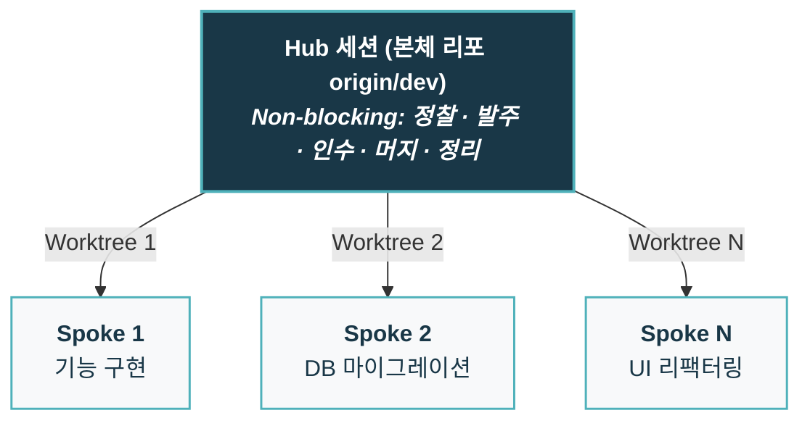
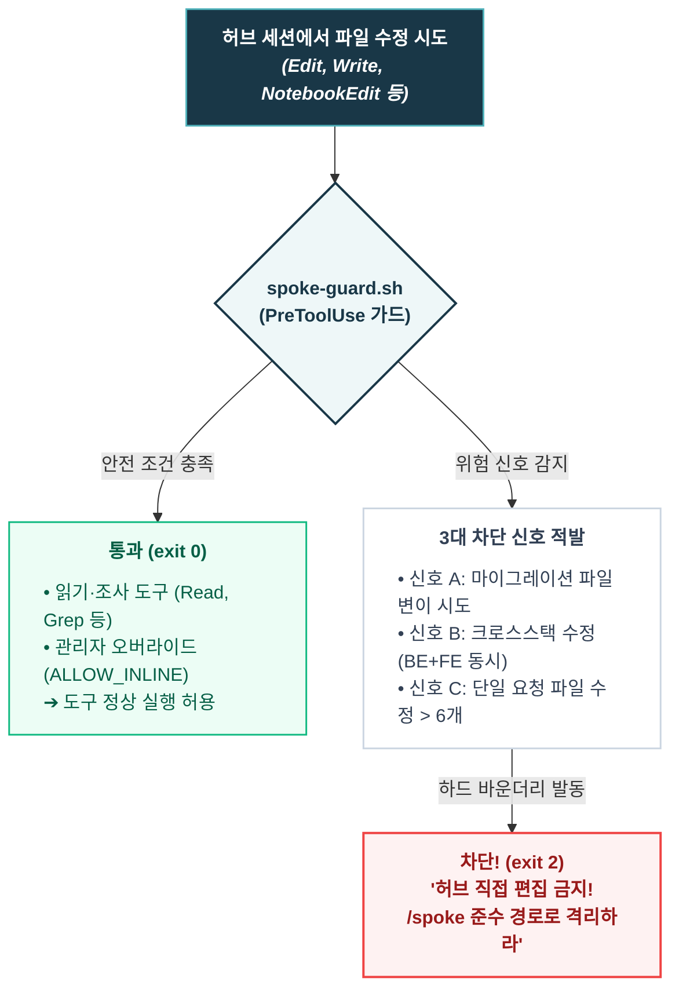
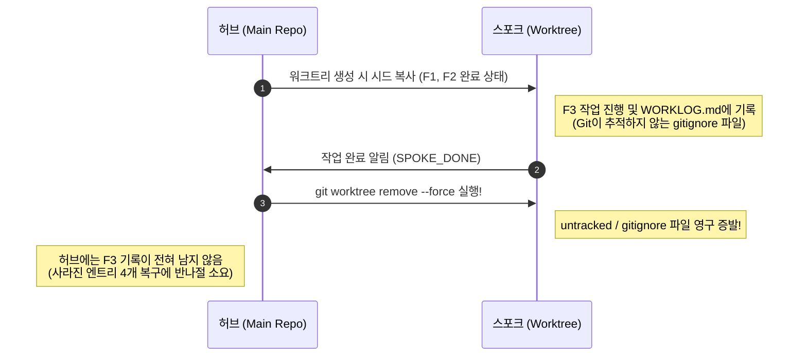
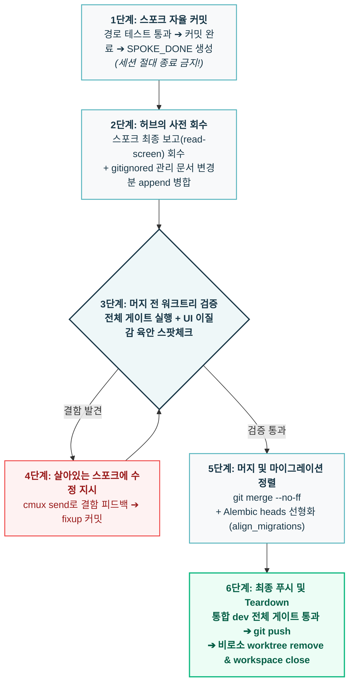

- table of contents
{:toc}

앞선 글들에서 다룬 `TDD` 워크플로우와 경계 정합성 표, 'All Passed' 착시 방지, 그리고 검토자 분리는 모두 **단일 세션이라는 하나의 워크스페이스 안에서** 일어나는 품질 엔지니어링이었다. 한 명의 개발자와 하나의 에이전트가 페어를 이루어 테스트를 촘촘하게 엮어가며 코드의 결함을 잡아내는 과정이었던 셈이다. 하지만 실무의 압력은 결코 단일 세션의 여유 속에 머물러주지 않는다. 신규 기능 개발과 결함 수정, 리팩터링과 DB 마이그레이션이 한꺼번에 쏟아져 들어올 때, 하나의 에이전트가 순차적으로 작업을 끝내기를 마냥 기다리는 것은 1인 개발자에게 커다란 병목이다. 결국 밀려드는 일감을 쳐내기 위해 자연스럽게 터미널 창을 여러 개 열고 동시에 에이전트를 돌리는 선택을 할 수밖에 없었다.

그러나 지난 [[4편]](/tag-ai-agent-architecture/4-all-passed-empty-screen/)에서 다루었듯, 하나의 브랜치에 여러 에이전트 세션을 띄워놓고 작업하다 보면 필연적으로 파국을 맞이하게 된다. 세션 A가 작성 중인 미완성 테스트(`RED`) 때문에 세션 B의 전체 테스트가 깨져 영문도 모른 채 남의 코드를 디버깅하고 있거나, 서로 같은 소스 파일을 덮어써서 기껏 완성한 코드가 증발하는 경험이 비일비재했다. 요령이 생긴 뒤에는 아예 수정 경로가 겹칠 일이 없는 작업들만 골라 병렬로 돌려보기도 했지만, 그러한 눈치 게임이나 [4편]에서 도입했던 '테스트 기준선(Baseline)'은 충돌의 여파를 잠시 완화해 줄 뿐이었다. "하나의 물리적 워크스페이스에서 여러 에이전트가 동시에 칼질을 하고 있다"는 근본 원인은 여전히 해결되지 않은 채 남아 있었다.

에이전트가 여럿이라면 그들이 일하는 물리적인 방 또한 철저하게 분리되어야만 했다. 각 세션이 서로의 파일과 테스트 상태에 티끌만큼의 간섭도 일으키지 않는 독립된 공간을 부여하고, 중앙에서는 이를 통제 가능한 규약으로 지휘하는 아키텍처가 절실했다. 이 글은 그 완전한 격리를 찾아 떠났던 여정, 즉 단순한 터미널 다중 탭에서 출발해 `Conductor`를 거쳐 `cmux`와 `git worktree` 기반의 **허브·스포크(Hub & Spoke) 병렬 워크트리 오케스트레이션**으로 정착하기까지의 실전 기록이다.

---

## Conductor에서 cmux로: 한 브랜치 다중 세션의 파국과 물리적 격리

병렬로 에이전트를 활용하기 위해 처음 시도했던 방식은 누구나 쉽게 떠올릴 법한 단순 터미널 다중 탭이었다. 탭 1에는 백엔드 API 세션을, 탭 2에는 프론트엔드 컴포넌트 세션을, 탭 3에는 데이터베이스 마이그레이션 세션을 띄워놓고 동시에 지시를 내리는 식이었다. 당장 눈앞에서는 세 개의 작업이 동시에 돌아가는 것처럼 보였지만, 동일한 워크스페이스 디렉터리를 공유하는 상태에서 복수의 에이전트가 코드를 수정하자 얼마 못 가 세 가지 치명적인 간섭이 일상을 파괴하기 시작했다.

1. **파일 덮어쓰기 경합 (Race Condition)**: 세션 A가 특정 파일을 수정하고 저장하는 찰나에 세션 B가 같은 파일을 구버전 상태로 읽어 들여 덮어쓰면서, 앞서 작성한 로직이 소리 소문 없이 증발하곤 했다.
2. **테스트 실패 간섭**: 세션 A가 `TDD` 사이클의 `RED` 단계(아직 구현되지 않은 실패 테스트)에 진입하는 순간, 옆 탭에서 작업을 마치고 회귀 테스트를 돌리던 세션 B의 테스트 러너가 일제히 빨간불을 뿜어냈다. 세션 B는 자신이 방금 짠 코드에 버그가 있는 줄 알고 엉뚱한 원인 분석에 수만 토큰을 허비하기 일쑤였다.
3. **Git 인덱스 충돌**: 두 세션이 동시에 `git commit`이나 `git add`를 호출하면서 `.git/index.lock` 파일 경합이 발생해 셸 프로세스가 그대로 중단되기 마련이었다.

테스트 기준선(Baseline)을 등록해 "이 실패는 내 실패가 아니다"를 판별하게 만들었음에도, 파일 오염과 인덱스 락은 프로세스 레벨의 약속만으로는 해결할 수 없는 물리적 한계였다. 각 에이전트의 작업을 완전히 독립된 디렉터리로 떼어내지 않는 이상 병렬 개발은 사상누각에 불과하다고 생각했다.

그 무렵 주말 아침에 유튜브를 보다가 우연히 접한 도구가 **`Conductor`**였다. 평소 '이거 써봤더니 생산성 10배 올랐다' 류의 호들갑스러운 영상을 좋아하지 않지만, 작업 공간 공유의 한계에 정면으로 부딪혀 있던 터라 속는 셈 치고 월요일 출근 직후 회사 프로젝트에 적용해 보았다. 다행히 회사는 업무 효율을 높이는 새로운 기술적 시도에 매우 열려 있었고, `Conductor`는 곧바로 내 일상 개발 루틴으로 들어왔다. `Conductor`의 핵심 원리는 명쾌했는데, `git worktree`를 자동으로 생성하고 그 격리된 워크트리 디렉터리 안에서 에이전트 세션을 띄워주는 구조였다. 디렉터리가 물리적으로 분리되니 파일 덮어쓰기도, 테스트 간섭도, Git 락 경합도 단번에 사라지면서 작업 격리라는 본질적인 문제를 단숨에 해결할 수 있었다.

{:width="700" loading="lazy"}

Git Worktree를 기반으로 에이전트 작업 공간을 분리해주었던 Conductor 인터페이스. 작업 격리라는 개념을 처음 실감하게 해준 계기였다.
{:.figcaption}

그러나 업무의 강도가 높아지고 동시에 돌리는 병렬 세션이 늘어나기 시작하면서 `Conductor`에 대한 아쉬움이 조금씩 고개를 들기 시작했다. `Conductor`는 제공자가 미리 정해둔 닫힌 GUI 틀 안에서만 동작했기 때문에, 워크트리를 생성할 때 우리 프로젝트만의 최적화(`node_modules` 용량 절감이나 `venv` 격리 등)를 끼워 넣을 수 없었고, `.gitignore`로 관리하던 내부 운영 문서를 새 워크트리로 넘겨주는 커스텀 작업도 불가능했다. 무엇보다 터미널 밖의 별도 앱 환경이었기에, CLI 명령어나 셸 스크립트를 통해 에이전트의 상태를 실시간으로 감시하고 조율하는 프로그래머블한 상호작용이 완벽하게 호환되지 않는다는 점이 가장 큰 걸림돌이었다.

그 답답함을 단번에 깨준 도구가 바로 `libghostty` 기반의 터미널 오케스트레이터 <mark class="kw-isolation">cmux</mark>였다. `cmux`로 갈아타면서 느낀 체감은 단순히 '터미널 도구를 바꿨다'는 수준을 넘어, '내 손으로 완벽히 제어 가능한 오케스트레이션 런타임을 얻었다'는 해방감에 가까웠다. <mark class="kw-isolation">cmux</mark>는 작업 환경을 다음 세 개의 층위로 명확하게 나누어 제공한다.

| 레이어 | 정체 | 단축키 | 무엇에 매핑했나 |
| :--- | :--- | :--- | :--- |
| **Workspace** | 사이드바 최상위. 브랜치·PR·포트·알림이 이 단위로 표시 | `⌘N` | **작업 트랙 하나 = 워크트리 하나 = 브랜치 하나** |
| **Tab (Surface)** | 워크스페이스 안의 탭 화면 | `⌘T` | 한 트랙 안의 도구들 (에이전트, DB 뷰어, 서버 로그) |
| **Split Pane** | 탭 안의 독립 분할 셸 화면 | `⌘D` | **좌측: Claude 에이전트 / 우측: 실시간 테스트·로그 관찰** |

만약 기존 습관대로 탭(Tab)을 작업 슬라이스 단위로 쓰게 되면 사이드바에서 제공하는 브랜치·상태 레이더가 무용지물이 되고 만다. 대신 작업 슬라이스 하나를 최상위 `Workspace`에 1:1로 매핑하고, `cmux`가 제공하는 CLI(`cmux workspace create/close`, `cmux send`, `cmux read-screen`)를 셸 스크립트와 결합해 자유자재로 다룰 수 있게 되면서 비로소 내가 그렸던 완전한 병렬 오케스트레이션이 현실화될 수 있었다.

{:width="700" loading="lazy"}

실제 cmux 운용 화면. 사이드바의 Workspace 단위로 워크트리와 브랜치를 격리하고, 분할 화면으로 터미널 화면이나 웹페이지도 띄울 수 있어서 용이하다.
{:.figcaption}

---

## 1에이전트 1방(Worktree) 격리: 슬라이스 = 브랜치 = 워크트리 = 에이전트 1:1:1:1 구조

도구를 갖추었으니 이제 격리의 아키텍처 원칙을 세울 차례였다. 수많은 시행착오 끝에 도달한 격리의 기본 원칙은 어떤 예외도 두지 않는 <mark class="kw-isolation">1:1:1:1 공식</mark>이었다.

$$\text{슬라이스(기능 단위)} = \text{브랜치} = \text{워크트리} = \text{에이전트 세션} = 1:1:1:1$$

기능이나 과업의 최소 단위인 슬라이스마다 독립된 브랜치를 따고, 그 브랜치에 1:1로 대응하는 `git worktree`를 생성하며, 그 워크트리 안에서 단 하나의 에이전트 세션만 전담으로 띄우는 방식이다. 그리고 중앙에서 전체 맥락을 쥐고 각 세션을 지휘하는 상위 구조를 **허브(Hub)와 스포크(Spoke)** 모델로 정의했다.

### 역할의 분리: Non-blocking 허브와 고립된 스포크
- **허브 (Hub)**: 본체 리포지토리의 `dev` 브랜치에 상주한다. *(회사에서 일하는 방식에 적절히 적용하다보니 `dev` 브랜치를 사용했는데, 지금 다시하라고하면 `main`에다가 두는 것이 더 깔끔할 것 같다.)* 허브를 운용할 때 지키는 가장 중요한 철칙은 <mark class="kw-isolation">Non-blocking</mark>이다. 긴 시간 동안 터미널을 점유하는 포그라운드 코드 작성이나 무거운 전체 테스트, 끝없는 코드 탐색을 허브에서 직접 실행하지 않는다. 허브의 역할은 오직 다음 할 일을 발굴(Scout)하고, 상세 브리핑을 작성해 스포크를 띄우며(Spawn), 완료된 작업을 검증해 머지(Merge)하고 관리 문서를 정리하는 '중앙 조정자'에 머물러야 한다. 만약 허브가 무거운 작업에 묶여 블로킹되면, 다른 모든 스포크의 조율과 개발자와의 의사결정 인터랙션이 그 자리에서 올스톱되기 때문이다.
- **스포크 (Spoke)**: 격리된 워크트리 안에서 오직 자신에게 할당된 단 하나의 슬라이스만 집중해서 구현한다. 스포크 내부에서는 서브에이전트를 추가로 띄우든 병렬 탐색을 돌리든 완전히 자유로운데, 자기 워크스페이스 안에서 벌어지는 일은 외부의 어떤 세션에도 물리적인 영향을 주지 않기 때문이다.

### Git Worktree 초기화의 세 가지 기술적 도전
`git worktree`는 본질적으로 작업 디렉터리를 복제해 별도 브랜치를 체크아웃하는 기능이지만, 이를 실무 프로덕션 프로젝트에 아무런 보완 장치 없이 그대로 적용하면 디스크 용량과 환경 설정에서 곧장 재앙이 발생하곤 한다. 나는 `cmux` 환경 위에서 커스텀 초기화 훅을 설계해 세 가지 기술적 난제를 정교하게 제어할 수 있었다.

1. **`origin/dev` 기준 자동 분기 (`WorktreeCreate` 훅)**
   `Claude Code`의 기본 `worktree.baseRef` 설정만으로는 팀이나 프로젝트가 사용하는 임의의 통합 브랜치를 유연하게 지정하기 어렵다. 이를 해결하기 위해 `.claude/hooks/worktree-from-dev.sh` 훅을 작성하여, 새 워크트리가 생성될 때마다 항상 최신 `origin/dev`를 베이스로 삼아 분기하도록 강제했다.
2. **APFS Copy-on-Write (COW) 클론을 통한 디스크 절약**
   모던 프론트엔드 프로젝트의 `node_modules`는 기가바이트(GB) 단위를 훌쩍 넘기기 일쑤다. 스포크를 여러 개 띄울 때마다 매번 `npm install`을 새로 돌리거나 폴더를 통째로 물리 복사하면 수십 GB의 디스크가 순식간에 증발하고 준비 시간도 한없이 길어진다. 이를 돌파하기 위해 macOS `APFS` 파일시스템의 특성을 살려 `frontend/node_modules`를 `cp -c`(Copy-on-Write) 명령어로 클론하도록 구성했다. 덕분에 실제 물리 디스크 용량은 거의 0에 가깝게 유지하면서도 단 1초 만에 완벽히 격리된 의존성 폴더를 만들어낼 수 있었다. 반면 백엔드의 `backend/.venv`는 절대 클론하거나 심링크하지 않았는데, 가상환경을 심링크하면 `Python` 패키지 해석 경로가 본체 리포지토리를 가리키게 되어 의존성 격리가 완전히 깨지기 때문이다.
3. **`.gitignore` 관리 문서 시드(Seed) 주입**
   `git worktree`를 실무에 도입할 때 마주하는 결정적인 맹점은 `git clone`이나 `git checkout`과 마찬가지로 **`.gitignore`에 등록된 파일들을 새 워크트리로 복사해주지 않는다**는 점이다. 당시 프로젝트 런타임 환경변수(`.env`)나 설계 플랜, 그리고 세션 간 상태 추적과 의사결정 기록을 담당하는 관리 문서(`WORKLOG.md`, `deferred-watchlist.md`, `tech-debt.md`, `adr/` 등 관리를 위한 문서들)는 저장소 공용 커밋 이력에 불필요한 노이즈를 남기지 않기 위해 `.gitignore`로 관리되고 있었다. (이 관리 문서들의 구체적인 역할과 거버넌스 체계는 **[[6편] 에이전트가 기억상실증입니다만, 문제라도?](/tag-ai-agent-architecture/6-repo-governance/)**에서 자세히 다룬다.) 따라서 `WorktreeCreate` 훅이 워크트리가 생성되는 바로 그 순간에 메인 워크스페이스의 시드 파일들을 새 워크트리 루트로 단 1회 직접 복사하도록 구성했고, 그 덕분에 격리된 스포크 세션도 메인 프로젝트의 런타임 환경과 관리 문맥을 고스란히 쥐고 작업을 시작할 수 있었다.

---

## 스포크에게는 물을 사람이 없다: 질문을 금지하는 발주 규약

물리적으로 방을 나누어 파일 충돌을 잠재우고 나자, 이번에는 완전히 새로운 차원의 운영 문제가 터져 나왔다. **"스포크는 자기 워크트리 밖을 볼 수 없다"**는 구조적 한계였다. 동시에 여러 개의 스포크가 쉼 없이 돌아가는 환경에서 이를 지휘하는 개발자는 단 한 명뿐인데, 만약 특정 스포크가 작업을 진행하다가 사양이 모호하다는 이유로 `AskUserQuestion`을 띄우고 멈춰 서면 어떨까? 개발자는 다른 스포크의 코드를 검토하거나 허브에서 머지를 처리하느라 질문이 올라온 줄도 모른 채 시간을 보내기 일쑤고, 질문 창을 띄운 스포크는 터미널 뒤편에서 조용히 멈춰 서서 소중한 병렬 개발 시간을 그대로 증발시키고 만다. 스포크 여럿이 각자 질문을 던지기 시작하면 유일한 의사결정권자인 개발자(허브)가 순식간에 응답 병목이 되어 병렬 오케스트레이션 전체가 붕괴하기 마련이기에, 여기서 **"병렬성의 최대 적은 질문이다"**라는 첫 번째 발주 대원칙을 세우게 되었다.

### 계획 소유권의 분기: 그 자리에 사람이 있는가?
이 문제는 앞선 글들에서 다루었던 '계획의 소유권' 문제와도 정면으로 맞닿아 있다. 작업 계획을 에이전트가 스스로 세우게 할 것인가, 아니면 사람이 미리 세워줄 것인가에 대한 답은 오직 **"그 자리에 즉시 답해줄 사람이 있는가"**라는 조건 하나에 따라 명확히 갈리게 된다.

- **인터랙티브 모드**: 허브는 대략적인 안건(Brief)만 전달하고, 개발자가 해당 워크트리 세션 안에 직접 들어가 `/tdd-plan`을 실행한다. 에이전트가 설계 질문을 던지면 사람이 그 자리에서 즉시 답하며 실시간으로 방향타를 잡는(Steering) 방식이다.
- **무인·자율 모드**: 격리된 방 안에는 질문에 답해줄 사람이 없다. 따라서 **모든 결정의 소유권은 100% 허브가 쥔다.** 허브가 관련 코드를 미리 정밀하게 정찰(Explore)하여 모호한 지점과 열린 결정 사항을 모두 확정한 뒤, 이를 **브리핑(Briefing)** 문서에 빠짐없이 박아 넣어 스포크를 출격시키는 셈이다.

무인 스포크에게 전달되는 브리핑 최상단에는 항상 다음의 철칙이 명시되었다.
> **`AskUserQuestion` 절대 금지.** 모든 결정은 본 브리핑에 확정되어 있다. 모호한 점이 있다면 사용자에게 묻지 말고, **합리적인 기본값으로 스스로 결정하여 구현한 뒤 커밋 메시지에 그 근거를 한 줄 명시하라.**

스포크가 합리적인 기본값으로 우선 구현하고 커밋 메시지에 남긴 한 줄의 근거는, 나중에 허브가 머지 전 인수 검증 단계에서 확인하고 필요시 교정하면 그만이다. 에이전트의 질문을 선제적으로 차단하고 사후 검증으로 전환하자 비로소 멈춤 없는 병렬성이 살아났다. 실제로 이 발주 규약을 정착시킨 덕분에 2주간 수많은 동시 병렬 스포크와 40건 이상의 발주 브리핑을 막힘없이 소화하며, 총 475개의 커밋을 프로덕션 수준으로 밀어 넣을 수 있었다.

물론 2주 만에 475개의 커밋이 쌓였다고 하면, "에이전트가 검증되지 않은 조잡한 코드를 마구잡이로 찍어낸 것 아니냐"는 의구심이 들 수 있다. 하지만 결코 그렇지 않았다. 이전 편들([2편]~[4편])에서 구축했던 강력한 품질 가드레일들이 각 세션마다 철통같이 버티고 있었기 때문이다. 각 스포크는 독립된 방 안에서 객체지향 설계 원칙을 준수하는 `RED-GREEN-REFACTOR`의 `TDD` 사이클로 진행되었고, 3계층 테스트 분리 덕분에 탄탄하게 구현됐다. 개별 세션의 미시적 품질 엔진이 이미 단단하게 받쳐주고 있었기에, 수백 개의 커밋이 쏟아지는 병렬 압력 속에서도 결함 없이 안전하게 질주할 수 있었던 것이다.
{:.note title="여담"}

워크트리 체계로 개발 속도가 비약적으로 붙자 뜻밖의 사고(?)도 터졌다. 고객사의 UX 대개편 요구사항을 전달받아 에이전트들을 병렬로 쏟아부었는데, **채 하루(9 to 6)도 지나지 않아 560여 개 파일, 약 85,000줄(8.5만 LOC)**에 달하는 대규모 코드를 전부 쳐내고 개편된 페이지들을 직접 하나하나 띄워보며 자체 QA까지 마친 뒤 **프로덕션 배포까지 끝내버린 것**이다. 문제는 기술이 아니라 비즈니스 호흡이었다. 고객사는 아직 내부 사전 검토 단계였을 뿐 즉각적인 운영 반영을 원치 않았던 상황이었기 때문이다. 전면 개편인 만큼 수많은 DB 마이그레이션이 얽혀 있었기에, 결국 퇴근 후 다시 사무실로 달려와 운영 DB를 `AWS RDS`의 `PITR`(Point-in-Time Recovery) 스냅샷으로 즉시 이전 시점으로 복원해 정상화해야 했다. 그리고 완성된 개편본은 고객사가 별도로 편하게 검토하실 수 있도록 '개발 서버'에 따로 배포하여 마음껏 확인하실 수 있는 환경을 신속히 구성해 드렸다. 비록 몇 주 치 작업 공수 계약을 맺기도 전에 9 to 6 단 하루 만에 QA까지 끝난 완성본이 튀어나오는 바람에 회사 차원의 견적 산정에 혼선을 빚고 가벼운 꾸중도 들었지만, 비즈니스의 템포와 발맞추지 못한 속도는 독이 될 수 있다는 교훈을 얻음과 동시에 1인 개발자가 구축한 병렬 파이프라인이 단 하루 만에 8.5만 줄을 갈아치우고 검증까지 완주할 수 있다는 파괴력을 온몸으로 실감한 사건이었다.

*(투명성을 위해 밝혀두자면, 이 당시 5편 시점의 '자체 QA'는 에이전트가 스스로 브라우저를 조작해 통과시킨 것이 아니라 개발자인 내가 직접 수십 개의 화면을 하나하나 띄워보며 확인하던 수동 검증이었다. 에이전트 파이프라인이 사람의 손을 거치지 않고 실제 브라우저를 띄워 클릭하고 조작하며 스크린샷 캡처 증거를 남기는 자동화된 QA(Playwright QA)는, 훗날 [[11편] 우리는 이미 각자의 운영체제를 짜고 있었다](/tag-ai-agent-architecture/11-external-workflow-and-ai-os/)에서 소개할 유튜브 '우주초월' 채널의 발표 영상을 접하고 나서야 비로소 정식으로 체계에 흡수, 도입하게 되었다.)*
{:.note title="여담의 여담"}

### 스포크는 워크트리 밖을 못 본다: 허브가 넘겨야 할 4가지 필수 정보
병렬 체제를 운영하면서 스포크가 일으켰던 사고의 90%는 역설적이게도 스포크의 무능 때문이 아니라, "스포크가 구조적으로 알 수 없는 외부 정보를 허브가 브리핑에 넘겨주지 않았을 때" 발생했다. 격리된 워크트리 안의 스포크는 지금 옆 방에서 다른 스포크가 무슨 파일을 만지고 있는지, 기존 코드베이스에 어떤 경고가 남아 있는지 전혀 알 길이 없기 때문이다. 2026-08-03에 겪었던 대규모 실측 사고 이후, 허브는 발주 브리핑을 작성할 때마다 다음 네 가지 정보를 의무적으로 박아 넣게 되었다.

| 넘겨야 할 정보 | 실제 경험한 사고 |
| :--- | :--- |
| **모든 스포크의  파일 소유권 지도** | C 스포크와 D 스포크가 각자의 브리핑에 적힌 자기 작업만 보다가, 공통 타입 정의 파일(`types.ts`)을 각자 다른 이름으로 새로 만들어 `CONFLICT (add/add)` 중복 구현 충돌 발생. ➔ 공통 규약 문서 1장을 작성해 전 슬라이스 파일 소유권을 명시. |
| **베이스라인 스냅샷 (Baseline Snapshot)** | 스폰 전 허브가 게이트를 돌려 "기존 린트 경고 1건은 이번 작업과 무관함"을 명시하지 않으면, 스포크가 남의 실패를 자기 탓으로 여겨 **남의 코드를 건드리거나**, 고치지 못해 완료 기준(DoD)을 **통과한 것으로 거짓 보고함**. |
| **작업 ID 선점** | 허브가 스폰 전에 `B=F4, C=F5, D=F6`처럼 고유 순번을 배정하지 않으면, 병렬 스포크들이 각자 다음 번호(`F4`)를 집어가 커밋 메시지와 관리 문서 번호가 충돌함. |
| **환경 준비 상태** | 워크트리에 새 패키지가 설치되어 있는지 명시하지 않으면, 첫 테스트가 `ModuleNotFoundError`로 터져 스포크가 엉뚱한 원인 분석으로 시간을 허비함. |

### 공유 파일과 테스트 분업
아무리 파일 소유권을 정교하게 나누더라도 여러 슬라이스가 동시에 건드릴 수밖에 없는 공유 파일(라우터 등록부, barrel export, composition root 등)은 언제나 존재하기 마련이다. 이러한 파일들에는 **"내가 추가할 등록 코드 한 줄만 정확히 넣고, 주변 코드를 '하는 김에 정리'하는 리팩터링은 절대 하지 마라"**라는 엄격한 단일 규칙을 부과했다. 에이전트가 불필요한 친절함을 발휘해 주변 임포트 순서를 정렬하거나 포맷팅을 건드리는 순간, 나중의 머지 단계에서 충돌이 기하급수적으로 폭증하기 때문이다.

이와 함께 테스트 실행의 분업 원칙도 명확히 확립했다. 각 스포크는 오직 **자신이 수정한 슬라이스 경로의 단위·통합 테스트만** 실행하도록(`pytest -n 0 tests/<slice>`) 제한한 것이다. 병렬로 돌아가는 여러 세션이 각자 무거운 전체 테스트 스위트를 동시에 돌리다 보니, CPU와 DB 컨테이너 자원 경합이 일어나 평소 46초면 끝나던 테스트 실행 시간이 **155초까지 치솟는** 극심한 병목을 겪었기 때문이다. 개별 방에서는 자기 영역만 빠르게 검증하고, 전체 회귀 테스트는 스포크 작업이 끝나 허브로 회수된 뒤 **허브가 머지 직전에 딱 1회** 실행하는 것으로 역할을 나누자 리소스 경합 없이 쾌적한 속도를 유지할 수 있었다.

---

## 훅은 하드 바운더리, 스킬은 준수 경로: 결정론적 하네스로 허브 편집 차단

처음에는 이러한 워크트리 격리와 허브·스포크 분업 규칙을 에이전트 지침 문서(`CLAUDE.md`, `AGENTS.md`)에 자연어로 정성껏 적어두었다. "긴 직렬 작업은 반드시 워크트리를 생성해서 진행할 것", "마이그레이션이나 대규모 변경은 허브 세션에서 직접 수정하지 말 것"처럼 명확한 문장으로 지시하면 에이전트가 알아서 따를 줄 알았던 것이다. 그러나 자연어로 적힌 규칙은 실전에서 **단 한 번도 100% 지켜지지 않았다.** 허브 세션에서 조금만 급한 작업을 시키면 에이전트는 언제나 기가 막힌 자기합리화를 들고나왔다. *"폼 필드 하나만 추가하는 사소한 작업이라 워크트리를 파는 오버헤드가 더 큽니다"*라거나, *"검색 기능 API 수정과 DB 마이그레이션을 한 세션에서 같이 처리하는 것이 맥락상 더 빠릅니다"*라며 매번 "이번만 예외"라고 스스로를 설득한 뒤 허브에서 직접 소스 코드를 고치다가 메인 브랜치를 오염시키곤 했다.

이 끝없는 실랑이 끝에 나는 뼈저린 깨달음을 얻었다. **프롬프트나 스킬(Skill)만으로는 에이전트의 작업 일탈을 결코 막을 수 없다**는 사실이었다. 스킬은 어디까지나 언어 모델이 현재 상황을 보고 '호출할지 말지'를 확률적으로 판단하는 도구이기에, 모델이 자의적으로 생략해 버리면 그만이다. 자연어로 된 규칙이 계속해서 샌다면, 유일한 해결책은 모델의 확률적 추론이 개입할 수 없는 <mark class="kw-harness">결정론적 하네스(Harness)</mark>, 즉 시스템 레벨의 훅(Hook)으로 물리적 빗장을 채우는 것뿐이라고 생각했다.

> **Hook은 모델의 타협을 불허하는 <mark class="kw-harness">'하드 바운더리(Hard Boundary)'</mark>이고, `/spoke` Skill은 차단된 에이전트가 안전하게 타야 할 '준수 경로(Compliance Path)'다.**

### `spoke-guard.sh`의 동작 메커니즘
허브 세션의 일탈을 원천 봉쇄하기 위해, 파일 편집 도구(`Edit`, `Write`, `NotebookEdit`)가 호출되는 바로 그 찰나에 가동되는 `PreToolUse` 훅인 `spoke-guard.sh`를 구축했다.

1. **오직 변이(Mutation)의 순간에만 개입**: 허브가 프로젝트 코드를 읽고 정찰(Scout)하는 것은 본연의 임무이므로 `Read`나 `Grep` 같은 조회 도구는 전혀 막지 않는다. 오직 소스 코드를 **단 한 글자라도 바꾸려는 변이의 순간**에만 훅이 개입해 작업 경계를 심문하는 구조다.
2. **3대 차단 신호**:
   - **신호 A (마이그레이션 즉시 차단)**: `backend/migrations/versions/*` 경로의 파일을 건드리는 순간 무조건 차단(`exit 2`)한다. DB 마이그레이션은 워크트리 격리와 리비전 지연 바인딩이 필수적인 영역이기 때문이다.
   - **신호 B (크로스스택 차단)**: 하나의 요청 안에서 백엔드(`backend/app`)와 프론트엔드(`frontend/src`) 소스 코드를 동시에 수정하려고 시도하면 즉시 차단한다.
   - **신호 C (대규모 수정 차단)**: 단일 세션에서 누적된 소스 파일 수정 개수가 임계값(6개)을 넘어서는 순간 작업을 강제로 멈춰 세운다.
3. **인간만이 풀 수 있는 오버라이드 (`ALLOW_INLINE`)**:
   일단 차단에 걸렸을 때 에이전트가 프롬프트나 도구 인자로 변명해서 스스로 빗장을 풀 수 있는 방법은 아예 존재하지 않는다. 오직 개발자가 직접 터미널에서 `touch <repo>/.claude/ALLOW_INLINE` 명령어로 센티넬 파일을 만들어주어야만 예외적으로 허브 인라인 편집이 허용되도록 설계했다. 이는 미배포 마이그레이션 stub을 선배치하거나 단순 라벨 오타를 고치는 등 인간이 판단하기에 극히 정당한 사유일 때만 제한적으로 사용하는 비상키인 셈이다.

`spoke-guard.sh`에 의해 직접 편집을 차단(`exit 2`)당한 에이전트는 하네스가 반환한 준엄한 에러 메시지를 마주하고 나서야 비로소 꼼수를 포기하고 `/spoke` 스킬을 호출해 워크트리를 파서 작업을 격리하기 시작했다. 결정론적인 하드 바운더리에 부딪혀 퇴로가 완전히 막힌 뒤에야 비로소 스킬이라는 준수 경로가 제 역할을 발휘할 수 있었다. 이 글에서 구축한 `cmux`와 `git worktree` 기반의 `Hub & Spoke` 오케스트레이션, 그리고 `spoke-guard` 하드 게이트는 훗날 도메인 온톨로지(`otlg`)의 액션 명세 체계와 결합되면서 에이전트의 권한과 실행 경계를 한 차원 더 정교하게 통제하는 아키텍처로 진화하게 되는데, 그 구체적인 결합 과정은 후속 시리즈인 **온톨로지 엔지니어링 [[5편] 아무리 똑똑한 알바생이라도 금고 열쇠를 통째로 맡기는 사장님은 없다](/tag-ontology-engineering/5-aip-action-and-sdlc-harness/)**에서 이어서 확인할 수 있다.

---

## 완료를 화면 문구로 판단하지 마라: 센티넬과 종료 코드로만 판정

병렬 워크트리 체제를 본격적으로 굴리면서 마주한 가장 까다로운 엔지니어링 과제는 **"저 방에 들어간 스포크의 작업이 정말로 끝났는지를 허브가 어떻게 판별할 것인가"**였다. 처음에는 이 문제를 아주 순진하게 접근해, 발주 브리핑 맨 끝에 *"작업이 다 끝나면 화면에 'DONE'이라고 출력해라"*라는 지시 한 줄을 적어 넣어 보았다. 그런데 그렇게 하고 감시 스크립트를 띄우자마자, 방금 생성된 모든 스포크가 0초 만에 일제히 'DONE' 상태로 판정되는 황당한 일이 벌어졌다. 허브가 전송한 브리핑 지시문 자체에 이미 *"화면에 'DONE'이라고 출력해라"*라는 문구가 들어 있었고, **그 프롬프트 문자열이 터미널 화면 상단에 그대로 렌더링되어 있었기 때문**에 감시 스크립트는 에이전트가 작업은커녕 키보드에 손도 대지 않았는데 화면 텍스트만 읽고 완료로 오판해 버린 셈이다.

그보다 더 등골이 서늘했던 사건도 있었다. 어느 날 한 스포크의 터미널을 들여다보니 화면에 *"모든 단위 테스트를 작성했고 11 passed로 성공했습니다. 작업을 완료합니다"*라고 아주 자랑스럽게 적혀 있었다. 하지만 어딘가 미심쩍어 해당 워크트리 디렉터리로 직접 들어가 `git status`를 쳐보았더니, **수정된 소스 파일도, 새로 생성된 테스트 파일도 단 하나도 존재하지 않았다(`0 changes`).** 에이전트가 컨텍스트 혼선이나 이전 턴의 출력 패턴에 취해 아무런 파일 조작도 하지 않은 채 그럴듯한 거짓 자기보고만 화면에 뱉어낸 것이었다. 이 두 번의 기만적인 사고를 겪으며 나는 **"화면에 보이는 텍스트는 사실이 아니며, 에이전트의 자기보고는 절대 믿을 수 없다"**는 결정적인 오케스트레이션 명제를 도출할 수 있었다.

### Liveness(진행 중인가)와 Completion(진짜 끝났는가)의 엄격한 분리
한동안은 "에이전트가 아직 살아 움직이는가"와 "부여된 과업이 진짜로 끝났는가"를 하나의 신호로 퉁치려다 수많은 거짓 경보와 오작동을 겪어야 했다. 이 두 질문은 성격이 전혀 다르기에 완전히 분리된 관측 메커니즘으로 다뤄야만 했다.

1. **아직 도는가? (Liveness)**
   - 터미널 화면에서 특정 상태 키워드(스피너 문자나 `esc to interrupt` 등)를 `grep`으로 찾는 방식은 전면 금지했다. `cmux` 하단 상태바에 잘려 나온 디렉터리 경로나 이전 출력 잔상 때문에, 에이전트가 이미 멈췄는데도 영원히 바쁜(busy) 상태로 오판되기 일쑤였기 때문이다.
   - 그 대신 도입한 올바른 해법은 **화면 전체의 텍스트 해시 diff**였다. 일정 주기(4~6회 폴링, 약 2~3분) 동안 터미널 화면 전체의 `SHA` 해시값이 단 한 글자도 변하지 않는다면, 에이전트가 비정상 정지(Stall)했거나 사용자 입력을 기다리며 멈춰 선 상태로 정확히 판정할 수 있었다.
2. **진짜 끝났는가? (Completion)**
   터미널 화면의 말잔치가 아니라, 화면 밖 OS와 Git 레벨에서 물리적으로 검증 가능한 세 가지 하드 신호가 동시에 맞아떨어질 때만 비로소 완료로 인정했다.
   - **센티넬 파일**: 스포크가 자체 검증을 마치고 워크트리 루트에 약속된 빈 파일(`<mark class="kw-harness">SPOKE_DONE</mark>`)을 실제로 생성했는가?
   - **Git 커밋 누적**: 베이스 브랜치 대비 1개 이상의 실제 커밋이 저장소에 쌓였는가? (`git rev-list --count origin/dev..HEAD ≥ 1`)
   - **테스트 러너 종료 코드**: 테스트 프로세스의 종료 코드(Exit Code)가 정확히 `0`인가?

| 센티넬 파일 | 커밋 누적 | 최종 판정 | 의미 |
| :--- | :--- | :--- | :--- |
| 없음 | 0개 | `working` | 작업 진행 중 |
| 없음 | N개 이상 | `committed:N` | 커밋 후 추가 작업 진행 중 |
| `SPOKE_DONE` | 1개 이상 | `DONE` | 정상 완료 (허브 인수 대상) |
| `SPOKE_BLOCKED` | - | `BLOCKED` | 사람의 즉각 개입 필요 |

만약 스포크가 스스로 해결할 수 없는 외부 환경 결함이나 치명적인 모순에 부딪혔을 때를 대비해 `SPOKE_BLOCKED` 센티넬도 함께 정의해 두었다. 백그라운드 감시 스크립트는 각 스포크의 상태가 **이전 폴링 대비 변화할 때만 딱 한 줄** 터미널에 요약 로그를 찍도록 절제했고, 모든 스포크가 `DONE`이나 `BLOCKED`에 도달하면 스스로 깔끔하게 종료되곤 했다.

### 터미널 화면을 믿었다가 겪은 실전의 함정들
1. **착수 판정도 화면으로 직접 확인해야만 했다**: `cmux send` 명령어가 `OK`를 반환하는 것은 `cmux` 데몬이 문자열 버퍼를 넘겨받았다는 뜻일 뿐, 에이전트가 실제로 실행을 시작했다는 뜻이 아니다. 장문의 브리핑을 전송할 때 타이핑 렌더링 지연으로 인해 마지막 `Enter` 키 입력이 씹히면서, **스포크 하나가 30분 동안 프롬프트 입력창만 띄워둔 채 멍하니 멈춰 있던 사고**가 있었다. 따라서 스폰 직후에는 반드시 실제 작업 흔적(첫 도구 호출 프롬프트)이 화면에 찍히는 것까지 확인하는 절차를 루틴화했다.
2. **화면 하단의 작업 경로(`cwd`)를 반드시 대조해야 한다**: 워크트리 생성 스크립트가 일시적인 오류로 실패했을 때 `cmux`가 직전 디렉터리로 폴백(Fallback)하면서, 하마터면 **전혀 다른 프로젝트 레포지토리에서 세션이 떠서 엉뚱한 프로덕션 코드를 뜯어고칠 뻔한 아찔한 경험**도 남아 있다.
3. **소스 코드 주석 `grep`을 검증 술어로 쓰지 마라**: 특정 레거시 함수를 완전히 제거했는지 확인하려고 코드베이스에 단순 `grep`을 걸었더니, "이 함수는 더 이상 쓰지 말 것"이라고 적어둔 **안내 주석(Comment)에 걸려 거짓 경보(거짓 STALL)**가 울리곤 했다. 검증의 기준은 언제나 텍스트 매칭이 아니라 테스트와 린터의 종료 코드여야 한다.
4. **입력창의 회색 텍스트는 지시문이 아니다**: 터미널 화면을 `read-screen`으로 긁어오다 보면 프롬프트 줄에 명령어가 적혀 있는 경우가 있는데, 이는 `Claude Code`의 `Tab` 자동완성 추천(고스트 텍스트)일 뿐 사용자가 입력한 것도, 에이전트가 실행한 것도 아니다. 이를 사용자의 새로운 지시로 착각해 엉뚱한 후속 작업을 발주할 뻔한 적도 있었다.
5. **macOS 기본 `Bash 3.2`의 함정**: 감시 스크립트를 작성할 때 최신 문법인 연관 배열(`declare -A`)을 썼다가 macOS 기본 내장 `bash(3.2)` 환경에서 구문 에러로 조용히 크래시가 났다. 백그라운드 프로세스 자체는 '실행됨'으로 떴기에 감시 루프가 멀쩡히 도는 줄 알고 하염없이 완료 알림을 기다렸던 기억이 있는데, 결국 셸 스크립트에서는 복잡한 자료구조 대신 스포크마다 명시적인 단일 변수를 쓰는 단순 무식한 구성이 가장 안전했다.

---

## 워크트리를 닫자 기록이 사라졌다: Teardown 6단계와 회수 게이트

스포크가 격리된 방에서 작업을 성공적으로 마치고 커밋까지 완료했다면, 마지막 관문은 **인수(Teardown)와 머지**다. 그리고 이 단계는 내가 1인 다중 에이전트 오케스트레이션을 구축하면서 **가장 비싼 수업료를 치르고 정립한 절차**이기도 하다.

여러 개의 웨이브 스포크들이 각자 할당된 기능을 구현하고 하나둘 회수되던 날이었다. 스포크 세션들이 차례대로 `SPOKE_DONE`을 띄우고 커밋까지 마친 것을 확인한 나는, 홀가분한 마음으로 `git worktree remove --force <wt>` 명령어를 날려 워크트리들을 깔끔하게 정리했다. 그런데 정리를 마치고 본체 리포지토리로 돌아와 관리 문서를 열어본 순간 등골이 서늘해졌다. 스포크들이 각자의 워크트리 안에서 작업 내역과 의사결정을 빼곡히 기록해 두었던 **<mark class="kw-ssot">WORKLOG.md</mark>의 최신 엔트리 4개가 흔적도 없이 증발해 버린 것**이었다.

원인은 너무나 허탈하면서도 치명적인 Git의 동작 원리에 있었다. `WORKLOG.md`와 `deferred-watchlist.md` 같은 관리 문서들은 소스 코드 커밋 히스토리에 자잘한 노이즈를 남기지 않기 위해 **`.gitignore`에 등록해 둔 로컬 파일**이었다. 그런데 `git worktree remove --force`로 워크트리를 삭제하는 순간, **Git이 추적하지 않는 모든 untracked 및 gitignored 파일은 작업 디렉터리와 함께 디스크에서 영구히 소멸하기 마련이다.**

더욱 심각한 문제는 이를 막겠다고 파일을 단순 `cp`로 복사할 때 벌어지는 덮어쓰기 함정이었다. 나중에 끝난 스포크 B의 워크로그 파일을 통째로 메인 레포에 복사해 덮어쓰면, 그보다 조금 일찍 끝나 메인 관리 문서에 반영되어 있던 스포크 A의 작업 기록이 스포크 B의 구버전 시드 기반 파일에 깔려 통째로 날아가는 데이터 유실이 일어났다. 결국 그날 증발해 버린 4개의 작업 기록을 복원하기 위해 머지된 커밋 해시와 `git diff`를 반나절 동안 하나하나 뜯어보며 역추적해야만 했고, 이 쓰라린 사고는 내 볼트에 다음과 같은 철칙을 새기는 계기가 되었다.

> **"병렬 워크트리에서 gitignore된 파일은 산출물이 될 수 없다. 워크트리의 수명이 곧 그 파일의 수명이다."**

### 엄격하게 고정된 워크트리 Teardown 6단계
이 참사 이후로 워크트리를 회수하고 닫는 절차는 단 한 치의 순서 어긋남도 허용하지 않는 6단계 체크리스트로 엄격히 고정되었다.

1. **스포크의 자체 커밋 (세션 유지 필수)**:
   코드 커밋은 반드시 작업을 수행한 스포크가 직접 치게 만든다. 자기가 어떤 의도로 코드를 고쳤고 어떤 기본값을 선택했는지는 스포크 본인이 가장 정확히 알고 있기 때문인데, 만약 허브가 `diff` 결과만 보고 커밋 메시지를 대리 작성하면 중요한 설계 맥락이 전부 유실되기 마련이다. 커밋을 마친 스포크는 `SPOKE_DONE`을 생성하되, **절대 세션을 스스로 종료(`exit`)하지 않고 그 자리에서 대기한다.**
2. **허브의 2대 필수 회수**:
   워크트리를 제거하기 전에 허브가 먼저 스포크 방에 들어가 두 가지 핵심 자산을 회수한다. 첫째는 `cmux read-screen`으로 스포크가 터미널 화면에 남긴 최종 보고(보류 사항, 설계 결정 근거, 디자이너 확인 필요 항목 등)를 긁어모으는 것이고, 둘째는 `WORKLOG.md`, `deferred-watchlist.md`, `tech-debt.md` 등 `.gitignore`로 관리되는 관리 문서의 추가분만 `diff`로 추출해 메인 관리 문서 하단에 **append** 방식으로 병합하는 작업이다.
3. **머지 전 워크트리 검증과 UI 스팟체크**:
   허브는 본체 브랜치로 머지하기 전에 해당 워크트리 디렉터리 안으로 들어가 통합 게이트를 먼저 돌려본다. 특히 프론트엔드 화면 작업이 포함된 슬라이스라면 개발 서버를 띄워 브라우저에서 육안으로 동작과 레이아웃을 직접 확인한다.
4. **살아있는 스포크에게 즉각 수정 지시**:
   1단계에서 스포크 세션을 종료하지 않고 살려두는 결정적인 이유가 바로 여기에 있다. **"종료 코드 0은 머지의 필요조건이지 충분조건이 아니다."** 단위 테스트와 E2E 테스트가 100% `GREEN`을 띄워도 사람이 실제 브라우저를 열어보면 경악스러운 순간을 마주하곤 하는데, 예컨대 세련된 디자인 시스템 모달 창 한가운데서 브라우저 기본 `window.confirm` 알림창이 덜컥 튀어나오는 식의 **UX 이질감**이다. 자동화된 테스트 러너는 이런 심미적·경험적 불일치를 결함으로 잡지 못하지만, 이때 스포크 세션이 살아있다면 방금 전까지 그 코드를 짰던 작업 컨텍스트를 고스란히 쥐고 있는 스포크에게 `cmux send`로 *"confirm 창을 커스텀 Dialog 컴포넌트로 교체하라"*고 한 줄만 던져 즉시 `fixup` 커밋을 받아낼 수 있다.
5. **머지와 마이그레이션 선형 복원**:
   모든 검증과 교정이 끝나면 비로소 본체 `dev` 브랜치로 `--no-ff` 머지를 수행한다. 이때 여러 병렬 스포크들이 각자의 방에서 독립적으로 생성했던 `Alembic` DB 마이그레이션 리비전 번호들은 머지 시점에 `align_migrations` 스크립트를 통해 선형 단일 체인(Single head)으로 재정렬된다(마이그레이션 번호 지연 바인딩).
6. **최종 게이트 통과 후 Teardown**:
   통합된 메인 `dev` 브랜치에서 최종 전체 회귀 테스트 게이트가 통과되고 리모트 저장소로 `git push`까지 무사히 완료되었을 때, 비로소 `git worktree remove --force`와 `cmux workspace close`를 호출해 물리적 워크트리와 터미널 세션을 함께 닫는다.

종료 코드 `0`이라는 숫자에만 취해 워크트리를 섣불리 닫았다가 소중한 작업 일지 4건을 날려 먹었던 그날의 흉터가, 역설적이게도 데이터 유실과 UX 결함을 동시에 걸러내는 가장 견고한 인수 게이트로 탈바꿈한 셈이다.

---

## 에필로그: 두 층의 결합, 그리고 폭풍 뒤에 찾아온 진짜 공포

결국 지난 [[4편] 역시 내 테스트 스위트는 잘못됐다](/tag-ai-agent-architecture/4-all-passed-empty-screen/)와 이번 [5편]은 1인 개발자의 생산성 체계를 지탱하는 동전의 양면과도 같다. [4편]에서 다룬 `TDD` 워크플로우와 경계 정합성 표가 **단일 세션 안쪽의 미시적 코드 품질**을 지켜내는 엔진이었다면, 이번 글에서 구축한 `cmux`와 `git worktree` 기반의 허브·스포크 오케스트레이션은 **여러 세션 사이의 거시적 격리와 병렬 처리량**을 책임지는 엔진이었다. 이 두 개의 엔진이 톱니바퀴처럼 맞물려 돌아가기 시작하자 단 2주 만에 475개의 커밋이 쏟아져 나왔고, 단 하루 만에 8만 5천 줄의 코드가 결함 없이 개편되는 폭발적인 가속도가 붙었다.

하지만 그 가공할 만한 속도에 환호했던 것도 잠시뿐, 내 눈앞에는 **이전과는 전혀 다른 차원의 거대한 비효율과 공포**가 입을 벌리고 있었다. 아이러니하게도 개발 속도가 인간의 인지 한계를 아득히 추월해 버린 것이 문제의 발단이었다. 사방의 격리된 워크스페이스에서 에이전트들이 밤낮없이 코드를 쏟아붓다 보니, **어제 정성껏 작성해 둔 아키텍처 설계 문서와 기록들이 오늘 아침이면 순식간에 현실과 동떨어진 구문서(deprecated)**가 되어버렸다. 불과 반나절 만에 수십 개의 프론트엔드 컴포넌트와 백엔드 API 엔드포인트가 새로 생겨나고 기존 인터페이스가 변형되는데, **유일한 개발자인 나 혼자의 머릿속 기억만으로는 도대체 시스템 어디에서 무슨 일이 벌어지고 있는지 추적하기가 물리적으로 불가능한 지경**에 이른 것이다.

- *"스포크 A가 기능을 구현하다가 일정상 보류(Deferred)해 둔 저 중요한 예외 처리는 지금 어디에 적혀 있는가?"*
- *"스포크 B가 방금 새로 정의한 데이터 모델의 스키마 변경 사항을, 다음 웨이브에 투입될 스포크 C는 과연 알고 있는가?"*
- *"터미널 창을 닫고 세션이 리셋되면 이전의 모든 맥락을 백지로 잊어버리는 이 에이전트들을 데리고, 도대체 어떻게 수십만 줄짜리 프로덕션 시스템을 일관성 있게 유지할 수 있단 말인가?"*

내가 직접 만든 병렬 하네스의 압도적인 속도에 정작 지휘관인 내가 깔려 질식할 것만 같았다. 주간 회의 때마다 그동안 변경된 사항들을 정리해서 공유해야 했는데, 매번 에이전트를 다시 켜서 최근 `git log`를 뒤지게 하고 무엇이 어떻게 바뀌었는지 역추적시키는 과정 자체가 너무나 소모적인 병목이라고 생각했다. 인간 뇌의 워킹 메모리는 한계가 명확했고, 개발자 한 사람이 수십 개 에이전트 세션 사이에서 '기억의 배달부'가 되어 사방을 뛰어다니는 방식은 이미 임계점을 넘어서 있었다.

이 거대한 혼돈을 잠재우기 위해서는 더 이상 인간의 기억력이나 에이전트의 휘발성 세션 메모리에 기대어서는 안 되었다. 오직 **Git 저장소(Repository) 그 자체가 스스로 모든 변화의 맥락과 남은 과제를 보존하고 증명하는 '단 하나의 신뢰 가능한 기억(<mark class="kw-ssot">SSOT, 단일 진실 공급원</mark>)'**으로 거듭나야만 했다. 다음 글인 **[[6편] 에이전트가 기억상실증입니다만, 문제라도?](/tag-ai-agent-architecture/6-repo-governance/)**에서는 병렬 개발의 폭풍 속에서 순식간에 무용지물이 되어가던 문서들을 어떻게 다시 살려냈는지, 무려 30곳의 코드 경로가 이미 삭제된 유령 문서를 가리키고 있던 참사를 딛고 저장소를 살아 움직이는 나침반으로 탈바꿈시킨 **관리 문서 4종과 레포지토리 거버넌스 시스템**의 치열한 구축기를 다뤄보겠다. 에이전트에게 기억이 없다면, 저장소가 대신 기억하게 만들면 되기 때문이다.
