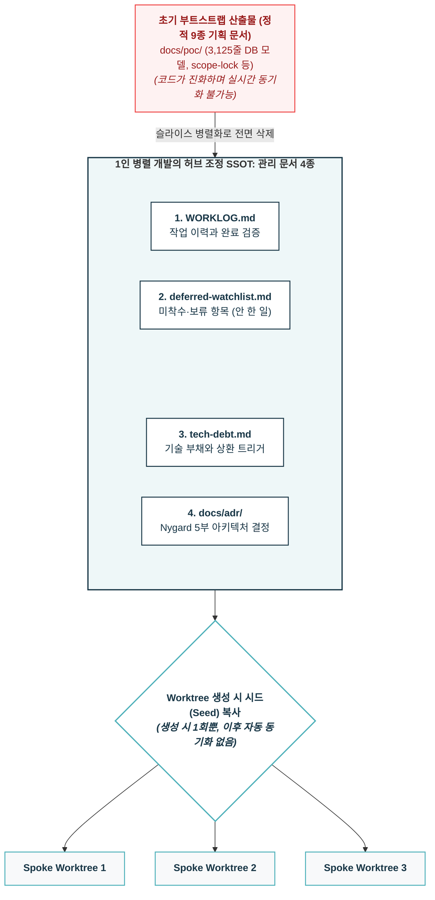
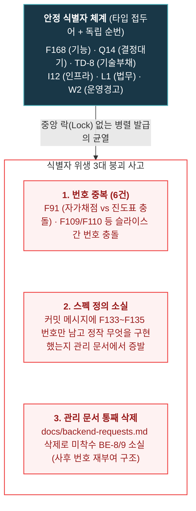
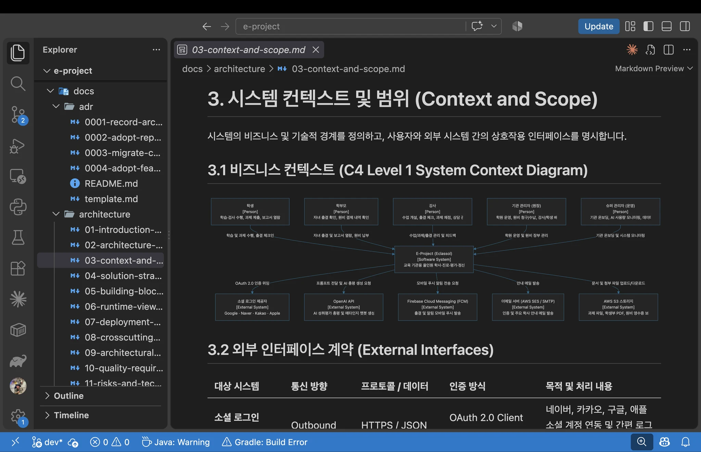
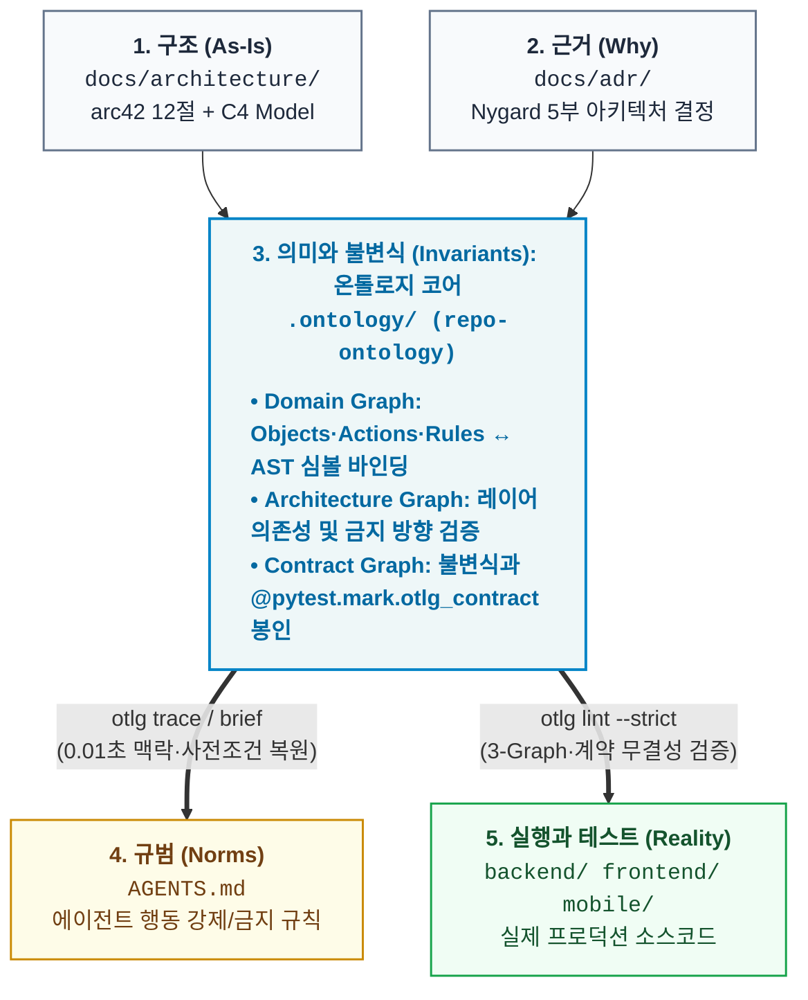

- table of contents
{:toc}

지난 [[5편] 같은 브랜치에서 에이전트끼리 사이좋게 코딩할 리가 없어](/tag-ai-agent-architecture/5-cmux-parallel-worktree/)에서 다루었듯, `cmux`와 `git worktree`로 물리적 충돌을 해결하며 빠른 속도로 많은 작업을 쳐낼 수 있게 되었지만 그 속도는 곧 부담으로 바뀌었다. 여러 워크트리에서 수십 개의 API와 컴포넌트가 동시에 쏟아지자 **기존에 작성해 두었던 기획서와 명세서들이 무서운 속도로 폐기(`deprecated`)**되기 시작했기 때문이다.

여기에 에이전트의 고질병인 '기억상실(`Stateless`)'이 결합하자 현장은 아비규환이 되었다. 터미널을 닫는 순간 에이전트는 완전한 백지상태로 깨어나는데, 방금 전까지 아키텍처를 고민하던 동료는 사라지고 아무것도 기억하지 못하는 새 세션이 첫인사를 건넬 뿐이었다. (벤더사들의 `resume` 기능이 생겼지만 동시 다중 세션에서는 세부 대화가 덮어써지는 등 한계가 명확했다.) 맥락을 잃은 에이전트는 다른 워크트리에서 보류(`Deferred`)하기로 결정한 사안을 멋대로 다시 들쑤시거나 옆 브랜치의 최신 모듈을 모른 채 중복 코드를 작성하기 일쑤였다.

매번 이전 대화를 프롬프트로 복기해 주는 방식에서 벗어나려면 **"사람의 기억도, 에이전트의 세션 메모리도 믿지 말고 오직 저장소(`Repository`) 그 자체가 스스로 모든 맥락과 부채를 증명하게 만들어야 한다"**는 원칙이 필요했다. 그렇게 정적 기획서를 버리고, 새로 투입된 에이전트가 단 10초 만에 지난 결정과 보류 항목을 이어받는 **저장소 정본(`SSOT`) 거버넌스와 문서 동기화 루프**를 구축하게 되었다.

---

## 코드를 따라잡지 못하는 기획서 대신, 상태를 기록하는 관리 문서 4종

소스 코드는 "지금 시스템이 어떻게 동작하는가"만 보여줄 뿐, 왜 이렇게 구현되었는지(결정), 어떤 타협과 빚을 지고 있는지(부채), 왜 이 작업을 미루어 두었는지(보류), 누가 언제 수정했는지(이력)는 말해주지 않는다. 초기에 작성했던 3,125줄짜리 DB 모델 정의서(`data-model-v0.md`) 등 정적 부트스트랩 문서 9종은 병렬 개발 속도를 따라잡지 못해 전면 삭제했고, 그 자리에 **시스템의 동적인 상태를 실시간 조율하는 '관리 문서 4종'**을 도입했다.

1. **`WORKLOG.md` (작업 이력 기록 문서)**: 어떤 슬라이스에서 무슨 기능을 끝내고 검증했는지 추적한다.
2. **`docs/deferred-watchlist.md` (보류 항목 기록 문서)**: 착수 가능 항목, 외부 계약·인프라 미비로 아직 못하는 일, 의도적으로 안 하기로 한 일의 단일 정본이다. 에이전트가 맥락 없이 오독하는 인라인 `// TODO` 주석을 금지하고 모든 보류 항목을 이곳으로 일원화했다.
3. **`docs/tech-debt.md` (기술 부채 기록 문서)**: Martin Fowler의 기술 부채 4분면에 따라 **① 분면, ② 만든 이유, ③ 이자, ④ 상환 트리거(언제 갚는가)**를 강제했다. 예컨대 단일 백엔드 규모에서 선택한 `HS256 대칭키 JWT(TD-1)`는 "백엔드가 2개 이상으로 분리될 때 상환한다"는 명시적 트리거와 함께 보류했다.
4. **`docs/adr/` (의사결정 기록)**: "코드는 무엇을 만들었는지는 말해주지만, 왜 그렇게 만들었는지는 말해주지 않는다"는 Michael Nygard의 원칙에 따라 5부 형식(Title, Status, Context, Decision, Consequences)으로 선택의 이유(`Why`)를 `append-only`로 보존했다.

이 4종 문서는 워크트리 생성 시 1회 복사되어 초기 맥락을 잡아주고, Teardown 단계에서 허브의 메인 문서로 다시 수거·병합되며 병렬 개발의 정합성을 지탱했다.

추후 온톨로지를 도입해 만든 Repo Ontology에서는 이 과정이 한층 더 간결해졌다. 워크트리를 띄울 때마다 문서들을 통째로 읽히는 대신, 작업에 필요한 도메인 규칙과 이전 결정 맥락만 명령어 한 줄(`otlg brief`)로 즉석에서 뽑아 에이전트에게 건네줄 수 있도록 개선했기 때문이다.
{:.note title="여담"}

---

## 작업마다 고유 번호 붙이기, 그리고 기능 명세와 코드의 자동 동기화

에이전트에게 자연어로만 지시하면 같은 기능을 제각각 다른 이름으로 불러 중복 구현과 히스토리 단절이 일어난다. 이를 막기 위해 모든 작업에 `F<n>`(기능), `Q<n>`(결정 대기), `TD-<n>`(기술 부채), `I<n>`(인프라) 같은 **`타입 접두어 + 독립 순번`**을 부여하고, 리베이스 시 바뀌는 커밋 `SHA` 대신 커밋 텍스트에 박힌 안정 식별자를 영구적인 닻(`Anchor`)으로 삼았다.

초기에는 스포크들이 중앙 락 없이 각자 채번하다가 `F91`이나 `ADR-0016` 번호가 충돌하거나, 완료 항목 삭제 규칙 때문에 미착수 항목까지 날아가는 사고를 겪었다. 이를 계기로 번호는 허브가 스폰 전에 선점 배정하고, 종결된 항목도 행을 지우는 대신 취소선과 함께 하단 종결 섹션이나 월별 아카이브로 이동해 파일 구조를 시스템화했다.

또한 세션이 리셋된 에이전트가 10초 만에 타깃 코드로 직행하도록 `docs/features/` 아래에 도메인별 기능 명세서 118종과 `index.md` 색인표를 구축했다. 백엔드 5계층(`Model -> CRUD -> Schema -> Service -> API`)과 프론트엔드 `FSD` 계층의 실제 파일 경로를 1:1 매핑하고, 세 가지 스킬로 **코드-문서 동기화 루프**를 자동화했다.
- **`/discover-features`**: 백엔드·프론트엔드 도메인을 스캔해 문서화 커버리지와 미작성 우선순위를 진단한다.
- **`/implement-feature`**: Clean Architecture 순서로 신규 기능을 구현·테스트한 직후 자동으로 기능 명세서를 생성한다.
- **`/modify-feature`**: 기존 기능 수정 시 변경 규모(`Major`/`Minor`/`Patch`)에 맞춰 버전 번호와 현재 명세·결정 근거·영향 범위를 함께 갱신한다.

이 118종의 마크다운 기능 명세서와 세 가지 동기화 스킬은 당시 큰 활약을 해주었지만, 코드베이스가 더 커지면서 이후 Repo Ontology(`.ontology/`)에 완전히 흡수되어 은퇴하게 된다. 사람이 마크다운에 파일 경로를 적어두는 대신 온톨로지가 소스 코드의 실제 함수와 클래스를 직접 추적(`otlg trace`)하고, 경로가 어긋나면 린터가 즉시 잡아내는 구조로 진화시켜 문서 갱신 비용을 훨씬 효율적으로 줄일 수 있었다.
{:.note title="여담"}

---

## 설계 문서 계층(arc42 · C4 · ADR)과 팔란티어식 5각 분업 체계

개별 기능을 넘어 전체 시스템 구조를 조망하기 위해 `/design` 스킬로 **Architecture(시스템 구성·배포 뷰) / Database(ERD·스키마·인덱스 전략) / Program(모듈 경계·인터페이스·API 계약)** 3대 설계서의 책임을 분리하고, 아키텍처 문서화 3대 기준을 결합했다.

> **"구조는 arc42, 그림은 C4 Model, 근거는 ADR."** 세 기준은 경쟁하지 않으며 철저하게 역할을 나눈다.

`docs/architecture/`에는 `arc42` 핵심 섹션을 세우고, 다이어그램은 `C4 Model`(`Context -> Container -> Component`)로 필요한 깊이만 줌인해 제공하며, 선택의 이유는 `docs/adr/`로 연결했다.

{:width="800" loading="lazy"}

실제 코드베이스에 적용된 아키텍처 문서화 체계. 좌측 탐색기에는 docs/adr/과 arc42 기반의 docs/architecture/ 11개 절이 체계적으로 정돈되어 있고, 우측에는 시스템의 전체 경계와 인터페이스를 명시한 C4 Level 1 시스템 컨텍스트 다이어그램이 렌더링되어 있다.
{:.figcaption}

나아가 명사 위주의 정적 문서가 시스템의 '동사(상태 전이 `Action`과 사전 불변식)'를 통제하지 못하는 한계와 수기 마크다운의 괴리(`Drift`)를 해결하기 위해, 팔란티어(`Palantir Foundry`)의 온톨로지 철학을 이식한 [<mark class="kw-ssot">repo-ontology (otlg)</mark>](https://github.com/tomato-vault/repo-ontology)를 제작해 도입했다.

도메인 객체와 상태 변경 행위, 불변 규칙, 그리고 아키텍처 경계와 테스트 계약을 실제 소스 코드와 1:1로 연결해 두자, 백지상태의 에이전트도 `otlg trace` 한 줄이면 **0.01초** 만에 관련 규칙과 수정할 파일 경로를 복원할 수 있었다. 앞서 수기로 관리하던 118종의 기능 명세서는 이 온톨로지로 흡수되었고, 별도로 두었던 기술 부채 문서 역시 아키텍처 문서의 위험·부채 섹션으로 통합되면서 **아키텍처 구조, 의사결정 근거, 도메인 온톨로지, 에이전트 행동 규범, 작업·보류 기록**이라는 **5대 정본 체계**로 자리 잡았다. 이 코드 레포지토리 온톨로지의 설계부터 정적 검증과 자가 갱신 위키로 이어지는 이야기는 후속 연재인 **온톨로지 엔지니어링 [[3편]](/tag-ontology-engineering/3-nouns-to-verbs-paradigm-shift/)~[[5편]](/tag-ontology-engineering/5-sdlc-harness-and-living-wiki/)** 및 **[[9편]](/tag-ontology-engineering/9-knowledge-blog-compiler-and-semantic-critique/)**에서 자세히 다룬다.

- [심화 근거: 저장소 정본 문서(Architecture·Database·Program·ADR·Worklog) 계층 구조와 스킬 템플릿 상세 보러가기](/tag-ai-agent-architecture/deep-dive/worktree-and-repo-governance/#repo-ssot-hierarchy)

---

## 에필로그: 1인 팀이 관리 문서가 필요해지는 순간

> **"1인팀이 관리 문서가 필요해지는 시점은, 혼자가 아니게 되는 순간이었다."**

물리적인 방 안에는 나 혼자 앉아 있었지만, 터미널 창 너머에서 나는 매일 수십 명의 '기억상실증에 걸린 천재 개발자들'을 이끄는 테크 리드이자 중앙 허브로 일하고 있었다. 레포지토리가 모든 것을 기억하고 상태를 증명하기 시작할 때 1인 팀은 비로소 망각에서 벗어나 병렬 개발의 자유를 누릴 수 있다. 다음 글인 **[[7편] 규칙이 64개나 있는데 왜 코드를 못 짜니](/tag-ai-agent-architecture/7-rule-pruning/)**에서는 레포지토리에 쌓아 올린 64개 규율집이 오히려 에이전트의 컨텍스트를 잠식하던 역설을 어떻게 구조조정으로 풀어냈는지 다뤄보겠다.
