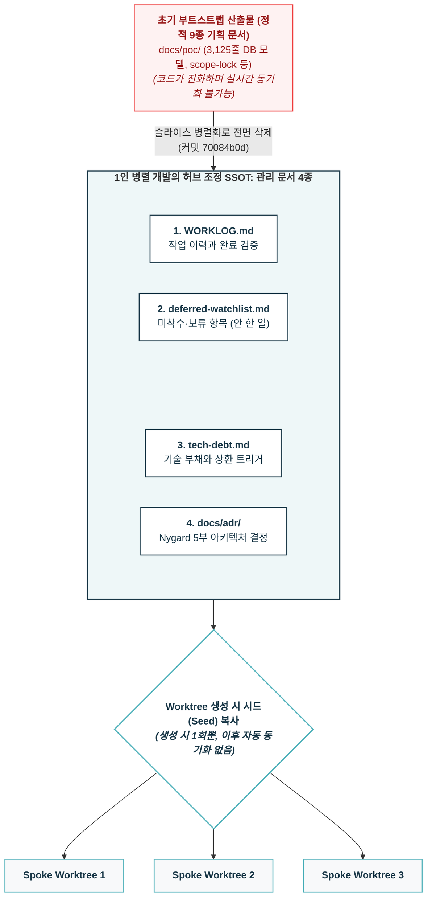
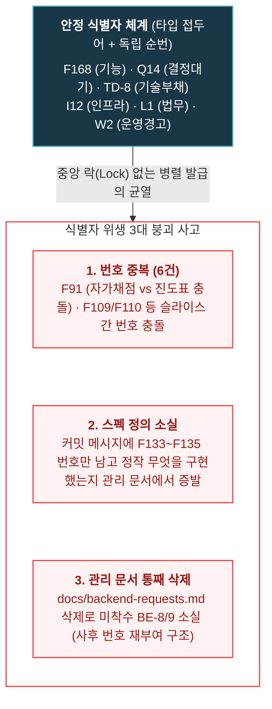
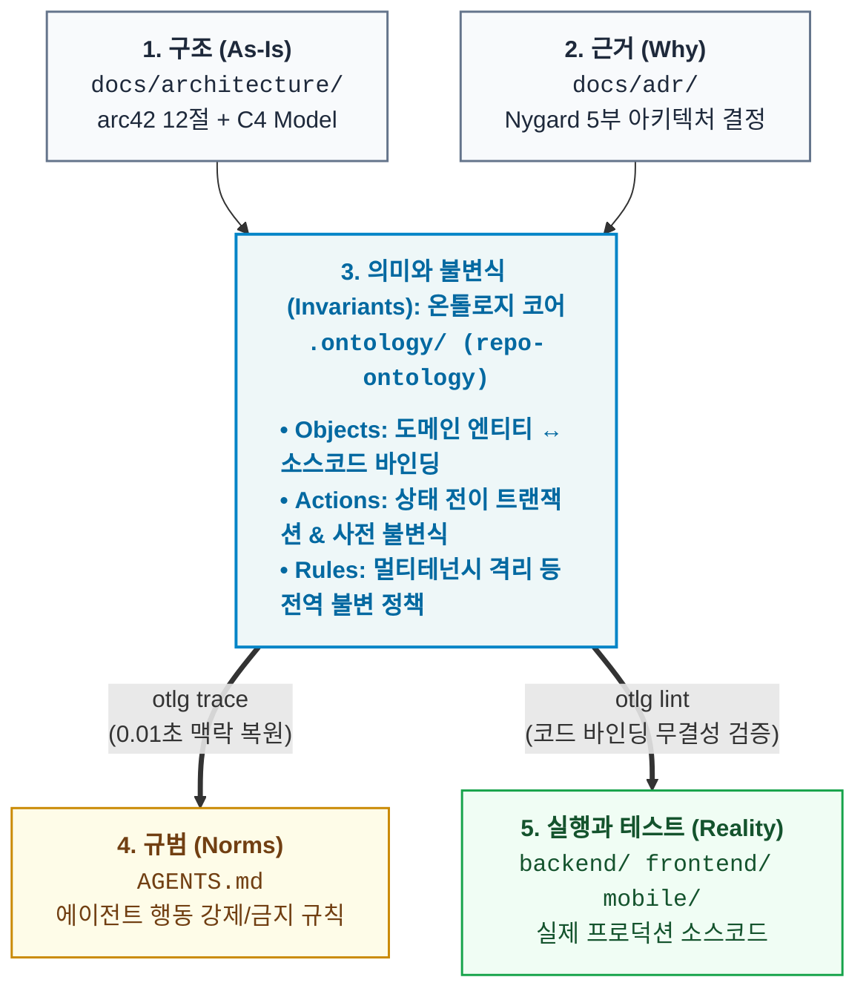

- table of contents
{:toc}

지난 [[5편] 같은 브랜치에서 에이전트끼리 사이좋게 코딩할 리가 없어](/tag-ai-agent-architecture/5-cmux-parallel-worktree/)에서 다루었듯, `cmux`와 `git worktree`를 결합해 에이전트마다 독립된 워크스페이스를 제공함으로써 물리적인 파일 충돌과 간섭은 완벽히 해결할 수 있었다. 단 2주 만에 475개의 커밋을 찍어내며 15개의 기능 슬라이스를 병렬로 밀어붙였으니 생산성 측면에서는 분명 경이로운 승리였지만, 그 압도적인 속도에 도취되었던 기쁨은 얼마 지나지 않아 서늘한 부담으로 바뀌고 말았다. 여러 워크트리에서 개발이 동시에 돌아가다 보니 사방에서 수십 개의 API와 컴포넌트가 새로 생겨나고 수정되었으며, **기존에 작성해 두었던 모든 기록과 문서들이 무서운 속도로 폐기(`deprecated`)**되기 시작했기 때문이다. 불과 며칠 전에 공들여 정리한 기획서와 DB 명세서는 순식간에 코드와 동떨어진 레거시 문서가 되어 있었고, **인간인 나 혼자의 머리로는 도대체 저장소 안에서 무엇이 새로 생겼고 무엇이 바뀌었는지 추적하는 것 자체가 물리적으로 불가능했다.**

여기에 에이전트 특유의 고질병인 '기억상실(`Stateless`)'이 결합하자 현장은 그야말로 아비규환이 되었다. 터미널 창을 닫거나 컨텍스트가 리셋되는 순간 에이전트는 완전한 백지상태가 되는데, 방금 전까지 나와 함께 아키텍처의 한계를 치열하게 고민하고 수십 개의 테스트 케이스를 격파했던 그 '천재적인 동료'는 온데간데없고 새로 열린 창에는 아무것도 기억하지 못하는 에이전트가 정중하게 첫인사를 건넬 뿐이었다. (물론 최근에는 벤더사들의 resume 기능이 생겼지만, 동시 다중 세션을 운용할 때는 부차 세션의 세부 대화가 덮어써지거나 유실되는 등 한계가 명확했다.) 과거의 맥락을 잃은 채 새로 띄운 에이전트는 다른 워크트리에서 이미 긴 논의 끝에 보류(`Deferred`)하기로 결정한 사안을 멋대로 다시 들쑤셔 코드를 엎어버리거나, 방금 옆 브랜치에 추가된 최신 모듈의 존재조차 모른 채 똑같은 중복 코드를 작성하기 일쑤였다.

이것은 사소한 작업상의 불편함이 아니라, **"내가 만든 병렬 하네스의 속도를 통제하지 못한다면 시스템은 조만간 내가 쏟아낸 코드의 무게를 감당하지 못할 것"**이라는 절박한 진화의 압력이었다. 인간 개발자인 내가 매번 기억의 전달자가 되어 이전 대화를 프롬프트로 복기해 주는 방식은 이미 한계에 부딪힌 지 오래였기에, 살아남기 위해서는 **"사람의 기억도, 에이전트의 세션 메모리도 믿지 말고 오직 저장소(`Repository`) 그 자체가 스스로 모든 맥락과 부채를 증명하게 만들어야 한다"**는 원칙을 세워야만 했다. 그렇게 소프트웨어 아키텍처와 문서화 방법론들을 찾아 헤맨 끝에 거대한 정적 기획서를 과감히 버리고, 터미널이 닫혀도 새로 투입된 에이전트가 단 10초 만에 지난 3주간의 결정과 보류 항목을 완벽하게 이어받을 수 있는 **저장소 거버넌스와 관리 문서 4종**을 구축하게 되었다.

---

## 터미널을 닫으면 너의 기억은 사라진다: 기억의 외주화

에이전트와의 협업에서 가장 위험한 착각은 "에이전트가 이전 대화의 암묵지를 공유하고 있을 것"이라는 믿음이다. 사람 개발팀이라면 커피를 마시며 나눈 대화나 슬랙 스레드의 잔상이 각자의 뇌 속 '장기 기억'에 남겠지만, 본질적으로 `Stateless`인 AI 에이전트에게는 장기 기억이란 존재하지 않는다. 컨텍스트 윈도우가 아무리 커져도 세션은 언젠가 종료되기 마련이며, 대화창이 리셋되는 순간 에이전트가 품고 있던 모든 맥락(`Context`)은 비휘발성 저장 매체에 기록되지 않은 채 허공으로 날아간다. 처음에는 이 간극을 메우려고 거대한 프롬프트 템플릿을 만들어 붙여넣거나 세션을 바꿀 때마다 이전 작업 요약을 사람이 직접 쳐서 먹여주기도 했으나, 이는 개발자가 에이전트의 '외부 기억 장치' 노릇을 하느라 정작 시스템 설계를 고민할 에너지를 탕진하는 전형적인 병목이었다.

이 악순환을 끊어내기 위해 내가 택한 해법은 기억의 주체를 **저장소(`Repository`)**로 완전히 외주화하는 것이었다. 소스 코드는 "지금 시스템이 어떻게 동작하는가"만 보여줄 뿐, 그 이면에 담긴 의사결정의 맥락까지는 대변해 주지 못하기 때문이다:
- "이 기능은 왜 이렇게 구현되었는가?" (결정)
- "이 코드는 어떤 타협과 빚을 지고 있는가?" (부채)
- "왜 이 작업은 지금 하지 않고 미루어 두었는가?" (보류)
- "누가 언제 이 스펙을 손대고 지나갔는가?" (이력)

이 질문들에 대한 답이 코드베이스 내부 문서로 격리되어 <mark class="kw-ssot">정본(SSOT, Single Source of Truth)</mark>으로 관리되지 않는다면, 새로 투입된 에이전트는 과거의 결정을 무시하고 코드를 제멋대로 엎어버리거나 미뤄둔 작업을 이미 끝난 것으로 오판해 건너뛰게 된다. 터미널을 닫아도 저장소는 끝까지 남기에, 에이전트의 휘발성 두뇌에 의존하는 대신 `Git` 커밋이 무결성을 보증하는 텍스트 파일에 모든 기억을 강제로 밀어 넣기 시작한 셈이다.

---

## 저장소에 무엇을 두는가: 부트스트랩 산출물 9종과 관리 문서 4종

프로젝트를 처음 시작할 때 우리는 보통 많은 기획 문서를 작성하곤 한다. 내가 진행했던 학원 관리 SaaS 프로젝트 초창기에도 제품의 초기 윤곽을 잡기 위한 거대한 부트스트랩 산출물 9종이 존재했다:
- `docs/poc/scope-lock.md`: 제품의 절대적 스코프 경계
- `docs/poc/decision-ledger.md`: Q1~Q32에 이르는 초기 정책 결정 원장
- `docs/poc/page-map.md` 및 S0~S7 슬라이스 설계서
- `docs/poc/data-model-v0.md`: 무려 3,125줄에 달하는 초기 DB 모델 정의서
- 아키텍처 스탠스, 기술 스택 결정서, 경쟁사 갭 분석, AI 모델 비용 전략 문서

이 문서들은 프로젝트의 초기 뼈대를 세우는 데는 꽤 유용했지만, 실제 코드가 수만 줄로 불어나고 기능 슬라이스 단위로 여러 에이전트가 병렬로 붙어 개발을 가속하기 시작하자 이내 거추장스러운 짐이 되었다. 코드는 매일 숨 가쁘게 진화하는데 3,000줄짜리 데이터 모델 문서를 실시간으로 최신화할 수 있는 사람은 아무도 없었기에, 결국 이 초기 산출물들은 한꺼번에 삭제하는 결단을 내렸다. 그렇다고 해서 문서를 다 없애고 코드만 남겨둔 것은 아니었으며, 숨이 멎은 정적 기획 문서를 걷어낸 자리에 **시스템의 동적인 상태를 실시간으로 조율하는 '관리 문서 4종'**을 새롭게 세웠다.



1. **`WORKLOG.md`**: 작업 이력과 완료 검증. 누가 어떤 슬라이스에서 어떤 기능을 끝냈는지 추적한다.
2. **`docs/deferred-watchlist.md`**: 아직 하지 않은 일, 차단된 일, 의도적으로 보류한 일의 SSOT.
3. **`docs/tech-debt.md`**: 이미 친 코드 안의 타협과 빚, 그리고 상환 트리거.
4. **`docs/adr/`**: 아키텍처 결정 기록. Nygard 5부 형식으로 남긴 구조적 선택들.

이 4종의 관리 문서는 단순한 기록물이 아니라 1인 병렬 개발을 지탱하는 **'허브 조정 SSOT'**였다. 지난 [[5편]](/tag-ai-agent-architecture/5-cmux-parallel-worktree/)에서 다루었듯 병렬 워크트리 환경에서 격리된 스포크 에이전트는 자기 방 밖의 상황을 전혀 알지 못하는데, 중앙의 허브 에이전트가 새 워크트리를 생성할 때 이 4종의 관리 문서가 해당 워크트리로 '시드(`Seed`)'로서 함께 복사된다. 여기서 핵심이 되는 불변의 규칙은 **"시드는 생성 시 단 1회만 복사되며, 이후 작업 도중에는 자동으로 동기화되지 않는다"**는 점이다. 스포크 에이전트는 자신이 파견된 시점의 관리 문서 스냅샷을 들고 작업에 착수하며, 슬라이스를 구현하다가 자기 범위 밖의 작업이나 당장 처리할 수 없어 미뤄야 할 항목이 생기면 그 보류(`defer`) 내역들을 로컬 관리 문서에 차곡차곡 쌓아 올린다. 그렇게 격리된 작업이 끝나고 브랜치가 머지될 때 허브 에이전트가 이를 다시 메인 관리 문서로 수거해 흡수함으로써 전체 정합성을 맞추는 구조였기에, 병렬 착수 전에 허브가 관리 문서를 항상 최신 상태로 유지하는 일이 무엇보다 중요했다.

---

## 안 한 일을 어디에 적는가: watchlist의 차단 분류와 복원 신뢰도 3단

실무 프로덕트를 개발하다 보면 당장은 이 작업을 진행할 수 없다는 현실적인 장벽을 끊임없이 마주하게 된다:
- 외부 카카오톡 푸시 API 계약이 아직 체결되지 않아서 (`F85`)
- 원장의 실제 화면 UX 선호도를 인터뷰하기 전이라서 (`F37`)
- 고교 지원 과목 스코프를 담당자가 아직 넘겨주지 않아서 (`Q14`)
- `spaCy` 문법 검사기가 어문 의존 범주를 잡지 못해 오라클이 고갈되어서 (`F40`)

보통의 1인 개발 환경이라면 코드 구석에 `// TODO: 나중에 피드백 받고 수정할 것` 같은 주석을 남기거나 개인 메모장에 대충 적어두고 넘어가겠지만, 병렬 에이전트 환경에서 코드 내 인라인 `TODO` 주석은 치명적인 독약이 된다. 에이전트가 코드베이스 전체의 `TODO`를 전후 맥락 없이 읽어 들여 시키지도 않은 엉뚱한 리팩토링을 시도하거나, 반대로 자신이 이번 세션에 책임지고 끝내야 할 작업인지조차 모른 채 영원히 방치하기 때문이다. 따라서 아직 하지 않은 일은 코드 주석이 아니라 오직 단 하나의 정본 장소인 `docs/deferred-watchlist.md`에만 기록하도록 강제했으며, 이 `watchlist` 역시 단순한 할 일 목록에 그치지 않고 **차단 여부(`Blocker`)**에 따라 엄격하게 분류해 관리했다:

| 분류 | 의미 | 실례 |
|:---|:---|:---|
| **착수 가능 (Unblocked)** | 선행 조건이 해결되어 즉시 구현에 들어갈 수 있는 항목 | `F52` 강사 모바일 진도 로스터 진입점 배선 |
| **차단 사유별 보류** | 인프라 미비, 외부 계약, 실측 데이터 부재로 멈춰 있는 항목 | `F106` 리포트 전국 평균 지표 (데이터 소스 부재), `I9` 이미지 인프라 apply 대기 |
| **범위 밖 (Out of Moat)** | 기술적으로 불가능하거나 제품 철학상 의도적으로 안 하기로 한 항목 | `O1` 증명·기하·서술형 자동 생성 (자동 검증 불가 = 해자 없음) |

`watchlist`에 등재되는 각 행은 반드시 **[항목 ID / 구체적 내용 / 왜 보류하는가 / 신뢰도 / 출처 문서]**의 다섯 가지 요소를 빠짐없이 갖추어야 했고, 그중에서도 **"종결되었다고 해서 목록에서 행을 삭제하지 않는다"**는 철칙을 가장 엄격하게 지켰다. 작업이 끝났다는 이유로 관리 문서에서 행을 지워버리면, 과거 커밋 메시지나 다른 브랜치의 PR 본문에 남겨진 `defer F109`, `ref BE-8` 같은 수많은 참조가 단숨에 부모를 잃고 길 잃은 포인터(`Dangling pointer`)가 되어버리기 때문이다. 대신 구현이 완료되거나 보류 사유가 해소된 항목은 반드시 문서 하단의 `## 5. 종결된 것` 섹션으로 이동시켜 취소선을 긋고 어떤 방식으로 닫혔는지를 명시함으로써, 히스토리의 추적 가능성을 끝까지 보존할 수 있었다.

### 휴리스틱한 나침반: 118개 기능의 현재와 역사를 기록한 docs/features/

관리 문서 4종이라는 거버넌스 체계를 본격적으로 도입하기 훨씬 전부터 내게는 자연스럽게 몸에 밴 오래된 습관이 하나 있었는데, 바로 저장소 루트의 `docs/features/` 디렉터리를 가꾸는 일이었다. 사수도 코드 리뷰어도 없는 1인 개발 환경에서 일하며 나는 늘 두 가지 현실적인 질문을 마음에 품고 있었다:
1. *"언젠가 새로운 개발자가 합류했을 때, 어떻게 해야 사수 없이도 이 방대한 프로덕션을 온전히 인수인계받을 수 있을까?"*
2. *"세션이 리셋된 CLI 에이전트에게 작업을 시킬 때, 어떻게 해야 최소한의 토큰과 탐색 비용으로 작업 대상 파일들을 정확히 짚어줄 수 있을까?"*

이 문서 체계는 거창한 소프트웨어 공학 이론이나 외부의 설계 압력을 받아서 탄생한 것이 아니었다. 그저 매일 쏟아지는 기능 요구사항을 쳐내면서 **어떻게 하면 에이전트와 나 자신이 조금이라도 덜 헤매고 더 효율적으로 일할 수 있을지를 치열하게 궁리하다가 본능적으로 깎아 낸 '휴리스틱(Heuristic)한 결과물'**에 가까웠다. 이를 위해 `docs/features/` 아래에 비즈니스 도메인별 디렉터리(`student`, `admin`, `parent`, `notifications`, `infra` 등)를 세분화하여 각 기능마다 독립된 마크다운 문서를 두었고, 루트에는 118개 기능 전체의 구현 현황과 복잡도를 한눈에 조망하는 `index.md` 색인표를 배치했다.

```
docs/features/
├── index.md             # 118개 기능 전체 현황(완료율 100%) 및 복잡도 색인표
├── _template.md         # 일관된 문서 작성을 위한 표준 템플릿
├── student/             # 학생 도메인 (study-planner.md, assessment.md 등 27종)
├── admin/               # 학원 관리자 도메인 (18종)
├── parent/              # 학부모 도메인
└── ...                  # 총 15개 도메인 서브디렉터리
```

각 기능 문서는 단순히 "이 기능은 이러하다"는 평면적인 기획 설명에 머무는 대신, CLI 에이전트가 문서를 읽자마자 곧장 타깃 코드로 직행할 수 있도록 철저하게 **엔지니어링 중심의 청사진**으로 설계되었다:

1. **관련 소스 파일의 1:1 매핑**:
   - 백엔드는 `Model → CRUD → Schema → Service → API`에 이르는 5단계 계층의 실제 파일 경로를 명시했다.
   - 프론트엔드는 `FSD(Feature-Sliced Design)` 아키텍처에 맞춰 `pages → widgets → features → entities → shared`의 컴포넌트 및 훅 파일 경로를 정확히 박아 넣었다.
2. **아키텍처 및 시스템 데이터 흐름**:
   - 사용자 액션부터 백엔드 처리와 외부 AI 연동(예: `GPT-4o-mini` 비동기 평가)까지 이어지는 데이터 흐름을 아스키 다이어그램으로 도식화했다.
3. **누적된 변경 이력 (Changelog)**:
   - 문서 하단에는 최초 작성(`v1.0`)부터 요구사항 변경(`v1.1`), 그리고 실제 운영 중 발견된 미세 버그 패치(`v1.2`: 타이머 초 단위 carry-over 보존 등)에 이르기까지 **날짜별 버전 히스토리**를 집요하게 누적했다.

이렇게 다듬어진 휴리스틱한 기능 문서화는 CLI 에이전트와의 실전 협업에서 기대 이상의 진가를 발휘했다. 새로운 터미널 창을 열고 기억을 잃은 에이전트에게 "학습 일정 관리 모듈의 목표 설정 로직을 수정해 줘"라고 지시할 때, 에이전트가 수만 줄의 전체 코드베이스를 무작정 `grep`하며 방황하게 둘 필요 없이 그저 `docs/features/learning-scheduler.md` 파일 하나만 컨텍스트로 쥐여주면 충분했기 때문이다. 에이전트는 단 10초 만에 백엔드와 프론트엔드의 어떤 파일들을 건드려야 하는지, API 계약이 어떻게 정의되어 있는지, 나아가 이 기능이 과거에 어떤 버그를 겪으며 현재 구조로 진화했는지를 단숨에 파악하고 정확한 구현에 착수할 수 있었다. 관리 문서 4종이 여러 워크트리 사이에서 끊임없이 변하는 '동적 상태(`State`)와 기술 부채'를 조율하는 관제탑이었다면, `docs/features/`는 시스템의 모든 부품들이 어디에 있고 어떻게 살아왔는지를 증명하는 **가장 오래되고 든든한 정적 베이스캠프**였던 셈이다.

---

## 작업에 번호를 붙인다는 것: 식별자 위생과 관리 문서의 아카이빙

여러 에이전트에게 "학생 자가채점 기능 좀 만들어줘"라고 자연어로만 지시하는 습관은 병렬 개발 환경에서 곧바로 재앙을 부른다. 어떤 에이전트는 그것을 '학생 모바일 채점'이라 부르고, 어떤 에이전트는 '자가채점 UI', 또 다른 에이전트는 '과제 제출 검수'라고 각자 다르게 명명하다 보니, 이름이 제각각이라 중복 구현이 빈번하게 일어날뿐더러 나중에 커밋 메시지를 검색해도 변경 히스토리가 하나로 꿰어지지 않기 때문이다. 이러한 혼선을 원천 차단하기 위해 우리는 모든 작업 단위에 고유한 번호를 부여하는 **`타입 글자 + 독립 순번`** 체계를 도입했다:
- `F<n>`: 기능 단위 (Feature), `F1`부터 `F168`까지 가장 광범위하게 사용
- `Q<n>`: 질문 및 정책 결정 대기 (Question)
- `M<n>`: 실측 지표 (Measurement)
- `I<n>`: 인프라 작업 (Infra)
- `L<n>`: 법무 및 라이선스 (Legal)
- `O<n>`: 스코프 밖 (Out of moat)
- `W<n>`: 운영 경고 및 품질 이슈 (Warning/Ops)
- `TD-<n>`: 기술 부채 (Tech Debt)

이 식별자 체계를 운영하면서 **"안정 식별자는 `Git` 커밋 `SHA`가 아니라 커밋 텍스트여야 한다"**는 중요한 엔지니어링 원칙이 자연스럽게 자리 잡았다. `Git`의 커밋 해시(`SHA`)는 브랜치를 리베이스(`Rebase`)하거나 커밋을 합치고(`Squash`) 메시지를 수정하는(`amend`) 순간 영원히 바뀌어버리기에, 해시값에만 의존하는 문서 참조는 리베이스 한 번에 전부 깨진 링크가 되고 만다. 반면 커밋 메시지와 문서 본문에 직접 새겨 넣은 `F91`, `BE-8`, `TD-10` 같은 텍스트 ID는 어떠한 깃 히스토리 조작 속에서도 변하지 않고 살아남아, 코드의 변경점과 설계 문서를 영구적으로 이어주는 단단한 '닻(`Anchor`)' 역할을 해주었다.



### 식별자 위생의 붕괴: 번호 중복 6건과 관리 문서 증발

그러나 아무리 정교하게 고안한 식별자 체계라도 사람이 방심하고 병렬 에이전트들이 중앙 락(`Lock`) 없이 각자의 워크트리에서 번호를 채번하기 시작하자 예상치 못한 균열이 일어났다. 가장 먼저 터져 나온 문제는 **번호 중복**이었는데, 서로 격리된 워크트리에서 일하던 에이전트들이 각자 로컬 관리 문서의 마지막 번호 다음에 오는 숫자를 매기면서 동일한 ID가 두 개의 전혀 다른 작업에 동시에 붙어버린 것이다:
- `F91`: 한쪽에서는 "학생 자가채점 모바일 UI"로 구현해 종결시켰는데, 다른 쪽에서는 "진도표 배정 덮어쓰기 UX"로 열려 있었다.
- `F109`·`F110`: 학생 관리 슬라이스에서는 "자가 비번 변경 및 부모폰 백필"이었는데, 공지 슬라이스에서는 "FCM 실전송 및 모바일 공지탭"에 같은 번호를 달았다.
- `F121`, `F143`, `F50`까지 무려 6건의 번호가 한 지붕 두 가족처럼 충돌하고 있었다.

두 번째 사고는 **잘못된 청소 규약으로 인한 관리 문서 소실**이었으며, 세 번째는 **관리 문서 자체의 비대화**였다. 프론트엔드가 백엔드에 요구하는 API 스펙을 정리하던 `docs/backend-requests.md`(`BE-1`~`BE-13`)에는 "완료된 항목은 그 자리에서 삭제한다"는 안일한 규칙이 걸려 있었는데, 에이전트가 이를 기계적으로 따르다 커밋 `7aa9962c`에서 파일 자체를 통째로 삭제해 버리는 바람에 아직 미착수 상태였던 `BE-8`과 `BE-9`가 영문도 모른 채 증발했다가 8월 7일 복구 작업 때 간신히 `I12`와 `Q14`라는 새 번호를 얻어 구조되기도 했다. 게다가 단 5주 만에 `watchlist` 엔트리가 80개를 넘어서고 파일 크기가 62KB에 육박하자 에이전트에게 매번 이 관리 문서를 읽히는 것 자체가 심각한 토큰 낭비와 컨텍스트 오염을 유발했고, 결국 종결된 항목을 월별로 아카이빙해 분리하고 활성 항목만 날렵하게 유지하는 수명 주기 거버넌스까지 추가로 확립해야만 했다.

---

## 결정과 부채를 남기는 법: ADR 충돌과 기술 부채 4분면

### ADR: 코드는 '왜'를 말하지 않는다

이제껏 설명했다시피 AI를 높은 농도로 사용하며 개발을 진행하다 보니, 어느 순간 "어떠한 기술 결정을 내릴 때 과연 나 자신이 그 이유에 대해서 명확히 설명할 수 있는가?"라는 근본적인 의문이 들었다. 일차원적으로는 당장 회의 자리에서 그 결정의 배경을 설명해야 한다는 현실적인 압박이 있었고, 조금 더 거시적으로 고민했을 때는 기술 면접 등에서 결국 내가 내린 선택에 대해 '왜(`Why`)'를 설득력 있게 이야기할 수 있을까라는 생각이 들었기 때문이다. 비록 경력은 짧지만 나 역시 엔지니어이기에 주먹구구식 구현에 머무르기보다 최적화된 시스템을 구축하고 싶다는 갈망이 있기도 했고, AI와 이러한 고민을 깊이 논의한 끝에 추천받아 도입한 체계가 바로 `ADR`이었다. 소프트웨어 아키텍트인 Michael Nygard가 **"코드는 무엇을 만들었는지는 말해주지만, 왜 그렇게 만들었는지는 말해주지 않는다"**라고 짚었듯, 우리는 중요한 아키텍처 선택의 기로에 설 때마다 Nygard의 5부 형식을 따른 <mark class="kw-term">ADR(Architecture Decision Record)</mark>을 빠짐없이 남겼다:
- **Title**: 결정을 지시하는 간결한 명사구
- **Status**: `proposed` ➔ `accepted` ➔ `superseded by ADR-NNNN`
- **Context**: 가치중립적인 사실과 힘들의 긴장 상태 (결론을 미리 쓰지 않는다)
- **Decision**: 능동태 완전문 ("We will...")
- **Consequences**: 결정으로 인해 얻은 것과 감수해야 하는 비용

이 프로젝트를 통틀어 총 17건의 `ADR`이 작성되었는데, 병렬 작업이 활발해지자 여기에서도 문서 번호가 충돌하는 아찔한 순간이 찾아왔다. 문항 이미지를 어떻게 서빙할지 결정한 `ADR-0016(problem-image-asset-serving)`이 이미 메인 브랜치에 머지되어 있었는데, 며칠 뒤 다른 워크트리의 에이전트가 '저장 시점 인간 검수(`HITL`) 태깅'을 다룬 결정을 내리면서 똑같이 `ADR-0016` 번호를 달고 들어온 것이다. 사람이 수기로 관리했다면 자칫 기존 문서를 덮어쓰거나 하나를 지웠을지도 모르지만, 우리는 **"한 번 내려진 결정은 결코 덮어쓰지 않으며 오직 `append-only`로만 관리한다"**는 `ADR`의 대원칙을 끝까지 고수했다. 그 원칙에 따라 나중에 들어온 저장 시점 태깅 문서는 즉시 `ADR-0017`로 번호를 올려 재부여함으로써 과거의 결정과 새로운 결정을 모두 온전히 보존할 수 있었고, 심지어 커밋 `5968c4b4`에서 실수로 `docs/adr/` 디렉터리 전체가 날아가는 사고가 터졌을 때도 8월 7일 전수 복구를 통해 17개의 역사적 결정을 단 하나도 빠짐없이 되살려 낼 수 있었다.

### 기술 부채: 빚을 지는 것은 죄가 아니다, 모르고 지는 것이 죄다

아키텍처 결정 못지않게 에이전트 시대의 개발에서 엄격하게 통제해야 했던 영역이 바로 기술 부채였는데, 이때 Martin Fowler의 '기술 부채 4분면(`Tech Debt Quadrant`)'은 부채를 바라보는 나의 시각을 완전히 바꾸어 놓았다:

| 구분 | 신중함 (Prudent) | 무모함 (Reckless) |
|:---|:---|:---|
| **의도적 (Deliberate)** | "지금은 이걸로 출시하고 결과를 감당한다"<br/>➔ **기한·트리거와 함께 보유** | "설계할 시간 없어, 일단 돌아가게만 해"<br/>➔ **즉시 상환 대상** |
| **우발적 (Inadvertent)** | "이제 와 보니 더 나은 방법이 보인다"<br/>➔ **학습 신호** | "레이어링이 뭔지도 몰랐다"<br/>➔ **즉시 상환 + 학습** |

빠른 제품 출시를 위해 의도적으로 타협을 선택하는 것 자체는 죄가 아니지만, 무엇을 타협했는지 모른 채 방치하여 시스템을 곪게 만드는 것은 엔지니어링의 직무유기에 가깝다. 그래서 기술 부채 관리 문서(`docs/tech-debt.md`)에 등재되는 모든 항목에는 **1) 분면, 2) 만든 이유, 3) 이자(무엇이 비싸지는가), 4) 상환 트리거(언제 갚는가)**라는 네 가지 필수 속성을 반드시 명시하도록 강제했으며, 실제 코드베이스에 남겨졌던 기록들을 보면 이 기준이 현장에서 얼마나 냉정하게 작동했는지 확인할 수 있다:
- **`TD-1` (HS256 대칭키 JWT)**:
  - *4분면*: 의도적·신중
  - *이유*: 20개 이하 테넌트의 단일 백엔드 규모에 비대칭키(RS256)와 키 회전 인프라는 과설계다 (`ADR-0002`).
  - *상환 트리거*: 백엔드가 2개 이상으로 분리되거나 외부 서비스가 토큰 검증을 요구할 때.
- **`TD-4` (상담 챗봇 공개 경로의 국외이전 동의 미구현)**:
  - *4분면*: 의도적·신중 ➔ **단, 공개 출시 시 즉시 무모(Reckless)로 전환**
  - *이유*: 컴플라이언스 일괄 처리를 위해 내부 테스트 단계에서 생략함 (`L1`).
  - *상환 트리거*: **공개 위젯 출시 전 필수 상환.** 미상환 시 법적 리스크 발생.
- **`TD-8` (생성 엔진 해상도 < 유형 해상도)**:
  - *4분면*: 의도적·신중
  - *이유*: 엔진은 '정수 사칙연산'이라는 단원급인데, 교재 유형은 '정수의 덧셈'이라는 소단원급이다. 억지로 물리면 덧셈을 골랐는데 곱셈식이 나온다.
  - *처리*: 코드로 때우지 않고, 정확히 일치하는 유형만 바인딩하고 나머지는 **422 에러로 정직하게 거부**했다.

"지금 당장 바쁘니까 나중에 시간 나면 고치자"는 모호한 메모는 곧장 쓰레기통으로 직행하지만, "이 부채는 의도적·신중 분면에 속하며 단일 백엔드가 두 개 이상으로 쪼개지는 날 상환한다"는 관리 문서의 명시적인 기록은 끝까지 살아남아 에이전트와 시스템을 안전하게 지켜주었다.

---

## 시스템의 나침반을 세우다: 아키텍처 문서화 3대 기준 (arc42 · C4 · ADR)

앞서 살펴본 4대 관리 문서(`WORKLOG`, `deferred-watchlist`, `tech-debt`, `ADR`)는 병렬 에이전트들과 매일 치열하게 부딪히며 프로젝트의 '동적 상태(작업 로그, 보류 항목, 기술 부채, 의사결정)'를 추적하기 위해 현장에서 직접 깎아내어 단단하게 굴리고 있던 실전 체계였다. 하지만 프로덕트의 규모가 커질수록 동적인 상태 추적만으로는 채워지지 않는 또 다른 갈증이 생겨났는데, 바로 새로운 세션의 에이전트와 나 자신이 거대한 코드의 숲에서 길을 잃지 않게 해줄 **'정적 시스템의 지도(`Map`)'**를 어떻게 그려야 하는가의 문제였다. 많은 개발자들이 문서화의 중요성을 부르짖으면서도 결국 실패하고 마는 이유는 무엇을, 어디에, 얼마나 깊게 그려야 하는지에 대한 명확한 기준이 없기 때문이며, 마크다운 파일 하나에 인프라 구성도와 클래스 구조, API 스펙을 두서없이 뒤섞어 두면 불과 한 달도 지나지 않아 실제 코드와 어긋나며 아무도 보지 않는 폐기물로 전락하기 마련이다.

그렇게 정적 아키텍처 문서화의 기준을 잡지 못해 방황하던 중, 우연히 유튜브 **'코딩하는 기술사'**님의 영상([아키텍처 문서화 3대 기준: C4 · ADR · arc42](https://www.youtube.com/watch?v=LaLtZsRWFMc))을 접하게 되었다. 영상 속에서 다시금 마주한 한마디는 내게 깊은 울림을 주었다:

> *"코드는 무엇을 만들었는지는 설명하지만, 왜 그렇게 만들었는지는 설명하지 않는다."*

나아가 해당 영상에서는 글로벌 소프트웨어 엔지니어링 업계에서 검증된 **아키텍처 문서화의 3대 기준**과 각 도구의 역할 분담을 명쾌하게 정의하고 있었다:

> **"구조는 arc42, 그림은 C4 Model, 근거는 ADR."**  
> 세 기준은 결코 경쟁하지 않으며 철저하게 역할을 나눈다.

이 간결한 공식을 마주하는 순간 그동안 머릿속에서 흩어져 있던 퍼즐 조각들이 단숨에 맞춰졌다. 이미 세 축 가운데 **근거(`ADR`)** 영역은 우리가 Nygard 포맷으로 치열하게 기록하며 실전에서 굴리고 있었기에, 그동안 비어 있었던 **구조(`arc42`)**와 **그림(`C4 Model`)**의 기준만 이 공신력 있는 표준 체계에서 발췌해 접목하면 더할 나위 없이 탄탄한 아키텍처 나침반이 완성되리라는 확신이 섰기 때문이다:

1. **구조는 arc42 (문서의 뼈대)**:
   - 독일의 Gernot Starke와 Peter Hruschka가 정립한 12개 섹션의 아키텍처 템플릿이다.
   - 처음부터 12개 섹션을 다 채우려다 지쳐 포기하는 대신, 영상에서 권장하는 **공식 최소 5개 핵심 섹션**을 먼저 발췌해 도입했다:
     - §1. 요구사항 및 목표 (Context & Quality Goals)
     - §3. 컨텍스트 및 경계 (Context & Scope)
     - §5. 빌딩 블록 뷰 (Building Block View)
     - §7. 배포 뷰 (Deployment View)
     - §9. 아키텍처 결정 (Architecture Decisions ➔ 우리가 쓰는 `ADR`로 링크 연결)
2. **그림은 C4 Model (다이어그램의 줌인)**:
   - 사이먼 브라운(Simon Brown)이 창안한 추상화 4단계 모델로, 복잡한 시스템을 한 장의 거대한 다이어그램에 무리하게 구겨 넣지 않는다.
   - **Context (시스템 문맥)**: 외부 사용자와 타 시스템 간의 거시적 관계
   - **Container (컨테이너 뷰)**: 웹 앱, 데이터베이스, 백엔드 API 등 실제 실행 단위
   - **Component (컴포넌트 뷰)**: 컨트롤러, 서비스, 리포지토리 간의 내부 의존성
   - 마치 지도 앱에서 전국 지도(`Context`)를 보다가 특정 도시(`Container`)로, 다시 골목길(`Component`)로 확대해 들어가듯 에이전트의 작업 범위에 딱 필요한 깊이의 다이어그램만 선택적으로 제공한다.

{:width="800" loading="lazy"}

실제 코드베이스에 적용된 아키텍처 문서화 체계. 좌측 탐색기에는 docs/adr/과 arc42 기반의 docs/architecture/ 11개 절이 체계적으로 정돈되어 있고, 우측에는 시스템의 전체 경계와 인터페이스를 명시한 C4 Level 1 시스템 컨텍스트 다이어그램이 렌더링되어 있다.
{:.figcaption}

이미 실전에서 검증된 4대 관리 문서가 매일 숨 가쁘게 돌아가는 '현장 엔진'이었다면, 그 위에 결합된 `arc42`와 `C4 Model`은 새로운 프로젝트와 도메인에 신중하게 이식되어 에이전트와 개발자 모두에게 길을 밝혀주는 '정적 지도'로서의 효용성을 확실하게 입증해 주었다.

---

## 지도를 넘어 실행으로: 팔란티어 온톨로지에서 착안한 5각 분업 체계

그러나 정적 지도를 아무리 정교하게 그려 놓아도, 실제 비즈니스 로직을 구현하는 단계에서는 여전히 두 가지 근본적인 병목이 남아 있었다. 첫째로 **데이터베이스 스키마와 ERD는 '명사(데이터의 형태)'만 보여줄 뿐, 시스템에서 허용되는 '동사(상태 전이 행위, `Action`)'와 사전 불변식을 통제하지 못한다**는 한계가 있었다. 예를 들어 '학생 과제 채점'이라는 기능은 단순한 `DB UPDATE` 쿼리 한 줄이 아니라, "반드시 제출 완료 상태여야 하고 해당 코스의 담당 강사여야 한다"는 엄격한 사전 불변식(`Preconditions`)과 "상태 전이 및 푸시 알림 발송"이라는 원자적 트랜잭션이 하나로 묶여 있는 복합적인 비즈니스 행동이기 때문이다. 둘째로 **실제 코드와 수기 마크다운 문서 사이의 필연적인 어긋남(`Drift`)** 역시 골칫거리였는데, 코드가 수만 줄로 폭증하자 사람이 일일이 기능 명세서를 최신 상태로 유지하기 어려웠고 결국 세션이 리셋된 에이전트는 특정 도메인 로직을 파악하기 위해 수십 개의 백엔드 서비스와 프론트엔드 컴포넌트를 끝없이 뒤져야만 했다.

이 해묵은 벽을 마주하고 고민하던 시점에 접한 **팔란티어(`Palantir Foundry / AIP`)의 온톨로지 철학**은 내게 머리를 강타하는 듯한 충격과 영감을 동시에 안겨주었다:

> *"이미 알고 있는 데이터를 예쁘게 보여주는 대시보드는 무의미하다. 온톨로지의 본질은 비즈니스 실체를 대변하는 객체(Objects)와, 시스템의 상태를 안전하게 변경하는 행동(Actions), 그리고 이를 통제하는 불변식(Invariants)의 결합에 있다."*

나는 이 철학을 곧바로 코드베이스에 이식하기로 마음먹고, 기존의 아키텍처 문서 시스템과 유기적으로 맞물리는 프로젝트 전용 실행형 온톨로지 템플릿 및 CLI 도구인 [<mark class="kw-ssot">repo-ontology (otlg)</mark>](https://github.com/tomato-vault/repo-ontology)를 직접 만들어 내가 운영하던 핵심 프로덕션 시스템인 B2B SaaS에 전격 도입했다.



이를 위해 프로젝트 루트에 기계 가독형 `.ontology/` 명세 디렉터리를 두고, 비즈니스 도메인을 팔란티어식 핵심 프리미티브(`Objects`, `Links`, `Actions`, `Functions`)와 전역 규칙으로 정교하게 정의했다:
- **`Objects` (명사)**: 도메인 엔티티와 실제 소스코드 `Model`/`Schema`의 1:1 바인딩
- **`Actions` (동사)**: 상태 전이 트랜잭션, 실행 전 불변식(`preconditions`), 부수효과
- **`Rules` (전역 정책)**: 멀티테넌시 데이터 격리 등 전역 비즈니스 불변식

실제 현장에서 체감한 도입 효과는 실로 경이로웠다. 세션이 리셋되어 백지상태가 된 에이전트에게 무거운 전체 코드를 읽히는 대신, 터미널에서 단 한 줄의 명령어만 실행하면 되었기 때문이다:
```bash
$ otlg trace attendance
```
명령어를 치는 즉시 단 **0.01초** 만에 출석 도메인에 관여하는 모든 객체(`Class`, `Attendance`), 허용된 액션(`ProcessKioskCheckIn`, `RecordAttendance`), 필수 사전 불변식(행 잠금 3중 방어, 테넌트 검증), 나아가 수정해야 할 백엔드·프론트엔드·모바일의 **정확한 소스 파일 경로 수십 개가 일목요연하게 정렬되어 출력**되었다. 이로써 **구조(`arc42`), 근거(`ADR`), 의미와 불변식(`.ontology`), 규범(`AGENTS.md`), 실행(코드)**이 한 치의 빈틈도 없이 맞물리는 **아키텍처 5각 분업 체계**가 비로소 완성되었으며, 수기 마크다운 명세의 괴리(`Drift`)를 깨부수고 팔란티어의 4대 프리미티브 철학을 단일 레포지토리 전용 툴체인으로 압축 이식한 구체적인 설계 과정은 별도 시리즈인 **온톨로지 엔지니어링 [[4편] 에이전트에게 매번 설명하기 귀찮다면 레포지토리가 직접 말하게 하면 되지 않을까](/tag-ontology-engineering/4-repo-ontology-primitives-and-trace/)**에서 깊이 있게 다룬다.

물론 팔란티어의 온톨로지 정도의 규모와 복잡성에 비하면 별거 없을지 모르지만, AI Agent 워크플로우에 있어서 상당히 유효하고 효율적인 구조임에는 틀림없다.
{:.note title="여담"}

---

## 에필로그: 혼자 하는 사람에게 관리 문서가 필요해지는 순간

한 걸음 물러서서 바라보면 참으로 기묘한 풍경이었다. 분명 나는 회사에서 사수도 부사수도 없는 유일한 개발자였고 내 옆자리에는 도메인 지식을 나눌 동료 엔지니어가 단 한 명도 없었는데, 정작 내 `Git` 저장소 안에는 웬만한 규모의 엔지니어링 조직보다 더 깐깐하게 설계된 4종의 관리 문서와 `ADR`, `C4 Model` 다이어그램과 `arc42` 아키텍처 뼈대, 그리고 기계 가독형 도메인 온톨로지(`repo-ontology`)가 촘촘하게 숨 쉬고 있었기 때문이다. 혼자 개발하는 환경에서 왜 이토록 지독하게 관리 문서를 적고 지도를 그려야만 했는지 자문해 보면, 그 답은 역설적이게도 명확했다:

> **"혼자 하는 사람에게 관리 문서가 필요해지는 시점은, 혼자가 아니게 되는 순간이었다."**

물리적인 공간에 앉아 있는 내 몸은 분명 혼자였지만, 수십 개의 터미널 창 너머에서 나는 결코 혼자가 아니었다. 각자의 워크트리마다 하나씩 띄워놓은 병렬 에이전트들, 어제 새벽까지 나와 치열하게 코드를 짜다 세션 종료와 함께 사라져 버린 과거의 에이전트, 그리고 내일 아침 아무런 사전 지식 없이 새로 투입될 미래의 에이전트까지 합치면, 나는 매일 수십 명의 '기억상실증에 걸린 천재 개발자들'을 이끄는 가상 엔지니어링 팀의 **테크 리드이자 중앙 허브**로서 일하고 있었던 셈이다. 그들에게 일관된 도메인 맥락을 불어넣고 서로의 작업 반경을 침범하지 않도록 교통정리를 하며 시스템의 설계 철학을 훼손하지 못하도록 묶어두는 유일한 고삐는, 사람이 매번 채팅창에 치는 휘발성 프롬프트가 아니라 저장소에 단단히 뿌리내린 마크다운 관리 문서와 기계 가독형 온톨로지뿐이었다. 에이전트가 기억상실증에 걸려 있어도 저장소가 모든 것을 기억하고 스스로의 상태를 증명하기 시작할 때, 1인 개발자는 비로소 망각과 혼돈의 공포에서 벗어나 온전한 병렬 개발의 자유를 누릴 수 있게 된다.

더 나아가 이 글에서 구축한 저장소 거버넌스 체계는 이후 팔란티어식 코드 도메인 온톨로지(`.ontology/`)와 결합된 **온톨로지 엔지니어링 [[4편] 에이전트에게 매번 설명하기 귀찮다면 레포지토리가 직접 말하게 하면 되지 않을까](/tag-ontology-engineering/4-repo-ontology-primitives-and-trace/)**를 거쳐, 리눅스 파일시스템 저널링(`JBD2`)에서 영감을 받아 에이전트의 작업 루프 속에서 문서 정합성이 스스로 유지되는 자가 갱신 거버넌스인 **온톨로지 엔지니어링 [[6편] 문서는 스스로 숨 쉰다](/tag-ontology-engineering/6-living-wiki-and-metadata-journaling/)**로 한 단계 더 진화하게 된다. 또한 이러한 저장소 기반의 자율 운영 체계가 글로벌 엔지니어링 커뮤니티의 흐름과 어떻게 맞닿아 있는지는 본 시리즈의 후반부인 **[[11편] 우리는 이미 각자의 운영체제를 짜고 있었다](/tag-ai-agent-architecture/11-external-workflow-and-ai-os/)**에서 외부 워크플로우와의 대조를 통해 입체적으로 풀어낼 예정이다.

하지만 이렇게 저장소 안에 꼼꼼하게 규칙과 관리 문서를 쌓아 올리자, 이번에는 전혀 예상치 못했던 또 다른 역설적인 위기가 찾아왔다. 에이전트가 준수해야 할 규칙이 60개를 넘어가면서부터 규칙 문서 자체가 컨텍스트 윈도우와 주의력을 집어삼켰고, 결국 에이전트가 정작 코드를 한 줄 짜기도 전에 방대한 지침에 짓눌려 판단력을 잃어버리는 '규칙 과잉의 재앙'이 터져버린 것이다. 이어지는 다음 글 **[[7편] 규칙이 64개나 있는데 왜 코드를 못 짜니](/tag-ai-agent-architecture/7-rule-pruning/)**에서는 64개에 달하던 거대한 규율집을 과감히 덜어내고, 정적 건강 검진 스킬(`/sweep`)과 `Git Churn` 분석을 결합해 에이전트의 일탈을 가볍고도 우아하게 통제해 낸 '규칙 다이어트'의 실전 과정을 다뤄보겠다.

