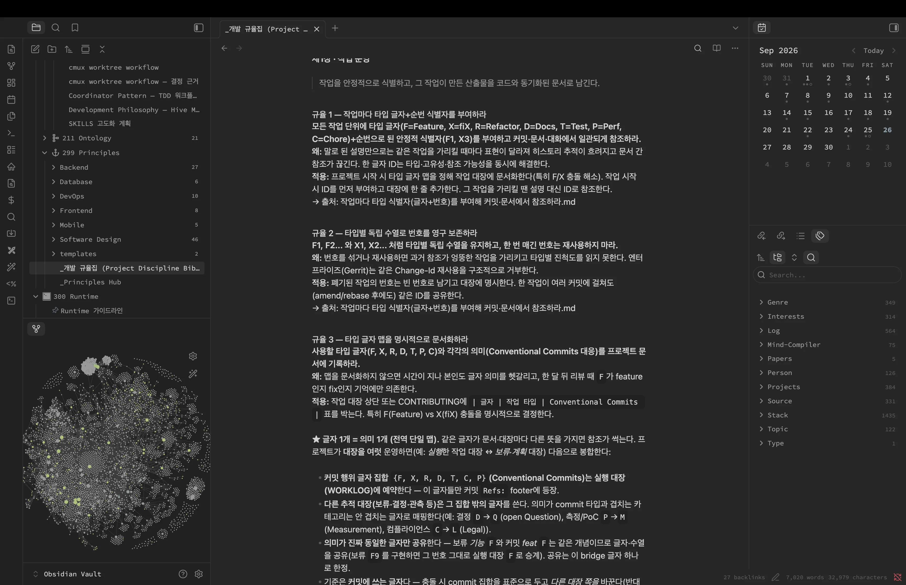
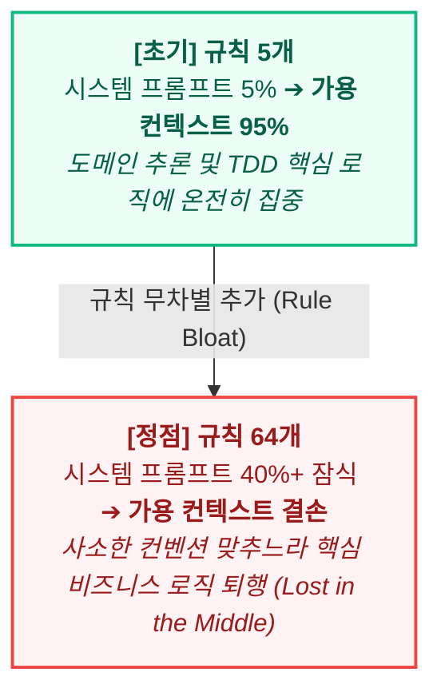
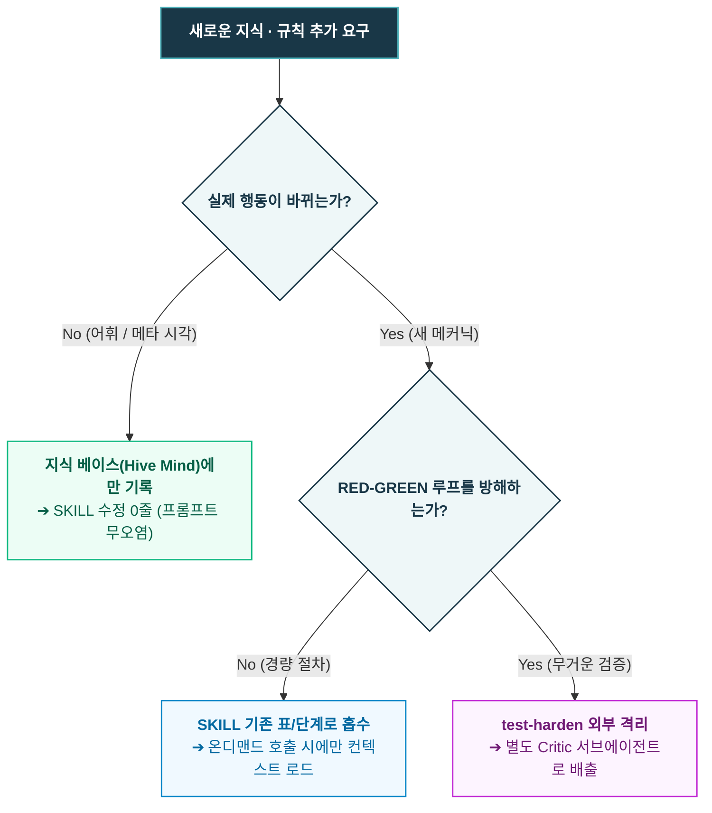
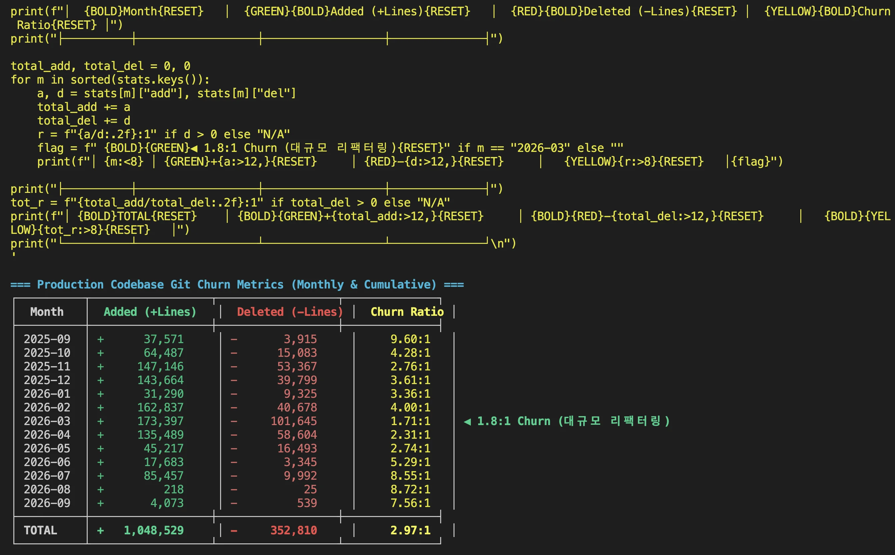

- table of contents
{:toc}

지난 [[6편]](/tag-ai-agent-architecture/6-repo-governance/)에서는 세션이 종료되면 기억을 잃어버리는 에이전트의 한계를 극복하기 위해 레포지토리 자체를 영구 기억 장치로 삼고 관리 문서 4종과 아키텍처 정본을 구축한 여정을 다루었다. 그렇게 개발 속도가 붙을수록 레포지토리 한편에서는 예상치 못한 또 다른 문제가 조용히 쌓이고 있었는데, 바로 **'규칙(Rule)'** 그 자체였다. 에이전트가 실수를 저지를 때마다 *"다시는 이런 실수를 하지 마라"*라며 지침에 규율을 한 줄씩 덧붙이다 보니, 2026년 6월에는 무려 64개 조항(수천 줄)에 달하는 방대한 『개발 규율집(Project Discipline Bible)』으로 비대해져 있었다.

두꺼운 규율집으로 빈틈없는 가드레일을 완성했다고 자부했지만 결과는 별로 좋지 못했다. 규칙이 늘어날수록 에이전트는 너무 많은 세부 규칙을 동시에 의식하려다 정작 수행해야 할 본래 과업을 잊어버리기 시작했다. 이번 글은 <mark class="kw-term">규칙 과잉(Rule Bloat)</mark>이 불러온 컨텍스트 과부하를 짚어보고, `CLAUDE.md` / `AGENTS.md` 축소·온디맨드 `Skill` 분리·결정론적 <mark class="kw-harness">하네스 훅(Hook)</mark> 이관이라는 **3계층 구조조정(<mark class="kw-term">Pruning</mark>)**, 그리고 <mark class="kw-term">/sweep</mark>을 통한 코드베이스 감량으로 컨텍스트를 다이어트해 낸 기록이다.

---

## 규칙 과잉(Rule Bloat)의 재앙과 3계층 구조조정

처음에는 소박한 주의사항 몇 줄로 시작했지만, `TDD`와 클린 아키텍처를 도입하며 에이전트의 실수가 다양해지자 사고가 터질 때마다 새로운 금지 조항을 추가해 총 64개 조항의 단일 기준 문서 『개발 규율집』 v1.0을 레포지토리 루트에 배치했다.

{:width="700" loading="lazy"}

실제 Obsidian Vault에서 관리되던 『개발 규율집(Project Discipline Bible)』. 실패를 겪을 때마다 규율 1, 2, 3처럼 규칙을 하나씩 덧붙이다 보니 어느새 64개 조항에 달하는 방대한 규율집이 되어 에이전트의 컨텍스트를 잠식하기 시작했다.
{:.figcaption}

그러나 실전에서 마주한 현실은 **'<mark class="kw-term">규칙 과잉의 역설(The Rule Bloat Paradox)</mark>'**이었다.

규칙 수 증가에 따른 프롬프트 비대화와 추론 컨텍스트 윈도우 잠식
{:.figcaption}

방대한 규율집이 시작부터 수만 토큰의 컨텍스트를 차지하면서 한정된 `LLM`의 주의력(Attention)은 코드를 읽기도 전에 고갈되었다. 수십 개의 세부 규칙이 시스템 프롬프트에 들어차자 에이전트는 **'<mark class="kw-term">Lost in the Middle(문맥 중간 소실)</mark>'** 현상을 일으키며 사소한 컨벤션을 맞추느라 정작 핵심 요구사항을 누락하거나 `TDD` 사이클을 망가뜨렸다.

그 무렵 GeekNews에서 접한 [「좋은 Claude.md 작성법」](https://news.hada.io/topic?id=24744) 아티클과 실전 시행착오를 바탕으로, 모든 규칙을 한 파일에 쑤셔 넣던 관료주의를 버리고 **3계층 구조조정**을 단행했다.

> **"항상 읽어야 할 헌법(`CLAUDE.md` / `AGENTS.md`)은 극단적으로 줄이고, 상황별 절차는 온디맨드 `Skill`로, 절대 어기면 안 되는 금지는 결정론적 `Hook`/`Linter`로 내린다."**
{:.tip title="프롬프트 거버넌스 3계층 원칙"}

1. **상시 헌법 계층 (`CLAUDE.md` / `AGENTS.md`)**: 모든 세션에서 공통으로 지켜야 할 착수 순서, 5대 정본 경로, 완료 조건 등 헌법 수준의 핵심 거버넌스 5~6개 조항(약 1,200 토큰)만 남기고 상시 프롬프트 군살을 전면 걷어냈다.
2. **온디맨드 절차 계층 (`SKILL`)**: `TDD` 계획(`/tdd-plan`), 실행(`/go`), 설계(`/design`), 리뷰(`/code-review`)처럼 특정 과업에만 필요한 세부 절차는 독립된 `SKILL`로 분리해 호출 시점에만 적시(Just-in-Time) 로드되도록 개편했다.
3. **결정론적 강제 계층 (`Hook` & `Linter`)**: 에이전트는 *"필드 하나만 추가하는 사소한 수정이라 워크트리 오버헤드가 더 큽니다"*라며 자연어 금지 조항(`MUST NOT`)을 자기합리화로 우회하곤 했다. 타협을 허용하면 안 되는 격리·무결성 규칙은 `spoke-guard.sh` **훅(Hook)**과 정적 린터(`otlg lint --strict`)로 물리적으로 틀어막았다.

여기서 **"기계(훅, 린터, CI)가 지킬 수 있는 규칙은 프롬프트에 단 한 줄도 남기지 마라"**라는 핵심 명제가 탄생했다. 하드 바운더리가 백퍼센트 확률로 막아주는 규칙을 굳이 말로 잔소리할 이유가 사라졌으므로, 수십 줄의 격리 지침을 프롬프트에서 즉시 삭제(Pruning)할 수 있었다.

---

## 확장 디시플린 3분류와 규칙 프루닝(Pruning)의 4대 기준

물리적 훅으로 위험 행동을 제어한 뒤에는 새로 배운 소프트웨어 공학 지식을 곧장 스킬에 추가하고 싶어지는 **'지식 추가의 유혹'**을 통제해야 했다. 좋은 체크리스트를 볼 때마다 즉흥적으로 `/tdd-plan`과 `/go`에 검증 단계를 덧붙였더니 에이전트가 간단한 함수 하나를 짜는 데도 과도한 검증 루프에 빠져 허우적거렸기 때문이다. 이를 막기 위해 **「<mark class="kw-term">확장 디시플린</mark>: "그때그때 추가" 금지」**라는 3단계 필터를 세웠다.

확장 디시플린 3단계 필터: 지식과 규칙을 프롬프트 바깥으로 격리하는 의사결정 트리
{:.figcaption}

- **어휘 보강 (Vocabulary)** & **인식 프레이밍 (Framing)**: 에이전트의 실제 행동 절차가 바뀌지 않고 개념 정의나 메타 시각만 선명해지는 경우라면 Obsidian 지식 베이스(<mark class="kw-ssot">Hive Mind</mark>)에만 기록하고 `SKILL` 코드는 단 한 줄도 건드리지 않는다.
- **새 운영 메커닉 (New Mechanic)**: 실제 장애(예: 422 빈 화면 사고 -> 경계 정합성 표 3종 신설)로 필요성이 입증되었을 때만 반영하되 기존 표의 컬럼으로 압축 흡수한다. Object Design Style Guide의 30여 개 테스트 규칙처럼 `RED-GREEN` 호흡을 무겁게 만드는 검증은 <mark class="kw-term">test-harden</mark> 스킬로 분리해 독립된 Critic 서브에이전트에게 <mark class="kw-isolation">격리 배출</mark>한다.

나아가 기존 64개 규율집에도 Kent Beck의 테스트 가지치기(`Tidy First`) 철학을 적용해 ① **Forces 소멸 규칙 숙청**, ② **하네스/도구 승격 규칙 삭제**, ③ **객체지향 상위 원칙으로의 포섭**, ④ **보류 항목 기록 문서(`deferred-watchlist.md`)로의 유예**라는 4대 기준으로 대대적인 **규칙 프루닝(Pruning)**을 단행했다.

---

## 규율집의 진화: 5대 정본 분업과 코드베이스 다이어트 (`/sweep`)

모체였던 64개 조항 『개발 규율집』 자체도 상시 프롬프트가 아닌 **'새 프로젝트 부트스트랩 설치 가이드 및 참조 카탈로그'**로 재정의했다. 특히 [[6편]](/tag-ai-agent-architecture/6-repo-governance/)에서 썼던 `docs/features/` 수기 기능 명세서가 병렬 개발 가속과 함께 이중 관리 부담이 되자 이를 폐지하고, 도메인 엔티티·액션·불변식·실제 코드 위치(`code_binding`)를 하나로 묶은 **레포지토리 온톨로지(`.ontology/`)**로 완전 흡수해 저장소 내 문서를 **5대 정본(SSOT)**으로 일원화했다.

1. **규범 (`AGENTS.md`)**: 모든 세션이 시작할 때 읽는 에이전트 헌법이다. 작업 착수 순서, 금지·강제 경계, 다른 정본 문서들의 위치와 완료 조건만 간결하게 담고 하네스 훅과 CI로 준수 여부를 검증한다(`CLAUDE.md`는 이 문서를 가리키는 얇은 어댑터로만 둔다).
2. **도메인 계약 (`.ontology/`)**: 기존 수기 기능 명세(`docs/features/`)를 흡수한 도메인 온톨로지다. 도메인 객체·행위·불변 규칙과 아키텍처 의존 방향, 테스트 계약을 실제 소스 코드 위치와 묶어 두고 정적 린터(`otlg lint --strict`)와 계약 테스트로 상시 검증한다.
3. **현재 구조 (`docs/architecture/`)**: arc42 템플릿과 C4 다이어그램으로 현재 시스템의 전체 구조와 품질 요구사항을 설명하며, 별도 파일로 흩어져 있던 기술 부채도 이곳의 위험·부채 섹션(§11)으로 통합해 실제 코드·배포 설정과 대조한다.
4. **결정 근거 (`docs/adr/`)**: 대안 비교와 특정 설계를 선택한 이유(Why), 그로 인해 감수할 결과를 시간순으로 남기며 온톨로지 규칙과 양방향으로 참조한다.
5. **실행 및 보류 기록 (`WORKLOG.md` · `deferred-watchlist.md`)**: 당월의 작업·검증 이력(지난달 기록은 월별 폴더로 아카이빙)과 당장 착수하지 않는 보류 항목을 관리하며, 실제 코드 변경분과 테스트 실행 증거로 완료를 대조한다.

- [심화 근거: 64개 규칙 전수 구조조정(Rule Pruning) 분류표와 CLAUDE.md·Skill·Hook 3계층 라우팅 명세 보러가기](/tag-ai-agent-architecture/deep-dive/worktree-and-repo-governance/#rule-pruning-and-skills)
- [연계 글: `.ontology/` 3-Graph 컴파일러와 5대 정본 Living Wiki 자가 갱신 루프 상세 보러가기 (온톨로지 엔지니어링 4·5편)](/tag-ontology-engineering/5-sdlc-harness-and-living-wiki/)

마지막으로 에이전트가 매일 쏟아내는 **코드베이스 자체의 비대화**에도 메스를 댔다. '추가(Add)'에는 능숙하지만 '삭제(Delete)'에는 소극적인 에이전트 특성을 억제하기 위해, 12개 축(400줄 초과 비대 파일, 중복 테스트, 미사용 `import`/의존성/환경변수, 죽은 코드, 문서 불일치, Pass-through 계층, `N+1` 쿼리 등)을 기계적으로 스캔해 감량 처방전을 내리는 정기 종합검진 스킬 **`<mark class="kw-term">/sweep</mark>`**과, 메서드 시그니처 계약서를 동결한 채 거대 모듈을 안전하게 쪼개는 **`<mark class="kw-term">safe-decompose</mark>`** 스킬을 도입했다.

{:width="700" loading="lazy"}

실제 프로덕션 코드베이스에서 집계한 Git log 월별 추가/삭제 라인 수. 100만 줄 이상의 코드가 누적되는 과정에서도 전체 Churn 비율을 2.9:1(2026-04 실측 기준 2.80:1)로 방어했고, 특히 대규모 구조 개편을 진행했던 2026년 3월에는 1.71:1(1.8:1)을 기록하며 신규 작성된 코드만큼 낡은 코드를 깎아냈음을 보여준다.
{:.figcaption}

이 정기 검진과 `TDD` 안전망 덕분에 **394,000줄 규모의 프로덕션 코드베이스**를 공격적으로 확장하는 와중에도 전체 누적 **<mark class="kw-term">Churn(추가/삭제) 비율을 2.80:1</mark>**(2026년 3월에는 **1.81:1**)로 방어해 낼 수 있었다.

---

## 완벽한 규칙이란 더 이상 뺄 것이 없는 상태다

> *"완벽함이란 더 이상 보탤 것이 없을 때가 아니라, 더 이상 뺄 것이 없을 때 마침내 이루어진다."* (앙투안 드 생텍쥐페리)

지속 가능한 엔지니어링 운영체계란 규칙과 코드를 끝없이 덧붙이기만하는 작업이 아니라, 무엇을 남기고 무엇을 기계와 계약으로 이관할지 끊임없이 솎아내는 정제 과정이었다. 불필요한 것을 상시 프롬프트에서 걷어내고, 수기 기능 명세는 `.ontology/` 계약으로 일원화하며, 치명적 경계선은 하네스 훅(`spoke-guard.sh`)과 린터로 가로막고, 코드베이스까지 `/sweep`으로 깎아내면 에이전트의 컨텍스트 윈도우에는 당장 눈앞의 문제를 해결하는 데 필요한 가장 명징한 계약만 남게 된다. 다음 글인 **[[8편] 어차피 도커인데 앤서블은 왜 썼을까](/tag-ai-agent-architecture/8-cloud-infra-evolution/)**에서는 이렇게 다듬어진 애플리케이션을 1인 팀이 클라우드에 무중단으로 배포·운영하기까지의 인프라 변천사를 다뤄보겠다.
