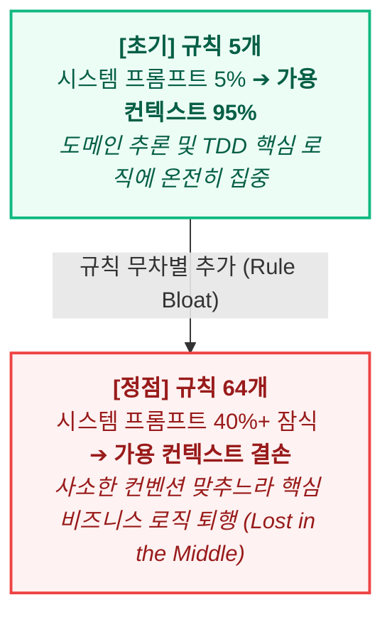
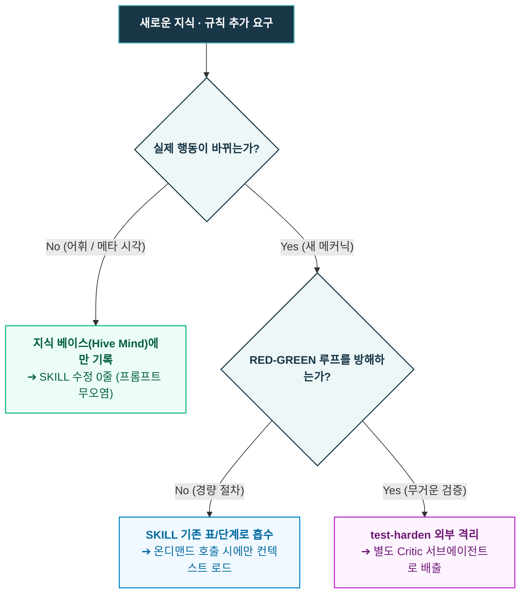

- table of contents
{:toc}

지난 [[6편]](/tag-ai-agent-architecture/6-repo-governance/)에서는 세션이 종료되면 모든 기억을 잃어버리는 AI 에이전트의 구조적 한계를 극복하기 위해, 저장소 자체를 영구 기억 장치로 삼고 관리 문서 4종(`WORKLOG.md`, `docs/deferred-watchlist.md`, `docs/tech-debt.md`, `docs/adr/`)을 구축했던 여정을 다루었다. 그렇게 시스템이 견고해지고 개발 속도가 붙을수록 저장소 이면에서는 또 하나의 거대한 괴물이 조용히 몸집을 불리고 있었는데, 그것은 다름 아닌 **'규칙(Rule)'** 그 자체였다. AI 에이전트와 페어 프로그래밍을 진행하며 버그를 만나거나 엉뚱한 결과물을 마주할 때마다 나는 *"다시는 이런 실수를 하지 마라"*라는 마음으로 프롬프트 지침과 시스템 문서에 규율을 한 줄씩 덧붙이곤 했다. 2025년 여름부터 실패가 발생할 때마다 차곡차곡 쌓아 올린 자연어 지침들은 2026년 6월에 이르러 무려 64개 조항에 달하는 방대한 『개발 규율집(Project Discipline Bible)』으로 비대해져 있었다.

당시에는 그 두꺼운 규율집을 보며 비로소 빈틈없는 가드레일을 완성했다고 자부했지만, 실제로 마주한 결과는 처참한 역설에 가까웠다. 규칙이 늘어날수록 에이전트가 더 똑똑해지기는커녕, 너무 많은 세부 규칙을 동시에 의식하려다 정작 수행해야 할 본래의 과업을 잊어버리는 등 의도한 대로 동작하지 않기 시작했기 때문이다. 결국 에이전트가 핵심 원칙을 온전히 지키게 만들기 위해서는 내가 애지중지 쌓아 올렸던 규칙들을 우선순위에 따라 과감히 버려야만 했다. 이번 글은 <mark class="kw-term">규칙 과잉(Rule Bloat)</mark>이 불러온 컨텍스트 과부하의 재앙을 짚어보고, 자연어 지침에 대한 환상을 깨트린 뒤 <mark class="kw-harness">하네스 훅(Hook)</mark>으로의 결정론적 이관과 과감한 <mark class="kw-term">프루닝(Pruning)</mark>, 그리고 <mark class="kw-term">/sweep</mark>을 통한 코드베이스 감량으로 에이전트의 컨텍스트를 다이어트해 낸 실전 엔지니어링 기록이다.

---

## 규칙을 너무 많이 만들었다: 규칙 과잉(Rule Bloat)의 재앙

처음에는 몇 줄의 소박한 메모로 시작했다. 터미널에서 AI 에이전트와 본격적으로 씨름하기 시작했을 무렵만 해도 "메인 커밋 메시지는 한 줄로 요약할 것"이나 "함수는 30줄을 넘기지 말 것" 같은 소박한 주의사항 몇 줄이 전부였기 때문이다. 하지만 프로젝트 규모가 커지고 도메인이 복잡해지는 과정에서 `TDD`와 클린 아키텍처를 본격적으로 도입하자, 에이전트가 저지르는 실수의 양상도 기하급수적으로 다양해지기 시작했다. 테스트를 통과하지도 않은 채 커밋을 시도하거나, 데이터베이스 마이그레이션 파일과 UI 컴포넌트를 한 프롬프트에서 동시에 건드리고, 기존 설계를 뒤흔드는 리팩터링을 상의 없이 감행하거나 <mark class="kw-term">ADR(Architecture Decision Record)</mark>도 남기지 않고 라이브러리를 교체하는 식의 사고가 터질 때마다 나는 반사적으로 새로운 금지 조항을 추가했다. 그렇게 2026년 6월 17일, 볼트에 흩어져 있던 설계 원칙과 실전 수칙들을 모두 그러모아 6개 클러스터와 5개 도메인 정찰, 외부 레퍼런스 대조를 거친 총 64개 조항의 단일 기준 문서 『개발 규율집(Project Discipline Bible)』 v1.0을 완성하기에 이르렀다. 이 문서만 레포지토리 루트에 던져두면 에이전트가 알아서 부트스트랩을 점검하고 모든 코드를 규율에 맞춰 완벽하게 짜줄 것이라 기대했던 셈이다.

{:width="700" loading="lazy"}

실제 Obsidian Vault에서 관리되던 『개발 규율집(Project Discipline Bible)』. 실패를 겪을 때마다 규율 1, 2, 3처럼 규칙을 하나씩 덧붙이다 보니 어느새 64개 조항에 달하는 방대한 규율집이 되어 에이전트의 컨텍스트를 잠식하기 시작했다.
{:.figcaption}

그러나 기대와 달리 실전에서 마주한 현실은 **'<mark class="kw-term">규칙 과잉의 역설(The Rule Bloat Paradox)</mark>'**이었다.

규칙 수 증가에 따른 프롬프트 비대화와 추론 컨텍스트 윈도우 잠식
{:.figcaption}

방대한 규율집이 시작부터 수만 토큰의 컨텍스트를 차지하면서 에이전트의 컨텍스트 윈도우는 코드를 읽기도 전에 턱 밑까지 차올랐다. `LLM`의 주의력(Attention)은 본질적으로 한정된 자원인데, 수십 개의 세부 규칙이 시스템 프롬프트에 빽빽하게 들어차자 에이전트는 **'<mark class="kw-term">Lost in the Middle(문맥 중간 소실)</mark>'** 현상을 일으키며 규칙의 홍수 속에서 길을 잃기 시작했다. 당장 풀어야 할 비즈니스 로직의 복잡한 조건 분기나 도메인 모델의 엣지 케이스를 분석하는 데 쓰여야 할 인지 용량(Reasoning Capacity)이 "규칙 42번에 명시된 네이밍 컨벤션을 어기지 말아야지"라거나 "규칙 58번의 가드레일 양식을 맞춰야지" 같은 부수적 제약을 연산하느라 전부 소진되어 버린 것이다. 그 결과 사소한 규칙 50개를 신경 쓰느라 정작 핵심 요구사항을 누락하거나, 가장 중요한 `TDD` `RED-GREEN` 사이클의 근본을 망가뜨리는 기괴한 준수율 폭락과 추론 퇴행이 빈번하게 벌어졌다.

그 무렵 GeekNews에서 접한 [「좋은 Claude.md 작성법」](https://news.hada.io/topic?id=24744) 아티클은 프롬프트 운영 방식을 근본부터 다시 점검하는 중요한 계기가 되었다.

> **"CLAUDE.md(시스템 프롬프트)는 최대한 짧고 단단하게 유지하라. 온갖 작업 지침을 한 파일에 쑤셔 넣는 것은 모델의 지능을 떨어뜨리는 지름길이다."**
{:.tip title="프롬프트 거버넌스 원칙"}

모든 상황별 규칙을 한 파일에 몰아넣고 상시 주입하려 했던 시도는 에이전트의 인지 구조를 무시한 나의 관료주의적 통제 욕심에 불과했다. 문제를 해결하기 위해 나는 기존의 단일 규율집 구조를 과감히 뒤집어 두 가지 방향의 구조 개편을 단행했다:
1. **루트 지침(`CLAUDE.md`)의 극단적 축소**: 모든 세션에서 공통으로 지켜야 할 프로젝트 헌법 수준의 핵심 거버넌스 5~6개 조항만 남기고 본문의 군살을 전면 다이어트했다.
2. **`SKILL`을 통한 적시(Just-in-Time) 온디맨드 주입**: `TDD` 계획 수립이나 DB 설계, 배포, 코드 리뷰처럼 특정 과업에만 필요한 세부 절차와 지침은 각각 독립된 디렉토리의 **`SKILL`**로 분리하여, 해당 작업이 실제로 호출되는 시점에만 컨텍스트에 로드되도록 개편했다.

---

## 말(자연어)로 쓴 규칙의 허상: 지키게 하려면 프롬프트에서 지워라

루트 지침을 덜어내고 스킬을 분리해 컨텍스트의 숨통을 틔워주었음에도, 실전 프로젝트 현장에서는 여전히 뼈아픈 규칙 위반 사고가 심심치 않게 터져 나왔다. 그중에서도 가장 치명적이었던 사례는 작업 공간 격리 규칙이 무너진 일이었다. 나는 에이전트에게 *"긴 직렬 작업이나 큰 변경은 반드시 허브(Main)에서 직접 하지 말고, 별도의 격리된 `git worktree`(스포크)를 생성하여 진행하라"*고 명확히 지시해 두었지만, 이 규칙은 바쁜 실무 흐름 속에서 너무나도 쉽게 무시되곤 했다. 자연어로 적힌 지침은 `LLM`에게 절대 어길 수 없는 물리 법칙이 아니라, 문맥과 상황에 따라 유연하게 타협할 수 있는 '권고사항(Should)' 정도로 받아들여졌기 때문이다.

실제로 겪어본 에이전트는 인간과 놀라울 정도로 비슷하게 편한 길을 택하려 하는 **'자기합리화의 천재'**에 가까웠다:
- *"이 작업은 단순히 입력 폼의 필드 하나를 추가하는 사소한 작업이므로, 굳이 새 워크트리를 파는 오버헤드를 감수하기보다 허브에서 직접 수정하는 것이 전체적인 생산성 면에서 유리합니다."*
- *"데이터베이스 마이그레이션과 검색 API 엔드포인트 수정은 긴밀하게 결합되어 있으므로, 지금 세션에서 한꺼번에 인라인으로 수정하는 것이 맥락 유지에 좋습니다."*

에이전트는 이처럼 그럴듯한 변명을 스스로 만들어내며 규칙을 우회했고, 메인 워크스페이스에서 곧바로 마이그레이션 파일을 건드리거나 수십 개의 소스 코드를 마구잡이로 수정해 버리는 대형 사고(WS-03, WS-06 실제 사고)를 일으켰다. 자연어로 작성된 규칙의 한계는 명확할 수밖에 없었는데, 프롬프트에 `MUST`, `CRITICAL`, `NEVER`, `DO NOT`을 대문자로 적어 넣고 느낌표를 세 개씩 붙여 강조해 보아도 모델의 생성 확률 분포 안에서는 언제나 "이번 한 번만 예외로 처리하자"는 편리한 틈새로 빠져나가기 마련이었기 때문이다.

### 스킬로는 강제할 수 없다: 하드 바운더리와 프루닝

많은 개발자가 이러한 규칙 위반을 막아보고자 프롬프트 지침을 더 촘촘하게 늘이거나 `/spoke`, `/plan` 같은 전용 슬래시 커맨드와 스킬을 추가로 정의하곤 한다. 하지만 스킬 역시 어디까지나 모델이 '지금 호출할지 말지를 스스로 판단'하는 도구일 뿐이기에, 모델이 자체적인 추론 끝에 "지금은 굳이 쓸 필요가 없겠는데?"라고 넘겨버리면 아무런 제동력을 발휘하지 못한다. 결국 모델의 자의적 판단이 개입할 수 있는 통로는 결코 완벽한 '강제 가드레일'이 될 수 없는 셈이다. 지난 [[5편]](/tag-ai-agent-architecture/5-cmux-parallel-worktree/)에서 상세히 다루었듯, 모델의 자의적 타협을 원천 차단하고 <mark class="kw-harness">결정론적(Deterministic) 강제</mark>를 실현하는 유일한 수단은 하네스 런타임이 파일 시스템과 프로세스 수준에서 물리적으로 틀어막는 **훅(Hook)**뿐이었다.

바로 이 지점에서 1인 개발 운영체계를 지탱하는 가장 역설적이면서도 핵심적인 거버넌스 명제가 탄생했다:
> **"기계(훅, 린터, CI)가 지킬 수 있는 규칙은 프롬프트에 단 한 줄도 남기지 마라."**

마이그레이션 변조나 크로스스택 수정, 대량 파일 변경 같은 위험 행동을 하네스 훅(`spoke-guard.sh`)이라는 <mark class="kw-harness">하드 바운더리(Hard Boundary)</mark>로 물리적으로 차단하고, 차단당한 에이전트가 자연스럽게 우회해 들어갈 수 있는 `/spoke` 스킬을 <mark class="kw-isolation">준수 경로(Compliance Path)</mark>로 열어두자 상황은 단번에 정리되었다. 기계가 백퍼센트 확률로 막아주는 규칙을 모델에게 굳이 말로 잔소리할 이유가 사라졌으므로, **프롬프트에서 에이전트를 장황하게 훈계하던 수십 줄의 작업 격리 지침은 그 즉시 삭제(Pruning)**할 수 있었다. 반드시 지키게 만들고 싶은 규칙이 있다면 자연어로 설득하려 애쓰는 대신 결정론적인 훅과 린터의 영역으로 이관하고, 프롬프트에서는 그 규칙을 미련 없이 지워버리는 것이 컨텍스트 다이어트와 규칙 프루닝의 첫 번째 단추였다.

---

## 확장 디시플린 3분류: 스킬에 넣을 것과 절대 넣지 말아야 할 것

물리적 강제 장치인 훅으로 위험 행동을 제어하고 나자, 이번에는 내 안에서 자라나는 또 다른 차원의 유혹과 싸워야 했다. 바로 새로 배운 지식을 곧장 시스템에 반영하고 싶어지는 **'지식 추가의 유혹'**이었다. 실무 개발을 병행하며 Matthias Noback의 『오브젝트 디자인 스타일 가이드』를 필사하고 The Passionate Programmer의 David Bernstein 강연 영상 25편을 분석하는 동안, 좋은 설계 패턴이나 날카로운 분석 렌즈를 접할 때마다 *"에이전트가 `TDD`를 돌릴 때 이 체크리스트도 검사하게 만들어야겠어!"* 혹은 *"이 3대 렌즈 시각은 너무나 유용하니 당장 `/tdd-plan` 프롬프트에 넣자!"*라는 열망이 불쑥 치밀어 오르곤 했다. 그렇게 새로운 통찰을 얻을 때마다 즉흥적으로 `SKILL` 파일에 지침과 검증 단계를 덧붙인 결과, 2026년 4월 말 무렵 우리의 핵심 `TDD` 스킬인 `tdd-plan`과 `go`는 내부 번호 체계가 뒤틀리고 분석·설계·구현의 시점 구분이 완전히 붕괴되는 파국을 맞이했다. 너무 많은 검증 단계를 한꺼번에 짊어진 에이전트가 간단한 함수 하나를 구현하는 데도 끝없는 자가당착에 빠져 허우적거렸던 것이다.

2026년 4월 29일 저녁, 나는 비대해져 무너진 스킬들을 전면 해체해 재조립하면서 새로운 지식이 무분별하게 실행 프롬프트로 흘러들지 못하도록 **「<mark class="kw-term">확장 디시플린</mark>: "그때그때 추가" 금지」** 원칙이라는 방어선을 세웠다.

| 분류 | 정의 | 처리 방식 | 실전 사례 |
|:---|:---|:---|:---|
| **1. 어휘 보강 (Vocabulary)** | 기존 단계가 이미 다루던 개념을 더 명확한 단어로 정의 | **<mark class="kw-ssot">Hive Mind</mark>에만 기록** (SKILL 코드 0줄 변경) | Strategy vs Factory 공간적 누수 명명 (Ep.16/17) |
| **2. 인식 프레이밍 (Framing)** | 워크플로우를 다른 각도에서 조망하는 메타 시각 | **<mark class="kw-ssot">Hive Mind</mark>에만 기록** (SKILL 코드 0줄 변경) | 구조 3대 렌즈 (Ep.13), 중복을 설계 신호로 보기 (Ep.15) |
| **3. 새 운영 메커닉 (New Mechanic)** | 에이전트가 수행할 새로운 행동·검증 게이트·산출물 | **실제 사고(Forces) 입증 시에만 반영** (단, 기존 표 컬럼/행으로 흡수) | 청구 기능 422 빈 화면 사고 ➔ 경계 정합성 표 3종 신설 |

**<mark class="kw-ssot">Hive Mind</mark>**란, 이 시리즈를 통해 이야기하고 있는 모든 AI Agent 워크플로우를 총망라하여 Obsidian에 정리해놓은 markdown 파일의 이름이다.
{:.note title="참고"}

이 기준에 따라 아무리 훌륭한 소프트웨어 공학 통찰을 발견하더라도 무작정 스킬 파일을 열지 않고 **3단계 필터**를 엄격히 거치도록 강제했다:
1. **어휘 보강 (Vocabulary)**: 에이전트의 실제 행동 절차가 바뀌지 않고 개념만 선명해지는 경우라면 <mark class="kw-ssot">Hive Mind</mark> 지식 문서에만 기록하고 `SKILL` 코드는 단 한 글자도 건드리지 않는다.
2. **인식 프레이밍 (Framing)**: 워크플로우를 바라보는 메타 시각에 해당한다면 마찬가지로 개인 지식 베이스에만 남겨둔다.
3. **새 운영 메커닉 (New Mechanic)**: 오직 실제 프로덕션 장애나 치명적인 누락 사례(Forces)가 현장에서 명확히 입증되었을 때만 `SKILL` 변경을 허용하되, 새로운 단계를 늘리는 대신 기존 표의 컬럼이나 행으로 압축해 흡수한다.

나아가 실제 사고로 입증된 새 메커닉이라 할지라도, 그것이 빠른 `RED-GREEN-REFACTOR` 마이크로 사이클의 호흡을 무겁게 만든다면 기본 루프에 넣는 대신 과감히 외부로 분리했다. 예를 들어 Object Design Style Guide에서 추출한 30여 개의 엄격한 테스트 설계 규칙은 메인 에이전트의 구현 컨텍스트를 오염시키지 않도록 <mark class="kw-term">test-harden</mark>이라는 별도의 외부 스킬로 떼어내고, 기능 구현이 끝난 직후 독립된 Critic 서브에이전트에게 <mark class="kw-isolation">격리 배출</mark>하여 검증하게 만들었다. 내가 새로 배운 지식을 자랑하듯 프롬프트에 욱여넣는 대신, 개념적 통찰은 지식 베이스(`Hive Mind`)에 머물게 하고 에이전트가 매 순간 읽어야 하는 실행 스킬(`SKILL`)은 극도로 간결하고 순수하게 유지하는 절제가 에이전트의 추론 지능을 지키는 핵심 비결이었던 셈이다.

확장 디시플린 3단계 필터: 지식과 규칙을 프롬프트 바깥으로 격리하는 의사결정 트리
{:.figcaption}

---

## 규칙을 버리는 용기 (프루닝, Pruning)

새로운 지식이 함부로 스킬에 유입되지 못하도록 방어선을 세우는 것만으로는 절반의 해결에 불과했다. 이미 지난 수개월 동안 켜켜이 쌓여 규율집과 프롬프트 곳곳에 들러붙어 있는 기존의 '규칙 부채'를 본격적으로 덜어내야 했기 때문이다. 이 막막한 감량 작업에서 결정적인 실마리를 제공해 준 것은, 아이러니하게도 같은 시기 테스트 코드의 병목을 해결하기 위해 파고들었던 **Kent Beck의 `TDD` <mark class="kw-term">테스트 프루닝(Pruning, 가지치기)</mark>** 철학이었다. 2026년 7월 말 당시 우리 프로젝트는 `tdd-plan`을 충실히 따르며 매 기능마다 테스트를 정직하게 쌓아 올린 끝에 테스트 코드가 구조적으로 선형 증가(`O(N)`)만 거듭하고 있었고, 급기야 통합 테스트 스위트가 한 번 도는 데만 48초가 소요되면서 빠른 피드백이 생명인 `TDD` 사이클 전체가 마비되는 위기에 처해 있었다.

그 병목을 돌파하기 위해 딥리서치로 확인했던 켄트 벡의 실제 테스트 관리 관행은 내 고정관념을 깨뜨리기에 충분했다:

> *"리팩터링 도중 서브컴포넌트를 추출하여 작고 빠른 단위 테스트(IO-Pure-IO)를 작성하고 나면, 그 단위 테스트들에 의해 완전히 포섭된 상위 시스템/통합 테스트는 가차 없이 삭제(pruning)한다. 시스템 레벨 테스트는 오직 전체적인 배선(Wiring)과 격리를 검증하는 최소한의 1개만 남겨둔다."*  
> (Kent Beck, Tidy First)
{:.note title="Kent Beck의 프루닝 관행"}

테스트 코드란 한 번 작성하면 영구히 보존해야 하는 기념비가 아니라, 하위 단위 테스트로 안전망이 이전되면 미련 없이 베어내야 하는 정원수에 가까웠다. 그 원리를 곱씹던 나는 **"프롬프트의 규칙 또한 테스트 코드와 완전히 똑같다"**는 사실을 명확히 깨달을 수 있었다. 개발자들은 장애나 버그가 터질 때마다 두려움에 쫓겨 프롬프트에 규칙을 추가하곤 하지만, 시간이 흘러 근본적인 아키텍처가 개선되고 물리적인 안전장치가 갖춰진 뒤에도 한 번 적힌 규칙은 지워지지 않은 채 영원히 프롬프트에 남아 에이전트의 컨텍스트를 갉아먹기 마련이다.

나는 비대해진 테스트 스위트를 가지치기하듯, 기존 규칙 스위트에도 네 가지 명확한 프루닝 기준을 들이대어 대대적인 정리를 단행했다:
1. **Forces 소멸 규칙의 숙청**: 과거의 특정 버그나 미숙한 구조 때문에 임시로 만들었지만, 이후 아키텍처 개편으로 인해 원천적인 발생 조건(Forces) 자체가 사라진 규칙은 즉시 삭제한다.
2. **하네스/도구로 승격된 규칙의 삭제**: `spoke-guard.sh` 같은 런타임 훅이나 정적 린터가 기계적으로 차단하기 시작한 규칙은 자연어 프롬프트에서 깨끗이 지워 중복 소비를 막는다.
3. **상위 원칙으로의 포섭**: 자잘한 10개의 코딩 금지 조항이 객체지향 설계 원칙(예: "원시 타입을 값 객체로 감싸라", "`CQS`에 따라 조회와 변경을 분리하라") 하나로 설명될 수 있다면, 지엽적인 미세 규칙을 모두 버리고 상위 원칙 하나만 남긴다.
4. **보류 관리 문서로의 유예 (Deferred Watchlist)**: 당장 이번 스프린트에서 강제할 실익이 적거나 검증에 드는 인지 비용이 더 큰 규칙은 활성 프롬프트에서 빼내어 `docs/deferred-watchlist.md`에 조용히 주차해 둔다.

프롬프트에 규칙 한 줄을 덧붙이는 데는 단 몇 초면 충분하지만, 이미 적혀 있는 규칙을 지워내는 데는 적지 않은 공학적 확신과 용기가 필요했다. 그러나 이미 역할을 다했거나 기계적 장치로 대체된 규칙들을 과감히 베어내지 않는 한, 에이전트의 컨텍스트 윈도우는 머지않아 다시 질식할 수밖에 없었을 것이다.

---

## 규율집 자체의 진화: 상시 잔소리에서 '부트스트랩 계약'과 '온톨로지 정본'으로

프롬프트와 스킬에서 군살을 덜어내고 나니, 시선은 자연스럽게 이 모든 문제의 출발점이었던 볼트의 **『개발 규율집(Project Discipline Bible)』** 그 자체로 향했다. 실행 프롬프트는 가벼워졌는데 정작 모체가 되는 규율집이 초기 형태(v1.0) 그대로 머물러 있다면 언제든 다시 규칙의 파편화와 중복 관리가 재발할 수밖에 없었기 때문이다. 최근 코드 도메인 온톨로지(`repo-ontology`, `otlg`)와 아키텍처 문서 체계를 갈고닦으면서, 나는 그 경험을 역수입해 64개 조항의 개발 규율집 자체를 전면 개편했다.

가장 먼저 바꾼 것은 **규율집이라는 문서의 정체성**이었다. 개편된 규율집의 서두에는 *"규율집 전문을 상시 컨텍스트에 복사하지 않는다"*는 문장이 박혀 있다. 이 문서는 매 세션 에이전트의 머릿속에 통째로 밀어 넣는 상시 프롬프트가 아니라, **새 프로젝트를 시작하는 에이전트가 최초로 읽고 저장소의 작업 체계(`AGENTS.md`, 도메인 계약, 문서 진입점, 검증 절차)를 설치(Bootstrap)하는 가이드**이자 작업 도중 판단 근거가 필요할 때만 펼쳐보는 **참조 카탈로그**로 재정의되었다. 핵심은 **"기억해야 할 당부를 검증 가능한 계약으로 옮기는 것"**이었다. 이후의 모든 세션은 무거운 규율집 대신 프로젝트 루트에 설치된 가벼운 `AGENTS.md`와 작업에 필요한 정본 계약만 읽고 움직인다.

### `docs/features/` 수기 기능 명세를 `repo-ontology`로 흡수하다

규율집을 개편하며 내린 가장 굵직한 구조적 결단은, 지난 [[6편]](/tag-ai-agent-architecture/6-repo-governance/)에서 구축해 요긴하게 써왔던 **`docs/features/` 기반의 수기 기능 명세서와 목차를 필수 산출물에서 과감히 걷어내고, 이를 레포지토리 온톨로지(`.ontology/`)에 완전히 흡수시킨 것**이었다.

도입 초기만 해도 기능마다 `docs/features/{기능}.md` 파일을 만들고 API 경로와 변경 이력을 적어두는 방식은 에이전트의 온보딩 시간을 크게 줄여주었다. 하지만 병렬 에이전트 체제에서 개발 속도가 기하급수적으로 빨라지자, 코드가 바뀔 때마다 수기 마크다운 명세서와 목차를 항상 최신으로 업데이트하는 일 자체가 비효율적인 오버헤드이자 이중 관리 부담으로 다가왔다. 무엇보다 내가 별도로 구축해 고도화하고 있던 **`repo-ontology`(`.ontology/`)**가 이미 도메인의 실체(`Objects`·`Links`), 상태 전이와 사전 조건(`Actions`·`Functions`·`Rules`), 화면 연결(`Views`), 그리고 실제 소스 코드 위치(`code_binding`)까지 그 기능이 가진 모든 맥락을 훨씬 더 정밀하고 기계 가독성 높은 형태로 포괄하고 있었다.

결국 `.ontology/`가 도메인 계약과 실제 코드 좌표를 하나로 묶어 쥐고 있는데, 같은 내용을 자연어 줄글로 풀어쓴 `docs/features/`를 따로 유지할 이유가 없었다. 나는 즉시 규율집의 낡은 규율들("기능 문서를 작성하고 목차를 유지하라")을 전면 개정하여 수기 기능 명세를 폐지하고, **도메인 계약과 코드 바인딩을 `.ontology/` 단일 정본에서 관리하며 착수 시 `otlg info`, `otlg trace <query> --json`, `otlg translate <screen>` 조회로 작업 맥락을 복원**하도록 일원화했다. (이 레포지토리 온톨로지의 구체적인 구조와 구축 과정은 후속 연재인 **[온톨로지 엔지니어링 시리즈](/tag-ontology-engineering/)**의 **[[4편] 에이전트에게 매번 설명하기 귀찮다면 레포지토리가 직접 말하게 하면 되지 않을까](/tag-ontology-engineering/4-repo-ontology-primitives-and-trace/)**에서 깊이 있게 다룬다.)

### 중복 서술을 금지하는 5대 정본 분업과 검증 경계의 명문화

수기 기능 문서를 온톨로지로 통합하면서, 저장소 안의 나머지 문서들도 같은 규칙이나 설명을 여러 곳에 중복해서 적지 않도록 **다섯 가지 정본(SSOT) 역할**로 명확히 재편했다.

| 역할 | 정본과 권장 경로 | 담을 내용 (단일 책임) | 검증 책임 |
|:---|:---|:---|:---|
| **1. 규범** | `AGENTS.md` | 착수 순서, 금지·강제, 정본 위치, 실행할 검사, 완료 조건 (`CLAUDE.md` 등은 이를 읽게 하는 얇은 어댑터) | 에이전트·리뷰, 설치된 훅과 CI |
| **2. 도메인 계약** | `.ontology/` | `docs/features/`를 흡수한 `Objects`·`Links`·`Actions`·`Functions`·`Rules`와 선택적 `Views`, 실제 `code_binding` | `otlg` 정적 검사 + 구현·행동 테스트 |
| **3. 현재 구조** | `docs/architecture/` | `arc42`의 현재 구조·운영·품질 요구, `C4` 그림, 데이터 구조 설명 (기술 부채는 `arc42 §11`을 기본 정본으로 통합) | 코드·배포 설정과 대조 |
| **4. 결정 근거** | `docs/adr/NNNN-제목.md` | 대안, 결정의 이유(`Why`)와 결과, 상태 | 리뷰, 후속 ADR로 결정 대체 |
| **5. 실행 기록** | `WORKLOG.md`, `docs/deferred-watchlist.md` | 작업·핵심 판단·검증 이력(당월 활성 유지 및 `docs/worklog/YYYY-MM.md` 월별 아카이빙), 미해결 사항과 재개 트리거 | 변경 `diff`와 실제 실행 증거 대조 |

아울러 온톨로지나 규칙 문서를 선언해 두었다고 해서 모든 제약이 마법처럼 강제된다는 환상을 경계하기 위해, 규율집 안에 **'정적 검사와 실제 강제의 경계'**를 직접 명문화했다. 예를 들어 `otlg lint --strict`는 참조 무결성과 바인딩된 코드 파일·심볼 문자열의 존재 여부를 확인하는 정적 검사일 뿐, 실제 함수의 권한·상태 전이·트랜잭션 동작은 행동 테스트(`TDD`)가 증명해야 하고, 비인가 파일 수정 차단은 설치된 하네스 훅(`spoke-guard`)과 CI가 담당해야 한다는 식이다. 심지어 CLI가 `WARNING`만 있을 때 종료 코드 `0`을 반환하는 동작과 진정한 `0 violations`(ERROR·WARNING 전무)를 엄격히 구분하도록 못 박고, 매 작업이 끝날 때는 **① 계약 동기화(`.ontology/` 바인딩 갱신) ➔ ② 검증(`otlg lint --strict` 및 행동·통합 테스트) ➔ ③ 구조·결정·미해결 반영(`arc42`·`C4`·`ADR`·보류 목록) ➔ ④ 작업 기록과 인계(`WORKLOG.md`)**의 4단계 환류 절차로 다음 세션에 넘겨주도록 64개 규율 전체의 실행 책임을 재정렬했다.

---

## 코드베이스 다이어트: `/sweep`과 2.8:1 Churn 방어의 실측

프롬프트와 규율집의 군살을 걷어내고 나자, 시선은 자연스럽게 에이전트가 매일 쏟아내는 코드베이스 자체로 옮겨갔다. 프롬프트의 규칙이 방치될 때 컨텍스트를 잠식하듯, AI 에이전트가 작성한 코드 또한 그대로 두면 무서운 속도로 비대해지며 시스템의 맥락을 흐려놓았기 때문이다. 본래 AI 에이전트는 **'추가(Add)'에는 능숙하지만 '삭제(Delete)'에는 극도로 소극적인 특성**을 지니고 있어서, 새로운 기능을 요구받으면 기존 구조를 깊게 파헤쳐 리팩터링하기보다 안전한 새 래퍼 함수를 덧붙이거나 조건문을 끼워 넣고, 더 이상 쓰이지 않는 옛 코드는 혹시 몰라 주석 처리한 채 방치하곤 한다. 이러한 비대화 본능을 구조적으로 억제하지 못하면 1인 개발자는 결국 자신이 만들어낸 코드의 무게에 짓눌릴 수밖에 없기에, 나는 규칙을 가지치기했던 원칙 그대로 코드베이스에도 정기 건강검진 스킬인 **<mark class="kw-term">/sweep</mark>**과 **2.80:1의 Churn(추가/삭제) 방어선**이라는 감량 메커닉을 도입했다.

### 2.80:1의 추가/삭제 비율: 39.4만 줄을 버텨낸 비결

소프트웨어 공학에서 <mark class="kw-term">코드 변동성(Churn)</mark>은 프로젝트의 실질적인 생산성과 기술 부채의 누적 속도를 가늠하는 핵심 지표로 꼽힌다. AI를 활용해 빠르게 기능을 찍어내는 일반적인 프로젝트에서는 추가되는 코드 라인과 삭제되는 코드 라인의 비율이 5:1에서 심하게는 10:1까지 치솟으며 근육 없이 군살만 급격히 불어나는 현상이 흔히 나타난다. 반면에 우리 프로젝트는 **394,000줄 규모의 프로덕션 코드베이스**를 1인이 운영하면서도, **전체 누적 Churn 비율을 2.80:1**로 꾸준하게 방어해 낼 수 있었다. 특히 이 수치가 신규 개발을 멈추고 리팩터링에만 매달려 만든 기록이 아니라, **수많은 신규 기능과 고객사 요구사항을 쉼 없이 구현하며 프로덕트를 공격적으로 확장해 나가는 와중에 거둔 실측치**라는 점이 중요하다. 대규모 기능 개발과 아키텍처 개편이 동시에 몰아쳤던 2026년 3월 한 달 동안에는 이 비율이 **1.81:1**까지 내려갔는데, 이는 곧 **새로운 기능 코드를 1.8줄 작성할 때마다 기존의 낡거나 중복된 코드 1줄을 가차 없이 찾아내어 지워냈다**는 의미이기도 하다.

{:width="700" loading="lazy"}

실제 프로덕션 코드베이스에서 집계한 Git log 월별 추가/삭제 라인 수. 100만 줄 이상의 코드가 누적되는 과정에서도 전체 Churn 비율을 2.9:1(2026-04 실측 기준 2.80:1)로 방어했고, 특히 대규모 구조 개편이 몰아쳤던 2026년 3월에는 1.71:1(1.8:1)을 기록하며 신규 작성된 코드만큼 낡은 코드를 깎아냈음을 보여준다.
{:.figcaption}

신규 기능을 얹는 와중에도 이토록 거침없이 기존 코드를 덜어낼 수 있었던 배경에는, 지난 [[2편] 토큰 낭비라던 TDD가 어느새 제 종교가 되었습니다](/tag-ai-agent-architecture/2-tdd-religion/)와 [[4편] 역시 내 테스트 스위트는 잘못됐다](/tag-ai-agent-architecture/4-all-passed-empty-screen/)에서 구축했던 `TDD` 품질 엔진과 경계 정합성 검증 체계가 코드 삭제에 따른 회귀 결함을 든든하게 막아주고 있었다는 점이 크게 작용했다.

### 정기 종합검진 도구 `/sweep`: 12개 항목의 기계적 진단

물론 직관이나 그날의 기분에 의존해 코드를 지울 수는 없었으므로, 규칙을 다룰 때와 마찬가지로 코드베이스의 부패 역시 정밀한 도구로 진단하고 처방해야 했다. 이를 위해 제작한 종합 건강검진 워크플로우가 바로 `/sweep` 스킬이며, 실행 시 코드베이스 전체를 아래 12개 축으로 기계적으로 스캔하여 구체적인 감량 처방전을 발행하도록 설계했다:
1. **Bloat (비대성)**: 400줄을 초과하여 단일 책임 원칙을 위반한 비대 파일 탐지
2. **Test Debt**: 의미 없이 실행 시간만 잡아먹거나 상위에서 중복 검증하는 테스트 스위트 색출
3. **Imports**: 모듈 간 순환 참조 및 미사용 `import` 구문 정리
4. **Dead Code**: 어디에서도 호출되지 않는 유령 함수 및 고아 컴포넌트 색출
5. **Env**: `.env`에 정의되지 않았거나 반대로 코드에서 더 이상 참조하지 않는 환경변수 누수 추적
6. **Deps**: `package.json`이나 `requirements.txt`에 방치된 미사용 의존성 라이브러리 제거
7. **Migration 잔재**: 이미 운영 반영이 완료된 일회성 마이그레이션 스크립트 정리
8. **Documentation**: 실제 코드 시그니처와 어긋난 채 방치된 구형 주석 및 문서 불일치 교정
9. **Pass-through Layer**: 실질적인 도메인 로직 없이 단순히 호출만 다음 계층으로 넘겨주는 불필요한 중간 래퍼 제거
10. **Shallow Modules**: 외부 인터페이스는 복잡한데 내부 구현은 얕은 모듈의 인라인화
11. **Security**: 코드 내 하드코딩된 시크릿 및 인젝션 취약점 검출
12. **Performance**: `N+1` 쿼리 및 불필요한 직렬 I/O 병목 구간 진단

실제로 한 번의 `/sweep` 종합 감사 과정에서 아키텍처 계층 규칙을 우회해 서비스나 컨트롤러가 직접 DB에 접근하던 **<mark class="kw-term">레이어 바이패스(Layer bypass)</mark> 위반 사례 47건**을 한꺼번에 적발할 수 있었고, 이를 8단계 페이즈(8-Phase)로 나누어 기능 중단 없이 안전하게 분해하고 재배선해 냈다.

### 대규모 파일 분해의 안전망: `safe-decompose`

비대해진 코드를 지우고 쪼개는 작업은 백지에서 새 코드를 짜는 일보다 훨씬 세심한 주의를 요구한다. 수천 줄에 달하는 거대한 신(God) 클래스를 여러 모듈로 분해하는 과정에서 함수 파라미터 하나를 빠뜨리거나 호출 체인의 시그니처를 미세하게 어긋나게 만드는 순간, 프로덕션 환경은 예고 없이 무너지기 때문이다. 이러한 분해 사고를 원천적으로 방지하기 위해 대규모 파일 해체 작업에는 반드시 **`<mark class="kw-term">safe-decompose</mark>`** 스킬의 안전 절차를 결합했다. 분해에 착수하기 전 대상 모듈의 **<mark class="kw-term">메서드 시그니처 계약서(Signature Contract)</mark>**를 먼저 추출해 불변 기준선으로 동결하고, 원본 파일에서 로직을 떼어낼 때는 조율자(Coordinator)와 저장소(Repository)의 인터페이스를 먼저 세워 단위 테스트로 고정한 뒤, 분해가 끝난 직후 `git diff` 대조를 통해 파라미터나 반환 타입 유실이 단 한 건도 없음을 기계적으로 교차 검증하는 방식이었다. 프롬프트에서 불필요한 규칙을 덜어내는 프루닝이 에이전트의 추론력을 회복시켜 주었다면, `/sweep`과 `safe-decompose`를 통한 체계적인 코드 감량은 1인 개발자의 코드베이스가 1년 넘게 부패하지 않고 날렵한 구조를 유지하게 해 준 실질적인 원동력이었다.

---

## 완벽한 규칙이란 더 이상 뺄 것이 없는 상태다

프랑스의 작가이자 비행사였던 앙투안 드 생텍쥐페리는 설계의 본질에 관해 다음과 같은 유명한 문장을 남겼다.

> *"완벽함이란 더 이상 보탤 것이 없을 때가 아니라, 더 이상 뺄 것이 없을 때 마침내 이루어진다."*

AI 에이전트와 호흡을 맞추며 1인 개발자로 프로덕션 엔지니어링 체계를 다듬어 온 시간은, 곧 이 문장의 무게를 코드와 프롬프트 위에서 몸소 체득해 나가는 과정이기도 했다. 협업 초기의 나는 에이전트가 실수를 저지를 때마다 모든 원인을 '규칙의 부족' 탓으로 돌리며 지침을 더 촘촘하게 짜고 금지 조항을 두껍게 쌓아 올리면 문제가 해결될 것이라 믿었지만, 그러한 시도는 오히려 에이전트를 무거운 규칙의 감옥에 가두어 추론 지능을 마비시키는 결과로 이어졌다.

결국 지속 가능한 엔지니어링 운영체계란 규칙과 코드를 끝없이 덧붙이는 백과사전 편찬 작업이 아니라, 무엇을 남기고 무엇을 기계와 계약으로 이관할지 끊임없이 솎아내는 정제 과정에 가까웠다. 자연어로 에이전트에게 읊조리던 잔소리의 대다수를 프롬프트에서 과감히 걷어내고, 수기 기능 문서(`docs/features/`)는 `.ontology/` 도메인 계약으로 흡수해 일원화하며, 절대 넘어서는 안 될 치명적 경계선은 하네스 훅(`spoke-guard.sh`)과 정적 린터로 물리적이고 결정론적이게 가로막는 것이다. 여기에 비대해진 코드베이스까지 `/sweep`과 2.80:1의 Churn 방어선으로 날씬하게 깎아내면, 에이전트의 컨텍스트 윈도우에는 당장 눈앞의 문제를 해결하는 데 필요한 가장 명징한 계약만 적시에 남게 된다. 우리가 만든 규칙을 에이전트가 온전히 지키게 만들고 싶다면 역설적이게도 우리가 만든 자연어 규칙부터 가차 없이 버릴 수 있어야 하며, 그렇게 가벼워진 컨텍스트와 단단해진 하네스 위에서 비로소 에이전트는 든든한 동료로서 날카롭게 코드를 써 내려가기 시작한다.

---

이렇게 로컬 워크스페이스에서 불필요한 규칙과 군살 코드를 걷어내고 날렵한 개발 시스템을 완성했다면, 이제 이 애플리케이션을 실제 사용자들이 접속하는 클라우드 환경에 안정적으로 띄우고 운영할 차례다. 사수도 없고 인프라 전담팀도 없는 1인 개발자는 어떻게 수십만 줄 규모의 애플리케이션을 무중단으로 배포하고 관리할 수 있었을까? `AWS` 콘솔을 수동으로 클릭하던 초기의 막막함에서 출발해 `Terraform`과 `Ansible`을 거쳐 `Docker` 표준화와 `ECR`/`ECS` 기반의 간결한 파이프라인으로 정착하기까지의 인프라 변천사는 다음 [[8편] 어차피 도커인데 앤서블은 왜 썼을까](/tag-ai-agent-architecture/8-cloud-infra-evolution/)에서 이어진다.

