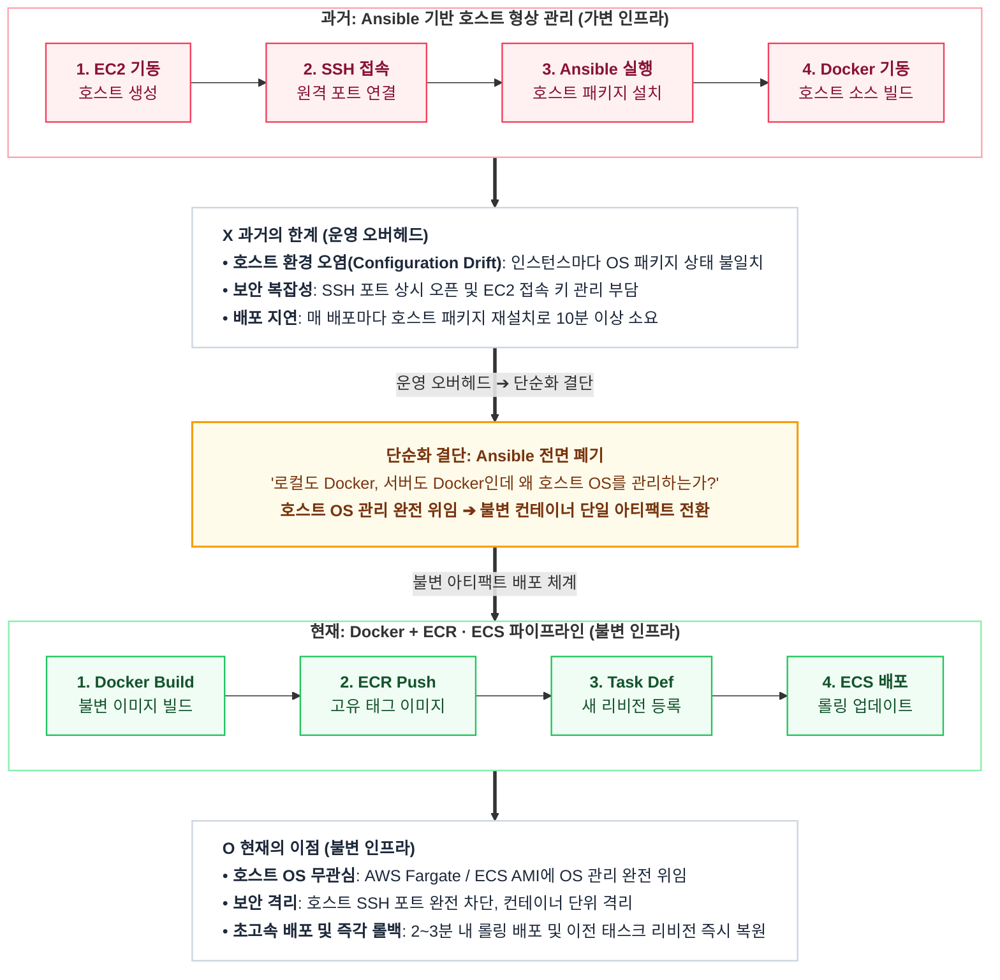
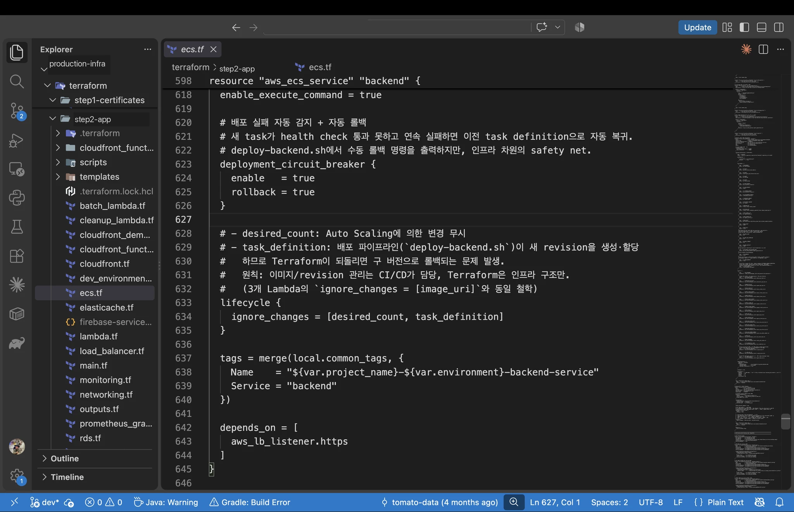

- table of contents
{:toc}

사수 한 명 없이 프로덕트 전체를 홀로 책임져야 하는 스타트업의 1인 개발팀에게 인프라는 작은 설정 실수 하나로도 실서비스 전체가 멈춰 설 수 있는 살얼음판 같은 영역이었다. 지난 [[7편]](/tag-ai-agent-architecture/7-rule-pruning/)에서 다루었듯 프롬프트와 규칙의 군살을 덜어내고 `TDD`([[2편]](/tag-ai-agent-architecture/2-tdd-religion/), [[4편]](/tag-ai-agent-architecture/4-all-passed-empty-screen/))로 백엔드 설계를 아무리 단단하게 다듬었더라도, 정작 그 코드가 살아 숨 쉬어야 할 클라우드 환경이 삐걱거리면 서비스는 사용자의 요청을 온전히 받아내지 못하기 마련이다. `AWS` 웹 콘솔을 마우스로 클릭하며 불안하게 시작했던 인프라 구축이 어떻게 <mark class="kw-term">Terraform</mark>이라는 선언적 코드가 되고, <mark class="kw-term">Ansible</mark> 기반 서버 구성을 거쳐, 마침내 <mark class="kw-term">Docker 불변 이미지</mark> 중심의 `ECR` + `ECS`와 독립된 내장 CI 배포 스크립트로 수렴하게 되었는지 그 치열했던 과정은 **"1인 팀이 온전히 통제 가능한 최소한의 불변 파이프라인"**을 확립해 나간 생존기에 가깝다.

---

## AWS 콘솔 클릭질의 공포: 비전공 신입이 맞닥뜨린 클라우드

지난 [[1편]](/tag-ai-agent-architecture/1-ground-rules/)에서 이야기했듯 2025년 6월 입사 당시 지원했던 포지션은 LLM 엔지니어였지만, 첫 웹 서비스 런칭을 앞둔 회사에서 당장 가장 시급한 과제는 클라우드 인프라 세팅(`DevOps`)이었다. 네트워크 기초조차 없던 신입에게 주어진 인수인계 자료라곤 대표님이 `AWS` 웹 콘솔에서 마우스로 클릭하며 설정해 둔 화면 녹화 영상 몇 편이 전부였다. `VPC`, 서브넷(`Subnet`), 라우팅 테이블, 보안 그룹(`SG`), 로드밸런서(`ALB`), 오토스케일링 그룹(`ASG`)이 뒤엉킨 콘솔 화면은 거대한 미궁처럼 느껴졌는데, 설상가상으로 멀티테넌트 SaaS 구조에 `ALB`와 `MongoDB` 도입이 절대 전제조건으로 걸려 있었다.

나중에 알게된건데, 우리 서비스 정도 수준이면 로드밸런서는 전혀 필요가 없었다. 겨우 몇개 학원에서 사용하는, 많아야 수백명 정도 수준의 트래픽을 감당하는데 ALB라니... 또, MongoDB도 맹목적으로 좋다며 사용하라고 종용하셨었는데, 이 또한 비효율의 극치였다. MongoDB를 사용함에 있어서 매니지드 서비스를 이용하기 위해 결국 MongoDB Atlas를 이용했는데 이 덕분에 VPC Peering등 아키텍처적으로 복잡해진 것은 물론, 우리 서비스는 Document DB를 도입할 명분이 전혀 없었다. 이 경험은 대표의 기술적 이해도에 실망하게된 일화이기도하다.
{:.note title="여담"}

2~3주간 AWS와 네트워크 관련 서적을 읽고 강의를 듣고 아키텍처 흐름도를 그려가며 콘솔 조작법을 익혔지만, 마우스 클릭에 의존하는 운영 방식은 근본적인 불안감을 남겼다. 인프라의 어느 설정을 언제 바꿨는지 `Git` 커밋처럼 변경 이력이 남지 않았고, 체크박스 하나를 잘못 클릭하는 순간 실서비스 트래픽에 영향이 갈 수 있다는 것이 압박감으로 돌아왔다. 스테이징이나 신규 테넌트 환경을 복제할 때마다 여러 번의 클릭을 오차 없이 재현하는 것도 힘들었다.

---

## 콘솔에서 코드로: Terraform 도입과 인프라 경계 선언

그 수동 클릭의 공포에서 벗어나기 위해 도입한 해법이 바로 **<mark class="kw-term">Terraform</mark>** 기반의 코드형 인프라(`IaC`)였다. 대표님이 2~3일간 출장을 떠난 틈을 타 DevOps Directive의 [Complete Terraform Course 강의](https://youtu.be/7xngnjfIlK4)와 공식 문서를 열심히 공부하여 사내 `AWS` 계정에 적용할 `HCL` 코드를 작성해 나갔다.

이때 테라폼을 공부하면서 접했던 여러 영상에서는 Terraform과 **<mark class="kw-term">Ansible</mark>**을 함께 조합했을 때의 강력한 시너지를 자주 강조하곤 했다. 인프라를 프로비저닝하는 테라폼과, 서버 내부 환경을 세팅하는 앤서블을 묶으면 배포 자동화의 완성도가 한층 높아진다는 설명이었다. 예컨대 [Terraform과 Ansible, CI/CD를 엮는 홈랩 자동화 강의](https://youtu.be/r5RckLwzkfc)나, 플레이북 기초를 직관적으로 풀어낸 [Ansible Playbook Basics 강의](https://youtu.be/p9bda0-TIRc), 그리고 플레이북 품질을 검증하는 [ansible-lint 워크스루 강의](https://youtu.be/8-M66pCzVTQ) 같은 영상들이 깊은 인상을 남겼다. 당시에는 '이런 기술 조합도 있구나' 하고 머릿속에 담아두었을 뿐이지만, 이 기억이 나중에 인스턴스 초기화 난관을 마주했을 때 Ansible을 주저 없이 도입하게 된 결정적 계기가 되었다.
{:.note title="여담: Terraform 학습 중 접한 Ansible의 씨앗"}

마침내 `terraform apply`를 입력했을 때 수십 개의 리소스가 의존성 그래프를 따라 일사불란하게 프로비저닝되었다. 무엇보다 마우스 클릭 기반 콘솔 운영은 에이전트에게 위임할 수 없는 블랙박스였지만(물론 요새는 Chrome 등 브라우저에서 에이전트를 띄워서 적절히 활용할 수 있겠지만 그 때 당시만하더라도 그런 기능은 없었다), 인프라가 텍스트 코드로 정의되는 순간 클라우드 자원은 `Git`이 추적하는 단일 진실 공급원(SSOT)이 되어 AI 에이전트와 함께 `terraform plan`의 결정론적 diff를 교차 검증할 수 있게 되었다. 아울러 DNS 전파 타임아웃을 막기 위해 `ACM` 인증서 발급(`step1-certificates/`)과 메인 인프라(`step2-app/`)를 **2-Step으로 분리**했고, 고객 영구 파일이 담긴 **`uploads` `S3` 버킷은 테라폼 생명주기 밖으로 격리**해 `data "aws_s3_bucket"`으로 읽기 전용 참조만 허용함으로써 `terraform destroy` 실수로도 고객 자산이 증발하지 않도록 생명주기 경계를 그었다.

---

## 서버 초기화의 시행착오와 단순화의 결단: 왜 Ansible을 버렸는가

테라폼으로 `EC2` 인스턴스를 띄운 뒤 마주한 난관은 서버 내부 부트스트랩이었다. 초기에 `user_data.sh` 안에 OS 패키지 설치부터 `Docker` 빌드까지 모두 밀어 넣었더니, 빌드에 3~5분이 걸리는 동안 포트가 열리지 않아 `ALB` 헬스체크가 실패하고 `ASG`가 준비 중인 서버를 무한 강제 종료하는 **인스턴스 Flapping**이 일어났다. 이 문제를 해결하기 위해 부팅 즉시 8000번 포트로 `200 OK`를 반환하는 **초경량 임시 `Python` 서버**로 30초 만에 헬스체크를 통과시킨 뒤, **<mark class="kw-term">Ansible</mark>** 플레이북이 `SSH`로 접속해 `Docker` 설치와 시크릿 주입을 마치고 본 컨테이너로 포트를 인수하도록 2단계 파이프라인을 구축했다.

앤서블의 **멱등성(Idempotency)** 덕분에 한숨을 돌리는 듯했지만, 배포 빈도가 높아질수록 매번 10분 넘게 걸리는 플레이북 실행과 호스트 관리에 회의감이 들기 시작했다. 마침 그 무렵 물어볼 사수 없이 홀로 고군분투하던 내 곁에 실전 경험이 풍부한 동료 개발자 한 분이 합류했는데, 그와 화이트보드 앞에서 시스템 구조를 그려가며 나눈 토론이 결정적인 전환점이 되었다. 그전까지의 나는 유명하다는 인프라 도구들을 하나씩 배워 시스템에 덧대는 데에만 급급했지만, 화이트보드 위에 호스트 OS와 컨테이너, 배포 파이프라인의 경계를 그려가며 이야기하다 보니 **"이미 모든 애플리케이션을 `Docker` 컨테이너로 말아서 배포하고 있는데 굳이 중간에 호스트 OS 형상 관리 계층까지 껴안고 갈 필요가 있는가, `AWS ECS`와 `ECR`을 쓰면 아키텍처를 훨씬 단순화할 수 있다"**는 결론에 도달한 것이다.

{:width="380" loading="lazy"}

시야를 넓혀준 동료에게 바치는 압도적 감사...!
{:.figcaption}

그 화이트보드 토론을 계기로 나는 내가 만든 파이프라인에 본질적인 질문 하나를 다시 던졌다.

> **"로컬에서도 Docker 컨테이너로 개발하고, 운영 서버에서도 Docker 컨테이너로 돌아가는데, 내가 왜 EC2 호스트 OS에 SSH로 들어가서 Ansible로 패키지를 깔고 형상 관리를 하고 있어야 하지?"**

냉정히 따져보니 동적 인벤토리 타임아웃, 22번 `SSH` 포트 개방과 키 관리 부담, 호스트 패키지 누적으로 인한 구성 드리프트(Configuration Drift), 배포마다 10분 이상 걸리는 플레이북 실행은 1인 팀에게 거대한 **운영 오버헤드**였다. 결국 나는 **`Ansible`과 호스트 형상 관리 계층을 전면 폐기**하고, 호스트 OS 관리는 `ECS Fargate` 및 `ECS` 최적화 AMI에 완전히 위임한 채 오직 **<mark class="kw-isolation">불변 아티팩트(Immutable Artifact)</mark>인 `Docker` 이미지**만 빌드해 `ECR`에 푸시하고 `ECS Task Definition` 리비전을 교체하는 4단계 불변 파이프라인으로 전환했다.

---

## IaC와 배포 스크립트의 소유권 충돌: "IaC의 경계는 누가 바꾸는가로 그어야 한다"

이후 2026년 4월 `terraform plan` 실행 중 실서버의 최신 `ECS` `task_definition` 리비전을 초기 구버전으로 강제 다운그레이드하겠다는 아찔한 드리프트 경고를 마주했다. 초기 상태를 고수하려는 `Terraform`과 하루에도 수차례 새 리비전을 찍어내는 배포 스크립트(`deploy-backend.sh`)가 하나의 필드를 동시에 소유하려 했던 결함이 원인이었다. 나는 `aws_ecs_service`에 `lifecycle { ignore_changes = [task_definition, desired_count] }`를 선언해 **"변하지 않는 인프라 골격은 `Terraform`이, 시시각각 바뀌는 컨테이너 리비전은 배포 파이프라인이 소유한다"**는 경계를 명확히 획정했다.

{:width="700" loading="lazy"}

실제 Terraform ecs.tf 코드. task_definition의 소유권을 배포 파이프라인(`deploy-backend.sh`)에 넘겨 인프라 코드와의 충돌을 원천 차단하고, circuit_breaker로 배포 실패 시 자동 롤백되도록 안전망을 구축했다.
{:.figcaption}

나아가 원격 러너 할당과 레이어 재빌드로 7~10분씩 허비하던 `GitHub Actions`를 걷어내고, 로컬 터미널에서 대기열 없이 2~3분 만에 완결되는 단일 스크립트(`deploy-backend.sh`) 내부에 4단계 CI 안전 게이트를 내재화했다.

1. **Git 워킹 디렉토리 청결 강제**: `git status --porcelain`을 검사해 미커밋 파일이나 로컬 `.venv`가 빌드 컨텍스트에 섞여 이미지 용량이 폭증하는 사고(ADR-0012)를 원천 차단한다.
2. **DB 마이그레이션 안전성 검증 및 선행 태스크**: `check_migration_safety.sh`로 `Alembic` 다중 head나 `op.drop_table()`을 정적 검사하고, `RDS` 자동 백업(PITR) 기반 위에서 일회성 `ECS Fargate` 태스크로 마이그레이션을 선행 실행한다.
3. **TDD 회귀 테스트 전수 통과**: 로컬 연산 자원으로 `test.sh`의 모든 단위·통합 테스트가 100% 통과(`set -e`)해야만 도커 빌드를 시작한다.
4. **결정론적 배포 태그와 서킷 브레이커**: 배포 즉시 `deploy/{timestamp}` 및 `deploy/latest` 태그를 자동 발행하고, `ECS circuit_breaker`로 비정상 기동 시 이전 리비전으로 자동 롤백한다.

- [심화 근거: Ansible Playbook·Docker 무중단 배포·DB 백업 및 클라우드 보안 설정 전문 보러가기](/tag-ai-agent-architecture/deep-dive/infra-fsd-and-ecosystem/#ansible-docker-infra)

---

## 1인 팀의 인프라 철학: "혼자서 통제 가능한 최소한의 파이프라인"

돌이켜보면 웹 콘솔의 마우스 클릭에서 출발해 테라폼 도입, 오토스케일링 Flapping 참사와 앤서블 플레이북을 거쳐 지금의 `ECR`·`ECS` 불변 컨테이너 파이프라인에 도달하기까지의 이 모든 격변은 **입사 직후 불과 3~4개월 남짓한 짧은 기간 동안 폭풍처럼 몰아치며 일어난 일**이었다. 이 밀도 높은 담금질은 불변 골격(`Terraform`)과 영속 데이터(`S3`, 관리형 DB), 무상태 컨테이너(`Docker`·`ECS`)와 가변 배포(`deploy-backend.sh`)의 생명주기 경계를 가르는 **소프트웨어 아키텍처에 대한 최초의 설계 감각**을 길러주었고, 그때 체득한 확고한 기준은 다음과 같다.

> **"좋은 인프라란 화려한 최신 기술의 집합체가 아니다. 장애가 발생했을 때 혼자서도 터미널을 열고 5분 안에 로그와 원인을 찾아낼 수 있는, 내 손바닥 안에서 온전히 통제되는 가장 단순하고 단단한 시스템이다."**

---

## 다음 이야기: 어차피 프론트엔드인데 아키텍처가 왜 필요해?

백엔드 객체 설계와 클라우드 인프라까지 서버 쪽의 기반과 안전망은 단단히 다져놓았지만, 사용자의 눈과 손을 맞이하는 프론트엔드에는 수천 줄짜리 '괴물 컴포넌트'와 '순환 참조의 지옥'이 기다리고 있었다. 다음 **[[9편] 어차피 프론트엔드인데 아키텍처가 왜 필요해?](/tag-ai-agent-architecture/9-frontend-fsd/)**에서는 13만 줄 프론트엔드에서 104건의 교차 참조 위반을 제거하고, `Feature-Sliced Design(FSD)` 6계층 단방향 규칙과 `Public API` 방화벽으로 에이전트의 난개발을 길들인 여정을 이어간다.
