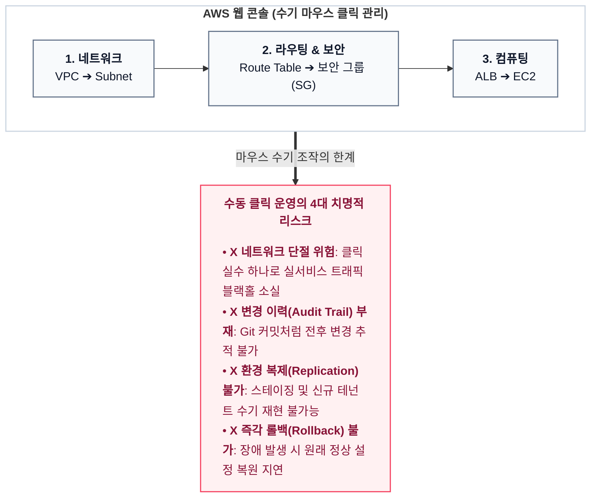
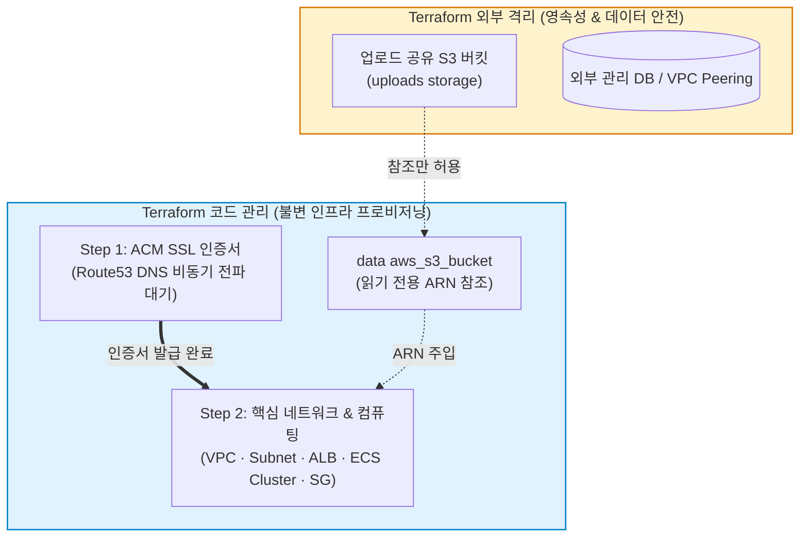
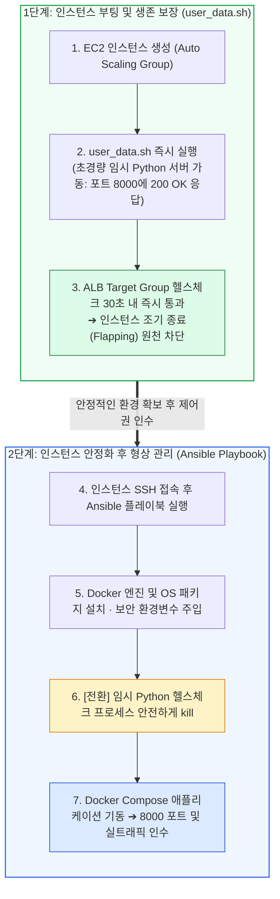
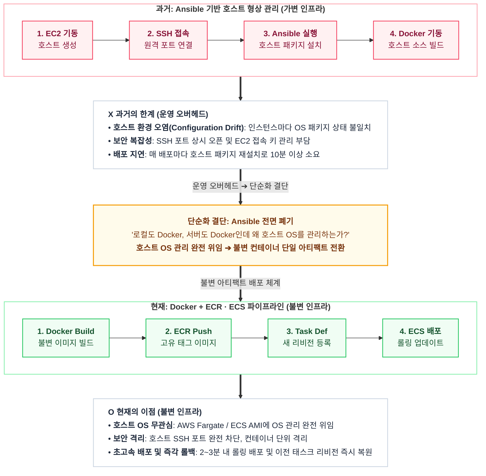
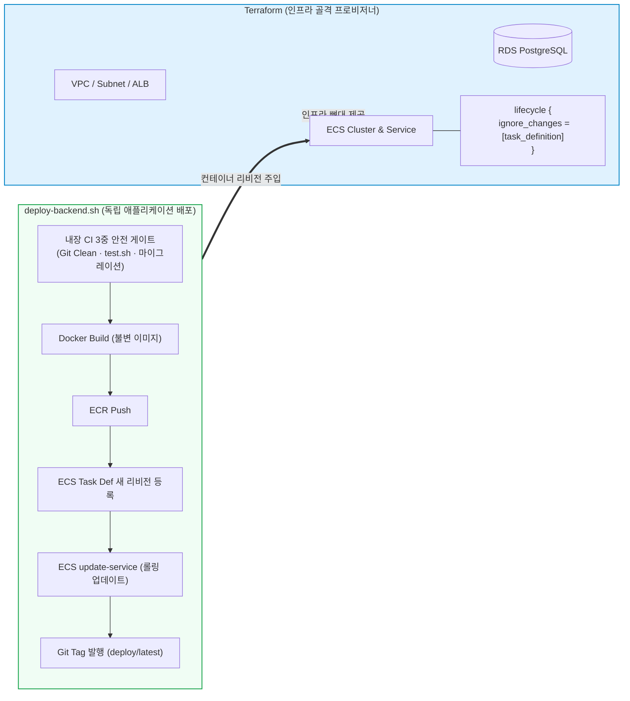

- table of contents
{:toc}

인프라 엔지니어나 SRE 전담 팀이 따로 존재하는 조직이라면 개발자는 잘 닦인 배포 파이프라인 위에 비즈니스 코드만 푸시하면 그만일 것이다. 하지만 물어볼 사수 한 명 없이 프로덕트 전체를 홀로 책임져야 하는 스타트업의 1인 개발자에게 인프라는 결코 피해 갈 수 없는 현실이자, 작은 설정 실수 하나로도 실서비스 전체가 멈춰 설 수 있는 살얼음판 같은 영역이었다. 지난 [[7편]](/tag-ai-agent-architecture/7-rule-pruning/)에서 다루었듯 로컬 워크스페이스에서 프롬프트와 규칙의 군살을 덜어내고 `TDD`([[2편]](/tag-ai-agent-architecture/2-tdd-religion/), [[4편]](/tag-ai-agent-architecture/4-all-passed-empty-screen/))로 백엔드 객체 설계를 아무리 단단하게 다듬어 놓았더라도, 정작 그 코드가 살아 숨 쉬어야 할 클라우드 환경이 삐걱거리면 프로덕션 서비스는 사용자의 요청을 단 한 줄도 온전히 받아내지 못하기 마련이다. `AWS` 웹 콘솔 화면의 수많은 체크박스를 마우스로 하나하나 클릭하며 불안하게 시작했던 인프라 구축이 어떻게 <mark class="kw-term">Terraform</mark>이라는 선언적 코드가 되고, <mark class="kw-term">Ansible</mark> 기반의 서버 구성 자동화를 거쳐, 마침내 <mark class="kw-term">Docker 불변 이미지</mark> 중심의 `ECR` + `ECS` 태스크 정의와 독립된 내장 CI 배포 스크립트로 수렴하게 되었는지 그 치열했던 과정이 지금의 운영 체계를 만들었다. 이 기록은 화려한 최신 클라우드 기술의 유행을 쫓아간 무용담이 아니라, 혼자서는 감당할 수 없는 운영 복잡성에 정면으로 부딪히며 불필요한 기술 레이어를 스스로 덜어내고 **"1인 개발자가 온전히 통제 가능한 최소한의 불변 파이프라인"**을 확립해 나간 생존기에 가깝다.

---

## AWS 콘솔 클릭질의 공포: 비전공 신입이 맞닥뜨린 클라우드

지난 [[1편]](/tag-ai-agent-architecture/1-ground-rules/)에서 이야기했듯 내가 2025년 6월 회사에 처음 합류했을 때 지원했던 포지션은 LLM 엔지니어였지만, 이제 막 첫 웹 애플리케이션 런칭을 준비하던 회사에서 당장 가장 시급한 과제는 서비스를 세상에 띄울 클라우드 인프라 세팅(`DevOps`)이었다. 네트워크 기초 지식조차 거의 없던 비전공·ML/DL 부트캠프 출신의 쌩신입에게 주어진 인수인계 자료라곤, 대표님이 `AWS` 웹 콘솔에서 마우스로 이것저것 클릭하며 설정해 두었던 화면 녹화 영상 몇 편이 전부였다. 영상 화질 너머로 보이는 웹 콘솔 화면은 `VPC`와 서브넷(`Subnet`), 인터넷 게이트웨이(`IGW`), 라우팅 테이블(`Route Table`)부터 보안 그룹(`Security Group`), 로드밸런서(`ALB`), 타깃 그룹(`Target Group`), 오토스케일링 그룹(`ASG`)에 이르기까지 생소한 용어들이 뒤엉킨 거대한 미궁처럼 느껴졌다. 이 리소스들이 배후에서 어떻게 유기적으로 엮여 트래픽을 흘려보내는지 감을 잡기조차 버거웠는데, 설상가상으로 서비스 요구사항은 여러 교육 기관이 동시에 사용하는 멀티테넌트 SaaS 구조였고 대표님은 트래픽 분산을 위한 로드밸런서(`ALB`)와 유연한 확장을 위한 `MongoDB` 도입을 절대적인 전제조건으로 내걸었다.

나중에 알게된건데, 우리 서비스 정도 수준이면 로드밸런서는 전혀 필요가 없었다. 겨우 몇개 학원에서 사용하는, 많아야 수백명 정도 수준의 트래픽을 감당하는데 ALB라니... 또, MongoDB도 맹목적으로 좋다며 사용하라고 종용하셨었는데, 이 또한 비효율의 극치였다. MongoDB를 사용함에 있어서 매니지드 서비스를 이용하기 위해 결국 MongoDB Atlas를 이용했는데 이 덕분에 VPC Peering등 아키텍처적으로 복잡해진 것은 물론, 우리 서비스는 Document DB를 도입할 명분이 전혀 없었다. 이 경험은 대표의 기술적 이해도에 실망하게된 일화이기도하다.
{:.note title="여담"}

당장 눈앞에 주어진 과제를 해내기 위해 2~3주간 `AWS` 및 네트워크 서적과 기술 블로그, 유튜브 강의, `GPT`와의 문답을 총동원해 밤낮없이 인프라 구조를 파고들었다. 추상적인 네트워크 개념을 머릿속에 집어넣으려 백지 위에 `VPC` 대역과 서브넷, `ALB`와 `EC2` 사이의 패킷 흐름도를 볼펜으로 수없이 그려가며 빈칸을 하나씩 메워 나갔다. 그렇게 가까스로 개념을 익히고 웹 콘솔 화면을 조작할 수 있게 되었음에도, 마우스 클릭에 의존해 프로덕션 인프라를 관리하는 방식은 근본적으로 비직관적일뿐더러 엔지니어링답지 못하다는 불안감을 지울 수 없었다. 내가 어제 어느 보안 그룹의 인바운드 규칙을 열었는지, 로드밸런서의 리스너 룰을 어떻게 바꿨는지 `Git` 커밋처럼 변경 이력(Audit Trail)이 전혀 남지 않았고, 콘솔의 체크박스나 서브넷 라우팅 연결 하나를 잘못 클릭하는 순간 실서비스 트래픽이 통째로 블랙홀로 빨려 들어갈 수 있다는 심리적 압박감이 매 순간 어깨를 짓눌렀다. 더구나 스테이징 환경을 세팅하거나 신규 고객사 테넌트를 위해 동일한 인프라를 하나 더 구축해야 할 때마다 웹 콘솔에서 수백 번의 마우스 클릭을 오차 없이 재현하는 것은 사실상 불가능에 가까웠기에, 이대로 수동 조작에 머물다가는 언젠가 내 손으로 프로덕션을 날려 먹는 대형 사고를 치고 말 것이라는 위기감이 절실하게 다가왔다.



---

## 콘솔에서 코드로: Terraform 도입과 인프라 경계 선언

그러한 수동 클릭의 비효율과 공포에서 벗어나기 위해 해결책을 수소문하던 끝에 마주한 해답이 바로 **<mark class="kw-term">Terraform</mark>**을 활용한 코드형 인프라(`IaC`, Infrastructure as Code)였다. 때마침 대표님이 2~3일간 외부 출장을 떠나게 되면서 눈치를 보지 않고 새로운 기술을 온전히 실험해 볼 수 있는 절호의 기회가 찾아왔고, 나는 그 기간 동안 공식 문서와 유튜브 강의를 집요하게 파고들며 사내 `AWS` 계정에 적용할 테라폼 코드를 한 줄씩 작성해 나갔다. 당시 가장 큰 길잡이가 되어 준 자료는 DevOps Directive의 [Complete Terraform Course - From BEGINNER to PRO! (Learn Infrastructure as Code)](https://youtu.be/7xngnjfIlK4) 강의였는데, 기본 문법부터 실전 `AWS` 리소스 프로비저닝까지 명쾌하게 짚어주는 흐름을 따라가며 인프라를 선언적 코드로 다루는 감각을 빠르게 흡수할 수 있었다.

이때 테라폼을 공부하면서 접했던 여러 영상에서는 Terraform과 **<mark class="kw-term">Ansible</mark>**을 함께 조합했을 때의 강력한 시너지를 자주 강조하곤 했다. 인프라를 프로비저닝하는 테라폼과, 서버 내부 환경을 세팅하는 앤서블을 묶으면 배포 자동화의 완성도가 한층 높아진다는 설명이었다. 예컨대 [Terraform과 Ansible, CI/CD를 엮는 홈랩 자동화 강의](https://youtu.be/r5RckLwzkfc)나, 플레이북 기초를 직관적으로 풀어낸 [Ansible Playbook Basics 강의](https://youtu.be/p9bda0-TIRc), 그리고 플레이북 품질을 검증하는 [ansible-lint 워크스루 강의](https://youtu.be/8-M66pCzVTQ) 같은 영상들이 깊은 인상을 남겼다. 당시에는 '이런 기술 조합도 있구나' 하고 머릿속에 담아두었을 뿐이지만, 이 기억이 훗날 인스턴스 초기화 난관을 마주했을 때 Ansible을 주저 없이 도입하게 된 결정적 계기가 되었다.
{:.note title="여담: Terraform 학습 중 접한 Ansible의 씨앗"}

수일간의 사투 끝에 마침내 터미널에서 `terraform apply`를 입력하고 엔터를 눌렀을 때의 전율은 지금도 생생하게 남아 있다. `VPC`와 서브넷, 인터넷 게이트웨이, 라우팅 테이블, 보안 그룹, `ALB`, `ECS` 클러스터에 이르는 수십 개의 `AWS` 리소스가 `HCL` 코드로 선언된 순서와 의존성 그래프를 따라 클라우드 위에 일사불란하게 프로비저닝되었기 때문이다. 더 이상 웹 콘솔의 복잡한 메뉴를 뒤적이며 길을 잃을 필요가 없었고, 인프라의 모든 형상이 `Git` 저장소 안에서 텍스트로 보존되며 모든 변경 사항을 `terraform plan`의 diff로 사전에 안전하게 검증할 수 있게 되었다. 막연한 두려움의 대상이었던 클라우드가 비로소 내 손끝의 코드로 통제된다는 강렬한 기술적 카타르시스와 함께, 1인 개발자로서 프로덕션 환경을 온전히 책임질 수 있다는 첫 번째 자신감을 얻은 순간이었다.

무엇보다 `IaC`로의 전환은 이후 구축한 AI 에이전트와의 협업 환경에서도 엄청난 시너지를 발휘했다. 마우스 클릭 기반의 웹 콘솔 운영은 AI에게 맥락을 공유하거나 작업을 위임할 수 없는 '인간만의 암묵지'이자 블랙박스 영역인데, 에이전트에게 콘솔의 수많은 메뉴와 버튼을 대신 클릭해 달라고 맡길 수는 없었기 때문이다(물론 요새는 Chrome 등 브라우저에서 에이전트를 띄워서 적절히 활용할 수 있겠지만 그 때 당시만하더라도 그런 기능은 없었다). 반면 인프라가 텍스트 코드로 정의되는 순간 클라우드 자원은 저장소 안에서 `Git`의 추적을 받는 일급 시민(First-class citizen)이 되며, 인간 개발자와 AI 에이전트가 완벽하게 동일한 단일 진실 공급원(SSOT)을 공유할 수 있게 된다. 새로운 서브넷 구성이나 보안 그룹 규칙 추가, `ALB` 리스너 라우팅 변경이 필요할 때마다 에이전트는 기존 테라폼 모듈의 구조를 읽고 정확한 `HCL` 코드를 제안했고, 나는 눈대중이나 감각에 의존하는 대신 `terraform plan`이 출력하는 결정론적 diff를 에이전트와 함께 교차 검증함으로써 리소스가 의도치 않게 삭제(destroy)되거나 재생성(replace)되는 참사를 사전에 완벽히 차단할 수 있었다.

### ACM SSL 인증서의 2-Step 분리

이처럼 모든 인프라 자원을 코드로 옮겨 적는 과정이 순탄하기만 했던 것은 아니며, 프로비저닝의 물리적 특성을 반영한 중요한 아키텍처적 결단을 내려야 했다. 처음에는 욕심을 부려 모든 리소스를 단 하나의 `apply` 명령으로 한 번에 구축하려 했으나, `aws_acm_certificate`로 SSL 인증서를 발급받고 `Route53`에 CNAME 레코드를 넣어 검증하는 `aws_acm_certificate_validation` 단계를 메인 인프라와 한데 묶자 반복적인 타임아웃 에러가 터져 나왔다. 도메인 DNS 전파(Propagation)와 인증서 검증은 외부 네트워크 환경에 따라 수 분에서 길게는 수십 분이 걸리는 비동기 프로세스인 반면, 테라폼은 즉각적인 동기식 완료를 기대하며 대기하다가 실패를 뱉어내는 구조적 불일치가 원인이었다. 이를 해결하기 위해 나는 인프라 구성을 `step1-certificates/`(인증서 발급 및 DNS 전파)와 `step2-app/`(`ALB` 및 핵심 컴퓨팅 인프라)이라는 **2-Step 파이프라인으로 물리 분리**했고, 인증서가 온전히 발급되어 활성화된 상태를 확인한 뒤 메인 인프라가 그 ARN을 안전하게 참조하도록 계층을 나눔으로써 프로비저닝의 결정론적 안정성을 확보할 수 있었다.

### 핵심 판단: S3 uploads 버킷을 Terraform 밖으로 뺀 이유

한 걸음 더 나아가 `IaC`를 본격적으로 도입할 때 엔지니어가 가장 흔히 빠지는 함정인 **"인프라의 모든 자원은 100% 테라폼 코드 안에 들어가야 완벽하다"**는 순수주의적 강박에서도 벗어나야 했다. 나는 고객들이 직접 올리는 이미지와 첨부 파일들이 영구 보관되는 **`uploads` `S3` 버킷만큼은 의도적으로 테라폼의 생명주기 관리 영역 밖으로 격리**하고, 테라폼 코드에서는 오직 `data "aws_s3_bucket"` 데이터 소스를 통해 이미 생성된 버킷의 ARN만 읽기 전용으로 참조하도록 엄격한 선을 그었다. 애플리케이션 서버나 네트워크 계층은 아키텍처 개편에 따라 언제든 리팩터링되거나 밀어버리고 다시 구축할 수 있는 일회성 자원이지만, 고객 자산이 담긴 영구 스토리지는 서비스의 시작부터 끝까지 절대 증발해서는 안 되는 최상위 영속 자원이기 때문이었다. 만약 인프라 구조를 재편하거나 실수로 `terraform destroy`를 실행했을 때 고객 데이터 버킷까지 함께 삭제되는 재앙을 물리적으로 원천 차단해야 했고, 이미 외부 관리형 데이터베이스(`MongoDB Atlas`)와 `VPC Peering`처럼 테라폼 바깥에서 영속적으로 유지되던 자원들과 운영 주기를 일관되게 맞추는 편이 훨씬 합리적인 판단이었다.



결국 모든 클라우드 자원을 무작정 코드로 감싸 안는 것이 기술적 완성도를 의미하지는 않는다. 무엇을 자동화된 코드로 묶어 일관되게 찍어내고 무엇을 데이터의 영속적 안전을 위해 코드 바깥으로 격리할지 그 **'소유권과 생명주기의 경계'를 긋는 일**이야말로 진짜 아키텍처 설계라는 사실이, 비전공 신입이었던 내가 클라우드 인프라를 바닥부터 마주하며 얻은 가장 값진 첫 번째 깨달음이었다.

---

## 서버 초기화의 시행착오: user data의 한계와 Ansible의 도입

테라폼을 통해 네트워크 뼈대와 `EC2` 인스턴스를 클라우드 위에 일관되게 띄우는 데까지는 성공했지만, 정작 그 빈 깡통 인스턴스 내부에 실행 환경을 세팅하고 애플리케이션 컨테이너를 안정적으로 구동시키는 과정은 또 다른 차원의 난관이었다.

### EC2 user data와 오토스케일링(ASG) Flapping 참사

초기에는 서버 부트스트랩을 너무나 단순하게 생각한 나머지, `EC2` 기동 시 최초 1회 실행되는 `user_data.sh` 셸 스크립트 안에 운영체제 패키지 업데이트(`apt update`)부터 `Docker` 및 `Docker Compose` 설치, `Git` 저장소 클론과 환경변수(`.env`) 주입, 그리고 `docker compose up -d --build` 명령까지 필요한 모든 초기화 작업을 한꺼번에 밀어 넣었다. 그러나 이 순진한 설계가 만들어 낸 결과는 서버가 켜지자마자 죽고 다시 켜지기를 무한히 반복하는 **인스턴스 Flapping(플래핑) 참사**였다. `EC2` 인스턴스가 부팅되자마자 앞단의 로드밸런서(`ALB`)는 타깃 그룹의 헬스체크 엔드포인트(`/health`)로 프로브 요청을 찌르기 시작하는데, 정작 인스턴스 내부에서는 `user_data.sh`가 무거운 OS 패키지를 내려받고 도커 이미지를 처음부터 빌드하느라 최소 3~5분 동안 포트를 열지 못했기 때문이다. 응답이 돌아오지 않자 `ALB`는 해당 인스턴스를 가차 없이 비정상(`Unhealthy`)으로 판정했고, 이를 감지한 오토스케일링 그룹(`ASG`)이 아직 준비 중인 인스턴스를 강제 종료(`Terminate`)한 뒤 새 인스턴스를 띄우면 그 새 서버마저 똑같이 초기화 도중 시간 초과로 사살당하는 악순환의 고리가 끝없이 이어졌다. 설상가상으로 스크립트 실행 도중 작은 패키지 에러라도 나면 원인을 파악하기 위해 매번 `SSH`로 서버에 들어가 `/var/log/cloud-init-output.log`를 뒤져야 했고, 설정 한 줄을 고칠 때마다 인스턴스 전체를 새로 찍어내야 하는 극심한 피로감이 뒤따랐다.

### 임시 Python 헬스체크와 Ansible을 통한 배포 제어권 회수

이 치명적인 Flapping 무한 루프를 끊어내고 배포의 주도권을 되찾기 위해 나는 인스턴스 생존 보장과 환경 구성의 책임을 두 단계로 엄격히 분리했다. 우선 `user_data.sh`에 몰아넣었던 무거운 설치 작업들을 전부 걷어내고, 인스턴스가 켜지자마자 백그라운드에서 8000번 포트로 즉각 `HTTP 200 OK`를 반환하는 **초경량 임시 `Python` HTTP 서버** 하나만 띄우도록 스크립트의 역할을 극단적으로 축소했다.

```bash
# user_data.sh 내부: ALB 헬스체크를 통과시켜 인스턴스를 안정화하는 임시 프로세스
python3 -c "
import http.server, socketserver
class H(http.server.SimpleHTTPRequestHandler):
    def do_GET(self):
        self.send_response(200)
        self.end_headers()
        self.wfile.write(b'warming up')
socketserver.TCPServer(('', 8000), H).serve_forever()
" &
```

이 얄팍하지만 확실한 임시 프로세스 덕분에 `EC2`가 부팅된 지 30초 만에 `ALB` 헬스체크가 즉시 통과되었고, `ASG`가 서버를 죽이지 않고 차분히 살려두는 안정적인 교두보를 확보할 수 있었다. 그렇게 인스턴스가 안전하게 살아 숨 쉬는 상태에서 비로소 테라폼 공부 시절 눈여겨보았던 **<mark class="kw-term">Ansible(앤서블)</mark>** 플레이북을 투입해 실제 서버 내부의 형상 관리를 통제하기 시작했다. 앤서블이 `SSH`를 통해 살아 있는 인스턴스에 접속한 뒤 `Docker` 엔진과 시스템 패키지를 설치하고 보안 시크릿 환경변수를 주입하며, 모든 준비가 끝난 직후 앞서 떠 있던 임시 `Python` 헬스체크 프로세스를 안전하게 종료(`kill`)한 다음 즉시 `Docker Compose`로 본 애플리케이션 컨테이너를 올려 8000번 포트와 실트래픽을 매끄럽게 인수하도록 파이프라인을 짠 것이다.



무엇보다 앤서블이 보장하는 **멱등성(Idempotency)** 덕분에 환경 설정이나 배포 구성을 조금 바꿀 때마다 매번 `EC2` 인스턴스를 통째로 날리고 재생성할 필요 없이, 언제든 플레이북을 다시 실행하는 것만으로 서버를 원하는 목표 형상에 안전하게 수렴시킬 수 있게 되었다.

---

## 단순화의 결단: "어차피 Docker로만 배포하는데 Ansible이 왜 필요한가?"

그렇게 테라폼과 앤서블의 조합으로 한숨을 돌리는 듯했지만, 서비스가 성숙해지고 배포 빈도가 높아지면서 내면에서는 또 다른 근본적인 회의감이 고개를 들기 시작했다. 마침 이 무렵은 내 개발자 커리어에서 손꼽히게 중요한 변곡점이 찾아온 시기였는데, 물어볼 사수 하나 없이 홀로 고군분투하던 내 곁에 개발 역량이 뛰어나고 실전 경험이 풍부한 동료 한 분이 합류한 것이다. 그와 화이트보드 앞에서 시스템 아키텍처를 직접 그려가며 치열하게 토론하던 시간들은, 혼자서 인터넷 강의나 `GPT`를 붙잡고 씨름할 때는 결코 얻을 수 없었던 '진짜 엔지니어링 대화와 시야의 확장'을 선물해 준 값진 경험이었다.

{:width="380" loading="lazy"}

시야를 넓혀준 동료에게 바치는 압도적 감사...!
{:.figcaption}

그전까지의 나는 업계에서 모범 사례로 꼽히는 모던 인프라 도구들을 어떻게든 빠르게 학습해서 우리 시스템에 하나씩 덧대는 데에만 급급했다. 하지만 동료와의 대화는 단순히 도구의 사용법을 넘어 '우리가 해결하려는 문제의 본질이 무엇인가?', '이 도구가 우리 팀에 실제로 주는 가치와 그 대가로 지불해야 하는 운영 비용은 얼마인가?'를 끊임없이 되묻게 만들었다. 당시 나는 `AWS ECS`와 `ECR`을 새롭게 도입하며 컨테이너 오케스트레이션 환경을 한창 고도화하고 있었는데, 화이트보드 위에 `EC2` 호스트 OS와 컨테이너 런타임, 배포 파이프라인의 경계를 그려가며 구조를 논의하던 중 머리를 망치로 맞은 듯한 본질적인 질문과 마주하게 되었다.

> **"로컬에서도 Docker 컨테이너로 개발하고, 운영 서버에서도 Docker 컨테이너로 돌아가는데, 내가 왜 EC2 호스트 OS에 SSH로 들어가서 Ansible로 패키지를 깔고 형상 관리를 하고 있어야 하지?"**

냉정하게 따져보니 1인 개발자가 감당하기에 `Ansible`과 호스트 서버 관리 계층은 시간이 갈수록 거대한 **운영 오버헤드(Operational Overhead)**로 변질되고 있었다. 오토스케일링으로 변경된 `EC2`의 IP를 동적 인벤토리(Dynamic Inventory)로 수집하다가 네트워크 타임아웃이 나면 배포 전체가 멈춰 섰고, 원격 접속을 위해 `SSH` 키를 관리하며 보안 그룹의 22번 인바운드 포트를 열어두어야 하는 보안 부담도 만만치 않았다. 게다가 호스트 OS 위에 파이썬 라이브러리나 패키지들이 누적되면서 서버마다 미세하게 환경이 달라지는 구성 드리프트(Configuration Drift)가 발생했고, 코드 몇 줄을 배포할 때마다 수십 개의 앤서블 태스크를 순차 실행하느라 10분 이상의 귀중한 시간을 허비해야 했다.

결국 나는 어렵게 공부해서 세팅해 두었던 **`Ansible`과 호스트 OS 형상 관리 계층을 미련 없이 전면 폐기**하는 결단을 내렸다. 아무리 공들여 구축한 기술이라도 1인 개발자의 운영 호흡에 불필요한 중간 레이어라면 과감히 덜어내는 것이 옳았기 때문이다. 기반 서버의 OS 패치와 런타임 관리는 `AWS`가 온전히 책임지는 `ECS Fargate` 및 최소한의 `ECS` 최적화 AMI(Amazon ECS-optimized AMI)에 완전히 위임하고, 나는 오직 애플리케이션 코드와 의존성이 하나로 밀봉된 **<mark class="kw-isolation">불변 아티팩트(Immutable Artifact)</mark>인 `Docker` 이미지** 하나만 바라보는 구조로 아키텍처의 축을 옮겼다. 그 결과 로컬이나 CI에서 소스코드를 빌드해 불변 이미지를 만들고, 고유 태그를 달아 `AWS ECR`에 푸시한 뒤, 새 이미지 URI를 가리키는 `ECS Task Definition` 리비전을 등록해 롤링 업데이트(`aws ecs update-service`)를 호출하는 4단계로 배포 절차가 극적으로 단순화되었다.



수백 줄에 달하던 앤서블 플레이북과 까다로운 인벤토리 설정 파일들이 저장소에서 일제히 지워지던 날, 나는 비로소 "살아 있는 서버 호스트를 어르고 달래며 유지보수하는 관리자"에서 **"검증된 불변 컨테이너 아티팩트만 깔끔하게 교체해 넣는 배포자"**로 운영 패러다임이 완전히 전환되었음을 실감할 수 있었다.

---

## IaC와 배포 스크립트의 소유권 충돌: "IaC의 경계는 누가 바꾸는가로 그어야 한다"

하지만 앤서블을 걷어내고 `ECR`과 `ECS` 중심의 불변 인프라로 구조를 단순화한 뒤에도 미처 예상치 못했던 아찔한 사고 위기가 한 차례 더 찾아왔는데, 바로 **인프라를 정의하는 `Terraform`과 애플리케이션을 올리는 배포 스크립트 간의 '관리 소유권 충돌'**이었다.

### 드리프트 경고: 최신 프로덕션을 구버전으로 되돌리겠다고?

2026년 4월 무렵 네트워크 관련 인프라 설정을 일부 조정하기 위해 터미널에서 `terraform plan`을 실행했을 때, 나는 화면을 가득 메운 붉은색 변경 예고(diff)를 보고 등골이 서늘해졌다. 내가 전혀 건드리지 않은 `ECS` 서비스의 `task_definition`과 주요 `Lambda` 함수들의 `image_uri`를 현재 실서버에서 정상 구동 중인 최신 리비전(예: `:66`)에서 **무려 수십 단계 이전의 구버전(예: `:37` 혹은 초기 `:latest`)으로 강제 다운그레이드하겠다**는 실행 계획이 출력되었기 때문이다. 만약 그 출력 결과를 꼼꼼히 읽지 않고 습관적으로 `terraform apply`를 승인했더라면, 실제 고객들이 한창 사용 중인 프로덕션 서비스 전체가 순식간에 수개월 전 과거 코드로 되돌아가는 초대형 장애가 터질 뻔한 아찔한 순간이었다.

### 원인: 두 주체가 한 필드를 동시에 소유하려 했다

이 위험천만한 드리프트 경고의 배후에는 **하나의 클라우드 리소스 속성을 서로 다른 생명주기를 가진 두 시스템이 동시에 소유하려 했던 구조적 결함**이 자리 잡고 있었다. `Terraform`은 최초 인프라를 구축할 당시 선언했던 초기 태스크 정의 리비전을 불변의 기준으로 기억하고 그 상태를 고수하려는 반면, 애플리케이션 배포 스크립트(`deploy-backend.sh`)는 비즈니스 코드가 바뀔 때마다 하루에도 몇 번씩 새 `Docker` 이미지를 빌드해 `ECR`에 올리고 `ECS Task Definition`의 새 리비전을 찍어내며 서비스를 갱신하고 있었기에 테라폼 입장에서는 자신의 통제를 벗어난 변경으로 인식한 것이다. 혹자는 "배포할 때마다 새 이미지 태그를 변수로 넘겨서 `terraform apply`로 배포하면 되지 않느냐"고 반문할 수도 있겠지만, 수 분의 상태 검사(State Refresh)와 고도의 신중함이 요구되는 인프라 프로비저닝에 하루 수차례 일어나는 애플리케이션 배포를 묶어버리면 배포 속도가 극단적으로 느려질뿐더러 장애 발생 시 즉각 이전 태스크 리비전으로 되돌려야 하는 긴급 롤백마저 무거운 테라폼 상태 변경 작업에 가로막히는 치명적인 안티패턴이 된다.

### 해결: `ignore_changes`는 회피가 아니라 경계 선언이다

결국 변경 주기가 근본적으로 다른 두 영역을 분리하기 위해 나는 테라폼의 `ECS` 서비스 리소스 선언부에 `lifecycle` 블록을 도입하여 소유권의 경계를 코드로 명확히 못 박았다.

{:width="700" loading="lazy"}

실제 Terraform ecs.tf 코드. task_definition의 소유권을 배포 파이프라인(`deploy-backend.sh`)에 넘겨 인프라 코드와의 충돌을 원천 차단하고, circuit_breaker로 배포 실패 시 자동 롤백되도록 안전망을 구축했다.
{:.figcaption}

```hcl
resource "aws_ecs_service" "app" {
  name            = "production-backend"
  cluster         = aws_ecs_cluster.main.id
  task_definition = aws_ecs_task_definition.app.arn
  desired_count   = 2

  lifecycle {
    ignore_changes = [
      task_definition, # 애플리케이션 배포 파이프라인이 전담 소유
      desired_count    # 오토스케일링 정책이 동적으로 소유
    ]
  }
}
```

여기에 선언된 `ignore_changes`는 단순히 성가신 `terraform plan`의 diff 출력을 눈가림하기 위한 꼼수가 결코 아니다. **"네트워크와 클러스터, 서비스라는 변하지 않는 인프라 골격은 `Terraform`이 소유하되, 그 위에서 시시각각 교체되는 컨테이너 리비전(`task_definition`)의 소유권은 애플리케이션 배포 파이프라인에, 실행 태스크 수(`desired_count`)의 소유권은 오토스케일링 정책에 온전히 위임한다"**는 아키텍처 차원의 엄격한 관할권 획정이었던 셈이다.



### GitHub Actions의 병목을 넘어: 셸 스크립트에 CI의 본질을 내재화하다

이처럼 테라폼으로부터 애플리케이션 배포의 독립성을 확보한 뒤에는, 배포를 수행하는 파이프라인 자체의 속도 병목도 함께 수술대에 올렸다. 처음에는 업계 표준처럼 여겨지는 **`GitHub Actions` 기반의 원격 CI/CD 파이프라인**을 정석대로 구축해 운영했으나, 하루에도 수차례 기능을 다듬고 즉각 프로덕션에 반영해야 하는 1인 개발 환경에서 원격 CI 러너는 점차 감내하기 힘든 생산성 병목으로 다가왔다. 커밋을 푸시할 때마다 원격 가상 머신이 할당되기를 멍하니 기다려야 했고, 무거운 도커 레이어와 파이썬 의존성 패키지를 매번 원격 환경에서 새로 내려받아 빌드하느라 배포 한 번에 7~10분 가까운 대기 시간이 소모되었다. 더군다나 간헐적으로 발생하는 원격 러너의 네트워크 타임아웃이나 시크릿 환경변수 설정 누락으로 파이프라인이 멈춰 서기라도 하면, 답답한 웹 대시보드의 로그를 뒤적이며 원인을 찾느라 정작 가장 중요한 로컬 개발의 몰입과 호흡이 산산조각 나기 일쑤였다.

> **"로컬 터미널에서 즉각적인 피드백을 받으며 가장 빠르게 프로덕션에 가치를 전달해야 하는데, 왜 원격 러너의 느린 대기열과 불투명성에 내 개발 호흡이 묶여 있어야 하는가?"**

이 질문 끝에 나는 무겁고 느린 `GitHub Actions` 원격 워크플로우를 과감히 걷어내고, **로컬 터미널에서 단 1초의 대기열 없이 즉각 실행할 수 있는 단일 셸 스크립트(`deploy-backend.sh`)**로 배포 체계를 전면 재편했다. 물론 원격 CI 도구를 덜어냈다고 해서 지속적 통합(CI)이 담보하던 품질 검증의 가치까지 포기한 것은 결코 아니었다. 외부 SaaS 플랫폼이나 화려한 YAML 설정 파일이라는 껍데기가 중요한 것이 아니라, **"검증되지 않은 코드가 프로덕션에 나가는 것을 물리적으로 가로막는 안전 게이트를 타협 없이 강제하는 것"**이야말로 CI의 진짜 본질이라고 생각했기 때문이다. 이에 따라 나는 프로덕션 배포 전 반드시 통과해야 할 핵심 검증 단계들을 `deploy-backend.sh` 스크립트 내부의 강제 게이트로 촘촘하게 내재화했다.

1. **1단계 (Git 워킹 디렉토리 청결 강제)**: `git status --porcelain`을 최우선으로 검사하여 커밋되지 않은 수정 사항이나 추적되지 않는 파일(untracked files)이 단 하나라도 남아 있으면 배포를 즉시 중단시킨다. 과거 로컬의 `.venv` 가상환경이나 임시 디버깅 파일이 `Docker` 빌드 컨텍스트에 딸려 들어가 컨테이너 이미지 크기가 수 GB로 폭증했던 사고(ADR-0012)를 원천 차단하기 위한 장치다.
2. **2단계 (마이그레이션 안전성 정적 검증)**: `Alembic` 마이그레이션 파일에 다중 head가 갈라져 있거나 의도치 않게 운영 테이블을 날려버리는 `op.drop_table()` 같은 위험 구문이 포함되어 있는지 `check_migration_safety.sh`로 사전 검사한다. 검증을 통과한 마이그레이션은 새 애플리케이션 컨테이너가 뜨기 직전 일회성 `ECS Fargate` 태스크로 안전하게 선행 실행되어 스키마 정합성을 보장한다.
3. **3단계 (TDD 회귀 테스트 전수 통과)**: `test.sh`에 등록된 모든 테스트 스위트가 단 하나의 실패 없이 100% 통과(`set -e`)해야만 비로소 도커 이미지 빌드가 시작된다. 빈약한 사양의 무료 원격 러너 대신 로컬 맥북의 강력한 연산 자원과 캐시를 그대로 활용하므로, 수백 개의 단위·통합 테스트가 불과 수십 초 만에 쾌적하게 전수 검증된다.
4. **4단계 (결정론적 배포 추적성 확보)**: 롤링 업데이트가 성공적으로 마무리되면 스크립트가 즉시 `deploy/{timestamp}` 및 `deploy/latest` `Git` 태그를 자동 발행해 원격 저장소에 푸시함으로써, 지금 이 순간 실서버에서 돌아가고 있는 컨테이너가 정확히 어느 커밋에서 빌드된 것인지 단 1초 만에 역추적할 수 있게 만들었다.

원격 러너의 대기열을 바라보며 매번 10분씩 허비하던 배포 주기는, 로컬 터미널에서 스크립트 한 줄을 실행하는 것만으로 **불과 2~3분 안에 모든 CI 품질 검증과 무중단 `ECS` 롤링 배포, 서킷 브레이커(`circuit_breaker`) 기반의 자동 롤백 감시까지 끝마치는 초고속 파이프라인**으로 거듭났다. 거창한 외부 CI/CD 플랫폼 없이도 본질적인 검증만을 단단하게 응축한 이 셸 스크립트 하나 덕분에, 수개월간 단 한 건의 배포 사고도 없이 가장 기민한 속도로 프로덕션 서비스를 운영할 수 있었다.

---

## 1인 개발자의 인프라 철학: "혼자서 통제 가능한 최소한의 파이프라인"

업계에는 언제나 쿠버네티스(`Kubernetes`)나 서비스 메시(`Istio`), 수십 개로 쪼개진 마이크로서비스와 복잡한 분산 이벤트 버스처럼 엔지니어의 호기심을 자극하는 화려하고 세련된 클라우드 아키텍처 유행이 넘쳐난다. 하지만 물어볼 사수 없이 제품 전체의 생사를 홀로 책임져야 하는 스타트업의 1인 개발자에게, **자신이 밑바닥부터 온전히 이해하고 통제할 수 없는 과도한 복잡성은 곧 가장 위험한 기술 부채이자 시한폭탄**이 되기 마련이다. 수많은 시행착오와 장애 위기를 정면으로 통과하며 내가 도달한 최종 클라우드 인프라는, 변하지 않는 인프라의 골격은 `Terraform`으로 선언하되 영구 데이터(`S3` uploads)는 코드 밖으로 안전하게 격리하고, 실행 환경은 호스트 OS 관리가 필요 없는 `Docker` 불변 이미지와 `ECS`에 일임하며, 배포는 3중 안전 게이트를 내장한 단일 셸 스크립트(`deploy-backend.sh`)로 직결하는 놀라울 만큼 단순하고 투명한 구조였다.

더욱 뜻깊은 사실은 웹 콘솔의 마우스 클릭에서 출발해 이러한 불변 아키텍처에 도달하기까지의 격변이 **2025년 6월 입사 직후부터 그해 10~11월 무렵까지 채 반년도 되지 않는 짧은 기간 동안 폭풍처럼 몰아치며 완성되었다**는 점이다. 입사 첫 달 마주했던 수동 콘솔 운영의 공포를 떨쳐내기 위해 테라폼을 독학해 전체 인프라를 코드로 옮겼고, `EC2` 부트스트랩 과정에서 터진 오토스케일링 Flapping 참사를 수습하고자 임시 헬스체크 서버와 앤서블 플레이북을 도입했다가, 이내 "어차피 도커 컨테이너로 돌아가는데 왜 호스트 OS를 내가 관리하고 있는가"라는 본질적 물음에 도달해 `ECR`·`ECS` 체제로 전환하며 앤서블을 과감히 걷어냈다. 이어 테라폼과 배포 파이프라인의 소유권 충돌을 겪으며 생명주기별 경계를 획정하고 원격 CI의 병목을 깨기 위해 로컬 배포 스크립트에 검증 게이트를 내재화하기까지, 이 밀도 높은 아키텍처 진화 과정 자체가 내가 소프트웨어 전체를 바라보는 눈을 틔워 준 가장 치열한 훈련장이었다.

그렇게 바닥부터 인프라를 세우고 부수기를 반복하던 경험은, 내가 애플리케이션과 시스템 전반을 관통하는 **'소프트웨어 아키텍처에 대한 최초의 설계 감각'을 체득하게 해 준 든든한 뿌리**가 되어 주었다. 단순히 애플리케이션 코드 파일 안에만 머물 때는 함수와 클래스라는 미시적인 나무밖에 보이지 않았지만, 클라우드 위에서 불변(Immutable) 골격과 가변(Mutable) 배포를 가르고 무상태(Stateless) 컨테이너와 영속(Persistence) 스토리지의 경계를 그으며 '누가 무엇을 소유하고 어떤 주기로 변경하는가'를 치열하게 분리해 본 원초적 감각이 모든 설계의 기준점을 잡아주었기 때문이다. 이 시기에 다져진 경계 설정의 감각은 훗날 백엔드의 `TDD`와 객체지향 설계([[2편]](/tag-ai-agent-architecture/2-tdd-religion/), [[3편]](/tag-ai-agent-architecture/3-teach-object-design/))를 정립하고, 나아가 프론트엔드의 `FSD` 아키텍처([[9편] 어차피 프론트엔드인데 아키텍처가 왜 필요해?](/tag-ai-agent-architecture/9-frontend-fsd/))로 계층 간 의존성을 단방향으로 통제하는 데 있어서도 흔들리지 않는 일관된 철학적 토대로 작용했다.

이 압축적인 담금질을 거쳐 최소한의 파이프라인이 단단히 자리 잡은 이후로, 클라우드 인프라는 마침내 개발자의 시야 뒤편으로 조용히 물러났다. 나는 더 이상 `AWS` 웹 콘솔을 두려운 마음으로 열어보지 않으며, 새벽에 서버가 예고 없이 죽을까 봐 가슴을 졸이지도 않는다. 언제든 내 손끝에서 몇 분 안에 완벽히 재현되고 검증되는 단순한 인프라가 든든한 배경이 되어준 덕분에, 1인 개발자인 나는 비로소 인프라 관리의 수렁에서 벗어나 사용자에게 실질적인 가치를 전달할 비즈니스 로직과 프로덕트 설계에 온전히 몰입할 수 있게 되었다.

> **"좋은 인프라란 화려한 최신 기술의 집합체가 아니다. 장애가 발생했을 때 1인 개발자가 터미널을 열고 5분 안에 로그와 원인을 찾아낼 수 있는, 내 손바닥 안에서 온전히 통제되는 가장 단순하고 단단한 시스템이다."**

---

## 다음 이야기: 어차피 프론트엔드인데 아키텍처가 왜 필요해?

백엔드 객체 설계와 클라우드 인프라, 그리고 안전 게이트가 내장된 배포 파이프라인까지 서버 사이드의 빗장은 단단하게 걸어 잠갔다. 하지만 시스템의 최전선에서 사용자의 눈과 손을 직접 맞이하는 프론트엔드가 무너져 내린다면 프로덕션 엔지니어링은 결코 완성될 수 없다. 특히 프론트엔드 지식이 전무했던 상태에서 AI 에이전트에게 화면 구현을 무작정 맡겼을 때 마주했던 가장 끔찍한 재앙은, 수천 줄로 비대해진 '괴물 JSX 컴포넌트'와 도메인 경계를 마구잡이로 넘나들며 서로를 호출하는 '순환 참조의 지옥'이었다. 다음 **[[9편] 어차피 프론트엔드인데 아키텍처가 왜 필요해?](/tag-ai-agent-architecture/9-frontend-fsd/)**에서는 13만 줄 규모로 불어난 프론트엔드 코드베이스에서 104건의 순환 참조를 전수 제거하고, `Feature-Sliced Design(FSD)` 6계층 단방향 의존성 규칙과 아키텍처 린터를 통해 에이전트의 프론트엔드 난개발을 완벽히 길들인 리팩터링 여정을 이어간다.
