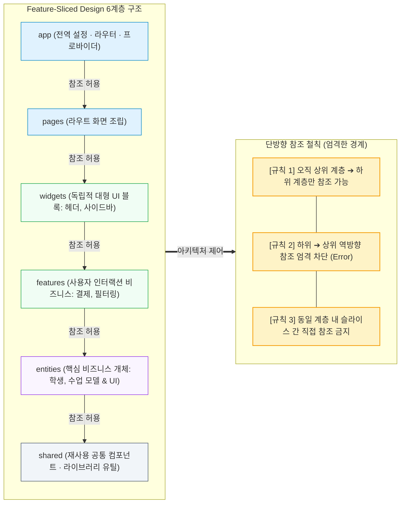
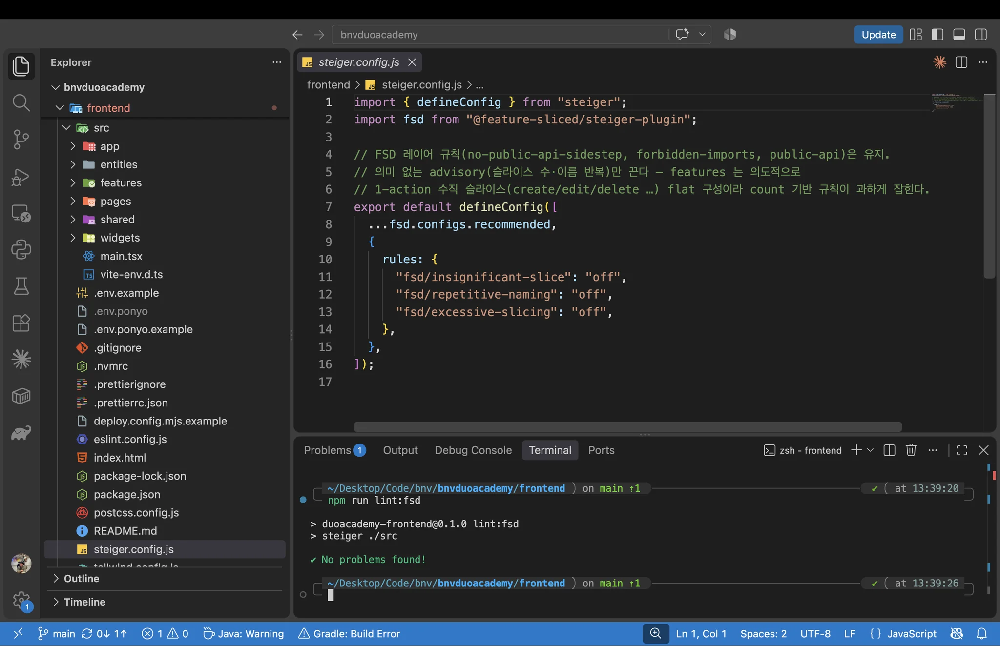

- table of contents
{:toc}

백엔드에서 계획 선행 규율([[1편]](/tag-ai-agent-architecture/1-ground-rules/))과 `TDD`·객체 4분류([[2편]](/tag-ai-agent-architecture/2-tdd-religion/), [[3편]](/tag-ai-agent-architecture/3-teach-object-design/)), 경계 정합성 게이트([[4편]](/tag-ai-agent-architecture/4-all-passed-empty-screen/))를 세우고, `cmux` 병렬 워크트리와 거버넌스([[5편]](/tag-ai-agent-architecture/5-cmux-parallel-worktree/), [[6편]](/tag-ai-agent-architecture/6-repo-governance/), [[7편]](/tag-ai-agent-architecture/7-rule-pruning/)) 및 `Docker`·`ECS` 불변 인프라([[8편]](/tag-ai-agent-architecture/8-cloud-infra-evolution/))까지 정립했지만 실전 최전선에는 아직 가장 제어하기 힘든 복병인 **'프론트엔드(Frontend)'**가 남아 있었다. "어차피 프론트엔드 화면인데 AI한테 시키면 알아서 뚝딱 만들어주는 거 아니야?"라는 초기의 안일한 믿음과 달리, 백엔드에만 `Clean Architecture`를 세워놓고 프론트엔드를 방치한 대가는 실로 참혹했다. 이 글은 에이전트가 모든 컴포넌트를 거미줄처럼 엮어놓아 104건의 교차 참조 위반에 시달리던 13만 줄 규모의 레거시 프론트엔드를 **`FSD(Feature-Sliced Design)`** 6계층 구조로 단 2일(25 Phase) 만에 분해하고, `Public API` 방화벽으로 AI의 난개발을 통제한 실전 연대기다.

---

## "누구긴 누구야 나지": 디자이너와 1인 풀스택의 순회공연과 '누더기 거인'

입사 한 달 뒤 디자이너분이 합류하면서 우리 둘은 사내 모든 신규 프로젝트를 순회공연하듯 함께 만드는 페어가 되었다. 당시 나는 클라우드 인프라 구축과 백엔드 API 개발을 홀로 감당하고 있었는데, 디자이너분이 들어왔다고 해서 복잡한 프론트엔드 상태 로직과 데이터 바인딩까지 단숨에 쳐낼 리는 만무했다. 그렇다면 디자인 시안을 실제 웹 서비스 코드로 구현해 내는 일은 누구의 몫이었을까?

**누구긴 누구겠는가, 바로 나였다.** ~~*(이런...)*~~

아무런 아키텍처 가이드라인이 없는 상태에서 디자이너분은 AI로 마크업과 `CSS`를 진행하시고, 나 역시 데이터 바인딩과 상태 로직을 판단 없이 전부 AI에게 맡겼다. 기획이 바뀔 때마다 AI는 전체 맥락을 이해하지 못한 채 기존 컴포넌트 밑바닥에 새로운 `useState`와 인라인 비즈니스 로직, 임시 `CSS`를 덕지덕지 이어 붙였고, 결국 코드들이 기준 없이 뒤엉킨 **'누더기 거인'**이 탄생했다. 여기에 [[8편]](/tag-ai-agent-architecture/8-cloud-infra-evolution/)에서 언급한 무분별한 `MongoDB` 비정규화 스키마 문제까지 겹치면서, 컴포넌트 하나가 수십 개의 도큐먼트를 비동기로 찔러대고 브라우저에서 무한 정렬·필터링하느라 대시보드 화면 로딩에 수십 초가 소요되었다. 디자이너분께서도 간단한 UI 수정 하나에 시간이 너무 오래 걸려 큰 스트레스를 받아 하셨다.

그전까지 프론트엔드에 관심이 없던 나를 일깨운 것은 페어로 일하던 디자이너분의 눈부신 태도였다. 그분은 향상심이 대단히 뛰어난 분이었는데, `git` 기초부터 시작해 체계적인 디자인 시스템을 구축하고 `CSS` 아키텍처 관리법을 밤낮으로 공부해 프로젝트에 묵묵히 녹여내셨다. 프로젝트가 진행될수록 동료 디자이너의 엔지니어링적 성장은 곁에서 보기에도 눈이 부실 정도였다.~~*(건의 형 멋있당)*~~ 내가 좋아하는 불교의 가르침 중에 **"주어진 상황에서 과거와 미래를 바라보며 불평불만 하지 말고, 지금 네가 서 있는 현재에 온전히 힘을 쏟아라"**라는 말이 있듯, 남을 탓하던 마음을 거두고 동료와 편하게 협업할 기반을 직접 만들기로 결심했다. `React`의 단방향 상태 흐름을 바닥부터 공부해 개인 가계부 앱([tomato-vault/household_ledger](https://github.com/tomato-vault/household_ledger))을 `React`와 `FastAPI`로 빌드해 보고, `Ruby on Rails`(`Hotwire/Turbo`)와 `Svelte`로도 재작성하며 프론트엔드 역시 견고한 **소프트웨어 아키텍처** 위에서만 지속 가능하다는 본질을 체득했다.

---

## 13만 줄 프론트엔드의 비명: 왜 에이전트는 프론트엔드에서 쉽게 폭주하는가?

처음에는 동료 개발자의 조언으로 `src/domains/{auth, organization, student, ...}` 형태의 18개 도메인 폴더 분할(`DDD` 관점)을 도입했다. 통짜 구조보다는 나았지만 두 가지 한계에 부딪혔다. 첫째, **`DDD`는 비즈니스 모델링 철학이지 프론트엔드 파일의 물리적 배치와 의존성 계층을 규정하는 지침이 아니었기에**, 18개 도메인이 저마다 `api`, `contexts`, `hooks`, `components`, `pages`를 한 방에 차리는 **Fat-Domain**이 되었다. 둘째, **도메인 간 수직적 상하 계층이 없는 수평 배치**였다. 2026년 5월 정기 코드 검진 스킬인 `/sweep`으로 진단했을 때, **132,454 LOC(13만 줄), 635개 파일, 18개 도메인** 규모의 프론트엔드에서 **도메인 간 교차 참조 위반 `104건`**, **`shared`의 도메인 역참조 오염 `26건`**, **양방향 순환 의존성 `27건`**이 쏟아져 나왔고, 대시보드 `Page`가 다른 도메인의 `Page` 6개를 부품처럼 `lazy import`하는 기괴한 일까지 벌어지고 있었다.

백엔드와 달리 프론트엔드에서 AI 에이전트가 유독 쉽게 폭주하는 이유는 세 가지 구조적 취약점 때문이다.

1. **책임과 역할의 무제한 혼재**: 컴포넌트 하나에 렌더링(`View`), 상태(`Model`), 서버 통신(`IO`), 이벤트(`Controller`)를 다 욱여넣어도 브라우저는 화면을 띄우므로 월권 행위가 '동작하는 코드' 뒤에 숨는다.
2. **도메인 간 수직적 상하 관계의 부재**: 동등한 높이의 도메인 폴더만 나열해 두면 에이전트는 누가 누구를 참조해야 하는지 판단할 수 없어 당장 편한 상대 경로로 남의 안방을 침범하며 거미줄 같은 순환 참조를 만든다.
3. **컨텍스트 윈도우 한계와 땜질식 덮어쓰기**: 단일 `JSX` 파일이 500~1,000줄을 넘어가면 에이전트는 `Lost in the Middle` 현상을 겪으며 파일 하단에 새 `useState`와 `useEffect`를 덧대어 괴물 컴포넌트를 키운다.

---

## 구원투수 FSD (Feature-Sliced Design): 6계층 단방향 규율과 Public API 방화벽

에이전트의 난개발을 물리적으로 차단하기 위해 도입한 해법이 바로 **`FSD(Feature-Sliced Design)`**였다. `FSD`는 프론트엔드 코드를 책임과 관심사에 따라 **6개의 수직 계층(`app ➔ pages ➔ widgets ➔ features ➔ entities ➔ shared`)**으로 분할하고 엄격한 단방향 의존성만 허용한다.

`FSD`가 AI 코딩 에이전트의 컨텍스트 범위를 가두는 최고의 물리적 방화벽이 된 비결은 세 가지 기계적 원칙에 있다.

1. **상위에서 하위로만 흐르는 단방향 의존성**: `pages`는 하위 레이어를 조합해 화면을 조립하고 `features`는 `entities`를 참조할 수 있지만, 하위 계층이 상위 계층을 `import`하려는 시도는 아키텍처 린터(`Steiger` 및 `eslint-plugin-boundaries`)에서 즉시 에러로 차단된다.
2. **동일 계층 내 슬라이스 간 격리**: `features/add-student`는 같은 레이어의 `features/enroll-course`를 직접 `import`할 수 없다. 공유 데이터는 하위 `entities`로 내리거나 상위 `widgets`/`pages`에서 조립해야 하므로 수평적 스파게티가 원천 봉쇄된다.
3. **`Public API`(`index.ts`) 캡슐화 방화벽**: 슬라이스 내부 세그먼트(`ui/`, `model/`, `api/`, `lib/`)는 사적 영역으로 은닉하고, 외부에 공개할 인터페이스만 슬라이스 루트의 `index.ts`에서 `named export`한다. 내부 마크업을 열 번 갈아엎어도 `index.ts` 시그니처만 유지되면 외부 코드는 단 한 줄도 깨지지 않아 디자이너와의 협업 효율도 극대화되었다.

{:width="700" loading="lazy"}

이후에 최초부터 FSD를 도입하여 작업한 프로젝트의 FSD 6계층 구조와 전용 린터 Steiger 구동 환경. 좌측 탐색기에 정돈된 6개 레이어와, steiger.config.js 설정을 거쳐 하단 터미널에서 npm run lint:fsd(No problems found!)로 계층 간 불법 참조 및 Public API 우회를 기계적으로 완벽히 통제하고 있다.
{:.figcaption}

기존에 구축해 둔 **614개의 단위·통합 테스트 스위트를 단 하나도 깨뜨리지 않기 위해**, 25개의 Phase로 나누어 공용 유틸부터 `shared`, `entities`, `features`로 점진 분리하며 매 단계 테스트 통과를 검증했다. 그 결과 회귀 버그 0건으로 단 이틀 만에 104건의 교차 침범을 모두 `0건`으로 해소했고, 새 슬라이스 생성 시 `/fsd-slice` 스캐폴더(`npm run new:slice`)와 3중 검증 게이트(`lint:fsd`, `typecheck`, `test:run`)로 규율을 자동화했다.

- [심화 근거: FSD 레이어·슬라이스 스캐폴딩(/fsd-slice) 규칙과 Public API 경계 코드 상세 보러가기](/tag-ai-agent-architecture/deep-dive/infra-fsd-and-ecosystem/#frontend-fsd-slices)

---

## 풀스택 온톨로지 연결과 1인 개발자의 프론트엔드 철학

`FSD`와 `Public API` 방화벽이 자리 잡자 에이전트에게 13만 줄 전체를 설명할 필요 없이 작업 슬라이스와 참조할 하위 `entity`만 지정해 주면 컨텍스트 오염 없이 정밀한 코드를 생성했고, [[5편]](/tag-ai-agent-architecture/5-cmux-parallel-worktree/)의 `cmux` 병렬 워크트리에서도 슬라이스 간 충돌 없이 병렬 개발이 가능해졌다. 나아가 이 구조는 [[6편]](/tag-ai-agent-architecture/6-repo-governance/)의 **118개 기능 카탈로그(`docs/features/`)** 및 도메인 온톨로지 엔진 `otlg`의 `code_paths.frontend` 바인딩(`Page ➔ Widget ➔ Feature ➔ Entity`)과 1:1로 맞물려, 백엔드 변경 시 영향받는 프론트엔드 슬라이스를 0.01초 만에 역추적하는 **온톨로지 엔지니어링 [[3편]](/tag-ontology-engineering/3-nouns-to-verbs-paradigm-shift/)**과 **[[5편]](/tag-ontology-engineering/5-three-graphs-and-tdd-contract-v030/)**의 토대가 되었다.

로딩에 수십 초가 걸리던 '누더기 거인'을 넘어 13만 줄을 `FSD`로 분해해 낸 경험은 **UI 컴포넌트는 단순한 그림이 아니라 데이터의 흐름과 책임의 경계가 교차하는 정교한 소프트웨어 아키텍처**라는 원칙을 각인시켜 주었다. 단방향 의존성 레일과 `Public API` 게이트야말로 동료와 나, 그리고 AI 에이전트 모두를 스파게티의 심연에서 구출하는 가장 실질적인 생존의 호흡기다.

---

## 다음 이야기: 기록의 악마는 고립된 노트의 꿈을 꾸지 않는다

백엔드와 클라우드 인프라, 프론트엔드까지 하나의 운영체계로 통제해 넣었지만, 로컬 저장소에는 매일 쏟아져 나오는 개발 일지와 수천 편의 기술 노트들이 외딴섬처럼 고립되어 쌓여가고 있었다. 다음 **[[10편] 기록의 악마는 고립된 노트의 꿈을 꾸지 않는다](/tag-ai-agent-architecture/10-knowledge-ontology/)**에서는 파편화된 지식들을 2계층 관계망과 `vault CLI` 스키마 게이트로 엮어내어 인간과 AI 에이전트가 함께 참조하는 외부 두뇌(Second Brain)로 구축한 '지식 온톨로지' 엔진의 실체를 공개한다.
