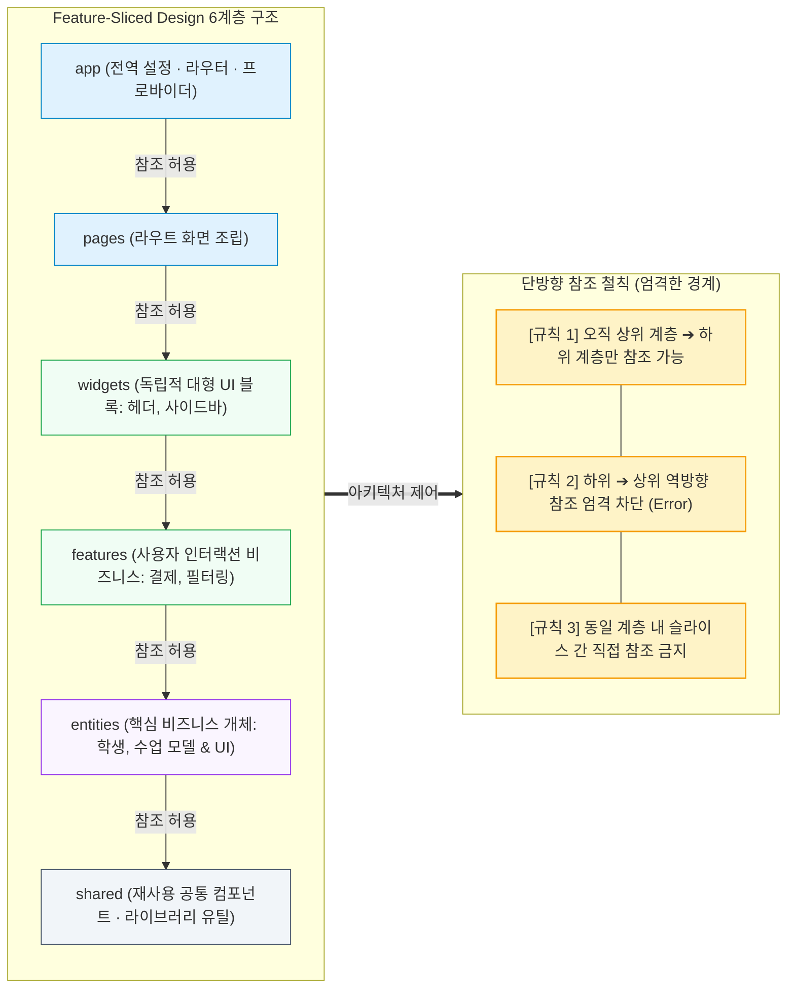

- table of contents
{:toc}

백엔드에서 계획을 먼저 세우는 규율을 확립하고([[1편]](/tag-ai-agent-architecture/1-ground-rules/)), `TDD`와 객체 4분류로 도메인을 가두었으며([[2편]](/tag-ai-agent-architecture/2-tdd-religion/), [[3편]](/tag-ai-agent-architecture/3-teach-object-design/)), 경계 정합성 표와 2중 가드레일로 인터페이스를 맞추었다([[4편]](/tag-ai-agent-architecture/4-all-passed-empty-screen/)). 이어 `cmux` 기반 1:1:1:1 병렬 워크트리와 저장소 관리 문서로 다중 에이전트 협업 거버넌스를 묶었고([[5편]](/tag-ai-agent-architecture/5-cmux-parallel-worktree/), [[6편]](/tag-ai-agent-architecture/6-repo-governance/), [[7편]](/tag-ai-agent-architecture/7-rule-pruning/)), 인프라 역시 `Docker` 불변 이미지와 `ECS`로 군더더기 없이 경량화하는 데 성공했다([[8편]](/tag-ai-agent-architecture/8-cloud-infra-evolution/)). 이쯤 되면 시스템의 모든 영역이 순조롭게 굴러가야 마땅했지만, 실전 프로덕션의 최전선에는 아직 가장 흉폭하고 제어하기 힘든 복병이 남아 있었다. 바로 사용자의 눈과 손이 직접 닿는 영역이자 다른 직군의 동료와 가장 치열하게 맞닿는 접점인 **'프론트엔드(Frontend)'**였다.

"어차피 프론트엔드 화면인데 아키텍처가 왜 필요해? AI한테 화면 하나 그려달라고 시키면 알아서 뚝딱 만들어주는 거 아니야?" 사수 없는 스타트업에서 비전공 신입 개발자로 고군분투하던 초기에는 회사도 나 자신도 그렇게 단순하게 믿었던 때가 있었다. 당시에는 나 역시 회사에 적응하며 당장 눈앞에 주어진 백엔드와 인프라 업무를 쳐내는 데 급급했기 때문이다. 하지만 그 안일한 믿음의 대가는 실로 참혹했고, 기준 없이 뒤엉킨 프론트엔드 코드는 개발자뿐만 아니라 함께 일하는 동료의 발목까지 붙잡는 거대한 늪이 되고 말았다. 이 글은 104건의 도메인 교차 참조 위반에 시달리던 13만 줄 규모의 레거시 프론트엔드를 **`FSD(Feature-Sliced Design)`** 6계층 구조로 단 2일(25 Phase) 만에 무결하게 분해하고, `Public API` 방화벽을 세워 AI 에이전트의 난개발을 통제하며 동료와 편하게 협업할 수 있는 기반을 다진 실전 아키텍처 연대기다.

---

## "누구긴 누구야 나지": 디자이너와 1인 풀스택의 눈물의 순회공연

내가 입사한 지 한 달 뒤 회사에 디자이너분이 새로 합류했고, 그날 이후 우리 둘은 사내의 거의 모든 신규 프로젝트를 순회공연하듯 함께 도맡아 만드는 페어가 되었다. 문제는 지난 [[8편]](/tag-ai-agent-architecture/8-cloud-infra-evolution/)에서 설명했듯, 당시의 나는 입사하자마자 회사의 전체 인프라를 클라우드에 올리는 작업에 매달리면서 애플리케이션 구동에 필요한 백엔드 비즈니스 로직과 API 개발까지 홀로 감당하고 있었다는 점이다. 그런 상황에서 회사에서는 우리 서비스도 이제 겉모습 때깔이 좋아야 한다며 디자이너를 채용했지만, 디자이너분이 들어왔다고 해서 복잡한 프론트엔드 상태 로직과 데이터 바인딩 코드까지 단숨에 쳐낼 리는 만무했다. 그렇다면 디자인 시안을 실제 웹 서비스 코드로 구현해 내는 일은 과연 누구의 몫이었을까?

**누구긴 누구겠는가, 바로 나였다.** ~~*(이런...)*~~

"요즘 프론트엔드는 AI 에이전트한테 시키면 다 알아서 잘해주는 거 아니냐?"라는 대표님과 팀장님의 순진한 환상 섞인 지시 아래, 우리는 프론트엔드에 대한 엔지니어링 사전 지식도, 아키텍처적 가이드라인도 전무한 상태로 프로젝트를 밀어붙였다. 아무런 구조화가 되어 있지 않은 상태에서 디자이너분도 결국 AI를 활용해 마크업과 `CSS` 등 프론트 작업을 진행하시고, 백엔드와 인프라를 구축하던 나 역시 프론트 지식은 전무했기 때문에 나머지 데이터 바인딩과 상태 로직을 판단 없이 전부 AI에게 맡기곤 했다. 당장 AI에게 "이 버튼 누르면 저 API 호출해서 표에 뿌려줘"라고 프롬프트를 치면 그럴듯한 화면이 몇 초 만에 튀어나왔기에, 겉보기에는 개발 속도가 엄청나게 빠른 것처럼 보였다. 하지만 코드의 기준과 경계가 완전히 부재한 상태에서 이어진 묻지마식 AI 위임의 결과는 정말이지 이루 말할 수 없을 정도로 처참했다.

---

## 수십 초가 걸리는 대시보드: '누더기 거인'의 탄생과 MongoDB 스키마의 앙상블

진짜 재앙은 회의 때마다 크게 바뀌는 요구사항과 이를 지탱해 줄 **관리 체제의 완전한 부재**에서 비롯되었다. 기획이 바뀔 때마다 AI에게 수정을 맡기면, AI는 이전 코드의 전체 맥락을 이해하지 못한 채 기존 컴포넌트 밑바닥에 새로운 `useState`와 인라인 비즈니스 로직, 임시 땜질용 `CSS`를 덕지덕지 이어 붙이기 바빴다. 아무런 규칙 없이 너도나도 AI에게 코드를 덧대게 시키다 보니, 코드들이 기준 없이 뒤엉킨 그야말로 난장판인 **'누더기 거인'**이 완성되고 말았다. 구조가 엉망인 누더기 거인이 되다 보니 AI조차 코드의 맥락을 제대로 짚지 못해 헤매기 일쑤였고, 디자이너분께서도 촉박한 일정 속에 간단한 UI 수정 하나를 반영하는 데에도 시간이 너무 오래 걸려 큰 스트레스를 받아 하셨다.

이러한 프론트엔드 코드의 구조적 붕괴에 더해, 앞서 [[8편] 어차피 도커인데 앤서블은 왜 썼을까](/tag-ai-agent-architecture/8-cloud-infra-evolution/)에서도 언급했던 무분별한 `MongoDB` 비정규화 스키마 관리 문제가 악마적인 시너지를 일으켰다. 프론트엔드 컴포넌트 하나가 화면에 렌더링되기 위해 서로 다른 수십 개의 비정규화 도큐먼트를 비동기로 찔러대고, 브라우저 컴포넌트 내부에서 이를 무한 루프로 정렬하고 필터링하는 아비규환이 펼쳐진 것이다. 그 결과물은 가히 전설적이었는데, 학원의 관리자 대시보드 화면 하나에 접근할 때마다 브라우저가 그대로 멈춰 서며 로딩에 무려 수십 초가 소요되곤 했다. 간단한 화면을 열 때마다 하염없이 스피너가 도는 누더기 거인 앞에서, 우리는 깊은 참담함을 금할 수 없었다.

---

## 동료의 향상심, 그리고 '도망치고 싶던 프론트'를 마주하기까지

솔직히 고백하자면 그때까지 나는 프론트엔드에 일절 관심이 없었다. 인프라와 백엔드는 내부 원리를 파고드는 과정이 너무나 재미있어서 자발적인 열정으로 밤을 새워가며 시스템을 궤도에 올려놓았지만, 이상하게 프론트엔드는 도무지 정이 가지 않았고 브라우저 위에서 화면을 맞추며 `CSS`와 씨름하는 과정이 그저 번거롭게만 느껴졌다. "아니, 그냥 프론트엔드 개발자 한 명 좀 뽑아주면 안 되나?"라는 생각이 하루에도 몇 번씩 습관처럼 머릿속을 맴돌았다. 하지만 회사는 인력 충원 없이 AI를 써서 알아서 해결하라는 완강한 입장이었고, 기술을 너무 쉽게만 생각하는 리더십의 태도에 대해 답답함을 느꼈었다.

그 절망적인 혼돈 속에서 나를 다시 일깨운 것은 함께 페어로 일하던 디자이너분의 눈부신 태도였다. 내가 인프라와 백엔드를 맨땅에 헤딩하며 배웠듯 그분 역시 향상심이 대단히 뛰어난 분이었는데, 버전 관리 도구인 `git`의 기초 사용법부터 시작해 본인 나름의 체계적인 '디자인 시스템'을 구축하여 회사 차원에 적용하고, 일관된 `CSS` 아키텍처 관리법을 밤낮으로 공부해 프로젝트에 묵묵히 녹여내셨다. 프로젝트가 하나둘 진행될수록 동료 디자이너의 엔지니어링적 성장은 곁에서 보기에도 눈이 부실 정도였다.~~*(건의 형 멋있당)*~~ 유일한 개발자로서 다른 직군의 동료와 긴밀하게 호흡해야 하는 환경 속에서, 결국 좋은 프로덕트는 내 몫만 끝낸다고 만들어지는 것이 아니라 각자의 전문성을 존중하되 직군 간의 장벽을 허물어 동료들이 온전히 제 역량을 발휘하며 편하게 협업할 수 있는 기반을 만들 때 나온다는 사실을 자연스럽게 깨닫게 되었다.

뜬금없지만 나는 불교를 좋아하는데, 내가 아는 불교의 가르침 중에 **"주어진 상황에서 과거와 미래를 바라보며 불평불만 하지 말고, 지금 네가 서 있는 현재에 온전히 힘을 쏟아라"**라는 가르침이 있다. 내가 아무리 프론트엔드에 관심이 없었고 기술을 대하는 리더십의 태도가 불만이었을지라도, 언제까지 남의 탓만 하며 문제를 외면할 수는 없는 노릇이었다. 피할 수 없는 현실이자 동료와 함께 풀어가야 할 과제라면 나도 이제 프론트엔드를 제대로 들여다봐야겠다는 결심이 섰고, 남을 탓하던 마음을 거두어 현재의 문제에 온전히 몰입하기 시작하자 놀랍게도 프론트엔드의 세계가 완전히 다르게 보이기 시작했다.

어떻게 하면 디자이너분과 서로 길을 잃지 않고 편하게 작업할 수 있을지 고민하며 `React`를 기초부터 정면으로 파고들었다. 컴포넌트의 라이프사이클과 훅(`Hook`)의 내부 동작 원리, 불변성을 기반으로 단방향으로 흐르는 `State`와 `Props`의 철학 등 굵직한 핵심 개념들을 제대로 짚어가며 공부하자 프론트엔드가 단순한 '화면 그리기'가 아니라 정교한 상태 머신이라는 사실이 눈에 들어왔다. 공식 튜토리얼(Tic-Tac-Toe 게임 만들기)부터 직접 손으로 한 줄씩 코드를 짜보며 브라우저 화면 위에 시각적인 인터랙션이 즉각 구현되는 쾌감에 빠져들었고, 그 재미에 탄력을 받아 개인 가계부 앱([tomato-vault/household_ledger](https://github.com/tomato-vault/household_ledger))을 `React`와 `FastAPI`를 조합해 처음부터 끝까지 빌드해 보는 사이드 프로젝트를 진행하기도 했다. 나아가 우리 회사의 서비스 특성상 `React` 외에 다른 스택이 구조적으로 더 유리하지는 않을까 하는 실용적인 호기심에 `Ruby on Rails`(`Hotwire/Turbo`)나 `Svelte`까지 깊이 들여다보며 가계부 앱을 `Rails`로 재작성해 프레임워크 간 상태 관리 철학을 비교 실습해 보았다. 이렇게 다양한 기술 스택을 넓은 시야에서 직접 부딪치며 탐색한 과정은, 백엔드와 마찬가지로 프론트엔드 역시 **'소프트웨어 아키텍처'**라는 견고한 공학적 토대 위에서만 지속 가능하다는 본질을 온몸으로 이해하는 결정적 계기가 되었다.

---

## 13만 줄 프론트엔드의 비명: 도메인 난개발과 104건의 교차 침범

초기 우리 레포지토리의 프론트엔드는 사실상 아무런 아키텍처적 규칙도 없이 AI에게 온전히 내맡겨진 무질서의 극치였는데, 이때 지난 [[8편]](/tag-ai-agent-architecture/8-cloud-infra-evolution/)에서도 큰 귀감이 되었던 개발 잘하는 동료분의 든든한 조언이 큰 실마리가 되어 주었다. 수익화 중인 자신만의 사이드 프로젝트를 탄탄하게 운영하며 프론트엔드도 깊이 다뤄본 실력자였던 그는, 내게 **`DDD(Domain-Driven Design, 도메인 주도 설계)`** 관점의 도메인 모듈화를 추천하며 비즈니스 도메인별로 디렉토리를 쪼개어 독립적으로 개발해 보라고 조언해 주었다. 무질서 속에서 고통받던 나에게 이는 대단히 실용적인 해답으로 다가왔고, 곧바로 프론트엔드에 `src/domains/{auth, organization, data-management, student, ...}` 형태의 도메인 분할 구조를 전격 도입하자 이전의 무규칙 상태에 비해 한결 정돈된 모양새를 갖추게 되었다.

### 하지만 DDD는 프론트엔드의 구체적인 배치 지침이 아니었다

하지만 프로젝트가 점점 커지며 서비스를 본격적으로 확장해 나가자, 이 도메인 분할 구조는 금세 두 가지 뼈아픈 한계에 부딪혔다. 첫째로 **`DDD`는 비즈니스 모델링을 위한 설계 철학이자 개발 방법론이지, 프론트엔드 파일의 물리적 배치와 의존성 계층을 규정해 주는 지침이 아니었다.** 백엔드에서는 `Bounded Context`와 `Aggregate`, `Layered Architecture`를 통해 책임과 경계를 단단히 묶을 수 있었지만, 프론트엔드에서 구체적인 하위 규칙 없이 "도메인별로 구성해 달라"고만 설정해 버리니 18개 도메인 폴더가 저마다 `api`, `services`, `contexts`, `hooks`, `components`, `pages`, `utils`를 자체 보유하며 모든 살림을 한 방에 차려버리는 **Fat-Domain** 구조로 굳어져 버렸다. 어떤 역할의 코드를 어디에 두고 누구를 참조할 수 있는가에 대한 명확한 규칙이 없었던 셈인데, 물론 그나마 폴더가 나뉜 덕분에 디자이너분께서도 이전의 통짜 구조보다는 훨씬 작업하기 편하다며 반기셨지만 근본적인 결합도 문제는 수면 아래에서 계속 자라나고 있었다.

둘째로 **도메인 간의 수평적 배치로 인한 상하 계층의 부재**가 발목을 잡았다. 처음에 동료에게 `DDD`에 대한 설명을 듣고 직관적으로 "기능별로 폴더를 쪼개서 관리하면 되겠구나"라고 이해했던 방식은, 사실 엄밀한 `DDD`라기보다는 **`FSD(Feature-Sliced Design)`**의 슬라이스 개념에 가까운 형태였다. 문제는 `FSD`처럼 '계층(Layer)'의 엄격한 상하 단방향 규칙을 세우지 않은 채 그저 18개의 도메인 폴더를 수평으로 나열해 두었다는 점이었다. 도메인들 사이에 수직적인 상하 관계가 전혀 없다 보니, AI 에이전트의 눈에는 모든 폴더가 서로 동등한 높이에서 아무나 불러다 써도 되는 무법지대로 보이기 시작했다.

### 13만 줄 코드베이스의 정기 검진: `/sweep`이 찾은 104건의 비효율

개인적인 각성과 학습을 거쳐 프론트엔드 아키텍처의 기본기를 다진 뒤, 2026년 5월 사내 프로덕션 코드베이스를 정기 코드 종합검진 스킬인 `/sweep`으로 정밀 진단했을 때 프론트엔드의 규모는 이미 **132,454 LOC(132K 라인), 635개 파일, 18개 도메인**에 달해 있었다. 터미널 화면에 찍힌 진단 수치는 1인 개발자의 등골을 서늘하게 만들기에 충분했다:
- **도메인 간 교차 참조(cross-domain import) 위반**: `104건`
- **shared에서 도메인 내부를 역참조하는 역방향 오염**: `26건`
- **양방향(순환) 의존성**: `27건`
- **상위 4개 거대 도메인이 전체 코드의 60%를 독점**

코드 내부를 들여다보니 구조적 모순은 더욱 심각했다. '수업' 비즈니스는 테넌트 관리 도메인에 있고 '수업 데이터 분석'은 데이터 관리 도메인에 쪼개져 있다 보니 두 도메인이 서로의 내부 파일을 마구 `import`하며 양방향 순환 참조를 일으키고 있었다. 공용이어야 마땅한 인증 유틸은 특정 도메인 깊숙이 갇혀 있어 5개 도메인이 상대 경로(`../../auth/hooks/useToken`)로 남의 안방을 침범하고 있었고, 심지어 전역에 한 번만 떠야 할 데이터 공급자(`Provider`)들이 최하위 계층인 `shared`에 잘못 마운트되어 계층 규칙을 어지럽히고 있었다. 그중에서도 가장 기괴했던 것은 **`Page`가 다른 도메인의 `Page`를 일반 컴포넌트 부품처럼 가져다 쓰는 안티패턴**이었는데, 핵심 사용자 대시보드 화면 하나가 테넌트 관리 도메인의 통화면 컴포넌트 6개를 통째로 `lazy import`하여 화면 안에 또 다른 화면을 덕지덕지 박아 넣고 있었던 것이다.

위반 건수 104건이라는 수치는 파일 몇 개를 수작업으로 고쳐서 해결할 수 있는 수준이 아니었다. 다음 신규 기능 하나만 더 추가되어도 프론트엔드 전체 의존성 그래프가 뒤엉켜 빌드조차 되지 않거나 런타임 렌더링 루프에 빠져 복구 불능 상태에 이를 수 있다는 명백한 붕괴 경고였다. 운영 중인 프로덕션 서비스가 멈추지 않으면서도 13만 줄 전체의 질서를 안전하게 바로잡을 수 있는 완전히 새로운 아키텍처적 관문이 절실했다.

---

## 왜 에이전트는 프론트엔드에서 더 쉽게 폭주하는가?

백엔드에서는 `Clean Architecture`나 3계층 레이어드 구조를 세워두면 `Controller ➔ Service ➔ Repository`라는 물리적 데이터 흐름이 명확하고, 객체 디자인 원칙([[3편]](/tag-ai-agent-architecture/3-teach-object-design/))에 따라 역할을 나누어주면 에이전트도 비교적 질서 있게 코드를 작성하는 편이다. 반면 프론트엔드는 본질적으로 에이전트가 통제력을 잃기 가장 쉬운 세 가지 구조적 취약점을 안고 있다:

1. **책임과 역할의 무제한 혼재**:
   컴포넌트 하나가 화면 렌더링(`View`), 복잡한 상태 관리(`Model`), 서버 통신(`IO`), 사용자 인터랙션 이벤트(`Controller`)를 모두 한 파일에 욱여넣어도 브라우저는 아무런 불평 없이 화면을 띄운다. 백엔드라면 컴파일러나 타입 검사기가 즉시 튕겨냈을 수많은 월권 행위가 프론트엔드에서는 '일단은 동작하는 코드'라는 착시 뒤로 교묘히 숨어버린다.

2. **도메인 간 수직적 상하 관계의 부재**:
   단순히 도메인별로 폴더를 나누라는 자연어 규칙만으로는 `Student` 도메인이 `Course` 도메인을 가져다 써도 되는지, 아니면 그 반대인지 에이전트가 판단할 수 없다. 둘 다 동등한 위상의 폴더로 보이기 때문에 에이전트는 당장 타이핑하기 편한 상대 경로로 남의 도메인 코드를 끌어다 쓰며 거미줄 같은 순환 참조를 만들어낸다.

3. **컨텍스트 윈도우 한계와 땜질식 덮어쓰기**:
   단일 `JSX` 파일이 500줄, 1,000줄을 넘어서는 순간 에이전트는 파일 상단의 상태 흐름과 하단의 렌더링 사이클을 하나의 시야에 온전히 담지 못하는 `Lost in the Middle` 현상을 겪는다. 결국 기존 로직을 깔끔하게 리팩터링하는 대신 파일 하단에 새로운 `useState`와 `useEffect`를 덧대며 컴포넌트를 돌이킬 수 없는 누더기 거인으로 키우고 만다.

에이전트에게 남의 도메인 코드를 함부로 참조하지 말고 컴포넌트를 작게 쪼개라는 자연어 프롬프트를 아무리 반복해 봐야 실전에서는 소용이 없었다. 디자이너분과 내가 각자 AI를 활용해 작업하더라도 서로 길을 잃지 않고 에이전트의 난개발을 원천 차단하기 위해 필요했던 것은, **"누가 누구를 참조할 수 있고 누구는 절대로 볼 수 없는가"를 기계적으로 강제하는 엄격한 계층 헌법**이었다.

---

## 구원투수 FSD (Feature-Sliced Design): 6계층의 단방향 규율

이 절체절명의 위기에서 오랜 공부와 검토 끝에 도입한 아키텍처가 바로 **`FSD(Feature-Sliced Design)`**였다. `FSD`는 프론트엔드 애플리케이션의 모든 코드를 명확한 책임과 관심사에 따라 **6개의 수직 계층(Layers)**으로 엄격히 분할한다:



`FSD`가 가진 가장 강력한 엔지니어링 미덕은 **"단방향 의존성의 절대 규칙"**에 있다:

1. **상위 계층은 오직 하위 계층만 참조할 수 있다**:
   - `pages`는 `widgets`, `features`, `entities`, `shared`를 자유롭게 조합하여 라우트 화면을 완성한다.
   - `features`는 `entities`의 데이터 모델과 기본 UI를 가져다 쓸 수 있지만, 반대로 `entities`는 상위의 `features`나 `pages`의 존재를 결코 알지 못한다.
   - 하위 계층이 상위 계층을 `import`하려는 시도는 아키텍처 린터 레벨에서 즉시 에러로 차단된다.

2. **동일 계층 내 슬라이스 간 직접 참조는 절대 금지된다**:
   - `features/add-student`는 같은 레이어에 있는 `features/enroll-course`를 절대로 직접 `import`할 수 없다.
   - 두 기능 사이에 공유되어야 하는 데이터나 UI가 있다면 반드시 하위 계층인 `entities`나 `shared`로 내려보내거나, 상위 계층인 `widgets`나 `pages`에서 조립해야 한다.

이 규칙이 세워진 순간, 에이전트에게 주어야 할 설계 지침은 놀라울 만큼 명쾌해졌다:
> **"네가 지금 작성하는 코드가 어느 레이어에 속하는지만 결정하라. 계층이 정해지면, 네가 볼 수 있는 코드와 볼 수 없는 코드의 경계는 시스템이 기계적으로 강제한다."**

{:width="700" loading="lazy"}

이후에 최초부터 FSD를 도입하여 작업한 프로젝트의 FSD 6계층 구조와 전용 린터 Steiger 구동 환경. 좌측 탐색기에 정돈된 6개 레이어와, steiger.config.js 설정을 거쳐 하단 터미널에서 npm run lint:fsd(No problems found!)로 계층 간 불법 참조 및 Public API 우회를 기계적으로 완벽히 통제하고 있다.
{:.figcaption}

---

## 614개 테스트를 지켜내며 FSD로 안전하게 안착하기까지

13만 줄 규모의 상용 서비스를 단번에 갈아엎는 빅뱅(Big-bang) 방식은 1인 개발자에게 너무나 위험한 도박이었다. 운영 중인 프로덕션 배포가 멈춰서도 안 되었고, 기존에 구축해 둔 **614개의 단위 및 통합 테스트 스위트가 단 하나라도 깨져서는 안 되었기 때문**이다. 그래서 나는 단숨에 폴더를 뒤집는 대신 기존의 `src/domains/` 폴더를 임시 완충 계층으로 두고, 경계 린터(`eslint-plugin-boundaries`)를 도입해 104건에 달하던 교차 참조를 25개의 세밀한 Phase로 나누어 점진적으로 깎아나가는 전략을 택했다. 공용 유틸부터 `shared`로 내리고 데이터 모델은 `entities`로, 사용자 인터랙션은 `features`로 하나씩 분리하며 매 단계마다 전체 테스트 통과 여부를 엄격히 검증했다. 그 결과 단 한 건의 회귀 버그도 없이 614개 테스트가 모두 초록불(`GREEN`)을 유지한 상태에서 단 이틀 만에 104건의 교차 침범을 전부 `0건`으로 해소할 수 있었고, 엉켜 있던 레거시 도메인 폴더를 완전히 삭제한 뒤 린터 규칙을 하드 에러(`error`)로 격상하며 13만 줄 전체를 `FSD` 6계층 구조로 안전하게 안착시켰다.

---

## Public API (`index.ts`)라는 방화벽: 캡슐화의 승리

`FSD` 아키텍처가 에이전트의 난개발을 막아주는 두 번째 결정적 무기는 바로 **`Public API`(`index.ts`)를 통한 엄격한 캡슐화**다. `FSD` 규약에서 각 슬라이스 내부의 세그먼트 폴더 구조(`ui/`, `model/`, `api/`, `lib/`)는 슬라이스 자신만의 사적 영역으로 취급되며, 외부에 공개할 컴포넌트나 훅, 타입은 **오직 해당 슬라이스의 루트에 위치한 `index.ts` 파일에서만 명시적으로 `export`**해야 한다:

```typescript
// src/entities/student/index.ts (공개 정문: Public API)
export { StudentCard } from './ui/StudentCard';
export { useStudentQuery } from './api/useStudentQuery';
export type { Student } from './model/types';

// 내부에서만 쓰이는 서브 컴포넌트, 헬퍼 함수, 임시 상태는 절대로 export하지 않는다!
// ui/sub/InternalAvatarBadge.tsx
// model/internalFormatters.ts
```

아울러 린터 규칙을 통해 외부 슬라이스에서 다른 슬라이스 내부의 깊은 파일 경로로 직접 침투하는 `import` 구문(`import { InternalAvatarBadge } from '@/entities/student/ui/sub/InternalAvatarBadge'`)을 물리적으로 차단해 버렸다. 이 방화벽이 가져온 실전 효과는 기대 이상이었다:
- **에이전트의 무단 침입 차단**: 에이전트는 더 이상 다른 슬라이스의 안방 서랍을 뒤적거리며 내부용 미완성 훅이나 서브 컴포넌트를 훔쳐다 쓰지 못한다. 오직 정문(`Public API`)에 걸려 있는 정규 인터페이스로만 소통해야 하므로 결합도가 극적으로 낮아진다.
- **자유로운 내부 리팩터링과 디자이너 협업 효율화**: `entities/student`의 내부 마크업 구조를 열 번 갈아엎고 디자인 시스템에 맞춰 서브 컴포넌트를 잘게 쪼개더라도, `index.ts`의 공개 시그니처만 유지된다면 이를 가져다 쓰는 수십 개의 외부 위젯이나 페이지는 단 한 줄의 코드도 수정할 필요가 없다. 디자이너분께서도 자신이 고쳐야 할 UI 컴포넌트의 위치(`ui/` 세그먼트)를 한눈에 찾고 안심하고 스타일을 수정할 수 있게 된 셈이다.

---

## AI 에이전트와 FSD의 시너지: 버그 없는 코드 생성의 비밀

`FSD` 6계층과 `Public API` 방화벽이 완성되자, AI 에이전트의 프론트엔드 작업 생산성과 정확도는 이전과 비교할 수 없을 만큼 상승했다:

1. **컨텍스트 오염의 원천 차단**:
   새로운 화면이나 기능을 만들 때 에이전트에게 13만 줄 전체의 구조를 설명할 필요가 없어졌다. "너는 지금 `features/exam-grading` 슬라이스를 개발 중이며, 참조할 수 있는 `Public API`는 `entities/student`와 `entities/exam`뿐이다"라고 경계를 지정해 주면 에이전트는 오직 그 좁고 정밀한 바운더리 안에서만 높은 집중력을 발휘한다.

2. **명확한 폴더 배치 가이드**:
   "이 버튼 코드는 어디에 두어야 하죠?"라는 소모적인 고민이 사라졌다. 비즈니스 액션이 담긴 컴포넌트면 `features`, 도메인 데이터 표시 카드면 `entities`, 이들을 묶은 독립 패널이면 `widgets`, 라우트 진입 화면이면 `pages`로 자리가 정해져 있어 개발자와 디자이너, 에이전트 모두의 판단 비용이 제로에 가깝게 수렴한다.

3. **안전한 병렬 작업**:
   지난 [[5편] 같은 브랜치에서 에이전트끼리 사이좋게 코딩할 리가 없어](/tag-ai-agent-architecture/5-cmux-parallel-worktree/)에서 소개한 `cmux` 병렬 워크트리 환경에서 여러 스포크 에이전트가 각기 다른 슬라이스를 동시에 개발하더라도, 동일 계층 간 참조가 금지되어 있고 `Public API` 계약만 준수하면 파일 충돌이나 예기치 못한 사이드 이펙트가 원천적으로 발생하지 않는다.

---

## 기획부터 백엔드, 프론트엔드까지 단 하나의 온톨로지로 연결되다

이 `FSD` 6계층 구조는 단순히 프론트엔드 코드를 깔끔하게 정리하는 데 그치지 않고, 지난 [[6편] 에이전트가 기억상실증입니다만, 문제라도?](/tag-ai-agent-architecture/6-repo-governance/)에서 다루었던 **118개 기능 카탈로그(`docs/features/`)의 단단한 주춧돌**이 되어 주었다. 기능 카탈로그의 문서마다 백엔드의 5개 레이어와 함께 프론트엔드의 사양을 다음과 같이 1:1로 대응시켜 못 박을 수 있었던 것은, 프론트엔드 코드베이스가 `FSD`라는 명확한 단방향 슬라이스로 정렬되어 있었기에 가능한 일이었다:
- **`Page`**: 이 기능은 사용자가 브라우저에서 어느 라우트 화면에 접속했을 때 보이는가? (`src/pages/`)
- **`Widget`**: 화면 안에서 어떤 독립적인 대형 UI 블록으로 조립되어 렌더링되는가? (`src/widgets/`)
- **`Feature`**: 사용자가 버튼을 누르거나 폼을 제출할 때 어떤 인터랙션 비즈니스가 실행되는가? (`src/features/`)
- **`Entity`**: 이 기능이 다루는 핵심 비즈니스 데이터 모델과 기본 UI 카드는 무엇인가? (`src/entities/`)

백엔드의 객체 4분류([[3편] 객체지향을 배웠으니 선생님을 가르쳐보겠습니다](/tag-ai-agent-architecture/3-teach-object-design/))와 프론트엔드의 `FSD` 계층이 이처럼 빈틈없이 맞물리자, 1인 개발자와 디자이너, 그리고 AI 에이전트는 기획 사양서부터 프론트엔드 컴포넌트, 백엔드 서비스, 데이터베이스 테이블에 이르기까지 **단 하나의 틈새도 없이 정합된 풀스택 아키텍처 지도**를 공유하며 일할 수 있게 되었다. (훗날 이 풀스택 레이어 매핑은 도메인 온톨로지 엔진인 `otlg`의 `code_paths.frontend` 바인딩으로 흡수되어, 백엔드 엔티티가 변경될 때 영향을 받는 프론트엔드 `FSD` 슬라이스까지 0.01초 만에 역추적해 주는 **온톨로지 엔지니어링 [[4편] 에이전트에게 매번 설명하기 귀찮다면 레포지토리가 직접 말하게 하면 되지 않을까](/tag-ontology-engineering/4-repo-ontology-primitives-and-trace/)**로 이어진다.)

---

## 1인 개발자의 프론트엔드 철학: "UI 컴포넌트는 그림이 아니라 아키텍처다"

디자이너분과 함께 프로젝트를 순회공연하듯 돌며 로딩에 수십 초가 걸리는 눈물의 '누더기 거인'을 마주했던 날들, 프론트엔드 개발자 한 명만 뽑아달라며 도망치고 싶었던 무력감, 그리고 동료의 눈부신 향상심에 자극받아 서로 길을 잃지 않고 편하게 협업할 방법을 고민하며 `React`와 `Rails`, `Svelte`까지 파고들었던 시간들은 내 엔지니어링 시야를 완전히 바꾸어 놓았다. 그 치열했던 탐색의 궤적을 지나 마침내 13만 줄 규모의 레거시 코드를 단 이틀 만에 `FSD` 구조로 무결하게 분해해 냈을 때, 나는 비로소 소프트웨어 엔지니어로서 평생 잊지 못할 핵심 원칙을 온몸으로 체득할 수 있었다. **UI 컴포넌트는 단순한 그림이 아니라, 데이터의 흐름과 책임의 경계가 교차하는 정교한 소프트웨어 아키텍처**라는 사실이다.

"어차피 프론트엔드인데 아키텍처가 왜 필요해?"라는 물음에 이제 나는 주저 없이 답할 수 있다. 화면 뒤편에는 언제나 서버와의 비동기 통신과 상태 변이가 흐르고 있으며, 컴포넌트 사이에는 엄격한 의존성 방향과 결합도 제어가 작동해야만 한다. 이러한 아키텍처적 레일을 깔아두지 않고 AI 에이전트에게 화면을 만들어달라고 지시하는 것은, 철로가 없는 산골짜기에 고속열차를 전속력으로 달리게 만드는 것과 다름없어 몇 초 만에 탈선해 스파게티 참사로 이어지기 마련이다. 단방향 의존성이라는 `FSD`의 궤도를 깔고 `Public API`라는 안전 게이트를 세워둔 덕분에, 에이전트는 수십 개의 컴포넌트를 빠르게 찍어내면서도 탈선 사고를 일으키지 않게 되었고 동료 디자이너와 나 역시 각자의 영역에서 스트레스 없이 역량을 발휘할 수 있었다. 1인 개발자에게 아키텍처란 거창한 이론이나 유행이 아니라, **함께 일하는 동료와 나 자신, 그리고 AI 에이전트 모두를 무한한 엔트로피와 스파게티의 심연으로부터 구출해 내는 가장 실질적인 생존의 호흡기**다.

---

## 다음 이야기: 기록의 악마는 고립된 노트의 꿈을 꾸지 않는다

백엔드와 클라우드 인프라, 그리고 프론트엔드 UI의 거대한 코드베이스까지 하나의 정교한 엔지니어링 운영체계 안으로 단단하게 통제해 넣었지만, 시스템이 거대해질수록 개발자의 머릿속과 로컬 저장소에는 또 다른 형태의 혼돈이 피어오르기 시작했다. 하루에도 수십 개씩 쏟아져 나오는 개발 일지와 아키텍처 의사결정 기록, 수천 편의 기술 학습 노트들이 서로 연결되지 못한 채 각자의 폴더 속에 외딴섬처럼 고립되어 쌓여가고 있었기 때문이다. 다음 **[[10편] 기록의 악마는 고립된 노트의 꿈을 꾸지 않는다](/tag-ai-agent-architecture/10-knowledge-ontology/)**에서는 흩어진 파편적 지식들을 13가지 정형 스키마와 태그 화이트리스트, 그리고 그래프 관계망으로 엮어내어 인간과 AI 에이전트가 함께 참조하는 외부 두뇌(Second Brain)로 구축한 '지식 온톨로지(Knowledge Ontology)' 엔진의 실체를 공개한다.
