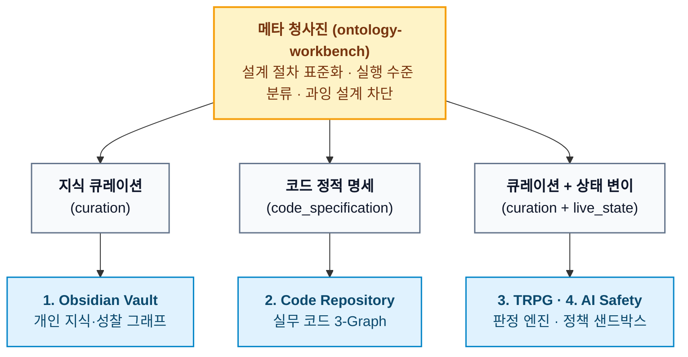

- table of contents
{:toc}

## 전체 시리즈 로드맵 안내

<mark class="kw-term">온톨로지 엔지니어링</mark>을 지식 베이스와 실무 코드에서 출발해 네 개의 세계와 메타 워크벤치로 확장한 기록이다.

| 글 제목 | 핵심 화두 |
|:---|:---|
| [[0편] 개념 공부를 넘어 실전으로, 네 개의 도메인에 온톨로지를 구축하기까지](/tag-ontology-engineering/0-ontology-engineering-intro/) | 4대 세계 이식과 실행 수준(Regime) 조감도 |
| [[1편] 온톨로지가 없는 AI는 현학적인 수다쟁이일 뿐이다](/tag-ontology-engineering/1-palantir-3rd-generation-platform/) | 엔터프라이즈 OS·AIP와 온톨로지 3대 계층 |
| [[2편] 4,400개의 흩어진 생각에 척추를 세우고 도구의 착각까지 도려내다](/tag-ontology-engineering/2-vault-knowledge-ontology/) | 지식 그래프 엔진과 523건 운영 감사 |
| [[3편] 문서는 명사로 정리되지만 코드는 동사로 움직인다](/tag-ontology-engineering/3-nouns-to-verbs-paradigm-shift/) | 명사에서 동사(Action Spec)로의 전환 |
| [[4편] 린트 에러 0개의 거짓말, 내가 만든 온톨로지를 의심하기까지](/tag-ontology-engineering/4-zero-lint-error-illusion-and-v020/) | 미검사 착시 제거와 AST 심볼 검증 |
| [[5편] 오픈소스와 논문에서 길어 올린 온톨로지 컴파일러, 3-Graph와 TDD 증거 봉인](/tag-ontology-engineering/5-three-graphs-and-tdd-contract-v030/) | 3-Graph 교차 검증과 TDD 증거 봉인 |
| [[6편] 아무리 똑똑한 알바생이라도 금고 열쇠를 통째로 맡기는 사장님은 없다](/tag-ontology-engineering/6-sdlc-harness-and-living-wiki/) | 물리적 방어 훅과 Living Wiki 엔진 |
| [[7편] 주사위는 거짓말을 하지 않는다, TRPG에서 비로소 도달한 진짜 Action Layer](/tag-ontology-engineering/7-trpg-kinetic-action-layer/) | 전장의 안개 격리와 결정론적 판정 |
| [[8편] 네 개의 온톨로지를 만들고 나서야 알게 된 것, 메타 청사진과 과잉 규율의 경계](/tag-ontology-engineering/8-meta-ontology-workbench-and-redteam/) | 설계 절차 표준화와 과잉 설계 차단 게이트 |
| [[9편] 고정된 CLI를 넘어 코드를 합성하는 그래프로, Code-on-Graph와 어제의 내가 내일의 에이전트에게 남기는 약속](/tag-ontology-engineering/9-code-on-graph-and-epilogue/) | 그래프 위 코드 합성과 샌드박스 시뮬레이션 |
| [[10편] 경험이 글이 되고 의미가 스스로를 증명하기까지, 지식·성찰 컴파일러와 3대 의미 모형 감사](/tag-ontology-engineering/10-knowledge-blog-compiler-and-semantic-critique/) | 블로그·성찰 컴파일러와 3대 의미 모형 감사 |
{:.roadmap-table}

### 심화 자료 (Deep-Dive) 아카이브

상세 스키마, 적대적 반례 전수 표, 검증 영수증을 모아둔 아카이브다.

| 심화편 제목 | 관련 회차 | 핵심 검증 질문 및 수록 근거 |
|:---|:---:|:---|
| [심화 \| Vault의 지식·성찰 컴파일러](/tag-ontology-engineering/deep-dive/vault-knowledge-compiler/) | `2·10편` | 13종 타입·7종 의미 관계, SQLite·SHACL 이중 검증, 적대적 반례 및 성찰 컴파일러 규격 |
| [심화 \| Repo Ontology의 명세와 3-Graph](/tag-ontology-engineering/deep-dive/repo-graph-contracts/) | `3·4·5편` | `.ontology/` 스키마, 도메인·아키텍처·테스트 계약 3-Graph, AST 심볼 및 테스트 영수증 봉인 |
| [심화 \| Repo의 SDLC 하네스와 의미 감사](/tag-ontology-engineering/deep-dive/repo-sdlc-and-audit/) | `6·10편` | `spoke-guard` 방어 훅, Living Wiki 5대 정본, 엔드포인트 역추적 및 의미 감사 매트릭스 |
| [심화 \| TRPG의 실행과 World Canon](/tag-ontology-engineering/deep-dive/trpg-world-canon/) | `7·9·10편` | 가시성(visibility) 투영, 결정론적 2d6 판정 핸들러, 밸런스 시뮬레이션과 무결성 감사 |
| [심화 \| Workbench와 Code-on-Graph](/tag-ontology-engineering/deep-dive/workbench-and-code-on-graph/) | `8·9편` | 실행 수준 분류와 과잉 설계 차단 게이트, AI 안전 정책 샌드박스 및 Code-on-Graph 규격 |
{:.deep-dive-table}

---

## 왜 온톨로지인가

[AI OS 시리즈](/tag-ai-agent-architecture/)에서 언급했듯 에이전트 생태계의 두 축은 각자의 <mark class="kw-term">워크플로우</mark>([11편](/tag-ai-agent-architecture/11-external-workflow-and-ai-os/)의 Ralph가 만드는 <mark class="kw-term">AI OS</mark> 등)와 <mark class="kw-term">온톨로지(Ontology)</mark>다. 온톨로지를 공부하면서 비로소 시장이 왜 팔란티어(Palantir)에 열광하는지 이해할 수 있었다 ~~*(물론 주식 때문인 게 크겠지만, 엔지니어 사이에서도 화두이긴 하니까)*~~. <mark class="kw-devil">기록의 악마</mark>인 나는 '옵시디언 볼트(Obsidian Vault)에 온톨로지를 도입해 유기적인 시스템으로 만들 수 있지 않을까?'라는 질문을 던졌고([AI OS 10편](/tag-ai-agent-architecture/10-knowledge-ontology/)), 추후 Vault 시리즈<!--(/tag-vault-os/)-->에서도 다뤄볼 생각이다. 나아가 코드 저장소 관리([AI OS 6편](/tag-ai-agent-architecture/6-repo-governance/), [7편](/tag-ai-agent-architecture/7-rule-pruning/))와 융합해 탄생한 것이 <mark class="kw-term">Repo Ontology</mark>다.

{:width="700" loading="lazy"}

`.ontology/` 디렉터리 구조(actions, functions, links, objects, rules)와 명세
{:.figcaption}

---

## 네 개의 세계와 깨달음: 이름은 같아도 실행의 층위는 다르다

배운 개념을 실무와 취미에 하나씩 이식하다 보니 무대는 어느덧 네 개의 세계로 넓어졌다. 스키마 게이트를 세운 **개인 지식 베이스(Vault)**, 도메인 불변식을 3-Graph로 묶은 **실무 코드 저장소(Repo)**, 정보 가시성과 결정론적 판정을 집행하는 **TRPG 캠페인**, 그리고 회색지대 정책을 샌드박스 검증 후 제재로 연결하는 **AI 안전 정책 검수(AI Safety)**다.

네 도메인을 가로지르며 적대적 검수 끝에 얻은 가장 큰 통찰은 **'온톨로지'라는 이름은 하나여도 도메인마다 책임져야 할 <mark class="kw-term">실행 수준(Regime)</mark>은 전혀 다르다**는 점이다. 지식 큐레이션, 코드 정적 명세, 실시간 상태 변이는 각기 정본(SSOT)과 보호해야 할 경계가 달랐기에, 억지로 하나의 통합 런타임으로 묶는 대신 설계 절차와 과잉 설계를 막는 <mark class="kw-term">부정 게이트(Negative Gate)</mark>만 메타 청사진(`ontology-workbench`)으로 추상화했다.

1. **개인 지식 베이스 (Obsidian Vault)** — <mark class="kw-term">지식 큐레이션(curation)</mark>
   - **정본과 도구**: 마크다운 노트·외부 도서 참조(`ext:`)와 전용 CLI(`vault` v0.6.0)
   - **핵심 검증과 경계**: 4,400개 노트의 생성 스키마 게이트와 의미 관계망을 검증(638개 테스트 통과)하되, 도구의 검사 통과와 지식 자체의 무결성을 구분하고 AI 요약본과 인간의 직접 성찰을 엄격히 분리한다.
2. **실무 코드 저장소 (Code Repository)** — <mark class="kw-term">코드 정적 명세(code_specification)</mark>
   - **정본과 도구**: `.ontology/` 명세·실제 소스 코드와 정적 검증 CLI(`otlg` v0.5.0)
   - **핵심 검증과 경계**: 도메인·아키텍처·테스트 계약의 3-Graph를 AST 심볼에 바인딩해 정적 정합성을 검증(139개 테스트 통과)하되, 런타임 실행 엔진을 흉내 내거나 단순 외래키(FK)를 억지로 객체화하지 않는다.
3. **TRPG 캠페인 월드 (TRPG Campaign)** — <mark class="kw-term">큐레이션 + 상태 변이(live_state)</mark>
   - **정본과 도구**: 세계관 정본(World Canon)·세션 라이브 상태와 판정 엔진(`trpg` v0.15.0)
   - **핵심 검증과 경계**: 캐릭터별 인식론적 전장의 안개(`visibility`)를 투영해 소문과 객관적 진실을 분리(386개 테스트 통과)하고, LLM의 서사 묘사와 결정론적 주사위·수치 변이를 물리적으로 격리한다.
4. **AI 안전 정책 검수 (AI Safety Moderation)** — <mark class="kw-term">큐레이션 + 상태 변이(live_state)</mark>
   - **정본과 도구**: 정책 스냅샷·골드 코퍼스와 `BubbleTap FDE` 워크벤치
   - **핵심 검증과 경계**: 복합 회색지대 정책을 그래프 위 실행 코드(<mark class="kw-term">Code-on-Graph</mark>)로 합성(55개 테스트 통과)하되, 골드 코퍼스 샌드박스 시뮬레이션과 실제 운영 제재 액션을 분리한다.

매일 다루는 네 세계에 온톨로지를 심고 허점을 도려낸 기록을 하나씩 풀어보고자 한다.

---

### [시리즈의 다음 이야기]

**[[1편] 온톨로지가 없는 AI는 현학적인 수다쟁이일 뿐이다](/tag-ontology-engineering/1-palantir-3rd-generation-platform/)**에서 DW와 Data Lake를 지나 <mark class="kw-term">엔터프라이즈 OS</mark>와 `AIP`로 나아간 팔란티어 20년의 궤적을 변우철 본부장님의 통찰과 함께 살펴보자.
