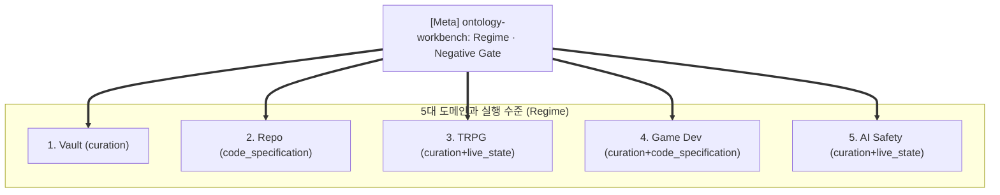

- table of contents
{:toc}

## 전체 시리즈 로드맵 안내

<mark class="kw-term">온톨로지 엔지니어링</mark>을 지식 베이스와 실무 코드에서 출발해 다섯 세계와 메타 워크벤치로 확장한 기록이다.

| 글 제목 | 핵심 화두 |
|:---|:---|
| [[0편] 내가 사랑하는 다섯 개의 세계에 온톨로지를 이식하기까지](/tag-ontology-engineering/0-ontology-engineering-intro/) | 5대 세계 이식과 `Regime` 조감도 |
| [[1편] 온톨로지가 없는 AI는 현학적인 수다쟁이일 뿐이다](/tag-ontology-engineering/1-palantir-3rd-generation-platform/) | Enterprise OS·AIP와 3대 계층 |
| [[2편] 4,400개의 흩어진 생각에 척추를 세우고 도구의 착각까지 도려내다](/tag-ontology-engineering/2-vault-knowledge-ontology/) | SQLite·`vv`와 523건 운영 감사 |
| [[3편] 문서는 명사로 정리되지만 코드는 동사로 움직인다](/tag-ontology-engineering/3-nouns-to-verbs-paradigm-shift/) | 명사에서 동사(`Action Spec`)로의 전환 |
| [[4편] 린트 에러 0개의 거짓말, 내가 만든 온톨로지를 의심하기까지](/tag-ontology-engineering/4-zero-lint-error-illusion-and-v020/) | 미검사 착시 제거와 AST 검증 `v0.2.0` |
| [[5편] 오픈소스와 논문에서 길어 올린 온톨로지 컴파일러, 3-Graph와 TDD 증거 봉인](/tag-ontology-engineering/5-three-graphs-and-tdd-contract-v030/) | 3-Graph 검증과 TDD 증거 봉인 |
| [[6편] 아무리 똑똑한 알바생이라도 금고 열쇠를 통째로 맡기는 사장님은 없다](/tag-ontology-engineering/6-sdlc-harness-and-living-wiki/) | `spoke-guard` 훅과 Living Wiki |
| [[7편] 주사위는 거짓말을 하지 않는다, TRPG에서 비로소 도달한 진짜 Action Layer](/tag-ontology-engineering/7-trpg-kinetic-action-layer/) | `visibility` 격리와 결정론 판정 |
| [[8편] 명작 게임의 손맛을 온톨로지로 해부한다는 것, 관찰된 증거와 추론의 분리](/tag-ontology-engineering/8-game-dev-evidence-ontology/) | 관찰·추론 분리와 수식 DAG |
| [[9편] 다섯 개의 온톨로지를 만들고 나서야 알게 된 것, 메타 청사진과 과잉 규율의 경계](/tag-ontology-engineering/9-meta-ontology-workbench-and-redteam/) | 설계 절차와 `Negative Gate` 워크벤치 |
| [[10편] 고정된 CLI를 넘어 코드를 합성하는 그래프로, Code-on-Graph와 어제의 내가 내일의 에이전트에게 남기는 약속](/tag-ontology-engineering/10-code-on-graph-and-epilogue/) | `Code-on-Graph` 이식과 시뮬레이션 |
| [[11편] 경험이 글이 되고 의미가 스스로를 증명하기까지, 지식·성찰 컴파일러와 3대 의미 모형 감사](/tag-ontology-engineering/11-knowledge-blog-compiler-and-semantic-critique/) | 블로그·`Mind Compiler`·3대 의미 감사 |

### 심화 자료 (Deep-Dive) 아카이브

상세 스키마, 적대적 반례 전수 표, 검증 영수증을 모아둔 아카이브다.

| 심화편 제목 | 연결 본편 | 핵심 검증 질문 및 수록 근거 |
|:---|:---:|:---|
| [심화 \| Vault의 지식·성찰 컴파일러](/tag-ontology-engineering/deep-dive/vault-knowledge-compiler/) | `2·11편` | 13종 타입·7종 관계, SQLite·SHACL, `V-01~M-05`, `Mind`, `V060` |
| [심화 \| Repo Ontology의 명세와 3-Graph](/tag-ontology-engineering/deep-dive/repo-graph-contracts/) | `3·4·5편` | `.ontology/` 스키마, 3-Graph, `v0.2.0`·`v0.3.0` 봉인 |
| [심화 \| Repo의 SDLC 하네스와 의미 감사](/tag-ontology-engineering/deep-dive/repo-sdlc-and-audit/) | `6·11편` | `spoke-guard`, Living Wiki, `RC-01~11` 엔드포인트·`brief` |
| [심화 \| TRPG의 실행과 World Canon](/tag-ontology-engineering/deep-dive/trpg-world-canon/) | `7·10·11편` | `visibility` 투영, 2d6 핸들러, 시뮬레이션·`TC-01~09` |
| [심화 \| 게임 데이터의 증거](/tag-ontology-engineering/deep-dive/game-evidence/) | `8·10편` | `observed`/`derived`/`inferred`, 역공학 99레코드 |
| [심화 \| Workbench와 Code-on-Graph](/tag-ontology-engineering/deep-dive/workbench-and-code-on-graph/) | `9·10편` | `Regime`·`Negative Gate`, `BubbleTap FDE`, `Code-on-Graph` |

---

## 왜 온톨로지인가

[AI OS 시리즈](/tag-ai-agent-architecture/)에서 언급했듯 에이전트 생태계의 두 축은 각자의 <mark class="kw-term">워크플로우</mark>([11편](/tag-ai-agent-architecture/11-external-workflow-and-ai-os/)의 `Ralph`가 만드는 <mark class="kw-term">AI OS</mark> 등)와 `Ontology`다. 온톨로지는 왜 `Palantir`에 열광하는지 이해시켜 주었다 ~~*(물론 주식때문인게 크겠지만, 엔지니어 사이에서도 화두이긴 하니까)*~~. <mark class="kw-devil">기록의 악마</mark>인 나는 '`Obsidian Vault`에 도입해 유기적인 시스템으로 만들 수 있지 않을까?'라는 질문을 던졌고([AI OS 10편](/tag-ai-agent-architecture/10-knowledge-ontology/)), 추후 Vault 시리즈<!--(/tag-vault-os/)-->에서도 다뤄볼 생각이다. 나아가 `Repository` 관리([AI OS 6편](/tag-ai-agent-architecture/6-repo-governance/), [7편](/tag-ai-agent-architecture/7-rule-pruning/))와 융합해 탄생한 것이 <mark class="kw-term">Repo Ontology</mark>다.

{:width="700" loading="lazy"}

`.ontology/` 구조(`actions`, `functions`, `links`, `objects`, `rules`)와 명세
{:.figcaption}

---

## 다섯 세계와 깨달음: 이름은 같아도 실행의 층위는 다르다

배운 개념을 실무와 취미에 이식하다 보니 무대는 다섯 세계로 넓어졌다. 스키마 게이트를 세운 `Vault`, 불변식을 3-Graph로 묶은 `Repo`, 가시성(`visibility`)과 결정론 판정을 집행하는 `TRPG`, 관찰(`observed`)과 추론(`inferred`)을 분리한 `Game Dev`, 그레이존 정책을 샌드박스 검증 후 제재로 잇는 `AI Safety`다.

적대적 검수로 얻은 통찰은 **'온톨로지'라는 이름은 하나여도 도메인마다 책임질 실행 수준(`Regime`)은 다르다**는 점이다. 큐레이션(`curation`), 코드 명세(`code_specification`), 상태 변이(`live_state`)는 정본과 보호 경계가 달랐기에, 단일 런타임 통합 대신 설계 절차와 부정 게이트(`Negative Gate`)만 `ontology-workbench`로 추상화했다.

| 도메인 | 도구 | `Regime` | 정본 (`SSOT`) | 핵심 검증 및 경계 |
|:---|:---|:---|:---|:---|
| **1. `Vault`** | `vault` `v0.6.0` | `curation` | 마크다운, `ext:` | `638 passed` / 도구 통과와 볼트 무결성, 요약과 성찰 분리 |
| **2. `Repo`** | `otlg` `v0.5.0` | `code_specification` | `.ontology/`+코드 | `139 passed` / 정적 명세와 런타임 분리, FK 객체화 금지 |
| **3. `TRPG`** | `trpg` `v0.15.0` | `curation`+`live_state` | Canon+상태 | `386 passed` / 서사와 수치 변경, 소문과 진실 분리 |
| **4. `Game Dev`** | `gdev` `v1.3.1` | `curation`+`code_specification` | 증거+99레코드 | `711 passed` / 관찰(`observed`)과 추론(`inferred`) 분리 |
| **5. `AI Safety`** | `BubbleTap FDE` | `curation`+`live_state` | 스냅샷+코퍼스 | `55 passed` / 시뮬레이션과 실제 제재 분리 |

매일 다루는 다섯 세계에 온톨로지를 심고 허점을 도려낸 기록을 하나씩 풀어보고자 한다.

---

### [시리즈의 다음 이야기]

**[[1편] 온톨로지가 없는 AI는 현학적인 수다쟁이일 뿐이다](/tag-ontology-engineering/1-palantir-3rd-generation-platform/)**에서 DW와 Data Lake를 지나 <mark class="kw-term">엔터프라이즈 OS</mark>와 `AIP`로 나아간 팔란티어 20년의 궤적을 변우철 본부장님의 통찰과 함께 살펴보자.
