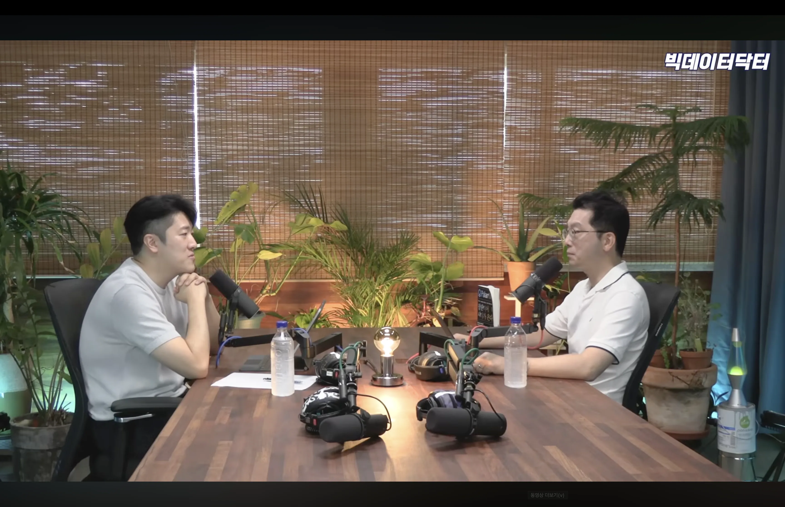
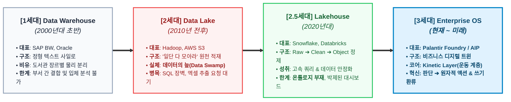

- table of contents
{:toc}

## 존재론: 가상 세계에 무엇을 실재하게 할 것인가

<mark class="kw-term">온톨로지(Ontology)</mark>를 처음 접했을 때, 대부분의 개발자가 그러했듯 나 역시 직관적으로 와닿지 않았다. 어원을 따라가 보면 그리스어로 '존재하는 것(`on`)'과 '학문·말(`logos`)'이 합쳐진 <mark class="kw-term">존재론(Ontologia)</mark>, 즉 *"무엇이 실재하는가(What is there?)"*라는 철학의 근본 물음과 마주하게 된다.

[AI OS 시리즈](/tag-ai-agent-architecture/)를 연재하며 되짚어보았듯, 코드를 작성하는 비용이 낮아지면서 이제는 **"어떤 구조와 철학으로 시스템의 경계를 그을 것인가"**가 개발자의 핵심 역량으로 떠올랐다. 시스템을 설계한다는 행위의 본질은 가상 세계에 어떤 대상을 실재하는 존재로 인정하고, 그들 사이에 어떤 관계를 맺어줄 것인가를 선언하는 일이다. 흔히 작성하는 관계형 데이터베이스(`RDB`) 테이블이나 클래스 다이어그램은 그중 좁은 단면에 불과하다.

*"이 세계에 문서와 태그는 독립적인 실체로 존재하는가? 폴더는 고유한 실체인가, 아니면 파일의 메타데이터에 불과한 경로 문자열인가?"* 이 물음에 답을 내리는 것에서부터 견고한 아키텍처가 출발한다.

---

## AI와 지식공학의 정전 정의: Tom Gruber의 4대 단어와 한계

인공지능 분야에서 온톨로지를 이야기할 때, 컴퓨터 과학자 톰 그루버(`Tom Gruber`)가 1993년 내린 정의가 가장 널리 인용된다.

> "온톨로지란 공유된 개념화에 대한 정형적이고 명시적인 명세다."
> *(An ontology is an explicit, formal specification of a shared conceptualization.)*

이 한 문장은 네 가지 핵심 단어로 분해된다.

1. **<mark class="kw-term">개념화(Conceptualization)</mark>**: 다루고자 하는 도메인 세계에 무엇이 실재하는지에 대한 추상 모델(엔티티, 속성, 관계)이다.
2. **<mark class="kw-term">명시성(Explicit)</mark>**: 사람의 머릿속이나 코드 구석에 숨겨둔 암묵적 가정이 아니라, 시스템 외부에 명확히 선언되어야 한다.
3. **<mark class="kw-term">형식성(Formal)</mark>**: 자연어 산문 가이드라인이 아니라, 기계가 파싱하고 논리적으로 검증·추론할 수 있는 엄밀한 문법(스키마, 공리)이어야 한다.
4. **<mark class="kw-term">공유성(Shared)</mark>**: 나 혼자만 아는 규약이 아니라 여러 모듈과 에이전트, 인간 작업자가 공통으로 합의하고 상호운용하는 어휘 체계여야 한다.

하지만 2000년대 초반 `W3C`가 주도한 <mark class="kw-term">시맨틱 웹(Semantic Web)</mark>과 초기 <mark class="kw-term">지식 그래프(Knowledge Graph)</mark> 운동은 현업에서 한계에 부딪혔다. 지식을 정적으로 분류하고 조회하는 데는 훌륭했지만, 1초에도 수천 번씩 상태가 변하고 부작용이 터져 나오는 비즈니스 트랜잭션과는 단절된 '읽기 전용 백과사전'에 머물렀기 때문이다.

---

## 20년 데이터 플랫폼의 잔혹사: DW에서 데이터의 늪(Data Swamp)까지

정적 사전에 머물던 온톨로지가 어떻게 현대 엔터프라이즈의 살아 숨 쉬는 운영체제로 진화했는지를 이해하려면 지난 20년간의 데이터 플랫폼 진화사를 들여다보아야 한다. 유튜브 채널 '빅데이터닥터 BIGDATA DOCTOR'의 인터뷰 [팔란티어 1인자와 끝장토론 (풀버전 - KT 변우철 본부장)](https://youtu.be/e7W4Y8IWj6E?si=XaxfNgCm7X3fPV6T)에서 변우철 본부장님은 팔란티어가 왜 온톨로지에 20년을 매달렸는지를 실무자의 눈높이에서 풀어낸다.

{:width="700" loading="lazy"}

유튜브 채널 '빅데이터닥터 BIGDATA DOCTOR'의 변우철 본부장님 인터뷰 영상
{:.figcaption}

변우철 본부장님의 설명에 따르면 기업의 데이터 플랫폼은 크게 세 단계를 거치며 진화해 왔다.

- **<mark class="kw-term">1세대 Data Warehouse</mark> (2000년대 초반)**: `SAP BW`나 `Oracle` 중심으로 정형 데이터를 집적했지만, 부서 간 데이터 사일로*(Silo)*가 극심해 입체적인 결합 분석이 불가능에 가까웠다.
- **<mark class="kw-term">2세대 Data Lake</mark> (2010년 전후)**: `Hadoop`과 `S3`의 등장과 함께 "일단 다 모아라!"라며 원천 데이터를 적재했다. 그러나 실무자들은 `SQL` 장벽 앞에서 데이터를 찾지 못해 여전히 IT 부서에 엑셀 추출을 요청하고 며칠씩 기다려야 했다. 맑은 호수를 꿈꿨던 레이크는 '<mark class="kw-term">데이터의 늪(Data Swamp)</mark>'으로 전락했다.
- **<mark class="kw-term">2.5세대 Cloud DW와 Lakehouse</mark> (최근)**: `Snowflake`와 `Databricks`로 원천 데이터를 정제(`Raw ➔ Cleaned ➔ Object`)하는 파이프라인은 세련되어졌지만 상위의 '온톨로지 계층'은 부재해, 결국 정적 대시보드의 틀을 벗어나지 못했다.

막대한 자본을 들여 클라우드로 이사했지만 경영진이 보는 것은 어제의 데이터가 박제된 대시보드 수준이었고, 실무자들은 여전히 슬랙과 메일로 엑셀을 주고받았다. 데이터가 회사의 <mark class="kw-term">행동(Action)</mark>으로 이어지는 다리가 끊어져 있었던 것이다.

---

## 팔란티어가 20년을 바친 한 우물: Semantic · Kinetic · Dynamic 3대 계층

이 끊어진 다리를 잇기 위해 팔란티어가 20년간 매달려 온 영역이 정적인 데이터를 살아 움직이는 비즈니스 행동으로 바꾸는 온톨로지 체계다. 팔란티어의 온톨로지는 단순한 지식 그래프가 아니라 전사 비즈니스를 메모리에 투영한 **디지털 트윈**이자 **<mark class="kw-term">기업의 운영체제(Enterprise OS)</mark>**로서 세 층위가 맞물려 돌아간다.

1. **<mark class="kw-term">Data / Semantic Layer</mark> (객체와 의미 관계)**: 물리적 DB 컬럼이 아니라 현업 실무자가 다루는 비즈니스 실체(공장, 항공기, 부품, 고객)와 그들 사이의 의미론적 연결이다.
2. **<mark class="kw-term">Logic / Dynamic Layer</mark> (규칙과 시뮬레이션)**: 비즈니스 규칙과 사전조건, 불변식을 검증하고, 가설을 실험해 영향도를 미리 예측하는 시뮬레이션 계층이다.
3. **<mark class="kw-term">Action / Kinetic Layer</mark> (행동과 쓰기 환류)**: 사용자나 AI의 결정을 받아 ERP나 운영 DB의 상태를 원자적 트랜잭션(Write-back)으로 변경하고, 그 결과를 온톨로지 전역에 다시 동기화하는 실행 계층이다.

*"백엔드에서 데이터베이스 업데이트 API 하나 호출하는 거랑 뭐가 다른가?"*라는 질문에 변우철 본부장님의 대답은 명쾌하다. 개별 API는 기능 하나에 닫혀 있지만, 온톨로지 액션은 전사 프로세스, 권한 통제, 감사 추적, 다단계 승인, 그리고 LLM 도구 호출과 결합되어 돌아간다. 예를 들어 특정 통신사 대리점의 아이폰 재고가 적정 기준(20일 치) 대비 7일 치만 남았음을 감지(`Semantic`)하면, 품절 손실을 막기 위해 3일 만에 도착하는 긴급 발주 승인 규칙을 가동(`Dynamic`)하고, 승인 즉시 ERP로 원자적 발주 트랜잭션을 집행(`Kinetic`)한 뒤 그 결과를 전사 재고 지도와 공급망 계획에 실시간으로 재동기화(`Closed-loop`)한다. 데이터 조회에서 그치지 않고 판단과 실행, 환류까지 단일 플랫폼 안에서 끝내는 것이 3세대 데이터 플랫폼의 실체다.

---

## 2026년 AI 시대의 역설: 왜 프롬프트가 아니라 온톨로지인가

생성형 AI가 보급되면서 기업들은 앞다투어 LLM 도입에 나섰지만, 프로덕션에 붙이는 순간 환각과 불변식 변조, 권한 우회 문제에 부딪혔다. 팔란티어 코리아 서지숙 님은 강연 [기업에서의 LLM 활용을 위한 Palantir AIP 솔루션](https://youtu.be/368EDZY6T2o?si=nOpj8fkUrJULbBQt)에서 이 실패의 원인을 **'천문학(미적분)과 기상 예보(통계학)'**의 비유로 명쾌하게 짚어낸다. 기업들은 LLM에게 2186년의 일식 시각을 오차 없이 계산해 내는 '천문학(결정론적 정답)'을 기대하지만, 실제 LLM의 본질은 내일 오후에 비가 올 확률을 51%로 추론하는 '기상 예보(통계학)'에 가깝다. 언제든 틀릴 수 있는 확률 모델을 기업 현장에 투입하려면 모델 바깥에 결정론적인 제어 장치가 있어야 한다.

더구나 식당 예약 같은 B2C 환경에서의 매끄러운 LLM 경험은 기업 내부로 그대로 이식되지 않는다. 공개된 웹 텍스트와 단순 API를 쓰는 B2C와 달리, 기업 현장은 파편화된 DB 스키마와 엄격한 데이터 권한, 회사마다 다른 업무 절차(Action Path)라는 장벽에 가로막혀 있기 때문이다. 이 장벽을 피하려고 콜센터 녹취록이나 PDF 문서 요약 같은 지엽적인 텍스트 영역에만 RAG 챗봇을 도입하면, 과거의 데이터 사일로와 똑같은 **'LLM 사일로'**만 또 하나 생겨날 뿐 정작 회사의 핵심 운영(Operation)에는 닿지 못한다.

팔란티어 `AIP(Artificial Intelligence Platform)`가 내놓은 해법은 **"이 신기술(LLM)을 어디에 써볼까?"에서 출발하는 단발성 기능 검증(`PoC`)이 아니라, "현업 사용자가 어떤 결정을 내리는가?"에서 거꾸로 내려가는(<mark class="kw-term">Transformation Backwards</mark>) 실전 운영 워크플로우(`Proof of Workflow`)**다. 사용자가 LLM과 직접 대화하는 대신, 기업의 데이터와 비즈니스 규칙을 담고 있는 온톨로지와 도구를 AIP가 중간에서 오케스트레이션(`Ontology + Tools + LLM`)한다.

> **"LLM에게 원천 데이터베이스를 직접 들여다보게 하거나 임의의 코드를 실행하게 두지 마라. 사용자 권한에 맞는 온톨로지 객체와 엄격한 `Action Types`를 도구로 쥐여주어라."**

여기서 LLM은 시스템의 지배자가 아니라 사용자의 자연어 의도를 해석해 온톨로지 도구를 호출하고, 출력 스키마가 강제된 해결책 후보를 제안하는 '라우터'다. 설령 LLM이 환각에 빠지더라도 실제 시스템 상태를 바꾸려면 `Logic Layer`의 사전조건 검증과 권한 검사를 물리적으로 통과해야 한다. 이는 특정 빅테크 모델에 종속되지 않는 **<mark class="kw-term">모델 중립성(Model-agnostic)</mark>**으로도 이어진다. 상용 모델이든 사내 오픈소스 모델이든, 온톨로지라는 단단한 레일 위에서 언제든 부품처럼 갈아 끼우면 되기 때문이다.

결국 **온톨로지가 없는 AI는 현학적인 수다쟁이에 머물고, 온톨로지를 쥔 AI만이 시스템을 안전하게 집행하는 진정한 <mark class="kw-term">운영체제(OS)</mark>가 된다.** 지금 이 내용을 정리하다 보니 최근 주목받는 `Jev`의 동작 방식과도 맞닿아 있어, 추후 함께 엮어보면 재미있는 아키텍처를 구현할 수 있을 듯하다.

---

## 1인 팀의 작업실로 내려온 온톨로지

변우철 본부장님과 서지숙 님의 강연을 통해 팔란티어의 온톨로지·AIP 아키텍처를 공부하며 나는 강한 기시감을 느꼈다. 4,400개의 노트와 수십만 줄의 프로덕션 코드를 혼자 짊어진 채, 매일 아침 기억을 잃고 백지상태로 투입되는 AI 코딩 에이전트들과 마찰을 빚던 내 일상이 그대로 겹쳐 보였기 때문이다.

에이전트에게 아무리 친절한 자연어 가이드라인(`CLAUDE.md`, `AGENTS.md`)을 적어주어도 세션이 길어지면 규칙을 무시했고, DB 스키마만 보고 코드를 짜다가 비즈니스 불변식을 깨뜨리며 `422`를 내거나 매 세션마다 코드베이스 지형을 파악하느라 수만 토큰을 날려버렸다. 대기업들이 겪었던 데이터의 늪과 AI 환각의 절망이 내 PC 안에서도 똑같이 일어나고 있었다.

> **"문제는 AI 모델의 지능이 모자라서가 아니었다. AI가 발을 딛고 서서 안전하게 행동할 수 있는 시스템의 뼈대, 즉 온톨로지가 내 컴퓨터에 없었기 때문이었다."**

엔터프라이즈의 온톨로지 철학을 어떻게 1인 팀의 작업대에 이식할 수 있을까? 앞서 **[[0편] 개념 공부를 넘어 실전으로, 네 개의 도메인에 온톨로지를 구축하기까지](/tag-ontology-engineering/0-ontology-engineering-intro/)**에서 예고했듯, 그 첫 여정은 내 모든 생각과 의사결정이 모인 4,400개 마크다운 지식 베이스(`Obsidian Vault`)의 엔트로피를 통제하는 일에서 시작되었다. 이어지는 **[[2편] 개인 지식 베이스에 온톨로지를 심다: 스키마 설계부터 도구의 자기 검증까지](/tag-ontology-engineering/2-vault-knowledge-ontology/)**에서는 옵시디언 볼트에 13가지 문서 유형과 2계층 관계망, `SQLite` 재귀 쿼리와 로컬 벡터 검색(`vv`)을 결합해 세운 '<mark class="kw-term">개인 지식 온톨로지</mark>' 구축기를 다룬다.
