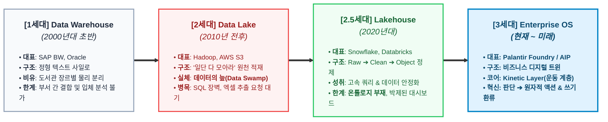
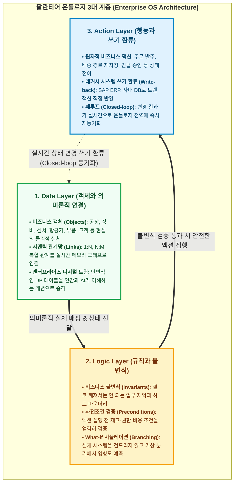

- table of contents
{:toc}

## 존재론: 가상 세계에 무엇을 실재하게 할 것인가

<mark class="kw-term">온톨로지(Ontology)</mark>를 처음 접했을 때, 대부분의 개발자가 그러했듯 나 역시 직관적으로 이해하지 못했다. 어원을 좇아 고대 철학으로 들어가 보면 그리스어로 '존재하는 것'을 뜻하는 `on`과 '학문·말'을 뜻하는 `logos`가 합쳐진 <mark class="kw-term">존재론(Ontologia)</mark>, 즉 *"무엇이 실재하는가(What is there?)"*라는 형이상학의 근본 물음을 마주하게 된다. 아리스토텔레스가 《범주론*(Categories)*》에서 만물을 실체*(Substance)*와 성질, 양, 장소, 시간, 관계 등으로 분류하려 했던 시도가 인류 역사상 첫 온톨로지적 탐구였다.

[AI OS 시리즈](/tag-ai-agent-architecture/)를 연재하며 되짚어보았듯, 코드를 작성하는 비용이 낮아지면서 이제는 **"어떤 구조와 철학으로 시스템의 경계를 그을 것인가"**가 개발자의 가장 본질적인 역량으로 떠올랐다. 컴퓨터 공학이 철학의 존재론을 불러들인 배경 역시 극도로 데이터 집약적*(Data-Intensive)*으로 진화한 애플리케이션의 복잡성을 체계적으로 포괄할 틀이 필요했기 때문이다.

시스템을 설계한다는 행위의 본질은 가상 세계에 어떤 대상을 실재하는 존재로 인정하고, 그들 사이에 어떤 관계를 맺어줄 것인가를 선언하는 일이다. 흔히 작성하는 관계형 데이터베이스(`RDB`) 테이블이나 클래스 다이어그램은 존재론의 좁은 단면에 불과하다.

*"이 세계에 문서와 태그는 독립적인 실체로 존재하는가? 폴더는 고유한 실체인가, 아니면 파일의 메타데이터에 불과한 경로 문자열인가?"*

이 물음에 답을 내리는 것에서부터 견고한 아키텍처가 출발한다.

---

## AI와 지식공학의 정전 정의: Tom Gruber의 4대 단어와 한계

인공지능 분야에서 온톨로지를 이야기할 때, 컴퓨터 과학자 톰 그루버(`Tom Gruber`)가 1993년 내린 정의가 가장 널리 인용된다.

> "온톨로지란 공유된 개념화에 대한 정형적이고 명시적인 명세다."
> *(An ontology is an explicit, formal specification of a shared conceptualization.)*

이 한 문장은 네 가지 핵심 단어로 분해된다.

1. **<mark class="kw-term">개념화(Conceptualization)</mark>**: 다루고자 하는 도메인 세계에 무엇이 실재하는지에 대한 추상 모델(엔티티, 속성, 관계)이다.
2. **<mark class="kw-term">명시성(Explicit)</mark>**: 사람의 머릿속이나 코드 구석에 `TYPES = {...}` 형태로 숨겨둔 암묵적 가정이 아니라, 시스템 외부에 명확히 선언되어야 한다.
3. **<mark class="kw-term">형식성(Formal)</mark>**: 자연어 산문 가이드라인이 아니라, 기계가 파싱하고 논리적으로 검증·추론할 수 있는 엄밀한 문법(스키마, 공리)이어야 한다.
4. **<mark class="kw-term">공유성(Shared)</mark>**: 나 혼자만 아는 규약이 아니라 여러 모듈과 에이전트, 인간 작업자가 공통으로 합의하고 상호운용하는 어휘 체계여야 한다.

하지만 초기 온톨로지 운동은 현업에서 한계에 부딪혔다. 2000년대 초반 `W3C`가 주도한 <mark class="kw-term">시맨틱 웹(Semantic Web)</mark>, `RDF`, `OWL`, <mark class="kw-term">지식 그래프(Knowledge Graph)</mark>는 지식을 정적으로 분류하고 조회하는 데는 훌륭했지만, 1초에도 수천 번씩 상태가 변하고 부작용*(Side Effect)*이 터져 나오는 비즈니스 트랜잭션과는 단절된 '읽기 전용 백과사전'에 머물렀기 때문이다. (그 배경과 실패 원인은 TwoBitHistory의 에세이 [Whatever Happened to the Semantic Web?](https://twobithistory.org/2018/05/27/semantic-web.html)이나 코리 닥터로우의 비판문 [Metacrap](https://people.well.com/user/doctorow/metacrap.htm)에서 확인할 수 있다.)

---

## 20년 데이터 플랫폼의 잔혹사: DW에서 데이터의 늪(Data Swamp)까지

정적 사전에 머물던 온톨로지가 어떻게 현대 엔터프라이즈의 살아 숨 쉬는 운영체제로 진화했는지를 이해하려면 지난 20년간의 데이터 플랫폼 진화사를 들여다보아야 한다. 유튜브 채널 '빅데이터닥터 BIGDATA DOCTOR'의 인터뷰 [팔란티어 1인자와 끝장토론 (풀버전 - KT 변우철 본부장)](https://youtu.be/e7W4Y8IWj6E?si=XaxfNgCm7X3fPV6T)에서 변우철 본부장님은 팔란티어가 왜 온톨로지에 20년을 매달렸는지를 실무자의 눈높이에서 풀어낸다.

{:width="700" loading="lazy"}

유튜브 채널 '빅데이터닥터 BIGDATA DOCTOR'의 변우철 본부장님 인터뷰 영상
{:.figcaption}

변우철 본부장님의 설명에 따르면 기업의 데이터 플랫폼은 크게 세 단계를 거치며 진화해 왔다.

- **<mark class="kw-term">1세대 Data Warehouse</mark> (2000년대 초반)**: `SAP BW`나 `Oracle` 중심으로 정형 데이터를 집적했지만, 부서 간 데이터 사일로*(Silo)*가 극심해 입체적인 결합 분석이 불가능에 가까웠다.
- **<mark class="kw-term">2세대 Data Lake</mark> (2010년 전후)**: `Hadoop`과 `S3`의 등장과 함께 "일단 다 모아라!"라며 원천 데이터를 적재했다. 그러나 실무자들은 `SQL` 장벽 앞에서 데이터를 찾지 못해 여전히 IT 부서에 엑셀 추출을 요청하고 며칠씩 기다려야 했다. 맑은 호수를 꿈꿨던 레이크는 '<mark class="kw-term">데이터의 늪(Data Swamp)</mark>'으로 전락했다.
- **<mark class="kw-term">2.5세대 Cloud DW와 Lakehouse</mark> (최근)**: `Snowflake`와 `Databricks`로 원천 데이터를 정제(`Raw ➔ Cleaned ➔ Object`)하는 파이프라인은 세련되어졌지만 상위의 '온톨로지 계층'은 부재해, 결국 정적 대시보드의 틀을 벗어나지 못했다.

막대한 자본을 들여 클라우드로 이사했지만 경영진이 보는 것은 어제의 데이터가 박제된 대시보드였고, 실무자들은 여전히 슬랙과 메일로 엑셀을 주고받았다. 데이터가 회사의 '행동*(Action)*'으로 이어지는 다리가 끊어져 있었던 것이다.

---

## 팔란티어가 20년을 바친 한 우물: Semantic · Kinetic · Dynamic 3대 계층

이 끊어진 다리를 잇기 위해 팔란티어(`Palantir`)가 20년간 파고든 영역이 정적인 데이터를 살아 움직이는 비즈니스 행동으로 바꾸는 온톨로지 체계다. 팔란티어의 온톨로지는 단순한 지식 그래프가 아니라 전사 비즈니스를 메모리에 투영한 **<mark class="kw-term">디지털 트윈(Digital Twin)</mark>이자 <mark class="kw-term">기업의 운영체제(Enterprise OS)</mark>**로서 세 층위가 맞물려 구동된다.

1. **<mark class="kw-term">Data / Semantic Layer (객체와 의미 관계)</mark>**: 물리적 DB 컬럼이 아니라 현업 실무자가 다루는 비즈니스 실체(공장, 항공기, 부품, 고객)와 의미론적*(Semantic)* 연결(`Links`)이다.
2. **<mark class="kw-term">Logic / Dynamic Layer (규칙과 시뮬레이션)</mark>**: 비즈니스 룰, 사전조건*(Preconditions)*, 불변식*(Invariants)*, 그리고 가설을 실험해 영향도를 예측하는 분기*(What-if Branching)* 모델이다.
3. **<mark class="kw-term">Action / Kinetic Layer (행동과 쓰기 환류)</mark>**: 사용자나 AI의 결정을 받아 레거시 `ERP`나 운영 DB 상태를 원자적 트랜잭션(<mark class="kw-term">Write-back</mark>)으로 변경하고, 결과를 온톨로지 전역에 재동기화하는 <mark class="kw-term">Closed-loop</mark> 운동 계층이다.

*"백엔드에서 데이터베이스 업데이트 API 하나 호출하는 거랑 뭐가 다른가?"*라는 질문에 변우철 본부장님의 대답은 명쾌하다. 개별 `API`는 기능 하나에 닫혀 있지만, 온톨로지 액션은 전사 프로세스, 권한 통제, 감사 추적*(Audit Trail)*, 다단계 승인, 그리고 `LLM` 도구 호출*(Tool Calling)*과 결합되어 확장된다. 통신사 대리점의 아이폰 재고 관리 시나리오를 보면 차이가 극명하다.

- **현상 인지 (`Semantic`)**: 특정 매장의 잔존량이 적정 기준(20일 치) 대비 7일 치에 불과함을 감지한다.
- **판단 (`Dynamic`)**: 일반 발주(10일 소요) 시 3일간 품절 손실이 발생함을 계산해, 3일 만에 도착하는 긴급 발주 승인 룰을 격발한다.
- **실행 (`Kinetic`)**: 승인 즉시 `SAP ERP`로 원자적 발주(<mark class="kw-term">Write-back</mark>) 트랜잭션을 날린다.
- **환류 (`Closed-loop`)**: 발주 결과가 온톨로지에 즉시 반영되어 익일 전사 재고 지도와 공급망 계획이 실시간 동기화된다.

데이터 조회에서 그치지 않고 판단과 실행, 환류까지 단일 플랫폼 안에서 끝내는 것, 이것이 3세대 데이터 플랫폼의 실체다.

---

## 2026년 AI 시대의 역설: 왜 프롬프트가 아니라 온톨로지인가

생성형 AI와 `LLM`이 보급되면서 기업들은 수많은 AI 프로젝트를 시작했지만, 프로덕션에 붙이는 순간 환각*(Hallucination)*과 불변식 변조, 권한 우회 문제에 부딪혔다. 전처리에 시간을 쏟고 벡터 DB로 검색 증강 생성(`RAG`)을 구축해도 결과물은 문서를 요약하는 '질의응답 챗봇'에 그쳤을 뿐, 시스템 상태를 안전하게 변경할 수는 없었다.

반면 팔란티어 `AIP(Artificial Intelligence Platform)`는 지난 20년간 구축한 온톨로지 레일 위에 `LLM`을 결합했다.

> **"LLM에게 원천 데이터베이스를 직접 들여다보게 하거나 임의의 코드를 실행하게 두지 마라. 온톨로지의 엄격한 `Action Types`를 도구*(Tool Calling)*로 쥐여주어라."**

여기서 `LLM`은 시스템의 지배자가 아니라 사용자의 의도를 해석해 액션을 호출하는 '라우터'다. `LLM`이 환각에 빠지더라도 실제 시스템에 변경을 가하려면 `Logic Layer`의 사전조건 검증과 권한 검사를 물리적으로 통과해야 한다. 이는 빅테크들의 `GPU` 치킨게임에서 벗어나는 **<mark class="kw-term">모델 애그노스틱(Model-agnostic)</mark>** 전략으로도 이어진다. `OpenAI`든 `Claude`든 `Llama`든 가장 우수한 모델을 온톨로지 레일 위의 라우터로 갈아 끼우면 되기 때문이다.

**온톨로지가 없는 AI는 현학적인 수다쟁이에 머물고, 온톨로지를 쥔 AI만이 시스템을 안전하게 집행하는 진정한 <mark class="kw-term">운영체제(OS)</mark>가 된다.** 지금 이 내용을 정리하다 보니 최근 주목받는 `Jev`의 동작 방식과도 맞닿아 있어, 추후 함께 엮어보면 재미있는 아키텍처를 구현할 수 있을 듯하다.

---

## 1인 개발자의 방 안으로 내려온 온톨로지

변우철 본부장님의 인터뷰와 팔란티어 아키텍처를 공부하며 나는 강한 기시감을 느꼈다. 4,400개의 노트와 수십만 줄의 프로덕션 코드를 혼자 짊어진 채, 매일 아침 기억을 잃고 백지상태로 투입되는 AI 코딩 에이전트들과 마찰을 빚던 내 일상이 그대로 겹쳐 보였기 때문이다.

에이전트에게 아무리 친절한 자연어 가이드라인(`CLAUDE.md`, `AGENTS.md`)을 적어주어도 세션이 길어지면 규칙을 무시했고, DB 스키마만 보고 코드를 짜다가 비즈니스 불변식을 깨뜨리며 `422`를 내거나 매 세션마다 코드베이스 지형을 파악하느라 수만 토큰을 날려버렸다. 대기업들이 겪었던 데이터의 늪과 AI 환각의 절망이 내 PC 안에서도 똑같이 일어나고 있었다.

> **"문제는 AI 모델의 지능이 모자라서가 아니었다. AI가 발을 딛고 서서 안전하게 행동할 수 있는 시스템의 척추, 즉 온톨로지가 내 컴퓨터에 없었기 때문이었다."**

엔터프라이즈의 온톨로지 철학을 어떻게 1인 개발자의 작업대에 이식할 수 있을까? 앞서 **[[0편] 내가 사랑하는 네 개의 세계에 온톨로지를 이식하기까지](/tag-ontology-engineering/0-ontology-engineering-intro/)**에서 예고했듯, 그 첫 여정은 내 모든 생각과 의사결정이 모인 4,400개 마크다운 지식 베이스(`Obsidian Vault`)의 엔트로피를 통제하는 일에서 시작되었다.

---

### [시리즈의 다음 이야기]

다음 글인 **[[2편] 4,400개의 흩어진 생각에 척추를 세우고 도구의 착각까지 도려내다](/tag-ontology-engineering/2-vault-knowledge-ontology/)**에서는 옵시디언 볼트에 13개 스키마와 2계층 관계망, `SQLite` 재귀 `CTE`와 교차언어 벡터 검색(`vv`)을 결합해 세운 '<mark class="kw-term">개인 지식 온톨로지</mark>' 구축기와, 523건의 적대적 운영 감사로 도구의 착각까지 도려낸 과정을 다룬다.
