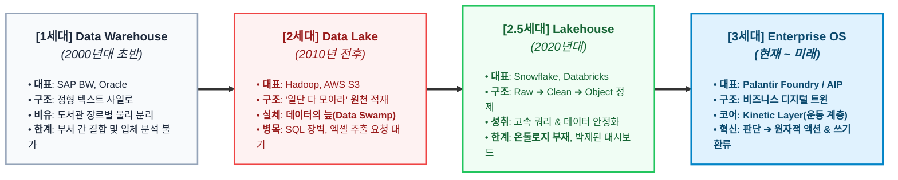
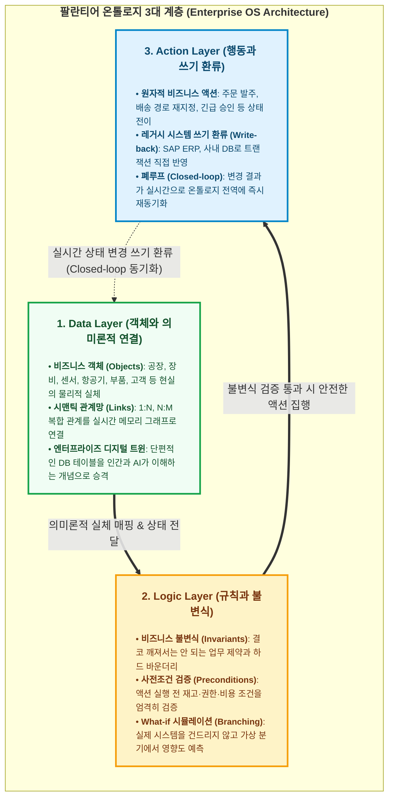

- table of contents
{:toc}

## 존재론: 가상 세계에 무엇을 실재하게 할 것인가

<mark class="kw-term">온톨로지(Ontology)</mark>를 처음 접했을 때, 아마 대부분의 개발자가 그러했듯 나 역시 직관적으로 이해하지 못했다. 온톨로지라는 단어의 어원을 좇아 고대 철학의 영역으로 들어가 보면 다음과 같은 정의를 마주하게 된다.

그리스어로 '존재하는 것'을 뜻하는 `on`과 '학문이나 말'을 뜻하는 `logos`가 합쳐진 <mark class="kw-term">존재론(Ontologia)</mark>은 *"무엇이 실재하는가(What is there?)"*라는 형이상학의 근본 물음을 다룬다. 아리스토텔레스가 자신의 《범주론*(Categories)*》에서 세계의 만물을 실체*(Substance)*와 성질, 양, 장소, 시간, 관계 등으로 분류하려 했던 시도가 바로 인류 역사상 첫 번째 온톨로지적 탐구였다.

[AI OS 시리즈](/tag-ai-agent-architecture/)를 연재하며 정리했던 내 일련의 경험을 돌이켜보면, 기존에는 시니어 엔지니어 이상에게나 요구되던 '개발 철학'과 '설계 원칙'이 최근 들어 훨씬 더 대두되는 동시에 더 주니어 레벨의 개발자들에게도 빠르게 다가가고 있다는 인상을 받는다. 코드를 작성하는 비용이 적어지게 되면서, **"어떤 구조와 철학으로 시스템의 경계를 그을 것인가"**가 개발자의 가장 본질적인 역량으로 떠올랐기 때문이다.

컴퓨터 공학이 철학의 오래된 존재론을 현대 소프트웨어 엔지니어링으로 불러들인 배경 역시 이러한 흐름과 맞닿아 있다. 현대의 애플리케이션은 극도로 데이터 집약적*(Data-Intensive)*으로 진화했다. 대량의 데이터를 단순히 쌓아두는 것을 넘어, 실시간으로 분석하고 재빠른 비즈니스 결정을 내려야 하는 시대적 요구가 거세졌다. 그리고 그 모든 복잡성을 체계적으로 포괄할 수 있는 틀로 온톨로지가 거론되는 것이 아닌가라고 통찰해본다.

소프트웨어나 시스템을 설계한다는 행위의 본질은 결국 가상 세계에 어떤 대상을 실재하는 존재로 인정하고, 그들 사이에 어떤 관계를 맺어줄 것인가를 선언하는 일이다. 우리가 흔히 작성하는 관계형 데이터베이스(`RDB`)의 테이블이나 클래스 다이어그램은 존재론의 아주 좁은 단면에 불과하다. 

*"이 세계에 문서와 태그는 독립적인 실체로 존재하는가? 폴더는 고유한 실체인가, 아니면 파일의 메타데이터에 불과한 경로 문자열인가?"*

이러한 물음에 명확한 답을 내리는 것에서부터 소프트웨어의 견고한 아키텍처가 출발한다.

---

## AI와 지식공학의 정전 정의: Tom Gruber의 4대 단어와 한계

소프트웨어 엔지니어링과 인공지능 분야에서 온톨로지를 이야기할 때, 컴퓨터 과학자 톰 그루버(`Tom Gruber`)가 1993년 내린 정의가 가장 널리 인용된다.

> "온톨로지란 공유된 개념화에 대한 정형적이고 명시적인 명세다."
> *(An ontology is an explicit, formal specification of a shared conceptualization.)*

이 간결한 한 문장은 네 가지 핵심 단어로 분해할 수 있다.

첫째는 **<mark class="kw-term">개념화(Conceptualization)</mark>**다. 우리가 다루고자 하는 도메인 세계에 무엇이 실재하는지에 대한 추상적인 모델이다. 엔티티, 속성, 관계 등이 여기에 속한다.

둘째는 **<mark class="kw-term">명시성(Explicit)</mark>**이다. 사람의 머릿속이나 코드 구석구석에 흩어진 암묵적인 가정이 아니라, 시스템 외부에 명확하게 선언되어 있어야 한다. 소스코드 파일 한구석에 `TYPES = {...}` 형태로 하드코딩해 둔 상수 목록은 진정한 의미의 명시적 선언이라 보기 어렵다.

셋째는 **<mark class="kw-term">형식성(Formal)</mark>**이다. 자연어로 길게 적어놓은 산문 가이드라인이 아니라, 기계가 파싱하고 논리적으로 검증하며 추론할 수 있는 엄밀한 문법(스키마, 공리)이어야 한다.

넷째는 **<mark class="kw-term">공유성(Shared)</mark>**이다. 나 혼자만 이해할 수 있는 규약이 아니라, 시스템의 여러 모듈과 에이전트, 그리고 인간 작업자가 공통으로 합의하고 상호운용할 수 있는 어휘 체계여야 한다.

하지만 이토록 완벽해 보이던 초기 온톨로지 운동은 현업에서 뼈아픈 한계에 부딪혔다고 한다. 2000년대 초반 `W3C`가 주도했던 <mark class="kw-term">시맨틱 웹(Semantic Web)</mark>, `RDF`, `OWL`, <mark class="kw-term">지식 그래프(Knowledge Graph)</mark>의 거대한 시도들은 대부분 학술적인 '읽기 전용 백과사전'에 머물렀다. 세계의 지식을 정적으로 분류하고 조회하는 데는 훌륭했지만, 1초에도 수천 번씩 상태가 변하고 부작용*(Side Effect)*이 터져 나오는 현업의 소프트웨어 엔지니어링 및 비즈니스 트랜잭션과는 단절되어 있었기 때문이다. (이에 대한 역사적 배경과 실패 원인은 TwoBitHistory의 테크 에세이 [Whatever Happened to the Semantic Web?](https://twobithistory.org/2018/05/27/semantic-web.html)이나 코리 닥터로우의 통렬한 비판문 [Metacrap](https://people.well.com/user/doctorow/metacrap.htm)에서 적나라하게 확인할 수 있다.)

---

## 20년 데이터 플랫폼의 잔혹사: DW에서 데이터의 늪(Data Swamp)까지

정적인 지식 사전에 머물던 온톨로지가 어떻게 현대 엔터프라이즈의 살아 숨 쉬는 운영체제로 진화했는지를 이해하려면 지난 20년간의 데이터 플랫폼 잔혹사를 들여다보아야 한다. 

최근 접한 유튜브 채널 '빅데이터닥터 BIGDATA DOCTOR'의 인터뷰 영상 [팔란티어 1인자와 끝장토론 (풀버전 - KT 변우철 본부장)](https://youtu.be/e7W4Y8IWj6E?si=XaxfNgCm7X3fPV6T)에서 변우철 본부장님(KT 피테크 본부장)은 팔란티어가 왜 온톨로지에 20년을 매달렸는지를 실무자의 눈높이에서 대단히 직관적으로 풀어내 준다.

{:width="700" loading="lazy"}

유튜브 채널 '빅데이터닥터 BIGDATA DOCTOR'의 변우철 본부장님 인터뷰 영상. 팔란티어의 역사와 엔터프라이즈 온톨로지의 실체를 깊이 있게 다룬다.
{:.figcaption}

변우철 본부장님의 설명에 따르면, 기업의 데이터 플랫폼은 크게 세 단계를 거치며 진화해 왔다.

첫 번째는 2000년대 초반의 **<mark class="kw-term">1세대 Data Warehouse</mark>** 시대다. `SAP BW`나 `Oracle`을 중심으로 정형 텍스트 데이터를 집적했다. 하지만 이는 도서관을 지으면서 소설관, 수필관, 만화관을 완전히 따로따로 지어놓은 것과 같았다. 부서 간의 데이터 사일로*(Silo)*가 극심했고, 서로 다른 시스템의 데이터를 결합해 입체적인 판단을 내리기가 불가능에 가까웠다.

두 번째는 2010년 전후의 **<mark class="kw-term">2세대 Data Lake</mark>** 시대다. `Hadoop`과 클라우드 오브젝트 스토리지(`S3`)가 등장하면서 "모든 데이터를 일단 다 모아라!"라는 구호가 업계를 뒤흔들었다. 로그, 이미지, 원천 텍스트 등 온갖 형식의 데이터를 데이터 레이크에 마구 집어넣었다. 그러나 결과는 좋지 못했다. 실무자들은 `SQL`과 빅데이터 쿼리 언어의 장벽 때문에 자신이 원하는 데이터가 어디에 있는지조차 찾을 수 없었다. 결국 IT 부서 담당자에게 엑셀 추출을 메일로 부탁하고 며칠씩 기다려야 하는 병목은 그대로 남았다. 맑은 호수를 꿈꿨던 데이터 레이크는 '<mark class="kw-term">데이터의 늪(Data Swamp)</mark>'으로 전락했다.

세 번째는 최근의 **<mark class="kw-term">2.5세대 Cloud DW와 Lakehouse</mark>** 시대다. `Snowflake`와 `Databricks`의 등장으로 원천 데이터를 정제 데이터(`Raw ➔ Cleaned ➔ Object`)로 변환하는 기술적 파이프라인은 눈부시게 세련되어졌다. 하지만 여전히 데이터 위에 올라서야 할 상위의 '온톨로지 계층'은 부재했다. 기술은 화려해졌지만, 근본적으로는 "데이터를 모아서 예쁘게 조회하는 대시보드"의 틀을 벗어나지 못했다.

수많은 기업이 막대한 자본과 시간을 들여 최신 클라우드 인프라로 이사했다. 그러나 경영진이 아침마다 보는 것은 어제의 데이터가 박제된 정적 대시보드였고, 실무자들은 여전히 `슬랙`과 메일로 엑셀 파일을 주고받으며 일하고 있었다. 데이터는 산더미처럼 쌓였지만, 그 데이터가 실제 회사의 '행동*(Action)*'으로 이어지는 다리가 완전히 끊어져 있었던 것이다.

---

## 팔란티어가 20년을 바친 한 우물: Kinetic Layer(운동 계층)

바로 이 끊어진 다리를 잇기 위해 팔란티어(`Palantir`)가 20년간 한 우물을 파며 구축해 낸 영역이 바로 **<mark class="kw-term">Kinetic Layer(운동 계층)</mark>**, 즉 정적인 데이터를 살아 움직이는 비즈니스 행동으로 바꾸는 온톨로지 체계다.

팔란티어의 온톨로지는 단순한 지식 그래프가 아니다. 현실의 전사 비즈니스를 메모리에 실시간으로 투영해 낸 **<mark class="kw-term">디지털 트윈(Digital Twin)</mark>이자 <mark class="kw-term">기업의 운영체제(Enterprise OS)</mark>**다. 이 온톨로지는 세 개의 층위로 단단하게 맞물려 구동된다.

1. **<mark class="kw-term">Data Layer (객체와 관계)</mark>**: 데이터베이스의 물리적 테이블 컬럼이 아니라, 현업 실무자가 일상에서 다루는 비즈니스 실체(공장, 항공기, 부품, 고객)와 이들 간의 의미론적*(Semantic)* 연결이다.
2. **<mark class="kw-term">Logic Layer (규칙과 불변식)</mark>**: 시스템 전역을 관통하는 비즈니스 룰, 사전조건*(Preconditions)*, 결코 깨져서는 안 되는 불변식*(Invariants)*, 그리고 다양한 가설을 시뮬레이션할 수 있는 분기*(What-if Branching)* 모델이다.
3. **<mark class="kw-term">Action Layer (행동과 쓰기 환류)</mark>**: 버튼을 누르거나 AI가 명령을 내렸을 때 레거시 `ERP`나 운영 시스템의 상태를 원자적 트랜잭션으로 직접 변경하는 계층이다. 변경된 결과는 즉각 온톨로지로 실시간 환류되는 <mark class="kw-term">Closed-loop</mark>를 완성한다.

많은 소프트웨어 엔지니어들이 온톨로지 액션을 처음 접할 때 의아해하며 질문을 던진다.
"결국 백엔드에서 데이터베이스 업데이트 API 하나 호출하는 거랑 뭐가 다른가?"

변우철 본부장님의 대답은 명쾌하다. 일반적인 포인트 툴의 개별 `API`는 해당 기능 하나에 닫혀 있지만, 온톨로지 액션은 전사 프로세스, 접근 권한 통제, 감사 추적*(Audit Trail)*, 다단계 승인 절차, 그리고 거대 언어 모델(`LLM`)의 도구 호출*(Tool Calling)*과 유기적으로 결합되어 무한히 확장된다.

통신사 대리점의 아이폰 재고 관리 시나리오를 예로 들면 이 차이가 극명하게 드러난다:

- **현상 인지 (Data Layer)**: 전국 대리점의 실시간 재고를 감시하던 시스템이 특정 매장의 적정 재고 기준(20일 치) 대비 현재 잔존량이 7일 치에 불과함을 감지한다.
- **판단 (Logic Layer)**: 일반 발주는 10일이 걸리므로 그대로 두면 3일간의 품절 손실이 발생한다는 사실을 계산한다. 비용이 더 들더라도 3일 만에 도착하는 긴급 발주 승인 룰을 격발한다.
- **실행 (Action Layer)**: 실무자가 승인하거나 시스템이 자동 트리거하여 `SAP ERP` 시스템으로 즉시 원자적 발주(<mark class="kw-term">Write-back</mark>) 트랜잭션을 날린다.
- **환류 (Closed-loop)**: 발주 완료 결과가 즉시 온톨로지에 반영되어 익일 전사 재고 지도와 공급망 계획이 실시간으로 동기화된다.

데이터를 바라보는 데서 그치지 않고, 판단과 실행, 그리고 환류까지 단 하나의 통합 플랫폼 안에서 끝내는 것. 이것이 팔란티어가 증명해 낸 3세대 데이터 플랫폼의 실체다.

---

## 2026년 AI 시대의 역설: 왜 프롬프트가 아니라 온톨로지인가

2023년 이후 생성형 AI와 거대 언어 모델(`LLM`)이 폭발적으로 보급되면서 엔터프라이즈 기업들은 큰 기대를 안고 수많은 AI 프로젝트를 시작했다. 하지만 그 기대는 곧 깊은 좌절로 바뀌었다.

챗봇은 일반적인 대화는 번지르르하게 잘하지만, 실제 기업의 프로덕션 시스템에 붙이는 순간 치명적인 문제를 일으킨다. 있지도 않은 데이터를 지어내는 환각*(Hallucination)*, 비즈니스 불변식을 무시하는 임의 변조, 시스템 권한을 우회하는 엉뚱한 행동들이 터져 나왔다. 아무리 정교한 프롬프트 엔지니어링을 적용하고 수십 페이지짜리 자연어 시스템 규칙을 프롬프트에 밀어 넣어도 구멍은 여전히 숭숭 뚫려 있었다.

일반적인 기업들이 택한 길은 고단했다. 데이터를 모으는 데 시간의 70~80%를 전처리로 날리고, 벡터 데이터베이스를 사서 임베딩을 돌린 뒤 검색 증강 생성(`RAG`) 파이프라인을 구축했다. 하지만 그렇게 수억 원을 들여 만든 결과물 역시 기껏해야 사내 문서를 요약해 답해주는 똑똑한 '질의응답 챗봇'에 불과했다. 여전히 시스템의 실제 상태를 안전하게 변경할 수는 없었다.

반면 팔란티어 `AIP(Artificial Intelligence Platform)`의 접근법은 본질부터 달랐다. 이미 지난 20년간 구축해 둔 온톨로지(데이터, 로직, 액션) 레일 위에 `LLM`을 다이렉트로 결합시켰다.

팔란티어의 철학은 명확하다:
> **"LLM에게 원천 데이터베이스를 직접 들여다보게 하거나 임의의 코드를 실행하게 두지 마라. 온톨로지의 엄격한 `Action Types`를 도구*(Tool Calling)*로 쥐여주어라."**

여기서 `LLM`은 시스템의 지배자가 아니다. 사용자의 자연어 의도를 해석해 적절한 액션을 호출하는 똑똑한 '라우터'에 불과하다. `LLM`이 아무리 기괴한 환각에 빠지더라도, 실제 비즈니스 시스템에 변경을 가하려면 `Logic Layer`의 사전조건 검증과 보안 권한 검사를 물리적으로 통과해야만 한다. 시스템을 파괴할 수 없도록 하드 바운더리를 온톨로지 레벨에서 이미 쳐둔 것이다.

나아가 이는 오늘날 빅테크들의 천문학적인 `GPU` 치킨게임으로부터 완전히 벗어나는 **<mark class="kw-term">모델 애그노스틱(Model-agnostic)</mark>** 전략으로 이어진다.
"누가 이기든 상관없다. 싸워라, 이긴 모델이 우리 온톨로지 레일 위에 올라타면 그만이다."

초거대 파운데이션 모델을 직접 학습하는 데 수조 원을 쏟아붓지 않아도 된다. `OpenAI`든 `Claude`든 오픈소스 `Llama`든, 그 시점에 가장 우수한 모델을 액션 라우터로 갈아 끼우면 된다. 모델이 똑똑해질수록 단단한 온톨로지를 구축해 둔 플랫폼의 가치는 기하급수적으로 폭증한다.

**온톨로지가 없는 AI는 현학적인 수다쟁이에 머물고, 온톨로지를 쥔 AI만이 시스템을 안전하게 집행하는 진정한 <mark class="kw-term">운영체제(OS)</mark>가 된다.**

지금 이 내용을 정리하다 보니, 최근 주목받고 있는 `Jev`의 동작 방식과도 밀접하게 연관되어 있어 보인다. `Jev`와 엮어서도 한 번 고민해 보면 꽤 재미있는 아키텍처를 구현할 수 있지 않을까 조심스럽게 기대해 본다.

---

## 1인 개발자의 방 안으로 내려온 온톨로지

변우철 본부장님의 인터뷰와 팔란티어의 온톨로지 아키텍처를 공부하며, 나는 강한 기시감을 느꼈다. 

사수도 없는 환경에서 4,400개의 노트와 수십만 줄의 프로덕션 코드베이스를 혼자 짊어진 채, 매일 아침 기억을 잃고 백지상태로 투입되는 AI 코딩 에이전트들과 마찰을 빚던 내 일상의 풍경이 그곳에 그대로 겹쳐 보였기 때문이다.

에이전트에게 자연어로 아무리 길고 친절한 가이드라인(`CLAUDE.md`, `AGENTS.md`)을 적어주어도 세션이 길어지면 슬그머니 규칙을 무시했다. 데이터베이스 스키마만 보고 코드를 짜다가 결코 깨져서는 안 될 비즈니스 불변식을 깨뜨리며 `422`를 내기 일쑤였다. 매 세션마다 거대한 코드베이스의 지형을 파악하느라 수만 토큰을 허공에 날려버렸다.

대기업들이 겪었던 데이터의 늪과 AI 환각의 절망은, 내 PC 안에서도 정확히 똑같은 형태로 일어나고 있었다.

그 순간 가장 본질적인 깨달음이 머리를 스쳤다:
> **"문제는 AI 모델의 지능이 모자라서가 아니었다. AI가 발을 딛고 서서 안전하게 행동할 수 있는 시스템의 척추, 즉 온톨로지가 내 컴퓨터에 없었기 때문이었다."**

엔터프라이즈의 거대한 온톨로지 철학을 어떻게 하면 1인 개발자의 일상적인 작업대에 이식할 수 있을까? 

그 첫 번째 여정은 내 모든 생각과 공부, 실전 삽질의 의사결정이 모여 있는 4,400개 마크다운 지식 베이스(`Obsidian Vault`)의 엔트로피를 통제하는 일에서부터 시작되었다.

---

### [시리즈의 다음 이야기]

다음 글인 **[[2편] 4,400개의 흩어진 생각에 척추를 세우다](/tag-ontology-engineering/2-vault-knowledge-ontology/)**에서는, 무분별하게 파편화되던 옵시디언 볼트에 13개 스키마와 2계층 관계망(구조 2종, 의미 7종), 그리고 `SQLite` 재귀 `CTE`를 결합하여 지식 엔트로피를 완벽히 통제해낸 '<mark class="kw-term">개인 지식 온톨로지</mark>' 구축기를 다룬다.

