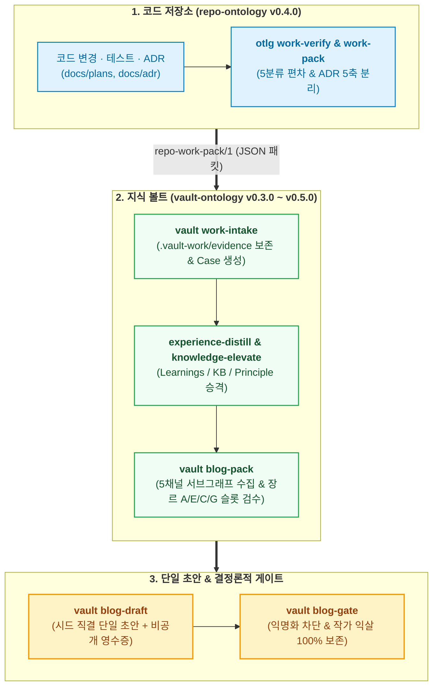

* toc
{:toc}

> "린트 에러가 0개이고 수백 개의 테스트가 통과하며 CLI가 정답(`answered`)을 반환할 때, 과연 그 응답의 '의미(Semantics)'는 추론과 투영 과정에서 단 한 치도 왜곡되지 않았다고 확신할 수 있는가?"
> 네 세계의 온톨로지 위에 저장소의 삽질을 지식과 블로그 초안으로 엮어내는 생산 파이프라인(`Repo v0.4.0 ↔ Vault v0.5.0`)과 내면의 기록을 삶의 질문에 연결하는 `Mind Compiler`를 세우고, 마침내 Panos Alexopoulos의 『Semantic Modeling for Data』를 잣대로 `Vault v0.6.0`·`Repo v0.5.0`·`TRPG v0.15.0`의 숨은 의미 왜곡까지 도려낸 대단원의 기록이다.
{:.lead}

---

## 추론과 시뮬레이션 너머에 남은 마지막 두 가지 질문

지난 [[9편]](/tag-ontology-engineering/9-code-on-graph-and-epilogue/)까지 개인 볼트(`vault`), 프로덕션 코드(`otlg`), 캠페인 런타임(`trpg`), 그리고 AI 안전 검수 청사진을 품은 메타 공방(`ontology-workbench`)이라는 네 세계에 온톨로지의 척추를 세웠지만, 마침표를 찍기 위해 답해야 할 두 가지 질문이 남아 있었다.

첫째는 **'지식의 순환과 생산(Production Loop)'**이었다. 볼트에서 사건(`case`)을 개념·절차로 풀고 원칙(`principle`)으로 승격시키며 맺어둔 간선(`derived_from`, `builds_on`)들의 연결망 자체가 이미 한 편의 블로그 서사 구조와 일치했다. 일기장의 고민들 역시 에이전트 요약과 분리해 삶의 질문(`Mind Compiler`)과 연결할 수 있다면, 온톨로지는 경험과 사유를 글과 내면의 답으로 길어 올리는 컴파일러가 될 수 있었다. 둘째는 **'의미의 무결성(Semantic Integrity)'**이었다. 테스트가 통과하고 CLI가 정상 봉투(`answered`)를 반환한다고 해서 도메인의 '의미'까지 보존되고 있을까? 조회 쿼리가 '반박(`contradicts`)'을 '파생(`derived_from`)'으로 바꾸거나 비밀 설정이 검색 적중 여부로 새고 있다면 어떨까?

---

## 경험이 지식이 되고 한 편의 글이 되기까지: Repo-to-Vault-to-Blog 파이프라인

실무 경험이 블로그 글이 되기까지의 마찰을 없애기 위해, `repo-ontology`(`v0.4.0`)와 `vault-ontology`(`v0.3.0 ~ v0.5.0`) 사이에 **증거 패킷과 5채널 수집기, 작가 중심 게이트**로 이어지는 파이프라인을 세웠다.

먼저 **저장소와 볼트의 주권**을 분리했다. 중간 복사 폴더(`Progress Note`)와 `supersedes` 간선을 은퇴시키고 계획·`Worklog`·`ADR`은 **코드 저장소**만 정본으로 두었다. 작업이 일단락되면 `otlg work-pack`으로 사건을 패킷(`repo-work-pack/1`)에 담아 볼트(`vault work-intake`)에 넘기되, 검토만 한 대안(`considered_not_taken`)이나 TDD 첫 실패(`expected_red`)를 실제 실패로 과장하지 않도록 5분류로 나누고 `ADR`도 5축 상태를 분리해 주장 상한(`claim_ceiling`)을 통제했다. 이후 `vault blog-pack`으로 5채널 서브그래프를 모으고 슬롯을 채워 `vault blog-draft`를 실행하면, 비공개 영수증은 격리한 채 **시드에 `derived_from`으로 직결되는 단일 초안**만 생성한다.

내가 가장 아끼는 장치는 마지막 **`vault blog-gate`**다. 금칙어와 엠대시·이모지를 차단하는 동시에, 내가 즐겨 쓰는 **작가 고유의 익살 표현들(취소선 농담, 이탤릭 괄호 독백, 여담 콜아웃)이 훼손되지 않았는지** 원본과 대조해 100% 보존을 강제한다. 만약 농담 삼아 적은 취소선 독백 안에 비공개 식별자가 들어 있다면 어떻게 될까? 일반 스크립트라면 문장을 멋대로 고쳐 말맛을 망치거나 금칙어를 통과시키겠지만, `blog-gate`는 즉시 **`AUTHOR_WIT_PRIVACY_CONFLICT`** 진단을 띄우며 멈춰 선다. **"작가의 유머 구절 안에 비공개 식별자가 있으니, 기계가 임의로 문장을 훼손하지 않고 토마토에게 직접 수정 결정을 위임한다"**는 이 에러 코드야말로 자동화 파이프라인이 인간 저자의 목소리를 존중하는 가장 온톨로지다운 방식이었다.

> [심화 근거: Repo-to-Vault-to-Blog 5채널 패킷과 C/study 프로파일·blog-gate 상세 계약 보러가기](/tag-ontology-engineering/deep-dive/vault-knowledge-compiler/#blog-pipeline)

---

## 기술 지식을 넘어 외부 도서 아카이브와 내면의 성찰을 엮다

이어서 **'독서 기록'**과 **'내면 일기'**를 손보았다. 도서 요약 본문은 외부 아카이브(`~/Documents/books-notes`)로 분리하고 볼트 내부 노트에서는 **`ext:repo:books-notes:<path>#<heading>`** URI로 외부 앵커를 가리키게 했다. 이때 `derived_from` 등 7대 관계는 외부 참조를 허용하되, **내부 학습 선행 경로를 뜻하는 `builds_on`만큼은 어떠한 `ext:` 값도 단호히 거부**해 커리큘럼 그래프를 보호했다.

삶의 아홉 가지 화두(`Q1`~`Q9`)를 모아둔 **`500 Mind Compiler`**에는 `vault mind`와 `vv weave`를 연결해 일기(`301 Day Notes`, `102 Monthly Diary`)와 디버깅(`103 Debugger`), 회고(`320.6 Reflection`) 속 내 생각들을 질문과 엮었다. 단, 에이전트가 작성한 작업 요약(`Harvest`)이나 책 줄거리 요약을 마치 '토마토 본인의 철학'처럼 긁어와 질문에 붙인다면 내 기억과 자아를 오염시키는 폭력이 된다.

그래서 두 도구는 공유 선택기(`vault.mind_sources`)로 `Harvest`와 혼합 영역(`Seeds`), 도서 요약문과 코드 블록을 배제하고 오직 내가 직접 쓴 산문만 추출한다. 8구간 샘플링을 폐기해 월말의 짧은 꼬리 문단까지 전수 검색하며, 결번(`Q3`)을 당기지 않고 실제 질문 ID를 보존한다. 무엇보다 `vault mind`는 절대 스스로 `_Question.md` 마크다운을 직접 고치지 않는다. 비공개 상태 기록 파일(`.vault-mind/ledger.json`)에서 후보를 준비하고, 내가 대화 세션에서 응답해 문서를 수정한 뒤에야 원본과 대상 파일의 64자리 **`SHA-256` 해시 영수증**을 대조(`apply --receipt`)해 완료 도장을 찍는다.

> [심화 근거: 외부 도서 아카이브(ext:)와 Mind Compiler 발화 주체 선택·영수증 상세 계약 보러가기](/tag-ontology-engineering/deep-dive/vault-knowledge-compiler/#mind-compiler)

---

## 테스트가 통과해도 의미는 왜곡될 수 있다: 3대 온톨로지 연쇄 의미 모형 감사

이 무렵 새로 정리한 Panos Alexopoulos의 **『Semantic Modeling for Data』**는 깊은 전율을 주었다. 온톨로지가 실패하는 이유는 문법 오류가 아니라 **'현실의 미묘한 의미를 스키마와 쿼리가 뭉개버리는 의미론적 안티패턴'**에 있었다. 나는 이를 **`ontology-critique-practices v1.0.0`** 스킬로 정제한 뒤, **P1 명시성(E)**·**P2 공유성(S)**·**P3 실용성(P)**의 세 잣대로 `Vault`, `Repo`, `TRPG` 3대 온톨로지를 전수 감사했다.

| 감사 대상 | 반례 | 의미 모형 감사(E/S/P)로 바로잡은 핵심 왜곡 | 회귀 검증 |
| :--- | :--- | :--- | :--- |
| **`Vault v0.6.0`** | `V060-01`~`16` | `together` **술어 증발** 교정, `experience` 센티넬 **정체성 착시** 제거, 6홉 절단(`DEPTH_LIMIT`) 진단 | **`638 passed`** |
| **`Repo v0.5.0`** | `RC-01`~`11` | `object_ref`/`code_ref`/`storage_ref` **3종 분리**, 양방향 보완 및 **타 객체 `scoped` 규칙 과잉 포함 제거** | **`139 passed`** (`9/9`) |
| **`TRPG v0.15.0`** | `TC-01`~`09` | **Project-Before-Match**: `rumored` 숨은 진실 요약·위치가 검색 적중(Membership Oracle)으로 새던 구멍 봉쇄 | **`386 passed`** |

1. **Vault `v0.6.0` (술어 증발과 센티넬 착시)**: 노트 A가 옛 이론 X를 반박(`contradicts`)하고 B가 영감을 받았을 때(`informed_by`), 공통 배경을 묻는 `vault ask together`가 원래 술어를 버리고 둘 다 **`derived_from`(직접 파생)**으로 둔갑시키던 왜곡(`V060-01`)을 잡았다. 또한 미문서화 경험을 뜻하는 센티넬 `derived_from: experience`를 일반 문서 ID와 같은 그룹핑 키로 취급해, **아무 상관 없는 35개의 노트가 마치 'experience라는 단일 사건'을 함께 겪은 형제 문서처럼 묶이던 착시(`V060-02`)**를 해결했다. ([심화 근거: Vault v0.6.0 의미 모형 감사 V060-01~16 전수 반례 보러가기](/tag-ontology-engineering/deep-dive/vault-knowledge-compiler/#vault-v060-audit))
2. **Repo `v0.5.0` (3종 엔드포인트 분리와 `brief` 교정)**: 보조 ORM 모델이나 DB 외래키 문자열을 억지로 일급 `Object`로 승격시키지 않고 도메인 객체(**`object_ref`**)·코드 참조(**`code_ref`**)·DB 외래키 설명(**`storage_ref`**)으로 분리했다(`RC-01`). 또한 수강료 청구서(`otlg brief FeeInvoice`) 조회 시 단방향 탐색 버그로 타깃 액션의 사전조건 3건은 누락되면서, 같은 도메인이라는 이유만으로 월별 스냅샷(`FeeMonthlySnapshot`) 전용 `scoped` 규칙이 딸려 들어오던 문제(`RC-02`, `RC-07`)를 양방향 보완과 `inclusion_reason` 명시로 바로잡았다. ([심화 근거: Repo v0.5.0 의미 모형 감사 RC-01~11 전수 반례 보러가기](/tag-ontology-engineering/deep-dive/repo-sdlc-and-audit/#repo-v050-audit))
3. **TRPG `v0.15.0` (Membership Oracle 봉쇄)**: 풍문만 들은 **`rumored`(소문)** 인물·아이템을 검색할 때, 기존 코드는 원본의 숨은 진실 `summary`와 `location_id`를 먼저 매칭한 뒤 출력 직전에만 가리고 있었다. 그 결과 `trpg trace "흑막의진짜정체" --perspective pc`를 검색하면 적중 목록(`matched_ids`)에 NPC 이름이 포함되어 진상을 역추적할 수 있는 구멍(`TC-03`)이 열려 있었다! 우리는 검색 전에 먼저 관점 투영기(Projector)로 진실 요약과 위치를 지우고 공개된 `rumor` 텍스트 위에서만 매칭하는 **`Project-Before-Match`**로 이를 원천 봉쇄했다. ([심화 근거: TRPG v0.15.0 의미 모형 감사 TC-01~09 및 Project-Before-Match 상세 보러가기](/tag-ontology-engineering/deep-dive/trpg-world-canon/#pc-perspective-audit))

아울러 세 감사 모두에서 독립 주석자 합의도($\kappa$)나 골드 질문셋 실험 없이 테스트 수만으로 가짜 품질 점수를 지어내는 유혹을 거부하고, **`E/S/P 및 ESBI = N/A`**로 정직하게 선언한 채 오직 재현된 반례와 회귀 테스트 통과 여부로만 증명했다.

---

## 에필로그: 곱연산의 시대, 이론이 도구를 이끈다

### 프롬프트 만능주의라는 환상과 곱연산 공식의 실체

지금까지 총 11편([[0편] 개념 공부를 넘어 실전으로, 네 개의 도메인에 온톨로지를 구축하기까지](/tag-ontology-engineering/0-ontology-engineering-intro/)부터 이번 10편까지)에 걸친 긴 여정을 갈무리하며, 나는 우주초월님의 영상에서 발표했던 한 장의 장표와 그 안에 적었던 공식을 다시금 떠올려 본다. 바로 **"개인의 엔지니어링 역량 × AI 활용 능력 = 최종 시너지"**라는 단순하지만 명확한 **'곱연산 공식'**이다.

오늘날 거대한 AI 열풍 속에서 세상은 연일 새로운 파운데이션 모델의 출시 소식을 쏟아내며, 이제 자연어 프롬프트만 그럴듯하게 치면 비전공자나 초급자도 뚝딱 소프트웨어를 만들어낼 수 있는 시대가 왔다고 이야기되곤 한다. 심지어 일각에서는 AI가 코드를 다 짜주는데 이제 와서 케케묵은 객체지향 설계 원칙이나 아키텍처, 온톨로지 같은 무거운 이론을 공부하는 것이 무슨 소용이냐며 '이론 무용론'을 설파하기도 한다.

하지만 지난 1년여간 최전선에서 수십만 줄의 실서비스 프로덕트를 홀로 굴리며 매주 수백 번씩 에이전트와 부딪혀 본 내가 목격한 실전의 진실은 정반대였다. 곱연산 공식에서 오른쪽 항인 AI 모델의 성능(`Sonnet`, `GPT`, `Gemini`)이 10에서 100으로 폭증할 때, 왼쪽 항인 인간 엔지니어의 기초 역량과 아키텍처 철학이 `0`에 머물러 있다면 그 곱셈의 최종 결과는 더 빠르게 증폭된 **'거대한 쓰레기(0)'**, 즉 아무도 유지보수할 수 없는 누더기 거인일 뿐이었다. 빅테크들이 수조 원의 GPU 치킨게임을 벌이며 더 똑똑한 모델을 내놓을수록, 역설적이게도 그 야생마 같은 지능을 내 도메인 안에 안전하게 길들이고 통제할 수 있는 엔지니어의 구조적 설계 역량이 성패의 모든 것을 가르고 있었다.

### 도구는 매일 바뀌어도 척추는 남는다

결국 에이전트에게 흔들리지 않는 가드레일을 쥐여줄 수 있었던 힘은 화려한 프롬프트 잔기술에서 나오지 않았다. 명령과 조회를 엄격히 분리하는 CQS 원칙, 불변성을 지키는 값 객체(Value Object), 모듈 간 경계 정합성을 다루는 소프트웨어 공학의 고전적인 설계 이론을 치열하게 공부했던 시간이 있었기에 에이전트의 코드 품질을 검증하는 `TDD`와 Critic 하네스를 짤 수 있었다. 마찬가지로 아리스토텔레스의 범주론부터 엔터프라이즈 데이터 플랫폼 20년의 진화사, `W3C`의 표준 어휘(`OWL`, `SKOS`, `PROV-O`), `Palantir`의 온톨로지 철학, 최신 `Code-on-Graph` 논문의 수리적 통찰, 그리고 Panos Alexopoulos의 의미 모형 비판 이론까지 근본부터 이해하려는 '덕질'의 시간이 있었기에, 비로소 내 컴퓨터 안의 네 세계에 `vault`, `otlg`, `trpg`, 그리고 `ontology-workbench`라는 흔들리지 않는 척추를 세울 수 있었다.

**온톨로지는 결코 유행을 타는 특정 벤더의 값비싼 독점 도구가 아니다. 그것은 끊임없이 증가하는 소프트웨어의 복잡성과 세션마다 초기화되는 망각에 맞서, 어제의 내가 내렸던 결정의 맥락을 잃지 않고 내일 아침 백지상태로 깨어날 에이전트와 흔들림 없이 호흡하기 위해 남겨두는 가장 단단한 약속이다.**

내일 아침이면 또다시 더 빠르고 현란한 코딩 에이전트와 새로운 프레임워크가 세상에 등장할 것이다. 그러나 어떤 도구가 밀물처럼 밀려와도 나는 더 이상 조급해하거나 흔들리지 않을 것이다. 내 책상 위 작은 컴퓨터 안에서 이미 나만의 단단한 운영체제를 짜고 있었고, 그 운영체제의 가장 깊은 곳에는 어떤 폭풍 속에서도 시스템을 지탱해 줄 **'온톨로지'**라는 척추가 조용히, 그리고 살아 숨 쉬듯 맥박치고 있기 때문이다.

---

### [시리즈를 완주하신 독자분들께]

지금까지 총 11편(0편~10편)에 걸친 **'온톨로지 엔지니어링: 지식 그래프에서 AI Agent OS까지'** 시리즈의 긴 여정을 함께 호흡하며 읽어주신 독자분들께 깊은 감사를 전한다. 전체 시리즈의 흐름을 다시 조망하거나 특정 구간의 아키텍처를 복기하고 싶다면, 이 모든 여정의 총괄 현관문인 **[[0편] 개념 공부를 넘어 실전으로, 네 개의 도메인에 온톨로지를 구축하기까지](/tag-ontology-engineering/0-ontology-engineering-intro/)**에서 언제든 다시 출발할 수 있다.
