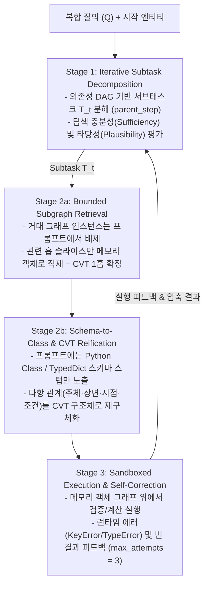
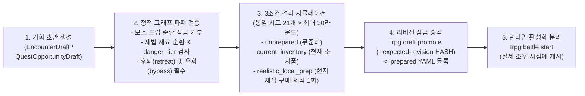

- table of contents
{:toc}

> "고정된 CLI 명령어는 정해진 질문에 대해서는 단 한 치의 오차도 허용하지 않는 든든한 성벽이었지만, 수천 건의 데이터와 다중 조건이 얽힌 창발적 합성을 감당하려면 프롬프트에는 스키마만 올리고 메모리 위에서 추론 코드를 합성하는 그래프로 진화해야 했다."
> `Code-on-Graph(arXiv:2606.03705v1)`의 3단계 반복 추론을 다섯 온톨로지에 이식한 Wave 1 안전 계약(`5-State Result Envelope`)과, 7.5MB 세계관 YAML 통합·대화형 2d6 파훼 전투·3조건 샌드박스 시뮬레이션으로 완성된 `trpg-ontology v0.14.0`의 기록이다.
{:.lead}

---

## 고정된 CLI 명령어 너머에서 마주한 조합 폭발의 벽

지난 [[9편] 다섯 개의 온톨로지를 만들고 나서야 알게 된 것, 메타 청사진과 과잉 규율의 경계](/tag-ontology-engineering/9-meta-ontology-workbench-and-redteam/)에서 나는 개인 지식 볼트(`vault-ontology`), 코드 저장소(`repo-ontology`), TRPG 캠페인(`trpg-ontology`), 게임 역공학 코퍼스(`game-dev-ontology`)를 아우르는 메타 설계 공방(`ontology-workbench`)을 세우고, 적대적 레드팀 검증을 통해 정적 온톨로지의 한계와 책임을 정직하게 그어 두었다. 돌이켜보면 지난 [[3편] 문서는 명사로 정리되지만 코드는 동사로 움직인다](/tag-ontology-engineering/3-nouns-to-verbs-paradigm-shift/)에서 처음 *"온톨로지는 AI 시대에 다양한 대상을 메타적으로 관리하기에 너무나 훌륭한 시스템이니 여기저기 적절한 곳에 적용해 보자!"*라고 결심했을 때만 해도, 내가 이 개념을 이토록 다양한 차원으로 밀어붙이게 될 줄은 몰랐다. 도메인에 부딪힐 때마다 온톨로지를 바라보는 내 해상도는 끊임없이 진화해 왔고, 이제 다섯 개의 온톨로지가 모두 궤도에 오른 시점에서 나는 마지막 여섯 번째 차원의 도약을 마주하게 되었다. `vault q`, `otlg trace`, `trpg scene`, `gdev.py`처럼 내가 미리 설계해 둔 고정 CLI 서브커맨드들은 정해진 질문에 대해서는 단 한 치의 오차나 환각도 허용하지 않는 든든한 성벽이었지만, 다섯 세계에 데이터가 수천 건씩 쌓이고 에이전트에게 여러 도메인 조건이 얽힌 창발적 합성(Emergent Synthesis)을 요구하기 시작하자 **'고정된 CLI를 넘어, 스키마 위에서 추론과 시뮬레이션 코드를 합성하는 그래프'**로의 진화가 필연적으로 요구되었기 때문이다.

가장 먼저 그 벽을 체감한 곳은 TRPG 세계관이었다. 418개의 세계관 마크다운과 글뤼엔 연금술 아카이브 1,478개 레코드를 합치면 원본만 약 7.5MB에 달했다. 여기에 파티 소지품과 지역별 고정 위험도(`danger_tier`)가 맞물린 상태에서 *"현재 파티 재료와 현지 채집 재료만으로 다음 보스의 기믹을 파훼할 수 있는가?"* 같은 질문을 던졌을 때 기존 방식은 진퇴양난에 빠졌다. 7.5MB 원문을 프롬프트에 넣으면 컨텍스트가 폭발하거나 중간 맥락을 놓치는 현상(Lost-in-the-middle)이 벌어졌고, 질문마다 새 CLI 플래그를 하드코딩할 수도 없었다. 다섯 번째 도메인인 AI 캐릭터 자동 검수 파이프라인(`BubbleTap FDE`)에서도 공개·비공개 설정과 수십 개의 동적 키워드북(`KeywordBookEntry`), 상황별 이미지(`CharacterImage`)가 얽혀, 이용 등급이 '전체 이용가'이면서 비공개 키워드북의 은유와 이미지 복장 단서가 결합될 때 비로소 정책 위반이 성립하는 조합 폭발이 일어났다.

---

## Code-on-Graph 논문 해부: 데이터는 메모리에, 프롬프트에는 스키마만

'고정 연산자의 경직성'과 '프롬프트 사실 주입의 확장성 한계'를 부수기 위해 해답을 찾은 연구가 2026년 논문 **[Code-on-Graph: Iterative Programmatic Reasoning via Large Language Models on Knowledge Graphs](https://arxiv.org/abs/2606.03705v1)**(Weiwei Ding 외, 2026)였다. 그래프 트리플을 프롬프트에 나열하면(Text-in-Context) 이웃 노드가 늘어나는 순간 산수나 빈도 비교(`count >= 2`)조차 틀리게 되고, Top-K로 가지를 쳐내면 필수 사실이 유실되며 복합 값 타입(CVT)에서 서로 다른 엔티티의 속성이 뒤섞인다. `Code-on-Graph`(`CoG`)의 핵심은 **"프롬프트에는 거대한 데이터 대신 컴팩트한 스키마(Python Class 정의)만 넣으며, 추론 연산은 즉석 합성한 코드로 메모리 내 그래프 위에서 수행한다"**는 것이다.

1. **Stage 1 (Planning)**: 복합 질문을 `parent_step` 기반 의존성 DAG 서브태스크 $T_t$로 분해하며 탐색 충분성과 답안 타당성을 평가한다.
2. **Stage 2 (Coding)**: 관련 서브그래프 슬라이스만 메모리에 적재(**Stage 2a**)하고 프롬프트에는 `Python` 클래스 및 `TypedDict` 스키마 스텁만 노출한다(**Stage 2b**). 특히 '동일 주체·장면·시점·조건'이 묶여야 의미가 성립하는 **CVT(Compound Value Types)**를 구조체로 재구체화(Reification)하여 서로 다른 엔티티의 속성이 교차 오염되는 참사를 차단한다.
3. **Stage 3 (Executing)**: 합성된 검증 로직을 메모리 내 객체 그래프 위에서 격리 실행하며, 런타임 예외뿐 아니라 **빈 결과(`Empty Output`)나 충분성 미달**까지 피드백으로 돌려주어 최대 3회(`max_attempts = 3`) 안에서 조건식을 스스로 교정하게 만든다.

논문은 **Proposition 1 (Token Utilization Rate, `TUR`)**을 통해, 사실을 직접 나열하면 인스턴스 수 $|I_t|$에 비례해 토큰이 소모되어 효율이 $\mathcal{O}(1)$에 갇히지만, `Schema-to-Class` 매핑은 고정 스키마 $|S_t|$만 프롬프트에 넣고 메모리의 $|I_t|$ 전체를 연산하므로 효율이 $\mathcal{O}(|I_t| / |S_t|)$로 선형 확장됨을 증명한다.

$$
\text{TUR}_{\text{Text-in-Context}} = \mathcal{O}(1) \quad \text{vs.} \quad \text{TUR}_{\text{Schema-to-Class}} = \mathcal{O}\left(\frac{|I_t|}{|S_t|}\right)
$$

다만 나는 이 지표를 이식하며 엄격한 해석 경계를 그었다. 논문이 보고한 **`40.7x ~ 47.6x`의 `TUR` 수치는 '프롬프트 토큰 1개당 접근 가능한 그래프 사실(Fact)의 이론적 비율'이지, 실제 런타임 실행 속도(Latency)가 47배 빨라진다거나 우리 CLI가 실측한 속도 배수가 결코 아니다.** 우리는 이를 거대한 데이터를 프롬프트 밖 메모리에 두고 스키마와 결과 요약만으로 추론을 통제하는 아키텍처 원리로만 정직하게 채택했다.

- [심화 근거: Code-on-Graph 3단계 파이프라인, CVT Python 스텁 및 TUR 수리 증명 상세 보러가기](/tag-ontology-engineering/deep-dive/workbench-and-code-on-graph/#code-on-graph)

---

## Wave 1: 읽기와 결정론적 쓰기의 분리, 그리고 5-State Result Envelope

학술 벤치마크를 프로덕션 도구로 가져오며, 나는 `Antigravity`와 `Codex`의 교차 검증을 거쳐 5대 온톨로지 전역에 두 가지 안전 계약을 못 박았다.

첫째는 **'읽기·사전검사·시뮬레이션(`CoG`)과 결정론적 쓰기·집행(`Action`)의 절대적 분리'**다. 우리의 `CoG` 계층은 무변이 사전검사(Preflight Dry-run)와 격리 시뮬레이션을 통해 **후보 패치(`CandidatePatch`), 액션 제안(`ActionProposal`), 정책 변경 제안(`PolicyChangeProposal`), 근거 참조(`evidence_refs`)를 도출하는 계층**으로만 작동하며, 실제 쓰기나 상태 승격은 100% 사전 등록된 핸들러(`registered_handlers_only`)만 수행한다.

둘째는 **'결과 상태의 정직한 5분류(`5-State Result Envelope`)'**다. 현실 도메인에서는 "정책 위반 근거 0건"처럼 **빈 결과 자체가 정답인 경우(`empty_valid`)**와, 검출기 판독 실패(`unknown`)나 출력 예산 절단(`incomplete`)을 똑같은 빈 배열(`[]`)로 뭉개버리면 치명적 미탐 사고가 터진다. 이를 막기 위해 모든 CLI 출력 봉투에 `schema_hash`, `dataset_revision`, `coverage`, `omitted_count`와 함께 **`answered | empty_valid | unknown | incomplete | failed`** 5개 상태를 명시하도록 표준화했다.

이 계약 위에서 **`ontology-workbench v0.3.0`**(`BubbleTap FDE`, `55 passed`)은 텍스트·이미지·OCR 단서를 CVT `AssessmentRelation`으로 묶어 동일 인물·장면·시점 근거만 결합하게 함으로써 교차 오탐을 차단하고 아웃박스 제재 핸들러와 홀드아웃 골드셋 Shadow 검증을 명세했다. **`game-dev-ontology v1.3.1`**(`711 passed`)은 정본 JSON을 Read-Only SQLite/FTS5에 투영해 `schema -> slice -> QueryPlan -> receipt` 파이프라인과 4대 가드레일(표본 전수화 거부, `60Hz` 임의 환산 차단, 미검증 후보 자동 승격 금지 등)을 구축했으며, **`vault v0.2.0`**(`531 passed`), **`repo v0.3.1`**(`100 passed`), **`trpg v0.13.0`**(`328 passed`) 역시 무변이 사전검사와 읽기 전용 스키마 스텁 노출을 안착시켰다.

- [심화 근거: 5-State Result Envelope JSON 규격, BubbleTap FDE 캐릭터 검수 청사진 및 Wave 1 전 도메인 계약 보러가기](/tag-ontology-engineering/deep-dive/workbench-and-code-on-graph/#result-envelope)
- [심화 근거: Game Dev Ontology(v1.3.1)의 Read-Only SQLite/FTS5 CoG 투영 엔진과 4대 가드레일 상세 보러가기](/tag-ontology-engineering/deep-dive/game-evidence/#shard-merge)

---

## Wave 2 하이라이트: trpg-ontology v0.14.0과 3조건 창발 시뮬레이션

Wave 1에 이어 진짜 승부처는 방대한 세계관과 캠페인 상태를 결합해 `CoG`의 **Stage 2a(핀포인트 서브그래프 조회)**와 **Stage 3(샌드박스 실행 피드백)**를 끝까지 밀어붙인 **`trpg-ontology v0.14.0` (`F15`)**이었다. 먼저 데이터를 **4계층(`World Canon` / `Ruleset` / `Campaign` / `Candidate & Prepared`)**으로 분리하고, 418개 세계관 문서와 글뤼엔 아카이브 1,478개 항목(`~7.5MB`)을 `world/canon/manifest.yml`과 **13개 정본 YAML**로 무손실 통합했다. 동명이인이 덮어써지지 않도록 `<파일 stem>:<source_path>` 복합 ID를 부여했고, `World Canon`을 읽었다고 해서 파티가 재료나 제법을 공짜로 얻지 못하도록 실제 보유 상태는 `Campaign` 원장에만 귀속시켰다. 또한 [[7편]](/tag-ontology-engineering/7-trpg-kinetic-action-layer/)의 `LÖVE 11.5` 전투 창이 서사 몰입감을 끊는 문제를 해결하고자 이를 과감히 폐기하고, [[8편]](/tag-ontology-engineering/8-game-dev-evidence-ontology/)에서 역공학한 『옥토패스 트래블러 II』의 약점 파훼(`Break`)와 저력(`latent_power`)을 이식한 대화형 2d6 파훼·연금 전술 계산기(`domains/combat/conversation.py`)로 일원화했다.

이를 바탕으로 세션 중 구상한 보스 초안(`EncounterDraft`)을 검증하는 **Stage 3 샌드박스 게이트**가 완성되었다. `trpg draft check`는 필수 파훼 아이템(`required_counters`) 재료가 **'지금 잡아야 하는 바로 그 보스의 전리품(Drop)'에만 존재하는 순환 잠금(Boss Drop Circular Lock)** 상태인지를 역추적해 거절한다. 이어지는 **21시드 × 30라운드의 3조건(`unprepared` / `current_inventory` / `realistic_local_prep`) 격리 시뮬레이션**은 특히 `realistic_local_prep`에서 엔진이 직접 현지 채집 1회, 상점 구매, 습득 제법(`known_recipes`) 1회 제작(재료·금화 실제 차감)까지 수행한 투영 인벤토리를 조립해 승률과 Break 봉쇄 횟수를 정량 비교한다. 7.5MB 세계관 조회를 맡은 `trpg canon` 역시 메모리 적중 `0.03초` 속도와 함께 **22개 적대적 반례 검토(`338 passed`)**를 거쳐 `pickle` 제거(`0700/0600` JSON + `O_NOFOLLOW`), TOCTOU 매니페스트 검증, `--perspective pc` 메모리 적재 전 차단, 동명이인 모호성 에러, 자연어 서식지 생물 115종의 `미확인(unlinked)` 정직 보고까지 완비했다.

- [심화 근거: TRPG v0.14.0 World Canon 13개 YAML 통합, 2d6 파훼 수식, 3조건 시뮬레이션 및 Canon 캐시 22개 적대적 반례 상세 보러가기](/tag-ontology-engineering/deep-dive/trpg-world-canon/#three-condition-simulation)

---

### [시리즈의 다음 이야기]

고정된 CLI를 넘어 스키마 위에서 추론과 시뮬레이션을 합성하는 `Code-on-Graph` 아키텍처를 다섯 온톨로지에 이식하고 나자, 이 여정을 완결 짓기 위해 답해야 할 마지막 두 가지 질문이 떠올랐다. 첫째는 매일 겪는 시행착오와 독서, 일기장의 고민을 어떻게 살아 숨 쉬는 지식과 블로그 글, 내면의 성찰로 직조해 낼 것인가라는 연결의 질문이었고, 둘째는 CLI가 `answered`를 반환할 때 그 응답의 '의미(Semantics)'가 투영 과정에서 왜곡되지 않았다고 확신할 수 있는가라는 자기 의심이었다.

시리즈의 대단원인 다음 글 **[[11편] 경험이 글이 되고 의미가 스스로를 증명하기까지, 지식·성찰 컴파일러와 3대 의미 모형 감사](/tag-ontology-engineering/11-knowledge-blog-compiler-and-semantic-critique/)**에서는 작업 패킷에서 블로그 초안으로 이어지는 자동화 파이프라인(`Repo v0.4.0 ↔ Vault v0.5.0`), 개인 기록을 삶의 질문과 엮는 `Mind Compiler`(`vault mind` & `vv weave`), 그리고 『Semantic Modeling for Data』를 잣대로 숨은 의미 왜곡까지 도려낸 3대 연쇄 감사와 에필로그를 다룬다.
