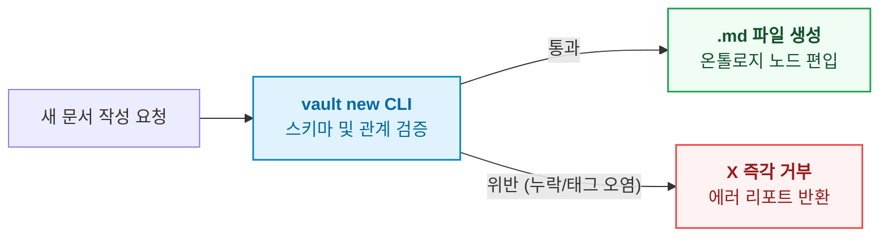

- table of contents
{:toc}

> "분류되지 않고, 검증되지 않으며, 연결되지 않은 마크다운 파일은 지식이 아니라 기술 부채다."
> `Obsidian` 볼트에 쌓인 4,400여 개의 비정형 메모와 의사결정 기록들에 13가지 정형 스키마와 2계층 온톨로지 관계망을 부여하고, `SQLite` 재귀 쿼리와 전용 CLI 하네스를 통해 지식의 엔트로피를 기계적으로 통제해 낸 개인 지식 온톨로지 구축기를 다룬다.
{:.lead}

---

## 기록의 시작과 4,400개 노트의 늪

지난 [AI OS 시리즈 1편](/tag-ai-agent-architecture/1-ground-rules/)에서 언급했듯이, 내 기록의 시작은 군대의 일기였다. 내가 느낀 것을 객관적인 말로 표현하는 일이 감정을 다스리는 데 발군이었고, 시간이 지나 읽었을 때 '그때 어떤 일을 겪고 어떻게 반응했구나'를 곱씹는 감회가 새로웠기 때문이다. 이 긍정적인 경험을 책, 영화, 게임 리뷰와 일상 메모로 확장하며 `Notion`과 `PARA` 필기법을 만족스럽게 사용해 왔다.

문제는 더 다양한 유형의 노트를 다루고자 `Obsidian`으로 옮기면서 부각되었다. 회사를 다니기 시작하자 매일 실무에서 포집해야 하는 개념들이 동적으로 쏟아졌고, `PARA`, `Zettelkasten`, `Atlas`, 도서분류체계를 흡수하며 볼트를 고도화할수록 구조는 비대해졌다. 가장 직관적인 난관은 폴더 분류와 태그의 중첩이었다. 예컨대 "FastAPI 동시성 제어"라는 노트는 `Python`인가, `Backend`인가, 아니면 `Architecture`인가? 디렉토리의 물리적 분리와 태그 분류를 중복 없이 가져가는 일도 쉽지 않았지만, 더 큰 문제는 **문서가 4,400개, 위키링크가 24,000개, 태그가 260여 종을 넘어가자 기획한 나조차 원하는 문서와 그들 사이의 맥락을 빠르게 찾기 어려워졌다**는 점이다.

특히 AI 에이전트를 이 볼트 안에서 활용할 때 폴더만 뒤지거나 단순 벡터 검색(`RAG`)만으로는 문맥의 선후 관계와 설계 근거를 전혀 구분하지 못하는 비효율을 체감했다. 그러다 [[1편] 온톨로지가 없는 AI는 현학적인 수다쟁이일 뿐이다](/tag-ontology-engineering/1-palantir-3rd-generation-platform/)에서 살펴본 온톨로지 개념을 접하면서, 볼트의 모든 문서를 정형 객체로 규정하는 돌파구를 찾게 되었다.

---

## 지식 온톨로지의 뼈대: 13종 `type`과 7종 의미 관계, 그리고 `SQLite` vs `RDF/OWL`

볼트에 온톨로지를 이식하며 세운 첫 원칙은 **"이 메타데이터 필드가 대체 어떤 질문에 답하는가?"**였다. 수정 시각(`updated`)은 `Git` 이력에서, 소속 구역(`part_of`)이나 보관 상태(`status`)는 디렉토리 경로에서 유도할 수 있으므로 frontmatter에서 과감히 걷어냈다. 대신 문서의 외형적 형식이 아니라 **'어떤 상황에서 이 문서를 찾는가(쓰임)'**를 기준으로 `type`을 단 13종으로 고정했다.

- **핵심 판단 구간 (4종, 80자 이내 `summary` 전역 필수)**: 도메인 원리를 다루는 `concept`, 따라 하면 결과가 나오는 재현 절차 `procedure`, 규격·명령어를 나열한 `reference`, 원칙이나 결정을 낳은 실제 장애·사건의 전말인 `case`. 에이전트가 본문을 다 열지 않고도 요약 한 줄만으로 탐색 여부를 즉시 판단하게 하기 위함이다.
- **거버넌스·실행·수집 구간 (9종)**: 불변 규칙인 `principle`, 선택 선언과 대안 비교인 `decision`·`tradeoff`, 실무 문서와 진입점·일지인 `project-doc`·`hub`·`log`, 외부 자료 필사와 감상·가치관 성찰인 `capture`·`review`·`reflection`. 어디에도 속하지 않는다는 핑계로 쓰이는 `etc` 같은 배출구는 원천 금지했다.

개별 문서의 정체성을 세운 뒤에는 24,000개 위키링크(`[[...]]`)의 모호성을 해결할 차례였다. 본문 위키링크는 우연한 마주침(Serendipity)을 위해 자유로운 무명 엣지로 남겨두되, 에이전트가 맥락을 추론할 때 반드시 알아야 할 핵심 연결만 frontmatter에 선언하는 **2계층 관계망**을 도입했다. 첫 번째 층위는 선행 학습 개념(최대 3개)을 잇는 **`builds_on`**이고, 두 번째 층위는 한국어 **'시험 문장(Test Sentence)'**에 대입해 읽었을 때 참일 때만 부여하는 **7종 의미 관계**다.

- **`derived_from`** ("A는 B에서 나왔다"): `커넥션 풀 산정 원칙`(`principle`) ➔ `실서비스 DB 커넥션 고갈 사건`(`case`)
- **`contradicts`** ("A와 B는 둘 다 참일 수 없다"): 상충하는 두 아키텍처 원칙이나 설계 대안의 대립
- **`diverges_from`** ("A는 B를 바탕으로 삼되 일부를 바꿨다"): 오픈소스 패턴을 내 로컬 환경에 맞게 변형한 가이드
- **`applies` · `informed_by` · `expresses` · `answered_by`**: 각각 원칙의 실전 적용(`applies`), 직접 근거는 아닌 영감·영향(`informed_by`), 가치를 구현한 도구(`expresses`), `Mind Compiler` 질문이 답을 얻은 성찰·기술 노트(`answered_by`)

스키마를 세운 뒤 나는 4,400개 노트를 `SQLite` 속성 그래프와 정통 `W3C` 표준인 `RDF/OWL` 트리플(`.ttl`)로 이중 모델링하여 9단계 실증 실험을 감행했다. 결과는 냉정했다. `OWL` 추론기를 돌리자 트리플이 27,587개에서 77,478개로 2.81배 불어나며 16.6초가 걸렸지만, 정작 **`SQLite` 재귀 CTE(`0.5ms` 응답)로 얻을 수 없던 유용한 새 사실은 단 0건**이었다. 웹 전체의 지식을 합치기 위해 '적혀 있지 않은 것은 아직 모르는 것'이라 가정하는 `OWL`의 **열린 세계 가정(OWA)**과 타입 강제 추론(`rdfs:domain/range`)은, 필수 필드 누락과 깨진 링크를 즉시 거부해야 하는 개인 지식베이스의 **닫힌 세계 가정(CWA)** 운영 목적과 정반대였기 때문이다.

결국 나는 상시 운용과 초고속 경로 질의(`vault q path`)는 `SQLite` 재귀 CTE에 맡기고, 생성·검증은 `vault new`와 `vault lint`가 단일 파이썬 검증 코드와 읽기 전용 태그 화이트리스트(`vault tags`)를 공유하는 물리적 **생성 게이트(Creation Gate)**로 통제하며, 닫힌 세계 제약 검증이 필요할 때는 `SHACL`을 결합하는 실용주의 아키텍처에 안착했다.

[심화 근거: 13종 문서 타입·7종 의미 관계 및 SQLite authorizer 상세 계약 보러가기](/tag-ontology-engineering/deep-dive/vault-knowledge-compiler/#vault-schema-and-sqlite)

---

## 선언된 그래프 너머의 의미 연결: `vault-vector`(`vv`)와 4부작 작성 루프

`SQLite` 그래프는 이미 선언된 관계에 대해서는 0.5ms 만에 답을 내놓았지만, **"아직 아무런 링크도 걸려 있지 않지만 뜻이 맞닿아 있는 문서"**는 찾아낼 수 없었다. 이 사각지대를 메우기 위해 일기 등 민감 기록이 외부 API로 나가지 않도록 로컬 교차언어 임베딩 모델(`snowflake-arctic-embed-l-v2.0-ko`) 기반의 `vault-vector`(`vv`)를 구축했다. 4,201개 문서를 49,105개 청크로 쪼개어 해시 기반 증분 색인(`vv index`)을 구성하자, 새 문서를 만드는 과정은 **1부 배치(`vv place`) ➔ 2부 대조(`vv search --near`) ➔ 3부 생성(`vault new`) ➔ 4부 연결**의 4부작 루프로 진화했다.

특히 743개 하위 폴더 중 어디에 문서를 둘지 결정하는 `vv place`는 폴더 내 문서들의 평균 벡터를 대표 카드로 삼고 `--type` 필터를 결합해 Top-5 배치 정확도를 **83.4%**(대분류 99.5%)까지 끌어올렸다. 또한 문서를 생성하기 전에 `vv search --near`로 의미적 유사 후보와 그 후보의 `SQLite` 선언 이웃을 한 화면에서 먼저 대조함으로써, 기존 원칙과의 충돌이나 중복 생성을 파일 생성 전에 흡수할 수 있게 되었다. 개인 일기(`Track`/`Memo`/`Echo`)에서 에이전트 요약문(`Harvest`)을 배제하고 삶의 화두(`500 Mind Compiler`)와 대조하는 `vv weave` 역시 이 구조 위에서 탄생했다.

---

## 테스트 466건 통과 뒤의 사각지대: 적대적 운영 감사 (`v0.1.1`)

단위 테스트가 **466건**이나 통과하고 있었으니 나는 도구가 완벽하다고 자부했다. 하지만 `Antigravity`의 조율 아래 `Codex`와 `Gemini` 두 에이전트를 교차 투입해 실제 코퍼스와 격리 픽스처 위에서 **적대적 운영 감사(Adversarial Operational Review)**를 진행했을 때, 정상 동작 테스트가 가리고 있던 **19건(`V-01 ~ M-05`)의 서늘한 운영 경계 허점**이 쏟아져 나왔다. 그중 가장 극적이었던 대표 반례 두 가지를 꼽자면 다음과 같다.

첫째는 **동일 경로 이관 시 결과물까지 스스로 증발시키던 자기 삭제 버그(`V-03`)**였다. 초안을 정식 폴더로 옮기며 원본을 지우는 `vault ingest --rm`에서, 볼트 내부의 초안을 이동할 때 자기 자신이 동명이인 중복으로 잡혀 사용자에게 위험한 `--force` 플래그 사용을 유도하는 문제가 있었다. 더 치명적인 것은 출발지와 목적지가 같은 파일을 가리킬 때 `vault ingest --force --rm`을 실행하면, **파일을 덮어쓴 직후 원본 정리 단계가 작동해 방금 생성한 최종 결과물까지 스스로 삭제(`self-deletion`)해 버린다**는 점이었다. 우리는 동일 실체 파일에 대한 `--rm`을 원천 거부하고, 내부 이동 시에만 출발지 자신을 중복 후보에서 제외(제3의 동명이인은 유지)하며, 작업 도중 원본 변경이 감지되면 삭제를 즉시 중단하도록 계약을 뜯어고쳤다.

둘째는 **동명이인 섹션 링크의 조용한 오결합과 아카이브 참조의 왜곡(`G-03`)**이었다. 서로 다른 프로젝트에 같은 이름의 설계서(`architecture-design.md`)가 존재할 때 폴더 경로 없이 `[[architecture-design#Open Questions]]`처럼 섹션 링크를 걸면, 기존 리졸버는 모호성을 경고하는 대신 정렬상 첫 번째로 잡히는 엉뚱한 프로젝트 문서에 조용히 결합해 버렸다. 반대로 그래프 제외 구역인 `900 Archive`에 실제로 존재하는 옛 문서를 참조했을 때는 파일이 버젓이 디스크에 있는데도 무조건 깨진 링크(`broken`)로 판정해 경고 잡음을 양산했다. 우리는 동명이인 문서의 섹션을 가리킬 때는 유일한 문서를 식별할 수 있는 폴더 경로 명시를 강제하고, 아카이브 실존 파일 참조는 전체 아카이브를 그래프 노드로 편입해 잡음을 키우는 대신 `archived` 리터럴 상태로 분리 보존해 진짜 유실된 `broken` 링크와 명확히 구분했다.

이 밖에도 `Git`의 8진수 이스케이프 때문에 한글 노트의 삭제·반토막 사고를 전혀 탐지하지 못하던 `vault doctor`를 `git ls-files -z`와 `--literal-pathspecs` 기반으로 전면 교체(`G-01`)하고, `vault q sql` 조회 명령 뒤에 `ATTACH DATABASE`를 붙여 디스크에 임의 파일을 생성할 수 있던 구멍을 `SQLite` `mode=ro`와 엔진 레벨 `authorizer` 화이트리스트로 원천 봉쇄(`V-06`)했다.

### 도구의 결함 수정과 볼트의 부채를 혼동하지 않는 정직함

적대적 반례 57건을 추가해 **총 523건의 테스트가 모두 통과**한 `v0.1.1`을 완성한 뒤, 수정 전후 코드를 실제 볼트에 읽기 전용으로 나란히 돌려 비교해 보았다.

| 실제 볼트 읽기 전용 검사 항목 | `v0.1.0` (수정 전) | `v0.1.1` (수정 후) | 변화의 의미 |
| :--- | :---: | :---: | :--- |
| **`vault lint` 위반** | 919건 | 919건 | 기존 문서들의 미해결 본문 링크(888건), `summary` 누락(21건) 등 과거 부채는 그대로 남음 |
| **`SHACL` violation / warning** | 21건 / 49건 | 21건 / **45건** | 스칼라 `derived_from` 및 `archived` 근거 인식으로 도구의 잘못된 경고(오탐) 4건 해소 |
| **`SQLite` 노드 / 엣지 / 태그** | 4,251 / 16,467 / 3,637 | 4,251 / 16,467 / 3,637 | 활성 그래프의 위상과 규모는 변함없이 보존됨 |

도구의 버그를 고쳐 테스트 523건을 통과시켰다는 사실이 곧 내 볼트 안에 쌓여 있던 **919건의 기존 린트 부채가 마법처럼 사라졌다는 뜻은 결코 아니다.** 한글 파싱이 고쳐진 `vault doctor`가 새로 포착한 삭제 후보 173건 역시 무작정 자동 복구(`--restore`)를 돌리는 대신 읽기 전용으로 정밀 분류해 보니, 120건은 폴더 이동으로 내용이 동일한 파일이 다른 위치에 존재했고 나머지도 수동 확인이 필요한 대상이었다. **"도구가 정상 작동하도록 고친 것"과 "그 도구가 다루는 실제 코퍼스가 무결해진 것"을 섞어 과장하지 않는 정직함**이야말로 이번 감사에서 얻은 가장 큰 수확이었다.

[심화 근거: Vault 적대적 검수 19개 반례(V-01~M-05) 전수 표 및 doctor 173건 분석 보러가기](/tag-ontology-engineering/deep-dive/vault-knowledge-compiler/#vault-v011-audit)

---

### [시리즈의 다음 이야기]

`Obsidian Vault`에 온톨로지 개념을 안착시키는 과정에서, 나는 문득 **'이 개념을 실제 코드가 돌아가는 레포지토리(`Repository`)에도 동일하게 적용할 수 있지 않을까?'**라는 생각을 하게 되었다([AI OS 시리즈 6편](/tag-ai-agent-architecture/6-repo-governance/), [7편](/tag-ai-agent-architecture/7-rule-pruning/)).

이어지는 **[[3편] 문서는 명사로 정리되지만 코드는 동사로 움직인다](/tag-ontology-engineering/3-nouns-to-verbs-paradigm-shift/)**에서는 정적 지식 분류의 성취에 머물러 있던 시야를 깨부순 팔란티어 키노트의 일갈과, 마크다운 문서(명사)에서 소스 코드의 상태 전이 명세(동사)로 온톨로지의 무게중심을 옮기게 된 패러다임의 전환을 다룬다.
