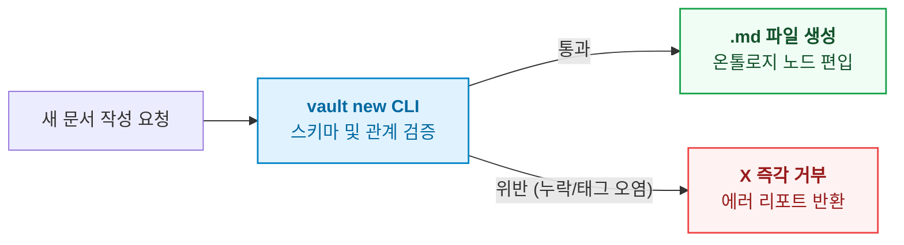

- table of contents
{:toc}

> "분류되지 않고, 검증되지 않으며, 연결되지 않은 마크다운 파일은 지식이 아니라 기술 부채다."
> `Obsidian` 볼트에 쌓인 4,400여 개의 비정형 메모와 의사결정 기록들에 13가지 정형 스키마와 2계층 온톨로지 관계망(구조 2종, 의미 7종)을 부여하고, `SQLite` 재귀 쿼리와 전용 CLI 하네스를 통해 지식의 엔트로피를 기계적으로 통제해 낸 개인 지식 온톨로지 구축기를 다룬다.
{:.lead}

---

## 기록의 시작

지난 [AI OS 시리즈 1편](/tag-ai-agent-architecture/1-ground-rules/)에서 언급했듯이, 내 기록의 시작은 군대의 일기에서부터 시작되었다. 일기를 적으면서 좋다고 느낀 점들을 꼽자면 내가 느낀 것을 객관적인 말로서 표현하는 것이 감정을 다스리는 것에 발군이라는 점과, 시간이 지나고 읽었을 때 '내가 그때 어떠어떠한 일을 겪고 어떻게 반응했구나'라는 것을 곱씹으면서 감회가 새로운 기분을 느낄 수 있다는 점이 있었다.

내가 느낀 이런 긍정적인 부분을 동일하게 적용할 수 있다고 생각한 것이 바로 '컨텐츠'였다. 책, 영화, 시리즈, 게임 등에 대한 일종의 리뷰를 남기는 식으로 나의 `Notion`을 확장했었다. 그와 동시에 그냥 삶에 있어서 기록하고 싶은 메모들을 수집하는 것도 병행했다. 이 타이밍에 사용하던 필기법은 `PARA`였고, `PARA` 노트 필기법은 굉장히 단순하기도 했고 이 시기에는 노트가 그렇게 다원화되지는 않아서 별문제 없이 만족하면서 사용했었다.

---

## 4,400개 노트의 늪: 정리 강박의 파탄

문제는 `Obsidian`으로 옮기면서 부각되었다. 더 다양한 유형의 노트들을 체계적으로 관리하고 싶다는 욕구로 인해 `Obsidian`으로 옮기면서 `PARA`, `Zettelkasten`, `Atlas`, 도서분류체계 등의 개념들을 조금씩 흡수하여 내 `Vault`를 고도화해 왔다. 이런 식으로 압력이 발생한 이유는, 기존에는 책을 읽고 공부한 내용을 메모하거나 영화를 시청한 후에 리뷰를 남기는 것처럼 다소 수동적인 방식으로 필기를 했다면, 회사를 다니기 시작하고 나서는 그날그때 포집해야 하는 개념들이 동적으로 발생하고 그것들을 체계화한 상태로 모으고 싶다는 수요가 생겼기 때문이었다.

중간중간 계속하여 노트 필기 시스템을 최적화하기 위한 수정을 거듭해 오긴 했지만, 너무 많은 노트들을 체계적이고 유기적으로 다루기란 굉장히 힘든 일이었다. 가장 직관적으로는 카테고리를 어떻게 규명하여 디렉토리를 나눌 것이냐라는 문제가 있었다. 예컨대 "FastAPI 동시성 제어"라는 노트는 `Python`인가, `Backend`인가, 아니면 `Architecture`인가와 같은 문제이다. 둘째로, 디렉토리의 분류 시스템과 더불어 `Obsidian`에서 제공하는 '태그' 시스템을 어떻게 정의할 것이냐라는 점이었다. 디렉토리로의 물리적 분리와 태그 시스템의 분류(sorting)를 최대한 중복 없이 가져가면서, 어떻게 최적화된 방법을 고민해서 적용할 것인가에 대한 문제였다.

이와 같은 초기 고민들을 해결해 나가며 복잡하게 성장해 온 내 `Vault` 시스템은, 기획하여 만든 나조차도 그 안에서 내가 원하는 문서들과 그 문서들 간의 관계를 빠르게 찾기에는 어려운 수준으로 비대해졌다. 특히 AI 에이전트를 이 `Vault` 안에서 활용한다고 했을 때 **굉장히 비효율적일 수 있다는 부분을 인지하게 된 후부터, 이를 최적화할 수 있는 방법이 없을까를 항상 고민해 왔다.** 그러다 지난 [[1편]](/tag-ontology-engineering/1-palantir-3rd-generation-platform/)에서 살펴본 온톨로지 개념을 접하게 되었고, 이것이 내가 가지고 있는 비효율을 타파할 수 있는 돌파구가 될 수 있겠다는 생각까지 이어지게 되었다.

---

## 지식 온톨로지의 뼈대: 13개 `type`과 정본 스키마

온톨로지를 내 `Vault`에 이식하기로 마음먹었을 때 가장 먼저 세운 원칙은, 볼트 안의 모든 마크다운 파일을 단순한 산문이나 감상문이 아니라 **시스템과 AI 에이전트가 일관되게 파싱할 수 있는 엄격한 정형 객체(Entity)로 규정하는 것**이었다. 당시 내 볼트에는 이미 24,000개가 넘는 위키링크와 260여 종의 태그가 존재했지만, 정작 문서 상단의 메타데이터(frontmatter)가 통일되어 있지 않다 보니 에이전트 입장에서는 파일을 일일이 열어 전문을 읽기 전까지는 그 문서가 단순한 책 필사인지, 실무 장애 회고인지, 아니면 반드시 지켜야 할 설계 원칙인지 구분할 방법이 없었다.

이러한 함정을 피하기 위해 나는 티아고 포르테의 『세컨드 브레인』이 강조한 '미래의 나를 까다로운 고객으로 대하라'는 원칙을 온톨로지 스키마 설계의 기준으로 삼았다. 모든 메타데이터 필드는 **"이 필드가 대체 어떤 질문에 답하는가?"**를 명확히 설명할 수 있어야 했고, 답할 질의가 없는 필드는 과감히 버렸다. 예컨대 수정 시각(`updated`)은 `Git` 커밋 이력에서 계산할 수 있고, 소속 구역(`part_of`)이나 보관 상태(`status`)는 파일이 놓인 디렉토리 경로(`900 Archive` 등)에서 그래프 빌더가 즉시 유도할 수 있으므로 frontmatter에 중복해서 적지 않기로 했다. 오직 파일 경로와 `Git` 이력만으로는 알 수 없는 고유한 사실만 남긴 끝에, 아래의 정본 스키마가 완성되었다.

```yaml
---
type: concept          # 전역 필수. 아래 13값 중 택 1
tags:                  # 태그의 유일한 정본 자리. 본문 인라인 태그는 엄격 금지
  - Stack/Python
summary: 한 줄 요약     # 판단 구간(concept·procedure·reference·case) 필수 (80자 이내)
builds_on:             # 선택. 이 문서를 이해하기 위한 직접 전제 개념 (최대 3개)
  - "[[CIDR]]"
supersedes:            # 통합·분리 마이그레이션 시 대체된 옛 문서만 명시
  - "[[옛 문서]]"
created: 2026-08-10    # 전역 필수 (YYYY-MM-DD)
---
```

여기서 핵심이 되는 `type` 필드는 문서의 외형적 형식이 아니라 **'어떤 상황에서 이 문서를 찾는가(쓰임)'**를 기준으로 단 13개의 고정된 값으로만 제한했다. 어디에도 속하지 않는다는 핑계로 쓰이는 `etc`나 `fallback` 같은 배출구를 허용하면 분류하기 까다로운 문서들이 전부 그곳으로 몰려 스키마가 무너지기 때문에, 애매한 경계에 놓인 문서는 명확한 **타이브레이커(Tie-breaker)** 질문으로 판정하도록 설계했다.

| 구분 | `type` 값 | 정의 및 경계 판정 기준 (Tie-breaker) | `summary` 필수 여부 |
| :--- | :--- | :--- | :---: |
| **핵심 판단 구간** | `concept` | 도메인 독립적 원리·이론 ("무엇인가 / 왜인가") | **O (80자 이내)** |
| **핵심 판단 구간** | `procedure` | 따라 하면 결과가 나오는 재현 절차 ("읽으면서 터미널을 여는가?") | **O (80자 이내)** |
| **핵심 판단 구간** | `reference` | 설명이 아닌 규격·명령어·사실의 나열 | **O (80자 이내)** |
| **핵심 판단 구간** | `case` | 원칙이나 결정을 낳은 실제 사건·장애의 시간순 전말 (`event`) | **O (80자 이내)** |
| **거버넌스 구간** | `principle` | 프로젝트와 일상을 관통해 지키는 불변 규칙 (`299 Principles`) | 권장 |
| **거버넌스 구간** | `decision` / `tradeoff` | 특정 시점의 선택 선언(`Decision Node`)과 대안 비교(`Trade-offs`) | 권장 |
| **실행·수집·성찰** | `project-doc`, `capture`, `review`, `reflection`, `log`, `hub` | 프로젝트 문서, 외부 필사(`capture`), 내 감상(`review`), 성찰, 일지, 인덱스 | 권장 |

특히 `concept`, `procedure`, `reference`, `case` 네 가지 **핵심 판단 구간**에는 80자 이내의 `summary` 작성을 전역 필수로 강제했다. 에이전트나 미래의 내가 수천 개의 기술 문서 중 지금 당장 필요한 문서를 고를 때, 파일 본문을 일일이 열지 않고도 요약 한 줄만으로 탐색 여부를 즉시 판단할 수 있게 만들기 위함이었다. 또한 태그는 오직 frontmatter의 `tags:` 배열에만 둘 수 있게 못 박고 본문 인라인 태그(`#태그`)를 전면 금지함으로써, 마크다운 헤딩이나 코드 조각이 태그로 오인되어 어휘 체계가 오염되는 문제를 뿌리부터 차단했다.

---

## 2계층 온톨로지 관계망: 구조 관계와 의미 관계

개별 문서의 정체성을 13개의 `type`으로 세운 뒤 마주한 다음 난관은 문서와 문서 사이의 연결, 즉 **위키링크(`[[...]]`)의 모호성**이었다. `Obsidian`을 쓰면서 문서마다 관련 있는 노트를 대괄호 두 개로 부지런히 연결해 두었지만, 링크가 24,000개를 넘어가자 단순한 위키링크만으로는 두 문서가 대체 왜 연결되어 있는지 기계도, 미래의 나도 알 수가 없었다. 어떤 링크는 그 문서를 이해하기 위해 반드시 먼저 읽어야 하는 선행 개념이었고, 어떤 링크는 과거의 장애 사건에서 원칙이 도출되었다는 출처였으며, 또 어떤 링크는 두 설계 원칙이 서로 양립할 수 없다는 충돌 표시였다.

그렇다고 24,000개가 넘는 위키링크 하나하나에 시맨틱 웹처럼 일일이 관계 이름을 붙이는 것은 현실적으로 불가능할뿐더러 바람직하지도 않았다. 모든 링크에 엄격한 타입을 강제하는 순간 관리 비용이 폭발하는 것은 물론, `Zettelkasten` 필기법의 가장 큰 미덕인 '예상치 못한 문서와의 우연한 마주침(Serendipity)'까지 죽어버리기 때문이다. 따라서 나는 일반 본문 위키링크는 자유로운 무명(untyped) 엣지로 그대로 남겨두되, 시스템과 AI 에이전트가 문서의 맥락을 추론할 때 반드시 알아야 하는 핵심 연결만 frontmatter에 명시하는 **2계층 관계망(구조 관계 2종 + 의미 관계 7종)**을 설계했다.

### 구조 관계 2종: 읽는 순서와 대체 이력

첫 번째 층위인 **구조 관계**는 지식의 계보와 수명주기를 담당한다.
- **`builds_on` ("무엇을 먼저 읽어야 하는가?")**: 해당 문서를 이해하기 위한 직접적인 선행 개념을 최대 3개까지만 선언한다. 만약 `A ➔ B ➔ C`로 이어지는 계보가 있다면 `A`에는 직접 부모인 `B`만 적고, `C`까지의 전체 학습 경로는 그래프 엔진이 **이행 폐쇄(Transitive Closure)**로 자동 계산한다.
- **`supersedes` ("과거의 무엇을 대체했는가?")**: 시스템이 진화하거나 노트가 통폐합되면서 폐기된 옛 문서를 가리킨다. 에이전트가 이미 폐기된 과거의 문서를 최신 지식으로 착각해 참조하는 일을 막아주는 수명주기 포인터다.

### 의미 관계 7종과 '시험 문장(Test Sentence)' 판정법

두 번째 층위인 **의미 관계**는 `builds_on`이 답하지 못하는 질문, 즉 **"이 문서가 왜 존재하는가?"**를 설명한다. 처음에는 서른 개의 역량 질문을 놓고 스키마를 깎아내며 15개의 관계 후보를 뽑았으나, 대상 문서의 `type`으로 구별할 수 있는 중복 후보들을 합쳐 최종적으로 7개의 의미 관계로 압축했다. 무엇보다 작성자의 기분에 따라 관계가 자의적으로 붙는 일을 막기 위해, **한국어 '시험 문장(Test Sentence)'에 대입해 읽었을 때 참이 되는 경우에만 해당 관계를 부여한다**는 엄격한 판정 규칙을 도입했다.

| 의미 관계 | 한국어 시험 문장 (이대로 읽어서 참일 때만 부여) | 실전 연결 예시 (`A` ➔ `B`) |
| :--- | :--- | :--- |
| **`derived_from`** | **A는 B에서 나왔다** (B가 없었으면 A를 못 썼다) | `커넥션 풀 산정 원칙` (`principle`) ➔ `실서비스 DB 커넥션 고갈 사건` (`case`) |
| **`contradicts`** | **A와 B는 둘 다 참일 수 없다** | 상충하는 두 아키텍처 원칙 또는 설계 대안 간의 대립 |
| **`diverges_from`** | **A는 B를 바탕으로 삼되 일부를 바꿨다** | 오픈소스 레퍼런스 패턴을 내 로컬 환경에 맞게 변형한 가이드 |
| **`applies`** | **A는 B라는 원칙을 적용했다** | 특정 프로젝트 설계서(`project-doc`) ➔ `측정 없이 최적화하지 마라` (`principle`) |
| **`informed_by`** | **A는 B의 영향을 받았다** (직접 근거는 아님) | 외부 기술 서적이나 키노트 필사(`capture`)에서 영감을 얻은 설계 노트 |
| **`expresses`** | **A는 B라는 가치를 구현한다** | 전용 CLI 하네스 도구 ➔ `자연어 규칙보다 기계적 강제가 우선한다` (`principle`) |
| **`answered_by`** | **A라는 질문이 B에서 답을 얻는다** | `Mind Compiler`의 화두 질문 노트 ➔ 해결 실마리를 찾은 성찰·기술 노트 |

이 관계를 다듬는 과정에서도 직접 부딪쳐보고서야 깨달은 흥미로운 교훈들이 있었다. 초기에는 '영향을 받았다'는 관계를 `informs`라는 이름으로 지었는데, 막상 표준 어휘인 `prov:wasInfluencedBy`와 연결하려다 보니 영어 능동태인 `A informs B`(A가 B에게 알린다)와 한국어 시험 문장인 'A는 B의 영향을 받았다'의 주어·목적어 방향이 정반대라는 사실을 발견했다. 한국어 시험 문장은 사람이 판정할 때 쓰는 도구이고 영어 이름은 기계가 표준 어휘와 잇는 자리이기에, 즉시 영어 문법에 맞춰 이름을 `informed_by`로 바로잡았다. 또한 한때 '원칙을 어겼다'는 뜻의 `violates` 관계도 두었으나, 5일간 실제 볼트를 운영하며 전수 조사를 해보니 원칙을 어긴 주체는 과거의 코드나 실행이었지 문서 자체가 아니었고, 설령 문서를 쓰면서 기존 원칙과의 충돌을 발견하더라도 쓰는 시점에 내용을 교정해 해소해 버리므로 결국 남지 않는다는 사실을 확인하고 과감히 제거했다.

---

## 그래프와 온톨로지의 경계 실측: `SQLite` vs `RDF/OWL`

이렇게 13개의 `type`과 9종의 관계(구조 2종, 의미 7종)를 정의하고 나니 자연스럽게 한 가지 근본적인 호기심이 고개를 들었다. 지난 [[1편]](/tag-ontology-engineering/1-palantir-3rd-generation-platform/)에서 살펴보았듯, 온톨로지의 정통 학계 표준은 `W3C`의 시맨틱 웹 스택(`RDF`, `RDFS`, `OWL`, `SPARQL`)이다. 과연 내 볼트 데이터를 단순한 관계형 DB 기반 속성 그래프(`SQLite`)로 다룰 때와, 정통 `RDF/OWL` 트리플로 변환해 논리 추론기(Reasoner)를 돌렸을 때 실무적으로 어떤 차이가 날까? 머리로만 개념을 아는 것과 내 데이터로 직접 부딪쳐 확인하는 것은 천지 차이였기에, 나는 볼트의 `211 Ontology` 구역에서 총 9단계(Phase 1~9)에 걸친 이중 모델링 실험을 감행했다.

실험 방식은 명확했다. 먼저 4,400여 개의 볼트 문서를 파싱해 `SQLite` 그래프 테이블로 구축한 뒤, 완전히 동일한 데이터를 `W3C` 표준인 `RDF/OWL` 트리플(`.ttl`)로 두 번째 모델링하여 `SPARQL` 질의와 `OWL` 추론기를 돌려 양쪽의 결과를 정밀하게 대조했다. 그리고 프로젝트 시작 전에 스스로 세웠던 **"효과가 0이면 정직하게 0이라고 적는다"**는 약속대로, 실험이 끝난 뒤 기록한 실측 결과는 내 예상보다 훨씬 더 냉정하고 명확했다.

| 평가 항목 | `SQLite` 속성 그래프 (`vault` CLI) | `RDF / OWL` 시맨틱 그래프 + 추론기 | 실측 판정 및 차이 |
| :--- | :--- | :--- | :--- |
| **핵심 역량 질문 6종 응답 속도** | **0.5ms** (재귀 CTE 즉시 응답) | 5ms ~ 300ms (`SPARQL` 엔진 오버헤드) | `SQLite`가 전 질의에서 **10~600배 빠름** |
| **추론기(Reasoner) 실행 대가** | 해당 없음 (질의 시점 동적 계산) | 트리플 **2.81배 폭발** (27,587 ➔ 77,478개), **16.6초 소요** | 늘어난 트리플의 절반(14,656개)은 아무 질의도 안 쓰는 잡음 |
| **추론기가 발견한 유용한 새 사실** | 기준선 (`q path`, `q near`로 이행 폐쇄·역링크 해결) | **0건** | 질적으로 새로운 사실 없음 |
| **필수 필드 누락 정적 검증** | `Python` 검증기로 **즉시 적발 및 차단** | `OWL` 공리만으로는 **위반 적발 0건** (`SHACL` 별도 필요) | 세계관 가정(CWA vs OWA)의 근본적 차이 |

추론기를 돌려 트리플이 77,478개로 불어나는데도 정작 내가 실무에서 쓸 수 있는 새로운 사실이 단 0건이었던 이유는, 내가 코드를 잘못 짜서가 아니라 **`OWL`이 전제하는 세계관 자체가 개인 지식베이스 운영 목적과 정반대였기 때문**이다.

첫째는 **열린 세계 가정(Open World Assumption, OWA)**이다. 관계형 DB나 우리가 짜는 일반 프로그램은 '적혀 있지 않은 사실은 거짓(없음)'이라고 판단하는 닫힌 세계 가정(CWA) 위에서 돌아간다. 반면 웹 전체의 지식을 합치기 위해 탄생한 `RDF/OWL`은 **"지금 데이터에 적혀 있지 않은 것은 없는 게 아니라 아직 모르는 것"**이라고 가정한다. 이 때문에 볼트에서 가장 일상적으로 필요한 '아무 링크도 없는 고아 노트 찾기'나 '필수 필드인 `summary`가 빠진 문서 찾기'조차 `OWL` 추론기 앞에서는 곧바로 성립하지 않았다. 둘째로 `rdfs:domain`과 `rdfs:range`는 데이터 입력을 거부하는 제약 조건(Constraint)이 아니라 **새로운 타입을 강제로 추론해 붙이는 규칙**이었다. 예컨대 사람이 실수로 잘못된 타입의 문서에 관계를 걸어도 에러를 내뱉는 대신 "이 문서도 저 클래스인가 보다"라고 엉뚱한 타입을 추론해 버리는 식이어서, 엄격한 스키마 검증을 위해서는 결국 닫힌 세계 도구인 `SHACL`을 또다시 얹어야만 했다.

이 실험을 통해 나는 **"온톨로지의 가치는 얼마나 화려한 학술 표준 문법을 썼느냐가 아니라, 내가 던지는 역량 질문(Competency Questions)에 얼마나 빠르고 정확하게 답하느냐로 평가된다"**는 핵심 원칙을 체득했다. 예를 들어 내가 `VPC 피어링` 문서를 읽기 전에 무엇부터 공부해야 하는지 묻는 학습 경로 질의는, 무거운 `OWL` 추론기 없이도 아래의 `SQLite` 재귀 CTE(`WITH RECURSIVE`) 여섯 줄이면 단 **0.5ms** 만에 `서브넷` ➔ `CIDR` ➔ `라우팅 테이블` ➔ `VPC` ➔ `VPC 피어링`으로 이어지는 선행 개념 계보를 완벽하게 뽑아낸다.

```sql
WITH RECURSIVE ConceptChain AS (
    SELECT target_doc, parent_doc, 1 AS depth
    FROM doc_relations
    WHERE target_doc = 'VPC 피어링' AND relation_type = 'builds_on'
    UNION ALL
    SELECT r.target_doc, r.parent_doc, c.depth + 1
    FROM doc_relations r
    JOIN ConceptChain c ON r.target_doc = c.parent_doc
    WHERE r.relation_type = 'builds_on'
)
SELECT parent_doc, depth FROM ConceptChain ORDER BY depth DESC;
```

결국 형식 명세 도구(`RDF/OWL`)로 운영의 문제를 풀려 했던 어긋남을 직접 두 손으로 확인한 끝에, 나는 상시 운용과 초고속 그래프 질의는 `SQLite` 속성 그래프에 맡기고, 엄격한 닫힌 세계 스키마 검증은 `Python` 전용 CLI가 담당하며, `RDF/OWL`과 `Turtle(.ttl)`은 외부 코퍼스와의 상호운용 및 표준 어휘 학습 산출물로 보관하는 실용주의 아키텍처에 안착할 수 있었다.

---

## 기계적 하네스: `vault new` CLI 생성 게이트와 화이트리스트

스키마를 정의하고 `SQLite` 그래프 엔진까지 갖추었지만, 시스템을 실제로 굴리면서 내가 가장 뼈저리게 느낀 진리는 **"자연어로 적힌 가이드라인은 인간이든 AI 에이전트든 반드시 어긴다"**는 사실이었다. `AGENTS.md`에 '문서를 만들 때는 반드시 13개 `type` 중 하나를 적고 화이트리스트에 있는 태그만 달아라'라고 아무리 정성껏 적어두어도, 작업이 바빠지거나 에이전트의 컨텍스트가 길어지면 슬그머니 존재하지 않는 태그를 창조하거나 `summary`를 빼먹은 채 마크다운 파일을 생성하곤 했다.

이 문제를 뿌리 뽑기 위해 내가 선택한 방법은 프롬프트로 부탁하는 대신 물리적인 **생성 게이트(Creation Gate) 하네스**를 세우는 것이었다. 에이전트가 기본 `Write` 도구를 사용해 볼트 디렉토리에 직접 `.md` 파일을 생성하는 행위를 원천 금지하고, 오직 내가 직접 개발해 전역 명령어로 등록해 둔 `vault new`(단축 명령어 `vo new`) CLI를 통해서만 새 문서를 만들 수 있도록 강제했다.



이 CLI 하네스는 세 가지 기계적 불변식으로 볼트의 무결성을 지킨다. 첫째, 문서를 생성하는 `vault new`와 전체 볼트를 감사하는 `vault lint`가 **단 하나의 검증 코드**를 공유하도록 설계해, 생성 시점에 통과한 문서는 사후 정적 검사에서도 100% 통과하도록 정합성을 맞췄다. 필수 필드(`type`, `created`, 판단 구간의 80자 이내 `summary`)가 하나라도 누락되면 파일 자체가 디스크에 생성되지 않고 즉각 거부 사유 목록이 반환된다. 둘째, 어휘의 무분별한 팽창을 막기 위해 `vault tags`를 **읽기 전용 화이트리스트**로 묶어 두었다. 화이트리스트에 정확히 존재하는 문자열만 에이전트가 직접 부착할 수 있고, 목록에 없는 새로운 태그는 즉시 에러로 차단되어 오직 인간인 나에게 추가를 제안만 할 수 있게 권한을 분리했다.

나아가 이 CLI는 단순한 문지기 역할에 그치지 않고, 지식이 고이지 않고 상위 계층으로 흐르게 만드는 **신진대사 트리거** 역할까지 수행한다. 새 문서가 생성될 때 CLI가 기존 그래프의 이웃 문서들을 자동으로 대조하여, 실무 작업 기록이 쌓이면 1차 경험 정제(`experience-distill`)를, 반복된 교훈이 보이면 범용 원칙과 의사결정 노드로의 2차 승격(`knowledge-elevate`)을, 개인 일기나 회고가 작성되면 내면의 화두와 잇는 성찰 직조(`reflection-weave`)를 제안함으로써 4,400개의 노트가 살아 숨 쉬는 세컨드 브레인으로 순환하게 만들었다.

---

## 마치며: 끊임없이 진화하는 나만의 지식 시스템

이렇게 13개의 `type` 스키마와 2계층 관계망, `SQLite` 재귀 질의 엔진, 그리고 `vault new` 생성 하네스가 맞물려 돌아가기 시작하면서 내 `Obsidian Vault`를 괴롭히던 무질서는 거짓말처럼 사라졌다. 4,400여 개의 문서 중 어디에 무엇이 있는지 몰라 헤매던 시간이 사라진 것은 물론이고, AI 에이전트 역시 볼트 전체를 무작정 뒤지며 토큰을 낭비하는 대신 `vault q near`와 `vault q path` 명령어 몇 번으로 단 몇 밀리초 만에 필요한 선행 지식과 과거 장애 사례, 설계 원칙을 정확히 찾아내어 작업 문맥에 주입할 수 있게 되었다. 인간의 직관적인 탐색과 기계의 결정론적 검증이 비로소 하나의 시스템 안에서 정렬된 것이다.

지금까지 풀어낸 이야기가 바로 내 `Vault`에 온톨로지라는 개념을 직접 도입하고 부딪혀 본 경험담이다. 글 서두에서 언급했듯이 나는 그동안 `PARA`, `Zettelkasten`, `Atlas`, 도서관 십진분류체계 등 세상에서 좋다고 하는 다양한 지식 관리 개념들을 내 `Vault`에 꾸준히 흡수하며 시스템을 고도화해 왔는데, 이번에는 그 진화의 연장선에서 '온톨로지'라는 철학을 어떻게 내 방식으로 녹여냈는지를 중점적으로 정리해 보았다.

사실 온톨로지 외에도 내 `Vault`를 지탱하고 있는 디렉토리 설계나 신진대사 워크플로우 등 할 이야기가 아직 많이 남아 있어서, 추후에는 아예 이 `Obsidian Vault` 시스템 자체만을 심층적으로 해부하는 별도의 시리즈<!--(/tag-vault-os/)-->도 본격적으로 써볼 생각이다. 아무쪼록 이번 글에서 다룬 온톨로지 도입기, 그리고 앞으로 이어질 볼트 시리즈를 통해 저마다 자신만의 지식 시스템(Second Brain)을 치열하게 고민하고 만들어가는 분들이 작은 인사이트라도 얻어가실 수 있다면 좋겠다.

---

### [시리즈의 다음 이야기]

[AI OS 시리즈 6편](/tag-ai-agent-architecture/6-repo-governance/)과 [7편](/tag-ai-agent-architecture/7-rule-pruning/)에서 다뤘던 내용은 1인 개발자가 AI와 함께 작업하는 환경에서 프로젝트의 형상을 어떻게 관리하느냐와 밀접하게 연관되어 있다. 나는 이번 글에서 소개한 것처럼 `Obsidian Vault`에 온톨로지 개념을 성공적으로 안착시키는 과정에서, 문득 **'이 개념을 실제 코드가 돌아가는 레포지토리(`Repository`)에도 동일하게 적용할 수 있지 않을까?'**라는 생각을 하게 되었다.

이어지는 **[[3편] 문서는 명사로 정리되지만 코드는 동사로 움직인다](/tag-ontology-engineering/3-nouns-to-verbs-paradigm-shift/)**에서는 정적 지식 분류의 성취에 머물러 있던 시야를 깨부순 팔란티어 키노트의 일갈과, 마크다운 문서(명사)에서 소스 코드의 상태 전이 명세(동사)로 온톨로지의 무게중심을 옮기게 된 패러다임의 전환을 다룬다.
