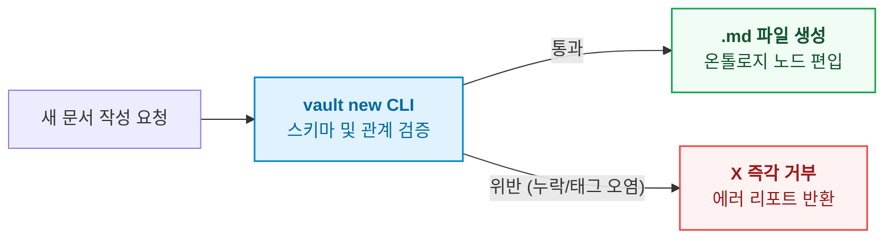
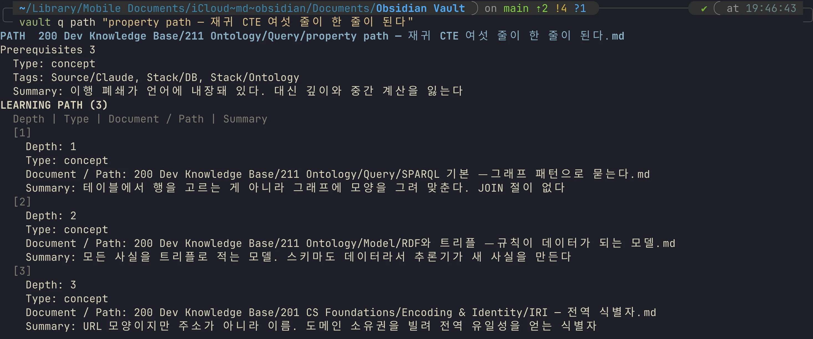
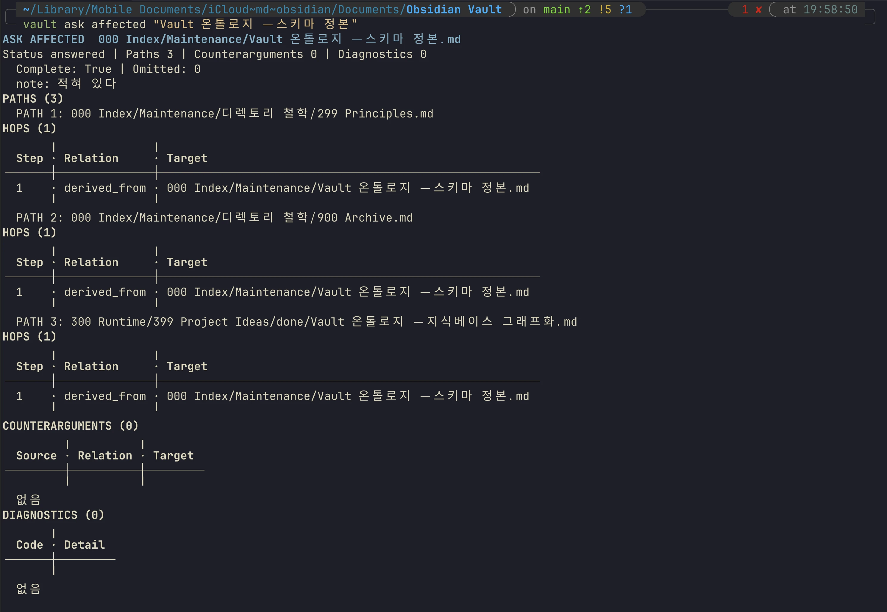

- table of contents
{:toc}

## 내가 만든 볼트에서 내가 길을 잃기 시작했을 때

지난 [AI OS 시리즈 1편](/tag-ai-agent-architecture/1-ground-rules/)에서 언급했듯이, 내 기록의 시작은 군대의 일기였다. 내가 느낀 것을 객관적인 말로 표현하는 일이 감정을 다스리는 데 발군이었고, 시간이 지나 읽었을 때 '그때 어떤 일을 겪고 어떻게 반응했구나'를 곱씹는 감회가 새로웠기 때문이다. 이 긍정적인 경험을 책, 영화, 게임 리뷰와 일상 메모로 확장하며 `Notion`과 `PARA` 필기법을 만족스럽게 사용해 왔다.

문제는 더 다양한 유형의 노트를 다루고자 `Obsidian`으로 옮기면서 부각되었다. 회사를 다니기 시작하자 매일 실무에서 포집해야 하는 개념들이 동적으로 쏟아졌고, `PARA`, `Zettelkasten`, `Atlas`, 도서분류체계, `Second Brain`의 철학을 흡수하며 볼트를 고도화할수록 구조는 비대해졌다. 가장 직관적인 난관은 폴더 분류와 태그의 중첩이었다. 예컨대 "FastAPI 동시성 제어"라는 노트는 `Python`인가, `Backend`인가, 아니면 `Architecture`인가? 디렉토리의 물리적 분리와 태그 분류를 중복 없이 가져가는 일도 쉽지 않았지만, 더 큰 문제는 **문서가 4,400개, 위키링크가 24,000개, 태그가 260여 종을 넘어가자 기획한 나조차 원하는 문서와 그들 사이의 맥락을 빠르게 찾기 어려워졌다**는 점이다.

특히 AI 에이전트를 이 볼트 안에서 활용할 때 `grep`으로 폴더만 뒤지는 것으로는 문맥의 선후 관계와 설계 근거를 전혀 구분하지 못하는 비효율을 체감했다. 그러다 [[1편] 온톨로지가 없는 AI는 현학적인 수다쟁이일 뿐이다](/tag-ontology-engineering/1-palantir-3rd-generation-platform/)에서 살펴본 온톨로지 개념을 접하면서, 볼트의 모든 문서를 정형 객체로 규정하는 돌파구를 찾게 되었다.

---

## 무엇을 기록하고 어떻게 연결할 것인가: 문서 유형 정의와 2계층 관계망

볼트에 온톨로지를 도입하며 세운 첫 번째 원칙은 **"이 메타데이터가 실제로 어떤 질문에 답하는가?"**였다. 수정 시각은 Git 이력에서, 소속 구역이나 보관 여부는 폴더 경로에서 바로 알 수 있으므로 문서 상단 메타데이터(frontmatter)에서 과감히 덜어냈다. 대신 문서의 겉모습이 아니라 **'어떤 상황에서 이 문서를 다시 찾는가'**를 기준으로 문서 유형(`type`)을 13가지로 정리했다.

- **원리와 해결책을 담은 기술·사례 노트 (4종)**: 개념과 원리를 설명하는 노트(concept), 그대로 따라 하면 재현되는 절차서(procedure), 명령어와 규격을 모아둔 참고 문서(reference), 그리고 실제 장애나 문제 해결 과정을 기록한 사례집(case)이다. 이 네 가지는 에이전트가 본문을 다 열지 않고도 탐색 여부를 바로 판단할 수 있도록 80자 이내의 한 줄 요약(`summary`)을 필수로 적게 했다.
- **원칙·의사결정·일상 기록 노트 (9종)**: 타협할 수 없는 개발 원칙(principle), 설계 결정과 대안 비교(decision·tradeoff), 프로젝트 문서와 목차·작업 일지(project-doc·hub·log), 외부 자료 스크랩과 리뷰·개인 성찰 노트(capture·review·reflection)다. 어디에도 속하지 않는다는 핑계로 쓰이는 '기타(etc)' 분류는 아예 만들지 않았다.

개별 문서의 역할을 정한 뒤에는 2만 4천 개에 달하는 위키링크의 모호함을 풀 차례였다. 본문 중간에 자유롭게 거는 일반 위키링크는 그대로 두되, 에이전트가 맥락을 따라갈 때 반드시 알아야 할 핵심 연결만 문서 상단에 명시하는 **<mark class="kw-term">2계층 관계망</mark>**을 도입했다. 첫 번째 층위는 이 문서를 이해하기 위해 먼저 읽어야 할 선행 개념을 가리키는 **`builds_on`**이고, 두 번째 층위는 한국어 문장으로 읽어보아 말이 될 때만 부여하는 **7가지 의미 관계**다.

- **출처와 영향 (`derived_from` · `informed_by`)**: "A는 B에서 나왔다"가 성립하는 직접적인 탄생 근거(예: 실서비스 DB 커넥션 고갈 사례에서 도출한 커넥션 풀 산정 원칙)와, 직접 근거는 아니지만 참고가 된 자료를 구분한다.
- **충돌과 변형 (`contradicts` · `diverges_from`)**: "A와 B는 동시에 참일 수 없다"처럼 서로 양립할 수 없는 설계 대안이나, "A는 B를 바탕으로 삼되 우리 환경에 맞게 일부를 바꿨다"는 변형 관계를 나타낸다.
- **적용과 답변 (`applies` · `expresses` · `answered_by`)**: 특정 원칙을 실전에 적용했거나, 추상적인 가치를 구체적인 도구로 구현했거나, 던져둔 질문이 특정 노트에서 실마리를 얻었을 때 연결한다.

스키마를 세운 뒤에는 그래프 저장소를 무엇으로 가져갈지 확인하기 위해, 4,400개 노트를 가벼운 `SQLite` 데이터베이스와 시맨틱 웹 표준인 `RDF/OWL` 방식으로 각각 구성해 비교해 보았다. 실제로 두 방식을 나란히 돌려보니 차이는 명확했다. OWL 추론기를 돌렸을 때는 데이터가 2만 7천여 개에서 7만 7천여 개로 불어나며 16.6초가 걸렸지만, 정작 **`SQLite` 재귀 쿼리(0.5ms 응답)로 찾을 수 없던 새로운 사실은 한 건도 나오지 않았다.** 웹 전체의 지식을 합치기 위해 '적혀 있지 않은 것은 아직 모르는 것'이라 여기는 OWL의 **<mark class="kw-term">열린 세계 가정(OWA)</mark>**은, 필수 항목 누락이나 깨진 링크를 곧바로 오류로 잡아내야 하는 개인 지식 베이스의 **<mark class="kw-term">닫힌 세계 가정(CWA)</mark>** 운영 목적과 맞지 않았기 때문이다.

결국 상시 운용과 빠른 경로 조회(`vault q path`)는 `SQLite`에 맡기고, 새 문서를 만들고 검사하는 과정은 `vault new`와 `vault lint`가 동일한 파이썬 검증 로직과 태그 화이트리스트(`vault tags`)를 공유하는 물리적 **<mark class="kw-term">생성 게이트(Creation Gate)</mark>**로 통제하며, 엄밀한 그래프 제약 검증이 필요할 때만 `SHACL`을 함께 쓰는 실용적인 구조로 정리했다.

[심화 근거: 13종 문서 타입·7종 의미 관계 및 SQLite authorizer 상세 계약 보러가기](/tag-ontology-engineering/deep-dive/vault-knowledge-compiler/#vault-schema-and-sqlite)

---

## 선언된 그래프 너머의 의미 연결: `vault-vector`(`vv`)와 4부작 작성 루프

`SQLite` 그래프는 이미 선언된 관계에 대해서는 0.5ms 만에 답을 내놓았지만, **"아직 아무런 링크도 걸려 있지 않지만 뜻이 맞닿아 있는 문서"**는 찾아낼 수 없었다. 이 사각지대를 메우기 위해 일기 등 민감 기록이 외부 API로 나가지 않도록 로컬 교차언어 임베딩 모델(`snowflake-arctic-embed-l-v2.0-ko`) 기반의 `vault-vector`(`vv`)를 구축했다. 4,201개 문서를 49,105개 청크로 쪼개어 해시 기반 증분 색인(`vv index`)을 구성하자, 새 문서를 만드는 과정은 **1부 배치(`vv place`) ➔ 2부 대조(`vv search --near`) ➔ 3부 생성(`vault new`) ➔ 4부 연결**의 4부작 루프로 진화했다.

특히 743개 하위 폴더 중 어디에 문서를 둘지 결정하는 `vv place`는 폴더 내 문서들의 평균 벡터를 대표 카드로 삼고 `--type` 필터를 결합해 Top-5 배치 정확도를 **83.4%**(대분류 99.5%)까지 끌어올렸다. 또한 문서를 생성하기 전에 `vv search --near`로 의미적 유사 후보와 그 후보의 `SQLite` 선언 이웃을 한 화면에서 먼저 대조함으로써, 기존 원칙과의 충돌이나 중복 생성을 파일 생성 전에 흡수할 수 있게 되었다. 개인 일기(`Track`/`Memo`/`Echo`)에서 에이전트 요약문(`Harvest`)을 배제하고 삶의 화두(`500 Mind Compiler`)와 대조하는 `vv weave` 역시 이 구조 위에서 탄생했다.

---

## 선언된 지식 그래프가 실제로 답하는 질문들: 단순 검색에서 맥락 추론으로

스키마 게이트(`vault new`)와 의미 검색(`vv`)을 거쳐 쌓인 지식 그래프가 진가를 발휘하는 순간은, 쌓여 있는 노트에 다시 질문을 던질 때다. 키워드 검색이나 폴더 트리 탐색만으로는 단어 몇 개가 겹치는 문서를 나열할 수 있을 뿐이지만, 명시적인 관계(`builds_on`, 7종 의미 관계)가 선언된 온톨로지 그래프 위에서는 **`vault q`와 `vault ask` 명령어 한 줄로 문서 사이의 선후 맥락과 파생 계보를 0.5ms 만에 추론**해 낼 수 있다.

### 1. 선행 학습 경로와 주변 맥락의 즉각적인 역추적 (`vault q path` · `vault q near`)

새로운 기술 주제를 복기하거나 AI 에이전트에게 특정 설계 문서의 배경지식을 주입해야 할 때, 더 이상 볼트 안을 헤매며 관련 문서를 하나씩 열어볼 필요가 없다. `vault q path`에 대상 노트 제목을 넘기면 `builds_on` 사슬을 재귀적으로 따라가며 **"이 문서를 온전히 이해하기 위해 먼저 읽어야 할 선행 개념(`LEARNING PATH`)"**을 각 노트의 역할(`Type`)과 한 줄 요약(`Summary`)까지 묶어 차례대로 뽑아낸다. 이어서 `vault q near`를 실행하면 해당 문서가 인용하는 노트, 이 문서를 참조하는 노트, 그리고 같은 태그를 공유하는 이웃 문서들이 역할별로 정돈되어 나타난다.

{:width="760" loading="lazy"}

`vault q path` 실행 화면. `property path` 문서를 이해하기 위한 3단계 선행 개념(`SPARQL 기본` ➔ `RDF와 트리플` ➔ `IRI`)과 각 문서의 핵심 요약(`Summary`)이 0.5ms 만에 출력된다.
{:.figcaption}

### 2. 지식의 파생 영향도와 영역 간 연결 고리 추적 (`vault ask`)

단순한 문서 찾기를 넘어 내가 가장 자주 쓰는 기능은 **지식의 출처와 파생 영향도를 검증 상태와 함께 추적하는 의미 질의(`vault ask`)**다. 예를 들어 핵심 스키마나 원칙 문서를 수정하기 전에 `vault ask affected`를 실행하면, 어떤 디렉토리 철학이나 아키텍처 문서들이 이 정본에서 파생(`derived_from`)되었는지 경로(`PATHS`)는 물론, 상충하는 반론(`COUNTERARGUMENTS`)이나 미해결 진단(`DIAGNOSTICS`)이 없는지까지 구조화된 응답 봉투(`Status answered · Complete: True`)로 한눈에 확인할 수 있다.

나아가 `vault ask together`와 `vault ask crossing`을 실행하면 과거에 읽었던 한 권의 책에서 어떤 개발 원칙(`299 Principles`)과 내면 성찰 노트(`100 Private Log`)들이 동시에 뻗어나갔는지, 혹은 내가 던진 삶의 질문(`500 Mind Compiler`)이 실제 아키텍처 플레이북(`400 Logic Forge`)의 의사결정과 어떻게 맞닿아 있는지 영역을 가로지르는 다리를 즉시 확인할 수 있다.

{:width="760" loading="lazy"}

`vault ask affected` 실행 화면. 스키마 정본에서 파생(`derived_from`)된 문서들의 영향 경로와 반론(`Counterarguments`)·진단(`Diagnostics`) 여부가 함께 출력된다.
{:.figcaption}

### 도구의 자기 검증과 과거 노트 부채를 구분하는 기준

물론 이렇게 그래프 질의 도구를 만들었다고 해서 볼트 안의 모든 노트가 완벽해지는 것은 아니다. 이 도구가 조용히 잘못된 답을 내놓거나 파일 경로를 오판하지 않도록 두 에이전트(`Codex`·`Gemini`)를 교차 투입해 19건의 운영 경계 반례를 잡아내고 523건의 회귀 테스트를 통과시키기도 하였다.

하지만 **"도구가 정상 작동하도록 고친 것"과 "그 도구가 다루는 기존 노트들의 문서 부채가 해결된 것"은 철저히 구분**했다. 온톨로지 도입 이전에 작성된 옛 노트들의 미해결 링크나 요약 누락(919건)은 파일 해시 기반의 베이스라인으로 격리해 두되, 오늘부터 새로 만들거나 수정하는 모든 노트에는 타협 없는 생성·검증 게이트를 적용해 볼트가 시간이 흐를수록 스스로 정화되도록 설계했다.

[심화 근거: Vault 적대적 검수 19개 반례 전수 표 및 SQLite·SHACL 이중 검증 규격 보러가기](/tag-ontology-engineering/deep-dive/vault-knowledge-compiler/#vault-v011-audit)

---

## 개인 지식 온톨로지에서 코드 레포지토리 온톨로지로

`Obsidian Vault`에 온톨로지 개념을 안착시키는 과정에서, 나는 문득 **'이 개념을 실제 코드가 돌아가는 레포지토리(`Repository`)에도 동일하게 적용할 수 있지 않을까?'**라는 생각을 하게 되었다([AI OS 시리즈 6편](/tag-ai-agent-architecture/6-repo-governance/), [7편](/tag-ai-agent-architecture/7-rule-pruning/)).

이어지는 **[[3편] 문서는 명사로 정리되지만 코드는 동사로 움직인다](/tag-ontology-engineering/3-nouns-to-verbs-paradigm-shift/)**에서는 정적 지식 분류의 성취에 머물러 있던 시야를 넓혀준 팔란티어 키노트의 통찰과, 마크다운 문서(명사)에서 소스 코드의 상태 전이 명세(동사)로 온톨로지의 무게중심을 옮기게 된 과정을 다룬다.
