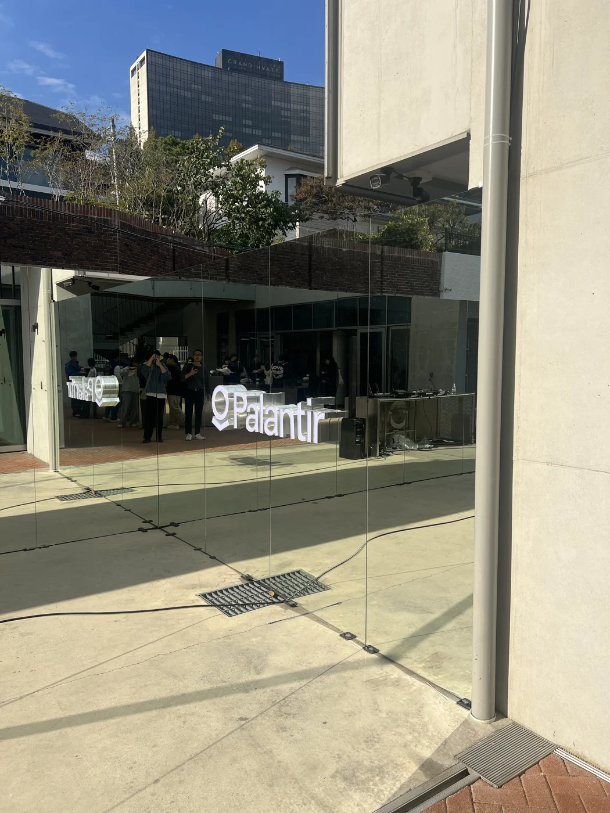
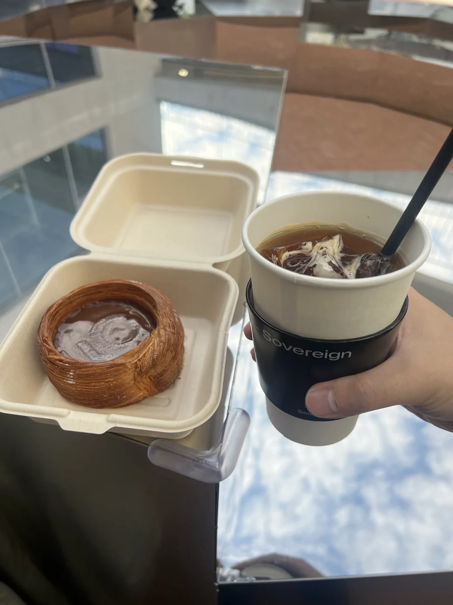
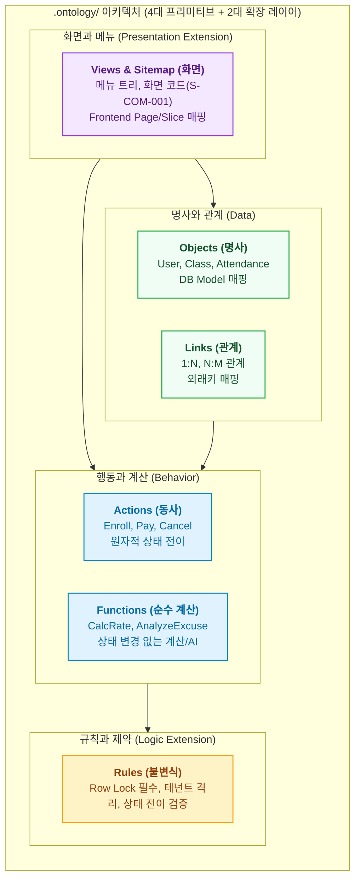
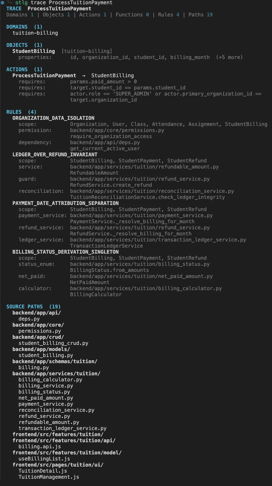

- table of contents
{:toc}

지난 [[2편] 개인 지식 베이스에 온톨로지를 심다: 스키마 설계부터 도구의 자기 검증까지](/tag-ontology-engineering/2-vault-knowledge-ontology/) 말미에서 언급했듯, `Obsidian Vault`의 온톨로지 개념을 코드 레포지토리에 이식하면 에이전트 협업을 훨씬 효율적으로 운용할 수 있지 않을까 고민하게 되었다. 이번 글에서는 정적 지식 온톨로지 너머의 '실행형 온톨로지'를 마주한 계기와, 팔란티어의 핵심 프리미티브를 코드 `Repository` 규격(`.ontology/`)과 전역 CLI(`otlg`)로 재설계해 이식한 과정을 다룬다.

---

## 볼트 온톨로지를 완성하고 빠졌던 착각, "이게 온톨로지의 전부 아니었어?"

옵시디언의 모든 문서에 13개의 엄격한 `type`을 부여하고, `builds_on`과 7가지 의미 관계로 지식 계보를 엮은 뒤 `vault new`와 `vault lint` 검증까지 통과시켰을 때만 해도 큰 성취감에 취해 있었다. `Obsidian Vault` 안에서 그 구현은 지식의 고립과 파편화를 완벽히 잡아주었기 때문이다. 다만 문제는 '볼트의 구현 수준'이 아니라 **'온톨로지라는 개념의 전체 외연에 대한 내 이해의 폭'**이었다.

문득 기묘한 의문이 들었다. **'내 볼트가 쾌적해진 건 맞는데, 왜 세상 사람들은 `Palantir`와 온톨로지가 기업 전체의 운명을 바꿀 것처럼 호들갑이지?'** 볼트 검색이 0.5ms 만에 끝나고 분류가 깔끔해졌다 한들, 그것만으로 수조 원짜리 엔터프라이즈 시장의 패러다임을 바꾼다고 하기엔 결정적인 고리가 빠져 있었다. 집요하게 살펴보니 내가 볼트에 구현한 것은 '지식 분류와 계보(Taxonomy & Knowledge Graph)' 영역이었고, `Palantir`가 구축한 운영 온톨로지(`Operational Ontology`)에는 아직 내가 보지 못했던 또 다른 차원이 존재했다.

{:width="520" loading="lazy"}

{:width="520" loading="lazy"}

최근 온톨로지와 팔란티어에 한창 빠져 있다 보니 서울에서 열린 팔란티어 팝업스토어도 다녀왔다(2026.10.25). 내가 가지고 있던 관념과 같이, 분위기적으로 개발자가 아닌 분들도 많이 계셨다. 초콜릿 타르트와 커피가 매우 맛있었다.
{:.figcaption}

---

## 데이터 조회에서 실제 행동으로, 팔란티어 키노트가 보여준 다음 차원

그 격차를 선명하게 일깨워 준 계기가 2026 스타트업 페스티벌 'Try Everything'의 `Palantir` 엔지니어 Alex와 Rosa 키노트였다. 두 엔지니어는 *"We hate slides. We truly hate slides."*라고 이야기하며, 그날 아침 빌드업한 라이브 프로덕션 환경에서 기업의 공급망 데이터를 실시간으로 조작해 보였다.

수만 개의 레거시 데이터셋이 온톨로지 객체(`Plant`, `Shipment`, `Order`)로 정제되어 워크플로우의 중심축(Ultimate Backbone)으로 작동하는 모습도 인상적이었지만, 내 머리를 망치로 맞은 듯 울렸던 대목은 대시보드를 정의하는 방식이었다.

> *"이미 알고 있는 데이터를 예쁘게 모아서 보여주는 대시보드는 우리에게 무의미합니다(meaningless). 진정한 가치는 데이터를 보고 즉각적인 신호를 보내며, 그 자리에서 **실제 행동(Action)**을 취해 시스템의 상태를 바꾸는 데 있습니다."*

그 순간 머릿속 퍼즐이 맞춰졌다. 내가 볼트에 세운 온톨로지는 기록과 학습 문서를 다루는 **'정교한 도서관 분류표(Taxonomy)이자 지식 지도'**였다. 하지만 이 철학을 살아 움직이는 **프로덕션 코드 레포지토리(`Repository`)**로 확장하려면, 문서 분류 방식을 베껴올 것이 아니라 무엇을 바꾸고 어떤 제약을 강제할지 다루는 **실행형 온톨로지(Actionable Ontology)** 관점을 새로 도입해야만 했다.

바로 이 지점에서 온톨로지를 바라보는 내 시야에 결정적인 **발상의 전환**이 일어났다. 처음 `Vault Ontology`를 만들 때만 해도 나는 온톨로지를 '흩어진 마크다운 노트를 깔끔하게 정리하는 방법론' 정도로 생각하고 있었다. 그런데 볼트에 스키마와 관계 규칙을 세워 에이전트의 행동을 통제해 보고, 이어서 팔란티어의 운영 온톨로지 철학까지 접하고 나니 깨달은 바가 있었다. **"잠깐, 온톨로지는 단순한 문서 분류법이 아니라 AI 시대에 온갖 복잡한 대상을 메타적으로 관리하고 통제하기에 더할 나위 없이 완벽한 아키텍처잖아? 그렇다면 노트에만 적용할 게 아니라, 내가 다루는 코드와 시스템, 나아가 취미와 연구 영역까지 적절한 곳마다 각 도메인의 성격에 맞춰 다각도로 적용해 보자!"**라는 확신이 선 것이다. 한 번 온톨로지라는 렌즈를 장착하고 나니, 서로 무관해 보였던 문제들이 모두 '도메인의 개념과 불변식을 기계가 읽을 수 있는 그래프로 추상화하는 과제'로 새롭게 보이기 시작했다.

---

## 왜 ERD와 문서만으로는 부족할까? 명사가 아닌 동사를 잡아야 하는 이유

엔지니어링 현장의 시각으로 온톨로지를 확장해 바라보자, 볼트와 코드 레포지토리의 온톨로지가 왜 다르게 설계되어야 하는지 본질이 명확해졌다.

| 비교 항목 | 개인 지식 온톨로지 (`Vault OS`) | 코드 도메인 온톨로지 (`Repo Ontology`) |
| :--- | :--- | :--- |
| **도메인 대상** | 생각, 학습, 의사결정 기록 (`Markdown`) | 소프트웨어 시스템, DB 제약, API, 소스 코드 |
| **주된 관심사** | **명사 (Taxonomy, 개념 분류와 계보)** | **동사 (Action & State Transition, 상태 전이)** |
| **핵심 질문** | "이 주장은 참인가, 선행 개념은 무엇인가?" | "이 행동을 실행하려면 어떤 조건이 먼저 충족되어야 하고, 어떤 상태가 바뀌는가?" |
| **오류의 대가** | 지식의 고립, 검색 비효율 | 멀티 테넌트 데이터 유출, 동시성 충돌, 프로덕션 장애 |
| **최종 산출물** | 읽기 쉬운 정본 마크다운 문서 | 결함 없고 회귀 없는 실행 가능한 코드 |

당시 내가 홀로 운영하던 B2B 학원 통합 관리 SaaS는 58개 화면과 `FastAPI`, `React`, `Flutter`가 얽힌 약 39만 줄 규모의 코드베이스였다. 앞서 **[AI Agent OS [6편] 에이전트가 기억상실증입니다만, 문제라도?](/tag-ai-agent-architecture/6-repo-governance/)**에서 118종의 수기 기능 명세서(`docs/features/`)와 관리 문서 4종을 세워 에이전트의 기억상실증을 일차적으로 잡아두었지만, 코드베이스가 39만 줄까지 불어나자 수기 마크다운 명세만으로는 한계가 찾아왔다. 흔히 ERD나 ORM 정의서, 기능별 파일 경로 목록만 있으면 도메인을 다 파악할 수 있다고 생각하지만, 테이블과 파일 목록은 정적인 뼈대, 즉 **'명사'**일 뿐이기 때문이다.

실제 프로덕션 장애가 터지는 지점은 언제나 **'동사(상태 변경)'**에 있었다. "과제 제출물을 채점한다(`GradeSubmission`)", "폐강 시 수납 상태를 전이한다" 같은 행위가 일어날 때 어떤 권한(`role:instructor`)과 사전 상태(`SUBMITTED`)를 검증해야 하는지, 동시 요청 시 어느 행을 잠가야(`SELECT FOR UPDATE`) 하는지 같은 불변식은 ERD 어디에도 적혀 있지 않았다. 매 세션 기억이 초기화된 에이전트가 테이블 구조(명사)만 보고 코드를 고치다가 비즈니스 불변식(동사)을 깨뜨리는 것은 당연한 귀결이었다.

---

## 과장 없는 아키텍처 정의를 위한 에이전트 교차 검증

초안 설계는 `Antigravity`와 진행했지만, 제3의 시선인 `Codex`에게 로컬 구현체를 넘겨 팔란티어 기준에서 냉정하게 뜯어보도록 교차 검증을 거쳤다.

| 분석 축 | `Antigravity` 관점 | `Codex` 관점 | 최종 수용한 엔지니어링 판정 |
| :--- | :--- | :--- | :--- |
| **온톨로지 명칭의 정당성** | 정당함 (지식 및 코드 도메인 온톨로지) | 정당함 (도메인 명세와 관계 모델 근거 충분) | **O (공통 승인)**: 두 시스템 모두 온톨로지 개념을 정당하게 구현함 |
| **`Vault Ontology` 판정** | 지식 거버넌스 2.5단계 (Data + Logic) | 개인 지식 온톨로지 (`vault new` 생성 게이트 포함) | **O (일치)**: 지식 산출물 대상의 스키마 및 생성 거버넌스 |
| **`Repo Ontology` 판정** | AIP 실행형 3단계 완전 도달 | 코드에 연결된 도메인 온톨로지 명세 (런타임 실행 엔진 아님) | **시각 보정**: 런타임 트랜잭션 엔진과 SDLC 접지 명세의 엄격한 분리 |

`Codex`의 지적은 날카로웠다. 팔란티어의 `Action Layer`는 현업에서 ERP나 DB 트랜잭션을 직접 일으키는 **'런타임 실행 엔진'**인 반면, 내 시스템은 SDLC에서 코딩 에이전트가 코드를 수정하기 전에 읽고 준수해야 할 비즈니스 동사와 불변식, 소스 코드 위치를 1:1로 묶어주는 **'코드에 연결된 도메인 온톨로지 명세(Code-bound Domain Ontology Specification)'**라는 것이었다.

나는 이를 수용해 과장된 포장 대신 **"팔란티어 온톨로지의 4대 핵심(`Objects`, `Links`, `Actions`, `Invariants`) 철학을 SDLC에 이식해 코딩 에이전트의 코드 파괴를 막는 하네스"**로 정체성을 확립했다. (이때 남은 '런타임 `Kinetic / Action Layer`'에 대한 갈증은 이후 [[6편] 주사위는 거짓말을 하지 않는다, TRPG에서 비로소 도달한 진짜 Action Layer](/tag-ontology-engineering/6-trpg-kinetic-action-layer/)에서 결실을 맺는다.)

---

## `.ontology/` 6대 구성요소 설계와 `otlg` CLI 기반 맥락 주입

새 세션이나 `git worktree`를 열 때마다 에이전트가 `grep`으로 수만 토큰을 허비하고 행 잠금이나 테넌트 격리를 빼먹는 사고를 끊어내기 위해, 프로젝트 루트 `.ontology/` 아래에 6대 프리미티브를 세웠다.

팔란티어의 4대 핵심인 **`Objects`(명사)**, **`Links`(관계)**, **`Actions`(원자적 상태 전이 동사와 사전조건)**, **`Functions`(순수 계산 및 AI 추론)**에 더해, 전역 가드레일을 강제하는 **`Rules`(행 잠금·테넌트 격리 불변식)**와 기획서 화면 코드·메뉴 트리(`sitemap.yml`)·프론트엔드 라우트를 엮는 **`Views`(화면 매핑)** 두 가지 로컬 확장 레이어를 결합했다. 각 명세는 `code_binding`을 통해 백엔드 서비스·API·프론트엔드 피처·모바일 뷰모델의 실제 파일 경로 및 심볼과 1:1로 결속된다.

{:width="700" loading="lazy"}

명령어 한 줄(`otlg trace`)로 관련 도메인 객체와 사전 조건, 필수 규칙, 19개 소스 파일 경로를 0.01초 만에 찾아낸 터미널 화면.
{:.figcaption}

이 그래프 위에서 돌아가는 `otlg` CLI 명령어 세 가지는 에이전트가 작업을 시작하는 방식을 완전히 바꾸어 놓았다.

- **`otlg trace`**: 아무 맥락이 없는 새 에이전트에게 관련 도메인 객체와 사전 조건, 반드시 지켜야 할 전역 규칙(기관별 데이터 격리, 초과 환불 금지 등), 그리고 수정해야 할 백엔드·프론트엔드 파일 경로를 **0.01초** 만에 찾아준다. 이때 거의 모든 기능에 공통으로 묶여 있는 '사용자(`User`)' 객체를 타고 상관없는 도메인 파일까지 줄줄이 딸려 나오는 일을 막기 위해, 검색어와 직접 연결된 핵심 객체에서 딱 한 단계(1-hop)까지만 따라가도록 탐색 범위를 제한했다.
- **`otlg translate` & `otlg intake`**: 고객사가 *"관리자 > 데이터관리 > 수업데이터관리 > 출석체크 화면이 안 돼요"*라고 문의하거나 요구사항이 적힌 엑셀 파일(`.xlsx`)을 보내올 때 쓰는 명령어다. '관리자'나 '데이터관리'처럼 어디에나 들어가는 흔한 메뉴 단어는 빼고 실제 기능 키워드를 기준으로 연결된 화면과 백엔드 코드 위치를 바로 찾아주며(`translate`), 엑셀의 각 요구사항이 어느 화면(`View`)과 동작(`Action`)에 해당하는지 자동으로 연결(`intake`)해 준다.

[심화 근거: .ontology/ 6대 프리미티브 YAML 스키마와 otlg trace·translate·intake 상세 계약 보러가기](/tag-ontology-engineering/deep-dive/repo-graph-contracts/#primitive-contracts)

---

## 문서와 코드가 따로 놀지 않게 막는 AST 검증과 도메인 점검

온톨로지 명세를 만들 때 가장 경계해야 할 문제는 코드는 계속 바뀌는데 명세서만 옛날 상태로 남는 것이다. 이를 막기 위해 `otlg lint --strict`는 YAML 문법이나 이름 오타만 검사하는 데 그치지 않고, 6대 구성요소에 적어둔 파일 경로와 클래스·함수 이름이 실제 코드에 존재하는지 끝까지 확인한다.

특히 파이썬 함수나 메서드가 실제로 존재하는지 확인할 때는 단순 글자 검색(`in`) 대신 **파이썬 `AST(구문 트리)` 분석기**를 쓴다. 파일 안에 같은 글자가 있는지만 검사하면 주석에 적힌 이름이나 다른 클래스에 있는 똑같은 이름의 메서드에 속아 넘어가기 쉽고, 반대로 검사하려고 코드를 직접 불러오면(`import`) DB 연결 같은 실행 코드가 돌아가 버리기 때문이다. `otlg`는 코드를 한 줄도 실행하지 않은 채 구문 트리만 읽어서 해당 클래스 안에 실제로 그 메서드가 정의되어 있는지 확인하고, 확실히 깨진 경로(`ERROR`)와 정적 분석만으로 알 수 없는 타 언어 심볼(`WARNING`)을 구분해 알려준다.

여기에 더해 에이전트 교차 검수로 **'문법은 맞지만 도메인 의미가 잘못 연결된 곳'**도 함께 바로잡았다. 예를 들어 학원 자체 모의시험을 관리하는 화면이 학교 내신 성적을 다루는 객체에 잘못 연결되어 있던 것을 실제 사용하는 학급(`Class`) 객체로 고치고, 아직 온톨로지로 정의하지 않은 모델은 억지로 끼워 맞추는 대신 '미등록 상태'로 솔직하게 비워 두었다.

하지만 파일과 함수가 제자리에 있다는 것을 확인하는 것만으로는 여전히 풀리지 않는 숙제가 남아 있었다. 코드 내부의 `import` 방향이 아키텍처 계층 규칙을 어기고 있지는 않은지, 그리고 온톨로지에 적어둔 비즈니스 규칙이 실제 `TDD` 테스트 코드로 검증되었는지를 어떻게 확인할 것인가? 이어지는 **[[4편] 오픈소스와 논문에서 찾은 해답: 도메인·아키텍처·TDD를 하나로 묶는 코드 온톨로지](/tag-ontology-engineering/4-three-graphs-and-tdd-contract-v030/)**에서는 도메인 의미와 아키텍처 구조, 테스트 실행 증거를 하나로 묶어낸 `3-Graph` 컴파일러 이야기를 다룬다.

[심화 근거: AST 심볼 바인딩 검증기와 Bounded Trace·도메인 오매핑 교정 상세 내역 보러가기](/tag-ontology-engineering/deep-dive/repo-graph-contracts/#ast-audit)
