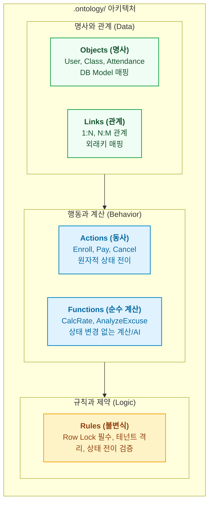

- table of contents
{:toc}

> 데이터베이스 ERD는 시스템의 명사(테이블)만 보여줄 뿐, 비즈니스가 어떻게 살아 숨 쉬는지(동사와 불변식)를 설명하지 못한다.
> 팔란티어(`Palantir Foundry`)의 핵심 프리미티브인 `Objects`, `Links`, `Actions`, `Functions`를 소프트웨어 저장소 규격으로 이식하고, 풀스택 코드를 1:1로 결합해 낸 아키텍처.
> 기억상실증에 걸린 AI 에이전트에게 `otlg trace` 단 한 방으로 0.01초 만에 코드 경로와 사전 불변식을 주입하는 실전 메커니즘을 해부한다.
{:.lead}

---

## 기억상실증 에이전트와 매일 아침의 냉기 (Cold Start의 비극)

당연히 AI를 통해 프로젝트에서 작업할 때 대부분의 경우 하루 일과를 끝마쳐도 세션은 끄지 않기 때문에 바로 이어서 진행할 수 있다. 그럼에도 불구하고 간헐적으로 이슈가 생겨서 꺼지는 경우도 존재한다(최근에는 `resume` 기능으로 이런 부분이 많이 완화되었지만 `AI Agent` 초기에만 해도 그런 기능이 없었다). 또, `AI Agent`의 기억력은 유한하기 때문에 작업이 이어짐에 있어서 기존의 것을 다시 찾아봐야 한다거나 하는 소요가 있는 경우가 빈번하다.

이런 부분에 항상 애로사항을 느끼고 있었는데, `Obsidian Vault`에 온톨로지를 도입하면서 `Repository`에도 적절히 도입해 볼 수 있지 않을까라는 생각을 하게 되었다. 특히 지난 [[3편] 문서는 명사로 정리되지만 코드는 동사로 움직인다](/tag-ontology-engineering/3-nouns-to-verbs-paradigm-shift/)에서 살펴보았듯, 병렬 개발을 위해 새로운 세션이나 격리된 `git worktree`를 열 때마다 에이전트가 과거의 모든 맥락을 잊어버린 채 완전한 백지상태로 투입된다는 점은 1인 개발자인 나에게 가장 큰 병목이었다. 에이전트에게 "이 프로젝트의 수납 취소 로직을 수정해 줘"라고 한마디를 건네면, 그때부터 에이전트는 프로젝트 구조를 파악하느라 `grep`과 `find`를 남발하며 수십 개의 모델과 라우터 파일을 열고 닫기를 반복했고, 정작 본 작업에 들어가기도 전에 세션 초반의 귀중한 컨텍스트 윈도우와 수만 토큰을 단순 탐색에 허비하곤 했다.

더 치명적인 문제는 그렇게 긴 탐색 끝에 코드를 수정하더라도, 도메인 곳곳에 숨어 있는 핵심 불변식(Invariants)을 가장 먼저 놓친다는 점이었다. 방대한 파일 트리를 헤매느라 지친 에이전트는 눈앞의 기능 요구사항을 구현하는 데 급급한 나머지, 동시성 제어를 위한 행 잠금(`SELECT ... FOR UPDATE`)을 누락해 이중 취소 버그를 유발하거나 멀티테넌트 격리(`tenant_id`) 조건을 빼먹어 타 기관의 데이터를 침범하는 식의 아찔한 사고를 내기 일쑤였다. 심지어 `PENDING` 상태에서만 전이가 허용되어야 한다는 도메인 상태 머신의 규칙조차 기존 코드에서 일일이 찾아내지 못해 무시해 버리는 일이 반복되었다.

이 소모적인 탐색 루프를 끊어내기 위해 나는 에이전트에게 매번 장황한 자연어 프롬프트로 주의사항을 당부하는 대신, 팔란티어의 온톨로지 스키마를 코드 레포지토리 내부에 직접 이식하여 기계가 즉시 읽고 따를 수 있는 **'코드에 연결된 도메인 온톨로지 명세'**를 세우기로 했다. 그렇게 어떤 프로젝트 루트에든 일관되게 이식할 수 있는 `.ontology/` 표준 디렉터리 템플릿과, 이를 파싱하여 에이전트와 코드베이스를 이어주는 전역 CLI 도구인 `otlg`(`repo-ontology`)를 직접 구축하게 되었다.

---

## 4대 프리미티브: 명사, 관계, 동사, 그리고 계산

레포지토리 안에 온톨로지를 세우기 위해 가장 먼저 한 일은 팔란티어 `Foundry`와 `AIP`가 엔터프라이즈 세계를 모델링할 때 사용하는 4대 핵심 프리미티브(`Objects`, `Links`, `Actions`, `Functions`)에 시스템 전역 제약(`Rules`)을 더해 소프트웨어 아키텍처의 언어로 재정의하는 작업이었다. 기존에 작성하던 정적인 마크다운 기능 명세서들은 데이터 구조와 비즈니스 로직이 자연어 문장 속에 뒤섞여 있어 기계가 파싱할 수 없었지만, 이 다섯 가지 구성 요소를 `.ontology/` 디렉터리 하위 스키마로 명확히 분리하자 복잡한 에듀테크 B2B SaaS 도메인이 정교한 부품처럼 맞물리기 시작했다.

| 프리미티브 | 엔터프라이즈 운영에서의 의미 | 코드 레포지토리(`.ontology/`) 이식 정의 |
| :--- | :--- | :--- |
| **`Objects` (명사)** | 현실 세계의 비즈니스 실체 | 도메인 엔티티(`User`, `Course`, `Attendance`)와 DB 모델 매핑. 단순 기술적 컬럼 나열이 아니라 비즈니스 의미 속성과 상태 값의 범위를 노출 |
| **`Links` (관계)** | 실체 간의 의미론적 연결 | 객체 간의 연관 관계(`1:1`, `1:N`, `N:M`) 및 외래키, ORM 관계 정의 |
| **`Actions` (동사)** | 시스템 상태를 바꾸는 원자적 트랜잭션 | 시스템 상태를 변경하는 유일한 관문(`Enroll`, `Pay`, `Cancel`, `Grade`). 입출력 파라미터, 사전 불변식(`preconditions`), 상태 전이 효과를 명세 |
| **`Functions` (순수 계산)** | 상태 변경 없는 연산 및 AI 추론 | DB 상태를 직접 바꾸지 않는 순수 비즈니스 계산(출석률 산출, 성적 백분위 계산) 및 도메인 객체를 입력받는 결정론적 AI 분석 파이프라인 |
| **`Rules` (전역 불변식)** | 전사 보안 및 컴플라이언스 정책 | 도메인 전반에 걸쳐 강제되는 보안, 멀티테넌트 데이터 격리, 동시성 행 잠금 등 시스템 전역 불변 규칙 |

이러한 구조적 분리에서 내가 특히 공을 들인 부분은 시스템의 상태를 직접 바꾸는 동사인 `Actions`와, 상태를 바꾸지 않고 값만 도출하는 `Functions`를 엄격히 갈라놓은 점이다. 예컨대 학생의 출석률을 계산하거나 제출된 결석 사유서를 LLM으로 분석해 공결 여부를 추천하는 행위는 부수 효과(Side Effect)가 없는 `Functions`에 속하지만, 강사가 그 추천을 바탕으로 실제 출석 상태를 변경하거나 과제 점수를 매기는 행위는 DB 트랜잭션과 이벤트 발행을 동반하는 `Actions`에 속한다. 이 경계를 스키마 차원에서 명확히 그어둔 덕분에, 코딩 에이전트는 자신이 수정해야 할 로직이 단순 조회·연산 파이프라인인지 아니면 행 잠금과 권한 검증이 필수적으로 요구되는 상태 변이 트랜잭션인지를 작업 착수 전에 단번에 식별할 수 있게 되었다.



위 다이어그램이 보여주듯, `Objects`와 `Links`가 도메인의 정적인 뼈대(Data)를 이루면 그 위에서 `Actions`와 `Functions`가 비즈니스 행위(Behavior)를 정의하고, 가장 아래에서 `Rules`가 모든 행위가 반드시 지켜야 할 불변의 제약(Logic)을 떠받치는 구조다. 명사와 동사, 그리고 규칙이 하나의 유기적인 그래프로 엮이면서 비로소 코드베이스 전체의 비즈니스 맥락을 기계가 탐색할 수 있는 토대가 마련된 셈이다.

---

## 실전 명세 스펙: 에듀테크 SaaS 예시 (`grade-submission.yml`)

그렇다면 이 개념적 모델이 실제 프로젝트 파일시스템 안에서는 어떻게 구현되어 있을까. 내가 운영하던 에듀테크 B2B SaaS의 과제 채점 유즈케이스를 정의한 `.ontology/actions/grade-submission.yml` 명세를 보면, 이 파일이 사람만 읽고 끝나는 자연어 문서가 아니라 정적 린터와 CLI가 직접 파싱하는 엄격한 **'기계 가독형 계약서(Machine-readable Contract)'**라는 사실을 확인할 수 있다.

```yaml
action: GradeSubmission
domain: education
description: 강사가 학생의 과제 제출물을 검토하고 점수와 피드백을 부여한다.

actor:
  type: Instructor
  permission: "role:instructor"

target:
  object: AssignmentSubmission
  lookup: "id"

parameters:
  score: { type: integer, range: [0, 100], required: true }
  feedback: { type: text, max_length: 2000, required: false }

preconditions:
  - rule: "제출 완료 또는 재제출 상태의 과제만 채점할 수 있다"
    expression: "target.status in ['SUBMITTED', 'RESUBMITTED']"
  - rule: "해당 코스의 담당 강사 본인이어야 한다"
    expression: "actor.id == target.course.instructor_id"
  - rule: "동시 채점 방지를 위한 행 잠금 필수"
    expression: "requires_row_lock(target.id)"

effects:
  mutate:
    target.status: "GRADED"
    target.score: "params.score"
    target.feedback: "params.feedback"
  events:
    - name: "ASSIGNMENT_GRADED_EVENT"
      channel: "push_notification"

code_binding:
  backend:
    service: "backend/app/services/assignment_service.py:AssignmentService.grade"
    api: "POST /api/v1/courses/{course_id}/submissions/{submission_id}/grade"
  frontend:
    feature: "frontend/src/features/grading"
  mobile:
    viewmodel: "mobile/lib/features/assignment/viewmodels/grading_viewmodel.dart"

governance:
  feature_id: "F52"
  adr: "docs/adr/0008-course-grading-policy.md"
```

이 짧은 `YAML` 파일 하나에는 코딩 에이전트가 해당 기능을 안전하게 수정하기 위해 알아야 할 모든 도메인 지식과 물리적 좌표가 압축되어 있다. 상단의 `action`, `actor`, `target`은 이 행위가 `Instructor` 권한을 가진 주체가 `AssignmentSubmission`이라는 도메인 명사의 상태를 변경하는 `GradeSubmission` 동사임을 선언하며, `parameters`는 입력값의 타입과 허용 범위(`0`에서 `100` 사이)를 명시한다. 이어지는 `preconditions`와 `effects` 블록은 이 명세의 핵심으로, 채점 로직이 실행되기 전에 반드시 검증해야 할 세 가지 사전 불변식(제출 상태 확인, 담당 강사 권한 확인, 동시 채점 방지를 위한 행 잠금 필수 선언)과 실행 후 변경되는 상태 및 부수 효과를 명확히 못 박아 두었다.

나아가 하단의 `code_binding`과 `governance` 블록은 추상적인 비즈니스 명세를 실제 풀스택 소스 코드 및 아키텍처 의사결정 기록(`ADR`)과 1:1로 결속하는 접착제 역할을 수행한다. `FastAPI` 백엔드의 라우터 엔드포인트와 서비스 메서드(`AssignmentService.grade`), `React` 프론트엔드의 피처 슬라이스, 그리고 `Flutter` 모바일 앱의 뷰모델 파일 경로까지 하나의 액션 아래에 정교하게 바인딩되어 있다. 덕분에 에이전트는 이 명세 파일 하나를 읽는 것만으로도 자신이 지켜야 할 비즈니스 가드레일과 백엔드·프론트엔드·모바일에 걸쳐 수정해야 할 정확한 타깃 지점을 한눈에 파악할 수 있다.

---

## `otlg trace`와 `translate`·`intake`: 0.01초 만에 뇌를 복원하는 기적

명세를 아무리 치밀하게 작성해 두었더라도, 에이전트가 이를 활용하는 과정이 번거롭다면 실무에서는 결국 외면받기 마련이다. 그래서 나는 새로운 세션에서 방금 깨어난 백지상태의 에이전트에게 수만 자에 달하는 프로젝트 배경 설명 프롬프트를 주입하는 대신, 중앙의 Hub 에이전트가 Spoke 에이전트에게 단 한 줄의 터미널 명령어(`$ otlg trace <Query>`)만 건네주면 모든 맥락 인출이 끝나도록 작업 착수 루프를 근본적으로 뜯어고쳤다.

{:width="700" loading="lazy"}

단 한 줄의 CLI 명령(`otlg trace`)으로 도메인 객체, 액션 선행조건, 4대 불변식 룰, 19개 소스 파일 경로를 0.01초 만에 인출한 실제 터미널 구동 화면.
{:.figcaption}

위 스크린샷은 실제 운영 중인 에듀테크 B2B SaaS의 결제 및 정산 도메인에서 `otlg trace` 명령을 실행했을 때 **0.01초** 만에 터미널에 쏟아져 나오는 실측 결과다. 에이전트는 전체 코드베이스를 무작정 뒤지는 대신 이 출력물 하나로 작업 대상(`Target`) 객체와 소속 비즈니스 도메인을 즉시 확인하고, 결제 금액이 0보다 커야 한다거나 조직 테넌트 및 슈퍼관리자 권한이 일치해야 한다는 필수 사전조건(`Preconditions`)을 뇌에 선제적으로 각인한다.

특히 위력적인 대목은 해당 액션에 걸려 있는 4대 전역 불변식 룰(`ORGANIZATION_DATA_ISOLATION`, `LEDGER_OVER_REFUND_INVARIANT`, `PAYMENT_DATE_ATTRIBUTION_SEPARATION`, `BILLING_STATUS_DERIVATION_SINGLETON`)과 각 규칙이 실제 코드의 어느 파일·심볼에서 강제되고 있는지(`enforcement` 경로)가 한 번에 묶여서 인출된다는 점이다. 에이전트가 과거처럼 환불 한도 검증이나 멀티테넌트 데이터 격리 규칙을 몰라서 사고를 치려야 칠 수가 없는 환경이 만들어지는 것이다. 여기에 더해 하단의 `SOURCE PATHS` 섹션을 통해 자신이 수정해야 할 백엔드 서비스, API, 모델, 스키마와 프론트엔드 UI 페이지 등 총 19개의 풀스택 소스 파일 경로를 0.01초 만에 획득한다.

여기서 한 걸음 더 나아가, 나는 실무에서 비개발자인 고객사나 기획자가 요구사항을 전달하는 방식과 개발자의 도메인 온톨로지 언어 사이에 존재하는 간극까지 메우고자 했다. 현업 고객사는 결코 "`ClassSession` 객체의 `RecordAttendance` 액션을 수정해 주세요"라고 말하지 않는다. 대신 카카오톡으로 *"관리자 > 데이터관리 > 수업데이터관리 > 출석체크 화면에서 일괄 변경이 안 돼요"*라고 보내거나, 수십 줄짜리 요구사항이 적힌 엑셀 시트(`.xlsx`)를 던져주곤 한다. 이 간극을 해결하기 위해 나는 `.ontology/views/`에 화면 메뉴 경로와 기획서 페이지 코드(`S-COM-001` 등)를 온톨로지 객체·액션 및 프론트엔드 `FSD` 슬라이스와 매핑한 뷰 명세를 추가하고, 두 가지 번역 명령어를 함께 구축했다. 화면 이름이나 메뉴 경로 하나로 풀스택 바인딩과 백엔드 온톨로지를 즉시 역추적하는 `otlg translate`와, 고객사가 보낸 엑셀 요구사항 시트의 컬럼(`대분류`, `중분류`, `페이지코드`, `기능설명`)을 자동 인식해 각 행이 어느 온톨로지 뷰와 액션에 해당하는지 일괄 분석해 내는 `otlg intake`다.

결과적으로 `otlg trace`, `translate`, `intake` 삼총사를 도입한 뒤 에이전트의 작업 착수 풍경은 완전히 달라졌다. 과거에는 고객사의 모호한 요청이 들어올 때마다 에이전트가 관련 화면과 백엔드 파일을 찾느라 수십 분 동안 터미널을 헤매며 막대한 탐색 토큰을 허공에 날렸다면, 이제는 외부 의존성 없는 결정론적 구조 인덱스를 통해 **파일 탐색 시간을 0.01초로 단축**하고 탐색 토큰 낭비를 사실상 제로로 수렴시켰다. 기억상실증 에이전트에게 매번 처음부터 길을 가르쳐주는 대신, 단 한 줄의 명령어로 가장 정확한 도메인 지도와 불변식 뇌를 즉각 이식하는 체계를 완성한 것이다.

---

## 코드 드리프트 방어: `otlg lint --strict`

물론 코드와 문서를 분리해 관리해 본 개발자라면 누구나 한 가지 합리적인 의심을 품게 된다. 시간이 흘러 실제 코드는 리팩터링되고 메서드 이름이나 파일 경로가 바뀌었는데, 정작 `.ontology/` 안의 `YAML` 명세가 옛날 경로를 그대로 가리키고 있다면 어떻게 될까. 문서와 코드가 어긋나는 이른바 **'온톨로지의 부패(Drift)'**가 발생하는 순간, 온톨로지는 에이전트에게 길을 알려주는 나침반이 아니라 오히려 잘못된 길로 유도하는 거짓말쟁이로 전락하고 만다.

내가 지난 [[2편]](/tag-ontology-engineering/2-vault-knowledge-ontology/)에서 마크다운 문서를 지키기 위해 `vault lint`를 만들었듯, 코드 레포지토리에서도 온톨로지의 부패를 원천 차단하기 위해 기계적 정적 검증 파이프라인인 `otlg lint --strict`를 구축했다. 이 린터는 단순한 `YAML` 문법 검사기에 그치지 않고, 온톨로지 내부의 참조 무결성과 실제 소스 코드 파일·심볼 사이의 정합성을 세 가지 차원에서 전수 검사한다.

| 검증 계층 | 검사 대상 | 정적 검증 메커니즘 (`otlg lint --strict`) | 불일치 시 조치 |
| :--- | :--- | :--- | :--- |
| **스키마 및 오타 원천 차단** | 모든 `.ontology/**/*.yml` 파일 | `Pydantic v2`의 `extra="forbid"` 모델 검증으로 정의되지 않은 필드나 오타를 조용히 무시하지 않고 즉시 적발 | 파싱 단계에서 즉시 에러 반환 |
| **온톨로지 참조 무결성 검증** | `Links`, `Actions`, `Rules`, `ADR` | 링크의 `source/target`, 액션의 `target/actor`, 룰의 `scope`가 가리키는 `Object`가 실재하는지, 연결된 `ADR` 문서가 존재하는지 교차 검증 | 고아 참조 및 깨진 거버넌스 링크 차단 |
| **코드 바인딩 및 심볼 실존 검증** | 풀스택 `code_binding` 및 `Rule enforcement` | 백엔드·프론트엔드·모바일 바인딩 파일과 전역 불변식 강제 경로(`enforcement`)가 실제 디스크에 존재하는지, 지정된 클래스·메서드 심볼(`:ClassName.method`)이 소스 파일 내에 실재하는지 검사 | `--strict` 모드에서 즉시 에러 및 커밋 차단 |

이처럼 누군가 백엔드 서비스의 메서드 이름을 바꾸거나 프론트엔드 컴포넌트 파일을 다른 폴더로 이동시키면서 온톨로지 명세를 함께 갱신하지 않으면, `otlg lint --strict`가 단번에 불일치를 잡아내어 에러를 뱉고 커밋과 CI 파이프라인을 가로막는다. 사람의 성실함이나 기억력에 기대어 문서를 최신화하는 대신 시스템의 정적 검증 게이트로 코드 바인딩을 강제한 덕분에, 레포지토리 온톨로지는 단 하루도 썩지 않는 **단일 진실 공급원(SSOT)**으로 유지될 수 있었다.

---

## 명세는 갖추어졌다, 이제 누가 집행하는가

여기까지 오면서 에듀테크 B2B SaaS 레포지토리 안에는 명사(`Objects`, `Links`)와 동사(`Actions`, `Functions`), 그리고 전역 불변식(`Rules`)이 질서정연하게 자리를 잡았고, 모든 명세는 풀스택 소스 코드와 1:1로 단단히 묶였으며, 백지상태의 에이전트는 `otlg trace`를 통해 0.01초 만에 도메인 맥락을 복원할 수 있게 되었다. 가히 에이전트와 개발자가 함께 참고할 수 있는 완벽한 **'도메인 법전(Specification)'**이 완성된 셈이다.

하지만 지난 [[3편]](/tag-ontology-engineering/3-nouns-to-verbs-paradigm-shift/)에서 `Codex`와의 교차 검증을 통해 확인했듯, 엔지니어링의 정직함은 여기서 한 걸음 더 나아간 질문을 요구한다. 아무리 정교하게 쓰인 법전이 존재한다 한들, 법전 그 자체가 스스로 걸어 나와 코드를 작성하거나 런타임 트랜잭션을 안전하게 집행해 주지는 않는다. 에이전트가 `otlg trace`로 0.01초 만에 뇌를 주입받았다고 해서, 실제 코드를 수정하는 과정에서 실수로 허용되지 않은 다른 도메인 파일을 건드리거나 사전 불변식 테스트를 빼먹는 행위까지 법전 혼자서 물리적으로 막아낼 수는 없기 때문이다.

결국 온톨로지 명세라는 헌법이 실무에서 온전한 생명력을 얻으려면, 그 헌법을 바탕으로 에이전트의 작업 범위를 물리적으로 통제하고 검증 결과를 다시 시스템에 안전하게 환류(Write-back)시키는 강력한 집행 기관이 결합되어야만 했다. 명세의 완성을 넘어 실제 소프트웨어 개발 라이프사이클(SDLC)의 실행을 완성하는 다음 단계가 바로 여기서 시작된다.

---

### [시리즈의 다음 이야기]

다음 글인 **[[5편] 아무리 똑똑한 알바생이라도 금고 열쇠를 통째로 맡기는 사장님은 없다](/tag-ontology-engineering/5-aip-action-and-sdlc-harness/)**에서는, 팔란티어 `AIP`의 `Tool Calling` 철학을 소프트웨어 개발 라이프사이클에 이식하여, `spoke-guard` 훅과 `TDD`, `Playwright` 스냅샷이 결합하여 온톨로지 스펙을 안전하게 집행하는 런타임 하네스 체계를 해부한다.
