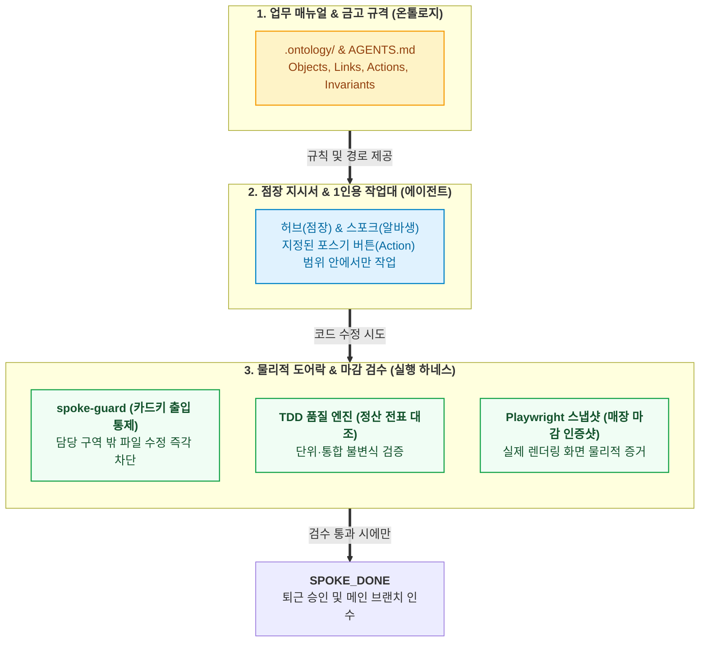

- table of contents
{:toc}

> "아무리 일 잘하는 알바생이 들어와도 가게 금고 열쇠와 장부 원본을 통째로 내어주는 사장님은 없다. 금고에 직접 손을 대게 하는 대신 화면에 딱 정해진 포스기(POS) 버튼만 누르게 하고, 담당 구역 밖의 창고 문은 아예 카드키가 찍히지 않게 잠가두어야 사고가 나지 않는다."
> 팔란티어(`Palantir`) `AIP(Artificial Intelligence Platform)`의 핵심 메커니즘을 소프트웨어 개발 라이프사이클(`SDLC`)에 이식한 실전 아키텍처다.
> 에이전트에게 데이터베이스와 전체 코드베이스를 무방비로 내주지 않고 `Action` 명세를 기반으로 작업 경계를 제한 노출하며, `spoke-guard` 훅과 `TDD`, `Playwright` 스냅샷으로 온톨로지 불변식을 물리적으로 강제하는 실행 하네스의 작동 원리를 다룬다.
{:.lead}

---

## 매뉴얼만 줬더니 창고까지 뒤엎는 신입 알바생

### 온톨로지 명세만 적어두면 마법이 일어날 것이라는 착각

사실 지난 [[4편]](/tag-ontology-engineering/4-repo-ontology-primitives-and-trace/)에서 `.ontology/` 디렉토리 아래에 4대 프리미티브(`Objects`, `Links`, `Actions`, `Functions`)를 정의하고 `otlg trace`로 0.01초 만에 풀스택 코드 지도를 뽑아냈을 때만 해도, 이제 에이전트가 알아서 완벽한 코드를 짜줄 것이라는 막연한 기대가 있었다. 수십만 줄의 코드베이스에서 헤매던 탐색 병목을 해결했으니 가장 큰 산을 넘었다고 생각했기 때문이다. 하지만 실제로 에이전트에게 복잡한 비즈니스 요구사항을 맡겨보면서, 아무리 정교한 온톨로지 YAML 파일을 작성해 두더라도 그 문서 자체가 런타임에 튀어나와 에이전트의 잘못된 코드 수정을 물리적으로 막아주지는 못한다는 냉정한 현실을 마주하게 되었다.

이를 가장 쉽게 비유하자면, 새로 뽑은 알바생에게 우리 가게의 모든 물건 위치와 업무 수칙이 적힌 완벽한 **'매뉴얼 북(`.ontology/`)'**을 한 권 쥐여준 뒤 안심하고 가게 전체 열쇠를 통째로 맡겨버린 상황과 똑같았다. 매뉴얼을 다 읽었으니 알아서 잘하겠거니 하고 잠시 자리를 비웠더니, 이 친절하고 열정 넘치는 알바생은 카운터 정리만 하라니까 사장실과 옆 매장 창고까지 들어가서 진열장을 자기 마음대로 재배치해 놓고(스코프 월경), 매뉴얼에 없는 환불 손님이 오자 사장에게 물어보지도 않고 금고를 열어 어림짐작으로 현금을 집어주었으며(무언의 추측, `Guessing`), 정산이 엉망으로 깨졌는데도 퇴근할 때는 해맑게 "사장님, 오늘 마감 완벽하게 끝났습니다!"라고 카톡(환각 보고)을 남겼다.

### 매뉴얼을 넘어 포스기 버튼과 카드키 통제로

앞서 [[3편]](/tag-ontology-engineering/3-nouns-to-verbs-paradigm-shift/)의 에이전트 교차 검증(`Antigravity` vs `Codex`)에서 명확히 짚어냈듯, 내가 레포지토리에 구축한 온톨로지는 그 자체로 트랜잭션을 집행하는 엔진이 아니라 에이전트가 코드를 고치기 전에 숙지해야 할 **'업무 매뉴얼이자 접지 명세(Grounding Spec)'**다. 현실의 어떤 노련한 사장님도 알바생에게 두꺼운 매뉴얼 한 권만 던져주고 금고 열쇠를 맡기지 않는다. 사고가 나지 않는 매장을 만들려면 매뉴얼 외에도 세 가지 물리적 통제 장치가 반드시 맞물려야만 했다.

첫 번째는 가게의 절대 수칙과 정산 공식을 정의한 **'업무 매뉴얼과 금고 규격(`.ontology/` & `AGENTS.md`)'**이다. 두 번째는 알바생에게 매장 전체를 열어주는 대신 오늘 처리할 주문서(`Do & Don't`)와 **'전용 작업대(`Hub & Spoke` 격리 워크트리)'**만 배정하는 업무 지시 체계다. 그리고 마지막 세 번째는 알바생이 자기 구역 밖의 창고 문을 열려고 하면 아예 카드키가 찍히지 않게 막는 **'물리적 도어락(`spoke-guard`)'**과, 퇴근 전 알바생의 말만 믿지 않고 실제 영수증 전표와 매장 진열 사진(`TDD` & `Playwright`)을 대조하는 **'마감 검수 시스템'**이다.



---

## AIP Tool Calling 철학의 이식: "금고 열쇠 대신 포스기 버튼만 내어주라"

### 금고를 통째로 열어주는 초보적 위임과 Palantir AIP의 해법

에이전트라는 알바생을 통제할 때 내가 가장 깊이 참고한 설계 사상은 `Palantir AIP`가 생성형 AI를 다루는 방식이었다. 기업 현장에서 AI 에이전트를 처음 도입할 때 흔히 범하는 치명적인 실수는, LLM에게 데이터베이스 접속 정보나 범용 SQL 실행 권한을 통째로 넘기며 "사용자의 자연어 요청에 맞춰 알아서 데이터를 수정하라"고 지시하는 것이다. 이는 알바생에게 금고 비밀번호와 회계 장부 원본을 통째로 내어주고 "손님이 달라는 대로 알아서 현금 꺼내주고 장부 고쳐놔"라고 말하는 것과 다름없다. 도메인 맥락이 결여된 AI는 복잡한 동시성 행 잠금(`SELECT FOR UPDATE`)이나 멀티테넌트 데이터 격리(`tenant_id`), 혹은 상태 전이 선행조건을 가볍게 무시한 채 임의의 `UPDATE` 쿼리를 날려 프로덕션 데이터베이스의 정합성을 순식간에 파괴하기 마련이다.

이러한 참사를 원천 차단하기 위해 `Palantir AIP`는 **"LLM에게 원천 데이터베이스(금고 열쇠)를 직접 주지 않고, 오직 온톨로지에 엄격히 선언된 `Action Types`(포스기 버튼)만을 도구 호출(`Tool Calling`) 인터페이스로 제한 노출한다"**는 핵심 철학을 고수한다. 알바생이 금고 속 현금을 임의로 집어낼 수 없고 오직 포스기 화면에 떠 있는 '결제 승인', '부분 환불', '재고 이동' 버튼만 정해진 절차에 따라 누를 수 있듯, 에이전트 역시 온톨로지가 규정한 비즈니스 동사만을 정해진 파라미터 규격에 맞춰 호출할 수 있다. 그러면 그 하부에 연결된 로직 계층과 보안 계층이 호출자의 권한과 사전 불변식을 검증한 뒤에야 비로소 안전한 트랜잭션으로 시스템의 상태를 변경하는 구조다.

### 닫힌 액션 스펙으로 코딩 에이전트의 작업 경계를 가두다

나는 이 '금고 대신 포스기 버튼만 내어준다'는 `Tool Calling` 제약 철학을 내가 운영하는 B2B 학원 통합 관리 SaaS의 소프트웨어 개발 라이프사이클(`SDLC`) 하네스에 그대로 이식했다. 런타임 에이전트에게 DB 전체의 쓰기 권한을 주는 것이 재앙이듯, 코딩 에이전트에게 39만 줄짜리 레포지토리 전체를 열어두고 "수납 취소 버그 좀 고쳐줘"라고 백지 위임장을 주는 것 또한 똑같이 위험한 일이기 때문이다. 아무런 경계 없이 투입된 코딩 에이전트는 당장 눈앞의 에러를 없애기 위해 공용 인증 미들웨어를 건드리거나 다른 도메인의 서비스 계층을 임의로 참조하며 아키텍처를 오염시키곤 한다.

그래서 나는 스포크 에이전트에게 매장 전체를 돌아다니며 코드를 고칠 권한을 주는 대신, `.ontology/actions/`에 선언된 액션 명세를 기반으로 **작업 경계를 완벽히 폐쇄한 닫힌 형태의 작업 지시서**만을 쥐여주기로 했다. 새로운 기능 슬라이스를 발주할 때 점장 역할을 맡은 허브 에이전트는 먼저 `otlg trace`를 실행해 대상 액션의 파라미터와 사전 불변식(행 잠금 여부, 허용 역할, 선행 상태), 그리고 `code_binding`에 연결된 풀스택 파일 경로를 추출한다. 그런 다음 `cmux`와 `git worktree`를 통해 `1 Feature Slice = 1 Git Branch = 1 Worktree = 1 Agent` 원칙으로 1인용 격리 작업대를 차려 스포크 에이전트를 앉히고, 온톨로지가 허락한 닫힌 액션 스펙 안에서만 코드를 수정하도록 엄격한 물리적 경계를 씌웠다.

---

## 사고를 원천 차단하는 3중 물리적 안전장치

매뉴얼을 쥐여주고 전용 작업대에 앉혔다 하더라도, 알바생의 선의와 "창고에는 들어가지 마"라는 말로만 한 당부(프롬프트 지시)를 믿고 가게 문을 닫을 수는 없다. 작업 시간이 길어지고 에러가 반복될수록 LLM의 주의력은 필연적으로 흐려지기 때문에, 에이전트가 선을 넘으려 할 때 물리적으로 개입하여 손을 쳐내는 안전장치가 반드시 필요했다. 이를 위해 나는 작업의 시작부터 퇴근 검수까지 에이전트를 감싸는 3중 물리적 방어선을 구축했다.

### 일차 방어선: 작업 경계를 봉쇄하는 선제 Do & Don't 지시서와 호출 벨

첫 번째 방어선은 스포크 에이전트가 코드를 한 줄이라도 작성하기 전에 허브 에이전트가 내려보내는 **'선제 Do & Don't 작업 지시서'**다. 이 지시서는 막연한 당부가 아니라 `.ontology/`의 심볼 바인딩과 프로젝트 루트 `AGENTS.md`의 아키텍처 5각 분업 규범을 결합해 생성한 구체적인 업무 범위 계약서다. 예컨대 과제 제출물 채점(`GradeSubmission`) 액션을 수정할 때 `Do` 항목에는 온톨로지에 바인딩된 백엔드 서비스 메서드(`grade_submission`)와 프론트엔드 `FSD(Feature-Sliced Design)`의 해당 피처 슬라이스(`features/grade-submission`), 그리고 모바일 `MVVM` 뷰모델만 수정하라고 명시한다.

반면 `Don't` 항목에는 온톨로지 스펙 밖에 있는 공용 인증 미들웨어나 결제 및 청구 모듈을 절대 건드리지 말 것, 백엔드의 `Model` -> `CRUD` -> `Service` -> `API Router` 단방향 레이어링이나 프론트엔드의 슬라이스 간 직접 참조(`Cross-slice import`) 금지 원칙을 어기지 말 것을 못 박는다. 아울러 작업 도중 매뉴얼이나 지시서에 정의되지 않은 애매한 예외 상황을 마주쳤을 때 알바생이 자기 멋대로 어림짐작(`Guessing`)해서 처리하는 행위를 엄격히 금지하고, 즉시 손을 멈춘 채 **호출 벨(`SPOKE_DECISION_NEEDED`)**을 눌러 점장(허브)에게 결정을 요청하도록 강제했다.

### 이차 방어선: 말로 타이르는 대신 문을 잠그는 spoke-guard 카드키 통제

하지만 아무리 정교한 `Do & Don't` 지시서를 프롬프트에 적어주어도, "자연어 프롬프트 규칙은 언젠가 반드시 샌다"는 것이 수백 번의 에이전트 세션을 돌리며 얻은 뼈아픈 교훈이었다. 출입문 앞에 '관계자 외 출입 금지' 종이를 붙여놓아도 급한 일이 생기면 기어코 문을 열고 들어가듯, 에이전트 역시 테스트가 계속 실패하거나 예상치 못한 타입 에러가 터지면 문제를 빨리 해결하려는 조급함에 프롬프트 상단의 `Don't` 제약을 까맣게 잊고 공용 모듈을 직접 수정하거나 `flutter clean`, `rm -rf ios/Pods` 같은 파괴적인 빌드 리셋 명령어를 실행하려 들기 마련이다.

이 문제를 뿌리 뽑기 위해 도입한 두 번째 방어선이 바로 도구 호출 직전에 OS 프로세스 레벨에서 작동하는 물리적 카드키 도어락인 **`spoke-guard`(`PreToolUse Hook`)** 셸 스크립트다. 에이전트가 파일 수정 도구나 셸 명령어 도구를 호출하는 순간, 실제 도구가 실행되기 전에 `spoke-guard.sh`가 먼저 개입하여 수정하려는 대상 파일 경로가 현재 알바생에게 배정된 작업 구역(`allowed_paths.txt`) 안에 있는지, 혹은 금지된 파괴적 명령어가 포함되어 있는지를 정적으로 검사한다. 만약 에이전트가 깜빡 잊고 담당 구역 밖의 공용 모듈 문을 열려고 하면, 도어락이 즉시 `exit 2` 코드와 함께 문 자체를 물리적으로 잠가버린다.

```bash
#!/usr/bin/env bash
# .spoke/hooks/spoke-guard.sh (PreToolUse 하드 바운더리 검증 훅 예시)
TARGET_FILE="$1"
ALLOWED_PATHS_FILE=".spoke/allowed_paths.txt"

# 1. 거버넌스 헌법 및 온톨로지 코어 임의 수정 차단 (별도 승인 없는 변조 방지)
if [[ "$TARGET_FILE" == "AGENTS.md" || "$TARGET_FILE" == "CLAUDE.md" ]]; then
  echo "[SPOKE-GUARD BLOCKED] 거버넌스 헌법(AGENTS.md)은 스포크가 임의로 수정할 수 없습니다." >&2
  exit 2
fi

# 2. 선제 Do & Don't에 정의된 허용 경로 외 공용 모듈 침범 차단
if [[ -f "$ALLOWED_PATHS_FILE" ]] && ! grep -qF "$TARGET_FILE" "$ALLOWED_PATHS_FILE"; then
  echo "[SPOKE-GUARD BLOCKED] 비인가 파일 수정 시도 차단: $TARGET_FILE" >&2
  echo "허용된 슬라이스 경계 밖의 수정이 필요하면 SPOKE_DECISION_NEEDED로 에스컬레이션하십시오." >&2
  exit 2
fi
```

"들어가지 마라"고 말로만 타이르던 초기 프롬프트 방식과 아예 카드키 권한을 제한한 `spoke-guard` 물리적 하네스 방식의 차이는 실제 운영 지표에서 극명하게 갈렸다.

| 통제 항목 | 자연어 프롬프트 단독 통제 (구두 주의) | `spoke-guard` + 물리적 하네스 (카드키 잠금) |
| :--- | :--- | :--- |
| **공용 모듈 월경(침범) 차단** | X (컨텍스트 장기화 시 빈번히 누수) | **O (`PreToolUse Hook`에서 즉각 거부)** |
| **파괴적 빌드 명령 실행 방지** | X (디버깅 막바지에 임의 실행 위험) | **O (금지 명령어 패턴 매칭 차단)** |
| **FSD / 레이어링 아키텍처 준수** | - (에이전트 주의력에 따라 편차 발생) | **O (`otlg lint` 및 정적 규칙으로 강제)** |
| **미정의 규칙 임의 추측 방지** | X (환각으로 임의 로직 작성) | **O (`SPOKE_DECISION_NEEDED` 호출 벨)** |

### 삼차 방어선: 퇴근 보고만 믿지 않는 마감 전표 대조와 Playwright 인증샷

세 번째이자 가장 결정적인 방어선은 에이전트의 퇴근 보고를 검수하는 **'독립 테스트 실행과 `Playwright` 마감 인증샷'**이다. 알바생이 퇴근하면서 "오늘 정산이랑 매장 청소 다 끝났습니다!"라고 보낸 카톡만 믿고 문을 닫았다가, 다음 날 아침 가게에 나가보면 포스기 정산 금액은 안 맞고 쇼케이스 유리는 깨져 있는 황당한 상황을 에이전트 협업에서도 똑같이 겪었기 때문이다. 백엔드 단위 테스트 통과(`pytest: 11 passed`) 로그만 띄워놓고 "기능 구현이 완벽히 끝났습니다"라고 당당하게 보고했지만, 막상 브라우저를 띄워 화면을 눌러보면 프론트엔드의 기본값(`default`)과 백엔드의 필수(`required`) 필드 계약이 어긋나 `422 Unprocessable Entity` 에러가 터지거나, 외래키(`FK`)가 해석되지 않아 화면에 데이터베이스 raw ID가 그대로 노출되고, 시간대(`KST`, `UTC+9`) 처리 불일치로 아예 하얀 빈 화면(`Empty Screen`)이 뜨는 일이 부지기수였다.

이를 방지하기 위해 나는 별도의 `Critic Agent`가 참여하는 `TDD` 사이클(`tdd-plan`, `go`)로 정산 전표(도메인 불변식)를 1차 검증하는 것에 그치지 않고, 스포크 에이전트가 퇴근 도장(`SPOKE_DONE`)을 찍기 전에 반드시 실제 헤드리스 브라우저(`Playwright`)를 띄워 구현된 UI 화면을 직접 조작하고 **마감 인증샷(스크린샷 스냅샷)**을 찍어 제출하도록 강제했다. 나아가 점장인 허브 에이전트 역시 스포크의 구두 보고를 그대로 믿지 않고, 머지 직전에 해당 커밋 `SHA`에서 테스트 러너와 브라우저 스냅샷 증거를 독립적으로 대조한 뒤에야 비로소 작업을 인수한다.

---

## 완결 파이프라인: 출근부터 퇴근 검수까지 맞물리는 5단계 라이프사이클

지금까지 살펴본 업무 매뉴얼(`.ontology/`, `AGENTS.md`)과 점장·알바생 분업(`Hub & Spoke`), 그리고 3중 물리적 안전장치는 `/hub-orchestrate` 스킬 아래에서 단 하나의 유기적인 5단계 라이프사이클로 맞물려 돌아간다. 새로운 요구사항이 들어오면 어떤 과정을 거쳐 안전한 프로덕션 코드로 수렴하는지를 단계별로 정리하면 다음과 같다.

| 단계 | 핵심 관문 | 주관 주체 및 도구 | 통과 불변식 (Exit Criteria) |
| :--- | :--- | :--- | :--- |
| **1단계** | **선제 기획 (`Do & Don't`)** | `Hub Agent` (`otlg trace` / `intake`) | 대상 `Action` 바운더리 확정 및 허용 파일 목록 명세 |
| **2단계** | **격리 `TDD` 구현** | `Spoke Agent` (`cmux worktree` + `spoke-guard`) | 월경 0건, `RED-GREEN-REFACTOR` 및 `Critic` 검증 통과 |
| **3단계** | **독립 실행 검증 (`QA`)** | `Spoke` & `Hub` (`pytest` + `Playwright`) | 테스트 `exit code 0` + 실제 렌더링 스냅샷 물리적 증거 확보 |
| **4단계** | **위키 및 정합성 저널링** | `Spoke Agent` (`otlg lint --strict`) | 온톨로지 심볼 바인딩 `0 violations` + 기능 위키 및 대장 갱신 |
| **5단계** | **완료 센티넬 및 머지** | `Spoke` 발행 -> `Hub` 최종 인수 | `.spoke/SPOKE_DONE` 확인 후 메인 브랜치 안전 병합 |

첫 단계인 **선제 기획**에서는 허브 에이전트가 `otlg trace`와 `otlg intake`를 통해 요구사항과 연관된 온톨로지 `Action` 명세를 읽고, 건드려야 할 풀스택 심볼과 절대 침범해서는 안 될 경계를 가르는 `Do & Don't` 명세표를 작성한다. 이어지는 두 번째 단계인 **격리 `TDD` 구현**에서는 `cmux`를 통해 독립된 `git worktree`에 투입된 스포크 에이전트가 `spoke-guard` 훅의 실시간 감시를 받으며 `RED-GREEN-REFACTOR` 사이클을 수행한다. 이 과정에서 아키텍처 계층 위반이나 비인가 파일 수정 시도는 물리적으로 차단되며, 별도의 `Critic Agent`가 객체지향 설계 원칙과 도메인 불변식 준수 여부를 날카롭게 교차 검증한다.

구현이 끝나면 세 번째 단계인 **독립 실행 검증**으로 넘어가, 백엔드 테스트 러너의 통과뿐만 아니라 `Playwright` 헤드리스 브라우저를 통한 실제 화면 조작과 스냅샷 캡처로 `422` 충돌이나 빈 화면이 없음을 물리적으로 입증한다. 네 번째 단계인 **위키 및 정합성 저널링**에서는 수정된 코드가 온톨로지 명세와 한 치의 오차도 없는지 `otlg lint --strict`를 돌려 `0 violations`를 확인하고, 변경된 기능 명세를 `docs/features/` 카탈로그와 운영 대장(`WORKLOG`)에 동기화한다. 이 네 가지 관문을 단 하나의 누락도 없이 모두 통과했을 때만 다섯 번째 단계인 **완료 센티넬(`.spoke/SPOKE_DONE`)** 파일이 발행되며, 허브 에이전트가 이 물리적 증거들을 최종 확인한 뒤 안전하게 메인 브랜치로 머지하고 워크트리를 정리함으로써 한 사이클이 완결된다.

---

## 남겨진 과제: 코드가 바뀔 때 문서는 어떻게 동기화되는가

이처럼 온톨로지 매뉴얼과 물리적 실행 하네스를 결합하자, 기억상실증에 걸린 에이전트가 기존 비즈니스 로직을 부수거나 엉뚱한 파일을 건드리는 사고는 극적으로 사라졌다. 1인 개발자인 내가 중앙의 허브에서 기획과 의사결정에만 집중하는 동안, 격리된 여러 워크트리의 스포크 에이전트들이 동시에 달려들어 하루에도 수십 개의 커밋과 기능 슬라이스를 흔들림 없는 품질로 쳐낼 수 있게 된 것이다.

하지만 개발 속도가 비약적으로 빨라지자 전혀 예상치 못했던 또 다른 병목이 수면 위로 떠올랐다. 에이전트들이 병렬로 코드를 쏟아내는 속도가 너무나 빠르다 보니, 에이전트에게 문서 작성을 시키더라도 '무엇을 어느 문서와 대장에 반영할지' 그 컨텍스트를 인간인 내가 머릿속에 쥐고 일일이 챙겨줘야만 하는 **'문서화 컨텍스트 유지 병목'**이 터져버린 것이다. 인간이 사후에 맥락을 챙겨 문서화를 지시하는 방식으로는 에이전트 군단의 병렬 생산 속도를 결코 따라잡을 수 없었기에, 나는 코드가 갱신되는 순간 저장소의 거버넌스 문서들도 마치 리눅스의 저널링 파일시스템(`ext4`)처럼 에이전트의 퇴장 트랜잭션 안에서 스스로 숨 쉬며 갱신되는 자동화 엔진을 고민해야만 했다.

---

### [시리즈의 다음 이야기]

다음 글인 **[[6편] 문서는 스스로 숨 쉰다](/tag-ontology-engineering/6-living-wiki-and-metadata-journaling/)**에서는, 병렬 에이전트의 폭발적인 개발 속도 속에서도 문서 부패를 원천 차단하기 위해 리눅스 저널링 파일시스템(`ext4`)의 원리를 이식한 '자가 갱신형 거버넌스(`Living Wiki Engine`)'와 아키텍처 5각 편대의 실체를 상세히 파헤친다.

