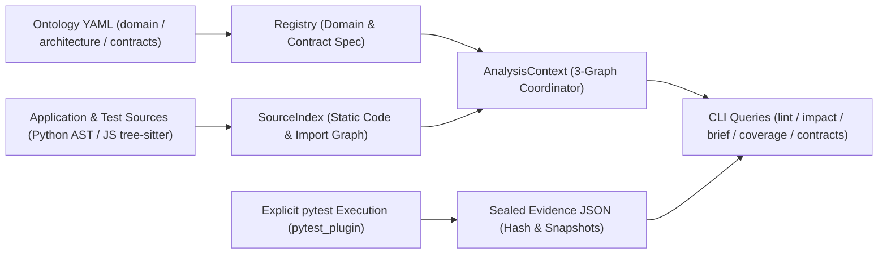

* toc
{:toc}

---

## 정적 바인딩 검사 너머에서 마주한 세 가지 질문

지난 [[3편] 문서는 명사로 정리되지만 코드는 동사로 움직인다](/tag-ontology-engineering/3-nouns-to-verbs-paradigm-shift/)에서 나는 온톨로지가 단순한 노트 정리법을 넘어 **'AI 시대에 복잡한 시스템을 메타적으로 통제하는 범용 아키텍처'**라는 사실을 깨닫고, 이를 프로덕션 코드베이스로 확장한 첫 걸음을 다루었다. 이어진 [[4편] 린트 에러 0개의 거짓말, 내가 만든 온톨로지를 의심하기까지](/tag-ontology-engineering/4-zero-lint-error-illusion-and-v020/)에서는 `YAML` 명세의 문법만 통과하고 실제 코드와는 유리되어 있던 초기 `repo-ontology`(`v0.1.0`)의 한계를 부수고, 파일 경로와 `Python` `AST` 심볼의 실존 여부까지 대조하는 `v0.2.0`을 구축한 과정을 복기했다. 온톨로지를 실제 도메인에 적용해 볼수록 내 안의 이해도 역시 함께 고도화되었는데, 처음에는 '개념과 심볼을 1:1로 매핑한 선언서' 정도로 생각했던 코드 온톨로지가 실무 리팩토링과 맞부딪히면서 한 차원 더 높은 질문을 던지기 시작한 것이다. 파일과 심볼이 제자리에 존재한다는 정적 사실만으로는 막아낼 수 없는 더 깊고 교묘한 균열들이 수면 위로 드러났기 때문이다.

첫 번째 질문은 **도메인 관계와 코드 의존성의 혼동**에서 비롯되었다. 온톨로지 명세상 정산 스냅샷(`FeeMonthlySnapshot`)과 결제 원장(`FeePaymentLedger`) 사이에 밀접한 도메인 `Link`가 선언되어 있고 각 파일과 클래스가 존재하더라도, 그 파일 내부에서 프론트엔드의 다른 `FSD`(`Feature-Sliced Design`) 슬라이스를 무단 침범하거나 백엔드 하위 모델 계층이 상위 서비스 계층을 역방향으로 `import`하는 아키텍처 경계 위반이 일어나면 기존 바인딩 검사만으로는 잡아낼 도리가 없었다.

두 번째 질문은 **규칙이 늘어날수록 불완전해지는 에이전트 브리핑의 한계**였다. 프로젝트가 성숙해지면서 도메인 불변식과 아키텍처 결정 기록(`ADR`), 그리고 절대 어겨서는 안 되는 금지 규칙(`prohibition`)들이 수십 개씩 쌓여 갔는데, 이를 일반적인 `RAG`처럼 임베딩 유사도 상위 몇 개(`Top-K`)로 잘라서 건네주면 결정적인 순간에 '마감된 월별 스냅샷은 수정할 수 없다'거나 '결제 금액을 초과해 환불할 수 없다'는 필수 금지 제약이 누락되기 일쑤였다. 게다가 과거 규칙이 새 규칙으로 대체(`supersedes`)되었을 때 폐기된 옛 규칙과 현행 규칙을 구분하지 못해 엉뚱한 코드를 짜는 일도 벌어졌다.

세 번째 질문이자 가장 본질적인 고민은 **명세된 규칙과 테스트 실행 증거 사이의 단절**이었다. 온톨로지에 사전 불변식(`preconditions`)과 상태 전이(`state_machine`)를 아무리 정교하게 적어두어도, 그 규칙이 실제 `pytest` 테스트 케이스와 어떻게 연결되어 있으며 방금 수정한 코드 위에서 실제로 실행되어 통과했는지를 증명할 방법이 없었다. 누군가 테스트 함수 위에 형식적인 주석만 달아두거나 특정 케이스를 `skip` 처리한 채 일부 테스트만 돌려놓고 도메인 계약을 준수했다고 보고하더라도 간파할 수 없었던 것이다. 내가 원했던 것은 단순한 문서 린터를 넘어, 도메인의 의미와 아키텍처 경계, 그리고 `TDD` 실행 증거를 하나의 컴파일러처럼 검증해 내는 체계였다.

---

## 글로벌 엔지니어링 지형도 탐색: 4대 오픈소스와 최신 논문에서 길어 올린 원리

그 세 가지 질문에 답을 찾기 위해 나는 곧바로 코드를 고치는 대신, 전 세계 엔지니어들과 연구자들이 코딩 에이전트와 소프트웨어 공학 온톨로지 문제를 어떻게 풀어가고 있는지 전수 조사했다. 바퀴를 처음부터 재발명하기보다 검증된 오픈소스와 최신 논문에서 핵심 원리를 길어 올리고 실무 환경에 맞게 재해석하는 편이 훨씬 단단한 아키텍처를 만드는 길이라 판단했기 때문이다.

먼저 `GitHub`의 4대 코드 온톨로지 오픈소스를 파고들며 실마리를 얻었다.

- **`NVIDIA/auto-ontology`**: 코드베이스와 데이터 스토어의 의미 계층을 에이전트 친화적인 구조화 인터페이스로 노출하며, 모든 질의 결과에 도출 출처(Provenance)와 현재 검증 상태(Assurance)를 명시적인 `JSON` 봉투(Envelope)로 반환하는 원리를 배웠다.
- **`wlsdks/ontology-atlas`**: 로컬 코드 변경의 파급 범위(Blast Radius)를 계산할 때 **선언된 도메인 관계와 실제 정적 `import` 의존성 영향을 철저히 구분**하고, 각 파급 결과마다 근거 경로를 남기는 영향도 분석의 정석을 확인했다.
- **`Scaffoldic/agentforge-graph` & `ruc-datalab/EvoOntology`**: 정적 코드 심볼과 `Git` 이력을 하나의 타입화된 그래프로 교차 조회하는 구조(`agentforge-graph`)와, 실제 소스 인벤토리를 분모로 삼아 역방향으로 미등록 빈칸을 진단하고 후보 프리뷰와 적용(`--apply`)을 분리하는 안전장치(`EvoOntology`)에서 큰 영감을 얻었다.

이어서 소프트웨어 공학 온톨로지 학술 논문들의 계보를 따라가며 이번 `v0.3.0` 설계의 직접적인 기둥이 된 최신 연구 두 편을 만났다.

첫 번째는 **`MOOSEDev 2026`**(*Ontology-Grounded Project Memory for Coding Agents*, James Adam, `arXiv:2608.13662`)이다. 코딩 에이전트를 위한 프로젝트 메모리를 다룬 이 논문은 규칙의 생명주기(`lifecycle.status`)와 대체 관계(`supersedes`), 부정 제약(`prohibition` / `forbidden`)을 일급 시민으로 다루며, 특히 활성 규칙을 브리핑할 때 **임베딩 유사도 순위(`Top-K`)로 잘라내지 않고 지정된 적용 범위의 규칙을 전수 반환**해야 한다고 강조한다. 필수 불변식은 확률적 검색이 아니라 결정론적 컴파일의 대상이어야 한다는 내 생각과 정확히 맞닿아 있었다.

두 번째는 **`OntoUML 2025`**(*Ontology-Driven Software Development: Generating Java Code from OntoUML*, Guus Grievink 외, `FOIS 2025`)다. 개념 명세와 코드 구조의 의미적 연결을 다룬 이 연구에서 착안하여, 도메인 객체가 가지는 유한 상태 머신(`state_machine`)의 초기·종료 상태, 허용된 전이(`transitions`), 그리고 그 전이를 일으키는 `Action` 대상의 정합성을 정적으로 검증하고 테스트 케이스와 매핑하는 구조를 고안했다.

물론 외부 원리를 가져오더라도 `PostgreSQL`이나 벡터 스토어 같은 무거운 서버 인프라, 혹은 에이전트가 사람 몰래 스스로 스키마를 고쳐 발행하는 자율 스키마 진화 기능은 의도적으로 배제(`Non-goals`)했다. 온톨로지는 에이전트를 통제하는 헌법이어야지, 에이전트가 제 마음대로 고쳐 쓰는 일기장이 되어서는 안 되기 때문이다.

---

## `AnalysisContext`와 3-Graph 분리 아키텍처

외부 원리와 자체 `TDD` 계약 설계를 하나로 꿰어내면서 내린 가장 중요한 아키텍처 결정은 **도메인 그래프(`domain`), 정적 코드 그래프(`import`), 계약-테스트 그래프(`contract-test`)를 하나로 뭉개지 않고 명확히 분리한 뒤 `AnalysisContext`에서 결합**하는 구조였다.



도메인 개념상 두 객체 사이에 `Link`가 있더라도, 코드 레벨에서는 레이어 방향(`service`에서 `model`로만 참조 허용)이나 `FSD` 슬라이스 격리 원칙(`forbid_cross_slice: true`)에 따라 직접 `import`가 금지되어야 하는 경우가 많다. 만약 도메인 그래프와 코드 의존성 그래프를 합쳐 버리면 도메인 `Link`가 곧 코드 `import` 허가증으로 오작동하며 아키텍처 경계가 무너지게 된다.

1. **정적 코드 그래프(`SourceIndex` & `architecture.yml`)**: 애플리케이션 코드를 런타임에 실행하지 않고 `Python` `AST`/`tokenize`와 `JS`/`TS` `tree-sitter` 파서만으로 정적 `import` 그래프를 구축한다. `architecture.yml`은 분석 대상 모든 파일의 단일 소유권(`unit`, 중복 `OWN001`/미소유 `OWN002` 차단), 레이어 단방향 의존성(`ARCH001`/`ARCH002`), 그리고 한국 표준시(`KST`) 만료일(`expires`)이 지정된 한시적 예외(`ARCH003`)를 엄격히 규율한다.
2. **도메인 그래프(`Registry` & `state_machine`)**: 모든 프리미티브에 생명주기(`lifecycle.status`, `supersedes` 순환 검증 `LIFE001`)와 금지 규칙(`kind: prohibition`, `forbidden`)을 부여하고, `Object.state_machine`을 통해 상태 `enum` 일치, 고립 상태 여부, 종료 상태(`terminal`) 이탈 금지, 전이 유발 `Action` 정합성(`STATE001`)을 정적으로 컴파일한다.
3. **Top-K 없는 `brief`와 3중 `impact`, 역방향 `coverage`**: `otlg brief`는 유사도 커팅 없이 스코프 내 활성 규칙과 금지 제약, 상태 전이 계약을 전수 반환한다. `otlg impact`는 직접 바인딩, 1-hop 도메인 이웃, 역방향 정적 `import`(및 `Git` 브랜치 비교)를 3중 근거로 분리해 보여주며, `otlg coverage`는 실제 소스 인벤토리를 분모로 삼아 미등록 파일을 역방향 진단한다. 모든 명령은 `scope`/`completeness`/`assurance`를 담은 단일 `JSON` Envelope와 표준 진단 코드를 반환한다.

---

## TDD 계약과 `pytest` 실행 증거 스냅샷 봉인

`v0.3.0`의 대미를 장식하는 세 번째 그래프는 온톨로지의 요구사항과 실제 `pytest` 테스트 코드를 단단히 묶어주는 **계약-테스트 그래프(`contracts.yml` & `pytest_plugin`)**다. 모든 사전조건(`precondition`)과 규칙(`rule`), 상태 전이(`transition`)에 고유 ID를 부여하고 필수 테스트 케이스(`cases`)를 선언하면, 테스트 코드에서는 `@pytest.mark.otlg_contract(ref="...", case="...")` 마커로 이를 연결한다.

하지만 테스트 함수 위에 데코레이터가 붙어 있는지만 정적으로 확인하고 끝낸다면, 빈 껍데기 테스트나 `pytest.skip`으로 우회하는 꼼수를 막을 수 없다. 그래서 나는 `repo_ontology.pytest_plugin`을 직접 구현해 `pytest` 실행 과정 자체에 개입하도록 만들었다.

```bash
pytest -p repo_ontology.pytest_plugin \
  --otlg-root /path/to/project \
  --otlg-evidence /tmp/otlg-evidence.json

otlg contracts report --project /path/to/project \
  --evidence /tmp/otlg-evidence.json --require-passed --json
```

플러그인이 활성화된 상태로 테스트를 돌리면, 단순히 통과 여부만 기록하는 것이 아니라 **사전조건과 규칙 본문의 계약 해시(Contract Hash), 그리고 테스트 시작 시점과 종료 시점의 온톨로지 명세·분석 대상 소스·테스트 파일·설정 파일 전체의 스냅샷 해시**를 함께 계산해 `/tmp/otlg-evidence.json`에 봉인한다.

만약 테스트 실행 도중 파일이 변조되거나, 테스트 통과 후 소스 코드나 명세를 한 글자라도 고치고 다시 `otlg contracts report --require-passed`를 호출하면 컴파일러는 해당 증거를 즉시 오래된 스냅샷(`stale`, `CON004`)으로 판정해 거부한다. 또한 에이전트가 불리한 테스트를 피하려고 `-k`나 `-m` 필터로 일부만 실행한 경우에도 전체 필수 케이스 증거로 인정하지 않으며, 연결된 모든 테스트가 빠짐없이 실행되어 `passed`를 받아야만 최종 충족으로 집계한다.

실제 `repo-ontology` 자체 테스트 **97개(`97 passed`)**를 통과시킨 뒤 에듀테크 B2B SaaS의 정산(`fee-billing`) 도메인에 적용해 실증한 결과, 단위 테스트 31개와 필수 계약 9/9 통과는 물론 의존성 정책 제거(`ARCH001` 27건), 마커 제거(`CON003` 9건), 잘못된 상태 전이(`STATE001`), 과거 스냅샷 주입(`CON004` 전수 `stale`)까지 4종의 반례 실험을 오차 없이 잡아냈다. 무엇보다 테스트 실행 여부(`execution: passed`)와 단언문(`assert`) 내부의 비즈니스 의미 증명(`semantics: not_assessed`)을 분리하여, 기계가 보증하는 경계와 리뷰어가 감사해야 할 경계를 속이지 않고 명시했다.

[심화 근거: 5대 외부 원리 흡수·제외 대조표와 3-Graph CLI·TDD 증거 봉인 상세 명세 보러가기](/tag-ontology-engineering/deep-dive/repo-graph-contracts/#three-graph-evidence)

---

### [시리즈의 다음 이야기]

오픈소스 생태계와 최신 논문에서 길어 올린 원리들을 바탕으로 도메인, 아키텍처, `TDD` 계약의 3-Graph(`v0.3.0`)를 완성하면서, 이제 `otlg`는 단순한 정적 사전을 넘어 에이전트에게 누락 없는 제약 조건을 브리핑하고 변경의 파급 범위를 계산하며 실행 증거 스냅샷까지 봉인하는 명실상부한 컴파일러가 되었다. 하지만 아무리 정교한 금고와 장부를 만들어 두었더라도, 실제로 매장에서 일하는 알바생(코딩 에이전트)이 금고 문을 열고 닫는 작업 절차(Workflow) 자체가 통제되지 않는다면 언제든 사고는 터질 수 있다.

다음 글인 **[[6편] 아무리 똑똑한 알바생이라도 금고 열쇠를 통째로 맡기는 사장님은 없다](/tag-ontology-engineering/6-sdlc-harness-and-living-wiki/)**에서는 이 `otlg` 컴파일러를 실제 소프트웨어 개발 생명주기(`SDLC`)의 각 단계에 결합하여, 에이전트가 스스로의 판단만으로 폭주하지 못하도록 물리적·절차적으로 제어하는 **'개발 하네스(Harness)'와 살아 숨 쉬는 위키(Living Wiki) 파이프라인**을 구축한 이야기를 본격적으로 풀어낸다.
