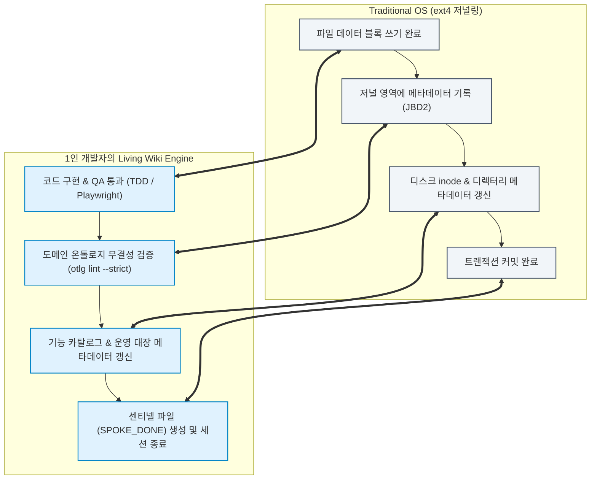
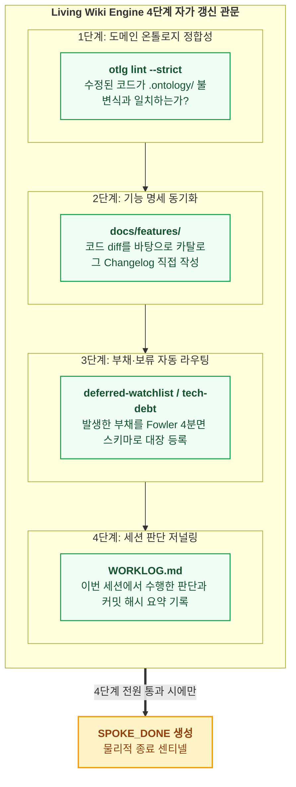

- table of contents
{:toc}

> "코드는 기계가 초당 수십 줄씩 찍어내는데, 어떤 문서를 어떻게 갱신할지 그 맥락을 인간 테크 리드가 머릿속에 쥐고 일일이 지시하고 있다면 그것은 진정한 자동화가 아니다."
> 처음부터 나 역시 문서 작성 자체는 에이전트에게 시키고 있었다. 하지만 병렬 에이전트 체제가 빚어낸 폭발적인 코드 생산성 이면에는, 역설적이게도 각 세션의 변경 맥락을 인간이 직접 기억하고 있다가 에이전트에게 문서화를 지시하고 챙겨줘야만 하는 '컨텍스트 유지 병목'이 도사리고 있었다. 리눅스 커널의 저널링 파일시스템(`ext4`) 메커니즘과 외부 실전 워크플로우의 통찰을 저장소 거버넌스에 이식하여, 에이전트가 작업을 마치고 퇴장하기 직전 스스로 도메인 온톨로지와 기능 카탈로그, 운영 대장을 트랜잭션 단위로 갱신하고 완결 짓는 'Living Wiki Engine' 구축기를 정리했다.
{:.lead}

---

## 개요

지난 [[5편] 아무리 똑똑한 알바생이라도 금고 열쇠를 통째로 맡기는 사장님은 없다](/tag-ontology-engineering/5-aip-action-and-sdlc-harness/)에서는 팔란티어(`Palantir`)의 액션 실행 철학을 소프트웨어 개발 라이프사이클(SDLC)에 맞게 재해석하여, 카톡 한 줄의 요구사항을 풀스택 명세로 번역(`otlg translate`)하고 격리된 워크트리의 스포크 에이전트가 안전하게 집행하도록 통제하는 하네스를 다루었다. 덕분에 에이전트가 도메인 불변식을 깨뜨리지 않고 일관된 품질로 코드를 생산하는 기반은 마련되었지만, 정작 그 하네스를 매일 가동하던 나에게는 생각지도 못한 새로운 병목이 찾아왔다. 이번 글에서는 에이전트에게 문서화를 맡겼음에도 코딩 속도가 빨라질수록 오히려 인간 테크 리드가 문서화 컨텍스트 유지의 늪에 빠지던 역설을 고백하고, 이를 해결하기 위해 구축한 자가 갱신형 거버넌스 엔진의 작동 원리를 살펴본다.

---

## 생산성의 역설: "코드는 기계가 짜고 뒷감당은 사람이 한다?"

돌아보면 처음부터 내가 문서를 손으로 직접 타이핑하고 있었던 것은 아니었다. 나는 일찍이 기능 문서화 스킬과 운영 대장 체계를 만들어 두고, 에이전트에게 코드뿐 아니라 문서 작성까지 시키는 방식으로 워크플로우를 굴리고 있었다. 특히 앞서 구축한 `cmux`와 `git worktree` 기반의 멀티 에이전트 체제가 본궤도에 오르면서, 내가 설계하고 운영하던 B2B 학원 통합 관리 SaaS 레포지토리에서는 이전에는 상상조차 할 수 없었던 속도로 기능들이 쏟아져 나왔다. 격리된 워크트리에 투입된 스포크 에이전트들이 단 한 시간 만에 서너 개의 풀스택 기능 슬라이스를 완결 지어 올렸고, 불과 2주 만에 475개에 달하는 검증된 원자적 커밋이 메인 브랜치에 합류하는 폭발적인 산출량을 기록할 수 있었다.

하지만 바로 그 압도적인 병렬 생산성이 기묘한 역설을 불러왔다. 타이핑은 분명 에이전트가 대신해 주고 있었지만, **'무엇을 어느 문서에 어떻게 반영해야 하는가'에 대한 컨텍스트를 온전히 인간인 내가 머릿속에 유지하고 있다가 챙겨줘야만 하는 상황**이 끊임없이 연출되었기 때문이다. 에이전트가 초당 수십 줄씩 코드를 찍어내고 테스트를 통과시키는 동안, 정작 유일한 인간 개발자인 나는 모니터 앞에서 여러 에이전트가 남긴 작업의 맥락을 붙잡고 문서화 지시를 내리느라 진땀을 빼고 있었다.

스스로 만들어 둔 저장소 거버넌스 규칙을 지키기 위해 내가 매 머지 전후로 직접 짊어져야 했던 '컨텍스트 유지'의 무게는 결코 가볍지 않았다. 스포크 에이전트가 작업을 마치고 돌아오면, 나는 그 에이전트가 수정한 백엔드 API 엔드포인트와 프론트엔드 컴포넌트 바인딩 내역을 파악한 뒤 `docs/features/` 아래의 기능 카탈로그 문서를 열고 구현 상태와 변경 이력(Changelog)을 적도록 일일이 지시해야 했다. 또한 구현 도중 일정이나 스코프 제약 때문에 불가피하게 타협한 지점이나 미해결 이슈들을 내가 기억해 두었다가 보류 감시 대장(`deferred-watchlist.md`)과 기술 부채 대장(`tech-debt.md`)에 분류해 등록하게 시켜야 했고, 이번 세션에서 왜 그런 아키텍처 결정을 내렸는지에 대한 맥락을 작업 일지(`WORKLOG.md`)에 남기는 일도 매번 내가 직접 챙기고 고민해야 했다.

그야말로 코드는 기계가 우아하게 찍어내는데, 그 뒷감당을 위한 컨텍스트를 인간이 유지하고 지시하느라 소모되는 인지 부하가 기하급수적으로 늘어난 것이다. 워커 에이전트가 하나일 때는 내가 그 맥락을 기억하고 챙겨주는 것이 가능했지만, 서너 개의 워크트리가 동시에 돌아가는 순간 인간의 워킹 메모리는 즉시 병목이 되었다. 아무리 에이전트의 코딩 속도를 열 배로 끌어올려 놓아도 마지막 문서 동기화 단계에서 인간의 기억력과 개입을 필요로 한다면 그것은 반쪽짜리 자동화에 불과했다. 무엇보다 내가 피로에 지쳐 특정 변경 맥락을 놓치거나 문서화 지시를 한 번이라도 건너뛰는 순간 코드와 문서의 정합성이 깨지고, 부패한 문서를 읽은 다음 에이전트가 또다시 잘못된 코드를 생산하며 다중 에이전트 체계 전체가 자멸할 수밖에 없다는 위기감이 뼈저리게 다가왔다.

---

## 돌파구: 두 가지 외부 통찰과 `repo-ontology` 디렉토리 구조로의 승화

그렇게 에이전트 문서화의 컨텍스트를 내가 직접 쥐고 챙겨야 하는 피로 속에서 헤매던 내게 결정적인 실마리를 준 것은 두 가지 외부의 통찰이었다. 하나는 에이전트가 문서를 갱신하는 **'타이밍과 생명주기'**에 대한 해법이었고, 다른 하나는 레포지토리 안에서 문서를 어떤 기준으로 분류하고 배치할 것인가에 대한 **'공간적 아키텍처'**의 해법이었다.

### 첫 번째 축: 우주초월의 '공식 라이프사이클 관문으로서의 위키'

먼저 내 머릿속의 안개를 걷어낸 것은 유튜브 '우주초월' 채널의 실무 에이전트 워크플로우 발표였다. 현업에서 멀티 에이전트를 치열하게 굴리며 부딪힌 한계와 해법을 다룬 그 영상을 보면서, 나는 기존에 내가 에이전트에게 문서화를 시키던 방식에 어떤 구조적 결함이 있었는지를 단번에 깨달을 수 있었다.

> *"위키 갱신은 개발이 끝난 뒤 별도로 지시하거나 챙기는 사후 작업이 아니라, 에이전트가 작업을 마치고 퇴장하기 전 자신의 컨텍스트 안에서 반드시 완수해야 하는 공식 생명주기(Lifecycle)의 마지막 관문이다."*

그 대목을 마주하는 순간, 그동안 왜 에이전트에게 문서화를 시키고도 내가 그토록 피로했는지가 명쾌하게 설명되었다. 나는 코드 구현과 테스트까지는 스포크 에이전트의 자율적인 생명주기 안에 넣어 강제해 두었으면서도, 정작 그 변경 사항을 문서와 대장에 반영하는 작업은 에이전트가 코딩을 끝낸 뒤 **인간이 맥락을 챙겨서 후속으로 시키는 별도의 단계**로 분리해 두고 있었던 것이다. 방금 코드를 직접 짜서 무엇이 바뀌고 무엇을 타협했는지 가장 생생한 컨텍스트를 쥐고 있는 주체는 바로 그 스포크 에이전트 자신인데, 정작 그 컨텍스트를 에이전트 스스로 마감하게 하지 않고 인간인 내가 옆에서 기억해 두었다가 다시 주입해 주려다 보니 병목이 터질 수밖에 없었다.

### 두 번째 축: 코딩하는 기술사님의 '아키텍처 문서화 3대 기준 (`C4` · `ADR` · `arc42`)'

그렇다면 에이전트가 퇴장하기 직전 스스로 갱신해야 할 레포지토리 내부의 문서들은 어떤 구조로 설계되어야 할까? 에이전트에게 무조건 마크다운 파일을 늘리라고 시키면 레포지토리는 금세 아무도 읽지 않는 주먹구구식 문서의 쓰레기장으로 변질되고 만다. 이때 레포지토리 내 프로젝트 문서 관리의 뼈대를 잡아준 것이 유튜브 '코딩하는 기술사' 채널에서 다룬 **아키텍처 문서화 3대 국제 표준(`arc42`, `C4 Model`, `ADR`)**이었다.

> *"코드는 **무엇을** 만들었는지는 설명하지만, **왜 이렇게** 만들었는지는 설명하지 않는다."*

AI 에이전트가 초당 수십 줄씩 코드를 찍어내는 시대일수록, 시스템의 거시적 구조와 설계 결정의 이유(`Why`)를 공신력 있는 표준 규격으로 남겨두지 않으면 다음 세션에 투입된 에이전트는 과거의 맥락을 알지 못해 아키텍처를 멋대로 뒤엎어버린다. 코딩하는 기술사님이 제시한 세 가지 기준의 역할 분담은 놀라울 만큼 명쾌했다.

* **`arc42` (문서의 뼈대와 목차)**: "무엇을, 어디에, 무슨 내용으로 남길 것인가?" 시스템의 소개와 목표부터 제약사항, 컨텍스트, 런타임 뷰, 기술 부채까지 12개의 표준 목차 템플릿으로 아키텍처 문서의 지정석을 부여한다.
* **`C4 Model` (추상화 레벨별 다이어그램)**: "그림을 어떤 수준으로 그릴 것인가?" 지도 앱을 줌인(Zoom-in)하듯 `Context` → `Container` → `Component` → `Code`의 4단계 추상화 계층으로 시스템 구조도를 그린다.
* **`ADR` (Architecture Decision Record, 결정의 근거)**: "설계 결정의 이유를 어떻게 남길 것인가?" 특정 기술이나 구조를 선택한 맥락(`Context`), 결정(`Decision`), 그리고 그로 인해 감수해야 할 결과(`Consequences`)를 짧은 단일 문서로 박제한다.

### 결합과 승화: `repo-ontology` 기반 아키텍처 5각 분업 디렉토리 구조

나는 우주초월의 **'공식 라이프사이클 퇴장 관문'** 아이디어와 코딩하는 기술사님의 **'`C4` · `ADR` · `arc42` 프로젝트 문서 관리법'**을, 내가 앞서 [[4편] 에이전트에게 매번 설명하기 귀찮다면 레포지토리가 직접 말하게 하면 되지 않을까](/tag-ontology-engineering/4-repo-ontology-primitives-and-trace/)에서 구축한 **팔란티어식 도메인 온톨로지(`.ontology/`)**와 하나로 융합했다. 그 결과 탄생한 것이 모든 프로젝트 레포지토리의 표준 거버넌스 구조로 자리 잡은 **'아키텍처 및 거버넌스 5각 분업 디렉토리 체계'**다.

```text
project-root/
├── AGENTS.md                  # [1. 규범 (Norms)] 모든 에이전트의 단일 신뢰 원천(SSOT) 헌법
├── CLAUDE.md                  # AGENTS.md를 상속하는 3줄짜리 초경량 어댑터 (Thin Adapter)
├── .ontology/                 # [2. 의미와 불변식 (Invariants)] repo-ontology (otlg)
│   ├── objects/               # 도메인 명사 (Entity, 테이블, 핵심 프로퍼티)
│   ├── links/                 # 엔티티 간 구조적 관계 및 카디널리티
│   ├── actions/               # 비즈니스 동사 (상태 전이, 사전 조건, 풀스택 코드 바인딩)
│   ├── rules/                 # 시스템 전역 불변식 및 아키텍처 강제 규칙 (ADR 연동)
│   └── views/                 # 클라이언트 UI 화면/메뉴 경로와 백엔드 온톨로지 매핑
└── docs/
    ├── architecture/          # [3. 거시적 구조 (As-Is)] arc42 12절 템플릿 + C4 Mermaid 다이어그램
    ├── adr/                   # [4. 결정의 근거 (Why)] ADR (Michael Nygard 포맷, .ontology/와 양방향 참조)
    ├── features/              # [5. 살아있는 기능 위키 (Living Wiki)] 슬라이스별 API/컴포넌트 명세 및 Changelog
    ├── WORKLOG.md             # 세션별 에이전트 판단 저널링 대장
    ├── deferred-watchlist.md  # 스코프 외 보류 항목 감시 대장 (F-식별자 및 재개 트리거)
    └── tech-debt.md           # 기술 부채 대장 (Fowler 4분면 분류 및 상환 조건)
```

위 디렉토리 구조가 보여주듯, 이 5각 분업 편대에서는 레포지토리 안의 단 하나의 문서도 역할이 겹치거나 모호하게 방치되지 않는다.

| 분업 계층 | 레포지토리 경로 | 적용된 표준 및 메커니즘 | 핵심 역할 |
| :--- | :--- | :--- | :--- |
| **1. 규범 (Norms)** | `AGENTS.md` | SSOT 헌법 + Thin Adapter | 에이전트가 레포 진입 시 가장 먼저 읽는 행동 강제·금지 규칙 |
| **2. 의미/불변식 (Invariants)** | `.ontology/` | `repo-ontology` (`otlg`) | 기계 판독 가능한 도메인 객체, 상태 전이 액션, 풀스택 코드 바인딩 |
| **3. 구조 (As-Is)** | `docs/architecture/` | `arc42` + `C4 Model` | 시스템의 현재 빌딩 블록과 외부 연동 계약 정본 (C4 Mermaid 포함) |
| **4. 근거 (Why)** | `docs/adr/` | `ADR` (Architecture Decision Record) | "왜 이렇게 설계했는가"에 대한 역사적 배경 (`.ontology/`의 `adr` 필드와 직결) |
| **5. 실행/기록 (Living Wiki)** | `docs/features/` 외 대장 | 우주초월 퇴장 관문 + 저널링 | 기능별 구현 명세 카탈로그 및 `WORKLOG`, `tech-debt`, `deferred-watchlist` |

특히 이 구조의 백미는 **코딩하는 기술사님의 정적 아키텍처 문서(`arc42`, `ADR`)가 팔란티어식 실행 온톨로지(`.ontology/`) 및 우주초월의 라이프사이클 관문과 유기적으로 맞물려 돌아간다**는 점이다. 예를 들어 왜 수강권 환불 시 부분 차감 공식을 그렇게 짰는지에 대한 역사적 근거(`Why`)는 `docs/adr/ADR-014.md`에 남기고, 그 결정에서 파생된 도메인 불변식과 실제 백엔드·프론트엔드 함수 위치(`What & Where`)는 `.ontology/rules/`와 `actions/`의 `adr: "ADR-014"` 필드에 바인딩해 둔다. 그리고 스포크 에이전트가 코드를 수정한 뒤에는 인간이 옆에서 맥락을 챙겨줄 필요 없이, 에이전트 스스로 이 5각 편대의 문서들을 최신 상태로 동기화하고 정적 린터(`otlg lint --strict`)의 검증을 통과해야만 세션을 종료할 수 있는 **'자가 갱신형 거버넌스(Living Wiki Engine)'**가 완성된 것이다.

---

## 리눅스 커널의 메타데이터 저널링과 Living Wiki

이 자가 갱신형 거버넌스 엔진의 작동 방식을 설계하면서 내가 가장 깊이 참고한 공학적 모델은 리눅스 커널의 저널링 파일시스템(`ext4`)이었다. 컴퓨터 운영체제에서 파일 하나를 디스크에 새로 쓰거나 수정할 때, 커널은 단순히 실제 데이터 블록만 디스크에 기록하고 작업을 끝내지 않는다. 만약 데이터 블록만 써넣고 그 파일의 크기, 권한, 위치 정보를 담고 있는 메타데이터(`inode`와 디렉터리 엔트리)를 갱신하지 않거나 중간에 전원이 꺼져버리면, 다음번에 파일시스템이 그 파일에 접근할 때 데이터 정합성이 깨져 파일시스템 전체가 손상되기 때문이다.

따라서 `ext4` 파일시스템은 데이터 블록 쓰기가 끝나면 저널 영역(`JBD2`)에 변경될 메타데이터를 먼저 기록하고, 디스크의 `inode`와 디렉터리 메타데이터를 온전히 갱신한 뒤에야 비로소 하나의 파일 쓰기 트랜잭션을 완료(Commit)로 판정한다. 나는 에이전트가 코드 레포지토리에서 기능을 구현하고 퇴장하는 과정 역시 이 커널의 파일시스템 트랜잭션과 구조적으로 완벽히 1:1 대응된다고 생각했다.



위 다이어그램이 보여주듯, 전통적인 OS에서 실제 파일 데이터 블록을 디스크에 쓰는 행위는 에이전트 OS에서 스포크 에이전트가 `TDD`와 `Playwright`를 통해 실제 동작하는 소스 코드를 구현하고 검증하는 단계와 같다. 하지만 코드만 짜놓고 그대로 세션을 닫아버리는 것은 파일 데이터만 써놓고 `inode`를 갱신하지 않은 채 전원을 뽑아버리는 것과 다를 바가 없다. 리눅스 커널이 파일 쓰기 트랜잭션을 마칠 때 백그라운드에서 저널을 검증하고 `inode` 메타데이터를 자동으로 갱신하듯, 에이전트 OS 역시 코드 구현이 끝나는 순간 도메인 온톨로지(`.ontology/`)와 기능 카탈로그(`docs/features/`), 그리고 운영 대장이라는 저장소 메타데이터를 **하나의 원자적 트랜잭션 단위로 스스로 갱신**해야만 시스템의 무결성이 영구히 보존될 수 있는 것이다.

---

## `SPOKE_DONE` 직전의 4단계 자가 갱신 관문

이러한 메타데이터 저널링 철학을 실제 스포크 에이전트의 워크플로우에 강제하기 위해, 나는 에이전트가 허브(Hub)에게 작업 완료를 알리는 물리적 센티넬 파일(`.spoke/SPOKE_DONE`)을 생성하기 직전 반드시 통과해야 하는 **4단계 자가 갱신 관문**을 퇴장 프로토콜로 못 박았다. 단순히 프롬프트로 "문서도 잘 챙겨서 적어줘"라고 부탁하는 대신, 아래의 네 가지 단계를 순서대로 완수하지 않으면 아예 완료 신호 자체를 발행할 수 없도록 생명주기의 마지막 게이트를 잠근 셈이다.

### 첫 번째 관문: 도메인 온톨로지 무결성 검증 (`otlg lint --strict`)

가장 먼저 에이전트가 통과해야 하는 관문은 자신이 방금 수정한 코드가 레포지토리의 도메인 온톨로지(`.ontology/`)에 선언된 명세와 한 치의 오차도 없이 일치하는지를 정적 린터로 증명하는 단계다. 구현 과정에서 새로운 엔티티나 상태 전이 액션을 추가했거나 기존 비즈니스 로직의 사전 불변식(`preconditions`), 심볼 경로(`code_binding`)를 변경했다면, 에이전트는 관련 YAML 명세를 함께 갱신한 뒤 반드시 `otlg lint --strict`를 실행해 위반 사항이 0건(0 violations)임을 확인해야 한다. 만약 실제 소스 코드의 함수명이나 에러 문구가 바뀌었는데 온톨로지 명세가 옛날 상태에 머물러 있거나 그 반대의 드리프트(Drift)가 감지되면, 린터가 즉시 에러를 뱉어내며 에이전트의 퇴장을 반려한다.

### 두 번째 관문: 기능 카탈로그 자동 갱신 (`docs/features/`)

온톨로지 정적 검증을 통과하고 나면, 에이전트는 자신이 이번 브랜치에서 만들어낸 실제 코드 `diff`와 확정 사양을 바탕으로 `docs/features/{feature}.md` 경로의 기능 카탈로그 문서를 직접 열어 갱신한다. 과거에는 내가 각 에이전트의 변경 사항을 머릿속에 들고 있다가 어떤 기능 문서를 어떻게 업데이트할지 사후에 일일이 지시하고 챙겨줘야 했지만, 이제는 그 코드를 방금 직접 작성해 가장 정확한 맥락을 쥐고 있는 스포크 에이전트가 스스로 해당 기능 문서의 구현 상태, 변경된 백엔드 API 엔드포인트와 프론트엔드 컴포넌트 바인딩 목록, 그리고 구체적인 변경 이력(Changelog)을 최신 상태로 기록한다. 이로써 코드 변경과 기능 명세서 갱신이 인간의 별도 개입이나 시간차 없이 동일한 워크트리 커밋 안에서 함께 이루어지게 되었다.

### 세 번째 관문: 부채와 보류 사항의 자동 라우팅 (`deferred-watchlist`, `tech-debt`)

세 번째 단계는 개발 과정에서 필연적으로 발생하는 기술적 타협점이나 미해결 이슈가 에이전트의 세션 종료와 함께 증발해 버리는 것을 막는 장치다. 스포크 에이전트가 슬라이스를 구현하다가 당장의 스코프 경계(`Don't` 규칙)나 일정 제약 때문에 이번 턴에 처리하지 않고 보류한 엣지 케이스, 혹은 임시로 우회해 둔 구조적 한계가 있다면 이를 암묵적으로 덮어두지 못하게 했다. 에이전트는 사전에 정의된 운영 대장 스키마(F-식별자 부여, 마틴 파울러의 기술 부채 4분면 분류, 구체적인 상환 트리거 조건 명시)에 맞춰 `deferred-watchlist.md`와 `tech-debt.md`에 해당 항목을 스스로 분류해 등록해야만 다음 단계로 넘어갈 수 있다.

### 네 번째 관문: 세션 판단 저널링 (`WORKLOG.md`)

마지막 네 번째 단계는 이번 세션에서 에이전트가 수행한 핵심 엔지니어링 판단과 검증 결과, 그리고 최종 커밋 해시 요약을 `WORKLOG.md`에 한 줄의 저널로 남기는 작업이다. 구현 도중 허브로 에스컬레이션(`SPOKE_DECISION_NEEDED`)하여 확정받은 비즈니스 결정 사항이나 트러블슈팅의 핵심 인과관계를 작업 일지에 기록하고 나서야, 에이전트는 비로소 `touch .spoke/SPOKE_DONE` 명령을 실행해 물리적 종료 센티넬을 생성하고 세션을 마칠 자격을 얻는다.



이 4단계 관문이 작동하기 시작하면서, 허브를 맡은 나와 CI 파이프라인의 검증 방식도 한층 명쾌해졌다. 스포크가 `SPOKE_DONE`을 띄우면 허브는 에이전트의 텍스트 보고를 그대로 믿는 대신, 해당 워크트리의 커밋 SHA에서 테스트 러너를 독립 실행해 통과 여부(`exit code 0`)를 확인하고 코드 변경분과 함께 회수된 Living Wiki의 `diff`를 검수하여 메인 브랜치로 머지한다. 코드와 문서, 그리고 운영 대장이 단 하나의 누락도 없이 한 묶음의 트랜잭션으로 저장소에 안착하는 구조가 완성된 것이다.

---

## 결과: 단 1초의 설명 없이 최신 뇌를 물려받는다

이처럼 리눅스 커널의 메타데이터 저널링을 본뜬 `Living Wiki Engine`을 퇴장 관문으로 정착시킨 결과, 매일 밤 나를 짓누르던 문서화 컨텍스트 유지와 오케스트레이션 피로는 거짓말처럼 사라졌다. 인간 테크 리드가 여러 워크트리의 작업 맥락을 머릿속에 쥐고 오가며 어떤 문서와 대장을 고칠지 사후 지시를 내리던 병목이 완전히 소멸했으며, 레포지토리는 에이전트가 코드를 짜고 호흡할 때마다 그 세션 안에서 스스로의 기억과 명세를 갱신하는 **살아 숨 쉬는 위키(Living Wiki)**로 거듭날 수 있었다.

무엇보다 이 영구 거버넌스 엔진이 가져다준 가장 압도적인 가치는 **다음 세션에 투입되는 신규 에이전트의 온보딩 비용이 정확히 '제로(0)'로 수렴했다**는 점이다. 앞선 에이전트가 퇴장하기 직전 도메인 온톨로지(`.ontology/`)와 기능 카탈로그(`docs/features/`), 기술 부채 대장을 가장 완벽한 최신 상태로 갱신해 놓고 떠났기 때문에, 바로 다음 날 새로 스폰되는 백지상태의 에이전트는 인간의 단 1초짜리 부연 설명조차 필요로 하지 않는다. 그저 `AGENTS.md` 헌법을 읽고 `otlg trace` 명령어를 실행하는 것만으로도, 직전 세션까지 반영된 프로덕션의 최신 뇌를 0.01초 만에 그대로 물려받아 지체 없이 다음 기능 구현에 착수할 수 있게 된 것이다.

돌아보면 지난 [[2편] 4,400개의 흩어진 생각에 척추를 세우다](/tag-ontology-engineering/2-vault-knowledge-ontology/)에서 출발한 개인 지식 온톨로지와 [[4편] 에이전트에게 매번 설명하기 귀찮다면 레포지토리가 직접 말하게 하면 되지 않을까](/tag-ontology-engineering/4-repo-ontology-primitives-and-trace/)에서 구축한 코드 도메인 온톨로지는, 이 `Living Wiki Engine`이라는 자가 갱신 루프를 만나면서 비로소 일회성 문서가 아닌 **스스로 숨 쉬는 영구 기관**으로 완성되었다고 해도 과언이 아닐 것이다. 지식과 코드, 그리고 에이전트의 실행과 기록이 하나의 닫힌 순환 고리 안에서 맞물려 돌아가기 시작하면서, 1인 개발자인 나는 마침내 문서 뒤치다꺼리라는 족쇄에서 벗어나 시스템 전체의 방향을 지휘하는 온전한 아키텍트의 자리로 돌아올 수 있었다.

---

### [시리즈의 다음 이야기]

마지막 글인 **[[7편] 결국 온톨로지란 어제의 나와 내일의 에이전트가 나누는 약속이었다](/tag-ontology-engineering/7-enterprise-os-and-solo-developer/)**에서는, 엑셀의 사일로를 부수며 전사 운영체제를 세우려 했던 팔란티어의 조직 저항 극복기와, 1인 개발자가 이 철학을 통해 시스템 주권을 쟁취해 낸 의미를 돌아보며 시리즈의 대단원을 맺는다.

