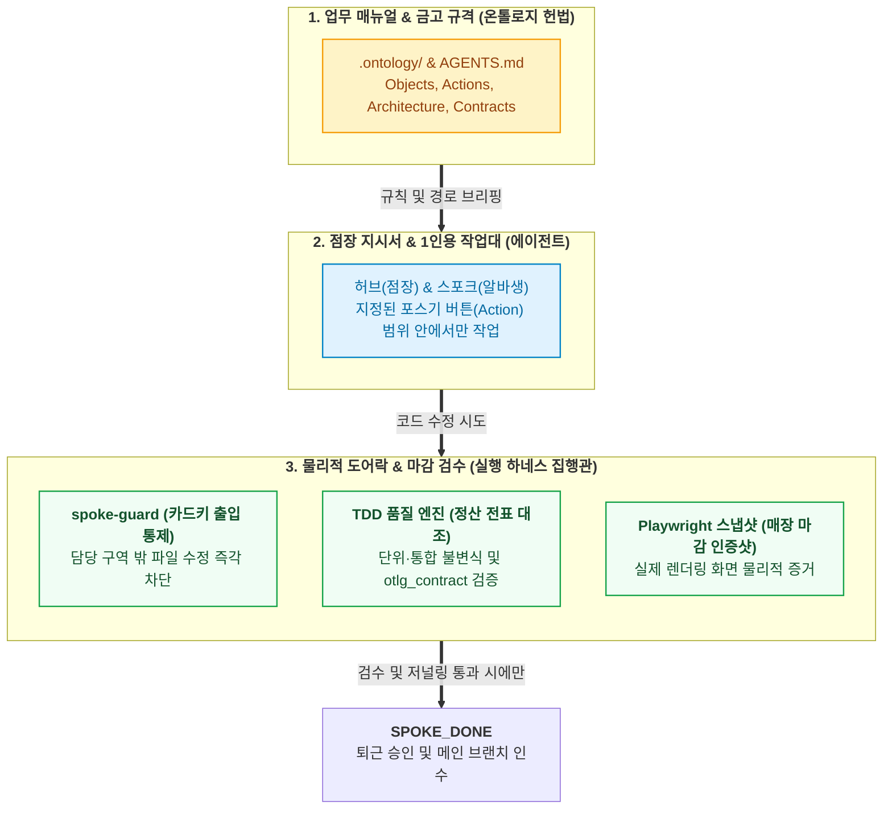
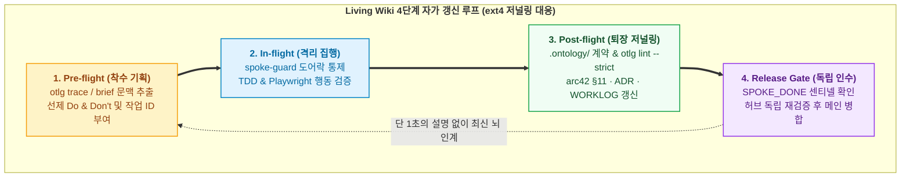

- table of contents
{:toc}

> "아무리 일 잘하는 알바생이 들어와도 가게 금고 열쇠와 장부 원본을 통째로 내어주는 사장님은 없다. 금고에 직접 손을 대게 하는 대신 화면에 딱 정해진 포스기(POS) 버튼만 누르게 하고, 담당 구역 밖의 창고 문은 아예 카드키가 찍히지 않게 잠가두어야 사고가 나지 않는다. 그리고 퇴근할 때는 오늘 바뀐 재고와 장부 내역을 정해진 서식에 맞춰 스스로 마감하게 해야 다음 날 출근한 근무자가 단 1초의 혼선도 없이 일을 이어받을 수 있다."
> 팔란티어(`Palantir`) `AIP`의 도구 호출 제어 철학을 소프트웨어 개발 라이프사이클(`SDLC`)에 이식한 물리적 실행 하네스와, 리눅스 커널의 저널링 파일시스템(`ext4`) 원리를 저장소 거버넌스에 결합한 `Living Wiki` 아키텍처다.
{:.lead}

---

## 매뉴얼만 줬더니 창고까지 뒤엎는 신입 알바생

지난 [[3편]](/tag-ontology-engineering/3-nouns-to-verbs-paradigm-shift/), [[4편]](/tag-ontology-engineering/4-zero-lint-error-illusion-and-v020/), [[5편]](/tag-ontology-engineering/5-three-graphs-and-tdd-contract-v030/)을 거치며 `.ontology/`에 3-Graph(`Domain`, `Architecture`, `Contract`)를 세우고 `otlg trace`와 `otlg brief`로 0.01초 만에 브리핑을 뽑아냈을 때만 해도, 에이전트가 알아서 완벽한 코드를 짜줄 것이라 기대했다. 하지만 요구사항을 병렬로 맡겨보면서, 정교한 온톨로지 YAML과 린터만으로는 에이전트의 무분별한 파일 수정을 런타임에 물리적으로 막을 수 없다는 현실을 마주했다.

비유하자면 새로 뽑은 알바생에게 완벽한 **'매뉴얼 북(`.ontology/`)'** 한 권을 쥐여준 뒤 안심하고 가게 전체 열쇠를 맡겨버린 셈이었다. 잠시 자리를 비웠더니 이 알바생은 카운터 정리만 하라니까 사장실과 옆 매장 창고까지 들어가 진열장을 마음대로 재배치해 놓고(스코프 월경), 매뉴얼에 없는 환불 손님이 오자 사장에게 물어보지도 않고 금고를 열어 어림짐작으로 현금을 집어주었으며(무언의 추측, `Guessing`), 정산이 깨졌는데도 퇴근할 때는 해맑게 "사장님, 오늘 마감 완벽하게 끝났습니다!"라고 카톡(환각 보고)을 남겼다.

사고 없는 매장을 만들려면 첫째로 정산 공식을 정의한 **'업무 매뉴얼과 금고 규격(`.ontology/` & `AGENTS.md`)'**, 둘째로 오늘 처리할 주문서(`Do & Don't`)와 **'전용 작업대(`Hub & Spoke` 격리 워크트리)'**, 셋째로 창고 문을 잠그는 **'물리적 도어락(`spoke-guard`)'**과 영수증·인증샷(`TDD` & `Playwright`)을 대조하는 **'마감 검수 시스템'**이 맞물려야 했다.

---

## AIP Tool Calling 철학과 헌법·집행관의 분업 구조

에이전트를 통제할 때 내가 깊이 참고한 사상은 `Palantir AIP`가 생성형 AI를 다루는 방식이었다. 흔히 범하는 실수는 `LLM`에게 DB 접속 정보나 범용 `SQL` 쓰기 권한을 통째로 넘기며 "알아서 데이터를 수정하라"고 지시하는 것이다. 이는 알바생에게 금고 비밀번호와 장부 원본을 내어주는 것과 같다. 도메인 맥락이 없는 AI는 동시성 행 잠금(`SELECT FOR UPDATE`)이나 멀티테넌트 격리(`tenant_id`), 선행조건을 무시한 채 임의의 `UPDATE` 쿼리를 날려 정합성을 파괴한다.

이를 차단하기 위해 `Palantir AIP`는 **"LLM에게 원천 데이터베이스(금고 열쇠)를 직접 주지 않고, 오직 온톨로지에 선언된 `Action Types`(포스기 버튼)만을 도구 호출(`Tool Calling`) 인터페이스로 제한 노출한다"**는 철학을 고수한다. 알바생이 포스기 화면의 '결제 승인', '부분 환불' 버튼만 누를 수 있듯, 에이전트도 온톨로지가 규정한 비즈니스 동사만 호출할 수 있다.

나는 이 철학을 B2B 학원 관리 SaaS의 `SDLC` 하네스에 이식했다. 다만 여기서 도메인 속성에 따른 결정적인 차이가 존재한다. 다음 [[7편]](/tag-ontology-engineering/7-trpg-kinetic-action-layer/)에서 다룰 **`TRPG Ontology`(`live_state`)**는 온톨로지 엔진 자체가 캐릭터 생명력과 인벤토리라는 라이브 상태 원본을 직접 소유하고 런타임에 상태 전이를 집행한다. 반면 수십만 줄의 코드로 돌아가는 **`Repo Ontology`(`code_specification`)**는 온톨로지가 DB 트랜잭션을 대신 실행하는 엔진이 아니라, **코딩 에이전트에게 어디서 어떤 불변식을 지켜 코드를 고쳐야 하는지 알려주는 '헌법(Spec)'을 제시하고, `spoke-guard` 물리적 훅과 `TDD`, `Playwright` 하네스가 그 헌법을 강제하는 '집행관(Enforcer)' 역할을 나눠 맡는 분업 구조**를 취한다.

새로운 기능 슬라이스를 발주할 때 점장(허브)은 `otlg trace`와 `otlg brief`로 사전 불변식과 `code_binding` 경로를 추출해 격리 작업대(`git worktree`)를 차리고, 세 겹의 방어선으로 스포크를 통제한다.

1. **선제 `Do & Don't` 계약과 호출 벨(`SPOKE_DECISION_NEEDED`)**: 온톨로지에 바인딩된 타깃 슬라이스만 수정하도록 못 박고, 미정의 예외 상황을 마주쳤을 때 어림짐작(`Guessing`)으로 처리하는 대신 즉시 손을 멈추고 점장에게 결정을 요청하도록 강제한다.
2. **문을 잠그는 `spoke-guard`(`PreToolUse Hook`)**: "들어가지 마라"는 당부(프롬프트 지시)만 믿고 가게 문을 닫을 수는 없다. 디버깅이 길어지면 에이전트는 프롬프트 제약을 잊고 공용 인증 모듈을 건드리거나 파괴적인 빌드 리셋 명령어를 날리곤 한다. 이를 막기 위해 도구 호출 직전 OS 프로세스 레벨에서 개입하는 `spoke-guard.sh` 도어락을 달아, `AGENTS.md` 헌법이나 허용 경로(`allowed_paths.txt`) 밖의 파일 수정을 시도하는 즉시 `exit 2`로 차단한다.
3. **퇴근 보고만 믿지 않는 마감 전표(`TDD`)와 인증샷(`Playwright`)**: 백엔드 단위 테스트 통과 로그만 띄워놓고 끝났다고 보고했지만, 브라우저를 열면 필수 필드 불일치(`422`)나 시간대(`KST`) 처리 오류로 빈 화면이 뜨는 일을 막기 위해 정적 검사와 행동 검증을 분리했다. 스포크는 `@pytest.mark.otlg_contract`로 테스트 증거를 봉인하고, 실제 헤드리스 브라우저(`Playwright`) 화면 스냅샷을 제출해야만 퇴근 도장(`SPOKE_DONE`)을 찍을 수 있다.

---

## 생산성의 역설과 리눅스 ext4를 닮은 4단계 Living Wiki 루프

온톨로지 헌법과 3중 하네스를 결합하자 스코프 침범 사고는 사라졌고, 2주 만에 475개의 검증된 커밋이 합류하는 폭발적인 생산성을 기록했다. 하지만 코딩 속도가 빨라지자 **'무엇을 어느 문서에 반영해야 하는가'에 대한 컨텍스트를 유일한 인간인 내가 머릿속에 쥐고 매번 사후 문서화 지시를 챙겨줘야 하는 피로**가 새로운 병목이 되었다.

이 위기를 돌파하게 해준 것은 두 가지 통찰과 『개발 규율집』 v2.2 개정이었다. 첫째는 유튜브 '우주초월' 채널에서 얻은 **"위키 갱신은 사후 작업이 아니라 에이전트가 퇴장하기 전 자신의 컨텍스트 안에서 완수해야 하는 공식 생명주기의 마지막 관문"**이라는 통찰이었다. 둘째는 '코딩하는 기술사' 채널에서 다룬 **아키텍처 문서화 3대 국제 표준(`arc42`, `C4 Model`, `ADR`)**이었다. 나는 `.ontology/`와 중복되던 수기 기능 문서(`docs/features/`)를 전면 폐지해 `.ontology/`로 흡수하고, **1) 규범(`AGENTS.md`) · 2) 도메인 계약(`.ontology/`) · 3) 현재 구조 및 기술 부채(`docs/architecture/` `arc42 §11` 일원화) · 4) 결정 근거(`docs/adr/`) · 5) 실행 및 보류 기록(`WORKLOG.md`, `deferred-watchlist.md`)**의 **5대 정본 문서(SSOT) 체제**를 완성했다.

{:width="700" loading="lazy"}

`docs/architecture/` 디렉토리의 `arc42` 12절 문서 구조와 `C4 Model` 시스템 컨텍스트 다이어그램 실제 화면
{:.figcaption}

나아가 리눅스 커널의 `ext4` 파일시스템이 데이터 블록 쓰기 뒤 저널(`JBD2`)과 메타데이터(`inode`) 갱신까지 마쳐야 트랜잭션 커밋으로 인정하듯, 우리의 SDLC 하네스 역시 **착수 기획(`Pre-flight`) -> 격리 집행(`In-flight`) -> 퇴장 저널링(`Post-flight`) -> 독립 인수(`Release Gate`)로 이어지는 4단계 자가 갱신 루프**를 하나의 트랜잭션으로 묶었다.

스포크가 `.spoke/SPOKE_DONE`을 발행하기 직전 완수하는 **`Post-flight` 퇴장 관문**은 1) `.ontology/` 명세·계약 동기화, 2) `otlg lint --strict` 무결성 검증, 3) `arc42`(`§11` 부채 포함)·`ADR`·`deferred-watchlist.md` 라우팅, 4) `WORKLOG.md` 세션 판단 기록을 강제한다. (자기 커밋의 해시를 같은 커밋 안에 미리 적으려 하는 순환 모순을 피하기 위해, 커밋 메시지에는 제목 끝 `(F12)`와 footer `Refs: F12`로 안정 식별자를 박아 추적성을 유지한다.)

그 결과 사후 문서화 병목이 사라졌을 뿐 아니라, **다음 날 새로 스폰되는 에이전트의 온보딩 비용이 사실상 '제로(0)'로 수렴**했다. 직전 에이전트가 5대 정본을 최신 상태로 저널링하고 퇴근했기에, 신규 에이전트는 80줄짜리 `AGENTS.md`를 읽고 `otlg trace`와 `otlg brief`를 실행하는 것만으로 최신 도메인 계약과 코드 지도를 0.01초 만에 물려받아 즉시 다음 구현에 착수한다.

> [심화 근거: spoke-guard 물리적 훅과 4단계 Living Wiki 자가 갱신 루프·개발 규율집 v2.2 상세 명세 보러가기](/tag-ontology-engineering/deep-dive/repo-sdlc-and-audit/#living-wiki)

---

### [시리즈의 다음 이야기]

지금까지 다룬 코드 레포지토리 도메인에서는 온톨로지(`.ontology/`)가 '헌법과 명세'를 맡고 실행 하네스(`spoke-guard`, `TDD`, `Playwright`)가 '집행과 검증'을 나눠 맡는 분업 구조를 취했다. 그렇다면 온톨로지가 정적 명세서에 머물지 않고, **온톨로지 엔진 그 자체가 런타임에 직접 세계의 상태를 바꾸고 물리 법칙을 집행하는 진짜 팔란티어식 `Kinetic / Action Layer`**를 끝까지 구현해 보면 어떤 모습일까? 세 번째 도메인으로 뛰어들어 마침내 동사 중심 온톨로지의 마지막 퍼즐을 맞춘 이야기는 다음 글인 **[[7편] 주사위는 거짓말을 하지 않는다, TRPG에서 비로소 도달한 진짜 Action Layer](/tag-ontology-engineering/7-trpg-kinetic-action-layer/)**에서 이어진다.
