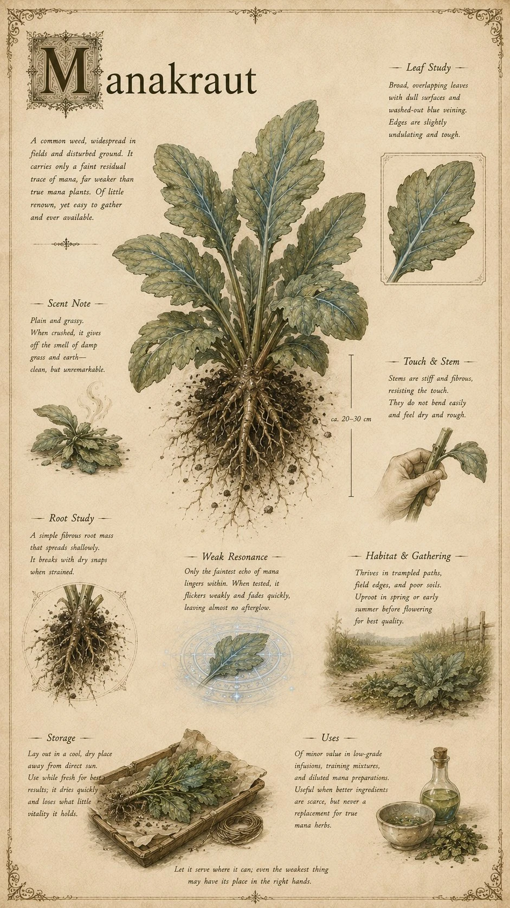
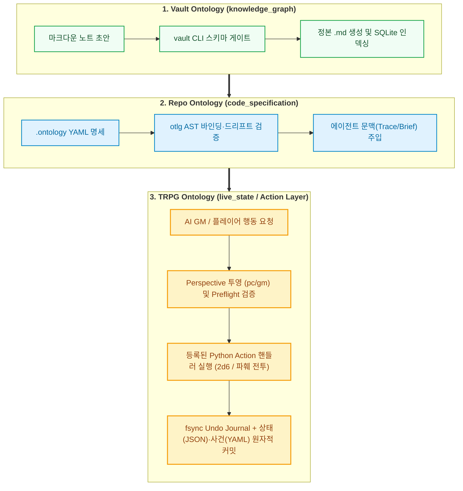
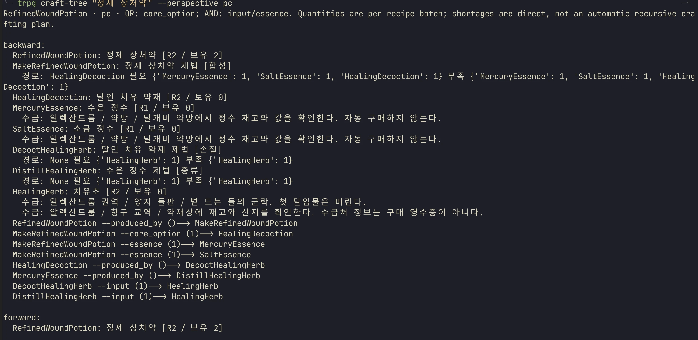

- table of contents
{:toc}


## 명사와 코드 명세를 넘어 살아 움직이는 세계로

앞선 [[5편]](/tag-ontology-engineering/5-sdlc-harness-and-living-wiki/)까지 다룬 코드 레포지토리의 온톨로지(`otlg`)는 어디까지나 코드가 지켜야 할 규칙을 적어 둔 '정적 명세'였다. 그러다 보니 문득 이런 욕심이 생겼다. **온톨로지가 설계 명세에 머물지 않고, 직접 런타임에 사전 조건을 검사하고 세계의 상태를 바꾸는 실행 주체가 되면 어떤 모습일까?** 팔란티어(Palantir)가 말하는 `Semantic Layer` 너머의 진짜 `Action Layer`를 내 손으로 끝까지 구현해 보고 싶다는 생각은, 뜻밖에도 퇴근 후의 취미 프로젝트에서 가장 먼저 불이 붙었다.

그 계기는 취미로 시작한 'AI 에이전트(GM)와 함께하는 판타지·연금술 TRPG' 프로젝트였다. 내가 직접 설계한 연금술사가 되어 도시와 유적을 탐험하고 AI가 게임 마스터(GM)를 맡아 세상의 반응을 묘사해 주는 구조였다. 처음에는 인물과 장소, 연금술 레시피, 사건 설정을 마크다운 문서로 계속 쌓아가며 진행했다. 물론 그 과정에서도 주사위를 굴리거나 인벤토리를 관리하고 시간 경과를 계산하는 일처럼 **기계적으로 처리해야 하는 부분은 전용 CLI를 만들어 역할을 분업**해 둔 상태였다.

{:width="440" loading="lazy"}

`ComfyUI`로 직접 생성한 TRPG 등장인물 일러스트. 캐릭터 설정에 맞춰 복식과 무장까지 시각화해 캠페인의 몰입감을 높였다.
{:.figcaption}

{:width="440" loading="lazy"}

세계관 속 연금술 약초(`Manakraut`)의 잎·뿌리·향기·마력 공명과 채집·보관법까지 고서 도감 형식으로 구현한 시각 자료.
{:.figcaption}

이 TRPG 프로젝트에는 꽤 많은 애정과 시간을 쏟았다. 캐릭터 대사를 소리로 듣기 위한 음성 생성 파이프라인을 붙이고, 위 캐릭터와 도감 이미지를 직접 뽑아내려고 `ComfyUI`까지 새로 공부해 적용했다. 세계관의 바탕이 되는 연금술 설정을 다듬기 위해 『도해 연금술』이라는 책을 사서 읽고 실제 게임 규칙에 녹여냈을 만큼 깊이 빠져들었던 작업이었다.
{:.note title="여담"}

하지만 캠페인이 길어지고 마크다운 문서가 수십, 수백 개로 불어나면서 한계가 뚜렷해졌다. 기계적 계산은 CLI로 떼어냈지만, 정작 **방대한 세계관 설정과 NPC 관계, 사건 맥락을 매 턴 AI GM에게 얼마나 효율적으로 전달할 것인가**라는 문제가 남아 있었기 때문이다. 문서가 늘어날수록 AI가 필요한 설정을 놓치거나, 반대로 GM 참고용 비밀 설정(`gm_only`)까지 한꺼번에 읽어 들여 대사 속에 스포일러를 흘릴 위험도 커졌다.

바로 그 지점에서 앞서 구축한 코드 온톨로지(`repo-ontology`)의 경험이 자연스럽게 이어졌다. 코드 레포지토리에 온톨로지를 세우며 했던 일의 본질 역시 **방대한 코드와 규칙 정보를 그래프와 명세로 구조화해 AI에게 가장 효율적으로 전달하고, 정해진 계약 안에서만 움직이게 만드는 것**이었다. *'이 원리를 TRPG에 적용하면 딱 맞겠다'*는 생각이 들었고, 그때부터 단순 보조 도구였던 CLI를 **온톨로지 기반의 `live_state` 실행 엔진(`trpg-ontology`)**으로 본격 확장하기 시작했다. 장면마다 플레이어가 알 수 있는 지식만 추려서 건네주고, 등록된 파이썬 핸들러가 사전 조건을 검증한 뒤 주사위 판정과 자원 차감, 시간 경과, 사건 이력 기록을 하나의 트랜잭션으로 집행하도록 묶어낸 것이다.



다이어그램처럼 `trpg-ontology`는 단순한 설정 위키가 아니다. AI GM이 세상의 상태를 읽을 때는 플레이어가 알 수 있는 지식만 투영해서 보여주고, 세계에 변화를 가할 때는 반드시 등록된 행동 계약을 통해서만 상태를 전이시키는 **실행형 캠페인 운영체제**다.

- [심화 근거: TRPG 10개 도메인 패키지, 3·3·3 연금술 토폴로지, Action 핸들러 및 fsync 저널 상세 명세 보러가기](/tag-ontology-engineering/deep-dive/trpg-world-canon/#action-layer)

---

## 멱등한 Action Layer와 `fsync` 저널로 세운 원자적 상태 관리

TRPG 온톨로지의 가장 큰 전환점은 **"Action YAML의 자연어 설명은 절대 실행하지 않으며, 오직 사전에 등록된 파이썬 핸들러만 세계의 상태를 바꿀 수 있다"**는 실행 계약을 세운 것이었다. 초기에는 에이전트가 주사위를 굴린 뒤 캐릭터 파일과 사건 파일을 각각 수정하게 했는데, 중간에 오류가 나면 돈만 깎이고 아이템은 들어오지 않는 부분 저장 오염이 일어나기 쉬웠고, 자연어 규칙을 제멋대로 해석할 여지도 남아 있었다.

이를 막기 위해 단서 조사, 연금술 조제(`CraftAlchemyItem`), 시간 전진, 여정 이동, 재료 채집, 휴식 회복, 미스터리·위협 종결까지 7가지 기본 행동 핸들러와 1가지 전투 루프를 합쳐 총 8가지 등록 Action에만 상태 변경 권한을 주었다.

```bash
# 단서 조사 및 연금술 조제: 사전 조건 검증, 2d6 판정, 대가 적용, 사건 기록을 단일 트랜잭션으로 마감
trpg act InvestigateAndDecode --id EVT-D019-POISON \
  --clue CLUE-POISON-SOLVENT-TRACE --prof --cost-threat SeveredSerpentHunt
trpg act CraftAlchemyItem --id EVT-CRAFT \
  --recipe MakeRefinedWoundPotion --core HealingDecoction --cost-money 10
```

명령을 실행하면 작업 공간과 캠페인 단위로 파일 잠금을 두 겹으로 걸어 동시 수정을 막고, 파일을 고치기 전에 원본 상태를 디스크에 즉시 기록(`fsync`)하는 되돌리기 저널에 백업해 둔다. 수치를 따로 고친 경우에도 변경 전후의 확인 값을 임시로 남겨 두어, 사건을 정식으로 마감하기 전까지는 린터가 미완료 경고를 띄운다. 특히 판정에서 '대가를 치르는 부분 성공'이 나왔는데도 자원 소모나 위협 시계 반영 없이 사건을 마감하려 하면 저장을 거부한다. 또 요청마다 고유 ID로 멱등성을 보장해, 같은 요청을 다시 보내도 주사위를 새로 굴리지 않고 이전 결과를 그대로 돌려준다.

하지만 기존 테스트 287개와 엄격한 린트 검사를 모두 통과했을 때도 **"내가 짠 테스트가 통과했다는 사실은 내가 상상한 시나리오만 안전하다는 뜻일 뿐"**이라는 의심을 지우지 않았다. 결국 `Codex`와 `Gemini`를 함께 투입해 빈틈을 찌르는 적대적 검수(Adversarial Review)를 해 보았다. 그 과정에서 사건 기록 밖에 있는 전투 로그에서 처치한 적 정보를 바꿔도 검사에 걸리지 않던 허점, 같은 날 밤 사건이 오전 사건의 원인으로 등록되는 시간 순서 모순, 이미 죽었거나 비공개 상태인 NPC를 단서 경로로 인정하던 오류를 찾아냈다.

그래서 곧바로 새 사건 기록에 전투 로그의 해시 값을 함께 묶어 변조를 막고, 하루 네 시간대(오전 → 오후 → 저녁 → 밤)의 앞뒤 순서와 단서 제공자의 생존·공개 여부를 교차 검사하도록 고쳤다. 이때 해시 검증을 도입하기 전에 쌓였던 과거 전투 기록 2건에 뒤늦게 해시를 채워 넣는 편법은 쓰지 않고, "검증 도입 이전의 기록"으로 솔직하게 구분해 남겼다. 그 결과 `trpg-ontology`는 새로 추가한 회귀 테스트 41건을 포함해 322개 테스트를 통과(GUI 테스트 6건 별도 제외)하고, 엄격한 린트 검사에서도 오류 0건을 기록했다.

- [심화 근거: TRPG 10개 도메인 패키지, 3·3·3 연금술 토폴로지, Action 핸들러 및 fsync 저널 상세 명세 보러가기](/tag-ontology-engineering/deep-dive/trpg-world-canon/#action-layer)

---

## 3단서 법칙과 연금술 도감 그래프, 그리고 3조건 전투 시뮬레이션

원자적 상태 관리 위에서는 미스터리 추리, 연금술 조제, 전투 밸런스라는 세 가지 게임 메커니즘이 온톨로지 그래프와 맞물려 돌아간다.

먼저 미스터리 시나리오가 주사위 실패 한두 번으로 막히지 않도록 고전 설계 원칙인 **'3단서 법칙(Three Clue Rule)'**을 정적 검증기(`trpg lint --strict`)에 이식했다. 모든 핵심 결론은 최소 3개 이상의 독립 단서(`supports`)와 연결되어야 하며, 각 단서가 현재 살아 있고 접근 가능한 NPC나 장소를 통해 실제로 획득 가능한지, 선행 단서들 사이에 순환 참조는 없는지까지 린터가 검사한다. (참고로 플레이어 관점 조회인 `--perspective pc`를 켜면 `gm_only`로 표시된 비밀 설정이나 NPC 내면 목표는 탐색 전에 걸러내어 스포일러를 방지한다.)

연금술 역시 단순 문자열 아이템 목록이 아니다. 59종의 아이템과 50종의 제법을 `Frontmatter v1` 스키마로 마크다운 도감 문서와 양방향 바인딩(`trpg docs lint`)해 두고, 대체 코어와 기법 수준, 설비 요구사항, 캐릭터의 실제 재료 재고까지 그래프로 엮었다. 덕분에 `trpg craft-tree` 한 줄만 실행해도 지금 당장 어떤 재료를 모아 어떤 상위 약물을 조제할 수 있는지 한눈에 역추적된다.

```bash
# 3단서·도감 무결성 검사 및 연금술 조합 트리·전투 밸런스 시뮬레이션
trpg lint --strict
trpg craft-tree "정제 상처약" --perspective pc
trpg draft check PreparedEncounter --json
trpg battle sim PreparedEncounter --json
```

{:width="760" loading="lazy"}

`trpg craft-tree` 실행 화면. 목표 약물(`정제 상처약`)에서 하위 제법, 대체 코어·정수, 원재료(`치유초`)의 실제 채집·구매처와 현재 보유 재고까지 한 번에 역추적한다.
{:.figcaption}

나아가 세션 중에 새로 구상한 보스나 조우 초안(`EncounterDraft`)을 캠페인에 편입하기 전에는 **3조건 격리 시뮬레이션(`trpg draft check` & `battle sim`)**을 거친다. 특히 필수 파훼 아이템 재료가 *'지금 잡아야 하는 바로 그 보스의 전리품에만 존재하는 순환 잠금(Boss Drop Circular Lock)'* 상태인지 역추적해 사전에 거절하고, 빈손·현재 인벤토리·현지 채집 및 제작까지 반영한 세 가지 조건으로 2d6 약점 파훼(`Break`) 전투를 시뮬레이션해 밸런스 붕괴를 미리 막아낸다.

---

## 세 개의 도메인을 구축하고 마주한 다음 질문, 메타 온톨로지

이렇게 지식 베이스(`Vault`), 실무 코드 레포지토리(`Repo`), 그리고 살아 움직이는 캠페인 런타임(`TRPG`)까지 세 개의 서로 다른 영역에 온톨로지를 세우고 나자, 머릿속에서 한 가지 거대한 공학적 유혹이 고개를 들기 시작했다. 과연 이 온톨로지들을 모두 아우르는 단 하나의 만능 스키마나 통합 프레임워크를 만들 수는 없을까? 그리고 새 도메인을 만났을 때 어디까지 온톨로지로 묶고 어디서 과잉 설계를 멈추어야 할까? 이어지는 **[[7편] 언제 온톨로지를 쓰고 언제 멈출 것인가: 메타 워크벤치와 6가지 설계 원칙](/tag-ontology-engineering/7-meta-ontology-workbench-and-redteam/)**에서는 도메인들을 관통하는 메타 설계 공방(`ontology-workbench`)과 `Negative Gate`, 두 AI를 맞붙인 적대적 검수의 6대 원칙, 그리고 1인 팀의 시스템 주권에 대한 이야기를 풀어본다.
