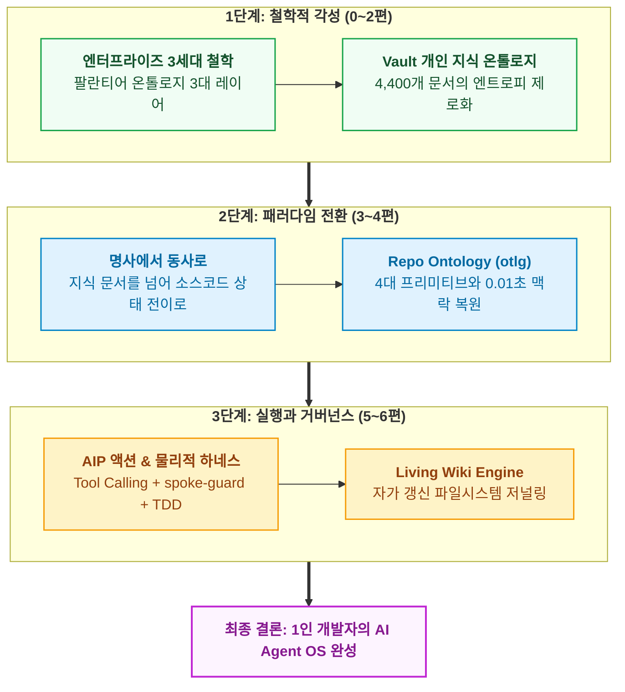

- table of contents
{:toc}

> "팔란티어 도입의 진짜 장벽은 기술의 부족이 아니었습니다. 자신의 엑셀 파일에 쥐고 있던 데이터 권력을 빼앗기지 않으려는 조직의 정치와 저항이었습니다."
> 거대 기업들이 데이터 사일로(Silo)를 부수며 전사 운영체제를 세우려 했던 치열한 투쟁, 그리고 1인 개발자가 개인 지식(`Vault`)과 저장소(`Repo`)에 온톨로지를 구축하여 스스로 시스템 주권을 쟁취해 낸 여정의 완결 기록이다.
{:.lead}

---

## 개요

지난 [[6편] 문서는 스스로 숨 쉰다](/tag-ontology-engineering/6-living-wiki-and-metadata-journaling/)까지 달려오며, 우리는 개인의 지식 베이스부터 수십만 줄의 프로덕션 코드베이스에 이르기까지 온톨로지라는 단단한 척추를 세우고 자가 치유 거버넌스로 마감하는 전 과정을 살펴보았다. 시리즈의 대단원을 장식하는 이번 마지막 글에서는 잠시 기술적 구현의 디테일에서 한 걸음 물러나, 거대 엔터프라이즈가 온톨로지를 도입할 때 마주하는 가장 거대한 본질적 장벽인 '조직의 저항'을 들여다보고 이를 1인 개발자의 내면과 시스템 주권이라는 관점으로 투영해 보고자 한다.

---

## 팔란티어는 왜 기술 회사가 아니라 '조직 변화의 회사'인가

### 17대 1의 공방전과 엑셀 뒤에 숨은 사일로의 권력

두산인프라코어와 DL E&C, 그리고 KT에 이르기까지 국내 굴지의 대기업 세 곳에서 `Palantir` 도입을 최전선에서 총괄했던 변우철 본부장은 지난 7년간의 여정을 회고하며 무척 인상적인 증언을 남겼다. 흔히 외부에서는 수천억 원대 엔터프라이즈 데이터 플랫폼을 도입할 때 가장 어려운 난관이 파편화된 레거시 데이터베이스를 정제하거나 복잡한 파이프라인을 엮어내는 기술적 문제일 것이라고 짐작하기 마련이다. 그러나 그가 현장에서 마주했던 진짜 장벽은 기술의 부족이 아니라, **"왜 내 데이터를 저 시스템에 다 넘겨야 하느냐"**라며 격렬하게 저항하는 각 부서장들과 실무자들의 반발이었다. 그는 도입을 추진하는 내내 단 한 번도 조직의 호의나 따뜻함을 느껴본 적이 없었으며, 늘 등에 칼을 꽂고 다닌다는 소리를 들으며 17대 1로 부서장들의 집중 공격을 견뎌내야 했다고 술회했다.

> *"팔란티어를 전사에 도입할 때 가장 힘들었던 것은 데이터 정제나 파이프라인 개발이 아니었습니다. 자신의 엑셀 파일에 쥐고 있던 데이터 권력을 빼앗기지 않으려는 각 부서장들과 실무자들의 반발이었습니다."*

도대체 왜 현업 부서들은 전사의 데이터를 하나로 투명하게 연결하겠다는 시스템에 그토록 날을 세우며 저항했던 것일까. 그 이면을 들여다보면 엔터프라이즈 환경에서 데이터란 단순한 숫자의 집합이 아니라, 곧 각 부서가 쥐고 있는 **'조직 권력(Power)'**이자 방패이기 때문이다. 전통적인 대기업 조직은 영업, 생산, 조달, 물류 등 각자의 기능 단위로 높다란 사일로(Silo)의 성벽을 쌓고 서로의 영역을 침범하지 않는 불문율 속에서 굴러간다. 생산 부서는 자신들만의 로컬 엑셀 시트에 실제 공장 가동률과 불량률의 원천 숫자를 숨겨두고, 영업 부서는 자신들만의 파일에 수주 잔고와 할인율의 세부 내역을 감춰둔 채 회의실로 들어온다. 사일로 안에 안전하게 숨어 있으면 자기 부서 관점에서는 언제나 최선을 다하고 있으므로 아무런 문제가 없어 보이며, 임원 회의 때마다 각자 부서에 유리하게 가공한 숫자를 엑셀에서 뽑아와 방어막을 치고 정치적 공방을 벌이는 것이 익숙한 생존 방식이었던 셈이다.

예컨대 주문 후 고객에게 제품이 도달하기까지 경쟁사는 하루가 걸리는데 우리 회사는 3일이 걸리는 병목이 발생했다고 가정해 보자. 사일로가 공고한 조직에서는 배송팀을 다그치는 선에서 논의가 맴돌지만, `Palantir`의 온톨로지를 통해 영업부터 생산, 출하까지의 엔드투엔드(End-to-End) 데이터를 단일한 객체(`Objects`)와 관계(`Links`)로 투명하게 엮어버리면 진짜 원인이 생산 리드타임과 구형 설비 교대 주기에 있다는 사실이 그 자리에서 적나라하게 드러난다. 이처럼 온톨로지가 부수려 했던 대상은 단순히 물리적으로 흩어진 데이터베이스의 파편화가 아니라, 엑셀 장막 뒤에 숨어 책임을 회피하고 기득권을 유지하던 조직의 사일로 자체였다.

### 포인트 솔루션의 함정을 넘어 전사 운영체제(Enterprise OS)로

많은 실무자들이 `Palantir`를 처음 마주했을 때 겪는 흔한 오해 역시 이 사일로의 관성에서 비롯된다. 기존 부서 단위의 업무 방식에 익숙한 이들은 `Palantir`를 세일즈포스(`Salesforce`) 같은 CRM이나 특정 공정만 다루는 SCM 툴, 즉 단일 목적에 특화된 '포인트 솔루션(Point Solution)'의 잣대로 평가하곤 한다. 동네 슈퍼에 장을 보러 갈 목적이라면 경차 한 대면 충분한데, 그 자리에 수억 원짜리 페라리를 끌고 와서는 왜 이렇게 차가 비싸고 장바구니 넣을 짐칸이 좁으냐고 불평하는 격이다.

팔란티어의 파견 엔지니어(FDE)들이 고객사에 첫발을 디뎠을 때 라이선스 수량이나 서버 스펙을 묻는 대신, 닷새 내내 **"당신네 회사가 겪고 있는 가장 고통스러운 문제, 해결하면 1,000억 원을 벌 수 있는 전사 과제가 무엇인가"**만을 집요하게 파고드는 이유가 바로 여기에 있다. 영국의 에너지 기업 BP가 연간 1,000억 원이 넘는 비용을 지불하면서도 `Foundry`를 전사 표준으로 삼은 것은, 300조 원에 달하는 제조원가 구조에서 전사 밸류체인의 생산성을 단 10%만 개선해도 수조 원 단위의 영업이익이 창출되기 때문이다.

결국 온톨로지를 세운다는 것은 특정 부서의 업무를 돕는 예쁜 대시보드나 분석 툴 하나를 새로 까는 일이 아니다. 전사의 모든 임직원과 AI 에이전트가 부서별 엑셀 파일 대신 단 하나의 단일 진실 공급원(SSOT)을 바라보게 만들고, 그 위에서 의사결정 기준(`Logic`)과 실제 시스템 반작용(`Action`)이 한 몸으로 돌아가도록 기업의 권력 구조와 일하는 방식을 송두리째 재편하는 **'전사 운영체제(Enterprise OS)'**의 이식 수술이라고 해도 과언이 아닐 것이다. 변우철 본부장이 성공적인 도입의 절대 조건으로 CEO의 직접적인 갈등 개입과 임원급 전담 조직을 꼽은 것 또한, 온톨로지가 본질적으로 기술을 넘어선 조직 거버넌스의 혁명이기 때문이다.

---

## 1인 개발자와 내면의 저항: 시스템에 주권을 넘기다

### 내 안의 사일로, '나태함과 순간의 타협'이라는 적

한편, 수만 명의 임직원이 얽힌 거대 엔터프라이즈의 시선에서 다시 내 책상 앞의 컴퓨터로 시선을 돌려보자. 지난 1년 남짓한 시간 동안 스타트업의 유일한 개발자로서 58개 화면 규모의 B2B 학원 통합 관리 SaaS를 홀로 설계하고 운영하던 나에게는, 당연히 데이터 제출을 거부하는 타 부서장도 없었고 회의실에서 엑셀 숫자를 두고 벌이는 사내 정치도 존재하지 않았다. 내가 곧 기획자이자 백엔드·프론트엔드 개발자였으며, 인프라 엔지니어이자 최종 의사결정권자였기 때문이다.

그러나 1인 개발자의 환경에는 대기업의 부서장들보다 훨씬 더 교묘하고 무서운 적이 도사리고 있었다. 그것은 바로 피곤한 밤이나 촉박한 마감 일정 앞에서 끊임없이 고개를 드는 **'나 자신의 나태함과 순간적인 타협'**이라는 내면의 저항이었다. 누군가 옆에서 내 코드를 리뷰해 주거나 아키텍처 원칙을 강제하는 동료가 없다 보니, 당장 눈앞의 기능 하나만 빨리 돌아가게 만들고 싶은 유혹은 매 순간 달콤한 목소리로 나를 흔들곤 했다.

- *"이번 지식 정리는 시간이 없으니까 굳이 13개 스키마나 `builds_on` 관계를 따지지 말고 일단 빈 노트에 대충 적어두자."*
- *"이번 수납 상태 변경 버그는 간단한 예외 처리니까, 귀찮게 `.ontology/`의 액션 스펙(`Actions`)을 먼저 고치지 말고 백엔드 서비스 코드만 살짝 고쳐서 배포하자."*
- *"에이전트가 짠 코드가 당장 화면에서는 잘 돌아가는 것 같으니, 시간이 걸리는 `TDD` 검증이나 `Playwright` 스냅샷 대조는 건너뛰고 일단 머지한 뒤에 나중에 정리하자."*

부끄럽지만 초창기의 나는 이러한 내면의 타협에 꽤 자주 무릎을 꿇었다. 그리고 그 안일한 타협이 한두 번씩 쌓여갈 때마다, 내가 관리하던 개인 지식 볼트와 프로덕션 코드베이스는 대기업의 파편화된 엑셀 시트들과 놀라울 정도로 똑같은 모습으로 썩어 들어갔다. 문서에는 적혀 있지 않은 암묵적인 예외 로직이 코드 곳곳에 숨어들어 사일로를 만들었고, 다음 날 새로운 세션에서 깨어난 기억상실증 AI 에이전트는 그 숨겨진 맥락을 알지 못한 채 코드를 덮어쓰며 멀쩡하던 기존 기능을 연쇄적으로 파괴했다. 남들과 싸울 필요가 없었을 뿐, 나 자신이 매일같이 과거의 나와 미래의 에이전트를 속이며 보이지 않는 데이터 사일로를 쌓아 올리고 있었던 셈이다.

| 비교 차원 | 엔터프라이즈의 데이터 사일로 (`Enterprise`) | 1인 개발자·에이전트의 맥락 사일로 (`Solo & Agent`) |
| :--- | :--- | :--- |
| **저항의 주체** | 데이터 권력을 뺏기지 않으려는 각 부서와 실무자 | 마감 압박 속에 규칙을 건너뛰려는 인간 개발자의 나태함 |
| **파편화의 형태** | 부서별 로컬 엑셀 파일에 숨겨진 가공된 숫자 | 문서와 분리된 핫픽스 코드, 머릿속에만 있는 암묵지 규칙 |
| **발생하는 병목** | 부서 간 책임 공방, 전사 밸류체인 최적화 실패 | 세션 초기화 시 에이전트의 맥락 상실, 기존 불변식 파괴 |
| **돌파 메커니즘** | C-레벨의 탑다운 결단과 단일 온톨로지(`Foundry`) 강제 | 인간의 의지력을 배제한 CLI 게이트(`vault`, `otlg`)와 물리적 훅 |

### 인간의 의지력을 믿지 않기로 했다: 시스템으로의 주권 이양

그 뼈아픈 자가당착을 겪고 나서야 나는 1인 개발자가 진정으로 싸워야 할 대상이 무엇인지를 똑바로 직시할 수 있었다. 대기업의 CEO가 부서 간 사일로를 허물기 위해 인사권과 제도적 강제력을 동원하듯, 나 역시 내 안의 나태함과 에이전트의 환각을 동시에 제압하기 위해서는 **'인간의 변덕스러운 의지력이나 기억력을 결코 믿지 않는 시스템'**을 세워야만 했다.

내가 개인 지식 베이스(`Obsidian Vault`)에서 에이전트나 나 자신이 임의로 마크다운 파일을 직접 생성하지 못하도록 막고 오직 `vault new`라는 엄격한 스키마 거부 게이트를 통과해야만 문서가 만들어지게 강제한 것, 그리고 코드 저장소(`Repository`)에 `otlg lint --strict`와 `spoke-guard.sh`라는 물리적 사법부를 세워 온톨로지 계약에 어긋나는 파일 수정을 커널 레벨에서 즉시 차단(`exit 2`)해 버린 진짜 이유가 바로 여기에 있다.

고민 끝에 내가 내린 답은 데이터와 규칙의 주권을 '인간 개인의 알량한 기억과 선의'에서 **'기계적으로 강제되는 시스템(온톨로지)'**으로 온전히 이양하는 것이었다. 아무리 내가 피곤하고 급하더라도 온톨로지 명세를 먼저 갱신하고 정적 심볼 바인딩 검사를 통과하지 않으면 아예 다음 단계로 넘어갈 수 없도록 내 손발에 스스로 족쇄를 채운 것이다. 아이러니하게도 그렇게 나 자신의 자의적인 타협 권한을 시스템에 넘겨주고 나자, 비로소 나는 39만 줄에 달하는 풀스택 코드베이스와 4,400여 개의 지식 문서를 단 한 명의 인력으로 온전히 방어하고 통제할 수 있는 진정한 의미의 **'시스템 주권'**을 손에 넣을 수 있었다.

---

## 온톨로지 엔지니어링의 완결: 지식 그래프에서 AI Agent OS로

돌아보면 처음부터 이처럼 정교한 온톨로지 체계를 머릿속에 다 그려놓고 시작했던 것은 아니었다. 당장 내 앞에 쏟아지는 공부 기록들이 볼트 안에서 길을 잃고 고립되는 것이 아까웠고, 밤새워 에이전트와 함께 짜놓은 프로덕션 코드가 다음 날 다른 에이전트의 손에 허무하게 망가지는 고통을 어떻게든 끝내고 싶다는 절박함이 모든 설계의 출발점이었다. 그렇게 눈앞의 결핍을 하나씩 메우며 달려온 여정은, 결과적으로 이 시리즈의 전체 관문을 이루는 **'3단계의 척추 진화'**로 응집되었다.

### 1단계: 철학적 각성과 지식의 척추 (0편 ~ 2편)

여정의 첫걸음은 온톨로지라는 낯선 개념의 역사적·공학적 실체를 바로 아는 데서 시작되었다. 우리는 시리즈의 현관문인 [[0편] 온톨로지를 활용한 레포지토리 방법론에 대하여](/tag-ontology-engineering/0-ontology-engineering-intro/)를 열어젖힌 뒤, 이어지는 [[1편] 2천 년 전 그리스 철학이 현대 기업의 엑셀 지옥을 구원할 리가 없어](/tag-ontology-engineering/1-palantir-3rd-generation-platform/)에서 아리스토텔레스의 존재론과 빅데이터 시대의 실패(데이터의 늪)를 짚어보며, 왜 데이터(`Data`), 로직(`Logic`), 액션(`Action`)이 결합된 3세대 데이터 플랫폼만이 실행형 AI(`AIP`)의 유일한 전제조건이 될 수 있는지를 확인했다.

그 철학적 통찰을 내 컴퓨터 안의 지식 자산에 최초로 이식한 결과물이 바로 [[2편] 4,400개의 흩어진 생각에 척추를 세우다](/tag-ontology-engineering/2-vault-knowledge-ontology/)였다. 기존 폴더 분류(`PARA`)의 한계와 맥락 없는 벡터 검색(`RAG`)의 환각을 넘어, 13개의 문서 타입(`type`)과 선행 지식 계보(`builds_on`)를 `SQLite` 그래프 인덱스로 엮어냄으로써 4,400여 개의 노트가 단 한 건의 스키마 위반(`0 violations`)도 없이 살아 숨 쉬는 **'개인 지식 운영체제(Vault OS)'**의 척추를 세울 수 있었다.

### 2단계: 패러다임 전환과 코드의 척추 (3편 ~ 4편)

하지만 정적인 지식 도서관을 완벽히 정리했다는 자만은 살아 움직이는 프로덕션 코드베이스 앞에서 곧바로 산산조각이 났다. [[3편] 문서는 명사로 정리되지만 코드는 동사로 움직인다](/tag-ontology-engineering/3-nouns-to-verbs-paradigm-shift/)에서 고백했듯, *"We hate dashboards"*라는 팔란티어 키노트의 일갈과 두 에이전트(`Antigravity`, `Codex`)의 냉정한 교차 검증을 거치며 나는 지식 문서는 **'명사(Taxonomy)'**를 다루지만 소프트웨어 코드는 **'동사(Action & State Transition)'**를 다룬다는 결정적인 본질을 깨닫게 되었다.

그 깨달음을 실제 코드 레포지토리에 구현해 낸 결정체가 [[4편] 에이전트에게 매번 설명하기 귀찮다면 레포지토리가 직접 말하게 하면 되지 않을까](/tag-ontology-engineering/4-repo-ontology-primitives-and-trace/)였다. 프로젝트 루트의 `.ontology/` 디렉토리 아래에 비즈니스 객체(`Objects`), 관계(`Links`), 상태 변경 동사(`Actions`), 순수 추론 함수(`Functions`)라는 4대 프리미티브를 표준 YAML 스펙으로 선언하고, 이를 백엔드·프론트엔드·모바일의 실제 소스 코드 심볼과 1:1로 바인딩(`code_binding`)했다. 덕분에 매 세션 백지상태로 깨어나는 코딩 에이전트에게 단 한 줄의 `otlg trace` 명령만으로 도메인 불변식과 수정 대상 풀스택 파일 지도를 0.01초 만에 결정론적으로 주입하는 **'코드 도메인 온톨로지'**가 완성되었다.

### 3단계: 실행과 거버넌스의 척추 (5편 ~ 6편)

마지막 단계는 주입된 온톨로지 명세가 실제 개발 라이프사이클(SDLC)에서 단 한 치의 오차도 없이 집행되고 스스로 문서를 갱신하도록 만드는 물리적 폐루프(Closed-loop)의 구축이었다. [[5편] 아무리 똑똑한 알바생이라도 금고 열쇠를 통째로 맡기는 사장님은 없다](/tag-ontology-engineering/5-aip-action-and-sdlc-harness/)에서는 알바생에게 금고 열쇠를 통째로 내어주는 대신 지정된 포스기 버튼(`Action`)과 선제적 Do/Don't 지시서만 내어주고, 담당 구역 밖의 문은 아예 카드키가 찍히지 않는 물리적 도어락(`spoke-guard`)으로 잠그며, 퇴근 전 정산 전표(`TDD`)와 마감 인증샷(`Playwright`)을 독립 검수하는 3중 물리적 하네스를 선보였다.

나아가 [[6편] 문서는 스스로 숨 쉰다](/tag-ontology-engineering/6-living-wiki-and-metadata-journaling/)에서는 코드가 변경될 때마다 인간이 문서화 컨텍스트를 머릿속에 쥐고 에이전트에게 사후 지시를 내리며 겪던 동기화 병목을 근본적으로 종식시켰다. 리눅스 커널의 저널링 파일시스템(`ext4`) 원리와 외부 워크플로우 및 아키텍처 문서화 표준(`C4`, `ADR`, `arc42`)을 결합하여, 에이전트가 작업을 마치고 종료하기 직전에 변경된 온톨로지 스펙과 5각 분업 위키·운영 대장을 4단계 루프로 스스로 최신화하고 `otlg lint --strict`를 통과해야만 퇴장이 허용되는 **'자가 치유(Self-Healing) 영구 기관'**을 완성한 것이다.

이 세 가지 척추(지식의 척추, 코드의 척추, 실행과 거버넌스의 척추)가 하나의 유기적인 파이프라인으로 맞물려 돌아갈 때, 비로소 우리는 AI의 확률적 환각이나 컨텍스트 오염에 휘둘리지 않게 된다. 코딩 에이전트는 온톨로지라는 단단하고 매끄러운 활주로 위에서 최고 속도로 안전하게 질주할 수 있게 되었고, 인간 엔지니어는 에이전트가 저지른 사이드 이펙트를 뒤치다꺼리하는 소모적인 노동에서 해방되어 더 높은 차원의 도메인 설계와 제품 가치 창출에 온전히 집중할 수 있게 된 것이다.

---

## 에필로그: 곱연산의 시대, 이론이 도구를 이끈다

### 프롬프트 만능주의라는 환상과 곱연산 공식의 실체

이 긴 시리즈의 마침표를 찍으며, 나는 우주초월님의 영상에서 발표했던 한 장의 장표와 그 안에 적었던 공식을 다시금 떠올려 본다. 바로 **"개인의 엔지니어링 역량 × AI 활용 능력 = 최종 시너지"**라는 단순하지만 냉혹한 **'곱연산 공식'**이다.

오늘날 거대한 AI 열풍 속에서 세상은 연일 새로운 파운데이션 모델의 출시 소식을 쏟아내며, 이제 자연어 프롬프트만 그럴듯하게 치면 비전공자나 초급자도 뚝딱 소프트웨어를 만들어낼 수 있는 시대가 왔다고 이야기되곤한다. 심지어 일각에서는 AI가 코드를 다 짜주는데 이제 와서 케케묵은 객체지향 설계 원칙이나 아키텍처, 온톨로지 같은 무거운 이론을 공부하는 것이 무슨 소용이냐며 '이론 무용론'을 설파하기도 한다.

하지만 지난 1년여간 최전선에서 수십만 줄의 실서비스 프로덕트를 홀로 굴리며 매주 수백 번씩 에이전트와 부딪혀 본 내가 목격한 실전의 진실은 정반대였다. 곱연산 공식에서 오른쪽 항인 AI 모델의 성능(`Sonnet`, `GPT`, `Gemini`)이 10에서 100으로 폭증할 때, 왼쪽 항인 인간 엔지니어의 기초 역량과 아키텍처 철학이 `0`에 머물러 있다면 그 곱셈의 최종 결과는 더 빠르게 증폭된 **'거대한 쓰레기(0)'**, 즉 아무도 유지보수할 수 없는 누더기 거인일 뿐이었다. 빅테크들이 수조 원의 GPU 치킨게임을 벌이며 더 똑똑한 모델을 내놓을수록, 역설적이게도 그 야생마 같은 지능을 내 도메인 안에 안전하게 길들이고 통제할 수 있는 엔지니어의 구조적 설계 역량이 성패의 모든 것을 가르고 있었다.

### 도구는 매일 바뀌어도 척추는 남는다

결국 에이전트에게 흔들리지 않는 가드레일을 쥐여줄 수 있었던 힘은 화려한 프롬프트 잔기술에서 나오지 않았다. 명령과 조회를 엄격히 분리하는 CQS 원칙, 불변성을 지키는 값 객체(Value Object), 모듈 간 경계 정합성을 다루는 소프트웨어 공학의 고전적인 설계 이론을 치열하게 파고들었던 시간이 있었기에 에이전트의 코드 품질을 검증하는 `TDD`와 Critic 하네스를 짤 수 있었다. 마찬가지로 아리스토텔레스의 범주론부터 엔터프라이즈 데이터 플랫폼 20년의 진화사, 그리고 `Palantir`의 온톨로지 철학을 근본부터 이해하려는 '덕질'의 시간이 있었기에, 비로소 내 볼트와 레포지토리에 `vault`와 `otlg`라는 흔들리지 않는 척추를 세울 수 있었다.

**온톨로지는 결코 유행을 타는 특정 벤더의 값비싼 독점 도구가 아니다. 그것은 끊임없이 증가하는 소프트웨어의 복잡성과 세션마다 초기화되는 망각에 맞서, 어제의 내가 내렸던 결정의 맥락을 잃지 않고 내일 아침 백지상태로 깨어날 에이전트와 흔들림 없이 호흡하기 위해 남겨두는 가장 단단한 약속이다.**

내일 아침이면 또다시 더 빠르고 현란한 코딩 에이전트와 새로운 프레임워크가 세상에 등장할 것이다. 그러나 어떤 도구가 밀물처럼 밀려와도 나는 더 이상 조급해하거나 흔들리지 않을 것이다. 내 책상 위 작은 컴퓨터 안에서 이미 나만의 단단한 운영체제를 짜고 있었고, 그 운영체제의 가장 깊은 곳에는 어떤 폭풍 속에서도 시스템을 지탱해 줄 **'온톨로지'**라는 척추가 조용히, 그리고 살아 숨 쉬듯 맥박치고 있기 때문이다.

---

### [시리즈를 완주하신 독자분들께]

지금까지 총 8편(0편~7편)에 걸친 **'온톨로지 엔지니어링: 지식 그래프에서 AI Agent OS까지'** 시리즈의 긴 여정을 함께 호흡하며 읽어주신 독자분들께 깊은 감사를 전한다. 전체 시리즈의 흐름을 다시 조망하거나 특정 구간의 아키텍처를 복기하고 싶다면, 이 모든 여정의 총괄 현관문인 **[[0편] 온톨로지를 활용한 레포지토리 방법론에 대하여](/tag-ontology-engineering/0-ontology-engineering-intro/)**에서 언제든 다시 출발할 수 있다.
