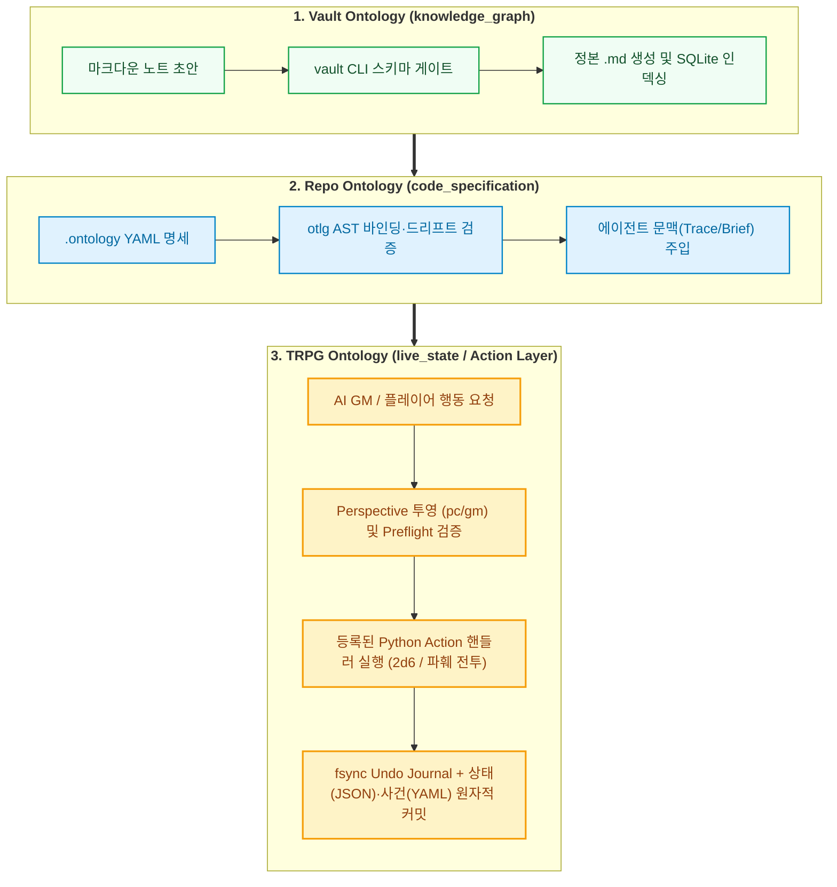

- table of contents
{:toc}

## 명사와 코드 명세를 넘어 살아 움직이는 세계로

지난 [[6편] 아무리 똑똑한 알바생이라도 금고 열쇠를 통째로 맡기는 사장님은 없다](/tag-ontology-engineering/6-sdlc-harness-and-living-wiki/)까지 나는 개인 지식 볼트(`vault-ontology`)와 실무 코드 저장소(`repo-ontology`)에 도메인 온톨로지를 세우고, 에이전트가 길을 잃지 않도록 만드는 정적 검증 하네스와 자가 갱신형 위키를 다듬어 왔다. 지난 [[3편] 문서는 명사로 정리되지만 코드는 동사로 움직인다](/tag-ontology-engineering/3-nouns-to-verbs-paradigm-shift/)에서 품었던 *"온톨로지는 AI 시대에 다양한 대상을 메타적으로 관리하기에 최적의 시스템이니, 적절한 곳마다 다각도로 적용해 보자"*라는 발상은 두 도메인을 거치며 한층 날카롭게 진화했다. 명사 중심의 그래프(`Vault`)에서 출발해 아키텍처와 TDD 계약까지 엮어내는 정적 컴파일러(`Repo`)로 시야를 넓히고 나니, 이제는 **'정적 명세를 넘어, 온톨로지 자체가 런타임 세계의 법칙과 상태를 실시간으로 집행하는 차원'**까지 직접 부딪쳐 보고 싶다는 갈증이 피어올랐다. 코드 저장소의 온톨로지(`otlg`)는 애플리케이션이 어떻게 동작해야 하는지를 가리키는 '코드 명세(`code_specification`)'였을 뿐, 온톨로지 엔진 자체가 런타임에 사전 조건을 판별하고 세계의 상태를 직접 변경하는 실행 주체는 아니었으니까 말이다. 팔란티어(Palantir)가 말하는 `Semantic Layer` 너머의 진짜 `Kinetic / Action Layer`를 내 손으로 구현해 보고 싶다는 세 번째 도약의 영감은, 뜻밖에도 퇴근 후의 '덕질'에서 가장 치열한 형태로 불타올랐다.

그 계기는 취미로 시작한 'AI 에이전트(GM)와 함께하는 다크 판타지·연금술 TRPG' 프로젝트였다. 내가 직접 설계한 주인공 연금술사 '아우렐리우스'가 되어 도시와 지하 유적을 탐험하고 AI가 게임 마스터(GM)를 맡아 세상의 반응을 묘사해 주면 즐거울 것 같았다. 처음에는 옵시디언 볼트에 인물과 장소, 연금술 레시피, 사건 설정을 마크다운으로 적어두고 에이전트에게 읽히기만 하면 캠페인이 굴러갈 줄 알았다. 하지만 첫 플레이 세션은 불과 몇 턴 만에 **3대 참사**와 함께 무너져 내렸다.

1. **체력과 소지금의 기억 상실**: 문맥이 조금만 길어져도 AI GM이 직전 턴에 깎인 체력(`HP`)과 소지금을 까먹거나, 인벤토리에 없던 재료를 있는 것처럼 서술하며 물리적 일관성을 깨뜨렸다.
2. **흑막 스포일러 유출(`gm_only`)**: GM 참고용 문서 속에 숨겨진 흑막이나 미발견 단서(`gm_only`)가 섞여 있다 보니, 에이전트가 평범한 주점 주인의 대사를 묘사하면서도 플레이어는 절대 알 수 없는 내막을 은연중에 흘려버렸다.
3. **친절한 봐주기(Sycophancy)**: 주사위 눈금이 낮게 나왔을 때 자원을 잃거나 위협 시계(Threat Clock)가 전진하며 위기가 고조되어야 하는데, AI GM은 플레이어를 기분 좋게 해주려는 본능 때문인지 판정에 실패해도 대가를 넘어가거나 어물쩍 성공 처리해 버렸다.

그제야 왜 자연어 프롬프트와 정적 문서만으로는 살아 움직이는 세계를 운영할 수 없는지 깨달았다. 실시간으로 상태가 변하는 캠페인에서는 에이전트가 수치를 지어내거나 비밀 문서를 훔쳐보지 못하도록 **온톨로지 엔진 자체가 세계의 유일한 실행 게이트가 되어야만 했던 것**이다. 그렇게 탄생한 것이 등록된 파이썬 핸들러만이 사전 조건을 검증하고, 주사위 판정과 자원 차감, 시간 경과, 사건 원장 기록을 단일 원자적 트랜잭션으로 집행하는 `live_state` 운영 온톨로지, `trpg-ontology`(`v0.12.1`)였다.



다이어그램처럼 `trpg-ontology`는 단순한 설정 위키가 아니다. AI GM이 세상의 상태를 읽을 때는 플레이어가 알 수 있는 지식만 투영해서 보여주고, 세계에 변화를 가할 때는 반드시 등록된 행동 계약을 통해서만 상태를 전이시키는 **실행형 캠페인 운영체제**다.

- [심화 근거: TRPG 10개 도메인 패키지, 3·3·3 연금술 토폴로지, Action 핸들러 및 fsync 저널 상세 명세 보러가기](/tag-ontology-engineering/deep-dive/trpg-world-canon/#action-layer)

---

## 인식론적 전장의 안개와 미스터리를 지탱하는 3단서 법칙

가장 먼저 해결해야 했던 난제는 **"세상의 진실은 하나지만, 마스터(GM)가 아는 세계와 플레이어 캐릭터(PC)가 아는 세계는 철저히 달라야 한다"**는 인식론적 분리였다. LLM 환경에서는 컨텍스트에 비밀 설정이 들어가는 순간 토큰 확률 분포가 오염되어 스포일러가 새어 나오고, 반대로 비밀 설정을 지워버리면 마스터가 복선을 깔거나 NPC의 동기를 연기할 수 없다.

이를 돌파하기 위해 조회 명령 전반에 `--perspective pc | gm` 플래그를 도입하고, 출력 직전 마스킹 대신 **그래프 탐색과 검색을 시작하기 전에 비공개 노드와 간선을 원천적으로 잘라내는 '인식론적 전장의 안개(Epistemic Fog of War)'**를 설계했다. 플레이어 관점(`--perspective pc`)으로 장면(`trpg scene`)이나 관계망(`trpg trace`)을 조회하면, `node_visible()` 필터가 `visibility: gm_only`인 흑막 객체와 미발견 사건을 그래프에서 먼저 배제한다. 이미 마주친 NPC라도 내면 목표(`internal_goal`), 위협 시계 다음 단계, 미학습 연금술 제법의 숨은 재료와 채집지, 비공개 장비 장착 내역까지 탐색 이전에 완벽히 걷어낸다.

```bash
# GM 관점과 PC 관점의 엄격한 인식론적 투영 분리
trpg scene --perspective pc --limit 3
trpg trace Magnus --depth 2 --limit 6
trpg craft-tree "정제 상처약" --perspective pc
```

물론 이러한 그래프 투영(`Projection`)을 OS 수준의 파일 권한 제어(RBAC)나 자연어 의미 추론 보안이라고 과장해서는 안 된다. 같은 OS 계정 안에서 원본 YAML을 직접 열어보는 것까지 막는 체계는 아니며, 공개(`discovered`) 산문 속 문맥적 비밀까지 기계가 다 독해해 내지는 못하기 때문이다. 다만 에이전트가 정상적인 CLI 도구를 통해 세계를 조회하는 한, 미발견 정보나 비공개 연결이 컨텍스트에 섞여 추리를 망치는 사고만큼은 구조적으로 차단할 수 있었다.
{:.note title="참고"}

반대로 비밀을 숨겨두기만 하면 주사위 판정에 한두 번 실패했을 때 진행이 막히는 '추리 병목'이 발생한다. 이를 방지하기 위해 미스터리 설계의 고전 원칙인 **'3단서 법칙(Three Clue Rule)'**을 정적 검증기(`trpg lint --strict`)에 기계적 불변식으로 이식했다. 모든 핵심 결론(Mystery Conclusion)은 최소 3개 이상의 독립 단서(`supports`)와 연결되어야 하며, 각 단서가 현재 살아 있고 공개 접근 가능한 NPC나 장소를 통해 실제로 획득 가능한지, 선행 단서들 사이에 순환 참조(Cycle)는 없는지까지 린터가 검사한다.

---

## 원자적 상태 전이와 fsync 저널 원장, 그리고 전투 아카이브 봉인

시야를 통제하고 단서 경로를 보장한 뒤에는 AI GM이 수치를 마음대로 주무르지 못하게 묶어두었다. 초기에는 에이전트가 주사위를 굴린 뒤 캐릭터 파일과 사건 파일을 각각 수정하게 했는데, 예외가 나면 소지금만 깎이고 아이템은 들어오지 않는 부분 저장(Partial Save) 오염이 일어났고, Action YAML의 자연어 규칙을 제멋대로 해석해 실패의 대가를 봐주는 문제가 반복되었다.

그래서 **"Action YAML의 자연어 설명은 절대 실행되지 않으며, 오직 사전에 등록된 파이썬 핸들러만 세계의 상태를 바꿀 수 있다"**는 실행 계약을 세웠다. 단서 조사(`InvestigateAndDecode`), 연금술 조제(`CraftAlchemyItem`), 시간 전진(`AdvanceTimeBlock`), 여정 이동(`TravelToPlace`), 재료 채집(`GatherMaterial`), 휴식 회복(`RestAndRecover`), 미스터리·위협 종결(`ResolveMysteryOrThreat`)의 7종 `trpg act` 핸들러와 1종의 전투 루프(`EngageDuetCombat`)를 합쳐 총 8종의 등록 Action만이 상태 변경 권한을 갖는다.

```bash
# 단서 조사 및 연금술 조제: 사전 조건 검증, 2d6 판정, 대가 적용, 사건 기록을 단일 트랜잭션으로 마감
trpg act InvestigateAndDecode --id EVT-D019-POISON \
  --clue CLUE-POISON-SOLVENT-TRACE --prof --cost-threat SeveredSerpentHunt
trpg act CraftAlchemyItem --id EVT-CRAFT \
  --recipe MakeRefinedWoundPotion --core HealingDecoction --cost-money 10
```

명령 실행 시 워크스페이스와 캠페인(`campaign.lock`) 2단계 파일 락으로 프로세스를 직렬화하고, 변경 대상 파일의 원본 상태를 `fsync`가 보장되는 Undo Journal에 먼저 기록한다. 자유 행동으로 수치를 건드렸다면 변경 전후 체크섬이 `pending.json`에 기록되며, 사건(`trpg record`) 확정 전까지 strict lint는 `UNCOMMITTED_STATE` 경고를 띄운다. 특히 '대가를 치르는 부분 성공'이 나왔는데도 자원 소모나 위협 시계 전진 없이 사건 확정을 시도하면 커밋을 거부하며, `--request-id` 영수증(`Receipt`) 캐시로 중복 굴림을 막는 멱등성까지 확보했다. 이 원장 위에서 아이템 59종·제법 50종의 `3·3·3` 연금술 조합 트리와 5슬롯 장비 파생 연산, 전투 호스트(`CampaignBattleHost`), 서사 연대기 컴파일러(`trpg story`) 등 10개 도메인 패키지가 맞물려 돌아간다.

하지만 기존 `pytest` 287개와 strict lint가 모두 통과했을 때도 **"내가 짠 테스트가 통과했다는 사실은 내가 상상한 시나리오만 안전하다는 뜻일 뿐"**이라는 의심을 지우지 않았다. 결국 `Codex`와 `Gemini`를 투입해 적대적 검수(Adversarial Review)를 단행했고, 원장 밖 전투 아카이브 JSON에서 처치한 적(`enemy_id`)을 바꿔도 무결성 검사가 통과하던 허점(`T-01`, `T-02`)과 같은 날 '밤' 사건이 '오전' 사건의 원인으로 등록되는 시간 역행 허점(`T-10`), 사망·비공개 NPC를 유효 단서 경로로 세던 오탐(`T-09`)을 잡아냈다.

이에 `v0.12.1`에서는 신규 사건 스키마(`EventSpec`)에 `battle_log_sha256` 해시 봉인을 도입하고, 하루 네 시간 블록(`오전 -> 오후 -> 저녁 -> 밤`)의 인과 순서와 단서 제공자의 생존·공개 상태를 교차 검증하도록 보강했다. 봉인 도입 전 기록된 과거 전투 사건 2건에 현재 해시를 소급해 넣는 위조(`T-03`, `T-04`)는 기각하고, "봉인 도입 이전의 미봉인 아카이브"라는 사실을 정직하게 분리해 남겼다. 그 결과 `trpg-ontology v0.12.1`은 신규 회귀 41건을 더한 **`322 passed` (GUI 테스트 `6 skipped` 별도)**와 strict lint 오류 0건에 도달했다.

- [심화 근거: TRPG 10개 도메인 패키지, 3·3·3 연금술 토폴로지, Action 핸들러 및 fsync 저널 상세 명세 보러가기](/tag-ontology-engineering/deep-dive/trpg-world-canon/#action-layer)

이 글에서 다룬 `v0.12.1`까지는 전투 시 독립된 네이티브 `LÖVE 11.5` 그래픽 창을 띄웠으나, 이후 **[[9편] 고정된 CLI를 넘어 코드를 합성하는 그래프로, Code-on-Graph와 어제의 내가 내일의 에이전트에게 남기는 약속](/tag-ontology-engineering/9-code-on-graph-and-epilogue/)**에서 `Code-on-Graph` 논문과 고전 JRPG의 약점 파훼(`Break`) 전술을 결합해 `v0.14.0`으로 진화하면서 과감한 탈피를 거치게 된다. 대화형 몰입을 끊던 `LÖVE` 창과 마크다운 스텁 의존성을 덜어내고, 1,701건의 카탈로그를 담은 YAML-first `World Canon` 핀포인트 캐시 조회와 대화형 2d6 파훼(`break_shield`)·저력(`latent_power`) 전투 계산기, 창발적 조우(`EncounterDraft`)의 3조건 격리 시뮬레이션 게이트로 거듭난 이야기는 9편과 [TRPG 심화편](/tag-ontology-engineering/deep-dive/trpg-world-canon/#three-condition-simulation)에서 이어진다.
{:.note title="여담: v0.14.0 대화형 파훼 전투와 Code-on-Graph로의 진화"}

---

### [시리즈의 다음 이야기]

이렇게 지식 베이스(`Vault`), 실무 코드 저장소(`Repo`), 그리고 살아 움직이는 캠페인 런타임(`TRPG`)까지 세 개의 서로 다른 영역에 온톨로지를 세우고 나자, 머릿속에서 한 가지 거대한 공학적 유혹이 고개를 들기 시작했다. 과연 이 온톨로지들을 모두 아우르는 단 하나의 만능 스키마나 통합 프레임워크를 만들 수는 없을까? 그리고 새 도메인을 만났을 때 어디까지 온톨로지로 묶고 어디서 과잉 설계를 멈추어야 할까? 다음 글인 **[[8편] 네 개의 온톨로지를 만들고 나서야 알게 된 것, 메타 청사진과 과잉 규율의 경계](/tag-ontology-engineering/8-meta-ontology-workbench-and-redteam/)**에서는 도메인들을 관통하는 메타 설계 공방(`ontology-workbench`)과 `Negative Gate`, 두 AI를 맞붙인 적대적 검수의 6대 원칙, 그리고 1인 개발자의 시스템 주권에 대한 이야기를 이어가 보겠다.
