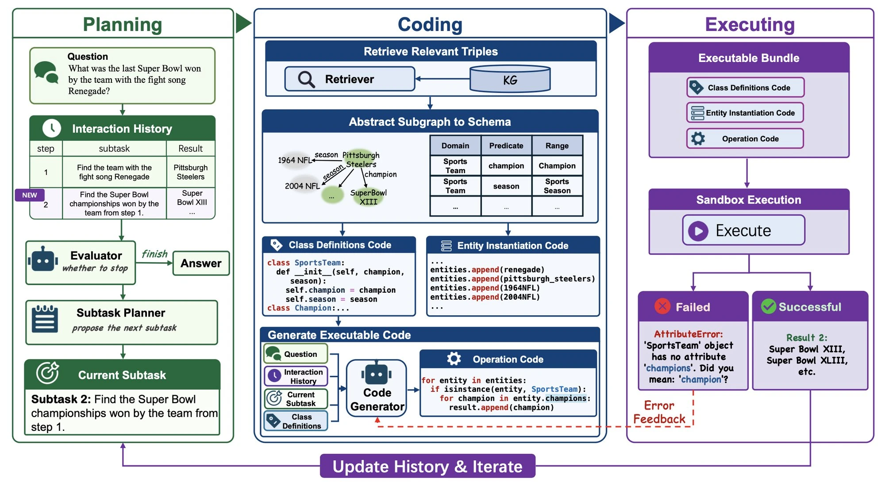
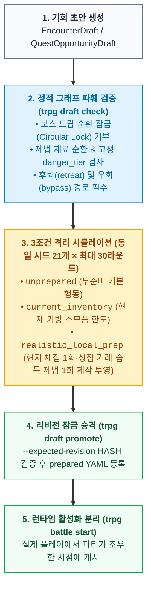

- table of contents
{:toc}

## 정해진 CLI 명령어만으로는 풀 수 없던 복합 질문들

`vault q`, `otlg trace`, `trpg scene`처럼 내가 미리 만들어 둔 CLI 명령어들은 정해진 질문에 대해서는 한 치의 오차나 환각도 허용하지 않는 든든한 도구였다. 하지만 각 도메인에 데이터가 수천 건씩 쌓이고, 에이전트에게 여러 조건이 동시에 얽힌 복합 질문을 던지기 시작하자 **고정된 조회 명령만으로는 감당할 수 없는 벽**이 드러났다. 이제는 미리 짜 둔 서브커맨드 몇 개를 넘어, 스키마 위에서 추론과 계산 코드를 직접 합성해 실행하는 다음 단계로 넘어가야 할 때였다.

가장 먼저 그 벽을 체감한 곳은 TRPG 세계관이었다. 418개의 세계관 마크다운과 연금술 아카이브 1,478개 레코드를 합치면 원본만 약 7.5MB에 달했다. 여기에 파티 소지품과 지역별 고정 위험도(`danger_tier`)가 맞물린 상태에서 *"현재 파티 재료와 현지 채집 재료만으로 다음 보스의 기믹을 파훼할 수 있는가?"* 같은 질문을 던졌을 때 기존 방식은 진퇴양난에 빠졌다. 7.5MB 원문을 프롬프트에 넣으면 컨텍스트가 폭발하거나 중간 맥락을 놓치는 현상이 벌어졌고, 질문마다 새 CLI 플래그를 하드코딩할 수도 없었다.

---

## Code-on-Graph 논문 해부: 데이터는 메모리에, 프롬프트에는 스키마만

'고정 연산자의 경직성'과 '프롬프트 사실 주입의 한계'를 살펴보던 중 만난 연구가 2026년 논문 **[Code-on-Graph: Iterative Programmatic Reasoning via Large Language Models on Knowledge Graphs](https://arxiv.org/abs/2606.03705v1)**(Weiwei Ding 외, 2026)였다. 그래프 데이터를 프롬프트에 그대로 나열하면 이웃 노드가 늘어나는 순간 개수 세기나 비교조차 틀리기 쉽고, 반대로 검색 결과 상위 몇 개만 잘라내면 필수 사실이 빠지기 쉽다. `Code-on-Graph`(`CoG`)가 제안한 해법은 **"프롬프트에는 거대한 데이터 대신 컴팩트한 클래스 스키마만 넣고, 실제 추론과 계산은 즉석에서 짠 파이썬 코드로 메모리 내 그래프 위에서 실행한다"**는 것이다.

{:width="760" loading="lazy"}

`Code-on-Graph`의 전체 실행 사이클. 질문을 하위 작업으로 쪼개고(`Planning`), 관련 서브그래프를 클래스 스키마로 추상화해 코드를 생성한 뒤(`Coding`), 샌드박스에서 실행하고 에러 피드백을 받아 반복 교정한다(`Executing`).
{:.figcaption}

그림에서 볼 수 있듯 `CoG`의 한 사이클은 세 단계가 맞물려 돌아간다.

1. **Planning (질문 분해와 종료 판단)**: 복합 질문이 들어오면 지금까지의 탐색 이력(`Interaction History`)을 바탕으로 충분한 답이 모였는지(`Evaluator`) 먼저 판별한다. 아직 부족하다면 `Subtask Planner`가 다음 단계에 풀어야 할 하위 작업(`Current Subtask`)을 하나씩 쪼개어 넘긴다.
2. **Coding (서브그래프 스키마화와 코드 생성)**: 지식 그래프에서 관련 트리플만 추려 온 뒤(`Retrieve Relevant Triples`), 이를 그대로 프롬프트에 넣지 않고 `Domain-Predicate-Range` 형태의 스키마 표로 압축한다(`Abstract Subgraph to Schema`). 프롬프트에는 이 구조에서 뽑아낸 파이썬 클래스 정의(`Class Definitions Code`)만 건네주고, 실제 데이터 객체(`Entity Instantiation Code`)는 메모리에 따로 올려 둔 상태에서 코드 생성기가 연산 코드(`Operation Code`)를 작성한다.
3. **Executing (샌드박스 실행과 에러 피드백)**: 클래스 정의, 인스턴스 초기화, 연산 코드를 하나로 묶어 샌드박스에서 실행한다. 만약 존재하지 않는 속성을 참조해 `AttributeError`가 나면 그 에러 피드백을 다시 코드 생성기로 돌려보내 조건식을 고치게 만들고, 성공한 결과만 이력에 누적해 다음 `Planning` 단계로 이어간다.

논문은 이 방식의 토큰 효율(`TUR`)을 수식으로도 정리한다. 사실을 직접 나열하면 인스턴스 수(`|I_t|`)에 비례해 토큰이 소모되어 효율이 `O(1)`에 머물지만, 스키마(`|S_t|`)만 프롬프트에 넣고 메모리의 전체 인스턴스를 연산하면 효율이 `O(|I_t| / |S_t|)`로 늘어난다는 것이다.

$$
\text{TUR}_{\text{Text-in-Context}} = \mathcal{O}(1) \quad \text{vs.} \quad \text{TUR}_{\text{Schema-to-Class}} = \mathcal{O}\left(\frac{|I_t|}{|S_t|}\right)
$$

하지만 이 논문을 꼼꼼히 공부해 보고 내린 현실적인 결론은, **내가 다루는 세 개 도메인(`Vault`, `Repo`, `TRPG`) 규모에서는 논문 전체를 그대로 가져올 필요가 없다**는 것이었다. 논문이 상정하는 환경은 세상 대부분의 지식을 한데 모아 놓은 위키피디아 기반 지식 그래프처럼 트리플의 술어(관계)만 해도 수천·수만 가지가 넘어 LLM이 한눈에 파악하기 어려운 초대형 그래프다. 반면 내 온톨로지들은 도메인 경계가 명확하고 관계 종류도 수십 개 이내로 잘 통제되어 있어서, 매 질의마다 LLM에게 임의의 파이썬 코드를 생성해 실행시키는 무거운 파이프라인까지 얹을 필요는 없었다.

그럼에도 **'거대한 인스턴스는 프롬프트 밖 메모리에 두고 스키마와 구조화된 결과 요약만 주고받는다'**, **'읽기·사전검사와 쓰기·실행을 분리하고 샌드박스 피드백으로 검증한다'**는 개념적 원리는 세 도메인 모두에 유효했다. 그래서 나는 논문의 전체 프레임워크를 통째로 복제하는 대신, 각 도메인에 꼭 필요한 개념만 추려서 `Vault`, `Repo`, `TRPG` 세 곳에 나누어 이식하기로 했다.

- [심화 근거: Code-on-Graph 3단계 파이프라인, CVT Python 스텁 및 TUR 수리 증명 상세 보러가기](/tag-ontology-engineering/deep-dive/workbench-and-code-on-graph/#code-on-graph)

---

## Wave 1: 읽기와 결정론적 쓰기의 분리, 그리고 5-State Result Envelope

이 개념적 원리를 실제 프로젝트로 가져오며, 나는 세 도메인 온톨로지 전역에 두 가지 안전 계약을 못 박았다.

첫째는 **'읽기·사전검사·시뮬레이션(`CoG`)과 결정론적 쓰기·집행(`Action`)의 절대적 분리'**다. 우리의 `CoG` 계층은 무변이 사전검사(Preflight Dry-run)와 격리 시뮬레이션을 통해 **후보 패치, 액션 제안, 근거 참조를 도출하는 계층**으로만 작동하며, 실제 쓰기나 상태 승격은 100% 사전 등록된 핸들러만 수행한다.

둘째는 **'결과 상태의 정직한 5분류(`5-State Result Envelope`)'**다. 현실 도메인에서는 "경계 위반이나 누락 0건"처럼 **빈 결과 자체가 정답인 경우**와, 검출 실패나 출력 예산 절단을 똑같은 빈 배열로 뭉개버리면 사고가 터질 수 있다. 이를 막기 위해 모든 CLI 출력에 스키마 해시, 데이터 리비전, 커버리지, 생략 건수와 함께 **`answered | empty_valid | unknown | incomplete | failed`** 5개 상태를 명시하도록 표준화했다.

이 계약 위에서 **`vault`**, **`otlg`**, **`trpg`** 모두 무변이 사전검사와 읽기 전용 스키마 스텁 노출을 일관되게 안착시켰다.

- [심화 근거: 5-State Result Envelope JSON 규격 및 Wave 1 전 도메인 계약 보러가기](/tag-ontology-engineering/deep-dive/workbench-and-code-on-graph/#result-envelope)

---

## Wave 2 하이라이트: World Canon 통합과 3조건 창발 시뮬레이션

Wave 1에 이어 진짜 승부처는 방대한 세계관과 캠페인 상태를 결합해 `CoG`의 **Stage 2a(핀포인트 서브그래프 조회)**와 **Stage 3(샌드박스 실행 피드백)**를 끝까지 밀어붙인 **`trpg-ontology` 대규모 업그레이드**였다. 먼저 데이터를 **4계층(`World Canon` / `Ruleset` / `Campaign` / `Candidate & Prepared`)**으로 분리하고, 418개 세계관 문서와 세계관 아카이브 1,478개 항목(`~7.5MB`)을 `world/canon/manifest.yml`과 **13개 정본 YAML**로 통합했다. 동명이인이 덮어써지지 않도록 `<파일 stem>:<source_path>` 복합 ID를 부여했고, `World Canon`을 읽었다고 해서 파티가 재료나 제법을 공짜로 얻지 못하도록 실제 보유 상태는 `Campaign` 상태 기록에만 귀속시켰다. 또한 전투 창이 서사 몰입감을 끊는 문제를 해결하고자 이를 과감히 폐기하고, 고전 JRPG의 약점 파훼(`Break`)와 저력(`latent_power`) 전술을 테이블탑 호흡에 맞게 재설계한 대화형 2d6 파훼·연금 전술 계산기(`domains/combat/conversation.py`)로 일원화했다.

이를 바탕으로 세션 중 구상한 보스 초안을 검증하는 **Stage 3 샌드박스 게이트**가 완성되었다. `trpg draft check`는 필수 파훼 아이템 재료가 **'지금 잡아야 하는 바로 그 보스의 전리품(Drop)'에만 존재하는 순환 잠금(Boss Drop Circular Lock)** 상태인지를 역추적해 거절한다. 이어지는 **21시드 × 30라운드의 3조건(`unprepared` / `current_inventory` / `realistic_local_prep`) 격리 시뮬레이션**은 특히 `realistic_local_prep`에서 엔진이 직접 현지 채집 1회, 상점 구매, 습득 제법 1회 제작(재료·금화 실제 차감)까지 수행한 투영 인벤토리를 조립해 승률과 Break 봉쇄 횟수를 정량 비교한다. 7.5MB 세계관 조회를 맡은 `trpg canon` 역시 메모리 적중 `0.03초` 속도와 함께 **22개 적대적 반례 검토**를 거쳐 `pickle` 제거, TOCTOU 매니페스트 검증, `--perspective pc` 메모리 적재 전 차단, 동명이인 모호성 에러, 자연어 서식지 생물 115종의 `미확인(unlinked)` 보고까지 완비했다.

- [심화 근거: TRPG World Canon 13개 YAML 통합, 2d6 파훼 수식, 3조건 시뮬레이션 및 Canon 캐시 22개 적대적 반례 상세 보러가기](/tag-ontology-engineering/deep-dive/trpg-world-canon/#three-condition-simulation)

---

## 추론과 시뮬레이션 너머에 남은 두 가지 과제, 지식의 순환과 의미 감사

고정된 CLI를 넘어 스키마 위에서 추론과 시뮬레이션을 합성하는 `Code-on-Graph` 아키텍처를 세 도메인 온톨로지에 이식하고 나자, 이 여정을 완결 짓기 위해 답해야 할 마지막 두 가지 질문이 떠올랐다. 첫째는 매일 겪는 시행착오와 독서, 일기장의 고민을 어떻게 살아 숨 쉬는 지식과 블로그 글, 내면의 성찰로 직조해 낼 것인가라는 연결의 질문이었고, 둘째는 CLI가 `answered`를 반환할 때 그 응답의 '의미(Semantics)'가 투영 과정에서 왜곡되지 않았다고 확신할 수 있는가라는 자기 의심이었다.

시리즈의 대단원인 **[[9편] 의미가 스스로를 증명하기까지: 성찰 컴파일러, 3대 의미 모형 감사, 그리고 에필로그](/tag-ontology-engineering/9-knowledge-blog-compiler-and-semantic-critique/)**에서는 외부 도서 아카이브와 개인 기록을 삶의 질문으로 엮는 `Mind Compiler`(`vault mind` & `vv weave`), 그리고 『Semantic Modeling for Data』를 잣대로 숨은 의미 왜곡까지 바로잡은 3대 연쇄 감사와 에필로그를 다룬다.
