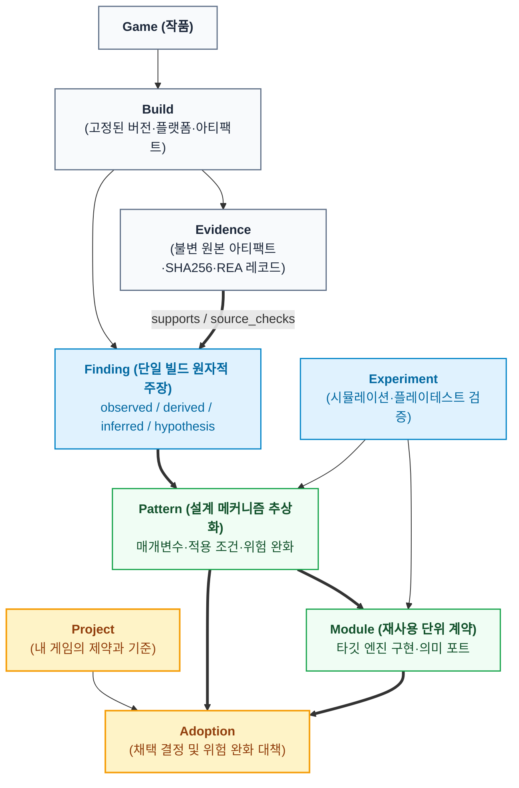

- table of contents
{:toc}

## 일회성 분석 노트를 넘어 재사용 가능한 빌딩 블록으로

지난 [[7편] 주사위는 거짓말을 하지 않는다, TRPG에서 비로소 도달한 진짜 Action Layer](/tag-ontology-engineering/7-trpg-kinetic-action-layer/)에서 직접 턴제 전투 루프와 연금술 조합 그래프, 장비 스탯 파생 엔진을 설계해 보면서, 나는 게임이라는 복합 시스템이 얼마나 정교한 규칙과 감각의 맞물림 위에서 돌아가는지 절감했다. 그리고 이 지점에서 온톨로지를 대하는 내 관점은 또 한 번 새로운 차원으로 확장되었다. 지금까지 만든 세 개의 온톨로지(`Vault`, `Repo`, `TRPG`)가 모두 **'내가 직접 만든 내부 시스템의 규칙을 통제하는 헌법'**이었다면, 문득 **"온톨로지를 역방향으로 써서, 타인이 만든 외부의 완성된 시스템(명작 상용 게임)을 해부하고 그 설계 지식을 내 것으로 흡수하는 '역공학 연구소'의 메타 틀로도 쓸 수 있지 않을까?"**라는 네 번째 발상의 전환이 찾아온 것이다. 내 손으로 작은 전투 루프를 짜보니 『Octopath Traveler II』처럼 브레이크(Break)와 부스트(Boost) 메커니즘, 성장 곡선, 손끝에 감기는 타격감이 일품인 작품들이 내부적으로 어떤 데이터 테이블과 타이밍 설계를 갖추고 있는지 속속들이 뜯어보고 싶다는 호기심이 일었다. 마침내 나는 역공학 분석 도구(`REA`)를 바탕으로 여러 게임을 해부하고, 그 통찰을 훗날 내가 만들 게임을 위한 지식 자산으로 축적하기로 마음먹었다.

하지만 게임 바이너리와 에셋 테이블을 뜯어보기에 앞서 두 가지 문제가 발목을 잡았다. 첫째는 대용량 패키지를 돌리는 윈도우 분석 PC와 맥북 개발 환경이 나뉘어 있어 결과물을 이관할 때마다 원본 출처가 유실되기 쉽다는 점이었고, 둘째는 **'특정 게임에서 관찰한 사실'과 '내 게임에서 바로 꺼내 쓸 수 있는 재사용 모듈' 사이의 간극**이었다. 미래에 어떤 엔진(`Unity`, `Godot`, `Unreal`, `LÖVE`)으로 게임을 만들지 고정하지 않은 상태에서 분석 노트에 엔진 종속적 용어와 주관적 감상을 뒤섞어 적어두면 레고 블록처럼 재조합하기가 불가능해진다.

그래서 나는 역공학 증거와 관찰 주장, 일반화된 설계 패턴, 타깃 엔진에서 검증한 모듈을 엔진 중립적인 구조로 담아낼 네 번째 도메인 온톨로지인 **`game-dev-ontology`(현재 도구 `v1.3.1`, `record schema v0.6.0`, `analysis-plan v0.4.0`)**를 설계했다. 출발점은 지식의 수명주기와 인식론적 확신 수준(`epistemic`)에 따라 레코드의 층위를 갈라놓는 것이었다.

핵심은 불변 파일 해시(`SHA256`)를 가진 `evidence`가 원본을 보관하면 `finding`이 정확한 셀렉터(JSON Pointer 등)로 근거를 가리키되, 원본 바이트에서 직접 확인한 **`observed`(관찰)**, 여러 필드를 산술 공식으로 계산한 **`derived`(도출)**, 데이터 구조를 바탕으로 설계 의도를 해석한 **`inferred`(추론)**와 **`hypothesis`(가설)**를 철저히 분리한 점이다. 단일 게임에서 추출한 패턴은 반드시 `coverage: single_game` 후보(`candidate`) 상태로만 머물러야 하며, 타깃 엔진에서 별도 실험(`experiment`)을 통과한 영수증이 붙어야만 `validated`로 승격될 수 있다.

---

## 분류 태그만으로는 손맛을 설명할 수 없다

기본 객체와 근거 분리 계약을 세운 뒤, 스스로에게 질문을 던졌다. **"과연 이 스키마로 명작 게임 특유의 찰진 '손맛(Game Feel & Juice)'까지 기록하고 재현할 수 있는가?"** 게임 요소를 16개 질문군(`facets`)으로 쪼개어 점검해 보니, 사운드와 애니메이션 클립이 존재한다는 태그 분류만으로는 왜 어떤 공격은 묵직하게 꽂히고 어떤 점프는 조작감이 쾌적한지 그 '동시성과 결합의 메커니즘'을 설명할 수 없었다.

점프 유예(Coyote Time)와 입력 버퍼링은 '입력·규칙 조율(`input_response`)'의 영역이고, 히트스톱(Hitstop)과 카메라 셰이크, 효과음 변조는 하나의 충돌 사건(`trigger_event`)을 기준으로 여러 감각 채널(`channels`)이 몇 밀리초(`ms`) 간격으로 맞물리는지의 문제다. 이에 따라 밸런스(`balance`), 레벨(`level`), 스프라이트(`sprite`)에 더해 **`feel` 프로파일**을 신설하고 두 가지 경계를 세웠다.

1. **관측 시계(`reference_clock`)와 내부 갱신 시계(`clock_domain`)의 분리**: 영상 캡처 `FPS`와 엔진 `simulation tick`을 같다고 가정하지 않으며, 관측 시계가 `unknown`이면 임의의 숫자(`ms`)를 적지 않고 `null`로 둔다. 히트스톱 역시 `simulation`, `animation`, `audio`, `UI` 중 어느 시계가 멈추며 복구 타이머가 정지되지 않은 시계(`unscaled_timer`)를 쓰는지 아니면 멈춘 것과 동일한 시계(`same_clock_timer`)를 쓰는지 구분한다.
2. **코드 설정(`configured`)과 런타임 전달(`captured`)의 분리**: 공개 소스 『Juicy Breakout』을 파일럿 분석했을 때, 코드에 이펙트 상수가 적혀 있어도 특정 분기에서는 발화하지 않거나 화면 흔들림을 껐을 때 전조 단서(`gameplay_telegraph`)를 대체할 수단이 빠진(`known_missing`) 경우가 확인되었다. 원본 게임의 결함도 있는 그대로 `finding`에 기록하되, 내 게임에 채택(`adoption`)할 때만 시계 복구와 접근성 대체 단서에 대한 완화 대책(`risk_responses: mitigate`)을 필수화했다.

---

## 대표 사례 1: 『Octopath Traveler II』에서 AI의 기억 오염과 표본의 반전

첫 타깃인 **『Octopath Traveler II』(`build:octopath-traveler-2/steam-13399590`, UE 4.27)**의 정적 추출물을 분석했을 때 온톨로지 검증의 진가가 드러났다. 초기 2차 코퍼스 제출 당시 스키마 검증기(`validate.py`)는 에러 0건으로 통과했지만, `Codex`와 `Gemini`에게 추출된 원본 JSON 바이트와 코퍼스 문장을 전수 대조하라는 적대적 검수를 지시하자 충격적인 결과가 돌아왔다.

추출기에 일부 샘플 행(309행 표본)만 뽑도록 옵션을 주었음에도, AI 분석가가 사전 학습 데이터나 외부 위키로 알고 있던 배경지식을 마치 눈앞의 원본 JSON에서 직접 읽은 사실(`observed`)인 것처럼 적어버리는 **'기억 오염'**을 일으킨 것이다. 보존된 JSON에는 레벨 `1`, `2`의 경험치(`NextExp=6, 10`)만 있었는데 미추출된 레벨 50·99 수치가 적혀 있었고, 상점 아이템 판매 비율에서 극적인 반전이 일어났다.

- **4행 표본에서의 교정 (`10%`)**: 2차 제출본에는 "상점 아이템 판매가는 구매가의 **20%**로 확정됨"이라고 적혀 있었으나, 보존된 `ItemDB` 샘플 4행(`50/5`, `260/26`, `720/72`, `1480/148`)은 모두 **10%(`1/10`)**였다. 우리는 근거 없는 20% 서술을 폐기하고, 원본 JSON Pointer의 실제 값과 연산 결과를 기계적으로 대조하는 **110개 값 앵커(`finding.source_checks`)**와 **추출 영수증(`extraction-receipt`)**을 도입해 이를 '표본 4건 한정 계산값(`derived: 10%`)'으로 격리했다. 또한 표본만 있는 테이블에 전수 분포를 물으면 0건이어도 보편 규칙으로 확정하지 못하도록 **`SampleOnlyPopulation`(`status: incomplete`)** 가드레일을 못 박았다.
- **15,038행 전수 추출에서의 대반전 (18개 기약분수 계층)**: 며칠 뒤 윈도우 PC의 4.11GB 원본 `Pak`에서 `--all-rows`로 27개 핵심 `DataTable` 전수(`34.4MB`, **15,038 / 15,038행**)와 31개 중첩 구조체 전수(`4,468행`, `undecoded_fields=0`)를 뽑아내어, `ItemDB` 1,675행 중 가격이 있는 **953행 전체**를 기약분수(`ratio`)로 계산하자 진실이 밝혀졌다. 환급률은 단일 비율이 아니라 **총 18개의 기약분수 계층**으로 나뉘어 있었다! 무기·방어구 등 장비 주류 **533건은 `20%`(`1/5`)**, 일반 소비재 **267건은 `10%`(`1/10`)**, 환금성 귀중품 **95건은 `50%`(`1/2`)**, 특수 아이템 **32건은 `5%`(`1/20`)**였고 나머지 26건도 14개 특수 비율(`2/3`, `4/5`, `1/1` 등)로 설계되어 있었다.

즉, AI 에이전트가 기억 오염으로 적었던 `20%`는 장비류의 주류 비율이었고, 초기 샘플 4행은 우연히 소비재 `10%` 구간만 뽑혔던 것이다. 만약 표본 4행의 `10%`를 보편 규칙(`population`)으로 선언하게 두었더라면 533건의 주류 장비 경제를 통째로 왜곡할 뻔했다.

- [심화 근거: 표본 4행과 가격표 953행(18개 비율 계층)의 비교 근거 및 110개 값 앵커(source_checks) 보러가기](/tag-ontology-engineering/deep-dive/game-evidence/#itemdb-refund-ratios)

아울러 데이터가 34.4MB(15,038행)로 커지며 발생한 컨텍스트 폭발과 스트림 타임아웃을 막기 위해, **1단계 Hub 단독 수집과 2단계 정적 Spoke Shard-Merge(`shards plan/check/merge/promote`)**를 구축했다. 고비용 `Pak` 추출과 Read-Only SQLite/FTS5(`.generated/gdev.sqlite`) 색인은 Hub가 단독 수행하고, 병렬 Spoke들은 읽기 전용 색인에서 필요한 조각(`slice`/`QueryPlan`)만 조회해 **150줄·10KiB 이하의 독립 샤드**로만 제출한다. 여기에 `ijson` 스트리밍 검증기(`ArtifactSession`)를 결합해 107.9MB(26,000행) 입력도 전체 파일 적재 `0회`, **256MiB RSS 예산 이내**로 검증해 냈다.

- [심화 근거: Read-Only SQLite/FTS5 CoG 4대 가드레일과 150줄·10KiB 정적 Shard-Merge·ijson 스트리밍 검증 보러가기](/tag-ontology-engineering/deep-dive/game-evidence/#shard-merge)

---

## 대표 사례 2: 두 번째 게임 『Balatro』에서 마주한 '선언형 테이블 편향'과 수식 DAG

두 번째 타깃으로 **`LÖVE 11.x` + `LuaJIT` + `GLSL` 셰이더** 기반의 덱빌딩 로그라이크 **『Balatro』(`build:balatro/steam-17459173`)**를 편입해 첫 12개 정적 카탈로그 테이블(**901행**)을 전수 추출했을 때, 우리는 **'선언형 테이블 편향(Procedural Detail Blindness)'**과 마주쳤다. 명사형 테이블 행 개수는 100% 추출되었지만, 게임의 손맛과 장인정신을 만드는 함수·셰이더 내부의 동사형 디테일들이 코퍼스에 한 줄도 들어오지 못했던 것이다.

1. **마우스 커서 호버 엔트로피 시드와 골드 스테이크 전설 보정 (`functions/misc_functions.lua`)**: 언시드 시작 시 단순 `os.time()`이 아니라 **마우스 호버 좌표(`x, y`)와 시간(`t`)의 선형 결합식(`0.33411983*x + 0.874146*y + 0.412311010*t`)**으로 시드를 만들고, 골드 스테이크(`stake >= 8`)에서는 미클리어 전설 조커가 배정될 때까지 고정 소수 상수(`+0.56189235...`)를 반복 가산하며 재탐색하는 루프가 존재했다.
2. **카드 3D 정점 왜곡과 비호버 공전 궤도 (`card.lua`, `sprite.lua`, `*.fs`)**: 호버 시 마우스 화면 좌표를 정점 셰이더(`mouse_screen_pos`)로 넘겨 3D 원근 휨과 광택 위상 이동(`tilt_var.amt`)을 만들고, 대기 시에도 카드 고유 `ID` 기반 의사난수 공전각(`G.TIMERS.REAL*(1.56 + (self.ID/1.14212)%1) + self.ID/1.35122`)으로 살아 숨 쉬는 질감을 합성하고 있었다. 초기 GLSL 파서는 정밀도 매크로(`MY_HIGHP_OR_MEDIUMP`) 때문에 유니폼 변수명 자리에 자료형 예약어(`vec2`, `float`)를 기록하는 토큰 오염까지 일으키고 있었다.
3. **에디션 누적 임계값(CDF) 추첨과 `Final Score = Chips × Mult` 합류 수식 (`common_events.lua` 등)**: `poll_edition`의 누적 확률 구간(Negative `0.3%`, Polychrome 순 `0.3%`, Holo 순 `1.4%`, Foil 순 `2.0%`), `Stone Card` 셰이더 생략 예외, 두 독립 버킷(`Chips`, `Mult`)의 곱셈 합류 수식이 카탈로그 바깥에 있었다.

우리는 `v1.1.0`~`v1.3.1` 업그레이드를 통해 함수 심볼(`CodeSymbolAndFunctionIndex`), 셰이더 바인딩(`ShaderPipelineAndSendBindings`), 난수 규칙(`RandomnessAndProceduralRules`), 수식 카탈로그(`FormulaCatalog`)의 **절차적 자산 4대 프로필**을 UTF-8 바이트 오프셋(`[start, end)`) 및 구간 `SHA256`과 함께 의무 추출하도록 표준화했다. 동시에 `gdev.py audit-extract`로 식별자 필드의 자료형 예약어 오염을 `SuspiciousExtractedIdentifier`로 차단하고, 동적 셰이더 호출(`G.SHADERS[_shader]:send` 12건)은 억지 추측 대신 `unresolved_references=12`(`status: incomplete`)로 보존했다.

나아가 미시적 작동 원리를 담는 `mechanic_detail` 4대 블록(`rules`, `formula_stages`, `timeline_steps`, `choice_entries`) 위에 정규화 값 해시(`expected_sha256`)와 다중 샤드 분할 조립(`profile_parts`)을 도입해 10KiB 샤드 한계를 돌파했고, 선행 스테이지 출력을 참조하는 **`operand_stage_ref`와 명시적 단위 변환(`explicit_unit_transform`)으로 `Final Score = Chips × Mult` 같은 이항·다변수 합류 수식 DAG**를 정형화했다. 마지막 `v1.3.1`에서는 혼합 프로필에서 동질 `detail_kind`(`choice_entries`)만 스코핑하도록 보정해 에디션 CDF 5분위 질의까지 `status: answered` 영수증을 획득했다.

- [심화 근거: Balatro 절차적 Lua·GLSL 자산 4대 프로필, expected_sha256 샤드 조립 및 Chips × Mult 수식 DAG 보러가기](/tag-ontology-engineering/deep-dive/game-evidence/#balatro-procedural-assets)

그 결과 `game-dev-ontology`(`v1.3.1`)는 **총 `711 passed`의 계약 검사**를 통과하고 있으며, `game-dev-knowledge` 코퍼스는 『Octopath Traveler II』와 『Balatro』를 아울러 **정본 레코드 `99건`(`game 2, build 2, evidence 15, finding 65, pattern 7, analysis-job 8`), 정적 필드 어댑터 `8종`, 추출기 테스트 `18/18 통과`**의 역공학 지식 베이스로 자리 잡았다. 네이티브 디스어셈블리가 없는 『Octopath Traveler II』의 런타임 영역은 정직하게 `partial`로 남겨두면서, Lua·GLSL 원본이 확보된 『Balatro』의 마이크로 디테일 7축과 핵심 메커니즘 3종은 바이트 오프셋 영수증과 함께 완벽한 `documented`로 종결해 낸 것, 이것이 관찰된 증거와 추론을 끝까지 분리하며 진화해 온 게임 온톨로지의 현주소다.

---

### [시리즈의 다음 이야기]

지금까지 개인 지식 볼트(`Vault`), 실무 코드베이스(`Repo`), 라이브 캠페인 런타임(`TRPG`), 상용 게임 역공학 코퍼스(`Game Dev`)까지 네 개의 세계에 온톨로지를 세우고, 적대적 검수와 실전 재분석을 통해 다듬는 여정을 걸어왔다. 그러자 자연스럽게 한 단계 높은 질문이 떠올랐다. **"어떤 도메인에 어떤 수준의 온톨로지를 세워야 하는가? 모든 세계를 하나의 거대한 스키마로 묶는 것이 정답일까, 아니면 도메인마다 꼭 필요한 규율만 뽑아내는 메타 청사진(Meta-Blueprint)이 필요한 걸까?"** 다음 글인 **[[9편] 다섯 개의 온톨로지를 만들고 나서야 알게 된 것, 메타 청사진과 과잉 규율의 경계](/tag-ontology-engineering/9-meta-ontology-workbench-and-redteam/)**에서는 네 온톨로지를 관통하며 정립한 메타 설계 방법론(`ontology-workbench`)과 적대적 검수의 공학을 총정리해 보겠다.
