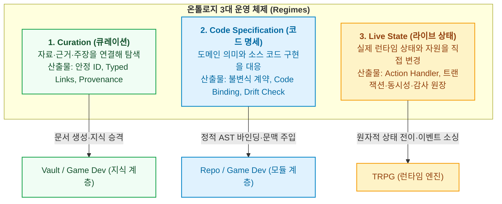

- table of contents
{:toc}

> "모든 도메인을 아우르는 단 하나의 만능 스키마를 만들겠다는 유혹을 버렸을 때, 비로소 무엇을 공유하고 무엇을 분리해야 하는지 보이기 시작했다."
> 개인 지식(`Vault`), 코드 저장소(`Repo`), 캠페인 런타임(`TRPG`), 상용 게임 역공학(`Game Dev`)까지 네 개의 세계에 온톨로지를 세운 뒤 이를 관통하는 다섯 번째 메타 청사진(`ontology-workbench`)을 설계하며 깨달은 경계의 감각, 두 AI를 맞붙인 적대적 검수의 6대 원칙, 그리고 1인 개발자가 시스템으로 쟁취해 낸 주권의 기록이다.
{:.lead}

---

## 네 개의 도메인을 넘나들며 마주한 질문: 무엇을 공유하고 무엇을 분리할 것인가

지난 [[8편] 명작 게임의 손맛을 온톨로지로 해부한다는 것, 관찰된 증거와 추론의 분리](/tag-ontology-engineering/8-game-dev-evidence-ontology/)까지 달려오며, 나는 내 삶과 맞닿아 있는 네 개의 서로 다른 영역에 차례대로 온톨로지라는 척추를 세웠다. 매일의 학습과 사유를 기록하는 마크다운 지식 베이스(`Vault Ontology`), 본업에서 수십만 줄의 프로덕션 코드를 통제하는 저장소(`Repo Ontology`), 취미로 즐기는 캠페인 세계의 수치와 서사를 실시간으로 변이시키는 런타임(`TRPG Ontology`), 그리고 상용 명작 게임의 바이너리와 에셋을 역공학하여 재사용 가능한 개발 지식으로 축적하는 연구소(`Game Dev Ontology`)가 바로 그 네 세계였다. 지난 [[3편] 문서는 명사로 정리되지만 코드는 동사로 움직인다](/tag-ontology-engineering/3-nouns-to-verbs-paradigm-shift/)에서 처음 *"온톨로지는 AI 시대에 무엇이든 메타적으로 관리할 수 있는 시스템이니 여기저기 적절한 곳에 적용해 보자!"*라며 시작했던 실험이 네 번의 전혀 다른 도메인을 통과하자, 온톨로지에 대한 내 이해는 이제 개별 도메인 안에서의 모델링을 넘어 **'도메인들의 도메인, 즉 온톨로지 자체를 어떻게 설계하고 어디서 멈추어야 하는가'**라는 다섯 번째 메타 차원으로 올라서게 되었다. 그리고 그렇게 네 번의 설계와 구현을 반복하고 나니 머릿속에서 한 가지 거대한 공학적 유혹이 고개를 들기 시작했다.

그 유혹이란 **"이 네 개의 온톨로지를 모두 아우르는 단 하나의 만능 `Entity` 슈퍼클래스나 단일 통합 프레임워크로 합치면 멋지지 않을까?"**라는 추상화 본능이었다. 네 프로젝트 모두 안정적인 식별자(`ID`)를 부여하고 타입 관계(`Typed Links`)를 맺으며 정합성 린트(`lint`)와 문맥 패키지(`Context Packet`)를 뽑아낸다는 점에서 구조가 닮아 있었기 때문이다.

하지만 실제 데이터와 운영 계약을 대조해 본 끝에 도달한 결론은 정반대였다. 가장 먼저 경계해야 할 함정은 '단어의 표면적 유사성'에 속는 일이다. `Vault Ontology`에도 문서 역할을 뜻하는 `type` 필드가 있고 `Game Dev`나 `TRPG`에도 아이템·에셋의 `type`이 존재하며, 네 도메인 모두 `Action`이나 `Rule`이라는 어휘를 쓰지만 그 뒤에 숨은 의미론적 계약(Semantic Contract)은 전혀 다르다. 진실의 원천(SSOT)과 상태 변경의 위험도가 다른데도 이를 하나의 슈퍼클래스나 단일 DB로 우겨 넣는 순간, 마크다운 노트를 하나 만들 때마다 불필요한 트랜잭션 동시성 키를 기입해야 하거나 프로덕션 코드 바인딩에서 엄격한 AST 검사가 빠져나가는 참사가 벌어질 것이 자명했다. 결국 메타 온톨로지 워크벤치(`ontology-workbench`)의 제1원칙은 명확했다. **도메인 간에 공통화해야 할 것은 단일 DB나 만능 런타임이 아니라, '새 도메인에 온톨로지를 설계하고 검증하는 판단 절차(`Method`)'와 서로 다른 세계의 언어를 번역하는 '개념 대조표(`Crosswalk`)'뿐이라는 사실이었다.**

---

## 온톨로지의 3대 운영 체제와 Negative Gate의 제동 장치

### 세 가지 운영 체제: Curation, Code Specification, Live State

네 도메인을 비교하며 얻은 가장 큰 수확은 온톨로지 활용 방식을 목적과 상태 변경의 책임 수준에 따라 **세 가지 운영 체제(`Regime`)**로 분류할 수 있게 되었다는 점이다. 새 도메인에 온톨로지를 도입할 때 무엇에 해당하는지를 먼저 판정하면, 어떤 산출물을 우선 만들고 어떤 과잉 설계를 쳐내야 할지가 자동으로 결정된다.

1. **`curation`(큐레이션)**: 자료와 근거, 주장을 연결해 탐색하는 체제다. `Vault Ontology`가 대표적이며 안정 ID와 타입 관계(`builds_on`, `derived_from`), 출처(`Provenance`)와 제한된 문맥 조회가 핵심이다. 노트를 생성·승격하는 지식 변이만 일어나므로 무거운 분산 락이나 롤백 트랜잭션을 강요할 필요가 없다.
2. **`code_specification`(코드 명세)**: 비즈니스 의미와 소프트웨어 구현체를 1:1로 대응시키는 체제다. `Repo Ontology`(`otlg`)가 담당하며 불변식 계약과 심볼 바인딩(`code_binding`), 정적 드리프트 검사(`Drift Check`)가 핵심이다. 명세와 실제 런타임 실행을 혼동하지 않는 것이 핵심 규율이다.
3. **`live_state`(라이브 상태)**: 시스템이 실제 세계의 상태와 자원을 실시간 변경하는 체제다. `TRPG Ontology`가 속하며 권한(`Authority`), 등록된 액션 핸들러(`Action Handler`), 트랜잭션 경계, 멱등성 키(`idempotency_key`), 동시성 제어(`expected_revision`), 불변 감사 원장(`Audit Ledger`)이 필수 생존 조건이 된다.

### 온톨로지를 안 만드는 결정도 성공이다: Negative Gate (`use_simpler_model`)

나는 새 도메인을 만났을 때 역량 질문(CQ) 판정부터 표준 어휘 대조, 객체·관계 설계, 권위·근거 분리, 행동 계약, 실패 사례(`negative fixture`) 검증까지 6단계를 밟아 청사진(`domain-blueprint.schema.json`)을 검증하는 **`ontology-workbench`**를 구축했다. 하지만 이 메타 프로토콜에서 가장 자랑스러워하는 장치는 화려한 스키마가 아니라, **"이 문제에는 온톨로지가 필요 없으니 더 단순한 모델을 쓰라"고 선언하며 설계를 조기 종료시키는 '네거티브 게이트(`Negative Gate`)'**다.

실제로 `Codex`와 `Gemini`가 적대적 검수를 벌이던 중, `Gemini`가 첫 테스트 시나리오로 가져온 **'단일 클러스터의 GPU 예약 시스템'**에 대해 `Codex`는 **"단일 클러스터 안에서의 시간 중첩과 쿼터 관리는 일반 관계형 데이터베이스(RDB)의 트랜잭션과 기본 API만으로도 완벽히 해결되는데 왜 온톨로지를 씌우느냐"**라고 반박했고 `Gemini` 역시 이를 수용했다. 나는 이 교훈을 즉시 제1규칙(`M-01`)으로 편입시켜, 기본 RDB나 단순 검색으로 끝나는 문제는 `stage=declined`, `negative_gate.decision=use_simpler_model`과 기각 사유(`rationale`)만 적으면 검증기가 이를 **'성공적인 설계 종료(`exit 0`)'**로 승인하도록 만들었다. **비용에 비해 실익이 없을 때 온톨로지를 만들지 않기로 결정하는 것 또한 일급 엔지니어링의 핵심 판단이기 때문이다.**

---

## 적대적 검수가 남긴 6가지 엔지니어링 원칙

다섯 프로젝트를 현업과 일상에서 믿고 쓸 수 있는 도구로 벼려낸 일등 공신은 **`Antigravity`(`Gemini`)와 `Codex`를 맞붙인 적대적 검수(Adversarial Red-teaming) 루프**였다. 한 에이전트가 설계나 코드를 내놓으면 다른 에이전트에게 악의적인 반례와 우회 경로를 찾게 하고, 실제 재현과 보정을 거듭하며 여섯 가지 원칙을 확립했다.

1. **필드·문서·기능 이름이 있다고 커버했다고 믿지 마라**: `Game Dev` 초기 버전에는 `audio`·`animation` enum만 있고 입력 버퍼와 히트스톱이 맞물려 타격감(`feel`)을 만드는 시계 구조가 없었으며, `Meta Workbench`에도 필수 용어가 비어 있는 역량 질문(`required_terms=[]`)이 통과하던 허점이 있었다.
2. **검사 통과(`0 errors`)를 내용의 진실성으로 둔갑시키지 마라**: 초기 `Repo Ontology`는 `lint --strict`를 통과했지만 `sitemap` 누락으로 깨진 경로 19개가 방치되어 있었고, `Meta Workbench`에서도 실패 테스트만 참조 배열에서 빼는 체리피킹(`M-20`) 반례가 재현되어 전수 통과 강제(`E_REPORT`)로 교정했다.
3. **못 본 값을 추론이나 기본값으로 메우지 마라 (`unknown`과 `partial`의 보존)**: 『옥토패스 트래블러 II』 초기 코퍼스에서 원본에 없는 레벨 50·99 경험치가 `observed`로 적히거나 표본 비율이 전체 법칙으로 일반화된 환각을 잡기 위해, 110개 값 앵커(`source_checks`) 대조를 도입하고 미조사 영역(`unexamined`)과 미해결 질문(`unknowns` 큐 30건)을 일급 시민으로 보존했다.
4. **강한 차단을 무조건 늘리는 것은 실력이 아니다 (과잉 규율 기각의 기술)**: 모든 예외를 에러(`exit 1`)로 막는 것은 관료주의적 폭력이다. 요약문 속 예시 링크 차단(`Vault`), `otlg trace` 외 파일 읽기 하드 락(`Repo`), 원게임 결함 기록 차단(`Game Dev`), 미배포 초안의 마이그레이션 변환기 강제(`Meta Workbench`) 등 현실 맥락에 어긋나는 과잉 강제는 단호히 기각했다.
5. **AI 두 개가 동의했다고 정답으로 취급하지 마라**: 두 모델이 동시에 같은 착각에 빠지는 일은 흔하다. 오직 `/tmp` 격리 환경의 반례 재현 스크립트, 원본 바이트(SHA256 및 JSON/Git 경로) 대조, 그리고 인간 엔지니어의 운영 정책 결정만이 최종 사법권으로 작동해야 한다.
6. **테스트 통과 숫자를 도메인 완성률처럼 포장하지 마라**: `Vault`의 523개 테스트 통과가 기존 노트의 린트 부채 919건을 지워주지 않듯, 도구의 계약 통과 수와 실제 도메인 자료의 완결성을 엄격히 분리해 보고하는 것이 마지막 지적 정직성이다.

- [심화 근거: 4대 도메인 Crosswalk 대조표, 6단계 메타 프로토콜 블루프린트 및 적대적 검수 6대 원칙 상세 보러가기](/tag-ontology-engineering/deep-dive/workbench-and-code-on-graph/#negative-gate)

---

## 팔란티어의 조직 저항과 1인 개발자의 시스템 주권

다섯 온톨로지를 깎아보니 엔터프라이즈 현장에서 온톨로지를 도입할 때 마주한다는 '조직의 저항'이 남의 일 같지 않게 다가왔다. 대기업 세 곳에서 `Palantir` 도입을 총괄했던 변우철 본부장은 가장 힘들었던 난관이 기술 문제가 아니라, **"왜 내 데이터를 저 시스템에 다 넘겨야 하느냐"**라며 17대 1로 공격해 오던 부서장들과 실무자들의 반발이었다고 술회했다. 부서별 로컬 엑셀에 숨겨진 숫자는 책임을 회피하고 부서를 방어하는 '조직 권력'이자 사일로의 성벽이다. `Palantir`가 전사 데이터를 단일 객체와 관계로 투명하게 엮고 의사결정(`Logic`)과 시스템 반작용(`Action`)이 한 몸으로 돌아가는 **'전사 운영체제(Enterprise OS)'**를 이식하려 했을 때, 그것은 엑셀 장막 뒤의 기득권을 해체하는 거버넌스 혁명이었던 셈이다.

타 부서장도 사내 정치도 없는 1인 개발자의 책상 앞에는 더 교묘한 적이 도사리고 있었다. 바로 피곤한 밤이나 마감 앞에서 고개를 드는 **'나 자신의 나태함과 순간적인 타협'**이라는 내면의 저항이었다. *"시간이 없으니 스키마는 따지지 말고 빈 노트에 대충 적자"*, *"간단한 예외 처리니까 `.ontology/` 명세는 건너뛰고 백엔드 코드만 핫픽스하자"*라는 타협이 쌓일 때마다 볼트와 코드베이스는 파편화된 엑셀 시트들과 똑같이 썩어 들어갔고, 다음 날 깨어난 에이전트는 숨겨진 예외를 모른 채 기존 기능을 연쇄 파괴했다.

그 자가당착을 겪고 나서야 나는 내 안의 나태함과 에이전트의 환각을 제압하기 위해 **'인간의 변덕스러운 의지력이나 기억력을 결코 믿지 않는 시스템'**에 주권을 넘기기로 결단했다. 오직 `vault new` 게이트를 통과해야만 문서가 생성되게 강제하고, `otlg lint --strict`와 `spoke-guard.sh`로 계약 위반 수정을 커널 레벨에서 차단(`exit 2`)하며, 값 앵커(`source_checks`) 없이는 관찰 기록 승격을 막은 이유가 여기에 있다. 자의적인 타협 권한을 기계적 시스템에 이양하고 나서야, 비로소 나는 39만 줄의 코드베이스와 4,400여 개의 지식 문서, 그리고 캠페인과 게임 분석 코퍼스를 단 한 명의 인력으로 통제하는 진정한 **'시스템 주권'**을 손에 넣을 수 있었다.

---

### [시리즈의 다음 이야기]

지금까지 우리는 다섯 도메인에 결정론적인 스키마와 고정된 CLI 연산자(`vault`, `otlg`, `trpg`, `gdev`)를 세우고 과잉 규율의 경계까지 조율해 왔다. 하지만 7.5MB에 달하는 세계관·연금술 기록 위에서 파티의 인벤토리와 현지 채집 재료만으로 파훼 가능한 창발적 보스 인카운터를 합성·검증해야 한다면, 혹은 텍스트와 이미지, 수십 개의 동적 키워드북이 얽힌 AI 캐릭터의 그레이존 정책을 검증해야 한다면, 미리 하드코딩된 고정 CLI 몇 개만으로는 그 조합 폭발의 벽을 넘을 수 없지 않을까?

다음 글 **[[10편] 고정된 CLI를 넘어 코드를 합성하는 그래프로, Code-on-Graph와 어제의 내가 내일의 에이전트에게 남기는 약속](/tag-ontology-engineering/10-code-on-graph-and-epilogue/)**에서는 `Code-on-Graph`(`arXiv:2606.03705v1`)의 스키마 기반 추론과 샌드박스 실행 피드백을 5대 온톨로지에 이식한 1·2차 업그레이드와, 3조건 격리 시뮬레이션·대화형 2d6 파훼 전투·핀포인트 Canon 캐시로 완성된 `trpg-ontology v0.14.0`의 여정을 함께 나누어 보겠다.
